# @h-ai/cache API リファレンス

[中文](cache.md) · [English](cache.en.md)

[モジュール README](../../../packages/cache/README.ja.md) · [設定](../configuration/cache.ja.md) · [データ構造](../data/cache.ja.md)

<a id="quick-start"></a>

## クイックスタート

ローカルの Redis を起動しておきます。この例ではユーザー 1 の表示名を `user:1` に保存します。

```ts
import { cache } from '@h-ai/cache'
import { core } from '@h-ai/core'
// localhost:6379 の Redis に接続する。成功時の data は undefined。接続に失敗したら起動を中止する。
const initialized = await cache.init({ type: 'redis', host: 'localhost' })
if (!initialized.success)
  throw new Error(initialized.error.message)
try {
  // user:1 に { name: 'Alice' } を JSON として 3600 秒保存する。保存できれば data は true。
  // 値をシリアライズできなければ SERIALIZATION_FAILED を返す。
  const written = await cache.kv.set('user:1', { name: 'Alice' }, { ex: 3600 })
  if (!written.success)
    throw new Error(written.error.message)
  // user:1 を { name: string } として読む。この例の data は { name: 'Alice' }。キーがなければ null。
  // Redis から読み取れなければ success は false。
  const user = await cache.kv.get<{ name: string }>('user:1')
  if (!user.success)
    throw new Error(user.error.message)
  if (user.data)
    // 'Cached user' と { name: 'Alice' } を INFO ログに出す。戻り値はない。
    core.logger.info('Cached user', { name: user.data.name })
}
finally {
  // 引数なしで Redis 接続を解放する。成功時の data は undefined で、保存したキーの TTL は維持される。
  // 接続を解放できなければ success は false。
  const closed = await cache.close()
  if (!closed.success)
    // 解放に失敗したら 'Cache cleanup pending' とエラーコードを ERROR ログに出す。戻り値はない。
    core.logger.error('Cache cleanup pending', { code: closed.error.code })
}
```

- `init({ type: 'redis', host: 'localhost' })` はローカルの既定ポート `6379` に接続します。成功時の `data` は `undefined` です。接続に失敗した場合は起動を中断します。
- `kv.set('user:1', { name: 'Alice' }, { ex: 3600 })` は値の JSON スナップショットを 3600 秒間保存します。書き込みに成功すると `true` が返ります。
- `kv.get<{ name: string }>('user:1')` は同じキーを読みます。型引数で期待する値の構造を指定します。値があれば `{ name: 'Alice' }` が返り、ログに `Alice` が表示されます。期限切れや存在しないキーは成功時の `null` になります。
- 引数なしの `close()` は Redis の接続を解放します。成功時の `data` は `undefined` で、書き込んだキーの期限はそのままです。解放に失敗すると、ログにエラーコードを記録します。

<a id="api-一覧"></a>

<a id="api-reference"></a>

## 機能

以下のコードはクイックスタートでインポートした `cache` と `core` を使います。初期化を含まない例では、先にキャッシュを初期化し、それぞれ新しいキーを使います。`success` を確認してから `data` または `error` を読み取ります。表の戻り値は成功時の `data` を示します。設定と接続状態のプロパティはそのまま読み取れます。

<a id="connection"></a>

### 接続と終了：`cache`

起動時にバックエンドを選び、正常な接続を確認してから使用します。終了時は依存モジュールから先に閉じます。

#### インターフェース一覧

| API | 用途 | 引数と既定値 | 戻り値・失敗 | 呼び出し例 |
| --- | --- | --- | --- | --- |
| `cache.init(config)` | プロセス内キャッシュを作成するか、Redis に接続 | `config`（必須） | `undefined`。接続準備が完了 | `await cache.init({ type: 'memory' })` |
| `cache.close()` | キャッシュインスタンスを解放し、プロセス内のデータを破棄 | 引数なし | `undefined`。リソースの解放が完了 | `await cache.close()` |
| `cache.ping()` | 接続を確認 | 引数なし | `'PONG'` | `await cache.ping()` |
| `cache.config` | 現在のマスク済み設定を取得 | 読み取り専用プロパティ、引数なし | `CacheConfig \| null` | `cache.config` |
| `cache.isInitialized` | キャッシュ操作が利用できるか確認 | 読み取り専用プロパティ、引数なし | `boolean` | `cache.isInitialized` |

#### 利用例：接続と終了

```ts
// { type: 'memory' } でプロセス内キャッシュを作成する。成功時の data は undefined。
// 本番環境で共有バックエンドが必須なら CONFIG_ERROR を返し、起動を中止する。
const initialized = await cache.init({ type: 'memory' })
if (!initialized.success)
  throw new Error(initialized.error.message)
try {
  // 引数なしで利用可能か確認する。接続済みなら data は 'PONG'。操作失敗時は success が false。
  const health = await cache.ping()
  if (!health.success)
    throw new Error(health.error.message)
  // 'Cache status' と PONG・接続状態・バックエンド種別を INFO ログに出す。戻り値はない。
  core.logger.info('Cache status', {
    health: health.data,
    // 引数なしの状態プロパティ。初期化直後は true、利用できなくなると false。
    initialized: cache.isInitialized,
    // 引数なしでマスク済みの設定を読む。この例の type は 'memory'、未初期化時の設定は null。
    backend: cache.config?.type,
  })
}
finally {
  // 引数なしで Memory インスタンスとデータを解放する。成功時の data は undefined。
  // 解放に失敗した場合は success が false。
  const closed = await cache.close()
  if (!closed.success)
    // 解放に失敗したら 'Cache cleanup pending' とエラーコードを ERROR ログに出す。戻り値はない。
    core.logger.error('Cache cleanup pending', { code: closed.error.code })
}
```

`init({ type: 'memory' })` はプロセス内にインスタンスを作成します。成功時の `data` は `undefined` です。引数なしの `ping()` は `PONG` を返し、`isInitialized` は `true`、`config?.type` は `'memory'` になります。引数なしの `close()` が成功すると `data` は `undefined` になり、インスタンスとその記録を解放します。初期化や接続確認の失敗は例外に変換し、解放の失敗はエラーコードを記録します。

`cache.init()` はバックエンドの準備が済んでから操作を有効にします。初期化と解放の両方に失敗した場合、`error.ext.cleanupPending` が `true` になります。設定のスナップショットは認証情報を隠します。

`cache.close()` は進行中の初期化を待ち、同時の終了呼び出しをまとめます。解放が始まると接続状態が `false` になり、保持していた操作オブジェクトや関数は `NOT_INITIALIZED` を返します。新しいインスタンスの準備が済んでから `cache` で取得し直します。解放に失敗した場合、次の close または init が再接続の前に解放を再試行します。Redis は QUIT の失敗時に切断し、接続を解放してから成功を返します。

<a id="values"></a>

### 値・カウンター・期限の管理：`cache.kv`

業務用のキーにシリアライズ可能な値を保存します。比較と交換では読み取り後に変更された値の上書きを防げます。

#### インターフェース一覧

| API | 用途 | 引数と既定値 | 戻り値・失敗 | 呼び出し例 |
| --- | --- | --- | --- | --- |
| `cache.kv.get(key)` | 値を取得 | `key: string` 必須の論理キャッシュキー | `T \| null` | `await cache.kv.get('u:1')` |
| `cache.kv.set(key, value, options?)` | 有効期限・条件付きで保存 | `key` と JSON 化できる `value`。`options` 内の任意の `nx`、`xx`、`ex`、`px`、`exat`、`pxat`、`keepTtl` は下の「書き込み条件と有効期限」を参照 | `boolean` | `await cache.kv.set('u:1', { name: 'Alice' }, { ex: 60 })` |
| `cache.kv.mget(...keys)` | 入力順に一括取得 | `...keys: string[]` 論理キャッシュキーを順に指定 | `(T \| null)[]`。存在しないキーや KV 以外のキーは `null` | `await cache.kv.mget('u:1', 'u:2')` |
| `cache.kv.mset(entries)` | 複数の値を一括保存 | `entries: Array<[string, CacheValue]>` 各項目は論理キーとその JSON 値 | `void` | `await cache.kv.mset([['u:1', { name: 'Alice' }]])` |
| `cache.kv.compareAndSwap(key, expected, value, options?)` | 現在値が一致する場合のみ更新 | `key`、`expected`（期待する現在値）、`value`（新しい値）。任意の `options` で `px`（正の安全な整数ミリ秒）か `keepTtl`（期限を引き継ぐ）を指定。両方省略すると新しい値に期限は設定されない | `boolean` | `await cache.kv.compareAndSwap('version', 1, 2)` |
| `cache.kv.del(...keys)` | 指定キーを削除 | `...keys: string[]` 論理キャッシュキーを順に指定 | `number` | `await cache.kv.del('u:1', 'u:2')` |
| `cache.kv.exists(...keys)` | 存在するキーを数える | `...keys: string[]` 論理キャッシュキーを順に指定 | `number` | `await cache.kv.exists('u:1', 'u:2')` |
| `cache.kv.type(key)` | 保存したデータ型を確認 | `key: string` 必須の論理キャッシュキー | `string` | `await cache.kv.type('u:1')` |
| `cache.kv.expire(key, seconds)` | 現在からの有効秒数を設定 | `key: string` 必須の論理キャッシュキー。`seconds: number` 相対期限を安全な整数秒で指定 | `boolean` | `await cache.kv.expire('u:1', 60)` |
| `cache.kv.expireAt(key, timestamp)` | 絶対有効期限を設定 | `key: string` 必須の論理キャッシュキー。`timestamp: number` 絶対 Unix 秒を安全な整数で指定 | `boolean` | `await cache.kv.expireAt('u:1', Math.floor(Date.now() / 1000) + 60)` |
| `cache.kv.ttl(key)` | 残り有効秒数を取得 | `key: string` 必須の論理キャッシュキー | `number` | `await cache.kv.ttl('u:1')` |
| `cache.kv.persist(key)` | 有効期限を解除 | `key: string` 必須の論理キャッシュキー | `boolean` | `await cache.kv.persist('u:1')` |
| `cache.kv.incr(key)` | 1増やす | `key: string` 必須の論理キャッシュキー | `number` | `await cache.kv.incr('hits')` |
| `cache.kv.incrBy(key, increment)` | 指定量を加算 | `key: string` 必須の論理キャッシュキー。`increment: number` 加算量 | `number` | `await cache.kv.incrBy('hits', 2)` |
| `cache.kv.decr(key)` | 1減らす | `key: string` 必須の論理キャッシュキー | `number` | `await cache.kv.decr('stock')` |
| `cache.kv.decrBy(key, decrement)` | 指定量を減算 | `key: string` 必須の論理キャッシュキー。`decrement: number` 減算量 | `number` | `await cache.kv.decrBy('stock', 2)` |
| `cache.kv.keys(pattern)` | パターンに一致するキーを列挙 | `pattern: string` 論理キー名に一致する glob パターン | `string[]` | `await cache.kv.keys('u:*')` |
| `cache.kv.scan(cursor, options?)` | 一致するキーを分割して走査 | `cursor` は初回 `"0"`、以降は前ページの値。`options.match` はキーの glob パターン（既定はすべて）。`count` は正の安全な整数（既定 10、Redis では処理量の目安） | `[string, string[]]` | `await cache.kv.scan('0', { match: 'u:*', count: 100 })` |

<a id="cache-kv-options"></a>

**書き込みと走査のオプション**

| フィールド | 型 | 必須と既定値 | 用途と適用条件 |
| --- | --- | --- | --- |
| `SetOptions.nx / xx` | `boolean` | `false` | それぞれキーが存在しない場合、存在する場合だけ書き込みます。同時指定不可。条件不成立なら成功結果の data=false。 |
| `SetOptions.ex / px` | `number` | 任意 | 相対秒またはミリ秒。正の安全な整数を一方に指定。 |
| `SetOptions.exat / pxat` | `number` | 任意 | 絶対 Unix 秒またはミリ秒。正の安全な整数で、過去なら即時失効。 |
| `SetOptions.keepTtl / CompareAndSwapOptions.keepTtl` | `boolean` | `false` | 既存の期限を維持。明示的な期限と同時指定不可。どちらも省略すると新しい値に期限なし。 |
| `CompareAndSwapOptions.px` | `number` | 任意 | 比較成功時、置換値の相対期限を正の安全な整数ミリ秒で設定。 |
| `ScanOptions.match` | `string` | 全キーに一致 | orders:* などの論理キーに対する glob パターン。 |
| `ScanOptions.count` | `number` | `10` | 走査ごとの正の安全な整数。Redis では処理量の目安で、実際の取得数は異なる場合があります。 |

`orders:1` が存在する場合、`{ nx: true, ex: 60 }` は `data: false` を返し、値と期限を維持します。存在しないキーには `data: true` を返し、約 60 秒の期限を設定します。

キー操作はすべてのデータ構造に適用されます。TTL は秒単位で、`-1` は無期限、`-2` はキーが存在しない場合です。`persist` は期限を解除した場合だけ `true` を返します。Memory のカウンターは安全な整数または整数の文字列を受け付け、増分が無効な場合や結果が安全な整数の範囲を超える場合は元の値を保持します。

#### 利用例：以前のバージョンが一致する場合だけ更新

新しい `demo:revision` キーで、最初は期待値を `undefined`、新しい値を `1` にし、`{ px: 60_000 }` で 60 秒の期限を設定します。次は期待値を `1`、新しい値を `2` にし、`{ keepTtl: true }` で期限を引き継ぎます。期限内に他からの書き込みがなければ、どちらの結果も `data: true` です。



```ts
// demo:revision がなければ 1 を保存して 60000 ミリ秒の TTL を設定する。
// 書き込み時は data が true、既存キーがあれば false、操作失敗時は success が false。
const created = await cache.kv.compareAndSwap('demo:revision', undefined, 1, { px: 60_000 })
if (!created.success)
  throw new Error(created.error.message)
// demo:revision の現在値が 1 のときだけ 2 に更新し、元の TTL を維持する。
// 更新時は data が true、不一致なら false、操作失敗時は success が false。
const replaced = await cache.kv.compareAndSwap('demo:revision', 1, 2, { keepTtl: true })
if (!replaced.success)
  throw new Error(replaced.error.message)
// 'Revision update' と初回作成・更新の結果を INFO ログに出す。戻り値はない。
core.logger.info('Revision update', { created: created.data, replaced: replaced.data })
```

JSON の保存内容を比較し、同じ操作で更新します。2 回目の呼び出しの前に別のノードが値を変更した場合は、`replaced.success` が `true`、`replaced.data` が `false` となり、既存の値と有効期限を保持します。`expected` に `undefined` を指定するとキーがない場合に一致し、`value` に `undefined` を指定すると一致したキーを削除します。バックエンドのエラーは `success: false` です。

#### 書き込み条件と有効期限

`cache.kv.set()` は値を JSON に変換して保存します。`nx` はキーが存在しない場合、`xx` はキーが存在する場合だけ書き込みます。二つのフラグは同時に指定できません。条件が成立しない場合は `success: true`、`data: false` を返し、既存の値と有効期限を保持します。

値を JSON に変換できない場合は `SERIALIZATION_FAILED` が返ります。たとえば、循環参照を含むオブジェクトや、`toJSON()` が `undefined` を返すオブジェクトが該当します。一括書き込みでこの失敗が起きた場合、項目は一件も書き込まれません。

有効期限は `ex`（相対秒）、`px`（相対ミリ秒）、`exat`（Unix 秒）、`pxat`（Unix ミリ秒）のいずれか一つを指定します。指定値は正の安全な整数で、ミリ秒に換算した期限も安全な整数である必要があります。無効な値や、有効期限と `keepTtl: true` を同時に指定した場合は `INVALID_SET_OPTIONS` が返ります。絶対時刻に過去の正の値を指定すると、キーは直ちに期限切れになります。期限を省略すると既存の TTL を解除します。`keepTtl: true` は既存の TTL を維持し、新規キーには期限を設定しません。

`cache.kv.compareAndSwap()` は比較が一致したときだけ有効期限を反映します。たとえば `{ px: 60_000 }` で置き換えると新しい値は約 60 秒保持されます。`{ keepTtl: true }` は元の期限を保持し、新しいキーには期限を設けません。どちらか一方を指定します。

#### 利用例：Redis Cluster の走査と一括操作

初期化済みの Redis Cluster を使います。`demo:user:*` でユーザーのキーを検索し、`count: 100` で各走査の作業量の目安を渡します。各呼び出しは `[nextCursor, batch]` を返し、次回は `nextCursor` を使います。一致するキーが `demo:user:1` と `demo:user:2` だけなら、走査完了時のログに見つかった順で二つの論理キーが出ます。この例では `@h-ai/core` から `core.ok` もインポートします。

```ts
import { core } from '@h-ai/core'
async function scanUserKeys() {
  const keys = new Set<string>()
  let cursor = '0'
  do {
    // 最初は '0'、以降は返されたカーソルで demo:user:* を走査する。count: 100 は作業量の目安。
    // 成功時は [次のカーソル, 論理キーの配列]。無効な入力は INVALID_SCAN、Cluster の構成変更は SCAN_TOPOLOGY_CHANGED。
    const page = await cache.kv.scan(cursor, { match: 'demo:user:*', count: 100 })
    if (!page.success)
      return page
    const [next, batch] = page.data
    for (const key of batch)
      keys.add(key)
    cursor = next
  } while (cursor !== '0')
  // 重複を除いたキーを渡し、success: true と data にキー配列を持つ HaiResult を作る。
  return core.ok([...keys])
}
const users = await scanUserKeys()
if (users.success)
  // 'Matching cache keys' と見つけた論理キーの配列を INFO ログに出す。戻り値はない。
  core.logger.info('Matching cache keys', { keys: users.data })
else
  // 走査に失敗したら 'Cache scan failed' とエラーコードを ERROR ログに出す。戻り値はない。
  core.logger.error('Cache scan failed', { code: users.error.code })
```

文字列の `'0'` から始め、返り値が `'0'` になったら終了します。Cluster はすべてのプライマリを走査し、設定とトポロジーが同じ別ノードからも再開できます。`count` は目安で、キーが複数回返る場合があります。トポロジー、`match`、`keyPrefix` が変わると `SCAN_TOPOLOGY_CHANGED` を返すため、途中結果を破棄して `'0'` からやり直します。無効なカーソルや `count` は `INVALID_SCAN` になります。`scan` と `keys` はプレフィックスを除いた論理キーを返し、プレフィックスのワイルドカードを文字どおり扱います。

`mget`、`del`、`exists` は複数スロットのキーを個別に処理できます。`mget` は入力の順序と重複を保持します。操作全体の原子性や同一時点のスナップショットは保証されず、`del` の失敗時には一部のキーが削除済みの場合があります。原子的な `mset`、集合演算、複数キーのブロッキング取得には同一スロットが必要です。共通の `{hash-tag}` を使います。スロットをまたぐ呼び出しは `CROSS_SLOT` を返します。

<a id="hashes"></a>

### フィールド単位の更新：`cache.hash`

オブジェクト全体を置き換えず、一つのフィールドを更新する場合に使います。

#### インターフェース一覧

| API | 用途 | 引数と既定値 | 戻り値・失敗 | 呼び出し例 |
| --- | --- | --- | --- | --- |
| `cache.hash.hget(key, field)` | フィールドを取得 | `key: string` 必須のハッシュキー。`field: string` ハッシュのフィールド名 | `T \| null` | `await cache.hash.hget('u:1', 'name')` |
| `cache.hash.hset(key, field, value)` または `cache.hash.hset(key, data)` | 一つ以上のフィールドを保存 | `key: string` 必須のハッシュキー。`field: string, value: CacheValue` 単一のフィールドと JSON 値。別の呼び出しでは、フィールド名から JSON 値への data オブジェクトを渡します | 新規フィールド数 | `await cache.hash.hset('u:1', 'name', 'Alice')` または `await cache.hash.hset('u:1', { name: 'Alice', visits: 1 })` |
| `cache.hash.hdel(key, ...fields)` | 指定フィールドを削除 | `key: string` 必須のハッシュキー。`...fields: string[]` 対象フィールド名を呼び出し順に指定 | `number` | `await cache.hash.hdel('u:1', 'name')` |
| `cache.hash.hexists(key, field)` | フィールドの存在確認 | `key: string` 必須のハッシュキー。`field: string` ハッシュのフィールド名 | `boolean` | `await cache.hash.hexists('u:1', 'name')` |
| `cache.hash.hgetall(key)` | 全フィールドを取得 | `key: string` 必須のハッシュキー | `T` | `await cache.hash.hgetall('u:1')` |
| `cache.hash.hkeys(key)` | フィールド名を列挙 | `key: string` 必須のハッシュキー | `string[]` | `await cache.hash.hkeys('u:1')` |
| `cache.hash.hvals(key)` | フィールド値を列挙 | `key: string` 必須のハッシュキー | `T[]` | `await cache.hash.hvals('u:1')` |
| `cache.hash.hlen(key)` | フィールド数を取得 | `key: string` 必須のハッシュキー | `number` | `await cache.hash.hlen('u:1')` |
| `cache.hash.hmget(key, ...fields)` | 入力順に複数フィールドを取得 | `key: string` 必須のハッシュキー。`...fields: string[]` 対象フィールド名を呼び出し順に指定 | `(T \| null)[]` | `await cache.hash.hmget('u:1', 'name', 'age')` |
| `cache.hash.hincrBy(key, field, increment)` | 数値フィールドに加算 | `key: string` 必須のハッシュキー。`field: string` ハッシュのフィールド名。`increment: number` 加算量 | `number` | `await cache.hash.hincrBy('u:1', 'visits', 1)` |

#### 利用例：フィールド単位の更新

```ts
// demo:profile に name: 'Ada' と visits: 1 を保存する。新規キーでは追加したフィールド数 2 を返す。
// いずれかの値をシリアライズできなければ SERIALIZATION_FAILED を返し、どのフィールドも更新しない。
const written = await cache.hash.hset('demo:profile', { name: 'Ada', visits: 1 })
if (!written.success)
  throw new Error(written.error.message)
// demo:profile の name と missing を指定順に読む。この例の data は ['Ada', null]。
// キーがハッシュ以外の型なら操作は失敗する。
const fields = await cache.hash.hmget('demo:profile', 'name', 'missing')
if (!fields.success)
  throw new Error(fields.error.message)
// 'Profile fields' とフィールド値の配列を INFO ログに出す。戻り値はない。
core.logger.info('Profile fields', { fields: fields.data })
```

`hset('demo:profile', { name: 'Ada', visits: 1 })` は名前と訪問回数を新しいプロフィールのキーに保存し、追加したフィールド数 `2` を返します。`hmget('demo:profile', 'name', 'missing')` は二つのフィールドを指定順に読み、`['Ada', null]` を返します。シリアライズできない値がある場合、書き込みは `SERIALIZATION_FAILED` を返し、一括指定したフィールドは元のままです。

Memory の `hincrBy` ではフィールド値、増分、結果のすべてが安全な整数である必要があります。存在しないフィールドは `0` から始まります。無効な入力は `OPERATION_FAILED` を返し、元のフィールドを保持します。Redis はネイティブの整数コマンドを使い、結果を JavaScript の `number` で返します。

<a id="lists"></a>

### 順序付きの読み書き：`cache.list`

リストは順序を保持し、両端から追加・取り出しできます。ブロッキング取り出しは値の到着か期限まで待ちます。

#### インターフェース一覧

| API | 用途 | 引数と既定値 | 戻り値・失敗 | 呼び出し例 |
| --- | --- | --- | --- | --- |
| `cache.list.lpush(key, ...values)` | 左端に追加 | `key: string` 必須のリストキー。`...values: CacheValue[]` JSON 化できる値を呼び出し順に指定 | `number` | `await cache.list.lpush('jobs', 'job-1')` |
| `cache.list.rpush(key, ...values)` | 右端に追加 | `key: string` 必須のリストキー。`...values: CacheValue[]` JSON 化できる値を呼び出し順に指定 | `number` | `await cache.list.rpush('jobs', 'job-2')` |
| `cache.list.lpop(key)` | 左端から取り出す | `key: string` 必須のリストキー | `T \| null` | `await cache.list.lpop('jobs')` |
| `cache.list.rpop(key)` | 右端から取り出す | `key: string` 必須のリストキー | `T \| null` | `await cache.list.rpop('jobs')` |
| `cache.list.llen(key)` | リスト長を取得 | `key: string` 必須のリストキー | `number` | `await cache.list.llen('jobs')` |
| `cache.list.lrange(key, start, stop)` | 両端を含む範囲を取得 | `key: string` 必須のリストキー。`start: number, stop: number` 0 始まりで両端を含む範囲。-1 は末尾 | `T[]` | `await cache.list.lrange('jobs', 0, 9)` |
| `cache.list.lindex(key, index)` | 指定位置の値を取得 | `key: string` 必須のリストキー。`index: number` 0 始まりの位置。負値は末尾から数えます | `T \| null` | `await cache.list.lindex('jobs', 0)` |
| `cache.list.lset(key, index, value)` | 指定位置の値を置換 | `key: string` 必須のリストキー。`index: number` 0 始まりの位置。負値は末尾から数えます。`value: CacheValue` JSON に変換できる新しい値 | `void` | `await cache.list.lset('jobs', 0, 'replacement')` |
| `cache.list.ltrim(key, start, stop)` | 指定範囲だけを残す | `key: string` 必須のリストキー。`start: number, stop: number` 0 始まりで両端を含む範囲。-1 は末尾 | `void` | `await cache.list.ltrim('jobs', 0, 99)` |
| `cache.list.blpop(timeout, ...keys)` | 左端の値を待って取得 | `timeout: number` Redis の待機秒数。0 は無期限。Memory は現時点で読める項目のみ確認。`...keys: string[]` 論理キャッシュキーを順に指定 | `[string, T] \| null` | `await cache.list.blpop(5, 'jobs')` |
| `cache.list.brpop(timeout, ...keys)` | 右端の値を待って取得 | `timeout: number` Redis の待機秒数。0 は無期限。Memory は現時点で読める項目のみ確認。`...keys: string[]` 論理キャッシュキーを順に指定 | `[string, T] \| null` | `await cache.list.brpop(5, 'jobs')` |

#### 利用例：順序付きの読み書き

```ts
// 空の demo:jobs の右端に 'job-1' を追加する。成功時は新しい長さ 1、操作失敗時は success が false。
const queued = await cache.list.rpush('demo:jobs', 'job-1')
if (!queued.success)
  throw new Error(queued.error.message)
// demo:jobs の左端の文字列を取り出す。この例の data は ['demo:jobs', 'job-1']。
// Redis で 1 秒待っても要素がなければ null。待機が取り消された場合は OPERATION_FAILED。
const next = await cache.list.blpop<string>(1, 'demo:jobs')
if (!next.success)
  throw new Error(next.error.message)
// 'Queued job' と取り出し結果を INFO ログに出す。戻り値はない。
core.logger.info('Queued job', { next: next.data })
```

`rpush('demo:jobs', 'job-1')` は空のキューの右端にジョブ ID を追加し、新しい長さ `1` を返します。`blpop<string>(1, 'demo:jobs')` は左端の文字列 ID を取り出し、`['demo:jobs', 'job-1']` を返します。取り出した後はキューが空になります。引数の `1` はジョブがない場合に Redis が待つ秒数です。Memory はキーを順に確認し、値がなければ直ちに `null` を返します。

Redis の `blpop` と `brpop` は呼び出しごとに専用の接続を使います。返す論理キーに `keyPrefix` は含まれません。Redis は `timeout` 秒だけ待ち、時間切れになると成功結果として `null` を返します。`0` は無期限の待機です。通常コマンドの `commandTimeout` はこの待機を打ち切りません。バックエンドの終了や入れ替えで待機を取り消すと `OPERATION_FAILED` が返ります。

<a id="sets"></a>

### 重複排除と集合の比較：`cache.set_`

存在判定・統合・比較には集合を使います。メンバーの順序は定まりません。

#### インターフェース一覧

| API | 用途 | 引数と既定値 | 戻り値・失敗 | 呼び出し例 |
| --- | --- | --- | --- | --- |
| `cache.set_.sadd(key, ...members)` | 重複を除いて追加 | `key: string` 必須の集合キー。`...members: CacheValue[]` 追加または削除する JSON メンバー値 | `number` | `await cache.set_.sadd('roles', 'editor')` |
| `cache.set_.srem(key, ...members)` | 指定要素を削除 | `key: string` 必須の集合キー。`...members: CacheValue[]` 追加または削除する JSON メンバー値 | `number` | `await cache.set_.srem('roles', 'editor')` |
| `cache.set_.smembers(key)` | 全要素を取得 | `key: string` 必須の集合キー | `T[]` | `await cache.set_.smembers('roles')` |
| `cache.set_.sismember(key, member)` | 要素が含まれるか確認 | `key: string` 必須の集合キー。`member: CacheValue` 比較するメンバーの値 | `boolean` | `await cache.set_.sismember('roles', 'editor')` |
| `cache.set_.scard(key)` | 要素数を取得 | `key: string` 必須の集合キー | `number` | `await cache.set_.scard('roles')` |
| `cache.set_.srandmember(key, count?)` | 削除せず無作為に取得 | `key: string` 必須の集合キー。`count?: number` 省略すると単一メンバー、指定すると配列 | `T \| T[] \| null` | `await cache.set_.srandmember('roles', 2)` |
| `cache.set_.spop(key, count?)` | 無作為に取り出す | `key: string` 必須の集合キー。`count?: number` 省略すると単一メンバー、指定すると配列 | `T \| T[] \| null` | `await cache.set_.spop('roles', 1)` |
| `cache.set_.sinter(...keys)` | 共通要素を取得 | `...keys: string[]` 論理キャッシュキーを順に指定 | `T[]` | `await cache.set_.sinter('roles:a', 'roles:b')` |
| `cache.set_.sunion(...keys)` | 全体の和集合を取得 | `...keys: string[]` 論理キャッシュキーを順に指定 | `T[]` | `await cache.set_.sunion('roles:a', 'roles:b')` |
| `cache.set_.sdiff(...keys)` | 最初の集合から差集合を取得 | `...keys: string[]` 先頭の集合からそれ以降の集合のメンバーを差し引きます | `T[]` | `await cache.set_.sdiff('roles:a', 'roles:b')` |

#### 利用例：重複排除と集合の比較

```ts
// 新しい demo:roles に 'reader' と 'editor' を追加する。成功時の data は追加数 2。
// キーが集合以外の型なら操作は失敗する。
const added = await cache.set_.sadd('demo:roles', 'reader', 'editor')
if (!added.success)
  throw new Error(added.error.message)
// demo:roles から 1 件を削除せずに無作為に選ぶ。この例では ['reader'] または ['editor']。
// キーがなければ []、集合以外の型なら操作は失敗する。
const sampled = await cache.set_.srandmember<string>('demo:roles', 1)
if (!sampled.success)
  throw new Error(sampled.error.message)
// 'Sampled roles' と選ばれたロールの配列を INFO ログに出す。戻り値はない。
core.logger.info('Sampled roles', { roles: sampled.data })
```

`sadd('demo:roles', 'reader', 'editor')` は新しい集合に二つのロールを追加し、追加数 `2` を返します。`srandmember<string>('demo:roles', 1)` は文字列を一つ無作為に選び、`reader` または `editor` を含む配列を返します。集合には両方が残ります。キーが別のデータ構造を持つ場合は、どちらの操作も失敗します。

`count` を省略した場合、`srandmember` と `spop` は一つのメンバーを返し、キーがなければ `null` を返します。整数を指定すると配列を返し、キーが存在しないか `count` が `0` の場合は `[]` になります。`srandmember` の正の `count` は集合の大きさを上限に重複なしで抽出します。負の `count` はその絶対値の件数を抽出し、重複を許します。`spop` は非負の `count` を受け付け、集合の大きさまで取り除きます。

<a id="scores"></a>

### 順位と得点による検索：`cache.zset`

ソート済み集合はメンバーごとに得点を持ち、順位や得点範囲で検索できます。

#### インターフェース一覧

| API | 用途 | 引数と既定値 | 戻り値・失敗 | 呼び出し例 |
| --- | --- | --- | --- | --- |
| `cache.zset.zadd(key, ...members)` | 要素とスコアを保存 | `key: string` 必須のソート済み集合キー。`...members: ZMember[]` 各要素は member 文字列と数値 score | `number` | `await cache.zset.zadd('scores', { member: 'u1', score: 10 })` |
| `cache.zset.zrem(key, ...members)` | 指定要素を削除 | `key: string` 必須のソート済み集合キー。`...members: string[]` 削除するメンバー ID | `number` | `await cache.zset.zrem('scores', 'u1')` |
| `cache.zset.zscore(key, member)` | スコアを取得 | `key: string` 必須のソート済み集合キー。`member: string` ソート済み集合のメンバー ID | `number \| null` | `await cache.zset.zscore('scores', 'u1')` |
| `cache.zset.zrank(key, member)` | 0始まりの昇順順位を取得 | `key: string` 必須のソート済み集合キー。`member: string` ソート済み集合のメンバー ID | `number \| null` | `await cache.zset.zrank('scores', 'u1')` |
| `cache.zset.zrevrank(key, member)` | 0始まりの降順順位を取得 | `key: string` 必須のソート済み集合キー。`member: string` ソート済み集合のメンバー ID | `number \| null` | `await cache.zset.zrevrank('scores', 'u1')` |
| `cache.zset.zrange(key, start, stop, withScores?)` | 順位の昇順で取得 | `key: string` 必須のソート済み集合キー。`start: number, stop: number` 0 始まりで両端を含む範囲。-1 は末尾。`withScores?: boolean` 既定 false は名前のみ。true でスコアも返します | `string[] \| ZMember[]` | `await cache.zset.zrange('scores', 0, 9, true)` |
| `cache.zset.zrevrange(key, start, stop, withScores?)` | 順位の降順で取得 | `key: string` 必須のソート済み集合キー。`start: number, stop: number` 0 始まりで両端を含む範囲。-1 は末尾。`withScores?: boolean` 既定 false は名前のみ。true でスコアも返します | `string[] \| ZMember[]` | `await cache.zset.zrevrange('scores', 0, 9, true)` |
| `cache.zset.zrangeByScore(key, min, max, options?)` | スコア範囲で取得 | `key: string` 必須のソート済み集合キー。`min: number \| string, max: number \| string` スコアの範囲は既定で両端を含みます。(10 のような接頭辞で端点を除外し、-inf と +inf で無限大を指定。任意の options は[スコア範囲オプション](#cache-score-range-options)を参照 | `string[] \| ZMember[]` | `await cache.zset.zrangeByScore('scores', 10, 100, { withScores: true })` |
| `cache.zset.zcard(key)` | 全要素数を取得 | `key: string` 必須のソート済み集合キー | `number` | `await cache.zset.zcard('scores')` |
| `cache.zset.zcount(key, min, max)` | 範囲内の要素数を取得 | `key: string` 必須のソート済み集合キー。`min: number \| string, max: number \| string` スコアの範囲は既定で両端を含みます。(10 のような接頭辞で端点を除外し、-inf と +inf で無限大を指定 | `number` | `await cache.zset.zcount('scores', 10, 100)` |
| `cache.zset.zincrBy(key, increment, member)` | スコアを加算 | `key: string` 必須のソート済み集合キー。`increment: number` 加算量。`member: string` ソート済み集合のメンバー ID | `number` | `await cache.zset.zincrBy('scores', 5, 'u1')` |
| `cache.zset.zremRangeByRank(key, start, stop)` | 順位範囲を削除 | `key: string` 必須のソート済み集合キー。`start: number, stop: number` 0 始まりで両端を含む範囲。-1 は末尾 | `number` | `await cache.zset.zremRangeByRank('scores', 0, 9)` |
| `cache.zset.zremRangeByScore(key, min, max)` | スコア範囲を削除 | `key: string` 必須のソート済み集合キー。`min: number \| string, max: number \| string` スコアの範囲は既定で両端を含みます。(10 のような接頭辞で端点を除外し、-inf と +inf で無限大を指定 | `number` | `await cache.zset.zremRangeByScore('scores', 0, 10)` |

<a id="cache-score-range-options"></a>

**スコア範囲オプション**

| フィールド | 型 | 必須と既定値 | 用途と適用条件 |
| --- | --- | --- | --- |
| `withScores` | `boolean` | `false` | 通常はメンバー名。true なら member と score を含むオブジェクトを返します。 |
| `offset` | `number` | `0` | 飛ばす一致項目数を安全な整数で指定。負値は空配列。 |
| `count` | `number` | `-1` | 取得する一致項目の上限を安全な整数で指定。負値は無制限。 |

`a: 10`、`b: 20` のとき、10〜20 の両端を含む範囲と `{ offset: 1, count: 1, withScores: true }` を指定すると `[{ member: "b", score: 20 }]` が返ります。

#### 利用例：順位と得点による検索

```ts
// 新しい demo:scores に a を 10 点、b を 20 点で追加する。成功時の data は追加数 2。
// 無効なスコアを指定すると操作は失敗する。
const added = await cache.zset.zadd('demo:scores', { member: 'a', score: 10 }, { member: 'b', score: 20 })
if (!added.success)
  throw new Error(added.error.message)
// demo:scores から 10 点を超える名前を昇順で最大 1 件読む。上限なしで、この例の data は ['b']。
// 無効な範囲を指定すると操作は失敗する。
const aboveTen = await cache.zset.zrangeByScore('demo:scores', '(10', '+inf', { count: 1 })
if (!aboveTen.success)
  throw new Error(aboveTen.error.message)
// 'Scores above ten' と取得した名前の配列を INFO ログに出す。戻り値はない。
core.logger.info('Scores above ten', { members: aboveTen.data })
```

`zadd('demo:scores', …)` は新しいランキングに 10 点の `a` と 20 点の `b` を追加し、追加数 `2` を返します。`zrangeByScore('demo:scores', '(10', '+inf', { count: 1 })` は 10 点より高いメンバーを点数の昇順で最大一つ読みます。この例では `withScores` を省略するため、`data` はメンバー名だけの `['b']` です。点数や範囲が無効なら操作は失敗します。

同じスコアのメンバーは名前の UTF-8 バイト順で並び、降順の照会では同点内の順序も逆になります。スコアには正負の無限大を使えます。`NaN` は `OPERATION_FAILED` になります。スコア範囲は既定で両端を含みます。10 を含めない場合は `'(10'`、上限や下限を設けない場合は `'+inf'` または `'-inf'` を使います。`zrangeByScore` の `offset` と `count` は個別に指定できます。既定は `offset` が `0`、`count` が `-1`（無制限）です。負の `count` は無制限、負の `offset` は空配列になります。

<a id="locks"></a>

### 短時間処理の排他：`cache.lock`

同じ業務処理が別ノードから同じロックを取得できます。今回受け取った `owner` は信頼できるサービス間リクエストで渡し、同じ Redis または Redis Cluster とキーの名前空間を使います。

#### インターフェース一覧

| API | 用途 | 引数と既定値 | 戻り値・失敗 | 呼び出し例 |
| --- | --- | --- | --- | --- |
| `cache.lock.acquire(key, options?)` | ロックを取得・再取得 | `key` が必須。初回取得の `options.ttl` は正の安全な整数秒（既定 30）。再取得には元の `owner` を指定し、元の期限を維持。`ttl` と `owner` は同時指定不可 | 取得した `owner` または `null` | `await cache.lock.acquire('demo:daily', { ttl: 30 })` |
| `cache.lock.release(key, owner)` | 取得分を一つ解放し、最後にロック解除 | `key: string` 必須のロックキー。`owner: string` 初回取得で返された所有者トークン | 解放時は `true`、ロックがないかトークンが無効なら `false` | `await cache.lock.release('demo:daily', owner)` |
| `cache.lock.isLocked(key)` | ロックの有無を確認 | `key: string` 必須のロックキー | 保持されていれば `true` | `await cache.lock.isLocked('demo:daily')` |
| `cache.lock.extend(key, ttl, owner)` | 取得回数を保持したまま期限を更新 | `key: string` 必須のロックキー。`ttl: number` 新しい期限を正の安全な整数秒で指定。`owner: string` 初回取得で返された所有者トークン | 更新時は `true` | `await cache.lock.extend('demo:daily', 60, owner)` |

#### 利用例：保護された処理を別ノードに委譲する

ノード A が `demo:daily` を最初に取得し、ノード B は受け取った `owner` で再取得します。例では両方の取得と解放を一つのプロセスで示します。内側の処理を B で実行する場合は、信頼できるサービス間リクエストでトークンを渡します。トークンをログや公開レスポンスに含めないでください。

```ts
// Redis の実キーは keyPrefix + '__lock:' + key。接頭辞なしでは __lock:demo:daily、
// 接頭辞が orders: なら orders:__lock:demo:daily になる。
const key = 'demo:daily'
// 外側の初回取得。Redis の値と data は同じ新しい owner UUID。値の例は 550e8400-e29b-41d4-a716-446655440000。
// 30 秒の TTL は Redis キーの有効期限として設定し、値の文字列には含めない。
// すでに保持されていれば data は null、操作自体が失敗したら success は false。
const acquired = await cache.lock.acquire(key, { ttl: 30 })
if (!acquired.success)
  throw new Error(acquired.error.message)
if (acquired.data !== null) {
  const owner = acquired.data
  try {
    // 同じ demo:daily と外側の owner で再取得する。Redis の値は owner|2（例 550e8400-e29b-41d4-a716-446655440000|2）になり、
    // キーの既存の有効期限は維持される。data には元の owner が返る。
    // 期限切れや不一致なら data は null、操作失敗なら success は false。
    const entered = await cache.lock.acquire(key, { owner })
    if (!entered.success)
      throw new Error(entered.error.message)
    if (entered.data !== null) {
      // demo:daily と再取得で返った owner を渡し、内側の取得分だけ解放する。
      // data が true なら Redis の値は owner|2 から owner に戻る。外側の取得分とキーの有効期限は残る。
      // 期限切れなら false、操作失敗なら success は false。
      const released = await cache.lock.release(key, entered.data)
      if (!released.success)
        throw new Error(released.error.message)
      if (!released.data)
        throw new Error('Lease expired before delegated release')
      // demo:daily のロックを確認する。外側の取得分が有効な間、data は true。
      // ロックがなければ false、確認できなければ success は false。
      const state = await cache.lock.isLocked(key)
      if (!state.success)
        throw new Error(state.error.message)
      // 'Lease after delegated release' と { held: true } を INFO ログに出す。戻り値はない。
      core.logger.info('Lease after delegated release', { held: state.data })
    }
  }
  finally {
    // demo:daily と初回の owner を渡し、外側の取得分を一度だけ解放する。
    // data が true なら一層を解放する。内側が解放済みなら最後の一層なので Redis キーごと削除する。
    // 期限切れや owner の不一致なら false。
    // 操作自体が失敗したら success は false。
    const released = await cache.lock.release(key, owner)
    if (!released.success)
      // 'Lease release failed' と解放のエラーコードを ERROR ログに出す。戻り値はない。
      core.logger.error('Lease release failed', { code: released.error.code })
    else if (!released.data)
      // すでに保持していなければ 'Lease was no longer held at release' を WARN ログに出す。戻り値はない。
      core.logger.warn('Lease was no longer held at release')
  }
}
```

以下の手順は期限内の実行を前提とします。`acquire(key, { ttl: 30 })` はタスクのキーで 30 秒のロックを作成します。使用中なら `data` は `null` となり、保護された処理をスキップします。`acquire(key, { owner })` には同じキーと最初に取得したトークンを渡します。`release(key, owner)` が成功するたびに取得分を一つ解放します。最初の解放後、`isLocked(key)` は確認時点でロックが残っているため `true` を返します。期限切れや不一致のトークンで解放すると `data: false`、操作の失敗は `success: false` となり、例ではそれぞれを処理します。

| 手順 | 成功時の結果 | ロックの状態 |
| --- | --- | --- |
| A が初回取得 | ランダムな `owner` | TTL 30 秒で取得 |
| B が同じ `owner` で再取得 | 同じ `owner` | 既存の TTL を保持 |
| B が自分の取得分を解放 | `true` | A が引き続き所有 |
| A が最後の取得分を解放 | `true` | ロックを解除 |

初回取得の既定の TTL は 30 秒です。取得と延長では正の安全な整数を秒単位で指定し、ミリ秒の期限も安全な整数に収めます。再取得のオプションは `owner` のみです。期限の変更は `extend(key, ttl, owner)` で行い、取得回数は変わりません。誤りや期限切れのトークンで再取得すると `null`、解放や延長では `false` が返ります。

<a id="two-node-lock"></a>

#### シナリオ：Redis を共有する二つのアプリノードでロックを再取得する

ノード A が外側のロックを保持し、ノード B に小計の計算を依頼します。A と B は別々の Node プロセスです。データベース番号を含む Redis URL、接頭辞 `demo:reentrant:`、ロック名 `daily-summary` を共通にします。

A は信頼された内部エンドポイントに `POST /internal/daily-summary` を一度送ります。サービスの認証情報は `Authorization`、ロックの `owner` は `X-Lock-Owner` に入れます。B はサービスを認証してから、そのルートに対応する固定のロック名と受け取った `owner` で再取得します。別ホスト間ではアクセスを制限した内部アドレスと TLS を使用し、認証情報はサーバー側のシークレット設定から注入します。プロキシのログ、アクセスログ、外部向けレスポンスから `owner` を除外します。

`@h-ai/cache` と `@h-ai/core` をインストールした Node プロジェクトに、次のコードを `reentrant-lock.mts` として保存します。同じファイルを B では `worker`、A では `run` モードで起動します。実演用の HTTP サーバーはループバックで待ち受けます。

```ts
import type { IncomingMessage, ServerResponse } from 'node:http'
import type { HaiResult } from '@h-ai/core'
import { Buffer } from 'node:buffer'
import { timingSafeEqual } from 'node:crypto'
import { createServer } from 'node:http'
import process from 'node:process'
import { setTimeout as delay } from 'node:timers/promises'
import { cache } from '@h-ai/cache'
// 両プロセスで同じ Redis URL とサービス認証情報を使う。
const [role, scenario] = process.argv.slice(2)
const redisUrl = process.env.DEMO_REDIS_URL
const serviceToken = process.env.DEMO_SERVICE_TOKEN
const port = Number(process.env.DEMO_WORKER_PORT ?? 4100)
if ((role !== 'worker' && role !== 'run') || !redisUrl || !serviceToken)
  throw new Error('Choose worker or run and set DEMO_REDIS_URL and DEMO_SERVICE_TOKEN')
if (!Number.isInteger(port) || port < 1 || port > 65535)
  throw new Error('Invalid DEMO_WORKER_PORT')
// 両ノードで同じロック名と内部ルートを使う。Redis の実キーは demo:reentrant:__lock:daily-summary。
const key = 'daily-summary'
const route = '/internal/daily-summary'
const expectedAuth = Buffer.from(`Bearer ${serviceToken}`)
// ノード B はロック操作の前に送信元を認証する。
function reply(response: ServerResponse, status: number, body: string): void {
  response.writeHead(status, { 'content-type': 'text/plain; charset=utf-8' }).end(body)
}
async function handleStep(request: IncomingMessage, response: ServerResponse): Promise<void> {
  if (request.method !== 'POST' || request.url !== route)
    return reply(response, 404, 'UNKNOWN_STEP')
  const receivedAuth = Buffer.from(request.headers.authorization ?? '')
  if (receivedAuth.length !== expectedAuth.length || !timingSafeEqual(receivedAuth, expectedAuth))
    return reply(response, 401, 'UNAUTHORIZED')
  const owner = request.headers['x-lock-owner']
  if (typeof owner !== 'string' || owner.length === 0)
    return reply(response, 400, 'OWNER_REQUIRED')
  // B は daily-summary と認証済みの要求から受け取った owner で再取得する。
  // Redis の値は生の UUID 文字列 owner から owner|2 になる。キーの有効期限を維持し、data に同じ owner を返す。
  // 期限切れなどで data が null なら 409、操作失敗なら 503。
  const entered = await cache.lock.acquire(key, { owner })
  if (!entered.success)
    return reply(response, 503, 'REENTRY_FAILED')
  if (entered.data === null)
    return reply(response, 409, 'LEASE_LOST')
  let total: number
  let released: HaiResult<boolean>
  try {
    total = 7 * 6
  }
  finally {
    // daily-summary と再取得で返った owner を渡し、B の取得分だけを一度解放する。
    // 通常は B が先に解放し、値を owner|2 から owner に戻す。キーの有効期限は維持する。
    // タイムアウトで A が先に解放していれば、B は最後の一層を解放してキーを削除する。
    // data が true なら 200、false なら 409、操作失敗なら 503。
    released = await cache.lock.release(key, entered.data)
  }
  if (!released.success)
    return reply(response, 503, 'INNER_RELEASE_FAILED')
  if (!released.data)
    return reply(response, 409, 'LEASE_LOST')
  reply(response, 200, String(total))
}
// B は Redis 接続を閉じる前に、新しい要求の受付を止めて処理中の要求を待つ。
async function startWorker(): Promise<void> {
  const server = createServer((request, response) => {
    void handleStep(request, response).catch(() => reply(response, 503, 'STEP_FAILED'))
  })
  try {
    await new Promise<void>((resolve, reject) => {
      server.once('error', reject)
      server.listen(port, '127.0.0.1', resolve)
    })
    process.stdout.write(`Node B listening on ${port}\n`)
    await new Promise<void>((resolve) => {
      process.once('SIGTERM', resolve)
      process.once('SIGINT', resolve)
    })
  }
  finally {
    if (server.listening) {
      await new Promise<void>((resolve, reject) => {
        server.close(error => error ? reject(error) : resolve())
      })
    }
  }
}
// A が初回のロックを取得し、小計の計算を B に依頼する。
async function runJob(): Promise<void> {
  const ttl = scenario === 'expired' ? 1 : 30
  // A は demo:reentrant:__lock:daily-summary に owner UUID を保存し、同じ値を受け取る。値の例は 550e8400-e29b-41d4-a716-446655440000。
  // TTL は通常 30 秒、失効の実演では 1 秒。Redis キーの有効期限に設定し、値には含めない。
  // 競合なら data は null、操作失敗なら success は false。どちらの場合も B には依頼しない。
  const acquired = await cache.lock.acquire(key, { ttl })
  if (!acquired.success)
    throw new Error(`Node A acquire failed (${acquired.error.code})`)
  if (acquired.data === null)
    throw new Error('Another execution holds this lease')
  const owner = acquired.data
  let total: string
  let released: HaiResult<boolean>
  try {
    if (scenario === 'expired')
      // 1250 ミリ秒待って、B が owner を受け取る前に Redis キー全体を失効させる。
      await delay(1_250)
    // 認証情報と今回の owner をヘッダーに入れて POST を一度だけ送る。最大 10 秒待ち、リダイレクトは拒否する。
    // B が解放まで確認できれば 200 と '42'。409 は失効、503 や応答の欠落は処理結果を確認できない。
    const response = await fetch(`http://127.0.0.1:${port}${route}`, {
      method: 'POST',
      headers: {
        'Authorization': `Bearer ${serviceToken}`,
        'X-Lock-Owner': owner,
      },
      redirect: 'error',
      signal: AbortSignal.timeout(10_000),
    })
    if (response.status === 409)
      throw new Error('Lease lost. Check the job state before starting a fresh attempt.')
    if (!response.ok)
      throw new Error(`Node B returned ${response.status}`)
    total = await response.text()
    if (!/^\d+$/.test(total))
      throw new Error('Node B returned an invalid total')
  }
  finally {
    // HTTP の結果が不明でも、daily-summary と初回の owner で A の取得分だけ一度解放する。
    // 通常は B の解放後なので、A が最後の一層を解放し Redis キーを削除する。
    // タイムアウト時に B の取得分が残っていれば、値を owner|2 から owner に戻すだけで期限は維持する。
    // data が false ならすでに保持していない。
    // 操作失敗ならエラーコードを報告する。
    released = await cache.lock.release(key, owner)
    if (!released.success)
      process.stderr.write(`Node A release failed (${released.error.code})\n`)
    else if (!released.data)
      process.stderr.write('Node A no longer owns the lease\n')
  }
  if (!released.success || !released.data)
    throw new Error('Node A could not confirm release of its lease')
  process.stdout.write(`Summary prepared: ${total}\n`)
}
// 両プロセスは同じ Redis URL と接頭辞 demo:reentrant: で自分の接続を開く。
// 成功時の data は undefined。初期化に失敗したらエラーコードを示して起動を中止する。
const initialized = await cache.init({
  type: 'redis',
  url: redisUrl,
  keyPrefix: 'demo:reentrant:',
})
if (!initialized.success)
  throw new Error(`Cache initialization failed (${initialized.error.code})`)
try {
  if (role === 'worker')
    await startWorker()
  else
    await runJob()
}
finally {
  // 引数なしで、このプロセスの Redis 接続を解放する。成功時の data は undefined。
  // 解放に失敗した場合はエラーコードを報告して非ゼロで終了する。
  const closed = await cache.close()
  if (!closed.success) {
    process.stderr.write(`Cache close failed (${closed.error.code})\n`)
    process.exitCode = 1
  }
}
```

| 順序 | 呼び出しと実際の入力 | 出力と処理 |
| --- | --- | --- |
| A と B を起動 | それぞれが `cache.init({ type: 'redis', url: redisUrl, keyPrefix: 'demo:reentrant:' })` を呼びます。 | `success: true` の `data` は `undefined` で、Redis を操作できる状態です。失敗時はエラーコードを報告して起動を中止します。 |
| A が初回取得 | `cache.lock.acquire('daily-summary', { ttl })`。通常は 30 秒、有効期限の実演では 1 秒です。 | 取得できれば新しい `owner` を返します。`data` が `null` なら別の実行が保持中のため、A はリクエストも解放もしません。操作そのものの失敗はエラーコードを報告します。 |
| A が B を呼び出す | `fetch` が固定の内部ルートへ POST し、サービス認証情報と今回の `owner` を渡します。待機は最大 10 秒で、リダイレクトは拒否します。 | `200` の本文は小計のテキスト `42` です。`400` は owner の欠落、`401` は認証失敗、`404` はルートまたはメソッドの不一致、`409` はロックの失効、`503` は B でのロック操作または処理の失敗です。 |
| B が再取得 | サービス認証後に受け取った `owner` を使い、`cache.lock.acquire('daily-summary', { owner })` を呼びます。 | 成功時は同じ owner を返し、保持回数を一つ増やして元の期限を維持します。`success: false` なら HTTP `503`、無効または期限切れの owner で `data: null` なら HTTP `409` です。いずれも B は計算や解放を行いません。 |
| B が小計を計算 | 再取得に成功した場合、応答を返す前の `finally` で `cache.lock.release('daily-summary', entered.data)` を一度呼びます。 | `data: true` は B の取得分を解放したことを示します。A の取得分が有効な間はロックが残ります。B はここで初めて `200` を返します。`data: false` は `409`、`success: false` は `503` です。 |
| A が処理を終える | HTTP の処理が完了または例外で終わった後、初回取得時の値で `cache.lock.release('daily-summary', owner)` を一度呼びます。 | `data: true` は A の取得分を解放したことを示し、B も解放済みならロックが解除されます。`data: false` は A がすでに所有権を失ったことを示します。失敗時はエラーコードを報告します。有効な小計を受け取り、自分の解放を確認できた場合に小計を出力します。 |
| A と B を終了 | それぞれが引数なしで `cache.close()` を呼びます。B は先に新規リクエストの受付を止め、処理中のリクエストを待ちます。 | 成功時の `data` は `undefined` で、各プロセスのキャッシュ接続が解放されます。失敗した場合はエラーコードを報告し、非ゼロで終了します。 |

開発用 Redis に接続できる状態で、同じシェルから両プロセスの環境変数を設定して B を起動します。サンプルの URL は自分の Redis に置き換えてください。4100 番ポートが使用中の場合は両方に同じ `DEMO_WORKER_PORT` を設定します。

```bash
export DEMO_REDIS_URL='redis://127.0.0.1:6379/0'
export DEMO_SERVICE_TOKEN="$(node -p 'require("node:crypto").randomBytes(32).toString("hex")')"
node reentrant-lock.mts worker &
worker_pid=$!
trap 'kill "$worker_pid" 2>/dev/null || true' EXIT
```

`Node B listening on 4100` が出たら A を実行します。一つ目は `Summary prepared: 42` と出力します。二つ目は 1 秒の有効期限を過ぎてからリクエストし、B の `409` を受けた A が失効を報告して非ゼロで終了します。

```bash
node reentrant-lock.mts run
node reentrant-lock.mts run expired
```

確認を終えたら B を停止し、接続のクローズを待ちます。

```bash
kill "$worker_pid"
wait "$worker_pid"
trap - EXIT
```

**期限切れやリクエスト失敗時。** B が再取得時に失効を検出すると `409` を返します。計算中に期限が切れた場合は解放時に `false` が返り、B は小計を破棄します。A は現在の実行を止め、同じジョブ ID で結果がすでに確定したかを調べてから、新しい owner で取得し直すか決めます。`503`、HTTP タイムアウト、応答の欠落時には、B のロック操作がすでに反映されている場合があります。A は取得を確認済みの自分の分だけ解放します。B は自分の分を解放し、残ったロックは TTL で回収されます。A は POST を再送しません。

例では小計を準備します。実際に保存する場合は、結果を保存する業務データストアにジョブのバージョンと期限を記録します。同じ条件付き書き込みの中でデータストアの時計を使って両方を確認し、失効した実行が後続の結果を上書きしないようにします。

#### バックエンドと有効期限

Redis は取得、再取得、延長、解放を原子的に処理します。Memory では同じプロセス内で状態を保持します。ローリングアップグレードでは、同じロックを使うすべての参加ノードを更新してから再取得を使います。切断後に取得や解放が反映されたか不明なら、回数が変わる呼び出しを再試行する前に結果を確認します。

期限切れの後も、以前の処理が動き続ける場合があります。最終書き込みには、CAS によるバージョン確認やトランザクション内の条件付き更新など、個別の競合条件を適用します。

`__lock:` はロック内部の保存用プレフィックスです。ロックの操作は `cache.lock` を使います。KV の直接操作では `owner` は検証されません。

#### 本番用バックエンド

本番は共有 Redis または Redis Cluster を使います。Redis の障害は呼び出し側に返ります。`NODE_ENV` または `HAI_CORE_ENV` が `production` の場合、`HAI_E2E=1` または `HAI_E2E_MOCK=1` を明示したテストだけが Memory を使用できます。 [共有状態と復旧](../../../.agents/instructions/distributed-state.md)

<a id="errors"></a>

## エラー処理

キャッシュ操作は `HaiResult<T>` を返します。`success` を確認してから `data` または `error` を読み取ります。エラーをログに記録する場合は、エラーコードとトレース ID を保持します。

| `HaiCacheError` の項目 | コード | 発生条件 |
| --- | --- | --- |
| `CONNECTION_FAILED` | `hai:cache:001` | 接続またはリソースの解放に失敗した |
| `OPERATION_FAILED` | `hai:cache:002` | 操作に失敗した |
| `SERIALIZATION_FAILED` | `hai:cache:003` | キャッシュ値の JSON シリアライズに失敗した |
| `KEY_NOT_FOUND` | `hai:cache:005` | Memory で `lset` が存在しないリストを更新しようとした |
| `NOT_INITIALIZED` | `hai:cache:010` | キャッシュが初期化されていない |
| `CONFIG_ERROR` | `hai:cache:012` | 設定が無効、または本番環境で Redis が必要 |
| `INVALID_SCAN` | `hai:cache:013` | カーソルまたは `count` が無効 |
| `SCAN_TOPOLOGY_CHANGED` | `hai:cache:014` | Cluster のトポロジーまたは走査条件が変わった |
| `CROSS_SLOT` | `hai:cache:015` | 同一スロットが必要な Cluster コマンドで、キーが複数のスロットにまたがっている |
| `INVALID_SET_OPTIONS` | `hai:cache:016` | `kv.set` の書き込み条件または有効期限の指定が無効 |
