# @h-ai/cache 功能说明

[English](cache.en.md) · [日本語](cache.ja.md)

通过 `cache` 使用进程内缓存或 Redis，保存键值、列表和集合。多个进程可借助共享 Redis 获取同一把有时效的锁。先检查 `cache.init()` 成功，再读写数据或获取锁。

[模块 README](../../../packages/cache/README.md) · [配置清单](../configuration/cache.md) · [数据结构](../data/cache.md) · [数据服务接入](../development/data.md)

<a id="module-dependencies"></a>

## 依赖

| 依赖 | 用途 | 何时需要 | 接入顺序 |
| --- | --- | --- | --- |
| Node.js、`@h-ai/core` | 在服务端读写缓存，使用 Core 的日志和结果类型 | 缓存服务在 Node.js 运行，安装 Cache 会一起安装 Core | 传入配置调用 `cache.init()`，成功后再启动依赖缓存的模块 |
| Redis 和 `ioredis` | 跨进程共享键值、计数和锁。Redis 驱动随 Cache 安装 | 使用 `type: 'redis'` 时需要 Redis。生产环境需要共享状态时使用 Redis | 先启动 Redis 或准备托管实例的连接信息，再调用 `cache.init()` |
| 进程内存 | 进程内存储和过期处理 | 本地开发和测试使用 `type: 'memory'` 时 | 直接调用 `cache.init({ type: 'memory' })` |

<a id="quick-start"></a>

## 最小接入示例

### 接入示例

```sh
pnpm add @h-ai/cache @h-ai/core
```

先启动本机 Redis。本例通过缓存键 `user:1` 保存用户 1 的显示名称。

```ts
import { cache } from '@h-ai/cache'
import { core } from '@h-ai/core'
// 连接 localhost 上的 Redis（默认端口 6379）。成功后可读写，data 为 undefined；连接失败读取 error。
const initialized = await cache.init({ type: 'redis', host: 'localhost' })
if (!initialized.success)
  throw new Error(initialized.error.message)
try {
  // 以 user:1 为用户键保存显示名的 JSON 快照，有效期 3600 秒。写入成功 data 为 true，操作失败读取 error。
  const written = await cache.kv.set('user:1', { name: 'Alice' }, { ex: 3600 })
  if (!written.success)
    throw new Error(written.error.message)
  // 读取刚写入的 user:1，类型参数描述返回值。data 为 { name: 'Alice' }，键缺失时为 null，读取失败查看 error。
  const user = await cache.kv.get<{ name: string }>('user:1')
  if (!user.success)
    throw new Error(user.error.message)
  if (user.data)
    // 将读出的显示名写入 info 日志，无业务返回值。
    core.logger.info('Cached user', { name: user.data.name })
}
finally {
  // 无参数关闭本例的客户端连接。成功时 data 为 undefined，Redis 键仍按原期限保留。清理失败读取 error。
  const closed = await cache.close()
  if (!closed.success)
    // 将清理失败的错误码写入 error 日志，无业务返回值。
    core.logger.error('Cache cleanup pending', { code: closed.error.code })
}
```

- `init({ type: 'redis', host: 'localhost' })` 连接本机默认的 `6379` 端口。成功时 `data` 为 `undefined`，连接失败时示例终止启动。
- `kv.set('user:1', { name: 'Alice' }, { ex: 3600 })` 保存对象的 JSON 快照，期限为 3600 秒，成功写入返回 `true`。
- `kv.get<{ name: string }>('user:1')` 按同一键读取，类型参数声明读取值的结构。命中返回 `{ name: 'Alice' }`，日志显示 `Alice`。键已过期或不存在时成功返回 `null`。
- `close()` 无参数，释放 Redis 客户端连接。成功时 `data` 为 `undefined`，写入的键按原期限保留。释放失败时日志记录错误码。

`cache.config` 返回当前配置的一份副本。Redis 的 `password` 或连接 URL 里的认证信息会隐藏。排查配置时可读取这个属性，启动时请从原配置位置读取真实凭据。

<a id="api-reference"></a>

## 功能说明

下面的片段沿用最小接入示例的 `cache` 和 `core` 导入。除自带初始化的示例外，先初始化缓存，再用各自的新键执行。业务操作返回 `HaiResult`，先检查 `success`，再读取 `data` 或 `error`。接口表中的返回值指成功时的 `data`，配置和就绪状态可直接读取。

<a id="connection"></a>

### 连接与关闭：`cache`

应用启动时选择后端，健康检查通过后再读写；停机时先关闭借用缓存的模块，再关闭 Cache。

#### 接口清单

| API | 用途 | 参数与默认值 | 返回值或失败 | 调用示例 |
| --- | --- | --- | --- | --- |
| `cache.init(config)` | 按配置创建进程内缓存或连接 Redis | `config`（必填） | `undefined`，连接可用 | `await cache.init({ type: 'memory' })` |
| `cache.close()` | 释放缓存实例。用内存模式时，关闭后该实例中的值不再可用 | 无 | `undefined`，资源已释放 | `await cache.close()` |
| `cache.ping()` | 检查后端连接 | 无参数 | `'PONG'` | `await cache.ping()` |
| `cache.config` | 读取当前脱敏配置 | 只读属性，无参数 | `CacheConfig \| null` | `cache.config` |
| `cache.isInitialized` | 检查缓存能否接收操作 | 只读属性，无参数 | `boolean` | `cache.isInitialized` |

#### 场景：连接与关闭

```ts
// 选用当前进程的 Memory 后端。成功时 data 为 undefined，初始化失败时停止示例。
const initialized = await cache.init({ type: 'memory' })
if (!initialized.success)
  throw new Error(initialized.error.message)
try {
  // 无参数检查当前后端。连接可用时 data 为 'PONG'，检查失败读取 error。
  const health = await cache.ping()
  if (!health.success)
    throw new Error(health.error.message)
  // 将 ping 的结果、当前就绪状态和后端类型写入 info 日志，无业务返回值。
  core.logger.info('Cache status', {
    health: health.data,
    // 读取就绪属性，本例成功初始化后为 true。
    initialized: cache.isInitialized,
    // 读取当前脱敏配置的 type，本例为 'memory'。未初始化时 config 为 null。
    backend: cache.config?.type,
  })
}
finally {
  // 无参数释放当前 Memory 实例及记录。成功时 data 为 undefined，清理失败读取 error。
  const closed = await cache.close()
  if (!closed.success)
    // 将清理失败的错误码写入 error 日志，无业务返回值。
    core.logger.error('Cache cleanup pending', { code: closed.error.code })
}
```

`init({ type: 'memory' })` 创建进程内实例，成功时 `data` 为 `undefined`。随后无参数调用 `ping()` 得到 `PONG`，读取 `isInitialized` 得到 `true`，读取 `config?.type` 得到 `'memory'`。无参数调用 `close()` 成功时 `data` 为 `undefined`，内存记录随实例释放。初始化或健康检查失败时示例抛出错误，清理失败时记录错误码。

`cache.init()` 在确认后端可用后才让应用开始读写。连接失败时先尝试释放资源。如果释放也失败，返回错误的 `error.ext.cleanupPending` 为 `true`。

`cache.close()` 等待正在进行的初始化。多次同时关闭时共用同一次清理。开始清理后，`cache.isInitialized` 为 `false`，读写暂停。检查 `await cache.close()` 的结果。如果关闭失败，下次调用 `cache.close()` 或 `cache.init()` 会先重试清理原连接，清理完成后才能重新连接。

关闭或重新初始化开始清理原连接后，已保存的操作对象和从中取出的函数都会返回 `NOT_INITIALIZED`。新实例就绪后，从 `cache` 重新取得操作。

Redis 的 QUIT 失败后会强制 disconnect；只有实际释放成功才报告关闭成功。

<a id="values"></a>

### 保存对象、计数和期限：`cache.kv`

把可序列化的数据放在有业务含义的键下；同一次比较并交换用于防止覆盖别人刚写的新值。

#### 接口清单

| API | 用途 | 参数与默认值 | 返回值或失败 | 调用示例 |
| --- | --- | --- | --- | --- |
| `cache.kv.get(key)` | 读取一个缓存值 | `key: string` 必填逻辑缓存键 | `T \| null` | `await cache.kv.get('u:1')` |
| `cache.kv.set(key, value, options?)` | 写入值并设置期限或写入条件 | `key`、可序列化为 JSON 的 `value`；`options` 可选字段有 `nx`、`xx`、`ex`、`px`、`exat`、`pxat`、`keepTtl`，详见下方写入条件与到期规则 | `boolean` | `await cache.kv.set('u:1', { name: 'Alice' }, { ex: 60 })` |
| `cache.kv.mget(...keys)` | 按输入顺序批量读取 | `...keys: string[]` 按顺序传入逻辑缓存键 | `(T \| null)[]`，缺失键或非 KV 类型对应 `null` | `await cache.kv.mget('u:1', 'u:2')` |
| `cache.kv.mset(entries)` | 批量写入键值 | `entries: Array<[string, CacheValue]>` 每项为逻辑键及其 JSON 值 | `void` | `await cache.kv.mset([['u:1', { name: 'Alice' }]])` |
| `cache.kv.compareAndSwap(key, expected, value, options?)` | 仅当原值符合预期时修改 | `key`、`expected`（预期旧值）、`value`（替换值）；`options` 可选 `px`（正安全整数毫秒）或 `keepTtl`（保留现有期限），省略则替换后的值无期限 | `boolean` | `await cache.kv.compareAndSwap('version', 1, 2)` |
| `cache.kv.del(...keys)` | 删除指定键 | `...keys: string[]` 按顺序传入逻辑缓存键 | `number` | `await cache.kv.del('u:1', 'u:2')` |
| `cache.kv.exists(...keys)` | 统计指定键中仍存在的数量 | `...keys: string[]` 按顺序传入逻辑缓存键 | `number` | `await cache.kv.exists('u:1', 'u:2')` |
| `cache.kv.type(key)` | 查询键保存的数据类型 | `key: string` 必填逻辑缓存键 | `string` | `await cache.kv.type('u:1')` |
| `cache.kv.expire(key, seconds)` | 设置相对到期秒数 | `key: string` 必填逻辑缓存键。`seconds: number` 相对到期秒数，用安全整数 | `boolean` | `await cache.kv.expire('u:1', 60)` |
| `cache.kv.expireAt(key, timestamp)` | 设置绝对到期时间 | `key: string` 必填逻辑缓存键。`timestamp: number` 绝对 Unix 秒，用安全整数 | `boolean` | `await cache.kv.expireAt('u:1', Math.floor(Date.now() / 1000) + 60)` |
| `cache.kv.ttl(key)` | 读取剩余有效秒数 | `key: string` 必填逻辑缓存键 | `number` | `await cache.kv.ttl('u:1')` |
| `cache.kv.persist(key)` | 移除过期时间 | `key: string` 必填逻辑缓存键 | `boolean` | `await cache.kv.persist('u:1')` |
| `cache.kv.incr(key)` | 计数加一 | `key: string` 必填逻辑缓存键 | `number` | `await cache.kv.incr('hits')` |
| `cache.kv.incrBy(key, increment)` | 按增量增加计数 | `key: string` 必填逻辑缓存键。`increment: number` 增加量 | `number` | `await cache.kv.incrBy('hits', 2)` |
| `cache.kv.decr(key)` | 计数减一 | `key: string` 必填逻辑缓存键 | `number` | `await cache.kv.decr('stock')` |
| `cache.kv.decrBy(key, decrement)` | 按减量减少计数 | `key: string` 必填逻辑缓存键。`decrement: number` 扣减量 | `number` | `await cache.kv.decrBy('stock', 2)` |
| `cache.kv.keys(pattern)` | 列出符合模式的键 | `pattern: string` 匹配逻辑键名的 glob 模式 | `string[]` | `await cache.kv.keys('u:*')` |
| `cache.kv.scan(cursor, options?)` | 分批扫描符合模式的键 | `cursor` 首页为 `"0"`，其后使用上一页游标；`options.match` 为键名 glob 模式（默认全部），`count` 为正安全整数（默认 10，Redis 作为工作量提示） | `[string, string[]]` | `await cache.kv.scan('0', { match: 'u:*', count: 100 })` |

<a id="cache-kv-options"></a>

**写入与扫描选项**

| 字段 | 类型 | 必填与默认 | 用途及生效条件 |
| --- | --- | --- | --- |
| `SetOptions.nx / xx` | `boolean` | `false` | 仅键不存在或存在时写入，两者互斥。未命中返回成功且 data=false。 |
| `SetOptions.ex / px` | `number` | 可省略 | 相对秒数或毫秒数，选其中一个正安全整数。 |
| `SetOptions.exat / pxat` | `number` | 可省略 | 绝对 Unix 秒或毫秒。正安全整数，过去的绝对时间立即过期。 |
| `SetOptions.keepTtl / CompareAndSwapOptions.keepTtl` | `boolean` | `false` | 保留已有到期时间。和显式期限互斥。均未指定时，新值无期限。 |
| `CompareAndSwapOptions.px` | `number` | 可省略 | 比较成功后为替换值设置相对毫秒期限，须为正安全整数。 |
| `ScanOptions.match` | `string` | 匹配全部键 | 匹配逻辑键的 glob 模式，如 orders:*。 |
| `ScanOptions.count` | `number` | `10` | 每次扫描使用的正安全整数。Redis 把它当作工作量提示，实际条数可能不同。 |

若 `orders:1` 已存在，传 `{ nx: true, ex: 60 }` 返回 `data: false`，不更新订单或到期时间。写入新键时返回 `data: true` 并设置约 60 秒期限。

通用键操作适用于所有结构。TTL 以秒计，`-1` 表示永久，`-2` 表示键不存在。`persist` 只有移除了期限才返回 `true`。Memory 计数接受安全整数或整数字符串，非法增量或结果超出安全整数范围时保留原值。

##### 写入条件与到期规则

`cache.kv.set()` 保存值的 JSON 快照。`nx` 仅在键不存在时写入，`xx` 仅在键已存在时写入，两者互斥。条件未命中时返回 `success: true` 和 `data: false`，保留原值和期限。

需要 JSON 序列化的缓存值无法编码时，操作返回 `SERIALIZATION_FAILED`。例如，循环对象和 `toJSON()` 返回 `undefined` 的对象会失败。批量写入遇到此类错误时不写入任何项。

用 `ex`（相对秒数）、`px`（相对毫秒数）、`exat`（Unix 秒）或 `pxat`（Unix 毫秒）设置期限。四种期限只能选一个，且不能与 `keepTtl: true` 同用。期限须是正安全整数，换算后的到期毫秒数也须是安全整数，否则返回 `INVALID_SET_OPTIONS`。指定已过去的正绝对时间会立即到期。省略期限会清除已有 TTL，`keepTtl: true` 则保留原期限，新键仍无期限。

`cache.kv.compareAndSwap()` 只在比较成功时应用期限。例如替换旧值时传 `{ px: 60_000 }`，新值从替换完成时起保留约 60 秒。用 `{ keepTtl: true }` 则保留旧到期时间，新键无期限。两者不可同传。

#### 场景：按旧版本有条件地更新

对全新的 `demo:revision` 键，第一次传入预期值 `undefined`、新版本 `1` 和 `{ px: 60_000 }`，只在键不存在时创建，有效期为 60 秒。第二次传入预期版本 `1`、新版本 `2` 和 `{ keepTtl: true }`，更新时保留第一次设置的期限。没有其他写入者且键尚未过期时，两次调用的 `data` 都为 `true`。



```ts
// 对新版本键，以 undefined 匹配缺失状态，写入 1 并设置 60000 毫秒期限。
// 写入 data 为 true，键已存在时为 false，存储失败读取 error。
const created = await cache.kv.compareAndSwap('demo:revision', undefined, 1, { px: 60_000 })
if (!created.success)
  throw new Error(created.error.message)
// 用上一步写入的版本 1 作预期值，匹配时写成 2 并保留原期限。
// data 为 true 表示已更新，false 表示版本已变或键已过期，操作失败读取 error。
const replaced = await cache.kv.compareAndSwap('demo:revision', 1, 2, { keepTtl: true })
if (!replaced.success)
  throw new Error(replaced.error.message)
// 将两次比较更新的布尔结果写入 info 日志，无业务返回值。
core.logger.info('Revision update', { created: created.data, replaced: replaced.data })
```

同一操作内比较并更新 JSON 快照。如果另一节点在第二次提交前已修改值，`replaced.success` 仍为 `true`，但 `replaced.data` 为 `false`，原值和期限都保留。传 `expected: undefined` 表示只在键不存在时匹配，传 `value: undefined` 表示匹配后删除。后端出错时，`success` 为 `false`。

#### 场景：在 Redis Cluster 扫描和批量操作

使用已初始化的 Redis Cluster。以 `demo:user:*` 匹配用户键，`count: 100` 向后端提示每次扫描的工作量。每次调用成功返回 `[nextCursor, batch]`，下一次传回 `nextCursor`。例如只存有 `demo:user:1` 和 `demo:user:2` 两个匹配键时，完整扫描后的日志包含这两个逻辑键，顺序取决于扫描结果。示例从 `@h-ai/core` 导入 `core`，并用 `core.ok()` 构造成功结果。

```ts
import { core } from '@h-ai/core'
async function scanUserKeys() {
  const keys = new Set<string>()
  let cursor = '0'
  do {
    // 首次传 '0'，后续传上一批的游标。匹配 demo:user:*，100 是工作量提示。
    // 成功 data 为 [下一游标, 匹配键数组]。游标无效或拓扑变化时返回该次失败。
    const page = await cache.kv.scan(cursor, { match: 'demo:user:*', count: 100 })
    if (!page.success)
      return page
    const [next, batch] = page.data
    for (const key of batch)
      keys.add(key)
    cursor = next
  } while (cursor !== '0')
  // 将扫完后去重的逻辑键包装为成功结果，data 是键数组，未匹配时为 []。
  return core.ok([...keys])
}
const users = await scanUserKeys()
if (users.success)
  // 将完整扫描得到的逻辑键写入 info 日志，无业务返回值。
  core.logger.info('Matching cache keys', { keys: users.data })
else
  // 将中断扫描的错误码写入 error 日志，无业务返回值。
  core.logger.error('Cache scan failed', { code: users.error.code })
```

`scan` 从字符串 `'0'` 开始，收到 `'0'` 时结束。Cluster 扫描所有主节点，游标可在配置和拓扑一致的应用节点间继续。`count` 是数量提示，返回可能跨页重复。拓扑、`match` 或 `keyPrefix` 变化时返回 `SCAN_TOPOLOGY_CHANGED`，应丢弃这轮结果并从 `'0'` 重试。无效游标或 `count` 返回 `INVALID_SCAN`。`scan` 和 `keys` 返回去除前缀的逻辑键，匹配时前缀中的通配符按字面处理。

`mget`、`del`、`exists` 可跨槽逐键执行，`mget` 保留输入顺序和重复项。这些操作没有整体原子性或快照，`del` 失败时可能已有部分键被删除。原子 `mset`、集合交并差和多键阻塞弹出要求同槽，可用共同的 `{hash-tag}`；跨槽返回 `CROSS_SLOT`。

<a id="hashes"></a>

### 按字段更新资料：`cache.hash`

只修改对象中的一个字段时使用 Hash，避免整份对象读回再覆盖。

#### 接口清单

| API | 用途 | 参数与默认值 | 返回值或失败 | 调用示例 |
| --- | --- | --- | --- | --- |
| `cache.hash.hget(key, field)` | 读取单个字段 | `key: string` 必填哈希键。`field: string` 哈希字段名称 | `T \| null` | `await cache.hash.hget('u:1', 'name')` |
| `cache.hash.hset(key, field, value)` 或 `cache.hash.hset(key, data)` | 写入一个或多个字段 | `key: string` 必填哈希键。`field: string, value: CacheValue` 单字段及其 JSON 值。另一种调用方式传 data 对象，键和值分别为字段名和 JSON 值 | 新增字段数 | `await cache.hash.hset('u:1', 'name', 'Alice')` 或 `await cache.hash.hset('u:1', { name: 'Alice', visits: 1 })` |
| `cache.hash.hdel(key, ...fields)` | 删除指定字段 | `key: string` 必填哈希键。`...fields: string[]` 要处理的字段名，按调用顺序传入 | `number` | `await cache.hash.hdel('u:1', 'name')` |
| `cache.hash.hexists(key, field)` | 检查字段是否存在 | `key: string` 必填哈希键。`field: string` 哈希字段名称 | `boolean` | `await cache.hash.hexists('u:1', 'name')` |
| `cache.hash.hgetall(key)` | 读取全部字段和值 | `key: string` 必填哈希键 | `T` | `await cache.hash.hgetall('u:1')` |
| `cache.hash.hkeys(key)` | 列出字段名 | `key: string` 必填哈希键 | `string[]` | `await cache.hash.hkeys('u:1')` |
| `cache.hash.hvals(key)` | 列出字段值 | `key: string` 必填哈希键 | `T[]` | `await cache.hash.hvals('u:1')` |
| `cache.hash.hlen(key)` | 统计字段数量 | `key: string` 必填哈希键 | `number` | `await cache.hash.hlen('u:1')` |
| `cache.hash.hmget(key, ...fields)` | 按输入顺序读取多个字段 | `key: string` 必填哈希键。`...fields: string[]` 要处理的字段名，按调用顺序传入 | `(T \| null)[]` | `await cache.hash.hmget('u:1', 'name', 'age')` |
| `cache.hash.hincrBy(key, field, increment)` | 增加字段计数 | `key: string` 必填哈希键。`field: string` 哈希字段名称。`increment: number` 增加量 | `number` | `await cache.hash.hincrBy('u:1', 'visits', 1)` |

#### 场景：按字段更新资料

```ts
// 在新的 demo:profile 中写入姓名和访问次数，data 为新增字段数 2。
// 值无法序列化时返回 SERIALIZATION_FAILED，整批字段保持原状。
const written = await cache.hash.hset('demo:profile', { name: 'Ada', visits: 1 })
if (!written.success)
  throw new Error(written.error.message)
// 从刚写入的资料键读取指定的两个字段，data 为 ['Ada', null]，null 对应缺失字段。
// 键类型冲突等读取失败从 error 获取详情。
const fields = await cache.hash.hmget('demo:profile', 'name', 'missing')
if (!fields.success)
  throw new Error(fields.error.message)
// 将按请求顺序读出的字段值写入 info 日志，无业务返回值。
core.logger.info('Profile fields', { fields: fields.data })
```

`hset('demo:profile', { name: 'Ada', visits: 1 })` 将姓名和访问次数写到新资料键，`data` 为新增字段数 `2`。`hmget('demo:profile', 'name', 'missing')` 请求两个指定字段，按请求顺序返回 `['Ada', null]`。写入值无法序列化时返回 `SERIALIZATION_FAILED`，这批字段都保留写入前的状态。

Memory 的 `hincrBy` 要求已有字段值、增量和结果均为安全整数，缺失字段从 0 开始。非法输入返回 `OPERATION_FAILED` 并保留原字段。Redis 使用原生整数命令，结果通过 JavaScript `number` 返回。

<a id="lists"></a>

### 排队与顺序读取：`cache.list`

列表保留顺序，可从两端放入或取走数据。Redis 可以等待值入队，Memory 会立即检查已有内容。

#### 接口清单

| API | 用途 | 参数与默认值 | 返回值或失败 | 调用示例 |
| --- | --- | --- | --- | --- |
| `cache.list.lpush(key, ...values)` | 从左端插入 | `key: string` 必填列表键。`...values: CacheValue[]` 要插入的 JSON 值，按调用顺序传入 | `number` | `await cache.list.lpush('jobs', 'job-1')` |
| `cache.list.rpush(key, ...values)` | 从右端插入 | `key: string` 必填列表键。`...values: CacheValue[]` 要插入的 JSON 值，按调用顺序传入 | `number` | `await cache.list.rpush('jobs', 'job-2')` |
| `cache.list.lpop(key)` | 取走左端元素 | `key: string` 必填列表键 | `T \| null` | `await cache.list.lpop('jobs')` |
| `cache.list.rpop(key)` | 取走右端元素 | `key: string` 必填列表键 | `T \| null` | `await cache.list.rpop('jobs')` |
| `cache.list.llen(key)` | 读取列表长度 | `key: string` 必填列表键 | `number` | `await cache.list.llen('jobs')` |
| `cache.list.lrange(key, start, stop)` | 读取包含端点的索引区间 | `key: string` 必填列表键。`start: number, stop: number` 含端点，从 0 开始的范围，-1 表示最后一项 | `T[]` | `await cache.list.lrange('jobs', 0, 9)` |
| `cache.list.lindex(key, index)` | 按索引读取一个元素 | `key: string` 必填列表键。`index: number` 从 0 开始的位置，负值从尾部索引 | `T \| null` | `await cache.list.lindex('jobs', 0)` |
| `cache.list.lset(key, index, value)` | 替换指定索引的元素 | `key: string` 必填列表键。`index: number` 从 0 开始的位置，负值从尾部索引。`value: CacheValue` 可序列化为 JSON 的新值 | `void` | `await cache.list.lset('jobs', 0, 'replacement')` |
| `cache.list.ltrim(key, start, stop)` | 只保留指定索引区间 | `key: string` 必填列表键。`start: number, stop: number` 含端点，从 0 开始的范围，-1 表示最后一项 | `void` | `await cache.list.ltrim('jobs', 0, 99)` |
| `cache.list.blpop(timeout, ...keys)` | 等待并取走左端元素 | `timeout: number` Redis 等待的秒数，0 表示持续等待。Memory 仅检查当前可读项。`...keys: string[]` 按顺序传入逻辑缓存键 | `[string, T] \| null` | `await cache.list.blpop(5, 'jobs')` |
| `cache.list.brpop(timeout, ...keys)` | 等待并取走右端元素 | `timeout: number` Redis 等待的秒数，0 表示持续等待。Memory 仅检查当前可读项。`...keys: string[]` 按顺序传入逻辑缓存键 | `[string, T] \| null` | `await cache.list.brpop(5, 'jobs')` |

#### 场景：排队与顺序读取

```ts
// 将任务 ID job-1 放到空队列 demo:jobs 的右端，data 为新长度 1。写入失败读取 error。
const queued = await cache.list.rpush('demo:jobs', 'job-1')
if (!queued.success)
  throw new Error(queued.error.message)
// 从同一队列左端取字符串任务 ID，Redis 空队列最多等 1 秒。成功取出时 data 为 ['demo:jobs', 'job-1']。
// 无值时 data 为 null，连接或类型错误读取 error。
const next = await cache.list.blpop<string>(1, 'demo:jobs')
if (!next.success)
  throw new Error(next.error.message)
// 将取出的键和值写入 info 日志，无业务返回值。
core.logger.info('Queued job', { next: next.data })
```

`rpush('demo:jobs', 'job-1')` 把任务 ID 放到空队列的右端，返回新长度 `1`。接着 `blpop<string>(1, 'demo:jobs')` 从同一队列的左端取走字符串任务 ID，返回 `['demo:jobs', 'job-1']`，列表随即为空。第一个参数 `1` 是 Redis 在没有任务可取时等待的秒数。Memory 按键顺序立即检查，找不到值即返回 `null`。

Redis 的 `blpop` 和 `brpop` 各次调用使用独立连接，返回的逻辑键已去除 `keyPrefix`。`timeout` 是 Redis 等待的秒数，超时成功返回 `null`，传 `0` 会一直等待。普通命令的 `commandTimeout` 不会截断这段等待。关闭或替换实例会取消仍在等待的弹出，并返回 `OPERATION_FAILED`。

<a id="sets"></a>

### 去重与集合比较：`cache.set_`

需要判断成员是否存在、合并成员或比较两组成员时使用集合，集合没有排列顺序。

#### 接口清单

| API | 用途 | 参数与默认值 | 返回值或失败 | 调用示例 |
| --- | --- | --- | --- | --- |
| `cache.set_.sadd(key, ...members)` | 添加去重成员 | `key: string` 必填集合键。`...members: CacheValue[]` 要添加或移除的 JSON 成员值 | `number` | `await cache.set_.sadd('roles', 'editor')` |
| `cache.set_.srem(key, ...members)` | 移除指定成员 | `key: string` 必填集合键。`...members: CacheValue[]` 要添加或移除的 JSON 成员值 | `number` | `await cache.set_.srem('roles', 'editor')` |
| `cache.set_.smembers(key)` | 读取全部成员 | `key: string` 必填集合键 | `T[]` | `await cache.set_.smembers('roles')` |
| `cache.set_.sismember(key, member)` | 检查是否包含成员 | `key: string` 必填集合键。`member: CacheValue` 用于比较的成员值 | `boolean` | `await cache.set_.sismember('roles', 'editor')` |
| `cache.set_.scard(key)` | 统计成员数量 | `key: string` 必填集合键 | `number` | `await cache.set_.scard('roles')` |
| `cache.set_.srandmember(key, count?)` | 随机读取但不删除 | `key: string` 必填集合键。`count?: number` 省略时返回单个成员，指定时返回数组 | `T \| T[] \| null` | `await cache.set_.srandmember('roles', 2)` |
| `cache.set_.spop(key, count?)` | 随机取走成员 | `key: string` 必填集合键。`count?: number` 省略时返回单个成员，指定时返回数组 | `T \| T[] \| null` | `await cache.set_.spop('roles', 1)` |
| `cache.set_.sinter(...keys)` | 求多个集合的交集 | `...keys: string[]` 按顺序传入逻辑缓存键 | `T[]` | `await cache.set_.sinter('roles:a', 'roles:b')` |
| `cache.set_.sunion(...keys)` | 求多个集合的并集 | `...keys: string[]` 按顺序传入逻辑缓存键 | `T[]` | `await cache.set_.sunion('roles:a', 'roles:b')` |
| `cache.set_.sdiff(...keys)` | 求首个集合相对其余集合的差集 | `...keys: string[]` 从首个集合扣除其余集合的成员 | `T[]` | `await cache.set_.sdiff('roles:a', 'roles:b')` |

#### 场景：去重与集合比较

```ts
// 将 reader 和 editor 加到新集合 demo:roles，data 为新增成员数 2。键类型冲突时读取 error。
const added = await cache.set_.sadd('demo:roles', 'reader', 'editor')
if (!added.success)
  throw new Error(added.error.message)
// 从刚创建的角色集合抽取 1 个字符串，data 为单元素数组，原成员保留。缺键时 data 为 []。
// 抽样操作失败从 error 获取详情。
const sampled = await cache.set_.srandmember<string>('demo:roles', 1)
if (!sampled.success)
  throw new Error(sampled.error.message)
// 将抽样返回的角色数组写入 info 日志，无业务返回值。
core.logger.info('Sampled roles', { roles: sampled.data })
```

`sadd('demo:roles', 'reader', 'editor')` 向新角色集合添加两个角色，`data` 为新增成员数 `2`。`srandmember<string>('demo:roles', 1)` 从同一个集合随机读取一个字符串成员，返回包含 `reader` 或 `editor` 的数组，集合保留两个角色。若键已存有其他结构，两次调用都会返回操作错误。

`srandmember` 和 `spop` 省略 `count` 时返回单个成员，缺键返回 `null`。指定 `count` 时返回数组，缺键或数量为零返回 `[]`。正数抽样无放回，以集合大小为上限；负数抽样允许重复，返回数量为其绝对值。`spop` 的数量须非负。

<a id="scores"></a>

### 排行榜与分数筛选：`cache.zset`

有序集合给每个成员保存一个分数，用于排行榜和分数区间查询。

#### 接口清单

| API | 用途 | 参数与默认值 | 返回值或失败 | 调用示例 |
| --- | --- | --- | --- | --- |
| `cache.zset.zadd(key, ...members)` | 添加成员及分数 | `key: string` 必填有序集合键。`...members: ZMember[]` 每项为 member 字符串及 score 数值 | `number` | `await cache.zset.zadd('scores', { member: 'u1', score: 10 })` |
| `cache.zset.zrem(key, ...members)` | 删除指定成员 | `key: string` 必填有序集合键。`...members: string[]` 要删除的成员标识 | `number` | `await cache.zset.zrem('scores', 'u1')` |
| `cache.zset.zscore(key, member)` | 读取成员分数 | `key: string` 必填有序集合键。`member: string` 有序集合的成员标识 | `number \| null` | `await cache.zset.zscore('scores', 'u1')` |
| `cache.zset.zrank(key, member)` | 查询从零开始的升序排名 | `key: string` 必填有序集合键。`member: string` 有序集合的成员标识 | `number \| null` | `await cache.zset.zrank('scores', 'u1')` |
| `cache.zset.zrevrank(key, member)` | 查询从零开始的降序排名 | `key: string` 必填有序集合键。`member: string` 有序集合的成员标识 | `number \| null` | `await cache.zset.zrevrank('scores', 'u1')` |
| `cache.zset.zrange(key, start, stop, withScores?)` | 按升序排名读取 | `key: string` 必填有序集合键。`start: number, stop: number` 含端点，从 0 开始的范围，-1 表示最后一项。`withScores?: boolean` 默认 false，仅返回成员名。true 返回成员及分数 | `string[] \| ZMember[]` | `await cache.zset.zrange('scores', 0, 9, true)` |
| `cache.zset.zrevrange(key, start, stop, withScores?)` | 按降序排名读取 | `key: string` 必填有序集合键。`start: number, stop: number` 含端点，从 0 开始的范围，-1 表示最后一项。`withScores?: boolean` 默认 false，仅返回成员名。true 返回成员及分数 | `string[] \| ZMember[]` | `await cache.zset.zrevrange('scores', 0, 9, true)` |
| `cache.zset.zrangeByScore(key, min, max, options?)` | 按分数区间筛选 | `key: string` 必填有序集合键。`min: number \| string, max: number \| string` 分数边界默认包含端点。括号前缀如 (10 排除端点，±inf 可作无穷端点。可选 options 见[分数范围选项](#cache-score-range-options) | `string[] \| ZMember[]` | `await cache.zset.zrangeByScore('scores', 10, 100, { withScores: true })` |
| `cache.zset.zcard(key)` | 统计成员总数 | `key: string` 必填有序集合键 | `number` | `await cache.zset.zcard('scores')` |
| `cache.zset.zcount(key, min, max)` | 统计分数区间内的成员 | `key: string` 必填有序集合键。`min: number \| string, max: number \| string` 分数边界默认包含端点。括号前缀如 (10 排除端点，±inf 可作无穷端点 | `number` | `await cache.zset.zcount('scores', 10, 100)` |
| `cache.zset.zincrBy(key, increment, member)` | 增加成员分数 | `key: string` 必填有序集合键。`increment: number` 增加量。`member: string` 有序集合的成员标识 | `number` | `await cache.zset.zincrBy('scores', 5, 'u1')` |
| `cache.zset.zremRangeByRank(key, start, stop)` | 删除排名区间内的成员 | `key: string` 必填有序集合键。`start: number, stop: number` 含端点，从 0 开始的范围，-1 表示最后一项 | `number` | `await cache.zset.zremRangeByRank('scores', 0, 9)` |
| `cache.zset.zremRangeByScore(key, min, max)` | 删除分数区间内的成员 | `key: string` 必填有序集合键。`min: number \| string, max: number \| string` 分数边界默认包含端点。括号前缀如 (10 排除端点，±inf 可作无穷端点 | `number` | `await cache.zset.zremRangeByScore('scores', 0, 10)` |

<a id="cache-score-range-options"></a>

**分数范围选项**

| 字段 | 类型 | 必填与默认 | 用途及生效条件 |
| --- | --- | --- | --- |
| `withScores` | `boolean` | `false` | 返回成员名列表。为 true 时返回含 member 与 score 的对象。 |
| `offset` | `number` | `0` | 用安全整数跳过匹配项。负值返回空数组。 |
| `count` | `number` | `-1` | 最多读取的匹配项，须为安全整数。负值表示不限。 |

已有 `a: 10` 与 `b: 20` 时，用区间 `[10, 20]` 和 `{ offset: 1, count: 1, withScores: true }`，返回 `[{ member: "b", score: 20 }]`。

#### 场景：排行榜与分数筛选

```ts
// 给新榜单 demo:scores 的成员 a、b 分别写入 10 分和 20 分，data 为新增成员数 2。分数无效时返回失败。
const added = await cache.zset.zadd('demo:scores', { member: 'a', score: 10 }, { member: 'b', score: 20 })
if (!added.success)
  throw new Error(added.error.message)
// 从刚写入的榜单读取分数严格大于 10 的首项，+inf 为上界，count: 1 限制数量。
// 成功 data 为 ['b']，无匹配时为 []，分数范围无效时返回失败。
const aboveTen = await cache.zset.zrangeByScore('demo:scores', '(10', '+inf', { count: 1 })
if (!aboveTen.success)
  throw new Error(aboveTen.error.message)
// 将筛出的成员名数组写入 info 日志，无业务返回值。
core.logger.info('Scores above ten', { members: aboveTen.data })
```

`zadd('demo:scores', …)` 在新排行榜添加成员 `a`（10 分）和 `b`（20 分），成功返回新增数 `2`。`zrangeByScore('demo:scores', '(10', '+inf', { count: 1 })` 查找严格高于 10 分的成员，按升序最多取一项。示例省略 `withScores`，因此 `data` 只含成员名 `['b']`。无效分数或范围返回操作错误。

同分成员按成员字符串的 UTF-8 字节顺序排列，倒序查询时也反转同分顺序。分数允许正负无穷，`NaN` 返回 `OPERATION_FAILED`。分数区间默认包含端点，用 `'(10'` 排除 10，用 `'-inf'`、`'+inf'` 表示无穷端点。`zrangeByScore` 的 `offset` 默认是 `0`，`count` 默认是 `-1`（不限），可以分别指定。负的 `count` 表示不限，负的 `offset` 返回空数组。

<a id="locks"></a>

### 短时间互斥执行：`cache.lock`

同一个业务执行可在不同节点取得同一把锁。调用方须在可信的服务间请求中传递本次获取的 `owner`，并使用同一个 Redis 或 Redis Cluster 及键命名空间。

#### 接口清单

| API | 用途 | 参数与默认值 | 返回值或失败 | 调用示例 |
| --- | --- | --- | --- | --- |
| `cache.lock.acquire(key, options?)` | 尝试获取或重入 | `key` 必填；在 `options` 中，首次可传 `ttl`（正安全整数秒，默认 30）；重入传原 `owner` 并保留原期限，和 `ttl` 互斥 | 获得的 `owner`，或 `null` | `await cache.lock.acquire('demo:daily', { ttl: 30 })` |
| `cache.lock.release(key, owner)` | 释放一次获取，最后一次实际解锁 | `key: string` 必填锁键。`owner: string` 首次获取后返回的持有凭据 | 成功 `true`，凭据无效或锁不存在 `false` | `await cache.lock.release('demo:daily', owner)` |
| `cache.lock.isLocked(key)` | 观察锁是否存在 | `key: string` 必填锁键 | 存在为 `true` | `await cache.lock.isLocked('demo:daily')` |
| `cache.lock.extend(key, ttl, owner)` | 更新期限并保留获取次数 | `key: string` 必填锁键。`ttl: number` 新的正安全整数秒数。`owner: string` 首次获取后返回的持有凭据 | 期限已更新为 `true` | `await cache.lock.extend('demo:daily', 60, owner)` |

#### 场景：主任务调用另一节点的受保护步骤

节点 A 首次获取 `demo:daily`，节点 B 使用收到的 `owner` 重入。下面在一个进程内演示两次获取及对应释放，部署时只通过可信的服务间请求把重入步骤移到节点 B。不要记录或公开 `owner`。

```ts
const key = 'demo:daily'
// Redis 键 = keyPrefix + '__lock:' + key。无前缀时是 __lock:demo:daily；若前缀是 orders:，则是 orders:__lock:demo:daily。
// 首次获取成功时，键的值和 data 都是新生成的 owner UUID，例如 550e8400-e29b-41d4-a716-446655440000。
// Redis 为该键记录 30 秒的到期时间，期限不写进值。已有持有者时 data 为 null，操作失败读取 error。
const acquired = await cache.lock.acquire(key, { ttl: 30 })
if (!acquired.success)
  throw new Error(acquired.error.message)
if (acquired.data !== null) {
  const owner = acquired.data
  try {
    // 用同一个任务键和首次取得的 owner 重入，Redis 把同一键的值改为「UUID|2」，例如 550e8400-e29b-41d4-a716-446655440000|2。
    // data 仍为原 UUID，Redis 键原有的到期时间不变。
    // 锁已过期或凭据不匹配时 data 为 null，重入操作失败读取 error。
    const entered = await cache.lock.acquire(key, { owner })
    if (!entered.success)
      throw new Error(entered.error.message)
    if (entered.data !== null) {
      // 用重入返回的 owner 释放内层。data 为 true 时，Redis 值从「UUID|2」恢复成 UUID，仍保留原到期时间。
      // 此时外层仍持锁。data 为 false 时凭据已失效，操作失败读取 error。
      const released = await cache.lock.release(key, entered.data)
      if (!released.success)
        throw new Error(released.error.message)
      if (!released.data)
        throw new Error('Lease expired before delegated release')
      // 传任务键观察内层释放后的状态。本例未超期时 data 为 true；状态读取失败查看 error。
      const state = await cache.lock.isLocked(key)
      if (!state.success)
        throw new Error(state.error.message)
      // 将观察到的持锁状态写入 info 日志，无业务返回值。
      core.logger.info('Lease after delegated release', { held: state.data })
    }
  }
  finally {
    // 用原任务键和首次获取的 owner 释放外层。正常顺序下这是最后一层，data 为 true 且整键和到期时间一起删除。
    // 若内层仍未释放，data 为 true 时只减少一层，值从「UUID|2」恢复成 UUID，原到期时间保留。
    // data 为 false 表示锁已不存在或凭据不匹配。操作失败读取 error。
    const released = await cache.lock.release(key, owner)
    if (!released.success)
      // 将外层释放失败的错误码写入 error 日志，无业务返回值。
      core.logger.error('Lease release failed', { code: released.error.code })
    else if (!released.data)
      // 外层凭据当前已失效，写入 warn 日志，无业务返回值。
      core.logger.warn('Lease was no longer held at release')
  }
}
```

以下顺序假定操作都在期限内完成。`acquire(key, { ttl: 30 })` 用任务键创建 30 秒租约，占用时 `data: null`，示例跳过受保护的步骤。`acquire(key, { owner })` 传同一个键和首次取得的凭据。每次 `release(key, owner)` 成功只撤销对应的一次获取。第一次释放后，按任务键调用 `isLocked(key)` 返回 `true`，只表示观察时仍有锁。凭据已过期或与当前锁不匹配时，释放返回 `data: false`，与操作失败的 `success: false` 分开处理。

| 步骤 | 成功结果 | 锁的状态 |
| --- | --- | --- |
| A 首次获取 | 随机 `owner` | 锁定，TTL 为 30 秒 |
| B 用该 `owner` 重入 | 同一个 `owner` | 保持当前 TTL |
| B 释放自己的获取 | `true` | A 仍持有 |
| A 释放最后一次获取 | `true` | 解锁 |

省略 `ttl` 时首次获取默认 30 秒。获取和续期的 TTL 必须是正安全整数秒，换算后的到期毫秒数也须安全。重入不可同时传 `owner` 和 `ttl`。要更改期限，用 `extend(key, ttl, owner)`，已有获取次数不变。使用错误或已过期的凭据重入返回 `null`，释放或续期返回 `false`。

<a id="two-node-lock"></a>

#### 场景：两个应用节点共享 Redis 并重入

节点 A 持有外层锁，调用节点 B 计算一个小计。A、B 是两个独立的 Node 进程。两者的 Redis URL 包含相同的库编号，键前缀同为 `demo:reentrant:`，锁名同为 `daily-summary`。

A 只向受信任的内部接口发起一次 `POST /internal/daily-summary`。服务凭据放在 `Authorization`，锁的 `owner` 放在 `X-Lock-Owner`。B 先验证服务凭据，再用该路由对应的固定锁名和收到的 `owner` 重入。部署到不同机器时，使用受限的内部地址和 TLS，并从服务端密钥配置注入凭据。代理、访问日志和对外响应都应省略 `owner`。

把下面保存为 Node 项目中的 `reentrant-lock.mts`。项目需要安装 `@h-ai/cache` 和 `@h-ai/core`。同一文件以 `worker` 模式运行 B，以 `run` 模式运行 A。演示中的 HTTP 服务只监听本机环回地址。

```ts
import type { IncomingMessage, ServerResponse } from 'node:http'
import type { HaiResult } from '@h-ai/core'
import { Buffer } from 'node:buffer'
import { timingSafeEqual } from 'node:crypto'
import { createServer } from 'node:http'
import process from 'node:process'
import { setTimeout as delay } from 'node:timers/promises'
import { cache } from '@h-ai/cache'
// 两个进程使用同一份连接和服务认证配置。
const [role, scenario] = process.argv.slice(2)
const redisUrl = process.env.DEMO_REDIS_URL
const serviceToken = process.env.DEMO_SERVICE_TOKEN
const port = Number(process.env.DEMO_WORKER_PORT ?? 4100)
if ((role !== 'worker' && role !== 'run') || !redisUrl || !serviceToken)
  throw new Error('Choose worker or run and set DEMO_REDIS_URL and DEMO_SERVICE_TOKEN')
if (!Number.isInteger(port) || port < 1 || port > 65535)
  throw new Error('Invalid DEMO_WORKER_PORT')
// Redis 实际键为 keyPrefix + '__lock:' + key，本例是 demo:reentrant:__lock:daily-summary。
const key = 'daily-summary'
const route = '/internal/daily-summary'
const expectedAuth = Buffer.from(`Bearer ${serviceToken}`)
// 节点 B 先鉴权，再使用共享租约。
function reply(response: ServerResponse, status: number, body: string): void {
  response.writeHead(status, { 'content-type': 'text/plain; charset=utf-8' }).end(body)
}
async function handleStep(request: IncomingMessage, response: ServerResponse): Promise<void> {
  if (request.method !== 'POST' || request.url !== route)
    return reply(response, 404, 'UNKNOWN_STEP')
  const receivedAuth = Buffer.from(request.headers.authorization ?? '')
  if (receivedAuth.length !== expectedAuth.length || !timingSafeEqual(receivedAuth, expectedAuth))
    return reply(response, 401, 'UNAUTHORIZED')
  const owner = request.headers['x-lock-owner']
  if (typeof owner !== 'string' || owner.length === 0)
    return reply(response, 400, 'OWNER_REQUIRED')
  // 用节点 A 在 X-Lock-Owner 头中传来的 UUID 重入，同一个 Redis 键的值由 UUID 改为「UUID|2」。
  // data 仍为原 UUID，键的原到期时间保留。data 为 null 时返回 HTTP 409，操作失败返回 503。
  const entered = await cache.lock.acquire(key, { owner })
  if (!entered.success)
    return reply(response, 503, 'REENTRY_FAILED')
  if (entered.data === null)
    return reply(response, 409, 'LEASE_LOST')
  let total: number
  let released: HaiResult<boolean>
  try {
    total = 7 * 6
  }
  finally {
    // 用重入返回的 owner 释放 B 的那一层。正常顺序下，data 为 true，值由「UUID|2」恢复为 UUID，原到期时间保留。
    // 如果 A 已先释放且 B 是最后一层，则整键删除。data 为 false 时返回 HTTP 409，操作失败返回 503。
    released = await cache.lock.release(key, entered.data)
  }
  if (!released.success)
    return reply(response, 503, 'INNER_RELEASE_FAILED')
  if (!released.data)
    return reply(response, 409, 'LEASE_LOST')
  reply(response, 200, String(total))
}
// 先停止接收请求，再关闭节点 B 的 Redis 连接。
async function startWorker(): Promise<void> {
  const server = createServer((request, response) => {
    void handleStep(request, response).catch(() => reply(response, 503, 'STEP_FAILED'))
  })
  try {
    await new Promise<void>((resolve, reject) => {
      server.once('error', reject)
      server.listen(port, '127.0.0.1', resolve)
    })
    process.stdout.write(`Node B listening on ${port}\n`)
    await new Promise<void>((resolve) => {
      process.once('SIGTERM', resolve)
      process.once('SIGINT', resolve)
    })
  }
  finally {
    if (server.listening) {
      await new Promise<void>((resolve, reject) => {
        server.close(error => error ? reject(error) : resolve())
      })
    }
  }
}
// 节点 A 获取外层租约，把小计计算交给节点 B。
async function runJob(): Promise<void> {
  const ttl = scenario === 'expired' ? 1 : 30
  // 首次获取成功时，Redis 在共享键中写入新的 owner UUID，例如 550e8400-e29b-41d4-a716-446655440000，data 返回同一 UUID。
  // Redis 在键上保存到期时间，正常为 30 秒，过期演示为 1 秒，期限不写进值。
  // 已有持有者时 data 为 null。成功前不发送请求，操作失败用 error 中的错误码退出。
  const acquired = await cache.lock.acquire(key, { ttl })
  if (!acquired.success)
    throw new Error(`Node A acquire failed (${acquired.error.code})`)
  if (acquired.data === null)
    throw new Error('Another execution holds this lease')
  const owner = acquired.data
  let total: string
  let released: HaiResult<boolean>
  try {
    if (scenario === 'expired')
      // 等待 1250 毫秒，让 Redis 在 B 收到 owner 前使整个键过期。
      await delay(1_250)
    // 向节点 B 的内部路由发 POST，传服务令牌和本次 owner。200 携带小计，409 表示租约丢失。
    // 其它失败状态、连接异常或超时均结束本次任务。
    const response = await fetch(`http://127.0.0.1:${port}${route}`, {
      method: 'POST',
      headers: {
        'Authorization': `Bearer ${serviceToken}`,
        'X-Lock-Owner': owner,
      },
      redirect: 'error',
      signal: AbortSignal.timeout(10_000),
    })
    if (response.status === 409)
      throw new Error('Lease lost. Check the job state before starting a fresh attempt.')
    if (!response.ok)
      throw new Error(`Node B returned ${response.status}`)
    total = await response.text()
    if (!/^\d+$/.test(total))
      throw new Error('Node B returned an invalid total')
  }
  finally {
    // 用 daily-summary 和首次取得的 owner 释放 A 的一层，HTTP 结果未知也只调用一次。
    // 正常顺序下，B 已释放，data 为 true，Redis 整键删除。若 B 仍持锁，值从「UUID|2」恢复成 UUID，期限不变。
    // data 为 false 时锁已过期或凭据不匹配，Redis 不修改锁。操作失败记录错误码。
    released = await cache.lock.release(key, owner)
    if (!released.success)
      process.stderr.write(`Node A release failed (${released.error.code})\n`)
    else if (!released.data)
      process.stderr.write('Node A no longer owns the lease\n')
  }
  if (!released.success || !released.data)
    throw new Error('Node A could not confirm release of its lease')
  process.stdout.write(`Summary prepared: ${total}\n`)
}
// 两个进程分别用 DEMO_REDIS_URL 和 demo:reentrant: 前缀初始化，共享同一命名空间。
// 成功时 data 为 undefined，接收请求或开始任务。连接失败用 error 中的错误码退出。
const initialized = await cache.init({
  type: 'redis',
  url: redisUrl,
  keyPrefix: 'demo:reentrant:',
})
if (!initialized.success)
  throw new Error(`Cache initialization failed (${initialized.error.code})`)
try {
  if (role === 'worker')
    await startWorker()
  else
    await runJob()
}
finally {
  // 无参数关闭本进程的 Redis 连接。成功时 data 为 undefined；清理失败记录错误码并设非零退出码。
  const closed = await cache.close()
  if (!closed.success) {
    process.stderr.write(`Cache close failed (${closed.error.code})\n`)
    process.exitCode = 1
  }
}
```

| 执行顺序 | 调用与实际输入 | 输出及处理 |
| --- | --- | --- |
| A、B 启动 | 各自调用 `cache.init({ type: 'redis', url: redisUrl, keyPrefix: 'demo:reentrant:' })` | `success: true` 时 `data` 为 `undefined`，可以操作 Redis。失败时进程报出错误码并停止启动。 |
| A 先持有 | `cache.lock.acquire('daily-summary', { ttl })`。正常模式 30 秒，过期演示 1 秒。 | 成功获得新 `owner`。如果 `data` 为 `null`，已有其他任务持锁，A 不发请求也不释放。操作失败时 A 抛出错误码。 |
| A 调 B | `fetch` 向固定内部路由发送 POST，带上服务凭据和本次 `owner`，最多等 10 秒，不跟随重定向。 | `200` 的响应体是小计文本 `42`。`400` 表示缺少 `owner`，`401` 表示鉴权未通过，`404` 表示路由或方法不匹配，`409` 表示租约失效，`503` 表示 B 的锁或工作步骤失败。 |
| B 重入 | `cache.lock.acquire('daily-summary', { owner })`，使用经服务鉴权后收到的凭据。 | 返回原 `owner`，持有次数加一，原到期时间保留。`success: false` 返回 HTTP `503`。凭据无效或到期时 `data: null`，返回 HTTP `409`。这两种情况都不计算，也不释放 B 未取得的层。 |
| B 完成小计 | 只对成功重入调用一次 `cache.lock.release('daily-summary', entered.data)`，在 B 的 `finally` 中执行，并先于 HTTP 响应。 | `data: true` 表示减掉 B 的一层，A 的层仍然有效时锁继续存在。B 在这时才返回 `200`。`data: false` 返回 `409`，`success: false` 返回 `503`。 |
| A 收口 | HTTP 请求结束或抛错后，用首次取得的凭据调用一次 `cache.lock.release('daily-summary', owner)`。 | `data: true` 表示释放了 A 的层。如果 B 已释放，这次就解锁。`data: false` 表示锁已不属于 A。释放失败会报告错误码。A 只有拿到有效小计并确认自己的释放后才打印小计。 |
| A、B 退出 | 各自调用无参数的 `cache.close()`。B 先停止接收请求并等待已有请求结束。 | 成功时 `data` 为 `undefined`，各自的缓存连接已释放。失败时记录错误码，并以非零状态退出。 |

有可访问的开发 Redis 后，在同一个 shell 中为两个进程设置环境变量并启动 B。用自己的 Redis 地址替换示例 URL。端口 4100 被占用时，可为两边设置同一个 `DEMO_WORKER_PORT`。

```bash
export DEMO_REDIS_URL='redis://127.0.0.1:6379/0'
export DEMO_SERVICE_TOKEN="$(node -p 'require("node:crypto").randomBytes(32).toString("hex")')"
node reentrant-lock.mts worker &
worker_pid=$!
trap 'kill "$worker_pid" 2>/dev/null || true' EXIT
```

看到 `Node B listening on 4100` 后运行 A。第一条命令输出 `Summary prepared: 42`。第二条命令等到 1 秒租约过期才发请求，B 返回 `409`，A 报告租约失效并以非零状态退出。

```bash
node reentrant-lock.mts run
node reentrant-lock.mts run expired
```

验证完成后停止 B，并等待它关闭连接。

```bash
kill "$worker_pid"
wait "$worker_pid"
trap - EXIT
```

**过期或请求失败时。** B 在重入前发现过期就返回 `409`。如果 B 在算完前失去租约，释放会返回 `false`，B 丢弃小计。A 停止当前业务执行，先按稳定的任务编号核对业务是否已经提交，再决定是否重新获锁。新的执行拿到新的 `owner`。B 返回 `503`、HTTP 超时或回复丢失时，B 的锁操作可能已经生效。A 只释放自己确认取得的一层。B 自己负责释放它取得的层，仍存在的锁会按 TTL 清理。A 不重发该 POST。

示例只计算小计。实际落库时，在保存结果的业务存储中记录任务版本和截止时间，并在同一次条件写入中用存储端时钟核对两者，避免过期的执行覆盖后来者的结果。

#### 锁的后端与失效边界

Redis 原子处理获取、重入、续期和释放。Memory 只在本进程内维护这些状态。滚动升级时，先升级参与同一把锁的所有节点，再启用重入。断线后若无法确定获取或释放是否已生效，避免盲目重试导致计数重复增减。

租约过期时，旧任务可能还在运行。最终写入须另做并发检查，例如用 CAS 校验记录版本，或在数据库事务中附上写入条件。

`__lock:` 是锁的内部存储前缀。业务使用 `cache.lock` 操作锁，普通 KV 操作会绕过 `owner` 校验。

#### 生产后端要求

生产使用共享 Redis 或 Redis Cluster。Redis 故障会返回失败。设置 `NODE_ENV` 或 `HAI_CORE_ENV` 为 `production` 时，只有显式设置 `HAI_E2E=1` 或 `HAI_E2E_MOCK=1` 的测试才允许使用 Memory。 [状态、并发和恢复边界](../../../.agents/instructions/distributed-state.md)

<a id="errors"></a>

## 错误处理

收到 `HaiResult<T>` 时先检查 `result.success`。成功时读取 `result.data`，失败时查看 `result.error`。记录故障时保留错误码和追踪编号，便于从日志找到对应请求。

缓存读写和锁操作返回 `HaiResult<T>`，配置和就绪状态等属性可直接读取。常用错误码如下。

| 错误码                                 | code            | 说明             |
| -------------------------------------- | --------------- | ---------------- |
| `HaiCacheError.CONNECTION_FAILED`      | `hai:cache:001` | 连接或资源释放失败 |
| `HaiCacheError.OPERATION_FAILED`       | `hai:cache:002` | 操作失败         |
| `HaiCacheError.SERIALIZATION_FAILED`   | `hai:cache:003` | 缓存值无法序列化为 JSON |
| `HaiCacheError.KEY_NOT_FOUND`          | `hai:cache:005` | Memory 通过 `lset` 更新不存在的列表 |
| `HaiCacheError.NOT_INITIALIZED`        | `hai:cache:010` | 未初始化         |
| `HaiCacheError.CONFIG_ERROR`           | `hai:cache:012` | 配置校验失败或生产环境要求 Redis |
| `HaiCacheError.INVALID_SCAN`           | `hai:cache:013` | 游标或 `count` 无效 |
| `HaiCacheError.SCAN_TOPOLOGY_CHANGED`  | `hai:cache:014` | Cluster 拓扑或扫描条件变化 |
| `HaiCacheError.CROSS_SLOT`             | `hai:cache:015` | Cluster 多键命令涉及不同槽位 |
| `HaiCacheError.INVALID_SET_OPTIONS`    | `hai:cache:016` | `kv.set` 的写入条件或期限配置无效 |
