# @h-ai/capacitor API reference

[Chinese source](capacitor.md) · [Configuration](../configuration/capacitor.en.md) · [Data structures](../data/capacitor.en.md)

## Quick start

Use the native module after `capacitor.init()`. Detect the runtime before doing work that needs a device. Remove push listeners when changing accounts or leaving a screen.

```ts
import { capacitor } from '@h-ai/capacitor'

// Detect and initialize the current Capacitor platform with defaults. A failed result stops before Preferences are used.
const initialized = await capacitor.init()
if (!initialized.success)
  throw new Error(initialized.error.message)
const failures: unknown[] = []
try {
  // Write dark under theme. Success completes the preference write; storage failure becomes an error in this example.
  const saved = await capacitor.preferences.set('theme', 'dark')
  if (!saved.success)
    throw new Error(saved.error.message)
  // Read the same theme key. Expect dark or null for a missing value. A failed read is collected below.
  const theme = await capacitor.preferences.get('theme')
  if (!theme.success)
    throw new Error(theme.error.message)
  // theme.data is 'dark'; a key that has not been saved returns null.
}
catch (cause) {
  failures.push(cause)
}
finally {
  // Close the active Capacitor instance and release its listeners. Collect any cleanup failure.
  const closed = await capacitor.close()
  if (!closed.success)
    failures.push(closed.error)
}
if (failures.length)
  throw new AggregateError(failures, 'Native preference operation failed')
```

<a id="api-reference"></a>

## Features

<a id="call-options"></a>

Arguments are documented with their features: [photo options](#camera-options), [push callbacks and cancellation](#push-options), and [status bar options](#status-bar-options). APK creation is covered separately under [Android container builds](#android-容器打包).

Each section lists individual interfaces, then follows the calls through a task. Parameters and defaults describe the arguments; call examples show the invocation, and returns describe the result or successful data as noted below. Check `success` on `HaiResult` before reading `data`. Detailed parameter defaults and advanced constraints remain linked to the Chinese reference.

Import the module as in the quick start. Except for lifecycle examples, run scenarios after initialization and before closure. Each call checks HaiResult.success before reading data and returns the original failed result to its caller. Scenarios without a function declaration are fragments inside an async application function. Use isolated test data and explicit cleanup.

<a id="platform"></a>

### Prepare native access and read device data: `capacitor`

Initialization detects the actual platform. Device and version data depend on the runtime; web and native capabilities differ.

Calling `close()` makes the module unavailable and invalidates any `init()` already in progress. That older initialization returns the existing `INIT_FAILED` error when it finishes and cannot set `isInitialized` back to `true` after closure. Wait for closure to finish before explicitly starting a new initialization.

#### Interface list

| API | Purpose | Parameters and defaults | Return value or failure | Call example |
| --- | --- | --- | --- | --- |
| `capacitor.init()` | Detect platform and prepare the runtime | None | `Promise<HaiResult<void>>`; an initialization invalidated by close returns `INIT_FAILED`. | `await capacitor.init()` |
| `capacitor.close()` | Invalidate pending initialization and release active native listeners | None | `Promise<HaiResult<void>>`; failed cleanup can be retried. | `await capacitor.close()` |
| `capacitor.getPlatform()` | Identify Android, iOS or web | None | `string` | `capacitor.getPlatform()` |
| `capacitor.isNative()` | Check whether code runs in a native app | None | `boolean` | `capacitor.isNative()` |
| `capacitor.isInitialized` | 检查模块状态 | `—` | `boolean` | `capacitor.isInitialized` |
| `capacitor.device.getInfo()` | Read OS and hardware information | None | `DeviceInfo` | `await capacitor.device.getInfo()` |
| `capacitor.device.getAppVersion()` | Read the installed app version and build | None | `{ version, build }` | `await capacitor.device.getAppVersion()` |

#### Scenario: Prepare native access and read device data

```ts
// Fragment inside an async application function; return failed results to its caller.
// Initialize this platform with defaults. Success has no data; return the original failed result on failure.
const initResult = await capacitor.init()
if (!initResult.success)
  return initResult
// Read the detected platform without arguments. The result is web, ios, or android.
const platform = capacitor.getPlatform() // 'web', 'ios' or 'android'
// Check the detected platform without arguments. true means an iOS or Android native shell.
const native = capacitor.isNative() // true on the native shell
capacitor.isInitialized // true
// Read platform, OS, and model from the active device. Return the failed result if the device operation fails.
const infoResult = await capacitor.device.getInfo()
if (!infoResult.success)
  return infoResult
const info = infoResult.data // actual platform, OS and model
// Ask the current app for version and build. Check success because native application data may be unavailable on web.
const version = await capacitor.device.getAppVersion() // check success; web may not supply native app data
// Close the current instance and release listeners. Return the failed result if cleanup fails.
const closeResult = await capacitor.close()
if (!closeResult.success)
  return closeResult
// listeners released
```

These calls take no input. Device data comes from actual plugins; initialize and check support before other examples.

Call device and push operations only after `capacitor.init()` succeeds. Ordinary preferences also require initialization and use `capacitor.preferences`; check `HaiResult.success` after each call.

<a id="camera"></a>

### Get a user-selected photo: `capacitor.camera`

Let the user choose a camera or photo source and choose uri, base64 or dataUrl for the next upload step.

#### Interface list

| API | Purpose | Parameters and defaults | Return value or failure | Call example |
| --- | --- | --- | --- | --- |
| `capacitor.camera.takePhoto(options?)` | Capture or select an image | Optional `options` selects the source, quality, dimensions, and output format. See [photo options](#camera-options). | `PhotoResult` | `await capacitor.camera.takePhoto({ source: 'camera' })` |

<a id="camera-options"></a>

#### Photo options

These fields belong to the `options` argument of `capacitor.camera.takePhoto(options)`.

| Field | Default and conditions | Purpose |
| --- | --- | --- |
| `source` | Default `prompt` | `camera` opens the camera, `photos` selects from the gallery, and `prompt` asks the device to show a chooser. |
| `quality` | Default `90` | Image quality from 0 to 100. |
| `width` / `height` | Optional; no default size limit | Maximum image width and height in pixels. |
| `resultType` | Default `uri` | On success, `data` is a displayable image URL for `uri`, a raw Base64 string for `base64`, or a Data URL with a MIME prefix for `dataUrl`. `format` is the image format reported by the plugin. |

#### Scenario: Get a user-selected photo

```ts
// Select a photo at quality 80 and request a data URL. Success includes image data and format. Cancellation or plugin failure returns an error.
const photo = await capacitor.camera.takePhoto({ source: 'photos', resultType: 'dataUrl', quality: 80 })
if (photo.success) {
  const source = photo.data.data // selected image data URL
  const format = photo.data.format // actual image format
}
```

The input selects photos, quality 80 and dataUrl. Image content and format depend on user choice; handle cancellation and permission failures according to the returned result.

[Detailed parameters and workflows](capacitor.md#camera)

<a id="push"></a>

### Register and listen for push: `capacitor.push`

Request system permission, register push and listen for receipt and action events. Remove listeners when the owner ends.

#### Interface list

| API | Purpose | Parameters and defaults | Return value or failure | Call example |
| --- | --- | --- | --- | --- |
| `capacitor.push.register(options?)` | Register a device with the native push service | Optional `options.signal: AbortSignal` aborts registration. Obtaining the token and final listener cleanup share one 30-second deadline from invocation. | `Promise<HaiResult<PushRegistration>>`; timeout or abort returns failure promptly while native cleanup may continue. | `await capacitor.push.register()` |
| `capacitor.push.listen(callbacks, options?)` | Receive deliveries and notification actions | Required `callbacks` object with optional `onReceived(notification)` and `onActionPerformed(action)`. Setup has a 30-second limit. Optional `options.signal` still stops callbacks and starts cleanup after success. | `Promise<HaiResult<PushCleanup>>`; await the returned cleanup function and check its result. | `await capacitor.push.listen(callbacks)` |

<a id="push-options"></a>

#### Push callbacks and cancellation

`callbacks` is the first argument to `listen()` and `options` is the second. `register()` accepts only optional `options`.

| Field | Default and conditions | Purpose |
| --- | --- | --- |
| `callbacks.onReceived(notification)` | Optional | Called when a notification arrives, with this module's `PushNotification` object. |
| `callbacks.onActionPerformed(notification)` | Optional | Called when the user taps a notification, with a `PushNotification`, rather than the plugin's raw action event. |
| `options.signal` | Optional; supplied by the application's `AbortController` | Aborting pending registration or listener setup returns failure promptly. After listener setup succeeds, abort still stops callbacks and starts cleanup; it does not prove native removal has completed. |

#### Scenario: Register and listen for push

Native push registration requests permission and waits for plugin events. Success/error listeners are attached before registration so immediate events are not lost.



`register()` starts its clock at invocation. Platform detection, plugin loading, permission, listener setup, receipt of a real token, and final listener removal share one 30-second deadline. Success requires both the token and completed cleanup within that deadline. Even after a token arrives, pending native removal causes failure at the deadline; aborting the supplied signal also returns failure promptly.

Denial, timeout, cancellation, or module closure stops this operation's callbacks and starts cleanup. A failed result can return before native cleanup finishes. The module retains pending or failed handles, and a late `addListener` handle is scheduled for removal when it arrives. The application must still associate the token with the account on its server; obtaining it does not mean a notification has been delivered.

```ts
// Fragment inside an async application function; return failed results to its caller.
const received: unknown[] = []
const actions: unknown[] = []
// Register this device for push with default settings. Success contains the platform token. Return the failed result on registration failure.
const registrationResult = await capacitor.push.register()
if (!registrationResult.success)
  return registrationResult
const registration = registrationResult.data // { token: '<platform token>' }
// Append delivered notifications and actions to the given arrays. Success returns an async listener cleanup function. Return the failed result on setup failure.
const stopResult = await capacitor.push.listen({
  onReceived: notification => { received.push(notification) },
  onActionPerformed: action => { actions.push(action) },
})
if (!stopResult.success)
  return stopResult
const stop = stopResult.data
// Remove the listeners installed above. Success has no data. Return the failed result on cleanup failure.
const stopResult2 = await stop()
if (!stopResult2.success)
  return stopResult2
// registered listeners removed
```

Inputs are application callbacks receiving real platform events. Do not log tokens; unsupported native push in web returns failure.

`listen()` limits only setup to 30 seconds. After success, that deadline no longer ends the listener, but the supplied signal remains active: abort stops callbacks and starts cleanup. The returned cleanup function and `capacitor.close()` return `Promise<HaiResult<void>>` and impose no cleanup timeout: they wait for actual native removal of handles already obtained. An `addListener` call that has not returned does not block this closure; its handle is scheduled for removal when it arrives. A successful close therefore does not mean those pending calls have finished. Failed removal returns `PUSH_CLEANUP_FAILED`, retaining handles for retry through the same cleanup function or a later `close()`. A registration failure or aborted signal does not prove native resources have been released.

[Detailed parameters and workflows](capacitor.md#push)

<a id="status-bar"></a>

### Control the system status bar: `capacitor.statusBar`

Use the native status-bar plugin to configure style and overlay, then show or hide it for the page.

`style` follows Capacitor's background-theme naming: `dark` displays light text for dark backgrounds, `light` displays dark text for light backgrounds, and `default` follows system appearance. It does not set the background color; that comes from the page or from `backgroundColor` where the platform supports it.

#### Interface list

| API | Purpose | Parameters and defaults | Return value or failure | Call example |
| --- | --- | --- | --- | --- |
| `capacitor.statusBar.configure(config)` | Apply only the supplied native status bar settings | Required `config` object with optional `style`, `backgroundColor`, and `overlay`. See [status bar options](#status-bar-options). | `void` | `await capacitor.statusBar.configure({ style: 'dark' })` |
| `capacitor.statusBar.show()` | Show the native status bar | None | `void` | `await capacitor.statusBar.show()` |
| `capacitor.statusBar.hide()` | Hide the native status bar | None | `void` | `await capacitor.statusBar.hide()` |

<a id="status-bar-options"></a>

#### Status bar options

These fields belong to the `config` argument of `capacitor.statusBar.configure(config)`. Omitted fields do not trigger plugin writes. Their visible effects depend on platform support.

| Field | Default and conditions | Purpose |
| --- | --- | --- |
| `style` | Optional | `dark` selects light text for dark backgrounds, `light` selects dark text for light backgrounds, and `default` follows system appearance. |
| `backgroundColor` | Optional; where supported | A hex background color such as `#ffffff`. |
| `overlay` | Optional; where supported | `true` places the bar over the WebView; `false` keeps the WebView below the bar. |

#### Scenario: Control the system status bar

This example assumes the page has a dark background behind the status bar. `dark` selects light text, and `overlay: true` extends the page behind the bar.

```ts
// Fragment inside an async application function; return failed results to its caller.
// Apply light status text for the dark page background and enable overlay. Return the failed result for unsupported platform or plugin errors.
const configureResult = await capacitor.statusBar.configure({ style: 'dark', overlay: true })
if (!configureResult.success)
  return configureResult
// Hide the status bar for the active app. Return the failed result if the plugin operation fails.
const hideResult = await capacitor.statusBar.hide()
if (!hideResult.success)
  return hideResult
// Show the status bar again. Return the failed result if restoration fails.
const showResult = await capacitor.statusBar.show()
if (!showResult.success)
  return showResult
```

Successful calls have no business data; observe the actual system bar on a supported native device. Browser output does not prove native behavior.

[Detailed parameters and workflows](capacitor.md#status-bar)

<a id="preferences"></a>

### Save ordinary preferences: `capacitor.preferences`

After successful initialization, store nonsensitive strings such as themes through `capacitor.preferences`. These operations are not credential storage and return `NOT_INITIALIZED` before initialization or after closure.

#### Interface list

| API | Purpose | Parameters and defaults | Return value or failure | Call example |
| --- | --- | --- | --- | --- |
| `capacitor.preferences.get(key)` | Read a nonsensitive preference | Required `key` names the nonsensitive preference. | `Promise<HaiResult<string or null>>` | `await capacitor.preferences.get('theme')` |
| `capacitor.preferences.set(key, value)` | Save a nonsensitive preference | Required `key` names the preference and `value` is the nonsensitive string to save. | `Promise<HaiResult<void>>` | `await capacitor.preferences.set('theme', 'dark')` |
| `capacitor.preferences.remove(key)` | Remove a named preference | Required `key` names the nonsensitive preference. | `Promise<HaiResult<void>>` | `await capacitor.preferences.remove('theme')` |

#### Scenario: Save ordinary preferences

```ts
import { capacitor } from '@h-ai/capacitor'

// Initialize without arguments before using preferences. Stop this example if initialization fails.
const initialized = await capacitor.init()
if (!initialized.success)
  throw new Error(initialized.error.message, { cause: initialized.error })
const failures: unknown[] = []
try {
  // Write dark to the nonsensitive demo-theme key. Success has no data; handle failure below.
  const saved = await capacitor.preferences.set('demo-theme', 'dark')
  if (!saved.success)
    throw new Error(saved.error.message, { cause: saved.error })
  // Read the same key, expecting dark. Stop before deletion if the read fails.
  const current = await capacitor.preferences.get('demo-theme')
  if (!current.success)
    throw new Error(current.error.message, { cause: current.error })
  current.data // 'dark'
  // Remove demo-theme. Success has no data; a failed removal does not prove deletion.
  const removed = await capacitor.preferences.remove('demo-theme')
  if (!removed.success)
    throw new Error(removed.error.message, { cause: removed.error })
  // Read the deleted key, expecting null. A plugin read failure still needs handling.
  const missing = await capacitor.preferences.get('demo-theme')
  if (!missing.success)
    throw new Error(missing.error.message, { cause: missing.error })
  missing.data // null
}
catch (cause) {
  failures.push(cause)
}
finally {
  // Close the module initialized by this example and collect cleanup errors. Preferences are then unavailable.
  const closed = await capacitor.close()
  if (!closed.success)
    failures.push(closed.error)
}
if (failures.length)
  throw new AggregateError(failures, 'Preference verification failed')
```

Values are strings. set/remove have no business data; get returns a string or null.

[Detailed parameters and workflows](capacitor.md#preferences)

<a id="tokens"></a>

### Store credentials securely: `createCapacitorTokenStorage`

Use the native secure-storage adapter and give it to api-client to coordinate persistence failures and cleanup.

In the interface table and examples below, `tokens` is the `TokenStorage` object returned by `createCapacitorTokenStorage()`. Import the factory from the `@h-ai/capacitor` root entry. Creating the adapter does not require `capacitor.init()`; actual reads and writes require a native environment and the secure-storage plugin. Platform or plugin failures reject the corresponding method's Promise.

#### Interface list

| API | Purpose | Parameters and defaults | Return value or failure | Call example |
| --- | --- | --- | --- | --- |
| `createCapacitorTokenStorage()` | Create a native secure credential adapter | None | `TokenStorage` | `createCapacitorTokenStorage()` |
| `tokens.getAccessToken()` | Read the access credential | None | `Promise<string or null>` | `await tokens.getAccessToken()` |
| `tokens.getRefreshToken()` | Read the refresh credential | None | `Promise<string or null>` | `await tokens.getRefreshToken()` |
| `tokens.setAccessToken(token)` | Save the access credential | Required `token`, the access token string from a trusted authentication response. | `Promise<void>` | `await tokens.setAccessToken(accessToken)` |
| `tokens.setRefreshToken(token)` | Save the refresh credential | Required `token`, the refresh token string from a trusted authentication response. | `Promise<void>` | `await tokens.setRefreshToken(refreshToken)` |
| `tokens.clear()` | Remove both credentials | None | `Promise<void>` | `await tokens.clear()` |

#### Scenario: Store credentials securely

Supply tokens from a trusted login response on a native device with the secure plugin. Reads return the stored strings; finally clears them. Plugin failures reject the Promise.

```ts
import { createCapacitorTokenStorage } from '@h-ai/capacitor'

async function verifySecureStorage(accessToken: string, refreshToken: string) {
  // Create a native secure token storage adapter with default key names. Its operations use the secure plugin.
  const tokens = createCapacitorTokenStorage()
  try {
    // Store the issued access token. This resolves without data or rejects if the secure write fails.
    await tokens.setAccessToken(accessToken)
    // Store the issued refresh token. This rejects on storage failure.
    await tokens.setRefreshToken(refreshToken)
    return {
      // Read the stored access token. It matches the supplied token after a successful write, or is null if absent. Plugin failures reject.
      accessMatches: await tokens.getAccessToken() === accessToken,
      // Read the stored refresh token. It matches the supplied token after a successful write, or is null if absent. Plugin failures reject.
      refreshMatches: await tokens.getRefreshToken() === refreshToken,
    } // both true
  }
  finally {
    // Delete both secure credentials. Partial deletion failure rejects with the cleanup errors.
    await tokens.clear()
  }
}
```

<a id="android-容器打包"></a>

## Android container builds

This workflow builds an Android APK from the mobile application. The container supplies Node.js, the JDK, and the Android SDK. The deliverable is an APK file; the build image stays on the build machine for reuse.

The Hai CLI uses `images/android.Dockerfile` from the installed `@h-ai/capacitor` package and prepares the image and working copy automatically. Application developers can use the project build command below. The optional manual image instructions at the end are for maintaining the build environment.

### Prepare the project

Distinguish these three directories:

| Directory | How to identify it | Purpose |
| --- | --- | --- |
| Hai project root | Contains the project's `hai.json` and `package.json` | Run `pnpm build --target app ...` here; artifacts are archived here too. |
| Native application directory | Contains `capacitor.config.ts` and is listed in `hai.json` under `build.app` | Usually `.` for a single application, or a path such as `apps/orders-app` in Fullstack. The CLI compiles the frontend, synchronizes Capacitor, and builds the Android project here. |
| Framework source repository root | The `hai-framework` checkout containing `packages/` and `apps/` | Used to maintain framework source. An application consuming the npm package does not need this checkout. |

Install the project's required Node.js and pnpm on the host, install project dependencies, and keep `pnpm-lock.yaml`. Start Docker or Podman with support for `linux/amd64` containers. On Windows the engine must provide a Linux container environment. The image supplies the Android JDK and SDK.

The native application needs `capacitor.config.ts`. Release builds also require an existing, version-controlled `android/` project. For the first debug build, the CLI can create an Android shell in its temporary working copy; that does not create a maintainable `android/` directory in the source project.

### Build an APK through the project command

Run the following command at the **Hai project root**. Use `pnpm.cmd` in Windows PowerShell.

```sh
# Build a debug APK. auto tries available Podman, then Docker; success prints the archived APK path.
pnpm build --target app --platform android --runtime auto --debug
```

To select an engine explicitly, replace `--runtime auto` with `--runtime docker` or `--runtime podman`. Omitting `--runtime` selects a local native build rather than this container workflow.

The CLI performs these steps:

1. Locate the packaged Dockerfile and prepare or reuse the toolchain image. The current definition contains Node.js 24, pnpm 12.11.2, JDK 21, Android SDK 36, and Build Tools 35.0.0 / 36.0.0.
2. Create a temporary working copy from the directory containing the project's lockfile, excluding host `node_modules`, old build outputs, `.env` files, and signing materials.
3. Install dependencies from the lockfile inside the container, build local workspace dependencies, then compile the application frontend.
4. Synchronize or create the Android project, run Gradle, and verify the APK. Release builds then use a separate signing step.
5. Archive the APK and `manifest.json` on the host and clean up the temporary working copy. Keep the image and project download caches for later builds.

Debug artifacts are under `.hai/build/app/android/debug/<batch-directory>/`. The sibling `latest` file records the latest successful batch directory name. Locate the APK using the printed path or the batch's `manifest.json` file list. Use the archive, as the container working copy is removed.

### Build a signed release

Prepare the existing `android/` project and supply `HAI_ANDROID_KEYSTORE`, `HAI_ANDROID_STORE_PASSWORD`, `HAI_ANDROID_KEY_ALIAS`, and `HAI_ANDROID_KEY_PASSWORD` through the build process or CI. The keystore path is resolved against the Hai project root. Signing materials are used in a separate step and are not placed in the build image.

```sh
# Build a release APK using the prepared signing settings. Missing signing requirements fail the build; success prints the release APK path.
pnpm build --target app --platform android --runtime auto
```

Release artifacts are archived under `.hai/build/app/android/release/<batch-directory>/`. See [native and offline prerequisites](../getting-started/build.en.md#native-builds) for signing and offline setup. Downloads require access to image registries, Node.js/npm, Android tools, Gradle, Google Maven, and Maven Central. See [download sources and proxies (Chinese)](../configuration/delivery.md#下载源和代理) for network settings.

`linux/amd64` is the build container's architecture. Target APK ABIs such as `arm64-v8a` and `armeabi-v7a` still come from the application's Gradle project and native plugins. iOS builds use macOS/Xcode; this Android image cannot replace them.

### Optional: build the toolchain image manually

For custom CI or toolchain diagnosis, build the packaged image separately. These are **Bash commands for Linux/WSL**. Start in the application directory containing `capacitor.config.ts`, with `@h-ai/capacitor` installed:

```sh
# Locate images through the public package entry, without assuming where node_modules dependencies were hoisted.
image_dir="$(node --input-type=module -e 'import { fileURLToPath } from "node:url"; process.stdout.write(fileURLToPath(new URL("../images/", import.meta.resolve("@h-ai/capacitor"))))')"
# Check that the installed package includes the build definition. If this fails, check dependency installation first.
test -f "$image_dir/android.Dockerfile"
```

When maintaining **hai-framework itself**, use the assignment below instead, from the source checkout root containing `packages/` and `apps/`. Choose this or the installed-package lookup above:

```sh
# Framework source checkouts only: this is a repository path, not an application directory convention.
image_dir="$PWD/packages/capacitor/images"
```

After choosing `image_dir`, build the image:

```sh
# Build a reusable toolchain image from this Dockerfile. This step does not compile the application or produce an APK.
docker build --platform linux/amd64 -t hai-capacitor-android:36 \
  -f "$image_dir/android.Dockerfile" "$image_dir"
```

`-f` selects the Dockerfile; the final `"$image_dir"` selects the [build context](https://docs.docker.com/build/concepts/context/). Only the toolchain definition directory is needed here. `hai-capacitor-android:36` is a local name for your manual CI or container commands. The Hai CLI derives its own cache tag from the tool definition and does not automatically select an image just because it has this name.
