# @h-ai/capacitor API リファレンス

[原文（中国語）](capacitor.md) · [設定](../configuration/capacitor.ja.md) · [データ構造](../data/capacitor.ja.md)

<a id="quick-start"></a>

## クイックスタート

`capacitor.init()` の後にネイティブ機能を使います。実機が必要な処理の前に環境を確認します。アカウント変更や画面離脱時にはプッシュのリスナーを解除します。

```ts
import { capacitor } from '@h-ai/capacitor'

// 既定の設定で現在の Capacitor 環境を判定して初期化します。失敗時は設定操作に進みません。
const initialized = await capacitor.init()
if (!initialized.success)
  throw new Error(initialized.error.message)
const failures: unknown[] = []
try {
  // theme に dark を保存します。成功時は保存完了、この例では保存失敗時にエラーをスローします。
  const saved = await capacitor.preferences.set('theme', 'dark')
  if (!saved.success)
    throw new Error(saved.error.message)
  // 同じ theme キーを読みます。保存済みなら dark、未保存なら null です。読込失敗は下で収集します。
  const theme = await capacitor.preferences.get('theme')
  if (!theme.success)
    throw new Error(theme.error.message)
  // theme.data は 'dark'、未保存のキーは null です。
}
catch (cause) {
  failures.push(cause)
}
finally {
  // 現在の Capacitor インスタンスを終了してリスナーを解放し、解放失敗を収集します。
  const closed = await capacitor.close()
  if (!closed.success)
    failures.push(closed.error)
}
if (failures.length)
  throw new AggregateError(failures, 'Native preference operation failed')
```

<a id="api-reference"></a>

## 機能

<a id="call-options"></a>

引数は機能ごとに説明します。[撮影オプション](#camera-options)、[プッシュのコールバックと中止](#push-options)、[ステータスバーのオプション](#status-bar-options)を参照してください。APK の作成手順は独立した [Android コンテナービルド](#android-容器打包)で説明します。

各節では個別のインターフェースを列挙し、その後に作業の流れを説明します。入力欄は呼び出し例、出力欄は成功時のデータです。`HaiResult` は `success` を確認してから `data` を読みます。引数の詳細な既定値と高度な制約は中国語の対応節を参照してください。

モジュールの import は入門例と同じです。開始・終了の例以外は初期化成功後、終了前に実行します。各呼び出しで HaiResult.success を確認し、失敗時は元の結果を返して、成功時だけ data を読みます。関数宣言のない例はアプリの非同期業務関数内の断片です。独立したテストデータと明示した後片付けを使います。

<a id="platform"></a>

### ネイティブ環境の準備と端末情報：`capacitor`

初期化時に実際のプラットフォームを検出します。端末・版の情報は環境依存で、Web とネイティブでは対応範囲が異なります。

`close()` を呼ぶとモジュールは利用不可になり、その時点で進行中の `init()` は無効になります。古い初期化は終了時に既存の `INIT_FAILED` を返し、終了後に `isInitialized` を `true` に戻すことはありません。再利用する場合は、終了処理を待ってから新しい `init()` を明示的に呼びます。

#### インターフェース一覧

| API | 用途 | 引数と既定値 | 戻り値・失敗 | 呼び出し例 |
| --- | --- | --- | --- | --- |
| `capacitor.init()` | 実行環境を判定して準備 | `—` | `Promise<HaiResult<void>>`。close で無効になった初期化は `INIT_FAILED`。 | `await capacitor.init()` |
| `capacitor.close()` | 進行中の初期化を無効にし、取得済みリスナーを解放 | `—` | `Promise<HaiResult<void>>`。解放失敗は再試行可能。 | `await capacitor.close()` |
| `capacitor.getPlatform()` | Android・iOS・Web を判別 | `—` | `string` | `capacitor.getPlatform()` |
| `capacitor.isNative()` | ネイティブアプリ内か判定 | `—` | `boolean` | `capacitor.isNative()` |
| `capacitor.isInitialized` | 检查模块状态 | `—` | `boolean` | `capacitor.isInitialized` |
| `capacitor.device.getInfo()` | OS と端末情報を取得 | `—` | `DeviceInfo` | `await capacitor.device.getInfo()` |
| `capacitor.device.getAppVersion()` | インストール済みアプリの版とビルド番号を取得 | `—` | `{ version, build }` | `await capacitor.device.getAppVersion()` |

#### 利用例：ネイティブ環境の準備と端末情報

```ts
// アプリの非同期業務関数内の断片です。失敗結果は呼び出し元へ返します。
// 既定の設定で現在の環境を初期化します。成功時にデータはなく、失敗時は元の失敗結果を返します。
const initResult = await capacitor.init()
if (!initResult.success)
  return initResult
// 引数なしで判定済みのプラットフォームを取得します。結果は web、ios、android のいずれかです。
const platform = capacitor.getPlatform() // 'web'、'ios'、または 'android'
// 引数なしでネイティブ環境か確認します。true は iOS または Android のネイティブアプリ内を示します。
const native = capacitor.isNative() // ネイティブアプリ内では true
capacitor.isInitialized // true
// 現在の端末のプラットフォーム、OS、機種を取得します。取得失敗時は元の失敗結果を返します。
const infoResult = await capacitor.device.getInfo()
if (!infoResult.success)
  return infoResult
const info = infoResult.data // 実際の端末のプラットフォーム、OS、機種
// 現在のアプリの版とビルド番号を取得します。Web では取得できないことがあるため success を確認します。
const version = await capacitor.device.getAppVersion() // success を確認。Web ではネイティブアプリ情報を取得できない場合があります。
// 現在のインスタンスを終了してリスナーを解放します。失敗時は元の失敗結果を返します。
const closeResult = await capacitor.close()
if (!closeResult.success)
  return closeResult
// リスナーの解放が完了しました。
```

引数なしです。端末情報は実プラグイン由来なので機種や版を固定しません。他の例でも初期化と対応確認が必要です。

端末情報やプッシュの操作は `capacitor.init()` の成功後に呼び出します。一般的な設定も初期化後に `capacitor.preferences` で操作し、呼び出しごとに `HaiResult.success` を確認します。

<a id="camera"></a>

### 利用者が選ぶ写真の取得：`capacitor.camera`

利用者に写真元を選んでもらい、後の転送に合わせて uri・base64・dataUrl を選びます。

#### インターフェース一覧

| API | 用途 | 引数と既定値 | 戻り値・失敗 | 呼び出し例 |
| --- | --- | --- | --- | --- |
| `capacitor.camera.takePhoto(options?)` | 画像を撮影または選択 | 任意の `options` で取得元、画質、サイズ、返却形式を指定。[撮影オプション](#camera-options)を参照。 | `PhotoResult` | `await capacitor.camera.takePhoto({ source: 'camera' })` |

<a id="camera-options"></a>

#### 撮影オプション

以下は `capacitor.camera.takePhoto(options)` の `options` 引数の項目です。

| 項目 | 既定値と条件 | 用途 |
| --- | --- | --- |
| `source` | 既定は `prompt` | `camera` は撮影、`photos` はアルバムから選択、`prompt` は端末の選択画面を表示します。 |
| `quality` | 既定は `90` | 画質を 0～100 で指定します。 |
| `width` / `height` | 任意。既定のサイズ制限なし | 画像の最大幅と高さをピクセルで指定します。 |
| `resultType` | 既定は `uri` | 成功時の `data` は、`uri` では表示可能な画像 URL、`base64` では Base64 文字列、`dataUrl` では MIME 接頭辞付きの Data URL です。`format` はプラグインが返した画像形式です。 |

#### 利用例：利用者が選ぶ写真の取得

```ts
// 画質 80 で写真を選び、Data URL を要求します。成功時は画像データと形式を返し、中止やプラグインの失敗時はエラーを返します。
const photo = await capacitor.camera.takePhoto({ source: 'photos', resultType: 'dataUrl', quality: 80 })
if (photo.success) {
  const source = photo.data.data // 選択した画像の Data URL
  const format = photo.data.format // 実際の画像形式
}
```

相册・品質 80・dataUrl を入力します。本文と形式は選んだ写真によります。取消や権限拒否を空の成功で代用しません。

[引数と手順の詳細](capacitor.md#camera)

<a id="push"></a>

### プッシュの登録と購読：`capacitor.push`

システム権限を取得・登録して受信と操作を購読し、画面や利用主体の終了時に解除します。

#### インターフェース一覧

| API | 用途 | 引数と既定値 | 戻り値・失敗 | 呼び出し例 |
| --- | --- | --- | --- | --- |
| `capacitor.push.register(options?)` | 端末をプッシュ通知サービスに登録 | 任意の `options.signal: AbortSignal` で中止。呼び出しから token の取得と最後の解放まで同じ 30 秒の期限を使う。 | `Promise<HaiResult<PushRegistration>>`。時間切れや中止は速やかに失敗を返し、ネイティブ側の解放が続くことがある。 | `await capacitor.push.register()` |
| `capacitor.push.listen(callbacks, options?)` | 通知の受信と操作を監視 | `callbacks` が必須。`onReceived(notification)` と `onActionPerformed(action)` は任意。設定は 30 秒まで。任意の `options.signal` は成功後もコールバックを止めて解放を開始する。 | `Promise<HaiResult<PushCleanup>>`。戻り値の解除関数を待ち、結果を確認する。 | `await capacitor.push.listen(callbacks)` |

<a id="push-options"></a>

#### プッシュのコールバックと中止

`listen()` の第 1 引数が `callbacks`、第 2 引数が `options` です。`register()` は任意の `options` だけを受け取ります。

| 項目 | 既定値と条件 | 用途 |
| --- | --- | --- |
| `callbacks.onReceived(notification)` | 任意 | 通知の受信時に呼び出され、引数はこのモジュールの `PushNotification` オブジェクトです。 |
| `callbacks.onActionPerformed(notification)` | 任意 | 通知をタップした際に呼び出されます。引数はプラグインの操作イベントではなく、`PushNotification` です。 |
| `options.signal` | 任意。アプリの `AbortController` から渡す | 登録や監視設定の途中で中止すると速やかに失敗を返します。監視開始後もコールバックを止めて解放を開始できますが、中止はネイティブ側の削除完了を意味しません。 |

#### 利用例：プッシュの登録と購読

ネイティブのプッシュ登録では許可とプラグインのイベントを待ちます。即座の通知を失わないよう、先に成功・失敗の監視を設定します。



`register()` は呼び出し時点から計時します。環境判定、プラグイン読込、権限要求、監視設定、実際の token の受信、最後のリスナー削除まで、同じ 30 秒の期限を使います。token の受信と解放の両方が期限内に成功した場合だけ成功を返します。token を受信済みでもネイティブ側の削除が終わらなければ期限時に失敗を返し、渡した signal を中止した場合も速やかに失敗を返します。

拒否、時間切れ、中止、モジュール終了時には、この処理のコールバックを止めて解放を開始します。失敗結果はネイティブ側の解放完了前に返ることがあります。未完了または削除に失敗したハンドルはモジュールが保持し、遅れて返る `addListener` のハンドルも到着後に削除を開始します。アプリは token をサーバーでアカウントに関連付ける必要があり、取得できても通知の配信完了を意味しません。

```ts
// アプリの非同期業務関数内の断片です。失敗結果は呼び出し元へ返します。
const received: unknown[] = []
const actions: unknown[] = []
// 既定の設定で現在の端末をプッシュ通知に登録します。成功時は発行された token を返し、失敗時は元の失敗結果を返します。
const registrationResult = await capacitor.push.register()
if (!registrationResult.success)
  return registrationResult
const registration = registrationResult.data // { token: '<プラットフォームが発行した token>' }
// 受信通知と利用者の操作を各配列に追加します。成功時は非同期の解除関数を返し、設定失敗時は元の失敗結果を返します。
const stopResult = await capacitor.push.listen({
  onReceived: notification => { received.push(notification) },
  onActionPerformed: action => { actions.push(action) },
})
if (!stopResult.success)
  return stopResult
const stop = stopResult.data
// 上で設定したリスナーを削除します。成功時にデータはなく、解放失敗時は元の失敗結果を返します。
const stopResult2 = await stop()
if (!stopResult2.success)
  return stopResult2
// 登録したリスナーの削除が完了しました。
```

アプリの二つの処理関数に実際の通知が渡されます。トークンはログに出さず、Web で未対応なら失敗を扱います。

`listen()` の 30 秒制限は設定段階だけに適用します。成功後はこの期限で監視を終了しませんが、渡した signal は引き続き有効で、中止時にコールバックを止めて解放を開始します。戻り値の解除関数と `capacitor.close()` は `Promise<HaiResult<void>>` を返し、解放処理のタイムアウトを設けず、取得済みハンドルのネイティブ側の削除完了を待ちます。未完了の `addListener` は今回の終了を妨げず、遅れてハンドルが届いた時点で削除を開始します。したがって close の成功は、これらの未完了呼び出しが終わったことまでは意味しません。削除失敗時は `PUSH_CLEANUP_FAILED` を返し、同じ解除関数または後続の `close()` で再試行できるようハンドルを保持します。登録失敗や signal の中止だけでネイティブリソースの解放完了とは判断できません。

[引数と手順の詳細](capacitor.md#push)

<a id="status-bar"></a>

### ステータスバーの制御：`capacitor.statusBar`

ネイティブプラグインでスタイルと重ね方を設定し、画面に応じて表示・非表示にします。

`style` は Capacitor の背景テーマの命名に従います。`dark` は暗い背景向けの明るい文字、`light` は明るい背景向けの暗い文字、`default` はシステムの外観に従います。`style` 自体は背景色を設定しません。背景色はページ、または対応プラットフォームの `backgroundColor` 設定で指定します。

#### インターフェース一覧

| API | 用途 | 引数と既定値 | 戻り値・失敗 | 呼び出し例 |
| --- | --- | --- | --- | --- |
| `capacitor.statusBar.configure(config)` | 指定したステータスバーの設定だけを適用 | `config` は必須。 `style`、`backgroundColor`、`overlay` は任意。[ステータスバーのオプション](#status-bar-options)を参照。 | `void` | `await capacitor.statusBar.configure({ style: 'dark' })` |
| `capacitor.statusBar.show()` | ネイティブのステータスバーを表示 | `—` | `void` | `await capacitor.statusBar.show()` |
| `capacitor.statusBar.hide()` | ネイティブのステータスバーを非表示 | `—` | `void` | `await capacitor.statusBar.hide()` |

<a id="status-bar-options"></a>

#### ステータスバーのオプション

以下は `capacitor.statusBar.configure(config)` の `config` 引数の項目です。省略した項目はプラグインで書き換えません。実際の表示はプラットフォームの対応範囲によります。

| 項目 | 既定値と条件 | 用途 |
| --- | --- | --- |
| `style` | 任意 | `dark` は暗い背景向けの明るい文字、`light` は明るい背景向けの暗い文字、`default` はシステムの外観に従います。 |
| `backgroundColor` | 任意。対応プラットフォームで有効 | `#ffffff` などの 16 進数の背景色です。 |
| `overlay` | 任意。対応プラットフォームで有効 | `true` は WebView の上にバーを重ね、`false` は WebView をバーの下に配置します。 |

#### 利用例：ステータスバーの制御

次の例では、ステータスバーの背後にあるページの背景を暗くしておきます。`dark` で明るい文字を選び、`overlay: true` でページをバーの背後まで広げます。

```ts
// アプリの非同期業務関数内の断片です。失敗結果は呼び出し元へ返します。
// 暗いページ背景向けの明るい文字と重ね表示を設定します。未対応やプラグインの失敗時は元の失敗結果を返します。
const configureResult = await capacitor.statusBar.configure({ style: 'dark', overlay: true })
if (!configureResult.success)
  return configureResult
// 現在のアプリのステータスバーを非表示にします。プラグインの失敗時は元の失敗結果を返します。
const hideResult = await capacitor.statusBar.hide()
if (!hideResult.success)
  return hideResult
// ステータスバーを再表示します。復元失敗時は元の失敗結果を返します。
const showResult = await capacitor.statusBar.show()
if (!showResult.success)
  return showResult
```

成功時に業務データはなく、実端末のバーで確認します。ブラウザでネイティブ動作を証明しません。

[引数と手順の詳細](capacitor.md#status-bar)

<a id="preferences"></a>

### 一般的な設定の保存：`capacitor.preferences`

初期化成功後に、テーマなど機密でない文字列を `capacitor.preferences` で保存します。認証情報には使いません。初期化前または終了後の呼び出しは `NOT_INITIALIZED` を返します。

#### インターフェース一覧

| API | 用途 | 引数と既定値 | 戻り値・失敗 | 呼び出し例 |
| --- | --- | --- | --- | --- |
| `capacitor.preferences.get(key)` | 機密でない設定を取得 | 必須の `key` は機密情報を含まない設定のキー名。 | `Promise<HaiResult<string or null>>` | `await capacitor.preferences.get('theme')` |
| `capacitor.preferences.set(key, value)` | 機密でない設定を保存 | 設定キー `key` と保存する機密性のない文字列 `value` が必須。 | `Promise<HaiResult<void>>` | `await capacitor.preferences.set('theme', 'dark')` |
| `capacitor.preferences.remove(key)` | 指定設定を削除 | 必須の `key` は機密情報を含まない設定のキー名。 | `Promise<HaiResult<void>>` | `await capacitor.preferences.remove('theme')` |

#### 利用例：一般的な設定の保存

```ts
import { capacitor } from '@h-ai/capacitor'

// 設定操作の前に引数なしで初期化します。失敗時はこの例を停止します。
const initialized = await capacitor.init()
if (!initialized.success)
  throw new Error(initialized.error.message, { cause: initialized.error })
const failures: unknown[] = []
try {
  // 機密でない demo-theme に dark を保存します。成功時はデータなし、失敗は下で処理します。
  const saved = await capacitor.preferences.set('demo-theme', 'dark')
  if (!saved.success)
    throw new Error(saved.error.message, { cause: saved.error })
  // 同じキーを読み、dark を確認します。読込失敗時は削除に進みません。
  const current = await capacitor.preferences.get('demo-theme')
  if (!current.success)
    throw new Error(current.error.message, { cause: current.error })
  current.data // 'dark'
  // demo-theme を削除します。成功時はデータなし、失敗時は削除済みと判断しません。
  const removed = await capacitor.preferences.remove('demo-theme')
  if (!removed.success)
    throw new Error(removed.error.message, { cause: removed.error })
  // 削除後のキーを読み、null を確認します。プラグインの読込失敗も処理します。
  const missing = await capacitor.preferences.get('demo-theme')
  if (!missing.success)
    throw new Error(missing.error.message, { cause: missing.error })
  missing.data // null
}
catch (cause) {
  failures.push(cause)
}
finally {
  // この例で初期化したモジュールを終了し、解放失敗を収集します。以後は設定操作が利用不可です。
  const closed = await capacitor.close()
  if (!closed.success)
    failures.push(closed.error)
}
if (failures.length)
  throw new AggregateError(failures, 'Preference verification failed')
```

値は文字列です。set/remove は業務データなし、get は文字列または null です。

[引数と手順の詳細](capacitor.md#preferences)

<a id="tokens"></a>

### 認証情報の安全な保存：`createCapacitorTokenStorage`

ネイティブの安全な保存を api-client に渡し、保存失敗と削除を一元管理します。

以下のインターフェース一覧と例にある `tokens` は、`createCapacitorTokenStorage()` が返す `TokenStorage` オブジェクトです。ファクトリーは `@h-ai/capacitor` のルートからインポートします。アダプターの作成前に `capacitor.init()` を呼ぶ必要はありません。実際の読み書きにはネイティブ環境と安全な保存プラグインが必要で、環境やプラグインの失敗時は対応するメソッドの Promise が拒否されます。

#### インターフェース一覧

| API | 用途 | 引数と既定値 | 戻り値・失敗 | 呼び出し例 |
| --- | --- | --- | --- | --- |
| `createCapacitorTokenStorage()` | ネイティブの安全な認証情報アダプターを作る | `—` | `TokenStorage` | `createCapacitorTokenStorage()` |
| `tokens.getAccessToken()` | アクセストークンを読む | `—` | `Promise<string or null>` | `await tokens.getAccessToken()` |
| `tokens.getRefreshToken()` | リフレッシュトークンを読む | `—` | `Promise<string or null>` | `await tokens.getRefreshToken()` |
| `tokens.setAccessToken(token)` | アクセストークンを保存 | 信頼済みの認証応答から得たアクセストークン文字列 `token` が必須。 | `Promise<void>` | `await tokens.setAccessToken(accessToken)` |
| `tokens.setRefreshToken(token)` | リフレッシュトークンを保存 | 信頼済みの認証応答から得た更新トークン文字列 `token` が必須。 | `Promise<void>` | `await tokens.setRefreshToken(refreshToken)` |
| `tokens.clear()` | 両方の認証情報を削除 | `—` | `Promise<void>` | `await tokens.clear()` |

#### 利用例：認証情報の安全な保存

信頼できるログイン応答のトークンをネイティブ端末で入力。保存値を読み戻し finally で削除します。プラグインの失敗は Promise の拒否で通知します。

```ts
import { createCapacitorTokenStorage } from '@h-ai/capacitor'

async function verifySecureStorage(accessToken: string, refreshToken: string) {
  // 既定のキー名でネイティブの安全なトークン保存アダプターを作成します。各操作は安全な保存プラグインを使います。
  const tokens = createCapacitorTokenStorage()
  try {
    // 発行されたアクセストークンを保存します。成功時にデータはなく、安全な書込みの失敗時は Promise が拒否されます。
    await tokens.setAccessToken(accessToken)
    // 発行されたリフレッシュトークンを保存します。保存失敗時は Promise が拒否されます。
    await tokens.setRefreshToken(refreshToken)
    return {
      // 保存済みのアクセストークンを読みます。保存成功後は入力値と一致し、未保存なら null、プラグインの失敗時は Promise が拒否されます。
      accessMatches: await tokens.getAccessToken() === accessToken,
      // 保存済みのリフレッシュトークンを読みます。保存成功後は入力値と一致し、未保存なら null、プラグインの失敗時は Promise が拒否されます。
      refreshMatches: await tokens.getRefreshToken() === refreshToken,
    } // 両方の比較結果が true
  }
  finally {
    // 両方の認証情報を削除します。一部の削除に失敗すると、解放エラーを含む Promise の拒否で通知します。
    await tokens.clear()
  }
}
```

<a id="android-容器打包"></a>

## Android コンテナービルド

モバイルアプリから Android APK を作成する手順です。コンテナーは Node.js、JDK、Android SDK を提供します。配布する成果物は APK ファイルで、ビルド用イメージは次回のためにビルド端末に保持します。

Hai CLI はインストール済みの `@h-ai/capacitor` に含まれる `images/android.Dockerfile` を使い、イメージと作業コピーを自動で準備します。アプリの開発では、まず以下のプロジェクト用ビルドコマンドを使ってください。末尾の手動イメージ構築は、ビルド環境を保守する場合の任意の手順です。

### ビルド対象を準備する

次の 3 種類のディレクトリーを区別します。

| ディレクトリー | 見分け方 | 用途 |
| --- | --- | --- |
| Hai プロジェクトのルート | プロジェクトの `hai.json` と `package.json` がある | ここで `pnpm build --target app ...` を実行し、成果物もここに保存します。 |
| ネイティブアプリのディレクトリー | `capacitor.config.ts` があり、`hai.json` の `build.app` に指定されている | 単体アプリでは通常 `.`、Fullstack では `apps/orders-app` などです。CLI はここでフロントエンドのコンパイル、Capacitor の同期、Android ビルドを行います。 |
| フレームワークのソースルート | `packages/` と `apps/` がある `hai-framework` のチェックアウト | フレームワーク自体を保守する場所です。npm パッケージを使うアプリでは取得不要です。 |

ホストにプロジェクト指定の Node.js と pnpm を用意し、依存関係をインストールして `pnpm-lock.yaml` を保持します。Docker または Podman を起動し、`linux/amd64` コンテナーを実行できるようにします。Windows では Linux コンテナー環境が必要です。Android 用の JDK と SDK はイメージが提供します。

アプリには `capacitor.config.ts` が必要です。リリース版には、既存かつバージョン管理済みの `android/` プロジェクトも必要です。初回のデバッグビルドでは、CLI が一時作業コピーに Android シェルを作成できますが、ソース側に保守用の `android/` ディレクトリーは残りません。

### プロジェクトのコマンドで APK を作成する

以下は **Hai プロジェクトのルート** で実行します。Windows PowerShell では `pnpm.cmd` を使います。

```sh
# デバッグ APK を作成します。auto は Podman、Docker の順に利用可能なエンジンを試し、成功時は保存先を表示します。
pnpm build --target app --platform android --runtime auto --debug
```

エンジンを固定する場合は `--runtime auto` を `--runtime docker` または `--runtime podman` に変更します。`--runtime` を省略すると、コンテナーではなくホスト上のネイティブビルドになります。

CLI は次の順序で実行します。

1. パッケージ内の Dockerfile を見つけ、ツールチェーンのイメージを準備または再利用します。現在の定義には Node.js 24、pnpm 12.11.2、JDK 21、Android SDK 36、Build Tools 35.0.0 / 36.0.0 が含まれます。
2. ロックファイルがあるディレクトリーから一時作業コピーを作成します。ホストの `node_modules`、古い成果物、`.env` ファイル、署名用ファイルは除外します。
3. コンテナー内でロックファイルに従って依存関係をインストールし、ローカル workspace の依存パッケージとアプリのフロントエンドをビルドします。
4. Android プロジェクトを同期または作成し、Gradle でビルドして APK を検証します。リリース版は続いて独立した署名手順に進みます。
5. APK と `manifest.json` をホストに保存し、一時作業コピーを削除します。イメージとプロジェクトのダウンロードキャッシュは次回も使えるよう保持します。

デバッグ版は `.hai/build/app/android/debug/<バッチディレクトリー>/` に保存します。同階層の `latest` ファイルには、最後に成功したバッチのディレクトリー名を記録します。APK の場所はコマンドの表示またはバッチ内の `manifest.json` のファイル一覧で確認してください。コンテナーの作業コピーは削除するため、保存済みの成果物を使います。

### 署名済みリリース版を作成する

既存の `android/` プロジェクトを用意し、ビルドプロセスまたは CI から `HAI_ANDROID_KEYSTORE`、`HAI_ANDROID_STORE_PASSWORD`、`HAI_ANDROID_KEY_ALIAS`、`HAI_ANDROID_KEY_PASSWORD` を渡します。キーストアの相対パスは Hai プロジェクトのルートから解決します。署名用ファイルは独立した手順で使い、ビルドイメージには含めません。

```sh
# 準備済みの署名設定でリリース APK を作成します。署名条件が不足すれば失敗し、成功時は APK の保存先を表示します。
pnpm build --target app --platform android --runtime auto
```

リリース版は `.hai/build/app/android/release/<バッチディレクトリー>/` に保存します。署名設定とオフライン準備は[ネイティブ・オフラインの前提](../getting-started/build.ja.md#native-builds)を参照してください。ダウンロードにはイメージレジストリー、Node.js/npm、Android ツール、Gradle、Google Maven、Maven Central への接続が必要です。通信設定は[ダウンロード元とプロキシ（中国語）](../configuration/delivery.md#下载源和代理)を参照してください。

`linux/amd64` はビルドコンテナーのアーキテクチャーです。APK の `arm64-v8a`、`armeabi-v7a` などの ABI は、アプリの Gradle 設定とネイティブプラグインで決まります。iOS は macOS/Xcode でビルドし、この Android イメージでは代替できません。

### 任意：ツールチェーンのイメージを手動で構築する

独自 CI やツールチェーンの調査では、パッケージ内のイメージを個別に構築できます。以下は **Linux/WSL の Bash コマンド** です。`@h-ai/capacitor` をインストール済みで、`capacitor.config.ts` があるアプリのディレクトリーから実行します。

```sh
# 公開パッケージの入口から images を探します。node_modules の配置や依存関係の巻き上げ先を仮定しません。
image_dir="$(node --input-type=module -e 'import { fileURLToPath } from "node:url"; process.stdout.write(fileURLToPath(new URL("../images/", import.meta.resolve("@h-ai/capacitor"))))')"
# インストール済みパッケージに構築定義があることを確認します。失敗時は依存関係のインストールを確認します。
test -f "$image_dir/android.Dockerfile"
```

**hai-framework 自体のソースを保守している場合** は、`packages/` と `apps/` があるチェックアウトのルートで、代わりに次の代入を使えます。上のパッケージ検索か、こちらのいずれかを選びます。

```sh
# フレームワークのソースチェックアウト専用です。業務アプリのディレクトリー構成を示すものではありません。
image_dir="$PWD/packages/capacitor/images"
```

`image_dir` を選んだら、イメージを構築します。

```sh
# 指定した Dockerfile から再利用可能なツールチェーンのイメージを構築します。この手順だけではアプリのコンパイルや APK 作成は行いません。
docker build --platform linux/amd64 -t hai-capacitor-android:36 \
  -f "$image_dir/android.Dockerfile" "$image_dir"
```

`-f` は Dockerfile、最後の `"$image_dir"` は[ビルドコンテキスト](https://docs.docker.com/build/concepts/context/)を指定します。ここではツールチェーン定義のディレクトリーだけを渡します。`hai-capacitor-android:36` は独自 CI やコンテナーコマンドで使うローカル名です。Hai CLI は定義から独自のキャッシュタグを作るため、この名前のイメージを手動で作成しても自動では採用しません。
