# @h-ai/capacitor 功能说明

[English](capacitor.en.md) · [日本語](capacitor.ja.md)

通过 `capacitor` 在 Capacitor 的 Android/iOS 应用中获取设备信息、注册推送、拍照或读写应用偏好。先安装需要的原生插件并将其同步到 Android/iOS 项目，运行时按需向用户请求权限。认证凭据使用独立的安全存储适配器。

设备相关调用从 `capacitor` 进入。为 API 客户端创建原生安全凭据存储时，使用下面的独立工厂 `createCapacitorTokenStorage()`。

[模块 README](../../../packages/capacitor/README.md) · [配置清单](../configuration/capacitor.md) · [数据结构](../data/capacitor.md) · [构建和原生交付](../getting-started/build.md)

<a id="quick-start"></a>

## 最小接入示例

```ts
import { capacitor } from '@h-ai/capacitor'

// Detect and initialize the current Capacitor platform with defaults. A failed result stops before Preferences are used.
const initialized = await capacitor.init()
if (!initialized.success)
  throw new Error(initialized.error.message)
const failures: unknown[] = []
try {
  // Write dark under theme. Success completes the preference write; storage failure becomes an error in this example.
  const saved = await capacitor.preferences.set('theme', 'dark')
  if (!saved.success)
    throw new Error(saved.error.message)
  // Read the same theme key. Expect dark or null for a missing value. A failed read is collected below.
  const theme = await capacitor.preferences.get('theme')
  if (!theme.success)
    throw new Error(theme.error.message)
  // theme.data 为 'dark'；尚未保存的键为 null。
}
catch (cause) {
  failures.push(cause)
}
finally {
  // Close the active Capacitor instance and release its listeners. Collect any cleanup failure.
  const closed = await capacitor.close()
  if (!closed.success)
    failures.push(closed.error)
}
if (failures.length)
  throw new AggregateError(failures, 'Native preference operation failed')
```

<a id="api-reference"></a>

## 功能说明

下面的场景代码从本页最小接入中导入模块；除连接/关闭场景外，均在初始化成功后、关闭前运行。每次调用后先检查 `HaiResult.success`；失败分支返回原结果，成功分支再读取 `data`。未给出函数声明的场景是应用异步业务函数内的片段。各场景使用独立测试数据，不能把相邻片段当成无需清理的生产脚本。

<a id="platform"></a>

### 准备原生环境与读取设备：`capacitor`

初始化时检测实际平台，设备和版本信息按当前运行环境返回；Web 与原生支持范围不同。

#### 接口清单

| API | 用途 | 参数与默认值 | 返回值或失败 | 调用示例 |
| --- | --- | --- | --- | --- |
| `capacitor.init()` | 检测平台并准备原生插件 | `—` | `Promise<HaiResult<void>>` | `await capacitor.init()` |
| `capacitor.close()` | 释放推送监听等资源 | `—` | `Promise<HaiResult<void>>` | `await capacitor.close()` |
| `capacitor.getPlatform()` | 选择平台行为 | `—` | `string: ios / android / web` | `capacitor.getPlatform()` |
| `capacitor.isNative()` | 判断是否原生环境 | `—` | `boolean` | `capacitor.isNative()` |
| `capacitor.isInitialized` | 检查模块状态 | `—` | `boolean` | `capacitor.isInitialized` |
| `capacitor.device.getInfo()` | 显示设备诊断信息 | `—` | `Promise<HaiResult<{ platform, osVersion, model, manufacturer, isVirtual, appVersion?, appBuild? }>>` | `await capacitor.device.getInfo()` |
| `capacitor.device.getAppVersion()` | 显示当前安装版本 | `—` | `Promise<HaiResult<{ version, build }>>` | `await capacitor.device.getAppVersion()` |

#### 场景：准备原生环境与读取设备

```ts
// 以下为应用异步业务函数体片段；失败时返回原结果。
// Initialize this platform with defaults. Success has no data; return the original failed result on failure.
const initResult = await capacitor.init()
if (!initResult.success)
  return initResult
// Read the detected platform without arguments. The result is web, ios, or android.
const platform = capacitor.getPlatform() // 'web', 'ios' or 'android'
// Check the detected platform without arguments. true means an iOS or Android native shell.
const native = capacitor.isNative() // true on the native shell
capacitor.isInitialized // true
// Read platform, OS, and model from the active device. Return the failed result if the device operation fails.
const infoResult = await capacitor.device.getInfo()
if (!infoResult.success)
  return infoResult
const info = infoResult.data // 设备实际平台、系统及型号
// Ask the current app for version and build. Check success because native application data may be unavailable on web.
const version = await capacitor.device.getAppVersion() // check success; web may not supply native app data
// Close the current instance and release listeners. Return the failed result if cleanup fails.
const closeResult = await capacitor.close()
if (!closeResult.success)
  return closeResult
// 监听器已释放，没有业务数据
```

无输入参数；设备结果来自实际插件，不能写死型号或版本。其他例子先初始化并检查平台支持。

设备和推送操作要在 `capacitor.init()` 成功后调用。表中的 `tokens` 是 `createCapacitorTokenStorage()` 返回的对象。插件读写失败时，这个对象的方法会拒绝 Promise。读写普通偏好用 `capacitor.preferences`。

照片的 source 选择相机、相册或交互选择器；quality 是 0–100 的质量值，width/height 是像素约束。成功时 data 随 resultType 返回可显示的 webPath、裸 Base64 或带 MIME 前缀的 Data URL，format 是插件返回的图片格式。callbacks 的 onReceived/onActionPerformed 接收推送对象，signal 来自应用创建的 AbortController；成功 listen 的 data 是需要 await 并检查结果的清理函数。独立工厂与 Preferences 辅助函数从 @h-ai/capacitor 根入口导入。

- **Token 存储**：`@aparajita/capacitor-secure-storage`（原生必需）。Android 使用 KeyStore + 加密 SharedPreferences，iOS 使用 Keychain；Web 不回退。
- **Preferences**：`@capacitor/preferences`（必需）。通用偏好数据存储，适合非敏感配置，不用于认证 Token。
- **设备信息**：`@capacitor/device`（可选）。平台、版本、型号检测。
- **应用版本**：`@capacitor/app`（可选）。读取 appVersion / appBuild。
- **推送通知**：`@capacitor/push-notifications`（可选）。注册 FCM/APNs Token、监听推送事件。
- **相机/相册**：`@capacitor/camera`（可选）。拍照、选取相册图片。
- **状态栏**：`@capacitor/status-bar`（可选）。沉浸式、背景色、样式配置。

#### Android 容器打包

在 Hai 工程根运行 `pnpm build --target app --platform android --runtime auto --debug`。省略 `--debug` 构建签名发布包，成功后在 `.hai/build/app/android/<构建类型>/` 查看最新批次。签名设置见 [原生和离线条件](../getting-started/build.md#原生和离线条件)。

构建镜像提供 Node.js 24、pnpm 12.11.2、JDK 21、Android SDK 36 和 Build Tools 35.0.0 / 36.0.0。构建机使用 `linux/amd64`，APK 的 `arm64-v8a`、`armeabi-v7a` 等目标 ABI 由应用的 Gradle 工程及其原生插件决定。iOS 打包需要 macOS 和 Xcode。

从框架仓库根目录构建镜像。已安装本包的项目可将 `image_dir` 指向 `@h-ai/capacitor` 实际安装目录下的 `images`。

```sh
image_dir=packages/capacitor/images
docker build --platform linux/amd64 -t hai-capacitor-android:36 \
  -f "$image_dir/android.Dockerfile" "$image_dir"
```

在待打包项目的根目录运行容器。使用干净的工作副本，在容器内执行 `pnpm install --frozen-lockfile`，先构建应用依赖的本地 workspace 包，再执行应用已有的构建、`cap sync android` 和 APK 打包命令。APK 写入挂载的工程目录。使用 rootless Podman 时，将 `docker` 换成 `podman`，在 `--user` 之外加上 `--userns=keep-id`。

```sh
docker run --rm -it --platform linux/amd64 \
  --user "$(id -u):$(id -g)" -e HOME=/tmp \
  -e GRADLE_USER_HOME=/tmp/.gradle -e ANDROID_USER_HOME=/tmp/.android \
  -v "$PWD:/workspace" hai-capacitor-android:36 bash
```

构建下载依赖时需要访问 npm、Gradle 分发站点、Google Maven 和 Maven Central。发布包沿用应用的签名流程，密钥库从容器外只读挂载，口令由构建环境注入。应用示例见 [mobile-app 原生交付与验收](../../../apps/mobile-app/README.md#原生交付与验收)。

<a id="call-options"></a>

#### 原生调用参数

| 字段 | 默认与条件 | 用途 |
| --- | --- | --- |
| `takePhoto.options.source` | 默认 `prompt` | 选 `camera` 拍照，`photos` 从相册选，`prompt` 由设备询问。 |
| `takePhoto.options.quality` / `width` / `height` | 默认画质 90，尺寸无默认限制 | 画质范围 0–100，宽高以像素为单位指定最大值。 |
| `takePhoto.options.resultType` | 默认 `uri` | 成功时 `data` 是照片路径、Base64 字符串或 Data URL，对应 `uri`、`base64`、`dataUrl`。 |
| `configure.config.style` / `backgroundColor` / `overlay` | 省略的设置不调用插件写入 | 样式可选 `dark`、`light` 或 `default`。背景色传十六进制颜色。 `overlay` 决定状态栏是否覆盖 WebView。 |
| `push.register.options.signal` / `push.listen.options.signal` | 可省略 | 取消尚未完成的注册或在取消时移除监听器。 |
| `push.listen.options.onReceived` / `onActionPerformed` | 可省略 | 分别处理消息送达和用户操作。 |

例如 `takePhoto({ source: "photos", resultType: "uri", width: 1200 })` 从相册选择照片，成功数据包含供预览的 URL 和格式，宽度上限为 1,200 像素。

<a id="camera"></a>

### 取得用户选择的照片：`capacitor.camera`

相机或相册选择由用户完成；根据后续上传方式选择 uri、base64 或 dataUrl。

#### 接口清单

| API | 用途 | 参数与默认值 | 返回值或失败 | 调用示例 |
| --- | --- | --- | --- | --- |
| `capacitor.camera.takePhoto(options?)` | 拍照或选择相册图片 | 可选 `options`，控制来源、画质、尺寸和返回格式。见[原生调用选项](#call-options)。 | `Promise<HaiResult<{ data: string, format: string }>>` | `await capacitor.camera.takePhoto({ source: "photos", resultType: "dataUrl" })` |

#### 场景：取得用户选择的照片

```ts
// Select a photo at quality 80 and request a data URL. Success includes image data and format. Cancellation or plugin failure returns an error.
const photo = await capacitor.camera.takePhoto({ source: 'photos', resultType: 'dataUrl', quality: 80 })
if (photo.success) {
  const source = photo.data.data // 用户所选图片的 Data URL
  const format = photo.data.format // 实际图片格式
}
```

输入选择相册、80 质量和 dataUrl；输出图像内容与格式由用户文件决定，取消或拒绝权限按真实结果处理，不使用空成功代替。

#### 场景：打开摄像头并取得 Base64

```ts
// Open the camera at quality 80 and return Base64 image content and its device-reported format. Permission or capture failure throws below.
const photo = await capacitor.camera.takePhoto({
  source: 'camera',
  resultType: 'base64',
  quality: 80,
})
if (!photo.success)
  throw new Error(photo.error.message)
photo.data // { data: '用户拍摄图片的 Base64 内容', format: 'jpeg' }；格式以实际设备结果为准
```

<a id="push"></a>

### 登记与监听推送：`capacitor.push`

先申请系统权限并登记推送，再监听收到和点击事件；页面或身份结束时解除监听。

#### 接口清单

| API | 用途 | 参数与默认值 | 返回值或失败 | 调用示例 |
| --- | --- | --- | --- | --- |
| `capacitor.push.register(options?)` | 申请权限并获取推送标识 | 可选 `options.signal: AbortSignal` 取消注册等待。省略时没有调用方取消信号。 | `Promise<HaiResult<{ token: string }>>` | `await capacitor.push.register()` |
| `capacitor.push.listen(callbacks, options?)` | 接收推送与点击事件 | `callbacks` 对象必填，含可选的收件 `onReceived(notification)` 与点击 `onActionPerformed(action)`。`options.signal` 可释放本次监听。 | `Promise<HaiResult<() => Promise<HaiResult<void>>>>` | `await capacitor.push.listen(callbacks, { signal })` |

#### 场景：登记与监听推送

原生推送注册会请求用户权限并等待插件事件。必须先挂载成功/失败监听，再触发注册，避免漏掉立即返回的事件。



30 秒边界覆盖权限、挂载监听和等待注册事件。拒绝、超时、取消或模块关闭都会清理已知及迟到句柄；注册与监听清理都成功后，才返回真实事件给出的 token；清理失败同样返回失败，可在 close 时继续清理。取得 token 后仍需应用把它与当前账号关联到服务端，取得 token 不代表消息已推送。

```ts
// 以下为应用异步业务函数体片段；失败时返回原结果。
const received: unknown[] = []
const actions: unknown[] = []
// Register this device for push with default settings. Success contains the platform token. Return the failed result on registration failure.
const registrationResult = await capacitor.push.register()
if (!registrationResult.success)
  return registrationResult
const registration = registrationResult.data // 平台签发的推送 token，不写入日志
// Append delivered notifications and actions to the given arrays. Success returns an async listener cleanup function. Return the failed result on setup failure.
const stopResult = await capacitor.push.listen({
  onReceived: notification => { received.push(notification) },
  onActionPerformed: action => { actions.push(action) },
})
if (!stopResult.success)
  return stopResult
const stop = stopResult.data
// Remove the listeners installed above. Success has no data. Return the failed result on cleanup failure.
const stopResult2 = await stop()
if (!stopResult2.success)
  return stopResult2
// 已移除本次登记的监听器，没有业务数据
```

输入是应用提供的两个处理函数；回调收到真实平台通知。Token 不写日志，Web 不具备原生推送能力时返回失败。

`capacitor.push.register({ signal })` 与 `capacitor.push.listen(callbacks, { signal })` 只在 Android/iOS 原生应用调用插件。申请权限和注册监听的过程最多等 30 秒。失败、超时、取消或调用 `capacitor.close()` 时，本次注册的监听会停止。若原生插件稍后才返回监听句柄，模块也会尝试移除它。

`capacitor.push.listen()` 成功后，可以继续用传入的 `signal` 取消，也可以调用结果中返回的清理函数。清理函数和 `capacitor.close()` 都返回 `HaiResult<void>`。插件移除失败时返回 `PUSH_CLEANUP_FAILED`，调用方可重试清理。

<a id="status-bar"></a>

### 控制系统状态栏：`capacitor.statusBar`

使用原生状态栏插件调整文字颜色与覆盖方式，再按页面需要显示或隐藏。

#### 接口清单

| API | 用途 | 参数与默认值 | 返回值或失败 | 调用示例 |
| --- | --- | --- | --- | --- |
| `capacitor.statusBar.configure(config)` | 设置状态栏显示 | 必填 `config` 对象，其中 `style`、`backgroundColor`、`overlay` 可省略。见[原生调用选项](#call-options)。 | `Promise<HaiResult<void>>` | `await capacitor.statusBar.configure({ style: "dark", overlay: true })` |
| `capacitor.statusBar.show()` | 显示状态栏 | `—` | `Promise<HaiResult<void>>` | `await capacitor.statusBar.show()` |
| `capacitor.statusBar.hide()` | 隐藏状态栏 | `—` | `Promise<HaiResult<void>>` | `await capacitor.statusBar.hide()` |

#### 场景：控制系统状态栏

```ts
// 以下为应用异步业务函数体片段；失败时返回原结果。
// Apply dark status text and enable overlay on the active native view. Return the failed result for unsupported platform or plugin errors.
const configureResult = await capacitor.statusBar.configure({ style: 'dark', overlay: true })
if (!configureResult.success)
  return configureResult
// Hide the status bar for the active app. Return the failed result if the plugin operation fails.
const hideResult = await capacitor.statusBar.hide()
if (!hideResult.success)
  return hideResult
// Show the status bar again. Return the failed result if restoration fails.
const showResult = await capacitor.statusBar.show()
if (!showResult.success)
  return showResult
```

成功都没有业务数据，结果体现在系统状态栏；本节例子需要支持该插件的原生设备，不能用浏览器截图证明原生行为。

<a id="preferences"></a>

### 保存普通偏好：`capacitor.preferences`

主题等非敏感字符串可放 Preferences；独立 safe* 工具返回相同结果契约，不用来保存认证密钥。

#### 接口清单

| API | 用途 | 参数与默认值 | 返回值或失败 | 调用示例 |
| --- | --- | --- | --- | --- |
| `capacitor.preferences.get(key)` | 读取普通偏好 | 必填 `key` 为非敏感偏好设置的键名。 | `Promise<HaiResult<string / null>>` | `await capacitor.preferences.get("theme")` |
| `capacitor.preferences.set(key, value)` | 保存普通偏好 | 必填 `key` 为偏好设置键名，必填 `value` 为要保存的非敏感字符串。 | `Promise<HaiResult<void>>` | `await capacitor.preferences.set("theme", "dark")` |
| `capacitor.preferences.remove(key)` | 删除普通偏好 | 必填 `key` 为非敏感偏好设置的键名。 | `Promise<HaiResult<void>>` | `await capacitor.preferences.remove("theme")` |
| `safeGetPreference(key)` | 独立读取非敏感偏好 | 必填 `key` 为非敏感偏好设置的键名。 | `Promise<HaiResult<string / null>>` | `await safeGetPreference("theme")` |
| `safeSetPreference(key, value)` | 独立保存非敏感偏好 | 必填 `key` 为偏好设置键名，必填 `value` 为要保存的非敏感字符串。 | `Promise<HaiResult<void>>` | `await safeSetPreference("theme", "dark")` |
| `safeRemovePreference(key)` | 独立删除非敏感偏好 | 必填 `key` 为非敏感偏好设置的键名。 | `Promise<HaiResult<void>>` | `await safeRemovePreference("theme")` |

#### 场景：保存普通偏好

```ts
// import 放在模块顶部；其余片段位于应用的异步业务函数体内，失败时返回原结果。
import { safeGetPreference, safeRemovePreference, safeSetPreference } from '@h-ai/capacitor'
// Write dark at demo-theme through the initialized Preferences API. Return the failed result on a failed write.
const setResult = await capacitor.preferences.set('demo-theme', 'dark')
if (!setResult.success)
  return setResult
// Read demo-theme through Preferences. It returns dark, or null if the key is gone. Return the failed result on failure.
const getResult = await capacitor.preferences.get('demo-theme')
if (!getResult.success)
  return getResult
getResult.data // 'dark'
// Remove demo-theme through Preferences. Success has no data. Return the failed result for storage errors.
const removeResult = await capacitor.preferences.remove('demo-theme')
if (!removeResult.success)
  return removeResult
// Use the standalone helper to write light at demo-theme. Return the failed result for storage errors.
const safeSetPreferenceResult = await safeSetPreference('demo-theme', 'light')
if (!safeSetPreferenceResult.success)
  return safeSetPreferenceResult
// Read the same key with the standalone helper. Expect light. Return the failed result on a failed read.
const safeGetPreferenceResult = await safeGetPreference('demo-theme')
if (!safeGetPreferenceResult.success)
  return safeGetPreferenceResult
safeGetPreferenceResult.data // 'light'
// Delete demo-theme with the standalone helper. The returned result is void on success.
const safeRemovePreferenceResult = await safeRemovePreference('demo-theme')
if (!safeRemovePreferenceResult.success)
  return safeRemovePreferenceResult
// Read demo-theme after deletion. Expect null on success. Return the failed result on a failed read.
const safeGetPreferenceResult2 = await safeGetPreference('demo-theme')
if (!safeGetPreferenceResult2.success)
  return safeGetPreferenceResult2
safeGetPreferenceResult2.data // null
```

输入值始终是字符串；set/remove 成功无数据，get 返回字符串或不存在的 null。

<a id="tokens"></a>

### 安全保存登录凭据：`createCapacitorTokenStorage`

原生凭据使用安全存储适配器；把适配器交给 api-client 统一处理保存失败和清理。

#### 接口清单

| API | 用途 | 参数与默认值 | 返回值或失败 | 调用示例 |
| --- | --- | --- | --- | --- |
| `createCapacitorTokenStorage()` | 创建原生安全凭据适配器 | `—` | `TokenStorage` | `createCapacitorTokenStorage()` |
| `tokens.getAccessToken()` | 读取已保存的访问令牌 | `—` | `Promise<string / null>` | `await tokens.getAccessToken()` |
| `tokens.getRefreshToken()` | 读取已保存的刷新令牌 | `—` | `Promise<string / null>` | `await tokens.getRefreshToken()` |
| `tokens.setAccessToken(token)` | 保存访问令牌 | 必填 `token`，由可信认证响应提供的访问令牌字符串。 | `Promise<void>` | `await tokens.setAccessToken(accessToken)` |
| `tokens.setRefreshToken(token)` | 保存刷新令牌 | 必填 `token`，由可信认证响应提供的刷新令牌字符串。 | `Promise<void>` | `await tokens.setRefreshToken(refreshToken)` |
| `tokens.clear()` | 删除本机两类凭据 | `—` | `Promise<void>` | `await tokens.clear()` |

#### 场景：安全保存登录凭据

输入为可信登录响应中的两类令牌，只在原生安全插件可用时运行。下面读回相同值并在 finally 清理，成功 clear 后读为 null；插件错误拒绝 Promise，交给应用错误边界。

```ts
import { createCapacitorTokenStorage } from '@h-ai/capacitor'

async function verifySecureStorage(accessToken: string, refreshToken: string) {
  // Create a native secure token storage adapter with default key names. Its operations use the secure plugin.
  const tokens = createCapacitorTokenStorage()
  try {
    // Store the issued access token. This resolves without data or rejects if the secure write fails.
    await tokens.setAccessToken(accessToken)
    // Store the issued refresh token. This rejects on storage failure.
    await tokens.setRefreshToken(refreshToken)
    return {
      // Read the stored access token. It matches the supplied token after a successful write, or is null if absent. Plugin failures reject.
      accessMatches: await tokens.getAccessToken() === accessToken,
      // Read the stored refresh token. It matches the supplied token after a successful write, or is null if absent. Plugin failures reject.
      refreshMatches: await tokens.getRefreshToken() === refreshToken,
    } // both true
  }
  finally {
    // Delete both secure credentials. Partial deletion failure rejects with the cleanup errors.
    await tokens.clear()
  }
}
```

#### 与 api-client 配合的 Token 安全存储

```ts
import { apiClient } from '@h-ai/api-client'
import { createCapacitorTokenStorage } from '@h-ai/capacitor'

// Configure the client with the server URL and refresh endpoint. A failed initialization stops setup.
const initialized = await apiClient.init({
  baseUrl: 'https://api.example.com/v1',
  auth: {
    // Use a native secure token storage adapter for issued credentials. Its read or write can reject if the native plugin fails.
    storage: createCapacitorTokenStorage(),
    refreshPath: '/auth/refresh',
  },
})
if (!initialized.success)
  throw new Error(initialized.error.message)
```

`createCapacitorTokenStorage()` 仅在 Android/iOS 原生环境中持久化 token，并要求已安装 `@aparajita/capacitor-secure-storage`。适配器的方法直接返回 Promise：Web 调用、插件不可用、读写或删除失败都会拒绝 Promise，不能当作空凭据或保存/退出成功。Web 入口应选择 api-client 的 Cookie/内存存储。

调用 `tokens.clear()` 时，当前实例立即停止返回旧的访问令牌和刷新令牌，再等待原生存储删除它们。删除失败时，当前实例仍不会读出旧凭据。单个键重新写入成功后才能再次读取。

已连接客户端时，使用 `apiClient.auth.setTokens()` 和 `apiClient.auth.clear()` 保证按顺序写入。页面需在成功或失败后结束加载状态，退出时清除页面上的登录信息。设备删除失败时提示用户重试，并通过服务端退出接口撤销会话，避免重启后旧凭据仍能使用。插件恢复后可以用原实例重试。

任一凭据写入失败都会屏蔽整对凭据，因此 access 已保存而 refresh 保存失败时也不会留下可读的半完成会话。登录/注册保存失败后应尝试 `auth.clear()` 清理部分持久数据；清理再次失败须明确提示，不得声称设备凭据已删除。

同一模块中的全部 TokenStorage 实例共享原生变更队列。`clear()` 等待更早调用的写入完成再删除，避免迟到写入在清理成功后恢复旧凭据；之后显式调用的写入可保存新凭据。该顺序不跨独立 WebView/JavaScript 运行环境提供进程间协调。

## 错误处理

`init/close`、device/camera/push/statusBar/preferences 业务操作与 `safe*Preference` 返回 `HaiResult<T>`；`getPlatform/isNative/isInitialized` 返回直接值。TokenStorage 适配器方法以 Promise 拒绝报告平台与存储错误：

```ts
import { capacitor, HaiCapacitorError } from '@h-ai/capacitor'

// Open the device camera with default result settings. Success returns the photo; a denied or unavailable camera returns a structured failure.
const result = await capacitor.camera.takePhoto({ source: 'camera' })
if (!result.success) {
  if (result.error.code === HaiCapacitorError.CAMERA_FAILED.code) {
    // 相机权限被拒绝或插件未安装
  }
}
```

常用错误码：

| 错误码                                        | code                | 说明                 |
| --------------------------------------------- | ------------------- | -------------------- |
| `HaiCapacitorError.INIT_FAILED`               | `hai:capacitor:001` | 初始化失败           |
| `HaiCapacitorError.NOT_AVAILABLE`             | `hai:capacitor:002` | 能力不可用           |
| `HaiCapacitorError.INIT_IN_PROGRESS`          | `hai:capacitor:003` | 初始化进行中         |
| `HaiCapacitorError.NOT_INITIALIZED`           | `hai:capacitor:010` | 未初始化             |
| `HaiCapacitorError.PREFERENCES_GET_FAILED`    | `hai:capacitor:011` | Preferences 读取失败 |
| `HaiCapacitorError.PREFERENCES_SET_FAILED`    | `hai:capacitor:012` | Preferences 写入失败 |
| `HaiCapacitorError.PREFERENCES_REMOVE_FAILED` | `hai:capacitor:013` | Preferences 删除失败 |
| `HaiCapacitorError.DEVICE_INFO_FAILED`        | `hai:capacitor:020` | 设备信息获取失败     |
| `HaiCapacitorError.APP_VERSION_FAILED`        | `hai:capacitor:021` | 应用版本获取失败     |
| `HaiCapacitorError.PUSH_REGISTER_FAILED`      | `hai:capacitor:030` | 推送注册失败         |
| `HaiCapacitorError.PUSH_LISTEN_FAILED`        | `hai:capacitor:031` | 推送监听失败         |
| `HaiCapacitorError.CAMERA_FAILED`             | `hai:capacitor:040` | 相机操作失败         |
| `HaiCapacitorError.STATUS_BAR_FAILED`         | `hai:capacitor:050` | 状态栏操作失败       |
