# @h-ai/cli API reference

<!-- translation: partial -->

[Chinese source](cli.md) · [Configuration](../configuration/cli.en.md) · [Data structures](../data/cli.en.md)

## Quick start

Install the CLI with `pnpm add -g @h-ai/cli`, then scaffold an application. Commands exit nonzero on failure.

```sh
pnpm view @h-ai/cli@latest version # 查询注册表，输出最新已发布版本。
pnpm add -g @h-ai/cli@latest # 将该 CLI 安装到 pnpm 的全局目录。
# Prints the installed CLI version selected by PATH. A missing executable fails before version output.
hai --version # 确认当前 PATH 实际调用的 CLI 版本。
# Creates my-app from the fullstack template with its web frontend. Invalid options or a conflicting destination stop creation.
hai create my-app --type fullstack --frontends web # 输入应用名、模板和前端目标，生成 my-app。
cd my-app # 进入刚生成的工程目录。
pnpm dev # 启动项目声明的开发服务，终端输出本地访问地址。
```

<a id="api-reference"></a>

## Features

Each section lists individual interfaces, then follows the calls through a task. Parameters and defaults describe the arguments; call examples show the invocation, and returns describe the result or successful data as noted below. Check `success` on `HaiResult` before reading `data`. Detailed parameter defaults and advanced constraints remain linked to the Chinese reference.

<a id="projects"></a>

### Create and extend projects: `hai create/add/init`

Choose a template for new projects, add modules or missing configuration to existing ones, and run from the application root.

#### Interface list

| API | Purpose | Parameters and defaults | Return value or failure | Call example |
| --- | --- | --- | --- | --- |
| `hai create [name] [options]` | Create an application | `name` names the project directory. `--type` selects a template. Missing values are prompted for unless `--defaults` applies. Flags also control dependency installation, Git and deployment setup. · [argument table](#cli-projects-arguments) | Project files and startup instructions | `hai create orders --type admin --defaults` |
| `hai add [module] [options]` | Add a framework module | `module` selects the framework module. Omit it to choose interactively. Dependencies are installed by default. Use `--no-install` to skip. · [argument table](#cli-projects-arguments) | Dependencies, settings and skills | `hai add ai` |
| `hai init [options]` | Fill missing project configuration | `options` controls which configuration is initialized. Existing files are kept by default. `--force` allows module configuration to be regenerated. · [argument table](#cli-projects-arguments) | Missing settings and AI entry files | `hai init` |

<a id="cli-projects-arguments"></a>

##### Arguments and switches

| Argument | Command or condition | Purpose and defaults |
| --- | --- | --- |
| `[name] / --type` | `create` | Prompt when omitted. With --defaults, use my-app and admin |
| `--frontends <targets>` | `create, fullstack` | Comma-separated frontend targets, used for fullstack |
| `--defaults` | `create` | Use defaults for unanswered prompts |
| `--package-manager <pm>` | `create` | Choose pnpm, npm or yarn. API and fullstack use pnpm |
| `--no-install` | `create, add` | Install by default. With this flag write files or dependency declarations without installing |
| `--no-deploy` | `create` | Omit deployment setup. Deployment tooling is included by default |
| `--no-git / --git-remote <url>` | `create` | Initialize Git by default. Skip Git or specify a remote URL |
| `[module]` | `add` | Module ID to add, for example ai. Choose interactively if omitted |
| `--force` | `init` | Regenerate module configuration. Existing files are kept by default |

<a id="command-options"></a>

##### Common command options

| Option | Default | Meaning |
| --- | --- | --- |
| `--yes` | Optional | Skip source selection. Without settings, use official sources. |

`hai deploy --env prod` selects `.env.prod` and the matching deployment environment.

[Detailed parameters and workflows](cli.md#projects)

#### Scenario: Create and extend projects

Flags and interactive choices determine template and features. Source generation and dependency installation are separate stages; review the destination and selections first.



Generation writes application code, configuration and AI skills. The package manager runs only when installation is selected. A generated project does not provision databases, Cache, Secrets or deployment. Install failure may leave generated files for inspection.

```sh
# Creates demo-app from the website template with default answers. Installation and Git initialization are skipped. An existing destination can stop creation.
hai create demo-app --type website --defaults --no-install --no-git
cd demo-app
# Adds AI and its required module configuration to demo-app. Invalid project or feature prerequisites stop the update.
hai add ai --no-install
# Refreshes the project's AI skills and entry files. A missing or unsupported project layout yields a diagnostic.
hai init
```

Inputs select demo-app, website and the ai module. Outputs are project, module settings and skills. Installation and Git initialization are disabled in this example; init preserves existing files by default.

<a id="scaffolding"></a>

### Generate business scaffolds: `hai generate`

Generate pages, components, HTTP routes or models by business name, selecting a workspace explicitly when needed.

#### Interface list

| API | Purpose | Parameters and defaults | Return value or failure | Call example |
| --- | --- | --- | --- | --- |
| `hai generate [type] [name] [options]` or `hai g [type] [name] [options]` | Generate source files | `type` selects the generator and `name` names its output. Omit them to choose interactively. Use `--workspace` to target one workspace. Existing files are protected by default. · [argument table](#cli-scaffolding-arguments) | Source files; existing files protected by default | `hai generate api orders --workspace orders-serv` |
| `hai g:page <name> [options]` | Generate a page | Required `name` names the generated page. Use `--workspace` to select the destination workspace. · [argument table](#cli-scaffolding-arguments) | Page source | `hai g:page orders` |
| `hai g:component <name> [options]` | Generate a component | Required `name` names the generated component. Use `--workspace` to select the destination workspace. · [argument table](#cli-scaffolding-arguments) | Component source | `hai g:component OrderList` |
| `hai g:api <name> [options]` | Generate an HTTP entry | Required `name` names the HTTP entry. `--workspace` targets an app or service in a multi-workspace project. · [argument table](#cli-scaffolding-arguments) | Contract/handler source | `hai g:api orders --workspace orders-serv` |
| `hai g:model <name> [options]` | Generate a model | Required `name` names the generated model. Use `--workspace` to select the destination workspace. · [argument table](#cli-scaffolding-arguments) | Model source | `hai g:model order` |

<a id="cli-scaffolding-arguments"></a>

##### Arguments and switches

| Argument | Command or condition | Purpose and defaults |
| --- | --- | --- |
| `[type] / [name]` | `generate, g` | Select the generator and output name. Omission prompts for selection |
| `<name>` | `g:page, g:component, g:api, g:model` | Required page, component, route or model name |
| `--workspace <name>` | `generate, g and aliases` | Select a target package or relative directory in a multi-workspace project |
| `--output <path>` | `generate, g` | Set the output path. The default and allowed directory depend on the generator |
| `--force` | `generate, g` | Allow replacing an existing generation target. The g:* shortcuts retain the default protection |

#### Scenario: Generate business scaffolds

```sh
# Generates the dashboard page in the current file-routed app. A conflicting file or unsupported project fails.
hai generate page dashboard
# Generates an orders page through the page alias. Existing files are protected.
hai g:page orders
# Generates the OrderList Svelte component. A colliding path stops generation.
hai g:component OrderList
# Generates the orders API in the selected orders-serv workspace. An unresolved workspace or conflicting output fails.
hai g:api orders --workspace orders-serv
# Generates the order model skeleton. A missing target module or conflicting file stops the generator.
hai g:model order
```

Each name produces source files for its template. Generated files still need authorization and business implementation; existing files follow overwrite protection.

[Detailed parameters and workflows](cli.md#scaffolding)

<a id="builds"></a>

### Compile and package apps: `hai build`

Select the build target, then produce compiled output, container archives or native packages.

#### Interface list

| API | Purpose | Parameters and defaults | Return value or failure | Call example |
| --- | --- | --- | --- | --- |
| `hai build [options]` | Compile or package the app | --target defaults to compile; image/app/desktop need their build tools · [argument table](#cli-builds-arguments) | Artifacts; image --json emits build metadata | `hai build --target image --json` |

<a id="cli-builds-arguments"></a>

##### Arguments and switches

| Argument | Command or condition | Purpose and defaults |
| --- | --- | --- |
| `--target <target>` | `build` | Defaults to compile. Choose image for containers, app for mobile, or desktop for desktop installers |
| `--images <names> / --concurrency <count> / --json` | `build, image` | Build all configured images by default with concurrency 2. --json writes this build’s artifact metadata to stdout |
| `--runtime <runtime> / --network <network>` | `build, image or Android container` | Choose auto, podman or docker. Auto prefers reachable Podman. An omitted network uses the engine setting |
| `--platform <platform> / --arch <arch> / --debug` | `build, native` | Select a native platform and x64 or arm64. Architecture defaults to the host. --debug switches from release to debug |
| `--image-source / --image-mirrors` | `container builds` | Choose official, cn or custom. Custom uses image prefix mappings. Omission uses saved choices or prompts |
| `--npm-source / --npm-registry` | `container builds` | Choose official, cn or custom. Custom uses the specified registry URL |
| `--proxy-mode / --proxy-url / --proxy-bypass / --no-http-proxy` | `container builds` | Choose inherit, system, custom, or none. The fallback is inherit. A custom mode takes a URL and optional bypass hosts. --no-http-proxy disables propagation |
| `--yes` | `download selection` | Use saved download settings or defaults without prompting |

#### Scenario: Compile and package apps

```sh
# Compiles the app in the current workspace and writes its configured build output. A compile error exits nonzero.
hai build --target compile
# Builds container artifacts and emits metadata JSON including artifactDir. Engine or build failure exits nonzero.
hai build --target image --json
```

The first produces compiled files; the second needs a container engine and produces image archives plus JSON metadata. Native targets need their SDK and signing prerequisites.

[Detailed parameters and workflows](cli.md#builds)

TypeScript automation can use `deploy.verifyBuildReceipt` to match the single-line v1 JSON to the archives and enforce the expected commit, platform, and image roles. [SDK example](deploy.en.md#programmatic-release-verification)

<a id="deployments"></a>

### Plan and deliver: `hai deploy`

Inspect the environment plan before choosing direct deployment or an offline bundle.

#### Interface list

| API | Purpose | Parameters and defaults | Return value or failure | Call example |
| --- | --- | --- | --- | --- |
| `hai deploy [appDir] [options]` | Plan, bundle or deploy | `appDir` identifies the project and defaults to the current project. Choose the environment in the terminal or pass `--env` explicitly. Flags select the artifact, services and environment file. · [argument table](#cli-deployments-arguments) | Plan JSON, bundle files or a deployment receipt | `hai deploy --env prod --plan` |

<a id="cli-deployments-arguments"></a>

##### Arguments and switches

| Argument | Command or condition | Purpose and defaults |
| --- | --- | --- |
| `[appDir] / --env <environment> / --env-dir <path>` | `deploy` | The app defaults to the current project. Set --env for noninteractive use. --env-dir overrides the environment file directory |
| `--plan / --inspect-remote` | `deploy` | Print the plan. Remote inspection requires --plan |
| `--artifact-dir <path> / --build` | `deploy` | Reuse existing artifacts or build before deploying. The flags are mutually exclusive |
| `--services <names> / --skip-middleware` | `deploy` | Pass comma-separated service names. --skip-middleware skips middleware deployment |
| `--bundle-only / --output <path>` | `deploy` | Create an offline bundle only. --output sets the bundle path |
| `--concurrency / --network / --npm-source / --npm-registry` | `deploy --build` | Forwarded to the build stage. Requires --build. See build options for each field |
| `--runtime / --image-source / --image-mirrors / --proxy-mode / --proxy-url / --proxy-bypass / --no-http-proxy` | `deploy` | Select the container engine, image source, and download proxy. Values match build options. A read-only plan performs no downloads |
| `--yes` | `deploy` | Confirm noninteractive execution. A plan with an explicit environment is read-only |

#### Scenario: Plan and deliver

```sh
# Reads the production settings and prints a read-only deployment plan as JSON. Missing configuration exits nonzero.
hai deploy --env prod --plan
```

The input is prod; output is plan JSON. --plan performs no deployment. Delivery and recovery prerequisites follow below.

[Detailed parameters and workflows](cli.md#deployments)

<a id="diagnostics"></a>

### Inspect help, upgrades and diagnostics: `hai`

Confirm the active CLI and options, use an exact published version for upgrade checks and inspect diagnostic bundles locally.

#### Interface list

| API | Purpose | Parameters and defaults | Return value or failure | Call example |
| --- | --- | --- | --- | --- |
| `hai upgrade <version> [options]` | Inspect an exact release | `version` selects an exact published release to inspect. `--cwd` selects the project, defaulting to the current project. · [argument table](#cli-diagnostics-arguments) | Dependency/configuration/skill difference report | `hai upgrade TARGET_VERSION` |
| `hai feedback <action> <bundle> [options]` | Read an offline diagnostic bundle | `action` selects what to read from the diagnostic ZIP at `bundle`. For `evidence`, `options` filter by request ID, error ID or time range. · [argument table](#cli-diagnostics-arguments) | Summary, evidence page or local viewer URL | `hai feedback summary feedback.zip` |
| `hai --version` or `hai --help` | Show version or help | Pass a command before `--help` for its arguments and options. | Version/options text | `hai deploy --help` |

<a id="cli-diagnostics-arguments"></a>

##### Arguments and switches

| Argument | Command or condition | Purpose and defaults |
| --- | --- | --- |
| `<version> / --cwd <path>` | `upgrade` | Pass a published exact version. --cwd selects the project to check, defaulting to the current directory |
| `<action> / <bundle>` | `feedback` | Required action (summary, inspect, evidence, or view) and path to the diagnostic ZIP |
| `--page <number> / --page-size <number>` | `feedback evidence` | Defaults to page 1 and 20 rows per page. Maximum page size is 100 |
| `--kind / --request-id / --error-id` | `feedback evidence` | Filter by evidence kind, request ID or error ID. An error ID anchors related logs |
| `--from <timestamp> / --to <timestamp>` | `feedback evidence` | Unix milliseconds bounding the evidence time range |
| `--port <number>` | `feedback view` | Viewer port. Defaults to 0 for OS assignment |

#### Scenario: Inspect help, upgrades and diagnostics

```sh
# Prints the CLI version found on PATH.
hai --version
# Prints the top-level command list and global switches.
hai --help
# Prints the deployment command's arguments and switches.
hai deploy --help
# Reads the existing feedback.zip and prints its summary. An invalid or unreadable archive fails.
hai feedback summary feedback.zip
```

Help and version print text; summary reads an existing ZIP and prints a digest. Replace upgrade’s placeholder with an exact registry version to produce dependency, configuration and skill differences.

[Detailed parameters and workflows](cli.md#diagnostics)
