# @h-ai/cli API リファレンス

<!-- translation: partial -->

[原文（中国語）](cli.md) · [設定](../configuration/cli.ja.md) · [データ構造](../data/cli.ja.md)

<a id="module-dependencies"></a>

## 依存関係

| 依存先 | 用途 | 利用条件 | 初期化順序 |
| --- | --- | --- | --- |
| Node.js と pnpm | CLI の実行、パッケージの導入、生成したアプリのスクリプト実行 | CLI の実行に Node.js が必要です。この例と API、Fullstack テンプレートでは pnpm を使用します | CLI の導入前に、22.23.4、24.22.1、26.12.1 以降の対応メジャー系列の Node.js と pnpm 12.11.2 を用意します |
| `@h-ai/core` | 設定、ログなどの共通機能 | CLI と同時にインストールされます | `hai` を実行します。CLI が自身の実行環境を管理します |
| Git | リポジトリの初期化とビルド元の記録 | `hai create` の既定で初期化します。`--no-git` で省略できます | プロジェクト生成やビルド元の記録前にインストールします |
| `@h-ai/deploy` | プロジェクトのデプロイ機能 | `hai deploy` を実行するとき | プロジェクト生成時にデプロイ機能を有効にするか、プロジェクトで `hai add deploy` を実行します |
| Docker または Podman | イメージのビルド、コンテナ内での Android ビルド | `hai build --target image` を実行するか、Android のコンテナビルドを選ぶとき | ビルド前にローカルエンジンを導入して起動します |
| プラットフォーム SDK と Rust | ネイティブインストーラーのビルド | ローカルで Android、iOS、デスクトップ向けにビルドするとき | [ネイティブビルドガイド](../getting-started/build.ja.md)に従って SDK を準備します。Tauri のデスクトップビルドには Rust も必要です |

<a id="quick-start"></a>

## クイックスタート

### 利用例

`pnpm add -g @h-ai/cli` で CLI を導入し、アプリを生成します。失敗したコマンドはゼロ以外の終了コードを返します。

```sh
pnpm view @h-ai/cli@latest version # 查询注册表，输出最新已发布版本。
pnpm add -g @h-ai/cli@latest # 将该 CLI 安装到 pnpm 的全局目录。
# Prints the installed CLI version selected by PATH. A missing executable fails before version output.
hai --version # 确认当前 PATH 实际调用的 CLI 版本。
# Creates my-app from the fullstack template with its web frontend. Invalid options or a conflicting destination stop creation.
hai create my-app --type fullstack --frontends web # 输入应用名、模板和前端目标，生成 my-app。
cd my-app # 进入刚生成的工程目录。
pnpm dev # 启动项目声明的开发服务，终端输出本地访问地址。
```

<a id="api-reference"></a>

## 機能

各節では個別のインターフェースを列挙し、その後に作業の流れを説明します。入力欄は呼び出し例、出力欄は成功時のデータです。`HaiResult` は `success` を確認してから `data` を読みます。引数の詳細な既定値と高度な制約は中国語の対応節を参照してください。

<a id="projects"></a>

### プロジェクトの作成と追加：`hai create/add/init`

新規作成ではテンプレートを選び、既存工程にはモジュールや不足設定を追加します。対象のルートで実行します。

#### インターフェース一覧

| API | 用途 | 引数と既定値 | 戻り値・失敗 | 呼び出し例 |
| --- | --- | --- | --- | --- |
| `hai create [name] [options]` | アプリを作成 | `name` は作成先のプロジェクト名です。`--type` でテンプレートを選びます。`--defaults` を使わない場合、省略した値は対話で入力します。依存関係の導入、Git、配備の準備はフラグで制御できます。 · [引数表](#cli-projects-arguments) | 工程ファイルと起動案内 | `hai create orders --type admin --defaults` |
| `hai add [module] [options]` | モジュールを追加 | `module` は追加するモジュールです。省略時は対話で選びます。依存関係は既定で導入し、`--no-install` で省略できます。 · [引数表](#cli-projects-arguments) | 依存・設定・スキル | `hai add ai` |
| `hai init [options]` | 不足する設定を作成 | `options` は初期化する設定を制御します。既存ファイルは既定で保持し、`--force` でモジュール設定を再生成できます。 · [引数表](#cli-projects-arguments) | 不足設定と AI 入口 | `hai init` |

<a id="cli-projects-arguments"></a>

##### 引数とオプション

| 引数 | コマンドまたは条件 | 用途と既定値 |
| --- | --- | --- |
| `[name] / --type` | `create` | 省略時は入力を求める。--defaults で my-app と admin |
| `--frontends <targets>` | `create, fullstack` | カンマ区切りのフロントエンド。fullstack のみ |
| `--defaults` | `create` | 未指定の対話項目に既定値を使用 |
| `--package-manager <pm>` | `create` | pnpm、npm、yarn を選択。api と fullstack は pnpm |
| `--no-install` | `create, add` | 既定ではインストール。指定時はファイルや依存定義だけを更新 |
| `--no-deploy` | `create` | デプロイの準備を省略。既定ではツールを含む |
| `--no-git / --git-remote <url>` | `create` | 既定では Git を初期化。Git を省略するか遠隔 URL を指定 |
| `[module]` | `add` | 追加するモジュール ID。例は ai。省略時は選択 |
| `--force` | `init` | モジュール構成を再生成。既定では既存ファイルを保持 |

<a id="command-options"></a>

##### 共通コマンドオプション

| オプション | 既定値 | 用途 |
| --- | --- | --- |
| `--yes` | 省略可 | 取得元の選択を省略。設定がなければ公式を使用。 |

`hai deploy --env prod` は `.env.prod` と対応するデプロイ環境を選択します。

[引数と手順の詳細](cli.md#projects)

#### 利用例：プロジェクトの作成と追加

引数と対話選択でテンプレート・機能を決めます。ソース生成と依存関係の導入は別の段階で、出力先と選択を先に確認します。



生成ではコード・設定・AI skills を出力し、選択時だけ依存関係を導入します。DB・Cache・Secret・配置先は別途準備が必要です。導入に失敗しても生成済みファイルが残るため、対象ディレクトリを確認します。

```sh
# Creates demo-app from the website template with default answers. Installation and Git initialization are skipped. An existing destination can stop creation.
hai create demo-app --type website --defaults --no-install --no-git
cd demo-app
# Adds AI and its required module configuration to demo-app. Invalid project or feature prerequisites stop the update.
hai add ai --no-install
# Refreshes the project's AI skills and entry files. A missing or unsupported project layout yields a diagnostic.
hai init
```

demo-app・website・ai を指定し、工程・設定・skill を得ます。この例はインストールと Git 初期化を省略し、init は既存ファイルを保ちます。

未翻訳：コマンドオプションと環境準備の詳しい例。[中国語の該当節](cli.md#api-reference)を参照してください。

<a id="scaffolding"></a>

### 業務の雛形を生成する：`hai generate`

業務名からページ・コンポーネント・HTTP・モデルを作り、複数 workspace では対象を指定します。

#### インターフェース一覧

| API | 用途 | 引数と既定値 | 戻り値・失敗 | 呼び出し例 |
| --- | --- | --- | --- | --- |
| `hai generate [type] [name] [options]` または `hai g [type] [name] [options]` | ソースを生成 | `type` は生成の種類、`name` は生成物の名前です。省略時は対話で選びます。`--workspace` で対象を選び、既存ファイルは既定で保持します。 · [引数表](#cli-scaffolding-arguments) | ソース。既存ファイルは既定で保護 | `hai generate api orders --workspace orders-serv` |
| `hai g:page <name> [options]` | ページを生成 | 必須の `name` は生成するページの名前です。`--workspace` で生成先を選びます。 · [引数表](#cli-scaffolding-arguments) | ページのソース | `hai g:page orders` |
| `hai g:component <name> [options]` | コンポーネントを生成 | 必須の `name` は生成するコンポーネントの名前です。`--workspace` で生成先を選びます。 · [引数表](#cli-scaffolding-arguments) | コンポーネントのソース | `hai g:component OrderList` |
| `hai g:api <name> [options]` | HTTP 入口を生成 | 必須の `name` は HTTP エントリの名前です。`--workspace` で複数ワークスペース内のアプリやサービスを選びます。 · [引数表](#cli-scaffolding-arguments) | 契約・ハンドラーのソース | `hai g:api orders --workspace orders-serv` |
| `hai g:model <name> [options]` | モデルを生成 | 必須の `name` は生成するモデルの名前です。`--workspace` で生成先を選びます。 · [引数表](#cli-scaffolding-arguments) | モデルのソース | `hai g:model order` |

<a id="cli-scaffolding-arguments"></a>

##### 引数とオプション

| 引数 | コマンドまたは条件 | 用途と既定値 |
| --- | --- | --- |
| `[type] / [name]` | `generate, g` | 生成の種類と名前。省略時は対話で指定 |
| `<name>` | `g:page, g:component, g:api, g:model` | ページ、コンポーネント、ルート、モデルの必須名 |
| `--workspace <name>` | `generate, g and aliases` | 複数ワークスペースで対象パッケージ名または相対ディレクトリを指定 |
| `--output <path>` | `generate, g` | 出力先。既定の場所と許可される範囲は生成器による |
| `--force` | `generate, g` | 既存の生成先を上書き可能にする。g:* のショートカットは既定の保護を適用 |

#### 利用例：業務の雛形を生成する

```sh
# Generates the dashboard page in the current file-routed app. A conflicting file or unsupported project fails.
hai generate page dashboard
# Generates an orders page through the page alias. Existing files are protected.
hai g:page orders
# Generates the OrderList Svelte component. A colliding path stops generation.
hai g:component OrderList
# Generates the orders API in the selected orders-serv workspace. An unresolved workspace or conflicting output fails.
hai g:api orders --workspace orders-serv
# Generates the order model skeleton. A missing target module or conflicting file stops the generator.
hai g:model order
```

名前を入力して対応するソースを生成します。権限と業務処理は別途実装し、既存ファイルには上書き防止が適用されます。

[引数と手順の詳細](cli.md#scaffolding)

<a id="builds"></a>

### コンパイルと梱包：`hai build`

対象を選び、コンパイル結果・コンテナー・ネイティブパッケージを作ります。

#### インターフェース一覧

| API | 用途 | 引数と既定値 | 戻り値・失敗 | 呼び出し例 |
| --- | --- | --- | --- | --- |
| `hai build [options]` | コンパイルとパッケージ化 | --target の既定は compile。image/app/desktop には各ツールが必要 · [引数表](#cli-builds-arguments) | 成果物。image --json は構築情報 | `hai build --target image --json` |

<a id="cli-builds-arguments"></a>

##### 引数とオプション

| 引数 | コマンドまたは条件 | 用途と既定値 |
| --- | --- | --- |
| `--target <target>` | `build` | 既定は compile。image はイメージ、app はモバイル、desktop はデスクトップ |
| `--images <names> / --concurrency <count> / --json` | `build, image` | 既定では全設定済みイメージを並行数 2 で処理。--json は今回の成果物を標準出力に出す |
| `--runtime <runtime> / --network <network>` | `build, image or Android container` | auto、podman、docker から選択。auto は利用可能な Podman を優先。ネットワークの既定はエンジン設定 |
| `--platform <platform> / --arch <arch> / --debug` | `build, native` | ネイティブの対象と x64 または arm64 を選択。既定はホストアーキテクチャ。--debug で release から debug に変更 |
| `--image-source / --image-mirrors` | `container builds` | official、cn、custom を選択。custom はイメージ接頭辞の対応表を使用。省略時は保存値または選択 |
| `--npm-source / --npm-registry` | `container builds` | official、cn、custom を選択。custom は指定の registry URL を使用 |
| `--proxy-mode / --proxy-url / --proxy-bypass / --no-http-proxy` | `container builds` | inherit、system、custom、none を選択。既定のフォールバックは inherit。custom は URL と任意の除外ホストを指定。--no-http-proxy で継承を無効化 |
| `--yes` | `download selection` | 保存済みのダウンロード設定または既定値を対話なしで使用 |

#### 利用例：コンパイルと梱包

```sh
# Compiles the app in the current workspace and writes its configured build output. A compile error exits nonzero.
hai build --target compile
# Builds container artifacts and emits metadata JSON including artifactDir. Engine or build failure exits nonzero.
hai build --target image --json
```

最初はコンパイル結果、次はエンジンなどの前提を満たした場合にイメージと JSON 情報を出力します。ネイティブには SDK と署名の前提も必要です。

[引数と手順の詳細](cli.md#builds)

TypeScript の自動処理では `deploy.verifyBuildReceipt` で v1 JSON 1 行と実アーカイブを照合し、期待するコミット・プラットフォーム・イメージロールを指定できます。 [SDK の利用例](deploy.ja.md#programmatic-release-verification)

<a id="deployments"></a>

### 計画と配布：`hai deploy`

環境計画を先に読み取り確認し、接続条件で直接配置かオフライン梱包を選びます。

#### インターフェース一覧

| API | 用途 | 引数と既定値 | 戻り値・失敗 | 呼び出し例 |
| --- | --- | --- | --- | --- |
| `hai deploy [appDir] [options]` | 計画・梱包・配備 | `appDir` は対象プロジェクトで、既定は現在のプロジェクトです。配備環境は対話で選ぶか `--env` で指定します。成果物、サービス、環境ファイルはフラグで選べます。 · [引数表](#cli-deployments-arguments) | 計画 JSON・配布ファイル・配備結果 | `hai deploy --env prod --plan` |

<a id="cli-deployments-arguments"></a>

##### 引数とオプション

| 引数 | コマンドまたは条件 | 用途と既定値 |
| --- | --- | --- |
| `[appDir] / --env <environment> / --env-dir <path>` | `deploy` | アプリは既定で現在のプロジェクト。非対話では --env が必須。--env-dir で環境ファイルの場所を上書き |
| `--plan / --inspect-remote` | `deploy` | 計画を出力。リモートの確認は --plan と併用 |
| `--artifact-dir <path> / --build` | `deploy` | 既存の成果物を使うか先にビルドするかを選択。併用不可 |
| `--services <names> / --skip-middleware` | `deploy` | カンマ区切りで対象サービスを指定。--skip-middleware でミドルウェアのデプロイを省略 |
| `--bundle-only / --output <path>` | `deploy` | オフラインパッケージのみ作成。--output は保存先 |
| `--concurrency / --network / --npm-source / --npm-registry` | `deploy --build` | ビルド段階に渡す。--build が必須。項目はビルドオプションを参照 |
| `--runtime / --image-source / --image-mirrors / --proxy-mode / --proxy-url / --proxy-bypass / --no-http-proxy` | `deploy` | コンテナエンジン、イメージ元、プロキシを指定。値はビルドオプションと同じ。読み取り専用の計画ではダウンロードを行わない |
| `--yes` | `deploy` | 非対話実行時の確認。環境を明示した --plan は読み取り専用 |

#### 利用例：計画と配布

```sh
# Reads the production settings and prints a read-only deployment plan as JSON. Missing configuration exits nonzero.
hai deploy --env prod --plan
```

prod を入力し計画 JSON を得ます。--plan は実際に配置しません。配布・復旧の前提は以下を参照してください。

[引数と手順の詳細](cli.md#deployments)

<a id="diagnostics"></a>

### ヘルプ・更新・診断の確認：`hai`

実行中の CLI とオプションを確認し、更新は公開済みの正確な版を使います。診断包はローカルで読みます。

#### インターフェース一覧

| API | 用途 | 引数と既定値 | 戻り値・失敗 | 呼び出し例 |
| --- | --- | --- | --- | --- |
| `hai upgrade <version> [options]` | 指定版の更新を事前確認 | `version` は確認する公開済みの正確なバージョンです。`--cwd` でプロジェクトを選び、既定は現在のプロジェクトです。 · [引数表](#cli-diagnostics-arguments) | 依存・設定・スキルの差分報告 | `hai upgrade TARGET_VERSION` |
| `hai --version` または `hai --help` | バージョンとヘルプを表示 | コマンド名の後に `--help` を指定すると、そのコマンドの引数とオプションが表示されます。 | バージョン・選択肢のテキスト | `hai deploy --help` |

<a id="cli-diagnostics-arguments"></a>

##### 引数とオプション

| 引数 | コマンドまたは条件 | 用途と既定値 |
| --- | --- | --- |
| `<version> / --cwd <path>` | `upgrade` | 公開済みの完全なバージョンが必須。--cwd で事前確認対象を指定し、既定は現在のディレクトリ |

#### 利用例：ヘルプ・更新・診断の確認

```sh
# Prints the CLI version found on PATH.
hai --version
# Prints the top-level command list and global switches.
hai --help
# Prints the deployment command's arguments and switches.
hai deploy --help
```

ヘルプと版はテキスト、summary は既存 ZIP の概要です。upgrade の例は登録済みの正確な版に置き換え、依存・設定・skill の差分を確認します。

[引数と手順の詳細](cli.md#diagnostics)
