# @h-ai/cli 功能说明

[English](cli.en.md) · [日本語](cli.ja.md)

在终端运行 `hai` 命令创建、构建、部署和检查应用。命令默认在当前目录查找项目，可用 `--cwd` 指定其他目录。构建生成的目录可交给部署命令使用。

这里的示例都是终端命令。看见 `hai xxx` 时，在应用根目录打开终端执行。

[模块 README](../../../packages/cli/README.md) · [配置清单](../configuration/cli.md) · [数据结构](../data/cli.md) · [创建与开发项目](../getting-started/create.md)

<a id="quick-start"></a>

## 最小接入示例

### 安装 CLI

安装前核对 Node.js 版本，支持 22.23.4、24.22.1 或 26.12.1 起的对应主版本。使用 pnpm 12.11.2。在 PowerShell 中，可运行 `pnpm.cmd`。

```sh
pnpm view @h-ai/cli@latest version # 查询注册表，输出最新已发布版本。
pnpm add -g @h-ai/cli@latest # 将该 CLI 安装到 pnpm 的全局目录。
# Prints the installed CLI version selected by PATH. A missing executable fails before version output.
hai --version # 确认当前 PATH 实际调用的 CLI 版本。
# Creates my-app from the fullstack template with its web frontend. Invalid options or a conflicting destination stop creation.
hai create my-app --type fullstack --frontends web # 输入应用名、模板和前端目标，生成 my-app。
cd my-app # 进入刚生成的工程目录。
pnpm dev # 启动项目声明的开发服务，终端输出本地访问地址。
```

输入项目名称与模板类型，输出工程文件；默认安装依赖并初始化 Git。`--defaults` 采用默认选择，`--no-install`、`--no-git`、`--no-deploy` 分别关闭安装、Git 初始化和部署开发依赖。省略名称或类型时交互选择。每个命令的选项以 `hai <command> --help` 为准。

<a id="api-reference"></a>

## 功能说明

<a id="projects"></a>

### 创建与补齐工程：`hai create/add/init`

新建工程先选模板，已有工程按需添加模块或补齐配置；命令在目标应用根目录执行。

#### 接口清单

| API | 用途 | 参数与默认值 | 返回值或失败 | 调用示例 |
| --- | --- | --- | --- | --- |
| `hai create [name] [options]` | 创建一个应用 | 用 `--type` 选模板。省略名称或类型时询问，`--defaults` 采用默认值。默认安装依赖、初始化 Git 并准备部署工具 · [参数表](#cli-projects-arguments) | 新项目及启动提示 | `hai create orders --type admin --defaults` |
| `hai add [module] [options]` | 向已有应用添加框架能力 | 模块名省略时询问。默认安装依赖，可加 `--no-install` · [参数表](#cli-projects-arguments) | 依赖、配置和相应 Skills，应用随后接入调用 | `hai add ai` |
| `hai init [options]` | 给现有工程补配置和 AI 入口 | 默认保留已有文件，`--force` 可以重建模块配置 · [参数表](#cli-projects-arguments) | 缺少的应用配置和 AI 文件 | `hai init` |

<a id="cli-projects-arguments"></a>

##### 形参与选项

| 实参 | 命令或生效条件 | 用途与默认行为 |
| --- | --- | --- |
| `[name] / --type` | `create` | 省略时询问。加 --defaults 时名称为 my-app、类型为 admin |
| `--frontends <targets>` | `create, fullstack` | 逗号分隔前端目标，只在 fullstack 生效 |
| `--defaults` | `create` | 对未填的交互选项采用默认值 |
| `--package-manager <pm>` | `create` | 选 pnpm、npm 或 yarn。api 与 fullstack 使用 pnpm |
| `--no-install` | `create, add` | 省略时执行安装。传入后生成文件或更新依赖声明，但跳过安装 |
| `--no-deploy` | `create` | 跳过部署能力的生成。默认包含部署工具 |
| `--no-git / --git-remote <url>` | `create` | 默认初始化 Git。前者跳过 Git，后者指定远端仓库地址 |
| `[module]` | `add` | 要添加的模块 ID，例如 ai。省略时选择 |
| `--force` | `init` | 重新生成模块配置。默认保留已有文件 |

#### 场景：创建与补齐工程

命令行参数和交互选择共同决定模板及功能。生成源码和安装依赖是两个阶段；先看清最终目录和功能再继续。



生成阶段落盘应用代码、配置和 AI skills；只有选择安装时才运行包管理器。生成成功不代表数据库、缓存、Secret 或部署环境已经准备好。安装失败可能留下已生成工程，应按错误检查该目录，而不是把整条命令当作全部回滚。

```sh
# Creates demo-app from the website template with default answers. Installation and Git initialization are skipped. An existing destination can stop creation.
hai create demo-app --type website --defaults --no-install --no-git
cd demo-app
# Adds AI and its required module configuration to demo-app. Invalid project or feature prerequisites stop the update.
hai add ai --no-install
# Refreshes the project's AI skills and entry files. A missing or unsupported project layout yields a diagnostic.
hai init
```

输入为 demo-app、website 模板及按需添加 ai；输出是工程、模块配置和 Skills 文件。示例关闭安装和 Git 初始化，init 默认保留已有文件。

#### 命令的通用参数

直接在终端运行 `hai`。根据命令输出和退出码判断结果。升级示例中的 `TARGET_VERSION` 需替换为 `pnpm view` 查到的已发布精确版本。

全局 `--cwd/-C` 指定工程目录，`--verbose/-v` 开启详细诊断。CLI消息按 `HAI_CORE_DEFAULTLOCALE` → `LC_ALL` → `LC_MESSAGES` → `LANG` 选择中英日文；生成应用的默认语言独立配置。

#### 场景：选择适合应用的模板

| type                 | 生成内容与场景                                                    |
| -------------------- | ----------------------------------------------------------------- |
| admin / website / h5 | SvelteKit管理后台、展示网站或移动网页；website默认只接Core/Kit/UI |
| api                  | contract与独立Serv服务的pnpm workspace                            |
| mobile-app           | Svelte/Vite/Capacitor客户端，连接独立API                          |
| fullstack            | contract、Serv、共享UI及所选Web/App/Desktop；miniapp仅为预留说明  |

模板只安装实际使用的模块，同时保留注释中的可选配置和 `.env.example`。取消配置注释不等于完成业务接入。AI/payment/vecdb/datapipe按需添加；生产使用共享数据库、Redis和文件后端。项目中默认启用中英日文，fullstack可用 `fullstack.i18n.locales` 选择子集。

带浏览器界面的模板在加载前检查已知低版本浏览器；最低要求为Chrome/Edge111、Firefox114、Safari及iOS/iPadOS16.4。[浏览器入口](../getting-started/build.md#浏览器启动检测)

#### 生成工程中的 AI 入口与界面

生成应用的共享入口是AGENTS.md和 `.agents/skills/`；Claude/Copilot/OpenCode引用共享规范。添加模块补齐相关技能引用，已有自定义文件保留。任务按能力选择skill，公共契约以安装版本类型为准。[模板组成](../../../packages/cli/templates/README.md)

Fullstack提供用户/角色、审计、反馈、个人设置和主题语言界面；初始账号密码只在环境私有文件或Secret中分发，CLI不打印值。密码只创建缺失账号，不重置已有账号。原生展示名来自Core配置，文件名使用工程标识。

<a id="scaffolding"></a>

### 生成业务骨架：`hai generate`

按业务名称生成页面、组件、HTTP 路由或模型，多 workspace 工程显式选择目标。

#### 接口清单

| API | 用途 | 参数与默认值 | 返回值或失败 | 调用示例 |
| --- | --- | --- | --- | --- |
| `hai generate [type] [name] [options]` 或 `hai g [type] [name] [options]` | 生成业务骨架 | 类型和名称可交互选择。多 workspace 工程用 `--workspace`；默认保护已有文件 · [参数表](#cli-scaffolding-arguments) | 页面、组件、路由、模型或迁移文件 | `hai generate api orders --workspace orders-serv` |
| `hai g:page <name> [options]` | 生成页面 | 页面名必填，按需设 `--workspace` · [参数表](#cli-scaffolding-arguments) | 页面文件 | `hai g:page orders` |
| `hai g:component <name> [options]` | 生成组件 | 组件名必填，按需设 `--workspace` · [参数表](#cli-scaffolding-arguments) | 组件文件 | `hai g:component OrderList` |
| `hai g:api <name> [options]` | 生成 HTTP 入口 | 名称必填，按需设 `--workspace` 选择应用或服务 · [参数表](#cli-scaffolding-arguments) | 对应模板的路由，或契约及 procedure | `hai g:api orders --workspace orders-serv` |
| `hai g:model <name> [options]` | 生成模型定义 | 名称必填，按需设 `--workspace` · [参数表](#cli-scaffolding-arguments) | 模型文件 | `hai g:model order` |

<a id="cli-scaffolding-arguments"></a>

##### 形参与选项

| 实参 | 命令或生效条件 | 用途与默认行为 |
| --- | --- | --- |
| `[type] / [name]` | `generate, g` | 分别选择生成类别和文件名称。省略时询问 |
| `<name>` | `g:page, g:component, g:api, g:model` | 必填。对应页面、组件、接口或模型名称 |
| `--workspace <name>` | `generate, g and aliases` | 选择目标包名或相对目录。多工作区下用于消除歧义 |
| `--output <path>` | `generate, g` | 指定生成位置，默认按生成器约定选择。服从目标模板的路径限制 |
| `--force` | `generate, g` | 允许覆盖现有生成目标。快捷 g:* 使用默认保护 |

#### 场景：生成业务骨架

```sh
# Generates the dashboard page in the current file-routed app. A conflicting file or unsupported project fails.
hai generate page dashboard
# Generates an orders page through the page alias. Existing files are protected.
hai g:page orders
# Generates the OrderList Svelte component. A colliding path stops generation.
hai g:component OrderList
# Generates the orders API in the selected orders-serv workspace. An unresolved workspace or conflicting output fails.
hai g:api orders --workspace orders-serv
# Generates the order model skeleton. A missing target module or conflicting file stops the generator.
hai g:model order
```

每条命令输入名称，输出对应模板的源码文件；生成不会自动完成授权和业务逻辑。存在同名文件时按命令的覆盖保护处理。

#### 场景：生成不同类型的源码文件

```sh
# Uses the current app's file-routed workspace. Fails on unsupported routing or a protected file.
hai generate page dashboard # 输入路由名，生成 dashboard 页面。
# The destination is derived from this workspace. A conflicting component stops generation.
hai generate component UserCard # 输入组件名，生成对应 Svelte 组件文件。
# The target package must resolve to orders-serv. Missing generator hooks or conflicting files stop the update.
hai generate api orders --workspace orders-serv # 输入接口名和目标包，生成契约或服务处理器。
# Uses the selected database model workspace. Existing files are protected.
hai generate model order # 输入模型名，生成数据库模型骨架。
# Creates the up/down scaffold only. A conflicting migration path fails.
hai generate migration add-orders # 输入迁移名，生成待填写的迁移文件。
```

生成名称只填写名称本身。通过 `--workspace` 指定包名或相对目录。SvelteKit 用 `--output` 时，输出必须在 `src/routes` 下，Serv 生成器没有这个选项。带文件路由的模板才能用 `hai generate page` 生成页面。生成 Serv 路由时，CLI 只更新带 `@hai-generator` 的集中入口。CLI 写入前先检查所有目标，失败时撤回本次修改，`--force` 也只会替换生成文件。迁移命令只生成 `up` 和 `down` 函数，实际迁移在之后运行。

<a id="builds"></a>

### 编译与打包应用：`hai build`

先确认构建目标，再生成编译目录、镜像或原生安装包。

#### 接口清单

| API | 用途 | 参数与默认值 | 返回值或失败 | 调用示例 |
| --- | --- | --- | --- | --- |
| `hai build [options]` | 编译源码或打包 | `--target` 默认 `compile`。镜像默认并行 2 项。原生打包默认 release · [参数表](#cli-builds-arguments) | 编译结果、镜像归档或安装包。镜像可用 `--json` 输出产物信息 | `hai build --target image --json` |

<a id="cli-builds-arguments"></a>

##### 形参与选项

| 实参 | 命令或生效条件 | 用途与默认行为 |
| --- | --- | --- |
| `--target <target>` | `build` | 默认 compile。image 生成镜像，app 生成移动包，desktop 生成桌面包 |
| `--images <names> / --concurrency <count> / --json` | `build, image` | 默认构建所有配置的镜像，并行数 2。--json 在标准输出给出本次构建的制品信息 |
| `--runtime <runtime> / --network <network>` | `build, image or Android container` | 选择 auto、podman 或 docker。auto 优先可用的 Podman。网络省略时沿用引擎设置 |
| `--platform <platform> / --arch <arch> / --debug` | `build, native` | 选择目标平台和 x64 或 arm64。架构默认主机值。--debug 选择调试包，默认 release |
| `--image-source / --image-mirrors` | `container builds` | 选择 official、cn 或 custom，custom 使用镜像前缀映射。省略时读取已保存选择或询问 |
| `--npm-source / --npm-registry` | `container builds` | 选择 official、cn 或 custom，custom 用指定的 registry URL |
| `--proxy-mode / --proxy-url / --proxy-bypass / --no-http-proxy` | `container builds` | 模式为 inherit、system、custom 或 none，默认 inherit。custom 提供 URL，可指定绕过代理的主机。--no-http-proxy 关闭继承 |
| `--yes` | `download selection` | 非交互接受已保存设置或适用默认值 |

#### 场景：编译与打包应用

```sh
# Compiles the app in the current workspace and writes its configured build output. A compile error exits nonzero.
hai build --target compile
# Builds container artifacts and emits metadata JSON including artifactDir. Engine or build failure exits nonzero.
hai build --target image --json
```

第一个输出应用编译产物，第二个在具备容器引擎和镜像前提时输出镜像归档及 JSON 元数据。原生目标还需要对应 SDK 与签名条件。

#### 场景：构建镜像与原生制品

```sh
# Needs a working container engine and both build roles. A failed image exits nonzero.
hai build --target image --images "serv,web" --concurrency 1 # 串行构建两个镜像角色，成功后输出镜像产物。
# Uses the Android SDK and configured runtime. Missing tools or build failures exit nonzero.
hai build --target app --platform android --runtime auto --debug # 选择 Android 和可用的容器引擎，输出调试包。
# Selects Windows x64 and writes the matching desktop artifact. Unsupported tooling or build failure exits nonzero.
hai build --target desktop --platform windows --arch x64 # 按 Windows x64 目标生成桌面制品。
```

默认目标 `compile` 用于编译，也可用 `--target image`、`app` 或 `desktop` 打包。容器镜像只包括 `serv` 和 `web` 两类角色，手机安装包和桌面应用单独发布。镜像最多同时构建 2 个。构建镜像时，`--runtime auto` 优先选择可用的 Podman，再选择 Docker。显式指定的运行时不可用时直接报错。Android 省略运行时时使用本机工具链，iOS 需要 macOS、Xcode 和签名。

每次成功构建都会在 `.hai/build/` 下保留独立目录，然后更新 `latest` 指向。使用 `--json` 时，命令的标准输出只包含本次镜像构建的 JSON，可把其中的 `artifactDir` 传给部署命令。进度和错误写到标准错误。若 Git 来源为 `unknown` 或无法判断是否有未提交修改，应先核实来源再部署。[命名、签名和自动化](../getting-started/build.md)

website静态构建在构建进程设置 `HAI_BUILD_STATIC=1` 与实际 `PUBLIC_BASE_PATH`，再执行 `pnpm build`，只发布build目录并保留.nojekyll。静态构建拒绝动态API/actions、服务端业务初始化、私密资产及链接；联系表单未接服务时只提示并保留输入。网站目录变化需要重建；API地址独立配置。[静态与子目录部署](../configuration/delivery.md)

<a id="deployments"></a>

### 查看计划并交付：`hai deploy`

先只读检查环境计划，再按连接条件直接部署或生成离线包。

#### 接口清单

| API | 用途 | 参数与默认值 | 返回值或失败 | 调用示例 |
| --- | --- | --- | --- | --- |
| `hai deploy [appDir] [options]` | 计划、打包或部署应用 | 目录默认由当前工程确定。需选择或传入 `--env`。制品、服务及环境文件可单独指定 · [参数表](#cli-deployments-arguments) | 计划 JSON、离线交付包或部署结果 | `hai deploy --env prod --plan` |

<a id="cli-deployments-arguments"></a>

##### 形参与选项

| 实参 | 命令或生效条件 | 用途与默认行为 |
| --- | --- | --- |
| `[appDir] / --env <environment> / --env-dir <path>` | `deploy` | 应用目录默认当前工程。环境交互选择，非交互时必须传 --env。--env-dir 覆盖环境文件目录 |
| `--plan / --inspect-remote` | `deploy` | --plan 输出计划。远端检查只可与 --plan 一起使用 |
| `--artifact-dir <path> / --build` | `deploy` | 用既有构建制品，或先构建再部署，两者互斥 |
| `--services <names> / --skip-middleware` | `deploy` | 逗号分隔目标服务名。--skip-middleware 跳过中间件部署 |
| `--bundle-only / --output <path>` | `deploy` | 只生成离线包，--output 指定包路径 |
| `--concurrency / --network / --npm-source / --npm-registry` | `deploy --build` | 传给构建阶段，必须同时指定 --build。字段见构建选项 |
| `--runtime / --image-source / --image-mirrors / --proxy-mode / --proxy-url / --proxy-bypass / --no-http-proxy` | `deploy` | 选择容器引擎、镜像来源和下载代理，字段取值同构建选项。只读计划不执行下载 |
| `--yes` | `deploy` | 非交互执行时用于确认操作。--plan 本身可在指定环境后只读运行 |

#### 场景：查看计划并交付

```sh
# Reads the production settings and prints a read-only deployment plan as JSON. Missing configuration exits nonzero.
hai deploy --env prod --plan
```

输入 prod 环境，输出计划 JSON；--plan 不执行实际部署。部署、打包与恢复的参数和前提见下面说明。

#### 场景：检查远端或制作离线包

```sh
# Reports invalid or missing production configuration with a nonzero exit.
hai deploy --env prod --plan # 读取生产环境配置，输出本地计划 JSON。
# Adds SSH observations from the configured remote. An unavailable baseline is reported in the plan.
hai deploy --env prod --plan --inspect-remote # 读取同一环境和服务器基线，补充计划中的远端事实。
# Writes an offline bundle without publishing it. Build or packaging errors exit nonzero.
hai deploy --env prod --build --bundle-only # 先构建，再输出可手工交付的生产归档。
# Publishes the selected roles only after checking the production baseline. A mismatch stops the partial rollout.
hai deploy --env prod --build --services "serv,web" # 对满足基线的生产环境构建并发布选定服务。
```

用 `--plan` 校验配置和查看部署计划。加上 `--inspect-remote` 后，CLI 才通过 SSH 读取远端上次成功发布的信息。看到 `not-inspected` 表示还没有检查远端。使用 `--bundle-only` 时无需连接目标服务器，输出归档、目标描述、执行脚本和 `APPLY.txt`。首次发布或调整服务结构时用完整包。只更新部分服务前，应核对服务器上的上一次成功发布与本次构建的预期一致。

排查打包或部署故障时，在所选环境设置 `HAI_CORE_LOGGING_LEVEL=debug`，查看部署模块的诊断日志。`--plan` 的标准输出保留为 JSON。

工程根 `package.json.name` 决定项目身份，再附加环境后缀。完整包保存当前服务组合与私有配置；服务器凭据、后端绑定账本和数据卷成套保护。失败可能恢复上一成功服务，但不撤销数据写入、迁移、通知或支付。SSH结果unknown时先只读核对远端，不能自动重复发布。[部署与恢复](../../../packages/deploy/README.md)

HTTPS支持已有普通PEM文件或Let’s Encrypt。证书/私钥每份最多1MiB、拒绝链接；ACME需要真实域名、邮箱、条款确认和公网80端口。证书状态在服务器，启停或改变布局需全量部署。[HTTPS配置](../configuration/delivery.md#可选https证书)

<a id="diagnostics"></a>

### 查看帮助、升级与诊断：`hai`

先确认正在运行的 CLI 与选项；升级前检查已发布精确版本，诊断包在本地读取。

#### 接口清单

| API | 用途 | 参数与默认值 | 返回值或失败 | 调用示例 |
| --- | --- | --- | --- | --- |
| `hai upgrade <version> [options]` | 预检完整发布和迁移差异 | 填写已发布的精确版本，目录默认当前工程 · [参数表](#cli-diagnostics-arguments) | 依赖、配置及 Skills 差异报告 | `hai upgrade TARGET_VERSION` |
| `hai feedback <action> <bundle> [options]` | 查看离线诊断包 | 操作和 ZIP 路径必填，`evidence` 可按请求、错误及时间范围过滤 · [参数表](#cli-diagnostics-arguments) | 摘要、清单、证据或本机查看器地址 | `hai feedback summary feedback.zip` |
| `hai --version`、`hai --help` | 查看版本或选项 | 也可用 `hai <command> --help` | 已安装版本或命令用法 | `hai deploy --help` |

<a id="cli-diagnostics-arguments"></a>

##### 形参与选项

| 实参 | 命令或生效条件 | 用途与默认行为 |
| --- | --- | --- |
| `<version> / --cwd <path>` | `upgrade` | 必填已发布精确版本，--cwd 指定预检哪个工程，省略为当前目录 |
| `<action> / <bundle>` | `feedback` | 必填操作 summary、inspect、evidence、view 和诊断 ZIP 路径 |
| `--page <number> / --page-size <number>` | `feedback evidence` | 默认第 1 页、每页 20 条。每页最多 100 条 |
| `--kind / --request-id / --error-id` | `feedback evidence` | 按种类、请求编号或错误编号筛选。错误编号可定位关联日志上下文 |
| `--from <timestamp> / --to <timestamp>` | `feedback evidence` | 毫秒级 Unix 时间戳，限定证据时间范围 |
| `--port <number>` | `feedback view` | 查看器端口，默认 0 由系统分配 |

#### 场景：查看帮助、升级与诊断

```sh
# Prints the CLI version found on PATH.
hai --version
# Prints the top-level command list and global switches.
hai --help
# Prints the deployment command's arguments and switches.
hai deploy --help
# Reads the existing feedback.zip and prints its summary. An invalid or unreadable archive fails.
hai feedback summary feedback.zip
```

帮助与版本输出文本，summary 输入现有 ZIP 输出摘要；upgrade 需用注册表查到的精确版本替换示例占位，输出依赖、配置与 Skills 的差异报告。

#### 场景：读取证据与预检升级

```sh
# Reads the first 20 matching entries. Invalid bundles or filters fail with a diagnostic.
hai feedback evidence feedback.zip --request-id request-42 --page 1 --page-size 20 # 以请求编号过滤指定 ZIP，输出证据首页。
# Starts a loopback viewer for the supplied ZIP. An invalid or unreadable archive stops startup.
hai feedback view feedback.zip # 打开指定 ZIP，输出本机查看器地址。
# Replace TARGET_VERSION with an exact published version. Unsupported versions or incompatible projects fail preflight.
hai upgrade TARGET_VERSION # 输入已发布精确版本，输出当前工程的升级预检结果。
```

离线包必须是普通单链接文件，最多64MiB；view仅监听loopback，使用随机访问路径。浏览器只运行框架内置查看器，不执行包内同名脚本。过滤结果不代表证据完整，继续按请求/错误编号检查上下文。

`hai upgrade` 只读核对实际消费包、CLI/deploy 制品、catalog、锁文件、安装状态和技能差异。

| 参数 | 默认值/必填 | 说明 |
| --- | --- | --- |
| `--yes`                                 | 省略时由当前是否交互终端决定 | 跳过交互选源，尚未配置时使用官方源                                                                                            |
| `hai deploy --env`                      | 选择部署环境    | 选择发布环境及该环境的文件。例如 `--env prod` 选用 `.env.prod`，私有文件仍按优先级合并 · [参数表](#cli-deployments-arguments) |

## 错误处理

命令失败显示安全原因、路径或步骤并以非零码退出。安装失败保留已生成文件便于重试；构建失败不更新成功latest。密钥不放命令参数或日志。计划、预检和导入回执各有明确范围，不能当部署成功。失败后按诊断修复配置、权限或前置依赖，再重试原步骤；结果未知先查事实。

<a id="command-options"></a>
