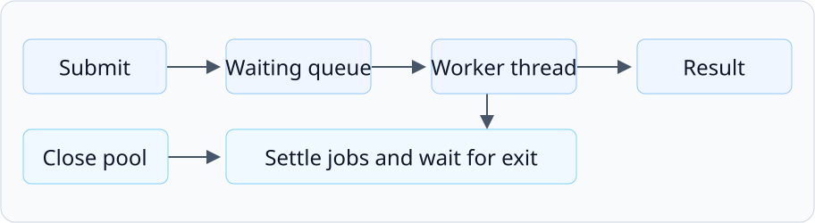

# Core API reference

[中文完整参考](core.md) · [日本語](core.ja.md) · [Core settings](../configuration/core.en.md) · [Core data](../data/core.en.md)

## Quick start

Install the package with `pnpm add @h-ai/core`. Add `config/_core.yml` to a Node.js application.

```yaml schema=@h-ai/core:CoreConfigSchema
name: Orders
defaultLocale: en-US
```

```ts
import type { CoreConfig } from '@h-ai/core'
import { core } from '@h-ai/core'

// Read configuration files directly in ./config and register successful loads by name. Initialization returns no value.
core.init({ configDir: './config' })
// Read the loaded core configuration snapshot. A missing entry throws.
const settings = core.config.getOrThrow<CoreConfig>('core')
// Apply the configured default locale to future messages. Returns no value.
core.i18n.setGlobalLocale(settings.defaultLocale)
// Log the application's configured name at startup. Returns no business data.
core.logger.info('Application ready', { app: settings.name })
```

Core loads the immediate YAML files in the directory. It registers `_core.yml` as `core`, and `app.yml` as `app`. The example stops startup if the required Core settings could not be loaded. In a browser, pass logging options directly to `core.init({ logging: { level: 'warn' } })`. If the page needs the application name, return that field in the server's page data and keep credentials on the server.

<a id="api-reference"></a>

## Features

<a id="config-api"></a>

### File and environment configuration: `core.config`

The file and environment methods below are for Node.js. A name identifies the saved configuration, such as `app` for `config/app.yml`. Use a Zod schema such as `const AppSchema = z.object({ port: z.number().int().positive() })` to validate values loaded from a file containing `port: 3000`. Import `z` from `zod` for that example.

Check `success` before using `data` from a `HaiResult`. Reloading changes the values held by Core. If a database or other service read its settings when it was initialized, arrange for that service to apply the new values.

#### Interface list

| API | Purpose | Parameters and defaults | Return value or failure | Call example |
| --- | --- | --- | --- | --- |
| `core.init(options?)` | Configure logging and scan YAML at startup | Without `configDir`, Core skips the scan. `configSchemas` optionally supplies field types by config name. `watchConfig` defaults to `false`. Explicit `logging` takes precedence over YAML logging settings | `void`. Logs individual file failures and continues. Directory or logger errors can throw | `core.init({ configDir: './config', configSchemas: { app: AppSchema }, watchConfig: true })` |
| `core.config.loadEnvFiles(options)` | Merge dotenv and existing environment variables | `mode` required. `envDir` defaults to the working directory | `HaiResult<Record<string, string>>`. Apply `data` to `process.env` explicitly | `core.config.loadEnvFiles({ mode: 'dev' })` |
| `core.config.load(name, filePath, schema?)` | Load one file and apply overrides | `name` and `filePath` required. Omit `schema` to load without schema validation | `HaiResult<T>`. A failure preserves the last successful value | `core.config.load('app', './config/app.yml', AppSchema)` |
| `core.config.validate(name, schema)` | Recheck the last loaded YAML with the current environment | Both parameters required. Use `reload()` to read edits on disk | `HaiResult<T>`. Success saves the checked values and the schema used for future reloads | `core.config.validate('app', AppSchema)` |
| `core.config.get<T>(name)` | Read the last saved value | `name` required. `T` supplies a TypeScript type | `T` or `undefined` | `core.config.get<{ port: number }>('app')` |
| `core.config.getOrThrow<T>(name)` | Read a setting required to continue | `name` required | `T`. Throws if the name has not been loaded | `core.config.getOrThrow<{ port: number }>('app')` |
| `core.config.has(name)` | Check whether a name has been loaded | `name` required | `boolean` | `core.config.has('app')` |
| `core.config.keys()` | List loaded names | No arguments | `string[]` | `core.config.keys()` |
| `core.config.reload(name)` | Read the file again and notify subscribers | `name` required | `HaiResult<unknown>`. Missing names return `CONFIG_NOT_LOADED`. Failed reloads preserve the previous value | `core.config.reload('app')` |
| `core.config.watch<T>(name, callback)` | Reload on file changes | Both parameters required. `T` defaults to `unknown`. The callback receives the new value on success or `null` and an error on failure | A function that removes this subscription. An unloaded name reports `CONFIG_NOT_LOADED` immediately | `const stop = core.config.watch('app', (_value, error) => { if (error) core.logger.warn('Reload failed', { code: error.code }) })` |
| `core.config.isWatching(name)` | Check whether a file watch is active | `name` required | `boolean` | `core.config.isWatching('app')` |
| `core.config.unwatch(name?)` | Stop watches and keep the loaded values | Omit `name` to stop all watches | `void` | `core.config.unwatch('app')` |
| `core.config.clear(name?)` | Remove loaded values and stop their watches | Omit `name` to clear all names | `void`. Leaves the files on disk intact | `core.config.clear('app')` |
| `core.config.resolve(options)` | Apply environment overrides in memory | `name` and `value` required. `environment` defaults to `process.env`. A `schema` or `shape` can provide field types. `missing` defaults to `'error'`; `'empty'` inserts an empty string for a missing placeholder | `HaiResult<unknown>`. Validate the result with the application schema | `core.config.resolve({ name: 'app', value: { port: 3000 }, environment: { HAI_APP_PORT: '4000' } })` |
| `core.config.toEnv(options)` | Flatten configuration into environment variables | `prefix` and `value` required. Optional `schema` or `shape` describes fields | `Record<string, string>`. Throws on invalid names | `core.config.toEnv({ prefix: 'HAI_APP', value: { port: 3000 } })` |
| `core.config.mergeEnv(layers)` | Merge sources by precedence | Pass objects in order from lowest to highest priority | `Record<string, string>` | `core.config.mergeEnv([{ HAI_APP_PORT: '3000' }, { HAI_APP_PORT: '4000' }])` |
| `core.config.parseEnv(text)` | Read literal variables from dotenv text | `text` required | `Record<string, string>`. Throws for duplicate keys or malformed values marked as generated JSON | `core.config.parseEnv('HAI_APP_PORT=3000\n')` |
| `core.config.stringifyEnv(values, options?)` | Write dotenv text | `values` required. `target` defaults to `'node'`. Choose `'compose'` for a Compose env file | A string. Throws on invalid names | `core.config.stringifyEnv({ HAI_APP_PORT: '3000' })` |

#### Scenario: Configuration in Node and the browser

This separates file reading, environment overrides, validation and publication. load establishes the file and schema; reload uses the saved settings.



For port: 3000 and HAI_APP_PORT=4000, only a successful check publishes 4000. Failed reads or validation retain the old value; reload subscribers receive the value or failure. Consumers must apply changed settings themselves.

Node configuration can read and watch YAML and dotenv files. In a browser, embedded assets or server load data carry public settings. File operations return `SERVICE_UNAVAILABLE`, `getOrThrow()` throws, and watchers report the failure immediately. In the browser, `core.config.isWatching()` always returns `false` and `core.config.unwatch()` does nothing.

Load dotenv values before initializing modules. The order is process environment, mode-local file, local file, mode file, then base file. Apply the returned map explicitly. YAML placeholders are expanded before hierarchical environment overrides, for example `HAI_APP_PORT` overrides `app.port`. A parent JSON value replaces that node. Child keys override it at the same priority. An empty string is a supplied value. Placeholder expressions supplied through environment values or JSON remain literal. Validate the resolved object separately when using `resolve()` directly. A reload updates Core's in-memory copy, so have consumers apply new settings explicitly. Unsubscribe after use, and keep the `# hai:json` marker on values emitted by the dotenv writer.

```ts
import { core } from '@h-ai/core'
import { z } from 'zod'

// Build the Zod schema for the port field below. The example passes it to load.
const AppSchema = z.object({ port: z.number().int().positive() })
// Load dev environment files. Success returns the variable map. Check error if reading or parsing fails.
const environment = core.config.loadEnvFiles({ mode: 'dev' })
if (!environment.success)
  throw new Error(environment.error.message)
Object.assign(process.env, environment.data)

// Load the YAML path as app and validate with AppSchema. Success data is the registered config. Check error on read or validation failure.
const loaded = core.config.load('app', './config/app.yml', AppSchema)
if (!loaded.success)
  throw new Error(loaded.error.message)
// Log the port read from the loaded configuration. Returns no business data.
core.logger.info('Listening', { port: loaded.data.port })
```

With `port: 3000` in `config/app.yml`, this logs port 3000 unless `HAI_APP_PORT` overrides it. The application exits before serving traffic if loading or validation fails.

<a id="logging-api"></a>

### Record logs: `core.logger`

`core.logger` starts at `info` with `pretty` output. Set `format: 'json'` for log collection. Node also emits JSON when the optional `pino-pretty` dependency is unavailable. The browser uses the developer console. Messages below the current level are dropped. Named loggers inherit global settings unless configured explicitly. A child binds extra fields. The current request context is included, and sensitive values are masked before output.

A child logger's fields apply to that child and its descendants. Creating one leaves the parent unchanged. The optional second argument, `ctx`, adds fields to a single entry. When fields share a key, later sources win: global fields → fields bound to the logger (from parent to child) → per-call `ctx` → current `core.context`.

#### Interface list

| API | Purpose | Parameters and defaults | Return value or failure | Call example |
| --- | --- | --- | --- | --- |
| `core.logger.trace` | Log the most detailed diagnostic steps | `message, ctx?` | `void` | `core.logger.trace('Callback entered')` |
| `core.logger.debug` | Log diagnostic information | `message, ctx?` | `void` | `core.logger.debug('Cache miss', { key: 'total' })` |
| `core.logger.info` | Log routine application events | `message, ctx?` | `void` | `core.logger.info('Order created', { id: 'order-1' })` |
| `core.logger.warn` | Log a condition that needs attention | `message, ctx?` | `void` | `core.logger.warn('Retry scheduled', { attempt: 2 })` |
| `core.logger.error` | Log an operation failure | `message, ctx?` | `void` | `core.logger.error('Write failed', { error })` |
| `core.logger.fatal` | Log a severe failure; the application decides whether to exit | `message, ctx?` | `void` | `core.logger.fatal('Startup failed')` |
| `core.logger.create` | Create a logger that inherits settings you omit | `options?` | `Logger` | `core.logger.create({ name: 'orders' })` |
| `core.logger.child` | Bind fields to a child logger | `fields` | `Logger` | `core.logger.child({ requestId: 'req-1' })` |
| `core.logger.configure` | Update the supplied global logging options | `options` | `void` | `core.logger.configure({ format: 'json', redact: ['customer.email'] })` |
| `core.logger.setLevel` | Set the global threshold, initially info | `level` | `void` | `core.logger.setLevel('warn')` |
| `core.logger.getLevel` | Read the current global threshold | None | `LogLevel` | `core.logger.getLevel()` |
| `core.logger.observe` | Receive records after filtering and redaction | `callback` | `() => void` | `core.logger.observe(record => { recentMessages.push(record.message) })` |

#### Scenario: Record business and diagnostic logs by level

```ts
import { core } from '@h-ai/core'

// Create the orders logger and return its instance.
const orders = core.logger.create({ name: 'orders' })
// Set the threshold to info so lower levels are skipped. Returns no value.
core.logger.setLevel('info')
// Read the current threshold with no arguments. It returns info.
core.logger.getLevel() // 'info'
// Log the startup message at fatal level. It returns undefined.
core.logger.fatal('Example startup failure') // Records a log; does not exit the process.
// Bind request-1 on top of orders and return the child logger.
const request = orders.child({ requestId: 'request-1' })

// Log creation and the supplied fields with the parent logger. Returns no business data.
orders.info('Order created', { attempt: 1 })
// Log attempt 2 with the child, which also includes request-1. Returns no business data.
request.warn('Request needs attention', { attempt: 2 })
// Run the callback in request-2, restore the outer context afterward, and return the callback result.
core.context.run({ requestId: 'request-2' }, () => {
  // Log the check and attempt 1. The context adds request-2. Returns no business data.
  orders.info('Order checked', { attempt: 1 })
})
```

The first entry has `attempt: 1` and no request ID. The second has `attempt: 2` and the child's `requestId: 'request-1'`. The third uses the parent again, but `core.context.run()` adds `requestId: 'request-2'`.

Use observers for bounded diagnostics. An observer receives entries after level filtering and redaction. Its exceptions and immediate recursive invocations are isolated. Calling the returned function unsubscribes the observer.

<a id="context-api"></a>

### Associate one request: `core.context`

Carry trusted request and user IDs across asynchronous calls so logs can be correlated.

#### Interface list

| API | Purpose | Parameters and defaults | Return value or failure | Call example |
| --- | --- | --- | --- | --- |
| `core.context.run(context, operation)` | Run within a request or task context | Fields and callback. Observers are enabled by default. | Callback result, including a promise | `await core.context.run({ requestId: 'req-1' }, async () => core.context.get().requestId)` |
| `core.context.get()` | Read the current context | No arguments | Readonly `RequestContext` (empty object without context) | `const { requestId } = core.context.get()` |

#### Scenario: Keep request IDs across asynchronous calls

Use `core.context.run()` with correlation fields such as `requestId`, `userId`, `scopeId`, and `jobId`. In Node, each request retains its own context across `await`. In a browser the context only lasts through synchronous work. Loggers automatically include the current fields. Obtain user and tenant identifiers from trusted server code. If a collector logs its own diagnostics, run that work with `suppressLogObservers: true` to avoid notifying the observers again.

<a id="sanitize-api"></a>

### Sanitize diagnostics: `core.sanitize`

Clean sensitive object fields, URLs and text before diagnostics without altering business input.

#### Interface list

| API | Purpose | Parameters and defaults | Return value or failure | Call example |
| --- | --- | --- | --- | --- |
| `core.sanitize.isSensitiveKey(key, matcher?)` | Match a field name | Key and optional matcher | `boolean` | `core.sanitize.isSensitiveKey('apiKey')` |
| `core.sanitize.sanitizeSensitiveValue(value, key, options?)` | Redact one value | Value, key (or `null`), optional replacement (default `[REDACTED]`) | Value | `core.sanitize.sanitizeSensitiveValue('example-only', 'password')` |
| `core.sanitize.sanitizeSensitiveFields(value, options?)` | Copy and redact structured data | Value, optional matcher and replacement | Redacted copy | `core.sanitize.sanitizeSensitiveFields({ password: 'example-only' })` |
| `core.sanitize.sanitizeUrl(url, options?)` | Mask URL credentials | URL, optional redaction options | `string` / `(invalid url)` | `core.sanitize.sanitizeUrl('https://example.com/?token=example-only')` |
| `core.sanitize.sanitizeText(text, secretValues?)` | Mask credential text | Text and known values (default `[]`) | `string` | `core.sanitize.sanitizeText('Bearer example-only')` |
| `core.sanitize.defaultSensitiveKeyRegex`, `defaultSensitiveReplacement` | Read the built-in matcher and replacement | Read-only constants | `RegExp` / `string` | `const replacement = core.sanitize.defaultSensitiveReplacement` |

#### Scenario: Hide sensitive fields before publishing diagnostics

Use these helpers before retaining diagnostics or exposing messages. The standard matcher masks credential fields. To add a separate business field using a custom matcher, apply the standard redaction first. Structured redaction works on a copy. Class getters and custom `toJSON()` are never executed. Dates become ISO strings, and URLs are masked. Supply known secret values explicitly when you need to redact unlabelled text. A general object copy may still contain cycles.

<a id="error-api"></a>

### Results and errors: `core.error`

Define domain errors, build complete diagnostics and safe public responses, and wrap successful data with result constructors.

#### Interface list

| API | Purpose | Parameters and defaults | Return value or failure | Call example |
| --- | --- | --- | --- | --- |
| `core.error.buildHaiErrorsDef(module, codes)` | Define stable module error codes | Module name and a name-to-code/status mapping | Error definitions | `const errors = core.error.buildHaiErrorsDef('orders', { NOT_FOUND: '300:404' })` |
| `core.error.buildHaiErrorInst(def, message, cause?, suggestion?)` | Attach a message to a failure | Definition, message, optional cause and suggestion | `HaiError` | `const error = core.error.buildHaiErrorInst(errors.NOT_FOUND, 'Order not found')` |
| `core.error.toPublic(error, traceId?)` | Prepare an error for a client | Error and optional trace ID | Public error | `core.error.toPublic(error, 'req-1')` |
| `core.error.formatMessage(error)` | Format the visible message | Error message and optional trace ID | `string` | `core.error.formatMessage(error)` |
| `ok(data)`, `err(def, message, cause?)` | Construct a business result | Success data, or error definition and message (or a complete error) | `HaiResult` | `ok({ id: 'order-1' })`, `err(errors.NOT_FOUND, 'Order not found')` |

#### Scenario: Build domain failures and safe public messages

A business caller checks `result.success` before reading `data` or `error`. Define codes once and translate messages when the failure occurs. Before sending an error over HTTP, strip internal causes with `core.error.toPublic()`. Return the visible error to the caller and correlate server logs using the trace ID. Import `ok` and `err` directly from `@h-ai/core`.

<a id="i18n-api"></a>

### Messages and locales: `core.i18n`

Choose a locale per request and read translated messages; avoid changing global locale for concurrent requests.

#### Interface list

| API | Purpose | Parameters and defaults | Return value or failure | Call example |
| --- | --- | --- | --- | --- |
| `core.i18n.setGlobalLocale(locale)` | Set the default locale | Locale code | `void` | `core.i18n.setGlobalLocale('ja-JP')` |
| `core.i18n.getGlobalLocale()` | Read the current locale | None; initial default is `zh-CN` | Locale code | `core.i18n.getGlobalLocale()` |
| `core.i18n.runWithLocale(locale, operation)` | Scope a Node request locale | Locale and callback | Callback result | `await core.i18n.runWithLocale('en-US', async () => core.i18n.coreM('core_errorNotFound'))` |
| `core.i18n.createMessageGetter(dictionaries)` | Create a message lookup | Dictionaries keyed by locale | `(key, options?) => string` | `const message = core.i18n.createMessageGetter({ 'zh-CN': { welcome: 'Welcome' } })` |
| `core.i18n.coreM(key, options?)` | Read a built-in message | Key, optional locale and interpolation parameters | `string` | `core.i18n.coreM('core_errorNotFound', { locale: 'en-US' })` |
| `core.i18n.DEFAULT_LOCALE`, `DEFAULT_LOCALES` | Read supported locales | Read-only constants | Locale and choices | `const choices = core.i18n.DEFAULT_LOCALES` |

#### Scenario: Select message language for a request

A message lookup uses its explicit locale first, then the Node request locale, then the global locale. Unsupported locales or missing dictionaries fall back to `zh-CN`. Language aliases `zh`, `en`, and `ja` resolve to the region-specific locales. Missing message keys return the key. Missing placeholder values leave the placeholder in the text. Use a separate dictionary for your application's messages.

<a id="validation-api"></a>

### Field validation messages: `core.zodValidation`

Map Zod issues to localized form messages while retaining field paths.

#### Interface list

| API | Purpose | Parameters and defaults | Return value or failure | Call example |
| --- | --- | --- | --- | --- |
| `core.zodValidation.createPrefixedZodMessageGetter(prefix, message)` | Adapt a module message prefix | Prefix and message getter | Message getter | `const translate = core.zodValidation.createPrefixedZodMessageGetter('core', message)` |
| `core.zodValidation.mapZodErrorToFormErrors(error, message)` | Map Zod issues to form fields | Failure value and adapted message getter | `{ field, message }[]` | `core.zodValidation.mapZodErrorToFormErrors(parsed.error, translate)` |

#### Scenario: Map validation issues to form fields

The mapper turns Zod v3/v4 issues into field-level messages. Array indexes appear in paths such as `items.0.email`, and `_` represents the whole form. Custom messages stay intact. The getter maps library message keys to your own dictionary.

<a id="module-api"></a>

### Start and stop modules: `core.module`

`core.module.createRuntime()` returns a controller. Call `start()` when you are ready to initialize the dependencies in order, and call `close()` on shutdown to release them in reverse order. A failed start triggers cleanup. If cleanup fails, a later close or start retries it before releasing dependencies still in use. Concurrent starts share the pending operation. Check the `HaiResult` from both calls. Set `enabled` on a step to decide when it participates.

#### Interface list

| API | Purpose | Parameters and defaults | Return value or failure | Call example |
| --- | --- | --- | --- | --- |
| `core.module.createRuntime(steps)` | Manage dependency startup and shutdown | Named steps with start and close functions, optional enabled predicate | `ModuleRuntime`, each call returns `Promise<HaiResult<void>>` | `const runtime = core.module.createRuntime([{ name: 'cache', start: () => cache.init({ type: 'memory' }), close: () => cache.close() }])` |
| `core.module.createNotInitializedKit(codeOrDef, messageFn)` | Return consistent failures before a module is ready | Both arguments are required: the error code or definition, and a function that returns the message. | `error()`, `result()`, `proxy()` | `core.module.createNotInitializedKit(HaiCommonError.NOT_INITIALIZED, () => 'Initialize the module first')` |
| `core.module.requiresSharedState(environment)` | Check whether a shared backend is required | Environment values. Explicit production E2E runs can opt out. | `boolean` | `core.module.requiresSharedState(process.env)` |

#### Scenario: Return a failure before initialization

Module authors can use this helper to keep the same API available before the backend is ready. For example, before `cache.init()` succeeds, calling `cache.kv.get(key)` returns a not-initialized result without connecting to Redis. Once ready, the cache module exposes the backend's real operations. Applications using an existing module only need to initialize it first and check the result.

- `error()` builds an error object.
- `result<T>()` returns `{ success: false, error }` for an early return from an operation.
- `proxy<T>()` creates a placeholder for the operation interface `T`. Calls return a promise that resolves to the failure above and never perform the operation. Use `proxy<T>('sync')` when all methods in that group return synchronously.

The message function runs each time an error is generated. It can look up the current request's language.

<a id="order-lookup-example"></a>

#### Scenario: Reject order queries before the status index is loaded

An order lookup module can only tell whether an order exists after it loads the status index. A call that arrives during startup should fail as not initialized, so callers can distinguish it from an unknown order. The example uses an in-memory `Map` as the loaded index. It needs only `@h-ai/core` and no database.

```ts
import type { HaiResult } from '@h-ai/core'
import { core, HaiCommonError, ok } from '@h-ai/core'

interface OrderQueries {
  getStatus: (orderId: string) => Promise<HaiResult<string | null>>
}

// Create a message getter from the three dictionaries below for later calls.
const message = core.i18n.createMessageGetter({
  'zh-CN': { notReady: '订单查询模块尚未初始化' },
  'en-US': { notReady: 'Order queries are not initialized' },
  'ja-JP': { notReady: '注文照会モジュールが初期化されていません' },
})
// Create the readiness kit from the common error and message callback. It provides a proxy and failure factory.
const waiting = core.module.createNotInitializedKit(
  HaiCommonError.NOT_INITIALIZED,
  // Resolve the localized order-lookup readiness message.
  () => message('notReady'),
)
// Create the default async placeholder from the interface type. Its methods return the not-initialized failure.
const fallback = waiting.proxy<OrderQueries>() // 与实际查询接口一致，默认返回 Promise。
let activeQueries: OrderQueries | undefined

const orderLookup = {
  init(statusById: ReadonlyMap<string, string>): HaiResult<void> {
    activeQueries = {
      async getStatus(orderId) {
        // Look up the supplied ID and wrap the status or null as success data.
        return ok(statusById.get(orderId) ?? null) // 查不到订单时成功返回 null。
      },
    }
    // Return initialization success with undefined data.
    return ok(undefined)
  },
  get orders(): OrderQueries {
    return activeQueries ?? fallback // 每次取接口时根据模块状态选择实现。
  },
  close(): void {
    activeQueries = undefined
  },
}

// Look up the sample order through the uninitialized placeholder. It returns a readiness failure.
const beforeInit = await orderLookup.orders.getStatus('order-42')
if (!beforeInit.success)
  // Log the placeholder's readiness error code. Returns no business data.
  core.logger.warn('Order lookup is not ready', { code: beforeInit.error.code })

// 此处用内存索引模拟已经从数据库加载完的数据。
// Activate the sample lookup with order-42 marked shipped. Success has no data. Read error on failure.
const initialized = orderLookup.init(new Map([['order-42', 'shipped']]))
if (!initialized.success)
  throw new Error(initialized.error.message)
try {
  // Look up loaded order-42. Success returns shipped.
  const found = await orderLookup.orders.getStatus('order-42')
  // Look up absent order-99. Success returns null.
  const missing = await orderLookup.orders.getStatus('order-99')
  if (found.success && missing.success)
    // Log the found status and the missing null. Returns no business data.
    core.logger.info('Order lookup finished', { found: found.data, missing: missing.data })
}
finally {
  // Clear the active index without arguments, returning later calls to the placeholder.
  orderLookup.close()
}
// Query order-42 again after close. This returns the placeholder failure.
const afterClose = await orderLookup.orders.getStatus('order-42')
if (!afterClose.success)
  // Log the post-close error code. Returns no business data.
  core.logger.warn('Order lookup has closed', { code: afterClose.error.code })
```

| When the lookup runs | Result |
| --- | --- |
| Look up `order-42` before startup (`beforeInit`) | `success: false`, error code `HaiCommonError.NOT_INITIALIZED.code`, no `data`. |
| Look up `order-42` after startup (`found`) | `{ success: true, data: 'shipped' }`. |
| Look up an unknown order, `order-99` (`missing`) | `{ success: true, data: null }`. The lookup ran against the index but found no match. |
| Look up `order-42` after closing (`afterClose`) | Returns the not-initialized failure again. |

The proxy never turns into the real implementation. The `orderLookup.orders` getter exposes the real queries once the module is ready. Read the getter for each call instead of keeping a reference to the startup placeholder.

<a id="worker-api"></a>

### Run CPU work on background threads with `core.worker`

Use a Worker for large document processing or batch computation while the calling thread continues serving other work. The pool starts threads on demand, runs one job per thread and takes waiting jobs in submission order. A dedicated thread supports ongoing message exchanges and independent termination.

#### Interface list

| Entry | Purpose | Inputs | Returns | Example |
| --- | --- | --- | --- | --- |
| `core.worker.createPool(entry, limits)` | Create a pool | Entry, positive thread limit, non-negative queue limit and optional idle time in milliseconds | `WorkerPool<Input, Output>` | `core.worker.createPool<string, number>(entry, limits)` |
| `pool.run(input, transfer?)` | Submit work | A cloneable input and optional transfer list | `Promise<HaiResult<Output>>` | `await pool.run(report)` |
| `pool.close()` | Settle unfinished jobs and stop the threads | None | `Promise<void>` | `await pool.close()` |
| `core.worker.start(entry, options?)` | Start a dedicated thread | Entry, plus optional Node `workerData` and `execArgv` | `WorkerThread<Input, Output>` | `core.worker.start<string, number>(entry)` |
| `thread.postMessage(input, transfer?)` | Send a message | Input and optional transfer list | `void` | `thread.postMessage(report)` |
| `thread.onMessage(listener)` | Subscribe to messages | Function that receives the output | Unsubscribe function | `const unsubscribe = thread.onMessage(receive)` |
| `thread.exited` | Observe exit | None | `Promise<WorkerExit>` | `await thread.exited` |
| `thread.terminate()` | Stop the thread | None | `Promise<void>` | `await thread.terminate()` |

#### Scenario: Measure documents and release the threads

The diagram follows one pool. Each thread takes the next waiting job after returning its current result. Closing settles queued and running tasks.



For example, while the first document runs, the second waits in the queue. If the owner closes the pool at that point, both tasks return a closed-pool result. The owner waits for `close()` before releasing other resources.

Ship the following entry file with the application. It replies once per input. Use the matching input and output types in the caller.

```js
import { parentPort } from 'node:worker_threads'

parentPort?.on('message', report => parentPort.postMessage(report.length))
```

Create the pool in the Node service and close it after the batch.

```ts
import { core } from '@h-ai/core'

const entry = new URL('./stats-worker.mjs', import.meta.url)
// Create a pool for the worker URL with at most two workers and four queued jobs.
const pool = core.worker.createPool<string, number>(entry, { maxWorkers: 2, maxQueuedJobs: 4 })
try {
  // Submit the report string. Success returns length 16. Check error on a full queue or worker failure.
  const result = await pool.run('Quarterly report')
  if (!result.success)
    throw new Error(result.error.message)
  void result.data // 16
}
finally {
  // Settle pending jobs and wait for the pool's workers to exit.
  await pool.close()
}
```

A full queue returns `HaiCommonError.RATE_LIMIT_EXCEEDED`. A closed pool returns `NOT_INITIALIZED`. Startup, message and thread failures return `INTERNAL_ERROR`. The failed job settles and later jobs can start a replacement thread. Set `idleTimeoutMs` for idle reclamation. By default idle threads remain until close, and idle Node threads release their event-loop reference.

#### Scenario: Start one dedicated thread and wait for a reply

To submit work and await its result, use `pool.run()` from the previous example. Use `core.worker.start()` when you need to exchange messages or control when the thread stops.

Save this Node Worker as `stats-once-worker.mjs`. It receives one message, replies with the string length, and closes its message port so the thread can exit on its own.

```js
import { parentPort } from 'node:worker_threads'

const port = parentPort
port?.once('message', (report) => {
  port.postMessage(report.length)
  port.close()
})
```

In the calling script in the same directory, use `onMessage()` to subscribe before sending `'Report'` with `postMessage()`. When the reply arrives, the callback logs `6` as the `length`.

```ts
import { core } from '@h-ai/core'

const entry = new URL('./stats-once-worker.mjs', import.meta.url)
// Start the dedicated worker at the one-shot statistics URL and return the thread controls.
const thread = core.worker.start<string, number>(entry)
// Subscribe to lengths and log them at info level. The subscription returns an unsubscribe function.
const unsubscribe = thread.onMessage(length => core.logger.info('Report length', { length }))

try {
  // Send the cloneable Report string to the worker. Returns no value.
  thread.postMessage('Report')
  // Await worker exit. A normal exit has code 0. Inspect error or a nonzero code on failure.
  const { code, error } = await thread.exited
  if (error || code !== 0)
    throw error ?? new Error(`Worker exited with code ${code}`)
}
finally {
  // Stop receiving messages through the subscription above.
  unsubscribe()
  // Request termination of the dedicated worker without arguments and wait for its exit.
  await thread.terminate()
}
```

`await thread.exited` waits for the Worker to stop and gives you its exit status. The `finally` block unsubscribes and ensures the thread is stopped even if sending the message throws.

In a Vite application, put the entry inside the Web Worker constructor, for example `() => new Worker(new URL("./stats-worker.js", import.meta.url), { type: "module" })`. The Web Worker entry uses `globalThis.addEventListener("message", ...)` and `postMessage()`. In a browser, `thread.exited` settles when you call `thread.terminate()` or the Worker reports an error. Load trusted scripts shipped with the application. Messages use structured clone. Node supports transferring ArrayBuffer, and browsers also support objects such as ImageBitmap. A submitted transfer list assigns ownership to the worker.

<a id="access-api"></a>

### Check request access: `core.access` (Node)

Use `core.access` to decide whether the Node server should let a request through based on its path, HTTP method, client IP and the server's current time. The service still handles authentication and authorization.

- **Serv or Kit:** Configure `http.access` in `_serv.yml` or `access` in `_kit.yml`, then pass the settings to `serv.createApp({ http, ... })` or `kit.createHandle({ access, ... })`. The framework prepares the checker at startup and returns HTTP 403 for denied requests. These rules do not go in `_core.yml`.
- **Other Node HTTP frameworks:** Create the IP resolver and policy checker at startup. For each request, resolve the IP using the actual peer address from the server or a trusted platform. Pass the URL pathname, HTTP method and resolved IP to the checker. Use its decision to choose the HTTP response.

A request must satisfy `global` and every matching rule. If none match, only `global` applies. Omitting `methods` or passing an empty list matches all methods. A pattern ending in `/**` matches the path itself and its descendants. A denial includes `reason: 'address'`, `'time'` or `'path'`, and a `ruleId` when a path rule denies it.

<a id="client-ip-resolver"></a>

#### Interface list

| API | Purpose | Parameters and defaults | Return value or failure | Call example |
| --- | --- | --- | --- | --- |
| `core.access.normalizeClientIp(value?)` | Normalize an IPv4 or IPv6 address | Optional address string | `string` / `undefined` | `core.access.normalizeClientIp('::ffff:198.51.100.23')` |
| `core.access.createClientIpResolver(trustedProxies?)` | Create a function that selects the IP for each access check | Trusted proxy configuration (default `auto`) | `resolveClientIp(request, remoteAddress?)` → IP or `undefined` | `const resolveClientIp = core.access.createClientIpResolver(['192.0.2.10'])` |
| `core.access.createConditionCheck(condition)` | Prepare address and schedule conditions | Condition object with address lists and time windows | `(ip?) => AccessDecision` | `core.access.createConditionCheck({ allowIps: [], denyIps: [], timezone: 'UTC', windows: [] })` |
| `core.access.createRequestCheck(input?)` | Compile a request policy | Rules, file reference, or `false`. Omission disables the policy. | `check(pathname, method, ip?)` → `AccessDecision` | `core.access.createRequestCheck({ file: './config/security/request-access.yml' })` |
| `core.access.loadPolicy(input?, baseDirectory?)` | Read and validate policy content | Policy input and base directory (default working directory) | `RequestAccessPolicy` / `false` | `core.access.loadPolicy({ file: './config/security/request-access.yml' })` |

#### Scenario: Which IP should the access check use?

**`core.access.createClientIpResolver()` selects the IP address for the access policy.** Suppose partner `198.51.100.23` reaches Node through reverse proxy `192.0.2.10`. Only the proxy connects directly to Node, so the socket shows `192.0.2.10`. Checking the socket address alone would check the proxy. The resolver uses the list of proxies you trust to decide whether to use a reported upstream address.

- **At startup:** `createClientIpResolver(['192.0.2.10'])` returns a function. This list names the proxies allowed to report where requests came from. The separate `allowIps` policy names the clients allowed to access the route.
- **Per request:** Call `resolveClientIp(request, remoteAddress)`. The `request` supplies HTTP headers. Get `remoteAddress`, the address that connected directly to the server, from the server socket (for example, `socket.remoteAddress`) or a trusted platform API. The function returns an IP string for the policy, or `undefined` if it cannot select one.

| Directly connected address (`remoteAddress`) | `X-Forwarded-For` | IP used for the check |
| --- | --- | --- |
| Trusted proxy `192.0.2.10` | `198.51.100.23` | `198.51.100.23`: use the upstream address reported by that proxy. |
| Address outside the trusted proxy list, `203.0.113.7` | The same `198.51.100.23` | `203.0.113.7`: ignore the forwarding header. |
| Trusted proxy `192.0.2.10` | Absent, with no `X-Real-IP` either | `192.0.2.10`: the only known address is the directly connected proxy. |
| Trusted proxy `192.0.2.10` | The address needed for the check is invalid | `undefined`: no usable upstream address. |
| No directly connected address supplied | Even if present | `undefined`: there is no way to check who supplied the header. |

When a trusted proxy provides multiple addresses, start at the right end of `X-Forwarded-For`, skip trusted proxy addresses from right to left, and use the first address outside the trusted list. If all addresses are trusted, use the leftmost one. The resolver checks `X-Real-IP` only if `X-Forwarded-For` is absent. On ordinary Node servers, the default `auto` ignores forwarding headers; managed private Compose deployments use their private container subnet. Pass `[]` to always ignore forwarding headers.

```ts
import { core } from '@h-ai/core'

// 启动时配置代理地址。这个数组不是合作方的 IP 白名单。
// Create an IP resolver using the trusted example proxy. It uses the peer address to decide whether to trust forwarded headers.
const resolveClientIp = core.access.createClientIpResolver(['192.0.2.10'])
const request = new Request('https://example.test/api/partners/inventory/sync', {
  headers: { 'X-Forwarded-For': '198.51.100.23' },
})

// 用同一个请求头对比不同的直接连接地址。实际服务从连接读取第二个参数。
// Pass the forwarded header and known proxy peer to get the address in the header.
const throughProxy = resolveClientIp(request, '192.0.2.10') // '198.51.100.23'
// Pass the same request with an untrusted direct peer. The result is the peer address.
const direct = resolveClientIp(request, '203.0.113.7') // '203.0.113.7'
// Pass only the request without a peer address. This returns undefined.
const unknown = resolveClientIp(request) // undefined

// 用解析后的地址检查合作方网段；路径和方法规则请用下方的 createRequestCheck 示例。
// Build the checker for the subnet and empty time windows below. It returns allow or deny decisions.
const checkIp = core.access.createConditionCheck({
  allowIps: ['198.51.100.0/24'],
  denyIps: [],
  timezone: 'UTC',
  windows: [],
})
// Check the resolved allowed-subnet address. allowed is true.
checkIp(throughProxy).allowed // true
// Check the peer outside the subnet. allowed is false.
checkIp(direct).allowed // false
// Check without a known client IP. allowed is false.
checkIp(unknown).allowed // false
```

A resolved IP does not grant access by itself. Pass it to `checkIp(ip)` or `checkAccess(pathname, method, ip)`. A rule that restricts IP addresses rejects an unresolved address (`undefined`). Serv and Kit do both steps internally; set `trustedProxies` and the access policy separately.

<a id="partner-sync-example"></a>

#### Scenario: Let a partner sync inventory during business hours

The service exposes `POST /api/partners/inventory/sync` behind a reverse proxy. Sync requests must come from the partner's `198.51.100.0/24` network and arrive Monday through Friday, from 09:00 inclusive to 18:00 exclusive, Shanghai time. The rule leaves `GET /health` available for monitoring.

In a custom Node HTTP server, create the resolver and checker once at startup. For each request, the HTTP adapter passes the Fetch `Request`, the peer address from the server socket, and the existing handler to `handlePartnerAccess()`. Here, `192.0.2.10` is the address the reverse proxy uses to connect to the backend. Replace it and the partner's network with your actual addresses.

```ts
import { core } from '@h-ai/core'

// 启动时配置一次：这里只信任直接连到后端的反向代理。
// Create an IP resolver using the trusted example proxy. It uses the peer address to decide whether to trust forwarded headers.
const resolveClientIp = core.access.createClientIpResolver(['192.0.2.10'])
// Build a checker from the path, method, subnet, and work hours below. Invalid policy throws.
const checkAccess = core.access.createRequestCheck({
  rules: [
    {
      id: 'partner-inventory-sync',
      paths: ['/api/partners/inventory/sync'],
      methods: ['POST'],
      allowIps: ['198.51.100.0/24'],
      timezone: 'Asia/Shanghai',
      windows: [{ days: [1, 2, 3, 4, 5], start: '09:00', end: '18:00' }],
    },
  ],
})

async function handlePartnerAccess(
  request: Request,
  peerAddress: string | undefined,
  next: (request: Request) => Response | Promise<Response>,
): Promise<Response> {
  // Resolve the client IP from the request and actual peer supplied by the host. Unknown addresses yield undefined.
  const clientIp = resolveClientIp(request, peerAddress)
  const { pathname } = new URL(request.url)
  // Check the actual path, HTTP method, and resolved address. The decision supplies allowed and a denial reason.
  const decision = checkAccess(pathname, request.method, clientIp)
  if (!decision.allowed) {
    // Log the denying rule and reason at info level. Returns no business data.
    core.logger.info('Request access denied', {
      ruleId: decision.ruleId,
      reason: decision.reason,
    })
    return new Response(null, { status: 403 })
  }
  return next(request) // 后续仍执行服务自己的认证和路由逻辑。
}
```

| Request reaching the backend (Shanghai time) | Result |
| --- | --- |
| Monday 10:00, partner `198.51.100.23` sends a sync request through the trusted proxy | Continues to authentication and sync. The downstream handler sets the final status. |
| Monday 10:00, a different network requests a sync through the same proxy | Returns `403`; the server logs `reason: 'address'`. |
| Monday 18:00, the partner requests another sync | Returns `403`; the server logs `reason: 'time'`. |
| `GET /health` at any time | The rule does not match; the health check continues. |

With Serv or Kit, put the same rules under `http.access` in `_serv.yml` or `access` in `_kit.yml`. Set `http.trustedProxies` for Serv or top-level `trustedProxies` for Kit. Those frameworks run the check; see [request policy settings](../configuration/core.en.md#request-access) for configuration examples.

Invalid policies throw when the checker is created. A referenced file is read only at creation; restart or recreate the checker after changing it. `check.encryption(pathname, method)` returns `'required'`, `'disabled'`, or `undefined` to keep the server's setting. It controls application-level encryption separately from HTTPS and does not grant access. If `check.requiresEncryption` is true, Serv and Kit require application-level transport encryption to be configured.

[Request policy settings](../configuration/core.en.md#request-access)

<a id="id-api"></a>

### Generate and validate IDs: `core.id`

Generate business, request and trace IDs, and check external formats. IDs are not secret keys.

#### Interface list

| API | Purpose | Parameters and defaults | Return value or failure | Call example |
| --- | --- | --- | --- | --- |
| `core.id.generate` | Generate a random ID | `length = 21` | `string` | `core.id.generate(8)` |
| `core.id.short` | Generate a short ID with 10 characters | None | `string` | `core.id.short()` |
| `core.id.withPrefix` | Add a business prefix to a random ID | `prefix, length = 21` | `string` | `core.id.withPrefix('order_')` |
| `core.id.trace` | Generate a trace ID with the trace- prefix | None | `string` | `core.id.trace()` |
| `core.id.request` | Generate a request ID with the req- prefix | None | `string` | `core.id.request()` |
| `core.id.uuid` | Generate UUID v4; throws when secure randomness is unavailable | None | `string` | `core.id.uuid()` |
| `core.id.isValidUUID` | Check the UUID v4 format | `value` | `boolean` | `core.id.isValidUUID('550e8400-e29b-41d4-a716-446655440000')` |
| `core.id.isValidNanoId` | Check the character set and length | `value, length = 21` | `boolean` | `core.id.isValidNanoId('abc', 3)` |

#### Scenario: Generate business and request IDs

IDs identify records and correlate operations. Use a credential generator for secrets. UUID generation throws when secure randomness is unavailable.

<a id="type-api"></a>

### Check value types: `core.typeUtils`

Check boundary values and narrow TypeScript types; validate business input with a schema as well.

#### Interface list

| API | Purpose | Parameters and defaults | Return value or failure | Call example |
| --- | --- | --- | --- | --- |
| `core.typeUtils.isDefined` | Check that a value is neither null nor undefined | `value` | `boolean` | `core.typeUtils.isDefined(null)` |
| `core.typeUtils.isObject` | Check for an object excluding null and arrays | `value` | `boolean` | `core.typeUtils.isObject({ name: 'orders' })` |
| `core.typeUtils.isFunction` | Check for a function | `value` | `boolean` | `core.typeUtils.isFunction(() => {})` |
| `core.typeUtils.isPromise` | Check for a promise | `value` | `boolean` | `core.typeUtils.isPromise(Promise.resolve('ready'))` |
| `core.typeUtils.isString` | Check for a string | `value` | `boolean` | `core.typeUtils.isString('orders')` |
| `core.typeUtils.isNumber` | Check for a number other than NaN | `value` | `boolean` | `core.typeUtils.isNumber(3000)` |
| `core.typeUtils.isBoolean` | Check for a boolean | `value` | `boolean` | `core.typeUtils.isBoolean(false)` |
| `core.typeUtils.isArray` | Check for an array | `value` | `boolean` | `core.typeUtils.isArray([1, 2])` |

#### Scenario: Check inputs and narrow types

These predicates narrow TypeScript types. Validate business data with a schema.

<a id="object-api"></a>

### Transform objects: `core.object`

Copy and merge configuration objects, select fields and convert entries.

#### Interface list

| API | Purpose | Parameters and defaults | Return value or failure | Call example |
| --- | --- | --- | --- | --- |
| `core.object.deepClone` | Copy a cloneable value; functions and other uncloneable values throw | `value` | `T` | `core.object.deepClone({ mode: 'local' })` |
| `core.object.deepMerge` | Merge plain objects recursively, with later values winning | `...objects` | `T` | `core.object.deepMerge({ port: 3000 }, { port: 4000 })` |
| `core.object.pick` | Keep the listed keys | `object, keys` | `Pick<T, K>` | `core.object.pick({ a: 1, b: 2 }, ['a'])` |
| `core.object.omit` | Remove the listed keys | `object, keys` | `Omit<T, K>` | `core.object.omit({ a: 1, b: 2 }, ['a'])` |
| `core.object.keys` | List own enumerable string keys | `object` | `(keyof T)[]` | `core.object.keys({ a: 1 })` |
| `core.object.values` | List values in the same order | `object` | `T[keyof T][]` | `core.object.values({ a: 1 })` |
| `core.object.entries` | Return key/value pairs | `object` | `[keyof T, T[keyof T]][]` | `core.object.entries({ a: 1 })` |
| `core.object.fromEntries` | Build an object from key/value pairs | `entries` | `Record<K, V>` | `core.object.fromEntries([['mode', 'local']])` |

#### Scenario: Merge settings and select fields

`deepClone` delegates to `structuredClone`. It can copy dates, maps, sets and cycles. Functions or other uncloneable inputs throw. `deepMerge` recurses into plain objects only. Later arrays, dates, collections and instances replace earlier values.

<a id="string-api"></a>

### Transform strings: `core.string`

Normalize names, whitespace and display lengths; observe platform limits for secure comparison.

#### Interface list

| API | Purpose | Parameters and defaults | Return value or failure | Call example |
| --- | --- | --- | --- | --- |
| `core.string.capitalize` | Uppercase the first character | `text` | `string` | `core.string.capitalize('hello')` |
| `core.string.kebabCase` | Convert to hyphen-separated case | `text` | `string` | `core.string.kebabCase('helloWorld')` |
| `core.string.camelCase` | Convert to lower camel case | `text` | `string` | `core.string.camelCase('hello-world')` |
| `core.string.snakeCase` | Convert to underscore-separated case | `text` | `string` | `core.string.snakeCase('helloWorld')` |
| `core.string.pascalCase` | Convert to Pascal case | `text` | `string` | `core.string.pascalCase('hello-world')` |
| `core.string.truncate` | Trim to the requested length when needed, then add the suffix | `text, length, suffix = '...'` | `string` | `core.string.truncate('abcdef', 3)` |
| `core.string.trim` | Remove leading and trailing whitespace | `text` | `string` | `core.string.trim(' hello ')` |
| `core.string.isBlank` | Check for empty or whitespace-only text | `text` | `boolean` | `core.string.isBlank(' ')` |
| `core.string.isNotBlank` | Check whether any nonwhitespace character remains | `text` | `boolean` | `core.string.isNotBlank('hello')` |
| `core.string.padStart` | Pad at the start to reach the target length | `text, length, pad = ' '` | `string` | `core.string.padStart('5', 3, '0')` |
| `core.string.padEnd` | Pad at the end to reach the target length | `text, length, pad = ' '` | `string` | `core.string.padEnd('5', 3, '0')` |
| `core.string.constantTimeEqual` | Compare equal-length strings; different lengths immediately return false | `left, right` | `boolean` | `core.string.constantTimeEqual('same', 'same')` |

#### Scenario: Normalize names and display text

Node uses native timing-safe comparison for equal-length UTF-16 byte sequences. The browser cannot guarantee constant-time execution. Keep credential checks on the server.

<a id="array-api"></a>

### Transform arrays: `core.array`

Deduplicate, group and chunk items, then inspect endpoints or compare membership.

#### Interface list

| API | Purpose | Parameters and defaults | Return value or failure | Call example |
| --- | --- | --- | --- | --- |
| `core.array.unique` | Deduplicate in order of first appearance | `items` | `T[]` | `core.array.unique([1, 1, 2])` |
| `core.array.groupBy` | Group by the key returned by the selector | `items, keySelector` | `Record<K, T[]>` | `core.array.groupBy(['a', 'bb'], value => value.length)` |
| `core.array.chunk` | Split into chunks; invalid sizes return an empty array | `items, size` | `T[][]` | `core.array.chunk([1, 2, 3], 2)` |
| `core.array.first` | Read the first item; empty arrays have no value | `items` | `T or undefined` | `core.array.first([1, 2])` |
| `core.array.last` | Read the last item; empty arrays have no value | `items` | `T or undefined` | `core.array.last([1, 2])` |
| `core.array.flatten` | Flatten one level | `items` | `T[]` | `core.array.flatten([[1], [2, 3]])` |
| `core.array.compact` | Remove null and undefined, preserving zero and other values | `items` | `T[]` | `core.array.compact([0, null, 1])` |
| `core.array.shuffle` | Return a shuffled copy | `items` | `T[]` | `core.array.shuffle([1, 2, 3])` |
| `core.array.intersection` | Keep items in the first array that also appear in the second | `first, second` | `T[]` | `core.array.intersection([1, 2], [2, 3])` |
| `core.array.difference` | Keep items in the first array that are absent from the second | `first, second` | `T[]` | `core.array.difference([1, 2], [2, 3])` |

#### Scenario: Group, chunk and compare collections

These helpers preserve the input array. Chunk sizes must be positive safe integers. Invalid sizes return an empty array. Group keys such as `constructor` are supported.

<a id="async-api"></a>

### Coordinate asynchronous work: `core.async`

Delay, time out, retry or limit concurrency as needed, and debounce or throttle input events.

#### Interface list

| API | Purpose | Parameters and defaults | Return value or failure | Call example |
| --- | --- | --- | --- | --- |
| `core.async.delay` | Wait approximately the supplied milliseconds | `ms` | `Promise<void>` | `await core.async.delay(10)` |
| `core.async.withTimeout` | Bound how long the caller waits; rejects on timeout | `promise, ms` | `Promise<T>` | `await core.async.withTimeout(Promise.resolve('ready'), 1000)` |
| `core.async.retry` | Retry thrown or rejected work; count includes the initial attempt | `operation, { maxRetries = 3, delay = 1000 }?` | `Promise<T>` | `await core.async.retry(async () => 'ready')` |
| `core.async.parallel` | Bound concurrent work and keep results in input order | `items, action, concurrency = 5` | `Promise<R[]>` | `await core.async.parallel([1, 2], async n => n * 2, 2)` |
| `core.async.serial` | Run one action at a time in input order | `items, action` | `Promise<R[]>` | `await core.async.serial([1, 2], async n => n * 2)` |
| `core.async.debounce` | Run the latest call after a quiet period | `callback, ms` | `wrapper` | `core.async.debounce(callback, 100)` |
| `core.async.throttle` | Run the first call immediately and skip later calls during the interval | `callback, ms` | `wrapper` | `core.async.throttle(callback, 100)` |

#### Scenario: Apply timeouts, retries and concurrency limits

A timeout rejects the waiting promise. The caller owns cancellation of the underlying work. Retry handles thrown errors and rejected promises. Inspect a failed `HaiResult` separately. Parallel work returns results in input order. The default concurrency is five. A rejected task does not stop every worker immediately.

<a id="time-api"></a>

### Work with dates and time: `core.time`

Parse and validate dates, format them and calculate local calendar boundaries. Include time zones in exchanged values.

#### Interface list

| API | Purpose | Parameters and defaults | Return value or failure | Call example |
| --- | --- | --- | --- | --- |
| `core.time.formatDate` | Fill date placeholders in the local time zone | `date, format = 'YYYY-MM-DD'` | `string` | `core.time.formatDate(new Date(2026, 0, 1))` |
| `core.time.timeAgo` | Return localized relative time | `date` | `string` | `core.time.timeAgo(new Date(Date.now() - 120_000))` |
| `core.time.now` | Read Unix milliseconds | None | `number` | `core.time.now()` |
| `core.time.nowSeconds` | Read Unix seconds rounded down | None | `number` | `core.time.nowSeconds()` |
| `core.time.parseDate` | Parse with the native Date parser; invalid input yields an invalid date | `text` | `Date` | `core.time.parseDate('2026-01-01T00:00:00Z')` |
| `core.time.isValidDate` | Check whether the Date is valid | `date` | `boolean` | `core.time.isValidDate(new Date('invalid'))` |
| `core.time.addDays` | Shift by days on the local calendar | `date, days` | `Date` | `core.time.addDays(date, 7)` |
| `core.time.addHours` | Shift by hours on the local clock | `date, hours` | `Date` | `core.time.addHours(date, 2)` |
| `core.time.startOfDay` | Return local midnight at the start of the day | `date` | `Date` | `core.time.startOfDay(date)` |
| `core.time.endOfDay` | Return the last millisecond of the local day | `date` | `Date` | `core.time.endOfDay(date)` |

#### Scenario: Parse, format and calculate date boundaries

Calendar operations use the runtime time zone. Daylight-saving changes can affect elapsed time. Pass ISO timestamps with offsets between systems.

## Error handling

Check `success` first when a business operation returns `HaiResult`. Handle thrown exceptions and rejected promises according to the individual function contract. Log the code and trace ID while keeping internal diagnostics out of client responses.
