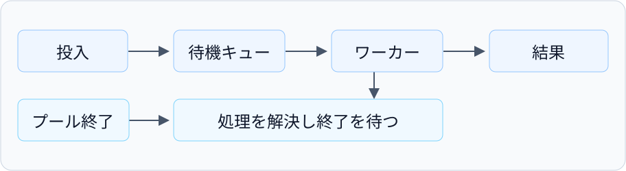

# Core API リファレンス

[中文完整参考](core.md) · [English](core.en.md) · [Core の設定](../configuration/core.ja.md) · [Core のデータ](../data/core.ja.md)

<a id="quick-start"></a>

## 最小構成で使う

`pnpm add @h-ai/core` でインストールします。Node.js アプリに `config/_core.yml` を作成します。

```yaml schema=@h-ai/core:CoreConfigSchema
name: Orders
defaultLocale: ja-JP
```

```ts
import type { CoreConfig } from '@h-ai/core'
import { core } from '@h-ai/core'

// ./config 直下の設定を読み、成功したものを名前で登録します。初期化自体に戻り値はありません。
core.init({ configDir: './config' })
// 読み込んだ core 設定を取得します。欠落時は例外です。
const settings = core.config.getOrThrow<CoreConfig>('core')
// 設定の既定ロケールを次のメッセージへ適用します。戻り値はありません。
core.i18n.setGlobalLocale(settings.defaultLocale)
// 起動ログに設定済みのアプリ名を記録します。業務データは返しません。
core.logger.info('Application ready', { app: settings.name })
```

Core は指定したディレクトリの直下にある YAML を読み込みます。`_core.yml` は `core`、`app.yml` は `app` という名前で保存されます。上の例では、必須の Core 設定を取得できないと起動を中止します。ブラウザーではページのコードから `core.init({ logging: { level: 'warn' } })` のようにログ設定を渡します。ページでアプリ名が必要な場合、サーバーのページデータにその項目だけを含めます。

<a id="api-reference"></a>

## 機能

<a id="config-api"></a>

### ファイルと環境設定：`core.config`

ファイルと環境変数を扱う以下の API は Node.js 用です。`name` は Core に保存した設定の名前です。たとえば `config/app.yml` は `app` です。例の `AppSchema` は、`zod` の `z` で作成した `z.object({ port: z.number().int().positive() })` を想定しています。

`HaiResult` は `success` を確認してから `data` を使います。再読み込みで更新されるのは Core に保存された値です。データベースなど起動時に設定を取得するモジュールには、アプリ側で新しい値を反映します。

#### インターフェース一覧

| API | 用途 | 引数と既定値 | 戻り値・失敗 | 呼び出し例 |
| --- | --- | --- | --- | --- |
| `core.init(options?)` | 起動時にログを設定し、YAML を読み込む | `options` は省略可。`options` は省略可。`configDir` を省略するとファイルを読み込みません。`configSchemas` で名前ごとの型を渡せます。`watchConfig` は既定で `false`。明示した `logging` が YAML より優先されます | `void`。個別ファイルの失敗はログに記録して続行します。ディレクトリやログの初期化エラーは例外になる場合があります | `core.init({ configDir: './config', configSchemas: { app: AppSchema }, watchConfig: true })` |
| `core.config.loadEnvFiles(options)` | dotenv ファイルと既存の環境変数をまとめる | `options` オブジェクトが必須。`options` オブジェクトが必須。`mode` は必須。`envDir` の既定値は作業ディレクトリ | `HaiResult<Record<string, string>>`。アプリが `data` を `process.env` に書き込みます | `core.config.loadEnvFiles({ mode: 'dev' })` |
| `core.config.load(name, filePath, schema?)` | 1 ファイルを読み込み、環境変数で上書きする | `name` と `filePath` は必須。`schema` を省略すると解析と置換のみ行います | `HaiResult<T>`。失敗時は直前に保存した値を保持します | `core.config.load('app', './config/app.yml', AppSchema)` |
| `core.config.validate(name, schema)` | 最後に読み込んだ YAML を現在の環境変数で検証し直す | 読み込み済みの別名 `name` と検証する Zod `schema` が必須。ファイル変更の読み取りは `reload()`。 | `HaiResult<T>`。成功時は値と今後の再読み込みに使う検証ルールを保存します | `core.config.validate('app', AppSchema)` |
| `core.config.get<T>(name)` | 保存済みの設定を読む | 必須の `name` は読込済み設定名。 `T` は取得値の TypeScript 型。 | `T` または `undefined` | `core.config.get<{ port: number }>('app')` |
| `core.config.getOrThrow<T>(name)` | 処理の続行に必要な設定を読む | 必須の `name` は取得する設定名。 `T` は取得値の TypeScript 型。 | `T`。未読み込みなら例外になります | `core.config.getOrThrow<{ port: number }>('app')` |
| `core.config.has(name)` | 指定の設定が読み込まれたか調べる | 必須の `name` は読込済みか確認する設定名。 | `boolean` | `core.config.has('app')` |
| `core.config.keys()` | 読み込み済みの設定名を一覧にする | 引数なし | `string[]` | `core.config.keys()` |
| `core.config.reload(name)` | ファイルを読み直し、監視中のコールバックへ知らせる | 必須の `name` はディスクから再読込する登録済み設定名。 | `HaiResult<unknown>`。設定名が未読み込みなら `CONFIG_NOT_LOADED`。失敗時は以前の値を保持します | `core.config.reload('app')` |
| `core.config.watch<T>(name, callback)` | ファイルの変更後に再読み込みする | 設定の別名 `name` と `callback(value, error)` が必須。新しい値、または失敗時に `null` とエラーを受け取る。 | この登録を解除する関数。設定名が未読み込みの場合はすぐに `CONFIG_NOT_LOADED` を通知します | `const stop = core.config.watch('app', (_value, error) => { if (error) core.logger.warn('Reload failed', { code: error.code }) })` |
| `core.config.isWatching(name)` | ファイル監視が稼働中か調べる | 必須の `name` は監視状態を確認する設定名。 | `boolean` | `core.config.isWatching('app')` |
| `core.config.unwatch(name?)` | 監視を止め、現在の値を保持する | `name` を省略すると全件停止 | `void` | `core.config.unwatch('app')` |
| `core.config.clear(name?)` | 保存済みの設定を消して監視を止める | `name` を省略すると全件削除 | `void`。ディスク上のファイルはそのままです | `core.config.clear('app')` |
| `core.config.resolve(options)` | メモリ上で環境変数による置換を行う | `options` オブジェクトが必須。`options` オブジェクトが必須。`name` と `value` は必須。`environment` は既定で `process.env`。`schema` または `shape` で項目の型を渡せます。`missing` は既定で `'error'`、`'empty'` では未設定の変数を空文字列に置き換えます | `HaiResult<unknown>`。用途に応じてアプリが値を検証します | `core.config.resolve({ name: 'app', value: { port: 3000 }, environment: { HAI_APP_PORT: '4000' } })` |
| `core.config.toEnv(options)` | 設定を環境変数へ変換する | `options` オブジェクトが必須。`options` オブジェクトが必須。`prefix` と `value` は必須。`schema` または `shape` は任意 | `Record<string, string>`。名前が不正なら例外になります | `core.config.toEnv({ prefix: 'HAI_APP', value: { port: 3000 } })` |
| `core.config.mergeEnv(layers)` | 変数を優先順位に従ってまとめる | `layers` は優先度の低い順に並べた環境変数マップの配列。 | `Record<string, string>` | `core.config.mergeEnv([{ HAI_APP_PORT: '3000' }, { HAI_APP_PORT: '4000' }])` |
| `core.config.parseEnv(text)` | dotenv の文字列を変数に変換する | 必須の `text` は dotenv のファイル内容。 | `Record<string, string>`。重複キーや生成用 JSON マーク付きの不正な値は例外になります | `core.config.parseEnv('HAI_APP_PORT=3000\n')` |
| `core.config.stringifyEnv(values, options?)` | 変数を dotenv テキストに変換する | 名前と文字列値のマップ `values` が必須。任意の `options.target` は既定 `node`。Compose 用には `compose` を指定。 | 文字列。名前が不正なら例外になります | `core.config.stringifyEnv({ HAI_APP_PORT: '3000' })` |

#### 利用例：設定の読込・検証・取得

ファイルの読込、環境変数の適用、検証、保存を分けて示します。reload は前回保存したファイルと検証規則を使います。



port: 3000 と HAI_APP_PORT=4000 なら、検証後に 4000 を保存します。読込・検証の失敗では前回の値を保持し、reload の購読者に結果を通知します。他のサービスへの反映はアプリ側で行います。

#### 利用例：Node とブラウザーでの設定

Node では YAML や dotenv を読み込み、ファイルを監視できます。ブラウザーで使う公開設定は、ビルド時に指定するかサーバーから受け取ります。ファイル操作は `SERVICE_UNAVAILABLE` を返し、`getOrThrow()` は例外を送出します。監視コールバックにはすぐ失敗が通知されます。 ブラウザーでは `core.config.isWatching()` は常に `false` を返し、`core.config.unwatch()` は何もしません。

モジュールの初期化前に dotenv の値を読み込んでください。優先順位はプロセスの環境変数、モード別ローカル、ローカル、モード別、基本ファイルの順です。戻り値の変数は必要に応じて明示的に反映します。YAML のプレースホルダーを展開した後、たとえば `HAI_APP_PORT` を `app.port` に反映します。親に JSON を設定するとそのノードを置き換え、同じ優先順位の子キーが親を上書きします。空文字列も指定値です。環境値や JSON から渡したプレースホルダーは展開されません。`resolve()` の結果は別途検証してください。再読み込みで更新されるのは Core 内の値なので、利用側でも明示的に反映し、監視が不要になったら解除します。dotenv の生成結果にある `# hai:json` は保持してください。

```ts
import { core } from '@h-ai/core'
import { z } from 'zod'

// 下のポート列用 Zod スキーマを作り、load に渡します。
const AppSchema = z.object({ port: z.number().int().positive() })
// dev の環境ファイルを読みます。成功時は変数マップ、読み込み・解析失敗時は error です。
const environment = core.config.loadEnvFiles({ mode: 'dev' })
if (!environment.success)
  throw new Error(environment.error.message)
Object.assign(process.env, environment.data)

// YAML を app として読み込み AppSchema で検証します。成功時は登録した設定、読み込み・検証失敗時は error です。
const loaded = core.config.load('app', './config/app.yml', AppSchema)
if (!loaded.success)
  throw new Error(loaded.error.message)
// 読み込んだポートを起動ログに記録します。業務データは返しません。
core.logger.info('Listening', { port: loaded.data.port })
```

`config/app.yml` に `port: 3000` があれば、`HAI_APP_PORT` による上書きがない限り 3000 をログに出します。読み込みや検証に失敗したらリクエストを受け付ける前に終了します。

<a id="logging-api"></a>

### ログを記録する：`core.logger`

`core.logger` は既定で `info` 以上を `pretty` 形式で出力します。ログ収集基盤へ送る場合は `format: 'json'` を指定します。Node で任意依存の `pino-pretty` を使用できない場合も JSON 形式になります。ブラウザーでは開発者コンソールに出力します。設定したレベルより低いメッセージは出力されません。名前付きロガーは、明示的な設定がなければ全体設定を継承します。子ロガーには固定フィールドを追加できます。リクエスト情報を付け、機密値をマスクしてから出力します。

子ロガーの固定フィールドは、その子ロガーとさらに下の子ロガーにだけ付きます。親ロガーは作成時のままです。ログメソッドの第 2 引数 `ctx` は、その 1 件にフィールドを追加します。同じキーがある場合は、全体設定 → ロガーの固定フィールド（親から子の順）→ 呼び出し時の `ctx` → 現在の `core.context` の順に後の値が優先されます。

コンテキスト内の有効な JSON オブジェクト・配列文字列は、展開してからフィールド単位でマスキングします。標準出力、ブラウザー出力、`core.logger.observe` は同じ構造を受け取ります。例えば `{ issues: '[{"path":"ldap.url","code":"invalid_type"}]' }` は要素が一つの `issues` 配列となり、Node の pretty 出力ではインデントされます。可能な限りオブジェクトを直接渡してください。ログメッセージ、JSON のスカラー値、不正な JSON は文字列のままです。65,536 文字を超える場合、解析結果のオブジェクト階層が 32 に達する場合、または JSON の再エンコードが 4 回を超える場合は展開を停止し、テキストのマスキングを適用します。

#### インターフェース一覧

| API | 用途 | 引数と既定値 | 戻り値・失敗 | 呼び出し例 |
| --- | --- | --- | --- | --- |
| `core.logger.trace(message, context?)` | 最も細かい診断手順を記録 | ログ本文の文字列 `message` が必須。任意の `context` でこのログ 1 件にフィールドを追加。 | `void` | `core.logger.trace('Callback entered')` |
| `core.logger.debug(message, context?)` | デバッグ情報を記録 | ログ本文の文字列 `message` が必須。任意の `context` でこのログ 1 件にフィールドを追加。 | `void` | `core.logger.debug('Cache miss', { key: 'total' })` |
| `core.logger.info(message, context?)` | 通常の業務イベントを記録 | ログ本文の文字列 `message` が必須。任意の `context` でこのログ 1 件にフィールドを追加。 | `void` | `core.logger.info('Order created', { id: 'order-1' })` |
| `core.logger.warn(message, context?)` | 処理を続けられる注意事項を記録 | ログ本文の文字列 `message` が必須。任意の `context` でこのログ 1 件にフィールドを追加。 | `void` | `core.logger.warn('Retry scheduled', { attempt: 2 })` |
| `core.logger.error(message, context?)` | 処理の失敗を記録 | ログ本文の文字列 `message` が必須。任意の `context` でこのログ 1 件にフィールドを追加。 | `void` | `core.logger.error('Write failed', { error })` |
| `core.logger.fatal(message, context?)` | 重大障害を記録。終了するかはアプリが決定 | ログ本文の文字列 `message` が必須。任意の `context` でこのログ 1 件にフィールドを追加。 | `void` | `core.logger.fatal('Startup failed')` |
| `core.logger.create(options?)` | 未指定の項目を全体設定から継承するロガーを作る | `options` は省略可。`name`、`level`、`format`、`context` の優先順位は下表を参照。 | `Logger` | `core.logger.create({ name: 'orders' })` |
| `core.logger.child(context)` | 固定フィールドを持つ子ロガーを作る | 必須の `context` オブジェクト。この子ロガーとその配下のログに固定フィールドとして付加。 | `Logger` | `core.logger.child({ requestId: 'req-1' })` |
| `core.logger.configure(config)` | 指定した全体ログ設定を更新 | `config` オブジェクトが必須。`level`、`format`、`context`、`redact` は省略可。下表を参照。 | `void` | `core.logger.configure({ format: 'json', redact: ['customer.email'] })` |
| `core.logger.setLevel(level)` | 全体の出力しきい値を変更。初期は info | 必須の `level`。`trace`、`debug`、`info`、`warn`、`error`、`fatal` のいずれか。 | `void` | `core.logger.setLevel('warn')` |
| `core.logger.getLevel()` | 現在の全体しきい値を取得 | 引数なし | `LogLevel` | `core.logger.getLevel()` |
| `core.logger.observe(observer)` | 出力レベルによる選別とマスクの後の記録を購読 | 必須の同期 `observer(record)`。レベルで選別しマスクした `LogRecord` を受け取る。 | `() => void` | `core.logger.observe(record => { recentMessages.push(record.message) })` |

#### 利用例：レベル別の業務・診断ログ

| 項目 | `create(options?)` | `configure(config)` |
| --- | --- | --- |
| `name` | `'orders'` など、ログの所属モジュールを示す文字列。省略可。 | モジュール名は `create()` で指定。 |
| `level` | `trace`、`debug`、`info`、`warn`、`error`、`fatal`。省略時は出力時の全体しきい値を継承。 | 初期値は `info`。指定すると全体しきい値を更新。 |
| `format` | `'json'` または `'pretty'`。省略時は出力時の全体形式を継承。 | 初期値は `'pretty'`。指定すると全体形式を更新。 |
| `context` | このロガーの各ログに付加するオブジェクト。省略可。同じキーは全体の値を上書き。 | 指定したオブジェクトを最上位キーで全体のコンテキストへマージ。省略または `{}` で既存の値を保持。 |
| `redact` | 全体のルールを継承。 | 追加でマスクするフィールドパスの配列。初期値は `[]`。`['customer.email']` を渡すと追加ルールを置換し、`[]` で解除。組み込みのマスクは継続。 |

```ts
import { core } from '@h-ai/core'

// 全体の出力を JSON にし、顧客メールアドレスをマスクします。戻り値はありません。
core.logger.configure({ format: 'json', redact: ['customer.email'] })
// orders 名のロガーを作り、そのオブジェクトを返します。
const orders = core.logger.create({ name: 'orders' })
// 閾値を info にし、低いレベルを除外します。戻り値はありません。
core.logger.setLevel('info')
// 引数なしで現在の閾値を取得します。結果は info です。
core.logger.getLevel() // 'info'
// 起動失敗メッセージを fatal で記録します。戻り値は undefined です。
core.logger.fatal('Example startup failure') // ログを記録し、プロセスは終了しません。
// orders に request-1 を追加した子ロガーを返します。
const request = orders.child({ requestId: 'request-1' })

// 親ロガーで作成メッセージと渡したフィールドを記録します。業務データは返しません。
orders.info('Order created', { attempt: 1, customer: { email: 'user@example.com' } }) // customer.email は '[REDACTED]'。
// 子ロガーで attempt: 2 と request-1 を記録します。業務データは返しません。
request.warn('Request needs attention', { attempt: 2 })
// request-2 の文脈でコールバックを実行し、終了後に外側へ戻って結果を返します。
core.context.run({ requestId: 'request-2' }, () => {
  // 確認と attempt: 1 を記録します。文脈から request-2 が入り、業務データは返しません。
  orders.info('Order checked', { attempt: 1 })
})
```

1 件目は `attempt: 1` のみで、リクエスト ID は付きません。2 件目には `attempt: 2` と子ロガーの `requestId: 'request-1'` が付きます。3 件目は親ロガーを使っていますが、`core.context.run()` により `requestId: 'request-2'` が付きます。

監視コールバックは、レベル判定とマスク処理を通過したログを受け取ります。記録件数などに上限を設けてください。コールバックの例外や即時の再帰呼び出しは他のログ処理から分離されます。戻り値の関数で購読を解除できます。

<a id="context-api"></a>

### 同じ要求を関連付ける：`core.context`

信頼できる要求・利用者 ID を非同期呼び出しに引き継ぎ、ログを関連付けます。

#### インターフェース一覧

| API | 用途 | 引数と既定値 | 戻り値・失敗 | 呼び出し例 |
| --- | --- | --- | --- | --- |
| `core.context.run(context, operation)` | リクエストやタスクのコンテキストで実行 | 信頼できるリクエスト ID と任意の `suppressLogObservers` を持つ `context` が必須。`operation` は同期または非同期の必須コールバック。 | コールバックの戻り値 | `await core.context.run({ requestId: 'req-1' }, async () => core.context.get().requestId)` |
| `core.context.get()` | 現在の値を取得 | 引数なし | 空の場合は `{}` | `const { requestId } = core.context.get()` |

#### 利用例：非同期処理への要求 ID の引継ぎ

`core.context.run()` に `requestId`、`userId`、`scopeId`、`jobId` などの追跡項目を渡します。Node では `await` をまたいでもリクエストごとに値が保持されます。ブラウザーで保持されるのは同期処理中だけです。ロガーは現在の値を自動で付加します。利用者やテナントの識別子は信頼できるサーバー側の処理で取得してください。収集処理自体の診断ログを出すときは、`suppressLogObservers: true` を指定すると監視コールバックへの再通知を抑制できます。

<a id="sanitize-api"></a>

### 診断情報のマスク：`core.sanitize`

診断に使う前にオブジェクト・URL・文字列の秘密を隠し、元データは変えません。

#### インターフェース一覧

| API | 用途 | 引数と既定値 | 戻り値・失敗 | 呼び出し例 |
| --- | --- | --- | --- | --- |
| `core.sanitize.isSensitiveKey(key, matcher?)` | 機密フィールド名か判定 | 判定対象のフィールド名 `key` が必須。任意の `matcher` は正規表現、フィールド名の配列、判定関数のいずれか。既定は組み込み。 | `boolean` | `core.sanitize.isSensitiveKey('apiKey')` |
| `core.sanitize.sanitizeSensitiveValue(value, key, options?, cache?)` | 値を一つマスク | 元の `value` とキー `key` が必須。ルートは `null`。任意の `options` で判定と置換値を設定し、置換値の既定は `[REDACTED]`。コピー済みのオブジェクトを保持する `cache` は `WeakMap` で、省略時は呼び出しごとに作成。 | 値 | `core.sanitize.sanitizeSensitiveValue('example-only', 'password')` |
| `core.sanitize.sanitizeSensitiveFields(value, options?)` | 構造データをコピーしてマスク | コピーしてマスクする `value` が必須。任意の `options.matcher`、`options.replacement` は下表を参照。 | マスク済みコピー | `core.sanitize.sanitizeSensitiveFields({ password: 'example-only' })` |
| `core.sanitize.sanitizeUrl(url, options?)` | URL の認証情報をマスク | `url` 文字列が必須。任意の `options.matcher` と `options.replacement` は URL 内の資格情報フィールドに適用。 | `string` / `(invalid url)` | `core.sanitize.sanitizeUrl('https://example.com/?token=example-only')` |
| `core.sanitize.sanitizeText(text, secretValues?)` | 認証情報を含む文字列をマスク | マスク対象の `text` が必須。任意の `secretValues` に既知の秘密値の配列を渡す。既定値 `[]`。 | `string` | `core.sanitize.sanitizeText('Bearer example-only')` |
| `core.sanitize.defaultSensitiveKeyRegex`、`defaultSensitiveReplacement` | 組み込みの判定規則と置換値を参照 | 読み取り専用定数 | `RegExp` / `string` | `const replacement = core.sanitize.defaultSensitiveReplacement` |

<a id="sanitize-options"></a>

#### マスクのオプション

| 項目 | 値・既定値・用途 |
| --- | --- |
| `matcher` | 任意の正規表現、フィールド名配列、または `(key) => boolean`。置換するフィールドを選ぶ。既定は組み込みの機密キー判定。 |
| `replacement` | 置換値。既定は文字列 `[REDACTED]`。URL の場合は文字列として反映。 |

下の例ではパスワードをマスク済みのコピーに `matcher: ['email']`、`replacement: '***'` を適用し、メールが `***` になります。

#### 利用例：診断の公開前に秘密を隠す

診断情報を保存したり利用者へメッセージを返したりする前に使います。標準の規則は認証情報のフィールドをマスクします。業務固有の項目に独自の規則を使う場合は、先に標準の処理を適用してください。処理はデータのコピーを対象とし、クラスの getter や独自の `toJSON()` は実行しません。日付は ISO 文字列、URL はマスク済みの文字列になります。ラベルなしの機密値もテキストから取り除くには、その値を明示的に渡してください。通常のオブジェクトのコピーには循環参照が残ることがあります。

<a id="error-api"></a>

### 結果とエラー：`core.error`

業務エラー・診断・安全な公開エラーを作り、成功値を結果構造で包みます。

#### インターフェース一覧

| API | 用途 | 引数と既定値 | 戻り値・失敗 | 呼び出し例 |
| --- | --- | --- | --- | --- |
| `core.error.buildHaiErrorsDef(module, errorInfo, system?)` | モジュールの安定したエラーコードを定義 | `module` と、エラー名を `業務コード:HTTP状態` に対応付けた `errorInfo` が必須。`system` の既定値は `hai` で、コードの先頭に付く。 | エラー定義 | `const errors = core.error.buildHaiErrorsDef('orders', { NOT_FOUND: '300:404' })` |
| `core.error.buildHaiErrorInst(def, message, cause?, suggestion?)` | 失敗にメッセージを付加 | エラー定義 `def` と公開する `message` が必須。内部原因 `cause` と対処の提案 `suggestion` は省略可。 | `HaiError` | `const error = core.error.buildHaiErrorInst(errors.NOT_FOUND, 'Order not found')` |
| `core.error.toPublic(error, traceId?, locale?)` | クライアントに返すエラーを整形 | `error` は必須。`traceId` は関連 ID を上書きし、`locale` は 5xx の共通メッセージに使う言語を指定。 | 公開用エラー | `core.error.toPublic(error, 'req-1')` |
| `core.error.formatMessage(error)` | 表示メッセージを整形 | 文字列メッセージと任意の `traceId` を持つ `error` が必須。 | `string` | `core.error.formatMessage(error)` |
| `ok(data)`、`err(errorOrDef, message?, cause?, suggestion?)` | 業務処理の結果を構築 | `ok` には成功時の `data` を渡す。`err` にはエラー定義、`HaiError`、標準エラーのいずれかの `errorOrDef` が必須。`message`、`cause`、`suggestion` は省略可。 | `HaiResult` | `ok({ id: 'order-1' })`、`err(errors.NOT_FOUND, 'Order not found')` |

#### 利用例：業務の失敗と安全な公開文言

業務処理の呼び出し元は、`data` や `error` を読む前に `result.success` を確認します。エラーコードは共通の定義にまとめ、発生時にメッセージを翻訳します。HTTP で返す前に `core.error.toPublic()` で内部の原因情報を除去します。公開可能なエラーを返し、追跡 ID を使ってサーバーログと照合できます。`ok` と `err` は `@h-ai/core` から直接インポートします。

<a id="i18n-api"></a>

### メッセージと言語：`core.i18n`

要求ごとに言語を選んで辞書から文言を取り出します。並行要求でグローバル言語を変えません。

#### インターフェース一覧

| API | 用途 | 引数と既定値 | 戻り値・失敗 | 呼び出し例 |
| --- | --- | --- | --- | --- |
| `core.i18n.setGlobalLocale(locale)` | 既定の言語を設定する | 必須の `locale` は `zh-CN`、`en-US`、`ja-JP`。略記 `zh`、`en`、`ja` も利用可。 | `void` | `core.i18n.setGlobalLocale('ja-JP')` |
| `core.i18n.getGlobalLocale()` | 現在の言語を取得する | なし。初期値は `zh-CN` | 言語コード | `core.i18n.getGlobalLocale()` |
| `core.i18n.runWithLocale(locale, operation)` | Node の処理中だけ言語を指定 | リクエスト言語 `locale` と同期または非同期の `operation` が必須。コールバックの値をそのまま返す。 | 関数の戻り値 | `await core.i18n.runWithLocale('en-US', async () => core.i18n.coreM('core_errorNotFound'))` |
| `core.i18n.createMessageGetter(messages)` | メッセージ取得関数を作成 | `messages` が必須。言語コードをキーとし、メッセージキーと訳文の辞書を値にする。 | `(key, options?) => string` | `const message = core.i18n.createMessageGetter({ 'zh-CN': { welcome: 'ようこそ' } })` |
| `core.i18n.coreM(key, options?)` | 組み込みメッセージを取得 | メッセージ `key` が必須。任意の `options.locale` で言語を上書きし、`options.params` で `{name}` などを埋める。 | `string` | `core.i18n.coreM('core_errorNotFound', { locale: 'en-US' })` |
| `core.i18n.DEFAULT_LOCALE`、`DEFAULT_LOCALES` | 対応言語を参照 | 読み取り専用定数 | 言語と候補一覧 | `const choices = core.i18n.DEFAULT_LOCALES` |

#### 利用例：要求ごとのメッセージ言語

メッセージは、呼び出し時に指定した言語、Node の現在のリクエスト言語、全体の言語の順に選ばれます。未対応の言語や辞書が存在しない場合は `zh-CN` に切り替わります。`zh`、`en`、`ja` はそれぞれ地域付きの言語コードに正規化されます。キーがなければキー自身を返し、置換値を省くとプレースホルダーは文字列に残ります。アプリ固有のメッセージには別の辞書を用意してください。

<a id="validation-api"></a>

### フィールド検証の文言：`core.zodValidation`

Zod の問題を、フィールドの位置を保ってフォームの翻訳済み文言に変換します。

#### インターフェース一覧

| API | 用途 | 引数と既定値 | 戻り値・失敗 | 呼び出し例 |
| --- | --- | --- | --- | --- |
| `core.zodValidation.createPrefixedZodMessageGetter(prefix, getMessage)` | モジュールのメッセージキーに接頭辞を付ける | メッセージキーの `prefix` と、訳文を取得する `getMessage(key, params)` が必須。 | 取得関数 | `const translate = core.zodValidation.createPrefixedZodMessageGetter('core', message)` |
| `core.zodValidation.mapZodErrorToFormErrors(error, getMessage)` | Zod の問題を入力項目に対応付ける | Zod の検証 `error` と変換済みの `getMessage(key, params)` が必須。 | `{ field, message }[]` | `core.zodValidation.mapZodErrorToFormErrors(parsed.error, translate)` |

#### 利用例：検証エラーとフォームの対応

Zod v3/v4 の検証結果をフィールドごとのメッセージに変換します。配列の位置は `items.0.email` のように表し、フォーム全体には `_` を使います。独自メッセージはそのまま返されます。取得関数で共通メッセージのキーと自分の辞書を対応付けます。

<a id="module-api"></a>

### モジュールの起動と終了：`core.module`

`core.module.createRuntime()` は起動・終了を管理するオブジェクトを返します。依存先を順番に初期化するには `start()`、終了時に逆順で解放するには `close()` を呼び出します。起動に失敗すると解放処理に進みます。解放に失敗した場合は、使用中の依存先を残し、次の終了または起動時に再試行します。同時に起動した場合は処理を共有します。どちらも `HaiResult` を確認してください。処理ごとに `enabled` で対象に含める条件を指定できます。

#### インターフェース一覧

| API | 用途 | 引数と既定値 | 戻り値・失敗 | 呼び出し例 |
| --- | --- | --- | --- | --- |
| `core.module.createRuntime(definitions)` | 依存先の起動と終了を管理 | 初期化順の配列 `definitions` が必須。各項目の `name`、`start`、`close` は必須で、任意の `enabled` が実行可否を決める。 | `ModuleRuntime`, each call returns `Promise<HaiResult<void>>` | `const runtime = core.module.createRuntime([{ name: 'cache', start: () => cache.init({ type: 'memory' }), close: () => cache.close() }])` |
| `core.module.createNotInitializedKit(codeOrDef, messageFn)` | 初期化前に共通のエラーを返す | エラーコードまたは定義の `codeOrDef` と、メッセージを取得する引数なしの `messageFn` が必須。 | `error()`, `result()`, `proxy()` | `core.module.createNotInitializedKit(HaiCommonError.NOT_INITIALIZED, () => 'Initialize the module first')` |
| `core.module.requiresSharedState(environment)` | 共有バックエンドが必要か判定 | `environment` オブジェクトが必須。`NODE_ENV` または `HAI_CORE_ENV` が `production` なら共有状態が必要。`HAI_E2E` または `HAI_E2E_MOCK` が `1` の明示的テストは除く。 | `boolean` | `core.module.requiresSharedState(process.env)` |

#### 利用例：依存順の起動と逆順の終了

#### 利用例：初期化前の呼び出しにエラーを返す

モジュールの実装者が、実際のバックエンドを利用できる前でも同じ API を公開するための機能です。たとえば、`cache.init()` が成功する前に `cache.kv.get(key)` を呼ぶと、Redis に接続せず、未初期化の失敗結果を返します。準備ができると、キャッシュモジュールが実際の操作を公開します。既存のモジュールを使う側は、先に初期化して、呼び出し結果を確認してください。

- `error()` はエラーオブジェクトを返します。
- `result<T>()` は `{ success: false, error }` を返します。操作の途中で処理を打ち切るときに使えます。
- `proxy<T>()` は操作インターフェース `T` の仮の実装を作ります。実際の操作は行わず、失敗結果で解決する Promise を返します。すべてが同期メソッドなら `proxy<T>('sync')` を使います。

メッセージ関数はエラーを作るたびに実行され、現在のリクエストの言語で文言を取得できます。

<a id="order-lookup-example"></a>

#### 例：注文の状態一覧を読み込むまでは照会を受け付けない

注文照会モジュールが注文の有無を判断できるのは、状態一覧を読み込んだ後です。起動が完了する前に呼び出された場合は未初期化エラーを返し、呼び出し側が「その注文は存在しない」と誤解しないようにします。ここでは読み込み済みの一覧をメモリ上の `Map` で表します。`@h-ai/core` だけで動作し、データベースは不要です。

```ts
import type { HaiResult } from '@h-ai/core'
import { core, HaiCommonError, ok } from '@h-ai/core'

interface OrderQueries {
  getStatus: (orderId: string) => Promise<HaiResult<string | null>>
}

// 下の 3 言語の辞書でメッセージ取得関数を作ります。
const message = core.i18n.createMessageGetter({
  'zh-CN': { notReady: '订单查询模块尚未初始化' },
  'en-US': { notReady: 'Order queries are not initialized' },
  'ja-JP': { notReady: '注文照会モジュールが初期化されていません' },
})
// 共通の未初期化エラーとメッセージ関数から、プロキシと失敗を作るツールを得ます。
const waiting = core.module.createNotInitializedKit(
  HaiCommonError.NOT_INITIALIZED,
  // 注文検索の未初期化文言を現在の言語で取得します。
  () => message('notReady'),
)
// インターフェースから非同期の代替を作ります。メソッドは未初期化エラーを返します。
const fallback = waiting.proxy<OrderQueries>() // 与实际查询接口一致，默认返回 Promise。
let activeQueries: OrderQueries | undefined

const orderLookup = {
  init(statusById: ReadonlyMap<string, string>): HaiResult<void> {
    activeQueries = {
      async getStatus(orderId) {
        // 渡された ID の状態または null を成功 data に包みます。
        return ok(statusById.get(orderId) ?? null) // 查不到订单时成功返回 null。
      },
    }
    // この例の初期化成功を返します。data は undefined です。
    return ok(undefined)
  },
  get orders(): OrderQueries {
    return activeQueries ?? fallback // 每次取接口时根据模块状态选择实现。
  },
  close(): void {
    activeQueries = undefined
  },
}

// 未初期化の代替で注文を検索します。未初期化エラーが返ります。
const beforeInit = await orderLookup.orders.getStatus('order-42')
if (!beforeInit.success)
  // 代替の未初期化エラーコードを記録します。業務データは返しません。
  core.logger.warn('Order lookup is not ready', { code: beforeInit.error.code })

// 此处用内存索引模拟已经从数据库加载完的数据。
// order-42 を発送済みとして検索を有効にします。成功時の data はなく、失敗時は error です。
const initialized = orderLookup.init(new Map([['order-42', 'shipped']]))
if (!initialized.success)
  throw new Error(initialized.error.message)
try {
  // 読み込んだ order-42 を検索し、成功時に shipped を返します。
  const found = await orderLookup.orders.getStatus('order-42')
  // 存在しない order-99 を検索します。成功時は null です。
  const missing = await orderLookup.orders.getStatus('order-99')
  if (found.success && missing.success)
    // 一致した状態と欠落時の null を記録します。業務データは返しません。
    core.logger.info('Order lookup finished', { found: found.data, missing: missing.data })
}
finally {
  // 引数なしで現在の索引を破棄し、後続の照会を代替に戻します。
  orderLookup.close()
}
// 終了後に order-42 を再検索すると未初期化エラーが返ります。
const afterClose = await orderLookup.orders.getStatus('order-42')
if (!afterClose.success)
  // 終了後のエラーコードを記録します。業務データは返しません。
  core.logger.warn('Order lookup has closed', { code: afterClose.error.code })
```

| 照会のタイミング | 結果 |
| --- | --- |
| 初期化前に `order-42` を照会（`beforeInit`） | `success: false`、エラーコードは `HaiCommonError.NOT_INITIALIZED.code`、`data` なし。 |
| 初期化後に `order-42` を照会（`found`） | `{ success: true, data: 'shipped' }`。 |
| 存在しない `order-99` を照会（`missing`） | `{ success: true, data: null }`。一覧は照会できましたが、該当注文はありません。 |
| 終了後に `order-42` を再び照会（`afterClose`） | 再び未初期化エラーを返します。 |

仮の操作オブジェクト自体が実際の実装に変わるわけではありません。初期化後は `orderLookup.orders` の getter が実際の操作を返します。起動前に取得した仮のオブジェクトを保持せず、照会のたびに getter から取得します。

<a id="worker-api"></a>

### `core.worker` で CPU 処理をバックグラウンドに移す

大きな文書の処理や一括計算を Worker に渡すと、呼び出し元はほかの処理を続けられます。プールは必要に応じてスレッドを起動し、各スレッドは待機キューの先頭から一件ずつ実行します。メッセージの継続的な交換や個別の終了には専用スレッドを使います。

#### インターフェース一覧

| 入口 | 用途 | 入力 | 戻り値 | 例 |
| --- | --- | --- | --- | --- |
| `core.worker.createPool(entry, options)` | プールを作成 | Worker URL またはブラウザーの生成関数 `entry` と、スレッド、待ち行列、アイドル回収を指定する `options` が必須。下表を参照。 | `WorkerPool<Input, Output>` | `core.worker.createPool<string, number>(entry, limits)` |
| `pool.run(input, transfer?)` | 処理を投入 | 構造化クローン可能な `input` が必須。`transfer` は任意の転送リスト。Node は ArrayBuffer を受け付ける。 | `Promise<HaiResult<Output>>` | `await pool.run(report)` |
| `pool.close()` | 未完了処理を解決してスレッドを終了 | なし | `Promise<void>` | `await pool.close()` |
| `core.worker.start(entry, options?)` | 専用スレッドを起動 | `entry` が必須。Node の `options` には `workerData` と `execArgv` を指定可。ブラウザーは入口だけを受け付ける。 | `WorkerThread<Input, Output>` | `core.worker.start<string, number>(entry)` |
| `thread.postMessage(input, transfer?)` | メッセージを送信 | 構造化クローン可能な `input` が必須。`transfer` は任意の転送リスト。Node は ArrayBuffer を受け付ける。 | `void` | `thread.postMessage(report)` |
| `thread.onMessage(listener)` | メッセージを購読 | Worker の各メッセージを受け取る `listener(output)` が必須。 | 購読解除関数 | `const unsubscribe = thread.onMessage(receive)` |
| `thread.exited` | 終了を監視 | なし | `Promise<WorkerExit>` | `await thread.exited` |
| `thread.terminate()` | スレッドを終了 | なし | `Promise<void>` | `await thread.terminate()` |

<a id="worker-options"></a>

#### プールと専用スレッドのオプション

| 項目 | 値・既定値・用途 |
| --- | --- |
| `createPool.options.maxWorkers` | 正の安全な整数を必須指定。各スレッドは同時に一つのタスクを実行。 |
| `createPool.options.maxQueuedJobs` | 非負の安全な整数を必須指定。`0` で待機なし。 |
| `createPool.options.idleTimeoutMs` | 任意の整数で 1～2147483647 ミリ秒。省略時は閉じるまでアイドルスレッドを保持。 |
| `start.options.workerData` | Node 専用。構造化クローン可能な起動データを渡し、Worker の `workerData` から読む。既定なし。 |
| `start.options.execArgv` | Node 専用。Worker の Node 起動引数を文字列配列で指定。省略時はホストの引数を継承。 |

下の文字数の例で `{ maxWorkers: 2, maxQueuedJobs: 4 }` を指定します。同時実行は二件、待機は四件、さらに投入すると制限エラーを返します。

#### 利用例：文書の文字数を測定してスレッドを解放する

図は一つのプール内の流れを示します。各スレッドは結果を返した後、キューの先頭の処理を受け取ります。終了時には待機中と実行中の処理を解決します。



一件目の文書を処理している間、二件目はキューで待機します。この時点でプールを閉じると両方が終了済みの結果を受け取ります。呼び出し元は `close()` の完了後にほかのリソースを解放します。

次のエントリーファイルをアプリと一緒に配布します。入力一件につき一回応答し、呼び出し側には対応する入力と出力の型を指定します。

```js
import { parentPort } from 'node:worker_threads'

parentPort?.on('message', report => parentPort.postMessage(report.length))
```

Node サービスでプールを作成し、一連の処理を終えたら閉じます。

```ts
import { core } from '@h-ai/core'

const entry = new URL('./stats-worker.mjs', import.meta.url)
// worker の URL で、最大 2 スレッド・待機 4 件のプールを作ります。
const pool = core.worker.createPool<string, number>(entry, { maxWorkers: 2, maxQueuedJobs: 4 })
try {
  // レポート文字列を渡します。成功時は長さ 16、満杯やスレッド失敗時は error です。
  const result = await pool.run('Quarterly report')
  if (!result.success)
    throw new Error(result.error.message)
  void result.data // 16
}
finally {
  // 引数なしで未処理タスクを精算し、ワーカーの終了を待ちます。
  await pool.close()
}
```

キューが満杯の場合は `HaiCommonError.RATE_LIMIT_EXCEEDED`、プールが閉じていれば `NOT_INITIALIZED`、起動や通信、スレッドの障害は `INTERNAL_ERROR` になります。障害のあった処理を解決した後、後続の処理でスレッドを補充できます。`idleTimeoutMs` でアイドル時の回収を指定できます。省略すると終了操作までアイドルスレッドが残り、Node ではイベントループの参照が解除されます。

#### 利用例：専用スレッドを起動して最初の応答を待つ

処理を投入して `await` で結果を受け取るには、前の例の `pool.run()` を使います。メッセージを直接やり取りしたり、スレッドを終了するタイミングを制御したりする場合は、`core.worker.start()` を使います。

次の Node Worker を `stats-once-worker.mjs` として保存します。メッセージを一件受信すると文字列の長さを返し、メッセージポートを閉じて自ら終了します。

```js
import { parentPort } from 'node:worker_threads'

const port = parentPort
port?.once('message', (report) => {
  port.postMessage(report.length)
  port.close()
})
```

同じディレクトリの呼び出し元スクリプトでは、`onMessage()` で応答を購読してから、`postMessage()` で `'Report'` を送信します。応答が届くと、コールバックが `length` の値 `6` をログに記録します。

```ts
import { core } from '@h-ai/core'

const entry = new URL('./stats-once-worker.mjs', import.meta.url)
// 統計用の URL で専用ワーカーを起動し、制御オブジェクトを返します。
const thread = core.worker.start<string, number>(entry)
// 長さを購読して info ログに記録します。購読の戻り値は解除関数です。
const unsubscribe = thread.onMessage(length => core.logger.info('Report length', { length }))

try {
  // クローン可能な Report をワーカーへ送信します。戻り値はありません。
  thread.postMessage('Report')
  // スレッド終了を待ちます。正常時は code が 0、異常時は error または別の終了コードを確認します。
  const { code, error } = await thread.exited
  if (error || code !== 0)
    throw error ?? new Error(`Worker exited with code ${code}`)
}
finally {
  // 引数なしで上で登録したメッセージの受信を止めます。
  unsubscribe()
  // 引数なしで専用ワーカーを停止させ、終了を待ちます。
  await thread.terminate()
}
```

`await thread.exited` は Worker の終了を待ち、終了状態を取得します。`finally` で購読を解除し、メッセージの送信時などに例外が発生した場合もスレッドを終了します。

Vite では `() => new Worker(new URL("./stats-worker.js", import.meta.url), { type: "module" })` のように Web Worker のコンストラクター内に入口を記述します。Worker の入口は `globalThis.addEventListener("message", ...)` と `postMessage()` を使います。ブラウザーでは `thread.terminate()` を呼び出すか、Worker のエラーを受信すると `thread.exited` が解決します。アプリと一緒に配布した信頼できるスクリプトを使用します。メッセージは構造化クローンで送信されます。Node では ArrayBuffer、ブラウザーでは ImageBitmap なども転送でき、転送リストを指定すると所有権が Worker に移ります。

<a id="access-api"></a>

### 要求のアクセス判定：`core.access`（Node）

`core.access` は、パス、HTTP メソッド、クライアント IP、サーバーの現在時刻に基づいて、Node サーバーがリクエストを通すかを判定します。認証と認可は引き続きサービス側で行います。

- **Serv または Kit:** `_serv.yml` の `http.access` または `_kit.yml` の `access` に書き、`serv.createApp({ http, ... })` または `kit.createHandle({ access, ... })` に渡します。フレームワークが起動時に判定の準備を行い、拒否時は HTTP 403 を返します。ルールは `_core.yml` には書きません。
- **その他の Node HTTP フレームワーク:** 起動時に IP 解決関数と判定関数を作ります。リクエストごとに、サーバーや信頼できる基盤から直接接続した相手のアドレスを取得して IP を解決し、URL のパス、HTTP メソッド、解決した IP を判定関数に渡します。HTTP の応答は結果を見て呼び出し側で返します。

リクエストは `global` と該当するすべてのルールを満たす必要があります。該当するルールがなければ `global` だけが適用されます。`methods` を省略するか空の配列を渡すとすべてのメソッドに適用され、末尾の `/**` はパス自体と配下の両方に一致します。拒否時には `reason`（`address`、`time` または `path`）と、ルールで拒否した場合の `ruleId` が返ります。

<a id="client-ip-resolver"></a>

#### インターフェース一覧

| API | 用途 | 引数と既定値 | 戻り値・失敗 | 呼び出し例 |
| --- | --- | --- | --- | --- |
| `core.access.normalizeClientIp(value?)` | IPv4 または IPv6 を正規化 | 接続元のアドレス文字列 `value` は省略可。省略時と無効値は `undefined`。 | `string` / `undefined` | `core.access.normalizeClientIp('::ffff:198.51.100.23')` |
| `core.access.createClientIpResolver(trustedProxies?)` | リクエストごとにアクセス判定用の IP を選ぶ関数を作成 | `trustedProxies` の既定値は `auto`。管理された非公開環境でだけコンテナのサブネットを使用。IP/CIDR 配列も指定可。`[]` で転送ヘッダーを無視。 | `resolveClientIp(request, remoteAddress?)` → IP または `undefined` | `const resolveClientIp = core.access.createClientIpResolver(['192.0.2.10'])` |
| `core.access.createConditionCheck(condition)` | アドレスと時間帯の条件を準備 | 信頼済みアドレスと時間の条件 `condition` が必須。項目と値は[アクセス方針](#access-condition-options)を参照。 | `(ip?) => AccessDecision` | `core.access.createConditionCheck({ allowIps: [], denyIps: [], timezone: 'UTC', windows: [] })` |
| `core.access.createRequestCheck(input?)` | リクエストポリシーを準備 | `input` はインライン方針、`{ file }`、`false` のいずれか。既定値は `false`。 | `check(pathname, method, ip?)` → `AccessDecision` | `core.access.createRequestCheck({ file: './config/security/request-access.yml' })` |
| `core.access.loadPolicy(input?, baseDirectory?)` | ポリシーを読み込んで検証 | `input` はインライン方針、`{ file }`、`false` のいずれか。既定値は `false`。`baseDirectory` は相対ファイルの基準で、既定は現在のディレクトリ。 | `RequestAccessPolicy` / `false` | `core.access.loadPolicy({ file: './config/security/request-access.yml' })` |

<a id="access-condition-options"></a>

#### アドレスと時間の条件

| 項目 | 値・既定値・用途 |
| --- | --- |
| `allowIps` | IPv4、IPv6、または CIDR の配列。空なら制限なし、指定時は一致したアドレスだけ許可。 |
| `denyIps` | IPv4、IPv6、または CIDR の配列。空なら拒否対象なし。一致時は許可リストより優先。 |
| `timezone` | 時間帯の判定に使う IANA タイムゾーン。例は `UTC`。 |
| `windows` | 時間帯の配列。`[]` で時間制限なし。各時間帯の `days`、`start`、`end` は下の例を参照。 |

#### 利用例：送信元の確認とアクセス規則

#### 利用例：アクセス判定に使う IP アドレスを決める

**`core.access.createClientIpResolver()` は、アクセス判定に渡す IP アドレスを選びます。** たとえば、取引先 `198.51.100.23` がリバースプロキシ `192.0.2.10` を経由して Node にアクセスすると、Node のソケットには直接つながったプロキシのアドレスだけが見えます。このアドレスをそのまま渡すと、取引先ではなくプロキシを判定することになります。IP を選ぶ関数は、信頼するプロキシの一覧を見て、そのプロキシが伝えた上流のアドレスを使えるかどうかを決めます。

- **起動時：** `createClientIpResolver(['192.0.2.10'])` で関数を作ります。この一覧に指定するのは、リクエストの送信元を伝えてよいプロキシです。アクセスを許可するクライアントは、別途ルールの `allowIps` に指定します。
- **リクエストごと：** `resolveClientIp(request, remoteAddress)` を呼びます。`request` には HTTP ヘッダーが入っています。`remoteAddress` は直接接続した相手のアドレスで、リクエストヘッダーではなく、サーバーのソケット（例：`socket.remoteAddress`）や信頼できる基盤の API から取得します。戻り値は判定に使う IP 文字列で、取得できなければ `undefined` です。

| 直接の接続元（`remoteAddress`） | `X-Forwarded-For` | 判定に使う IP |
| --- | --- | --- |
| 信頼するプロキシ `192.0.2.10` | `198.51.100.23` | `198.51.100.23`。プロキシが伝えた上流のアドレスを使います。 |
| 信頼するプロキシの一覧にない `203.0.113.7` | 同じく `198.51.100.23` | `203.0.113.7`。転送ヘッダーは無視します。 |
| 信頼するプロキシ `192.0.2.10` | なし。`X-Real-IP` もなし | `192.0.2.10`。直接接続したプロキシのアドレスだけが分かります。 |
| 信頼するプロキシ `192.0.2.10` | 判定に必要なアドレスが無効 | `undefined`。使える上流のアドレスがありません。 |
| 直接の接続元が未指定 | ヘッダーがあっても | `undefined`。誰がヘッダーを渡したか確認できません。 |

信頼するプロキシが複数のアドレスを伝えた場合は、`X-Forwarded-For` の右端から順に信頼するプロキシのアドレスを飛ばし、一覧にない最初のアドレスを使います。すべてが一覧にあれば左端のアドレスを使います。`X-Real-IP` を読むのは `X-Forwarded-For` がない場合だけです。既定の `auto` は通常の Node サーバーでは転送ヘッダーを無視し、フレームワークが構成した非公開の Compose 環境ではコンテナのプライベートサブネットを使います。常に転送ヘッダーを無視するには `[]` を指定します。

```ts
import { core } from '@h-ai/core'

// 启动时配置代理地址。这个数组不是合作方的 IP 白名单。
// 例の信頼済みプロキシで IP 解決関数を作ります。接続元から転送ヘッダーを採用するか判断します。
const resolveClientIp = core.access.createClientIpResolver(['192.0.2.10'])
const request = new Request('https://example.test/api/partners/inventory/sync', {
  headers: { 'X-Forwarded-For': '198.51.100.23' },
})

// 用同一个请求头对比不同的直接连接地址。实际服务从连接读取第二个参数。
// ヘッダー付き要求と信頼済み接続元から、ヘッダー内のアドレスを取得します。
const throughProxy = resolveClientIp(request, '192.0.2.10') // '198.51.100.23'
// 同じ要求でも信頼されない直接接続元なら、そのアドレスを返します。
const direct = resolveClientIp(request, '203.0.113.7') // '203.0.113.7'
// 接続元なしで要求だけを渡すと undefined です。
const unknown = resolveClientIp(request) // undefined

// 用解析后的地址检查合作方网段；路径和方法规则请用下方的 createRequestCheck 示例。
// 下のサブネットと空の時間枠で判定関数を作り、許可・拒否を返します。
const checkIp = core.access.createConditionCheck({
  allowIps: ['198.51.100.0/24'],
  denyIps: [],
  timezone: 'UTC',
  windows: [],
})
// 許可サブネットの解決済みアドレスを渡します。allowed は true です。
checkIp(throughProxy).allowed // true
// サブネット外の接続元を渡します。allowed は false です。
checkIp(direct).allowed // false
// クライアント IP が不明な場合は allowed が false です。
checkIp(unknown).allowed // false
```

IP を取得しても、その場でアクセスが許可されるわけではありません。`checkIp(ip)` または `checkAccess(pathname, method, ip)` へ渡します。IP 制限のあるルールは、アドレスが取得できなかった場合（`undefined`）も拒否します。Serv と Kit はこの 2 ステップを内部で行うので、アプリは `trustedProxies` とアクセスルールをそれぞれ設定します。

<a id="partner-sync-example"></a>

#### 例：取引先の在庫同期は営業時間内だけ許可する

サービスはリバースプロキシ経由で `POST /api/partners/inventory/sync` を公開しています。同期できるのは、取引先のネットワーク `198.51.100.0/24` から、上海時間の月曜から金曜の 09:00 以上 18:00 未満に届いたリクエストだけです。`GET /health` にこのルールは適用されず、監視は従来どおり動作します。

独自の Node HTTP サーバーに組み込む場合は、起動時に IP 解決関数と判定関数を作成します。リクエストごとに HTTP アダプターから Fetch `Request`、サーバーのソケットで取得した接続元アドレス、既存の処理関数を `handlePartnerAccess()` に渡します。`192.0.2.10` はリバースプロキシがバックエンドへの接続に使うアドレスの例です。取引先のネットワークとともに実際の値に置き換えてください。

```ts
import { core } from '@h-ai/core'

// 启动时配置一次：这里只信任直接连到后端的反向代理。
// 例の信頼済みプロキシで IP 解決関数を作ります。接続元から転送ヘッダーを採用するか判断します。
const resolveClientIp = core.access.createClientIpResolver(['192.0.2.10'])
// 下のパス、メソッド、サブネット、営業時間で判定関数を作ります。不正な方針は例外です。
const checkAccess = core.access.createRequestCheck({
  rules: [
    {
      id: 'partner-inventory-sync',
      paths: ['/api/partners/inventory/sync'],
      methods: ['POST'],
      allowIps: ['198.51.100.0/24'],
      timezone: 'Asia/Shanghai',
      windows: [{ days: [1, 2, 3, 4, 5], start: '09:00', end: '18:00' }],
    },
  ],
})

async function handlePartnerAccess(
  request: Request,
  peerAddress: string | undefined,
  next: (request: Request) => Response | Promise<Response>,
): Promise<Response> {
  // 要求とホストが渡した実接続元から IP を解決します。不明なら undefined です。
  const clientIp = resolveClientIp(request, peerAddress)
  const { pathname } = new URL(request.url)
  // 実際のパス、HTTP メソッド、解決済み IP を点検し、allowed と拒否理由を返します。
  const decision = checkAccess(pathname, request.method, clientIp)
  if (!decision.allowed) {
    // 拒否した規則と理由を info で記録します。業務データは返しません。
    core.logger.info('Request access denied', {
      ruleId: decision.ruleId,
      reason: decision.reason,
    })
    return new Response(null, { status: 403 })
  }
  return next(request) // 后续仍执行服务自己的认证和路由逻辑。
}
```

| バックエンドが受け取るリクエスト（上海時間） | 結果 |
| --- | --- |
| 月曜 10:00、取引先 `198.51.100.23` が信頼済みのプロキシ経由で同期を要求 | 認証と同期処理に進みます。最終的なステータスは後続の処理関数が返します。 |
| 月曜 10:00、別のネットワークから同じプロキシ経由で同期を要求 | `403` を返し、サーバーは `reason: 'address'` を記録します。 |
| 月曜 18:00、取引先が再び同期を要求 | `403` を返し、サーバーは `reason: 'time'` を記録します。 |
| 任意の時刻に `GET /health` を要求 | ルールに該当せず、ヘルスチェックを続行します。 |

Serv または Kit では、同じルールを `_serv.yml` の `http.access` または `_kit.yml` の `access` に記述します。プロキシは Serv の `http.trustedProxies`、または Kit の最上位の `trustedProxies` に設定します。判定はフレームワークが行います。[リクエストポリシーの設定](../configuration/core.ja.md#request-access)に設定例があります。

設定が不正なら判定関数の作成時に例外が発生します。別ファイルを変更したら、再起動するか判定関数を作り直します。`check.encryption(pathname, method)` は `'required'`、`'disabled'` または `undefined`（サービスの設定を使う）を返します。これは HTTPS とは別のアプリケーション層の暗号化設定で、アクセスの許可とは別です。`check.requiresEncryption` が `true` の場合、Serv と Kit はアプリケーション層の通信暗号化設定を必要とします。

[リクエストポリシーの設定](../configuration/core.ja.md#request-access)

<a id="id-api"></a>

### ID の生成と検証：`core.id`

業務・要求・追跡 ID を生成し、外部入力の形式を確認します。ID を秘密鍵には使いません。

#### インターフェース一覧

| API | 用途 | 引数と既定値 | 戻り値・失敗 | 呼び出し例 |
| --- | --- | --- | --- | --- |
| `core.id.generate(length?)` | ランダム ID を生成 | ID の文字数 `length` は省略可。既定値 `21`。 | `string` | `core.id.generate(8)` |
| `core.id.short()` | 10 文字の短い ID を生成 | 引数なし | `string` | `core.id.short()` |
| `core.id.withPrefix(prefix, length?)` | ランダム ID に業務用の接頭辞を付ける | 接頭辞の文字列 `prefix` が必須。`length` は後ろに付ける乱数文字の数で、既定値は `21`。 | `string` | `core.id.withPrefix('order_')` |
| `core.id.trace()` | trace- で始まる追跡 ID を生成 | 引数なし | `string` | `core.id.trace()` |
| `core.id.request()` | req- で始まるリクエスト ID を生成 | 引数なし | `string` | `core.id.request()` |
| `core.id.uuid()` | UUID v4 を生成。安全な乱数が得られない場合は例外 | 引数なし | `string` | `core.id.uuid()` |
| `core.id.isValidUUID(uuid)` | UUID v4 の形式を確認 | 検証する UUID 文字列 `uuid` が必須。 | `boolean` | `core.id.isValidUUID('550e8400-e29b-41d4-a716-446655440000')` |
| `core.id.isValidNanoId(str, length?)` | 文字の範囲と長さを確認 | 検証する文字列 `str` が必須。期待する文字数 `length` の既定値は `21`。 | `boolean` | `core.id.isValidNanoId('abc', 3)` |

#### 利用例：業務と要求 ID の生成

識別子は記録の特定や操作の追跡に使います。認証情報には専用の生成機能を使用してください。安全な乱数が得られない場合、UUID の生成は例外になります。

<a id="type-api"></a>

### 値の型を判定する：`core.typeUtils`

境界の値を確認して TypeScript の型を絞り込みます。業務入力の検証は別途 Schema で行います。

#### インターフェース一覧

| API | 用途 | 引数と既定値 | 戻り値・失敗 | 呼び出し例 |
| --- | --- | --- | --- | --- |
| `core.typeUtils.isDefined(value)` | null でも undefined でもないか確認 | 判定する任意の JavaScript 値 `value` が必須。 | `boolean` | `core.typeUtils.isDefined(null)` |
| `core.typeUtils.isObject(value)` | null と配列を除き、オブジェクトか確認 | 判定する任意の JavaScript 値 `value` が必須。 | `boolean` | `core.typeUtils.isObject({ name: 'orders' })` |
| `core.typeUtils.isFunction(value)` | 関数か確認 | 判定する任意の JavaScript 値 `value` が必須。 | `boolean` | `core.typeUtils.isFunction(() => {})` |
| `core.typeUtils.isPromise(value)` | Promise か確認 | 判定する任意の JavaScript 値 `value` が必須。 | `boolean` | `core.typeUtils.isPromise(Promise.resolve('ready'))` |
| `core.typeUtils.isString(value)` | 文字列か確認 | 判定する任意の JavaScript 値 `value` が必須。 | `boolean` | `core.typeUtils.isString('orders')` |
| `core.typeUtils.isNumber(value)` | NaN 以外の数値か確認 | 判定する任意の JavaScript 値 `value` が必須。 | `boolean` | `core.typeUtils.isNumber(3000)` |
| `core.typeUtils.isBoolean(value)` | 真偽値か確認 | 判定する任意の JavaScript 値 `value` が必須。 | `boolean` | `core.typeUtils.isBoolean(false)` |
| `core.typeUtils.isArray(value)` | 配列か確認 | 判定する任意の JavaScript 値 `value` が必須。 | `boolean` | `core.typeUtils.isArray([1, 2])` |

#### 利用例：入力値の判定と型の絞込み

これらの判定関数で TypeScript の型を絞り込めます。業務データの検証にはスキーマを使います。

<a id="object-api"></a>

### オブジェクトの加工：`core.object`

設定オブジェクトをコピー・統合し、フィールド選択やキーと値の変換を行います。

#### インターフェース一覧

| API | 用途 | 引数と既定値 | 戻り値・失敗 | 呼び出し例 |
| --- | --- | --- | --- | --- |
| `core.object.deepClone(obj)` | 複製可能な値を複製。関数などは例外 | 元の `obj` が必須。複製する場合はクローン可能なデータを渡す。 | `T` | `core.object.deepClone({ mode: 'local' })` |
| `core.object.deepMerge(...objects)` | プレーンなオブジェクトを再帰的に結合。後の値が優先 | `objects` を優先度が低い順に渡す。同じキーは後の値が優先。 | `T` | `core.object.deepMerge({ port: 3000 }, { port: 4000 })` |
| `core.object.pick(obj, keys)` | 指定のキーのみ残す | 元のオブジェクト `obj` と、残すキーの配列 `keys` が必須。 | `Pick<T, K>` | `core.object.pick({ a: 1, b: 2 }, ['a'])` |
| `core.object.omit(obj, keys)` | 指定のキーを除く | 元のオブジェクト `obj` と、除外するキーの配列 `keys` が必須。 | `Omit<T, K>` | `core.object.omit({ a: 1, b: 2 }, ['a'])` |
| `core.object.keys(obj)` | 自身の列挙可能な文字列キーを取得 | 所有プロパティを読み出す元のオブジェクト `obj` が必須。 | `(keyof T)[]` | `core.object.keys({ a: 1 })` |
| `core.object.values(obj)` | 同じ順序で値を取得 | 所有プロパティを読み出す元のオブジェクト `obj` が必須。 | `T[keyof T][]` | `core.object.values({ a: 1 })` |
| `core.object.entries(obj)` | キーと値の組を取得 | 所有プロパティを読み出す元のオブジェクト `obj` が必須。 | `[keyof T, T[keyof T]][]` | `core.object.entries({ a: 1 })` |
| `core.object.fromEntries(entries)` | キーと値の組からオブジェクトを作る | `entries` が必須。各要素は `[key, value]` の組。 | `Record<K, V>` | `core.object.fromEntries([['mode', 'local']])` |

#### 利用例：設定の統合とフィールド選択

`deepClone` は `structuredClone` を使い、日付、Map、Set、循環参照をコピーできます。関数などコピーできない値は例外になります。`deepMerge` が再帰的に結合するのはプレーンオブジェクトだけで、配列、日付、コレクション、インスタンスは後の値で置き換えます。

<a id="string-api"></a>

### 文字列の加工：`core.string`

名前・空白・表示長を整え、安全な比較では実行環境の制限を確認します。

#### インターフェース一覧

| API | 用途 | 引数と既定値 | 戻り値・失敗 | 呼び出し例 |
| --- | --- | --- | --- | --- |
| `core.string.capitalize(str)` | 先頭文字を大文字にする | 処理対象の文字列 `str` が必須。 | `string` | `core.string.capitalize('hello')` |
| `core.string.kebabCase(str)` | ハイフン区切りの形式に変換 | 処理対象の文字列 `str` が必須。 | `string` | `core.string.kebabCase('helloWorld')` |
| `core.string.camelCase(str)` | 小文字始まりのキャメルケースに変換 | 処理対象の文字列 `str` が必須。 | `string` | `core.string.camelCase('hello-world')` |
| `core.string.snakeCase(str)` | アンダースコア区切りの形式に変換 | 処理対象の文字列 `str` が必須。 | `string` | `core.string.snakeCase('helloWorld')` |
| `core.string.pascalCase(str)` | パスカルケースに変換 | 処理対象の文字列 `str` が必須。 | `string` | `core.string.pascalCase('hello-world')` |
| `core.string.truncate(str, length, suffix?)` | 長すぎる文字列を切って接尾辞を追加 | 文字列 `str` と残す UTF-16 コード単位数 `length` が必須。切り詰めた後に既定 `...` の `suffix` を付ける。`length <= 0` の場合は元の文字列を返す。 | `string` | `core.string.truncate('abcdef', 3)` |
| `core.string.trim(str)` | 前後の空白を除く | 処理対象の文字列 `str` が必須。 | `string` | `core.string.trim(' hello ')` |
| `core.string.isBlank(str)` | 空文字列か空白のみか確認 | 処理対象の文字列 `str` が必須。 | `boolean` | `core.string.isBlank(' ')` |
| `core.string.isNotBlank(str)` | 空白以外の文字があるか確認 | 処理対象の文字列 `str` が必須。 | `boolean` | `core.string.isNotBlank('hello')` |
| `core.string.padStart(str, length, char?)` | 指定長になるまで先頭を埋める | 文字列 `str` と対象の長さ `length` が必須。埋める文字列 `char` の既定値は空白。 | `string` | `core.string.padStart('5', 3, '0')` |
| `core.string.padEnd(str, length, char?)` | 指定長になるまで末尾を埋める | 文字列 `str` と対象の長さ `length` が必須。埋める文字列 `char` の既定値は空白。 | `string` | `core.string.padEnd('5', 3, '0')` |
| `core.string.constantTimeEqual(a, b)` | 同じ長さの文字列を比較。異なる長さは即 false | 比較する文字列 `a`、`b` が必須。 | `boolean` | `core.string.constantTimeEqual('same', 'same')` |

#### 利用例：名前と表示文の変換

Node では長さが等しい UTF-16 のバイト列をネイティブ関数で定時間比較します。ブラウザーでは定時間性を保証できないため、認証情報の比較はサーバーで行ってください。

<a id="array-api"></a>

### 配列の加工：`core.array`

項目の重複排除・分類・分割を行い、端点や集合の関係を調べます。

#### インターフェース一覧

| API | 用途 | 引数と既定値 | 戻り値・失敗 | 呼び出し例 |
| --- | --- | --- | --- | --- |
| `core.array.unique(arr)` | 最初に現れた順序で重複を除く | 処理対象の配列 `arr` が必須。 | `T[]` | `core.array.unique([1, 1, 2])` |
| `core.array.groupBy(arr, fn)` | 選択関数が返したキーで分類 | 配列 `arr` と、要素が属するグループのキーを返す `fn(item)` が必須。 | `Record<K, T[]>` | `core.array.groupBy(['a', 'bb'], value => value.length)` |
| `core.array.chunk(arr, size)` | 分割幅で小分けにする。無効な幅は空配列 | 配列 `arr` と各グループの最大件数 `size` が必須。 | `T[][]` | `core.array.chunk([1, 2, 3], 2)` |
| `core.array.first(arr)` | 最初の要素を返す。空配列には値なし | 処理対象の配列 `arr` が必須。 | `T or undefined` | `core.array.first([1, 2])` |
| `core.array.last(arr)` | 最後の要素を返す。空配列には値なし | 処理対象の配列 `arr` が必須。 | `T or undefined` | `core.array.last([1, 2])` |
| `core.array.flatten(arr)` | 一段だけ平坦にする | 入れ子の配列 `arr` が必須。平坦化するのは 1 階層。 | `T[]` | `core.array.flatten([[1], [2, 3]])` |
| `core.array.compact(arr)` | null と undefined を除き、0 などを保持 | 処理対象の配列 `arr` が必須。 | `T[]` | `core.array.compact([0, null, 1])` |
| `core.array.shuffle(arr)` | 順序を無作為化したコピーを返す | 処理対象の配列 `arr` が必須。 | `T[]` | `core.array.shuffle([1, 2, 3])` |
| `core.array.intersection(arr1, arr2)` | 最初の配列のうち二つ目にもある要素を返す | 配列 `arr1`、`arr2` が必須。両方にある要素を取得。 | `T[]` | `core.array.intersection([1, 2], [2, 3])` |
| `core.array.difference(arr1, arr2)` | 最初の配列のうち二つ目にない要素を返す | 配列 `arr1`、`arr2` が必須。前者にあり後者にない項目を残す。 | `T[]` | `core.array.difference([1, 2], [2, 3])` |

#### 利用例：分類・分割・集合比較

入力配列は変更されません。分割サイズは正の安全な整数を指定してください。不正なサイズには空配列を返します。グループキーには `constructor` なども指定できます。

<a id="async-api"></a>

### 非同期処理の調整：`core.async`

待機・期限・再試行・並列数を調整し、入力イベントをデバウンスやスロットルで制御します。

#### インターフェース一覧

| API | 用途 | 引数と既定値 | 戻り値・失敗 | 呼び出し例 |
| --- | --- | --- | --- | --- |
| `core.async.delay(ms)` | 指定したミリ秒だけ非同期に待機 | 必須の待ち時間 `ms`。ミリ秒単位。 | `Promise<void>` | `await core.async.delay(10)` |
| `core.async.withTimeout(promise, ms)` | 待機時間を制限しタイムアウトで拒否 | 待機する `promise` と期限 `ms`（ミリ秒）が必須。タイムアウトで待機を終了。 | `Promise<T>` | `await core.async.withTimeout(Promise.resolve('ready'), 1000)` |
| `core.async.retry(fn, options?)` | 例外や拒否時に再試行。初回を試行回数に含む | 非同期処理 `fn` が必須。`options.maxRetries` は試行の総数で既定 `3`、最低 1 回。`options.delay` は既定 `1000` ミリ秒。 | `Promise<T>` | `await core.async.retry(async () => 'ready')` |
| `core.async.parallel(items, fn, concurrency?)` | 並列数を制限し、入力順に結果を返す | 配列 `items` と非同期の `fn(item, index)` が必須。`concurrency` は同時実行上限で、正の安全な整数。既定値 `5`。 | `Promise<R[]>` | `await core.async.parallel([1, 2], async n => n * 2, 2)` |
| `core.async.serial(items, fn)` | 入力順に一項目ずつ処理 | 配列 `items` と非同期の `fn(item, index)` が必須。入力順に各処理を待機。 | `Promise<R[]>` | `await core.async.serial([1, 2], async n => n * 2)` |
| `core.async.debounce(fn, ms)` | 呼び出しが途切れてから最後の入力を処理 | コールバック `fn` と待ち時間 `ms`（ミリ秒）が必須。 | `wrapper` | `core.async.debounce(callback, 100)` |
| `core.async.throttle(fn, ms)` | 初回をすぐに実行し、間隔内の後続呼び出しを飛ばす | コールバック `fn` と待ち時間 `ms`（ミリ秒）が必須。 | `wrapper` | `core.async.throttle(callback, 100)` |

#### 利用例：期限・再試行・並列数の調整

タイムアウトすると待機中の Promise が拒否されます。元の処理のキャンセルは呼び出し側で行います。再試行の対象は例外と拒否された Promise です。失敗した `HaiResult` は別途確認してください。並行処理の結果は入力順です。並行数の既定値は 5 です。一件が失敗しても他のワーカーはすぐには停止しません。

<a id="time-api"></a>

### 日時の処理：`core.time`

日付の解析・検証・表示とローカル暦の境界計算を行います。外部に渡す値には時差情報を付けます。

#### インターフェース一覧

| API | 用途 | 引数と既定値 | 戻り値・失敗 | 呼び出し例 |
| --- | --- | --- | --- | --- |
| `core.time.formatDate(date, format?)` | ローカル時刻で日付の書式を埋める | `Date` の値 `date` が必須。`format` は出力形式で、既定値 `YYYY-MM-DD`。 | `string` | `core.time.formatDate(new Date(2026, 0, 1))` |
| `core.time.timeAgo(date)` | 現在の言語で相対時刻を表示 | `Date` オブジェクト `date` が必須。 | `string` | `core.time.timeAgo(new Date(Date.now() - 120_000))` |
| `core.time.now()` | Unix ミリ秒を取得 | 引数なし | `number` | `core.time.now()` |
| `core.time.nowSeconds()` | 切り捨てた Unix 秒を取得 | 引数なし | `number` | `core.time.nowSeconds()` |
| `core.time.parseDate(dateStr)` | Date で解析。無効な入力なら無効な日付を返す | 解析する日付テキスト `dateStr` が必須。例は `2026-01-01T00:00:00Z`。 | `Date` | `core.time.parseDate('2026-01-01T00:00:00Z')` |
| `core.time.isValidDate(date)` | Date が有効か確認 | `Date` オブジェクト `date` が必須。 | `boolean` | `core.time.isValidDate(new Date('invalid'))` |
| `core.time.addDays(date, days)` | ローカルの暦で指定日数分ずらす | `date: Date` と日数 `days` が必須。負値で過去へ移動。 | `Date` | `core.time.addDays(date, 7)` |
| `core.time.addHours(date, hours)` | ローカルの時計で指定時間分ずらす | `date: Date` と時間数 `hours` が必須。負値で過去へ移動。 | `Date` | `core.time.addHours(date, 2)` |
| `core.time.startOfDay(date)` | 当日のローカル 0 時を取得 | `Date` オブジェクト `date` が必須。 | `Date` | `core.time.startOfDay(date)` |
| `core.time.endOfDay(date)` | 当日の最後の 1 ミリ秒を取得 | `Date` オブジェクト `date` が必須。 | `Date` | `core.time.endOfDay(date)` |

#### 利用例：日時の解析・表示・境界計算

暦の演算には実行環境のタイムゾーンを使います。夏時間の切り替えで実経過時間が変わることがあります。システム間ではオフセット付き ISO 日時を渡してください。

## エラー処理

業務操作から `HaiResult` が返ったら、先に `success` を確認します。例外を送出する同期関数や拒否される Promise は、それぞれの契約に従って処理してください。ログにはコードと追跡 ID を記録し、内部情報を応答に含めないでください。
