# @h-ai/crypto API Reference

<a id="h-aicrypto-functions"></a>

[中文](crypto.md) · [日本語](crypto.ja.md)

Use SM2 for encryption and signatures, SM3 for digests and HMAC, SM4 for content encryption, and password hashing on the server. HTTP transport adds authentication, replay protection and body limits; applications still enforce authorization.

[Module README](../../../packages/crypto/README.en.md) · [Configuration](../configuration/crypto.en.md) · [Data structures](../data/crypto.en.md)

<a id="module-dependencies"></a>

## Dependencies

| Dependency | Purpose | When required | Setup order |
| --- | --- | --- | --- |
| Node.js or a browser | Run cryptographic algorithms and transport encryption helpers | Both runtimes import `@h-ai/crypto`. Asynchronous password hashing uses Node.js | Call `crypto.init()` before using algorithms or creating a transport client or server |
| `@h-ai/core` | Logging, result types and error handling | Installed with Crypto | Call the algorithms through Crypto |
| `@h-ai/cache` and Redis | Store client public keys, claim request IDs for replay protection and track quotas | Cache is an optional package dependency. It is required when using `crypto.transport.createKeyStore({ cache })`. Use Redis when production requires shared state | Install Cache and call `cache.init()` with the selected backend. Create the key store and pass it to `crypto.transport.createServer()` |

## Quick start

### Example

Check initialization before calling algorithms. Algorithms return HaiResult: check success before reading data, and propagate failures to the application error boundary. Run later algorithm examples after initialization and before closure.

```ts
import { crypto } from '@h-ai/crypto'

// Initialize crypto with defaults. Success has no data. Check error on failure.
const initialized = await crypto.init()
if (!initialized.success)
  throw new Error(initialized.error.message, { cause: initialized.error })
// Hash the UTF-8 bytes of abc with default SM3. Success data is 64 hex characters. Check error on failure.
const digestResult = crypto.hash.hash('abc')
if (!digestResult.success)
  throw new Error(digestResult.error.message, { cause: digestResult.error })
const digest = digestResult.data
// digest: 66c7f0f462eeedd9d1f2d46bdc10e4e24167c4875cf2f7a2297da02b8f4ba8e0
```

<a id="api-reference"></a>

## Features

<a id="lifecycle"></a>

### Prepare and close algorithms: `crypto`

Initialization prepares algorithm objects. Their owner closes independent transport managers and clients before closing the module.

#### Interface list

| API | Purpose | Parameters and defaults | Return value or failure | Call example |
| --- | --- | --- | --- | --- |
| `crypto.init()` | Prepare the algorithms before using them. | None | `Promise<HaiResult<void>>` | `await crypto.init()` |
| `crypto.close()` | Clear module state. Close transport managers and sessions when their owners are done with them. | None | `Promise<void>` | `await crypto.close()` |
| `crypto.isInitialized` | Read readiness (property). | None | `boolean` | `crypto.isInitialized` |

#### Scenario: Check readiness and close

No arguments are required. Readiness becomes true after successful initialization and false after close. Reinitialize before running later examples. Closing during initialization prevents a late result from reopening the module.

```ts
// Read readiness, which is true after initialization.
crypto.isInitialized // true
// Close the current crypto instance without arguments. Completion has no data.
await crypto.close() // Promise<void>
// After close, readiness reads false.
crypto.isInitialized // false
// Initialize crypto with defaults. Success has no data. Check error on failure.
const initialized = await crypto.init()
if (!initialized.success)
  throw new Error(initialized.error.message, { cause: initialized.error })
// Read readiness, which is true after initialization.
crypto.isInitialized // true
```

<a id="asymmetric"></a>

### Encrypt and sign: `crypto.asymmetric`

Encrypt with the recipient public key and decrypt with its private key. Sign with the sender private key and verify with its public key. Keys and ciphertext vary on each run.

#### Interface list

| API | Purpose | Parameters and defaults | Return value or failure | Call example |
| --- | --- | --- | --- | --- |
| `crypto.asymmetric.generateKeyPair()` | Create an SM2 key pair. | None | `HaiResult<KeyPair>` | `crypto.asymmetric.generateKeyPair()` |
| `crypto.asymmetric.encrypt(data, publicKey, options?)` | Encrypt text with the recipient's public key. | Required plaintext `data` and recipient `publicKey`. Optional `options` controls ciphertext layout and encoding. See [SM2 settings](#sm2-options). | `HaiResult<string>` | `crypto.asymmetric.encrypt('orders', publicKey)` |
| `crypto.asymmetric.decrypt(ciphertext, privateKey, options?)` | Recover plain text with the matching private key and the same cipher mode. | Required `ciphertext` and matching `privateKey` strings. `options.cipherMode` is `0` (C1C2C3) or `1` (C1C3C2, default) and must match encryption. | `HaiResult<string>` | `crypto.asymmetric.decrypt(ciphertext, privateKey)` |
| `crypto.asymmetric.sign(data, privateKey, options?)` | Sign a message with a private key. | Required message `data` and signer `privateKey`. Optional `options` controls hashing and the signer ID. See [SM2 settings](#sm2-options). | `HaiResult<string>` | `crypto.asymmetric.sign('orders', privateKey)` |
| `crypto.asymmetric.verify(data, signature, publicKey, options?)` | Test the signature with the public key and the same options as signing. | Required original `data`, `signature`, and `publicKey`. `options.hash` defaults to `true` and `options.userId` to `1234567812345678`. Match the signer’s settings. | `HaiResult<boolean>` | `crypto.asymmetric.verify('orders', signature, publicKey)` |
| `crypto.asymmetric.isValidPrivateKey(key)` | Check the SM2 private key format. | Required `key` is the candidate SM2 private key. | `boolean` | `crypto.asymmetric.isValidPrivateKey(privateKey)` |
| `crypto.asymmetric.isValidPublicKey(key)` | Validate the encoding and curve point of an external SM2 public key | Required `key` is an external SM2 public-key candidate. Valid encoding has 128 hexadecimal coordinate characters, or 130 with the `04` prefix. | `boolean` type guard: `true` only for valid encoding and a point on the SM2 curve; initialization is unnecessary | `crypto.asymmetric.isValidPublicKey(pair.publicKey)` |

<a id="sm2-options"></a>

##### SM2 encryption and signing settings

| Field | Default and conditions | Purpose |
| --- | --- | --- |
| `cipherMode` | Default `1` | Selects ciphertext order, C1C3C2 for `1` and C1C2C3 for `0`. Match on encryption and decryption. |
| `outputFormat` | Default `hex` | Encryption returns a `hex` or `base64` ciphertext string. |
| `hash` / `userId` | Defaults to `true` and `1234567812345678` | Controls SM3 preprocessing and the public SM2 identity. Use the same settings to verify. |

#### Scenario: Generate keys, round-trip a message and verify its signature

The message is order-42. Decryption restores that text; verification of a changed message succeeds with false. The independent validator also accepts external values such as null and returns false.

```ts
import { crypto } from '@h-ai/crypto'

// Generate a random SM2 key pair without arguments. Success data has publicKey and privateKey. Check error on failure.
const pairResult = crypto.asymmetric.generateKeyPair()
if (!pairResult.success)
  throw new Error(pairResult.error.message, { cause: pairResult.error })
const pair = pairResult.data
// Validate the generated public key. A valid format returns true.
crypto.asymmetric.isValidPublicKey(pair.publicKey) // true
// Validate the generated private key. A valid format returns true.
crypto.asymmetric.isValidPrivateKey(pair.privateKey) // true
// Check null as a public key. It returns false.
crypto.asymmetric.isValidPublicKey(null) // false
// Check the sample invalid public-key string. It returns false.
crypto.asymmetric.isValidPublicKey('not-a-public-key') // false

// Encrypt order-42 with the generated public key. Success returns SM2 ciphertext. Check error on failure.
const ciphertextResult = crypto.asymmetric.encrypt('order-42', pair.publicKey)
if (!ciphertextResult.success)
  throw new Error(ciphertextResult.error.message, { cause: ciphertextResult.error })
const ciphertext = ciphertextResult.data
// Decrypt the prior ciphertext with the matching private key. Success returns order-42. Check error on failure.
const decryptedResult = crypto.asymmetric.decrypt(ciphertext, pair.privateKey)
if (!decryptedResult.success)
  throw new Error(decryptedResult.error.message, { cause: decryptedResult.error })
decryptedResult.data // 'order-42'
// Sign order-42 with the generated private key. Success returns a signature string. Check error on failure.
const signatureResult = crypto.asymmetric.sign('order-42', pair.privateKey)
if (!signatureResult.success)
  throw new Error(signatureResult.error.message, { cause: signatureResult.error })
const signature = signatureResult.data
// Pass the original message, signature, and matching public key. Valid signatures return true. Check error on operation failure.
const verifiedResult = crypto.asymmetric.verify('order-42', signature, pair.publicKey)
if (!verifiedResult.success)
  throw new Error(verifiedResult.error.message, { cause: verifiedResult.error })
verifiedResult.data // true
// Keep the signature and key but change the message to changed. A completed check returns false. Check error on failure.
const changedMessageResult = crypto.asymmetric.verify('changed', signature, pair.publicKey)
if (!changedMessageResult.success)
  throw new Error(changedMessageResult.error.message, { cause: changedMessageResult.error })
changedMessageResult.data // false
```

#### Scenario: Select ciphertext encoding and signing options

`cipherMode` chooses the order of three parts of one SM2 ciphertext: C1 is the temporary curve point needed for decryption, C2 is the encrypted content, and C3 checks integrity. The default `1` orders them C1→C3→C2; `0` orders them C1→C2→C3. It does not split content. Encryption and decryption must agree.

`outputFormat` encodes that ciphertext as a string; it defaults to `hex`. The example selects `base64` and passes the same options to decryption.

The previous scenario omits signing options, using `{ hash: true, userId: '1234567812345678' }`. Here `signing` **overrides userId with `'orders-service'`**, and verification passes the same object. This public identifier participates in the SM2 identity digest; it is neither an IAM user ID nor a password and does not bind the logged-in user automatically. With `hash: true`, SM3 processes the identity digest and original message before signing. Keep this default for business text, including large text.

```ts
// Generate a random SM2 key pair without arguments. Success data has publicKey and privateKey. Check error on failure.
const pairResult = crypto.asymmetric.generateKeyPair()
if (!pairResult.success)
  throw new Error(pairResult.error.message)
const pair = pairResult.data
const options = { cipherMode: 1, outputFormat: 'base64' } as const
// Encrypt order-42 with the generated public key and selected layout. Success returns Base64 ciphertext. Check error on failure.
const encodedResult = crypto.asymmetric.encrypt('order-42', pair.publicKey, options)
if (!encodedResult.success)
  throw new Error(encodedResult.error.message, { cause: encodedResult.error })
const encoded = encodedResult.data
// Decrypt the prior output with the same layout and encoding and the matching private key. Success returns order-42. Check error on failure.
const decodedResult = crypto.asymmetric.decrypt(encoded, pair.privateKey, options)
if (!decodedResult.success)
  throw new Error(decodedResult.error.message, { cause: decodedResult.error })
decodedResult.data // 'order-42'
const signing = { hash: true, userId: 'orders-service' }
// Sign order-42 with the private key, hashing enabled, and the orders-service identity. Success returns a signature. Check error on failure.
const signedResult = crypto.asymmetric.sign('order-42', pair.privateKey, signing)
if (!signedResult.success)
  throw new Error(signedResult.error.message, { cause: signedResult.error })
const signed = signedResult.data
// Verify the same text, signature, public key, and options. A match returns true. Check error on operation failure.
const customVerifiedResult = crypto.asymmetric.verify('order-42', signed, pair.publicKey, signing)
if (!customVerifiedResult.success)
  throw new Error(customVerifiedResult.error.message, { cause: customVerifiedResult.error })
customVerifiedResult.data // true
```

<a id="primitive-validation"></a>

SM2 encrypts nonempty text only. Failed authentication or incomplete ciphertext returns a failed result. Private keys use 64 hexadecimal digits and scalars 1 through n−2; signatures use 128 hexadecimal digits. Public-key validation does not prove ownership.

#### Scenario: Decide whether to process large text directly

`crypto.asymmetric.encrypt/sign` consume a whole string synchronously. They provide no automatic segmentation, streaming API or background Worker. SM2 encryption handles variable-length messages; internal KDF blocks still produce one complete ciphertext.

For L UTF-8 bytes, this implementation produces L+96 ciphertext bytes (64 for C1 and 32 for C3), or `2 × (L+96)` hex characters. JavaScript string.length is not a byte count.

Default signing hashes the identity digest and full message with SM3, then produces one signature: always128 hex characters (64bytes). Verification still needs the original message and matching userId/hash. Current internals convert and copy whole inputs; fixed signature length does not mean fixed memory usage.

A local1 MiB ASCII sample passed encryption/decryption and signing/verification:2097344 ciphertext hex characters and128 signature characters. This is a verified sample, not a promised limit. The primitives currently enforce no business byte cap. Catchable failures return failed results, but memory exhaustion cannot guarantee a result. Apply a UTF-8 byte cap before calling. Prefer the existing SM2/SM4/HMAC transport scheme for large bodies within its configured limits; it is not an unlimited streaming file API.

<a id="hashing"></a>

### Digests and message authentication: `crypto.hash`

A digest checks content; HMAC additionally requires a shared secret. A plain digest does not identify its sender.

#### Interface list

| API | Purpose | Parameters and defaults | Return value or failure | Call example |
| --- | --- | --- | --- | --- |
| `crypto.hash.hash(data, options?)` | Compute a 64-digit hexadecimal SM3 digest. | Required `data` is the string or `Uint8Array` to hash. Optional `options.inputEncoding` defaults to `utf8`. Use `hex` to decode hexadecimal input first. | `HaiResult<string>` | `crypto.hash.hash('orders')` |
| `crypto.hash.hmac(data, key)` | Compute a keyed SM3 digest. | Required message `data` and shared HMAC `key`. | `HaiResult<string>` | `crypto.hash.hmac('orders', secretKey)` |
| `crypto.hash.verify(data, expectedHash)` | Compute the digest again and compare it with the expected value. | Required original `data` and the `expectedHash` to compare against. | `HaiResult<boolean>` | `crypto.hash.verify('orders', digest)` |

#### Scenario: Check text, bytes and a keyed message

The inputs are abc, its UTF-8 bytes and its hex encoding; all three digests match. Invalid hex fails. The HMAC secret is demonstration data; obtain real secrets from protected configuration.

```ts
// Hash the UTF-8 bytes of abc with default SM3. Success data is 64 hex characters. Check error on failure.
const digestResult = crypto.hash.hash('abc')
if (!digestResult.success)
  throw new Error(digestResult.error.message, { cause: digestResult.error })
const digest = digestResult.data
// 66c7f0f462eeedd9d1f2d46bdc10e4e24167c4875cf2f7a2297da02b8f4ba8e0
// Hash the encoded bytes of abc using SM3. Success matches the string digest. Check error on failure.
const byteDigestResult = crypto.hash.hash(new TextEncoder().encode('abc'))
if (!byteDigestResult.success)
  throw new Error(byteDigestResult.error.message, { cause: byteDigestResult.error })
byteDigestResult.data === digest // true
// Decode hex 616263 into the bytes of abc. Success matches the earlier digest. Check error on failure.
const hexDigestResult = crypto.hash.hash('616263', { inputEncoding: 'hex' })
if (!hexDigestResult.success)
  throw new Error(hexDigestResult.error.message, { cause: hexDigestResult.error })
hexDigestResult.data === digest // true
// The z character is invalid in hex, so this call returns a failure.
crypto.hash.hash('6z', { inputEncoding: 'hex' }).success // false
// Compare abc with its generated digest. Success returns true. Check error on calculation failure.
const digestVerifiedResult = crypto.hash.verify('abc', digest)
if (!digestVerifiedResult.success)
  throw new Error(digestVerifiedResult.error.message, { cause: digestVerifiedResult.error })
digestVerifiedResult.data // true
// Compare changed to the original digest. Success returns false. Check error on calculation failure.
const changedDigestResult = crypto.hash.verify('changed', digest)
if (!changedDigestResult.success)
  throw new Error(changedDigestResult.error.message, { cause: changedDigestResult.error })
changedDigestResult.data // false
// Compute the HMAC of order-42 with the sample shared key. Success returns 64 hex characters. Check error on failure.
const macResult = crypto.hash.hmac('order-42', 'demo-shared-secret')
if (!macResult.success)
  throw new Error(macResult.error.message, { cause: macResult.error })
const mac = macResult.data
mac.length // 64
```

HMAC measures keys in UTF-8 bytes and hashes keys longer than 64 bytes with SM3. Hex input must contain complete bytes; strings default to utf8.

<a id="symmetric"></a>

### Encrypt with a shared key: `crypto.symmetric`

SM4 defaults to CBC with a fresh IV; the result carries the fields needed for decryption. An IV may be public but must not be reused with the same key. Keep the key secret.

#### Interface list

| API | Purpose | Parameters and defaults | Return value or failure | Call example |
| --- | --- | --- | --- | --- |
| `crypto.symmetric.generateKey()` | Generate a random SM4 key (32 hexadecimal digits). | None | `string` | `crypto.symmetric.generateKey()` |
| `crypto.symmetric.generateIV()` | Generate a random initialization vector (32 hexadecimal digits). | None | `string` | `crypto.symmetric.generateIV()` |
| `crypto.symmetric.encrypt(data, key, options?)` | Encrypt text as a payload. CBC generates a new IV if none is supplied. | Required plaintext `data` and SM4 `key`. Optional `options` controls CBC/ECB, the IV, and encoding. See [SM4 settings](#sm4-options). | `HaiResult<SymmetricEncryptedPayload>` | `crypto.symmetric.encrypt('orders', key)` |
| `crypto.symmetric.decrypt(payload, key)` | Decrypt a payload with the same key. | Required ciphertext `payload` includes mode and encoding. Required `key` is the original SM4 key. | `HaiResult<string>` | `crypto.symmetric.decrypt(payload, key)` |
| `crypto.symmetric.encryptWithIV(data, key)` | Encrypt in CBC and include the newly generated IV in the result. | Required plaintext `data` and SM4 `key`. | `HaiResult<EncryptWithIVResult>` | `crypto.symmetric.encryptWithIV('orders', key)` |
| `crypto.symmetric.decryptWithIV(ciphertext, key, iv)` | Decrypt hex-encoded CBC ciphertext with the original key and IV. | Required hexadecimal `ciphertext` and original SM4 `key` and `iv`. | `HaiResult<string>` | `crypto.symmetric.decryptWithIV(ciphertext, key, iv)` |
| `crypto.symmetric.isValidKey(key)` | Check the SM4 key format. | Required `key` is the SM4 key candidate to validate. | `boolean` | `crypto.symmetric.isValidKey(key)` |
| `crypto.symmetric.isValidIV(iv)` | Check the initialization vector format. | Required `iv` is the initialization-vector candidate to validate. | `boolean` | `crypto.symmetric.isValidIV(iv)` |

<a id="sm4-options"></a>

##### SM4 encryption settings

| Field | Default and conditions | Purpose |
| --- | --- | --- |
| `mode` | Default `cbc` | Selects `cbc` or `ecb` for protocols that require it. |
| `iv` | Generated for CBC when omitted | Used by CBC. An explicit value has 32 hexadecimal characters. Use a fresh IV for each encryption. |
| `outputFormat` | Default `hex` | Selects `hex` or `base64`. The result records the selection in `encoding`. |

#### Scenario: Store a structured payload and decrypt it

The input is hello and a generated 32-digit hexadecimal key. Both round trips restore hello; ciphertext and IV vary.

```ts
// Generate a random SM4 key without arguments and return it as hex.
const key = crypto.symmetric.generateKey()
// Check the generated SM4 key. A valid key returns true.
crypto.symmetric.isValidKey(key) // true
// Encrypt hello with the generated key. Success returns ciphertext, encoding, mode, and IV. Check error on failure.
const encryptedResult = crypto.symmetric.encrypt('hello', key)
if (!encryptedResult.success)
  throw new Error(encryptedResult.error.message, { cause: encryptedResult.error })
const encrypted = encryptedResult.data
// { mode: 'cbc', encoding: 'hex', ciphertext: '…', iv: '…' }
// Decrypt the ciphertext object with the original key. Success returns hello. Check error on failure.
const plaintextResult = crypto.symmetric.decrypt(encrypted, key)
if (!plaintextResult.success)
  throw new Error(plaintextResult.error.message, { cause: plaintextResult.error })
plaintextResult.data // 'hello'
// Encrypt hello with the same key. Success returns the ciphertext and a new IV. Check error on failure.
const withIVResult = crypto.symmetric.encryptWithIV('hello', key)
if (!withIVResult.success)
  throw new Error(withIVResult.error.message, { cause: withIVResult.error })
const withIV = withIVResult.data
// Pass the prior ciphertext, original key, and that IV. Success returns hello. Check error on failure.
const plaintextWithIVResult = crypto.symmetric.decryptWithIV(withIV.ciphertext, key, withIV.iv)
if (!plaintextWithIVResult.success)
  throw new Error(plaintextWithIVResult.error.message, { cause: plaintextWithIVResult.error })
plaintextWithIVResult.data // 'hello'
```

#### Scenario: Supply a fresh IV and return Base64

Generate an independent IV for this encryption only. The payload records encoding=base64, which decrypt uses to decode it.

```ts
// Generate a random SM4 key without arguments and return it as hex.
const key = crypto.symmetric.generateKey()
// Generate a fresh random IV without arguments and return it as hex.
const iv = crypto.symmetric.generateIV()
// Validate the generated IV. A valid format returns true.
crypto.symmetric.isValidIV(iv) // true
// Encrypt hello in CBC using the fresh key and explicit IV. Success data is Base64-encoded. Check error on failure.
const base64PayloadResult = crypto.symmetric.encrypt('hello', key, {
  mode: 'cbc', iv, outputFormat: 'base64',
})
if (!base64PayloadResult.success)
  throw new Error(base64PayloadResult.error.message, { cause: base64PayloadResult.error })
const base64Payload = base64PayloadResult.data
base64Payload.encoding // 'base64'
// Decrypt the Base64 record with the same key. Success returns hello. Check error on failure.
const base64PlaintextResult = crypto.symmetric.decrypt(base64Payload, key)
if (!base64PlaintextResult.success)
  throw new Error(base64PlaintextResult.error.message, { cause: base64PlaintextResult.error })
base64PlaintextResult.data // 'hello'
```

SM4 accepts empty plaintext, but decryption rejects empty ciphertext, invalid encoding, incomplete 16-byte blocks, invalid PKCS#7 padding and invalid UTF-8. Select ECB only when a protocol requires it. CBC provides no message authentication; use transport for HTTP. Passwords and password hashes are not SM4 keys; this module has no password-to-key derivation function.

<a id="passwords"></a>

### Store and verify passwords: `crypto.password`

Generate salted password records on the server, store the record instead of plaintext and verify at login.

#### Interface list

| API | Purpose | Parameters and defaults | Return value or failure | Call example |
| --- | --- | --- | --- | --- |
| `crypto.password.hash(password, config?)` | Generate a password hash for a server-side account store. | Required plaintext `password`. Optional `config.saltLength` and `config.iterations` are described in [password hashing settings](#password-config). | `HaiResult<string>` | `crypto.password.hash(password)` |
| `crypto.password.verify(password, hash)` | Check a password against the stored hash. | Required plaintext `password` and stored `hash` record. | `HaiResult<boolean>` | `crypto.password.verify(password, storedHash)` |
| `crypto.password.hashAsync(password, config?)` | Generate a password record on a worker thread | Required plaintext `password`. Optional `config.saltLength` and `config.iterations` match [the synchronous settings](#password-config). | `Promise<HaiResult<string>>` | `await crypto.password.hashAsync(password)` |
| `crypto.password.verifyAsync(password, hash)` | Verify a password on a worker thread | Required plaintext `password` and stored `hash` record. | `Promise<HaiResult<boolean>>` | `await crypto.password.verifyAsync(password, storedHash)` |

Use the asynchronous methods for registration and sign-in requests in Node.js. Each process runs up to four password workers and queues up to 32 waiting jobs. Workers start on demand. A full queue returns `HaiCryptoError.PASSWORD_BUSY` (HTTP 503). `crypto.close()` ends unfinished jobs with `NOT_INITIALIZED` and waits for the workers to exit. The synchronous methods and browser entry use the same record format.

<a id="password-config"></a>

#### Password hashing config

| Field | Default and conditions | Purpose |
| --- | --- | --- |
| `saltLength` | Default 16, integer range 8–128 | Length of the generated random salt in characters. |
| `iterations` | Default 10,000, integer range 1–1,000,000 | Hash iteration count. Verification reads it from the stored record. |

With `{ saltLength: 24, iterations: 12000 }`, success returns a record beginning with `$hai$12000$` and containing a 24-character random salt.

#### Scenario: Distinguish a match, a mismatch and a malformed record

Hashing the same password produces different records. A wrong password is successful data false; a malformed record is a failed result with INVALID_INPUT.

```ts
// Hash the demo password using a 16-byte random salt and 10,000 iterations. Success returns the storage record. Check error on failure.
const recordResult = await crypto.password.hashAsync('demo-password', {
  saltLength: 16, iterations: 10000,
})
if (!recordResult.success)
  throw new Error(recordResult.error.message, { cause: recordResult.error })
const record = recordResult.data
// record is the full random record string; fields are explained below.
// Asynchronously verify the demo password against its full record. A match returns true. Check error on failure.
const passwordMatchedResult = await crypto.password.verifyAsync('demo-password', record)
if (!passwordMatchedResult.success)
  throw new Error(passwordMatchedResult.error.message, { cause: passwordMatchedResult.error })
passwordMatchedResult.data // true
// Compare the wrong password with the valid record. A completed check returns false. Check error on failure.
const wrongPasswordResult = crypto.password.verify('wrong-password', record)
if (!wrongPasswordResult.success)
  throw new Error(wrongPasswordResult.error.message, { cause: wrongPasswordResult.error })
wrongPasswordResult.data // false
// Verify the demo password against a malformed record. This fails with hai:crypto:002.
const malformed = crypto.password.verify('demo-password', '$hai$invalid')
malformed.success // false
if (!malformed.success) {
  malformed.error.code // 'hai:crypto:002'
}
```

saltLength defaults to 16 (integer 8–128); iterations defaults to 10000 (integer 1–1000000). Records use `$hai$iterations$salt$hash`: canonical decimal iterations, an alphanumeric salt and a 64-digit lowercase hexadecimal digest. Do not log passwords, records or keys.

`saltLength` is the number of random **characters** in each record’s salt, not the password length. The implementation chooses from uppercase/lowercase letters and digits; 16 means 16 characters. The salt makes equal passwords produce different records and is stored with the digest.

`iterations` counts repeated SM3 calculations: start with salt + password, then hash repeatedly. 10000 means ten thousand rounds, not login retries. More rounds take more synchronous CPU time during both creation and verification. Omitting the options uses 16 and 10000.

The returned string is a **password hash record** stored in the user database, not an encrypted password that can be decrypted. This concrete example verifies demo-password; real hash calls generate new salts and therefore return different records:

```text
$hai$10000$Q7m2k8R4v6N1x9Za$d2f65faa5aca03c5bd806077ba5ade701fbaad6a3ce85388325e7a924697d2aa
```

| Part | Example value | Meaning |
| --- | --- | --- |
| `$hai$` | `$hai$` | Framework password-record format marker |
| `iterations` | `10000` | Rounds used for this record; read by verify |
| `salt` | `Q7m2k8R4v6N1x9Za` | This record’s 16-character random salt |
| `hash` | `d2f65f…697d2aa` | Final 64-character lowercase hex digest; full value above |

Dollar signs delimit the fields. At login, pass the entered password and the entire saved record to verify. It reads the rounds and salt, recomputes and compares; no saltLength/iterations options are needed. Angle-bracket placeholders are not valid records.

<a id="transport"></a>

### Negotiate and protect HTTP: `crypto.transport`

The Node server seals and opens envelopes in a dedicated Worker pool. A full queue can return `TRANSPORT_BUSY`, which Kit and Serv map to HTTP 503. The host handles HTTP binding, registered key lookup and nonce claims.

Ordinary applications use Serv/Kit on the server and api-client/kit.client on the client. The following factories support custom adapters. Production nodes share a managed key ring and Redis registry.

#### Interface list

| API | Purpose | Parameters and defaults | Return value or failure | Call example |
| --- | --- | --- | --- | --- |
| `crypto.transport.createServer(options)` | Make the transport manager. Supply the server key ring and a shared key store on the server. | Required `options` includes the server key ring and registration store. See [server and client arguments](#call-options) for body and time limits. | `HaiResult<TransportEncryptionManager>` | `crypto.transport.createServer({ serverKeyRing, keyStore })` |
| `crypto.transport.createClient(options)` | Make a client session. Its key exchange URL must resolve to the configured server endpoint. | Required `options.keyExchangeUrl` points to the trusted service. `options.fetch` and the local plaintext limit are optional. See [server and client arguments](#call-options). | `TransportClient` | `crypto.transport.createClient({ keyExchangeUrl: 'https://api.example.com/api/_hai/key-exchange' })` |
| `crypto.transport.protocol` | Read the shared header names and protocol constants (property). | None | `typeof crypto.transport.protocol` | `crypto.transport.protocol` |
| `manager.getServerKeyId()` | Read the active server key ID. | None | `string` | `manager.getServerKeyId()` |
| `manager.getServerPublicKey()` | Read the current public key for exchange. | None | `string` | `manager.getServerPublicKey()` |
| `manager.registerClientKey(clientPublicKey)` | Register a client's public key; returns its client ID. | Required `clientPublicKey` is the client’s SM2 public key to register. | `Promise<string>` | `await manager.registerClientKey(clientPublicKey)` |
| `manager.getClientPublicKey(clientId)` | Look up the registered key, or return undefined if absent. | Required `clientId` is the identifier returned by registration. | `Promise<string \| undefined>` | `await manager.getClientPublicKey(clientId)` |
| `manager.decryptRequest(payload, expected)` | Validate the encrypted request against the server's actual request context and decrypt it. | Required `payload` is the inbound encrypted envelope and `expected` is the context derived from the actual request. | `Promise<HaiResult<string>>` | `await manager.decryptRequest(payload, expectedContext)` |
| `manager.encryptResponse(request, data, status)` | Encrypt the response and bind it to the originating request. | Required `request` is the authenticated request context, `data` is the plaintext response, and `status` is the actual HTTP status. | `Promise<HaiResult<EncryptedPayload>>` | `await manager.encryptResponse(requestContext, '{}', 200)` |
| `manager.close()` | Close this transport manager. | None | `Promise<void>` | `await manager.close()` |
| `session.init()` | Perform key exchange before sending encrypted requests. | None | `Promise<HaiResult<void>>` | `await session.init()` |
| `session.encryptedFetch(input, init?)` | Send a request with the Fetch signature through the encrypted session. | Required Fetch `input` selects the URL or Request. Optional `init` supplies Fetch settings such as method, body, headers, and abort signal. | `Promise<Response>` | `await session.encryptedFetch(ordersUrl)` |
| `session.ready()` | Check whether the session can send a new request. | None | `boolean` | `session.ready()` |
| `session.destroy()` | Remove the local session's key material. | None | `void` | `session.destroy()` |
| `crypto.transport.parseServerKeyRing(serialized)` | Parse a key ring supplied by trusted startup code | Required `serialized` is JSON text or an equivalent object from a trusted server Secret. | `HaiResult<TransportServerKeyRing>`; errors omit secrets | `crypto.transport.parseServerKeyRing(secret)` |

<a id="call-options"></a>

##### Server and client arguments

These are code arguments, not `_crypto.yml` fields.

| Option | Default | Meaning |
| --- | --- | --- |
| Server `serverKeyRing` | Required | Managed `{ activeKeyId, keys }`, injected by trusted server startup. |
| Server `keyStore` | Required | Registry from `crypto.transport.createKeyStore({ cache })`; production uses Redis. |
| Server `maxPlaintextBytes` | 1048576 | Request/response UTF-8 plaintext bytes, integer 1024–67108864; the host may forward Serv/Kit file settings. |
| Server `maxFutureSkewSeconds` | 30 | Allowed future skew, integer 0–300 seconds. |
| Server `maxRequestAgeSeconds` | 300 | Request age from issuance, integer 1–600 seconds. |
| Client `keyExchangeUrl` | Required | Trusted server key-exchange URL. |
| Client `maxPlaintextBytes` | Follow server | An explicit local limit selects the smaller local/exchanged value. |
| Client `fetch` | Global fetch | Standard Fetch implementation preserving body and cancellation semantics. |

#### Scenario: Build a server from a trusted Secret

Prerequisites: Crypto and Cache are initialized. secret comes from a server Secret Manager or protected environment variable, as JSON or an object containing activeKeyId and keys. Invalid input returns a redacted failure; successful data is a manager.

```ts
import { cache } from '@h-ai/cache'
import { crypto } from '@h-ai/crypto'

function buildTransport(secret: unknown) {
  // Parse the key ring loaded from the caller's trusted Secret. Success returns the ring. Return failures as-is.
  const ring = crypto.transport.parseServerKeyRing(secret)
  if (!ring.success)
    return ring
  // Create the server with the validated key ring and registry. Success returns a manager. Return failures directly.
  return crypto.transport.createServer({
    serverKeyRing: ring.data,
    // Use the initialized cache to create a public-key and request registry for the server.
    keyStore: crypto.transport.createKeyStore({ cache }),
  })
}
```

#### Scenario: Return handshake data and look up a registered key

manager is successful data from the previous function. clientPublicKey comes from bounded, validated handshake JSON. Registration returns a clientId; lookup returns the same key. Registration rejects on failure and the HTTP boundary must translate that failure.

```ts
import type { TransportEncryptionManager } from '@h-ai/crypto'

async function exchange(manager: TransportEncryptionManager, clientPublicKey: string) {
  // Register the client's public key and return its registration ID. Invalid input or failed registration throws.
  const clientId = await manager.registerClientKey(clientPublicKey)
  // Read the public key by its new registration ID. A live record yields the original key; a missing one yields undefined.
  const registered = await manager.getClientPublicKey(clientId)
  // registered === clientPublicKey
  return {
    clientId,
    // Read the current server key ID without arguments.
    serverKeyId: manager.getServerKeyId(),
    // Read the current server public key without arguments for the client's handshake.
    serverPublicKey: manager.getServerPublicKey(),
    // Read the manager's plaintext request size limit in bytes.
    maxPlaintextBytes: manager.bodyLimits.plaintextBytes,
    // Read the client key registration lifetime in seconds.
    clientKeyTtlSeconds: manager.clientKeyTtlSeconds,
  }
}
```

#### Scenario: Send a request and read plaintext through the client

Creating a client only creates a local object. The flow starts at init or the readiness check before a business request.



A usable session is reused; concurrent callers otherwise share one handshake. Server registration alone does not make the client ready: the response, budget and lifetime must pass validation. Timeout, invalid data or destroy prevents publication of the candidate session.

Prerequisite: the HTTPS service exposes exchange at the handshake path and the authenticated echo handler below at /api/echo. A POST body of hello returns a decrypted Response containing { received: "hello" }. Fetch failures throw; finally destroys the session.

session is the **client transport object** returned by crypto.transport.createClient, separate from an IAM login session. Creating it sends no request.

1. init generates a local SM2 pair and POSTs the public key to keyExchangeUrl. The server registers it and returns clientId, server key/version, body limit and key lifetime. Only a validated response commits the in-memory session and makes ready true. Failure returns a failed HaiResult; this does not log in or call a business endpoint.
2. encryptedFetch reads and bounds the whole request body, encrypts and signs it with request identity/time/method/path, then sends it. It authenticates the response against that request and its HTTP status before decrypting and returning a plaintext Response. Read json()/text() normally, and still check response.ok/business results. Network, capacity, protocol and authentication failures reject the Promise.
3. encryptedFetch negotiates automatically before a new request when needed; concurrent calls share a handshake. It does not replay a failed sent business request. destroy clears local keys and cancels negotiation; a later encryptedFetch can negotiate again and does not imply server logout.

The example sends POST hello and reads decrypted `{ received: "hello" }`. This is bounded whole-body text/JSON, not streaming file upload. Authenticated HEAD/204/205/304 responses remain bodyless; do not call json() on them.

```ts
// Construct a client session for the API's handshake URL and return the instance.
const session = crypto.transport.createClient({
  keyExchangeUrl: 'https://api.example.com/api/_hai/key-exchange',
})
// Read readiness without arguments. A new or destroyed session returns false.
session.ready() // false
try {
  // Establish encryption via the configured handshake URL. Success enables encrypted requests. Check error on failure.
  const sessionInitialized = await session.init()
  if (!sessionInitialized.success)
    throw new Error(sessionInitialized.error.message, { cause: sessionInitialized.error })
  // Read readiness without arguments after a successful handshake. It returns true.
  session.ready() // true
  // POST hello to echo using the ready session. It returns a Response with readable plaintext. Transport or decryption errors throw.
  const response = await session.encryptedFetch('https://api.example.com/api/echo', {
    method: 'POST', body: 'hello',
  })
  if (!response.ok)
    throw new Error(`HTTP ${response.status}`)
  const body: unknown = await response.json() // { received: 'hello' }
}
finally {
  // Clear the session's encryption state without arguments. Readiness becomes false.
  session.destroy()
}
// Read readiness without arguments. A new or destroyed session returns false.
session.ready() // false
// Read the transport protocol version constant, which is 2.
crypto.transport.protocol.VERSION // 2
```

#### Scenario: Extract the actual request context before decryption

Use this lower-level method only after a custom adapter has bounded and validated the envelope structure. payload remains unauthenticated; expected values come from the actual Request, never from payload. Successful data is plaintext. Normally use crypto.transport.authenticateRequest in the next section.

```ts
import type { EncryptedRequestPayload, TransportEncryptionManager } from '@h-ai/crypto'

async function decryptEnvelope(
  manager: TransportEncryptionManager,
  payload: EncryptedRequestPayload,
  request: Request,
) {
  const url = new URL(request.url)
  // Decrypt the received payload using the actual request context. Success contains plaintext and context. Return verification, time, or decryption failures directly.
  return manager.decryptRequest(payload, {
    // Read the ID using the protocol's header name. Pass an empty string for validation when missing.
    clientId: request.headers.get(crypto.transport.protocol.CLIENT_ID_HEADER) ?? '',
    method: request.method,
    path: url.pathname + url.search,
  })
}
```

After stopping new requests and draining responses, await manager.close(), then close Crypto and the application-owned Cache. session.destroy() cancels pending handshakes; late results cannot restore the session. Server registrations expire independently. Rotate by deploying old and new keys to all nodes before switching activeKeyId, then remove the old version after the transition; clients re-handshake without automatically replaying writes.

<a id="transport-protocol"></a>

#### Protocol: Transport v2 encoding and verification

The handshake prepares keys. Each business exchange then encrypts and authenticates a message and restores a normal Response, using a new request ID and random symmetric keys.



The server checks the signature, unwraps keys, verifies the MAC, decrypts and checks time before consuming the request ID. Business code runs only after those checks. The client binds the response to its request and HTTP status before authentication and decryption. Business HTTP errors remain the caller’s responsibility; network or authentication failures do not replay the operation.

Serv, Kit, api-client and browser/mobile clients share this application protocol. TLS authenticates exchange public keys; IAM authorization and business idempotency remain required. Exchange POST JSON `{ clientPublicKey }` registers the client and returns `clientId`, `serverKeyId`, `serverPublicKey`, `maxPlaintextBytes` and optional `clientKeyTtlSeconds`. Keys accept only valid uncompressed SM2 points: 128 hex digits, optionally prefixed with `04`.

A fixed registry TTL starts at registration. The client counts from sending exchange and renews one tenth of the TTL early, capped at 30 seconds. Concurrent callers share exchange; already sent requests verify responses using their sending session. Omitted TTL means no automatic renewal deadline. Custom stores can declare `clientKeyTtlSeconds`.

All nodes use the same private managed ring. Deploy old and new versions first, switch `activeKeyId` and recreate managers, then remove the old version after transition. Removal revokes that ID. Old clients destroy and exchange again; never automatically replay a potentially completed write. Secrets belong in protected server configuration, never public YAML, `PUBLIC_*`, `VITE_*`, logs or responses.

An envelope has exactly `{ context, direction, status, encryptedKey, ciphertext, iv, tag, signature }`. Context has exactly these fields:

```ts
interface Context {
  version: 2
  serverKeyId: string
  clientId: string
  requestId: string
  issuedAt: number
  method: string
  pathHash: string
}
```

Server IDs are 1–64 and client IDs 1–128 letters, digits, underscores or hyphens. `requestId` is a fresh 128-bit random value encoded as 32 lowercase hex digits; `issuedAt` is positive safe-integer Unix milliseconds. `method` is the actual uppercase HTTP method. `pathHash` is lowercase SM3 of `URL.pathname + URL.search`, without decoding or reordering queries, limited to 8192 UTF-8 input bytes. Proxies preserve the original path and query.

Each message generates independent 16-byte SM4, 32-byte MAC and 16-byte IV values. SM2 C1C3C2/hex encrypts the UTF-8 JSON `[sm4KeyHex, macKeyHex]` into `encryptedKey`. SM4-CBC uses PKCS#7, hex ciphertext and hex IV. HMAC uses the 64 UTF-8/ASCII bytes of `macKeyHex`, not its hex-decoded bytes.

The authentication text is `JSON.stringify()` of this fixed-position array, without whitespace (line breaks below are illustrative):

```text
["hai-transport", context.version, direction, context.serverKeyId,
 context.clientId, context.requestId, context.issuedAt, context.method,
 context.pathHash, status, encryptedKey, ciphertext, iv]
```

`tag = HMAC_SM3(authenticatedText, macKeyHex)` is 64 lowercase hex digits. Sign `JSON.stringify([authenticatedText, tag])` with SM2 defaults `hash=true`, `userId=1234567812345678`; the signature is 128 hex digits. Requests use the client's private key, direction `request` and status 0. Responses use the private key for the request's `serverKeyId`, direction `response`, actual HTTP status and an exact copy of request context.

1. Read within bounds and reject extra envelope/context fields. Derive expected client ID, method and path from the actual HTTP Request and compare the recomputed path hash.
2. Look up the registered sender key; verify SM2 signature, unwrap keys, compare HMAC in constant time, then decrypt CBC. Failed authentication never reaches CBC. This follows the authenticate-before-decrypt principle in [RFC 7366](https://www.rfc-editor.org/rfc/rfc7366); this envelope is not a TLS record.
3. Reject `issuedAt > now + futureSkew` or `now >= issuedAt + maxAge`: future boundary is inclusive, expiry is exclusive. Only authenticated requests atomically claim `(clientId, requestId)`, then recheck expiry. Duplicates, storage failure and expiry during claim reject; business failure never refunds a nonce.
4. A time-window failure after trusted binding/signature/MAC yields encrypted 400 / `hai:crypto:071` with validation-time `serverTime`. HEAD carries the envelope in a header. The client compares every response-context field and actual HTTP status before signature/MAC/decryption; only then does it trust time or capacity diagnostics. Missing markers, malformed or unrelated responses reject without plaintext fallback.

Every message sets `X-Encrypted: true`; requests also set `X-Client-Id`. Body-bearing methods use JSON envelopes even for empty plaintext. GET/HEAD use an empty-plaintext envelope in `X-Hai-Transport` and no body. Normal responses use JSON; HEAD, 204/205/304 or actually bodyless responses use that header. Never carry one envelope in both header and body. CORS allows and exposes the header. Plaintext routes require matching server/client exclusions; Kit has no `requireEncryption` / `encryptResponse` downgrade switches.

Custom adapters call `await crypto.transport.authenticateRequest(manager, request)` and use `data.plaintext` only on success; bind replies through `await manager.encryptResponse(data.context, json, status)`. For authenticated time failures, pass the error's trusted context to `crypto.transport.createErrorResponse()`. See [retention and recovery](../data/crypto.en.md#transport-state) and [capacity and deployment](crypto.en.md#transport-capacity).

Still untranslated: extended worked examples. Read the [Chinese source section](crypto.md#detailed-workflow).

<a id="registry"></a>

### Store public keys and used request IDs: `crypto.transport.createKeyStore`

Registered keys let the server verify client signatures; remembered request IDs prevent replay. Both records expire, and shared counters provide a final capacity guard.

#### Interface list

| API | Purpose | Parameters and defaults | Return value or failure | Call example |
| --- | --- | --- | --- | --- |
| `crypto.transport.createKeyStore(options)` | Create an expiring, capacity-bounded registry | Required `options.cache` is initialized Cache. See [registry options](#registry-options) for key lifetime and registration quotas. | `TransportKeyStore`; invalid options throw TypeError, quota exhaustion rejects with `hai:crypto:072` | `crypto.transport.createKeyStore({ cache })` |
| `registry.register(publicKey)` | Register a client public key | Required `publicKey` is the valid SM2 public key to register. | `Promise<string>`; key/storage failure rejects | `await registry.register(publicKey)` |
| `registry.get(clientId)` | Read a registered public key | Required `clientId` is the identifier returned by registration. | `Promise<string / undefined>`; storage failure rejects | `await registry.get(clientId)` |
| `registry.claimRequest(clientId, requestId, expiresAt)` | Accept an ID once and reject replays | Required `clientId` and `requestId` identify this request. Required `expiresAt` is the retention deadline in Unix milliseconds. | Atomic `Promise<boolean>`; storage failure rejects | `await registry.claimRequest(clientId, requestId, expiresAt)` |
| `registry.delete?.(clientId)` | Delete a key registration | Required `clientId` identifies the client to unregister. | `Promise<void>`; deletes only the key; storage failure rejects | `await registry.delete?.(clientId)` |
| `registry.close?.()` | Clean up custom store resources | None | `Promise<void>`; optional cleanup for custom stores; the built-in Cache store does not close its borrowed connection | `await registry.close?.()` |

<a id="registry-options"></a>

##### Cache arguments and capacity guards

| Option | Default | Meaning |
| --- | --- | --- |
| `cache` | Required | Initialized `@h-ai/cache`: memory for development/tests, Redis for shared production state. |
| `ttlSeconds` | 3600 | Fixed public-key lifetime, integer 1–86400 seconds; reads never renew it and permanent keys are disallowed. |
| `maxRegistrationsPerMinute` | 10000 | Positive safe integer of registrations per shared 60-second window. |
| `maxRequestsPerMinute` | 100000 | Positive safe integer of new requests per shared 60-second window. |

These application-wide safeguards bound cache growth and do not replace per-IP/user/route rate limits. Defaults are 10000 registrations and 100000 new IDs per 60-second window starting at first reservation. Full windows return 503 and recover on expiry; live keys/markers remain. See [examples](../data/crypto.en.md#transport-state). Raising limits also requires a Redis memory review.


Each quota window starts with its first write and expires through cache TTL. CAS consumes capacity atomically while preserving the original TTL; application clock differences do not reset the window. All nodes use identical limits. Exhaustion or sustained contention returns `hai:crypto:072`, mapped by Serv/Kit to 503 without automatic replay. Failed writes and concurrent duplicates may conservatively consume quota; ordinary replays of existing nonces consume none. Keys, nonces and the two fixed quota counters all expire. No full-key scan or eviction of live nonces is used. State is bounded approximately by minute quota times retained minutes: default public keys span at most 61 windows; nonces at most 17. Configure Redis memory, noeviction and reliable persistence as well.

#### Scenario: Observe registration and duplicate rejection with test IDs

The client object, server key ring and shared registry own different state. This map shows where private keys stay and which records expire.



Only public keys cross the handshake. The client private key stays in that object’s memory; destroy clears local state. Server private keys come from trusted Secrets. Cache stores expiring client public keys, used request IDs and minute counters. Closing a manager neither deletes all shared records nor closes the application’s Cache connection.

Cache must be initialized. This isolated test registration does not reuse a manager requestId; production claims happen inside the manager after full authentication. The first claim returns true and the second false. Deleting a key does not delete used IDs. The built-in registry has no close hook; the application owns the connection. Custom stores may provide one.

```ts
import { cache } from '@h-ai/cache'

// Create the registry from the initialized cache with a lifetime of 3,600 seconds and return the instance.
const registry = crypto.transport.createKeyStore({ cache, ttlSeconds: 3600 })
// Generate a test SM2 key pair without arguments. Success contains both keys. Check error on failure.
const testPairResult = crypto.asymmetric.generateKeyPair()
if (!testPairResult.success)
  throw new Error(testPairResult.error.message, { cause: testPairResult.error })
const testPair = testPairResult.data
// Register the generated test public key and return its client ID. Registration failure throws.
const clientId = await registry.register(testPair.publicKey)
try {
  // Read the public key back by its ID. It matches the test key here. Lookup failures can throw.
  await registry.get(clientId) === testPair.publicKey // true
  const requestId = globalThis.crypto.randomUUID().replaceAll('-', '')
  const expiresAt = Date.now() + 60_000
  // Claim the fresh request ID for this client and future expiry. The first claim returns true. Storage failure throws.
  await registry.claimRequest(clientId, requestId, expiresAt) // true
  // Try the same unexpired ID again. It returns false for a duplicate. Storage failure throws.
  await registry.claimRequest(clientId, requestId, expiresAt) // false
}
finally {
  // If supported, remove the public-key registration by test ID. Completion has no data. Failure throws.
  await registry.delete?.(clientId)
  // If supported, close the registry without arguments. Completion has no data.
  await registry.close?.()
}
// Look up the deleted ID again. This returns undefined. Storage errors may throw.
await registry.get(clientId) // undefined
```

<a id="http-budgets"></a>

### Authenticate HTTP messages and bound buffering: adapter helpers

Custom HTTP adapters use these root exports; Serv/Kit already integrates them. A body policy reserves per-path capacity before reading, and business work starts only after authentication.

#### Interface list

| API | Purpose | Parameters and defaults | Return value or failure | Call example |
| --- | --- | --- | --- | --- |
| `crypto.transport.bodyLimits` | Read default handshake, header and body budgets | No arguments; UTF-8 bytes | `Readonly TransportBodyLimits` | `crypto.transport.bodyLimits.plaintextBytes // 1048576` |
| `crypto.transport.plaintextRange` | Read the allowed plaintext budget range | No arguments; bytes | `Readonly { min: 1024, max: 67108864 }` | `crypto.transport.plaintextRange.max // 67108864` |
| `crypto.transport.timeLimits` | Read allowed request ages and clock skew | No arguments; seconds | `Readonly time limits` | `crypto.transport.timeLimits.maxRequestAgeSeconds // 600` |
| `crypto.transport.resolveBodyLimits(maxPlaintextBytes?, options?)` | Derive transport limits from a plaintext budget | Optional `maxPlaintextBytes` and `options.requiredPlaintextBytes` set the limit and required capacity. See [body arguments](#body-options). | Immutable `TransportBodyLimits`; invalid/conflicting values throw RangeError | `crypto.transport.resolveBodyLimits(8388608)` |
| `crypto.transport.createBodyPolicy(maxPlaintextBytes?, routes?)` | Create a per-path body policy | Optional `maxPlaintextBytes` sets the global limit and `routes` overrides specific paths. See [body arguments](#body-options). | Policy; invalid configuration throws RangeError | `crypto.transport.createBodyPolicy(undefined, { '/files/*': 8388608 })` |
| `policy.acquire(pathname)` | Acquire request buffering capacity | Required `pathname` is the actual request path used to select a capacity rule. | `{ limits, release } / null` when busy | `policy.acquire('/files/report')` |
| `lease.release()` | Release acquired capacity | None | `void`; releases once, repeated calls are safe | `lease.release()` |
| `crypto.transport.readBody(stream, options)` | Read bounded bytes as strict UTF-8 | Required `stream` is the original byte stream or `null`. Required `options.maxBytes` caps the read. See [body arguments](#body-options). | `Promise<string>`; size, UTF-8, cancellation/read errors throw | `await crypto.transport.readBody(request.body, { maxBytes: 16384 })` |
| `crypto.transport.authenticateRequest(manager, request, limits?)` | Authenticate and decrypt an HTTP request | Required `manager` is the server manager and `request` is the actual Request. Optional `limits` sets the route budget and falls back to the manager budget. | `Promise<HaiResult<{ plaintext, context }>>`; read/size errors throw | `await crypto.transport.authenticateRequest(manager, request)` |
| `crypto.transport.createErrorResponse(error, authenticated?)` | Create a safe body-limit or time error response | Required `error` is a supported time or size error. Optional `authenticated` provides trusted `{ manager, context }` to protect the response. | `Promise<Response>`; encrypts when trusted context is supplied | `await crypto.transport.createErrorResponse(error)` |
| `new TransportBodyTooLargeError(limitBytes, actualBytes?, options?)` | Describe a body limit and observed bytes | Required `limitBytes` is the cap. Optional `actualBytes` is the observed size. `options` can set the diagnostic direction and stage. See [body arguments](#body-options). | RangeError subclass, `hai:crypto:070` | `new TransportBodyTooLargeError(1024, 1025)` |
| `new TransportTimeError(context, serverTime)` | Describe an authenticated time-window rejection | Both positions are required. Pass authenticated `context` or `undefined`, then the Unix timestamp `serverTime` in milliseconds. | Error subclass; invalid time throws RangeError | `new TransportTimeError(undefined, Date.now())` |

<a id="body-options"></a>

#### Body read and budget arguments

| Field | Default and conditions | Purpose |
| --- | --- | --- |
| `maxPlaintextBytes` / `options.requiredPlaintextBytes` | An omitted limit uses the required minimum or 1 MiB if both are omitted | Measured in UTF-8 bytes. Both must be integers from 1 KiB to 64 MiB. An explicit limit must cover the required minimum. |
| `routes` | Defaults to an empty map | Maps full paths to plaintext limits. `*` matches one complete path segment. |
| `readBody.options.maxBytes` / `signal` | Limit is required and must be a nonnegative safe integer. Signal is optional. | Caps total bytes read. Abort stops the wait and cancels the underlying read. |
| `options.direction` / `stage` | Defaults to `request` and `plaintext` | Labels a size error by direction (`request` or `response`) and stage (`plaintext`, `encrypted`, or `header`). |

`crypto.transport.resolveBodyLimits(undefined, { requiredPlaintextBytes: 2048 })` returns `plaintextBytes` of `2048`.

#### Scenario: Read a bounded handshake body

A Response stream containing {"hello":"world"} returns the same text. crypto.transport.readBody does not validate protocol JSON; parse and validate fields separately. Oversized data throws a body-limit error, invalid UTF-8 throws TypeError, and cancellation or read failures retain their cause.

```ts
import { TransportBodyTooLargeError, TransportTimeError, crypto } from '@h-ai/crypto'

// Read the sample JSON with the handshake byte limit. This returns text. Oversize input throws TransportBodyTooLargeError.
const text = await crypto.transport.readBody(new Response('{"hello":"world"}').body, {
  // Read the default handshake body limit in bytes for this call.
  maxBytes: crypto.transport.bodyLimits.keyExchangeBytes,
})
// text === '{"hello":"world"}'
// Pass an 8 MiB plaintext limit and return the byte quotas for plaintext and encrypted payloads.
const limits = crypto.transport.resolveBodyLimits(8 * 1024 * 1024)
limits.plaintextBytes // 8388608
limits.encryptedPayloadBytes // 16809984
// Read the minimum plaintext limit of 1,024 bytes.
crypto.transport.plaintextRange.min // 1024; minimum plaintext bytes
// Read the maximum plaintext limit of 67,108,864 bytes.
crypto.transport.plaintextRange.max // 67108864; maximum plaintext bytes
// Read the maximum request age of 600 seconds.
crypto.transport.timeLimits.maxRequestAgeSeconds // 600; maximum request lifetime in seconds
```

#### Scenario: Authenticate, encrypt the response and release capacity

Input is a handshaken client POST to /api/echo with plaintext hello. The server encrypts { received: "hello" }; the client verifies it and restores a normal Response. crypto.transport.authenticateRequest calls decryptRequest internally. Only its verified context is used for responses. This handler covers a body-bearing POST; other methods and bodyless states follow the protocol section.

```ts
import type { TransportEncryptionManager } from '@h-ai/crypto'
import { TransportBodyTooLargeError, TransportTimeError } from '@h-ai/crypto'

// Use 1 MiB by default and 8 MiB for routes matching the files wildcard. The policy allocates capacity by path.
const policy = crypto.transport.createBodyPolicy(1024 * 1024, {
  '/files/*': 8 * 1024 * 1024,
})

async function echo(manager: TransportEncryptionManager, request: Request): Promise<Response> {
  // Request capacity for the actual path. Success returns its limits and release method. If unavailable, take the 503 branch.
  const lease = policy.acquire(new URL(request.url).pathname)
  if (!lease)
    return new Response(null, { status: 503 })
  try {
    // Authenticate the request with the manager and leased limits. Success gives plaintext and context. The branches handle errors.
    const verified = await crypto.transport.authenticateRequest(manager, request, lease.limits)
    if (!verified.success) {
      const cause = verified.error.cause
      if (cause instanceof TransportTimeError && cause.context)
        // Create an HTTP error response for the time error with the manager and verified context.
        return crypto.transport.createErrorResponse(cause, { manager, context: cause.context })
      return new Response(null, { status: verified.error.httpStatus ?? 400 })
    }
    // Encrypt the status-200 JSON response with the verified context. Success yields the ciphertext envelope; failure returns 500.
    const encrypted = await manager.encryptResponse(
      verified.data.context, JSON.stringify({ received: verified.data.plaintext }), 200,
    )
    if (!encrypted.success)
      return new Response(null, { status: 500 })
    return Response.json(encrypted.data, {
      // Mark the JSON envelope with the protocol's encrypted-response header name and value.
      headers: { [crypto.transport.protocol.ENCRYPTED_HEADER]: crypto.transport.protocol.ENCRYPTED_HEADER_VALUE },
    })
  }
  catch (error) {
    if (error instanceof TransportBodyTooLargeError)
      // Convert the size exception to a 413 response.
      return crypto.transport.createErrorResponse(error)
    throw error
  }
  finally {
    // Release this request's capacity without arguments on every exit. It returns no data.
    lease.release()
  }
}
```

#### Scenario: Convert body-limit and time failures to responses

These isolated diagnostic examples return 413 for a request body limit and 400 for time rejection. Encrypt diagnostics only with an authenticated context; never trust a self-reported client timestamp.

```ts
import { TransportBodyTooLargeError, TransportTimeError } from '@h-ai/crypto'

// Construct the size error from limit 1,024 and observed size 1,025. Its code is hai:crypto:070.
const oversized = new TransportBodyTooLargeError(1024, 1025)
oversized.code // 'hai:crypto:070'
// Convert the constructed size error to a response with status 413.
const tooLarge = await crypto.transport.createErrorResponse(oversized)
tooLarge.status // 413
// Construct a time error from a missing request timestamp and the current milliseconds. Its code is hai:crypto:071.
const invalidTime = new TransportTimeError(undefined, Date.now())
invalidTime.code // 'hai:crypto:071'
// Convert the time error with no authenticated context into a response with status 400.
const timeRejected = await crypto.transport.createErrorResponse(invalidTime)
timeRejected.status // 400
```

<a id="transport-capacity"></a>

#### Capacity, files and proxy sizing

`maxPlaintextBytes` limits the complete JSON plaintext in UTF-8 bytes, equally for requests and responses. The default is 1 MiB; the integer range is 1 KiB–64 MiB. Strings, null, zero, negative/fractional values and unlimited settings are invalid. Only Serv/Kit host configuration accepts `auto`, normalized to omission before calling Crypto.

Set `transport.maxPlaintextBytes` in `config/_serv.yml` using `HAI_SERV_TRANSPORT_MAXPLAINTEXTBYTES`, or in `config/_kit.yml` using `HAI_KIT_TRANSPORT_MAXPLAINTEXTBYTES`. The host forwards it to the manager; generated API/fullstack templates already do so. Direct integrations pass `maxPlaintextBytes` to `crypto.transport.createServer()` and recreate the manager after changes.

Key exchange returns `manager.bodyLimits.plaintextBytes`; clients follow it unless a smaller local limit is configured. Custom exchange endpoints must return `maxPlaintextBytes` while retaining the separate 16 KiB handshake limit. Lowering the server budget takes effect immediately; existing clients must exchange keys again to learn it.

Measure `new TextEncoder().encode(JSON.stringify(payload)).byteLength`, not character count. File Base64 uses `4 * ceil(fileBytes / 3)` characters, plus JSON fields, names, escaping and other business data. A 4 MiB XLSX file uses `5592408` Base64 bytes; an 8 MiB plaintext budget can fit typical wrapping. Keep the application's JSON/Base64 format rather than treating binary as UTF-8.

`crypto.transport.resolveBodyLimits(limit).encryptedPayloadBytes` derives `2 * limit + 32768` for hex-encoded SM4-CBC and the bounded authentication envelope. An 8 MiB plaintext budget requires `16809984` proxy request bytes. Memory also holds JSON, Base64, ciphertext and authentication intermediates. Applications still enforce raw-file, archive expansion, worksheet/row, permission and business concurrency limits.

Ordinary routes use the global budget. Feedback report, evidence, attachment and ZIP routes declare `feedback.budget.maxTransportBytes` through host `routePlaintextBytes`; explicit host values take precedence. `*` matches one complete path segment; overlapping patterns use the smaller budget. Exchange and deployment adapters reserve the maximum route budget. Explicit routes above 1 MiB have 2 concurrency slots, separate from 16 ordinary slots, released after response completion or failure. Busy admission returns 503 / `hai:crypto:072` without automatically replaying writes.

Handshake JSON 16 KiB, public keys 4 KiB, envelope headers 16 KiB, paths 8 KiB and exchange timeout 30 seconds remain independent, as do authentication and shared replay checks. Reading over budget stops, cancels the original stream and releases its reader, without relying on Content-Length or clone/tee. `TransportBodyTooLargeError` extends RangeError (`hai:crypto:070`) and contains only `direction`, `stage`, `limitBytes` and optional observed `actualBytes`. Stages are `plaintext`, `encrypted` or `header`; early cancellation may observe less than the full body.

Oversized requests return 413. An oversized response to an authenticated request becomes an encrypted 500 capacity error; clients restore its diagnostics only after authentication. Unauthenticated 413 means request capacity failure and its body is cancelled. api-client maps capacity errors to `HaiApiClientError.PAYLOAD_TOO_LARGE` (`hai:api-client:020`) with direction, stage and byte counts.

#### Deployment and incremental updates

docker-ssh derives Nginx `client_max_body_size` from resolved `_serv.yml`, disabling request/response buffering. Both endpoints check response size; header buffers remain separate. SvelteKit deployment derives adapter-node `BODY_SIZE_LIMIT` from `_kit.yml`. Self-managed proxies and launchers should use `crypto.transport.resolveBodyLimits()`; operators configure external CDN/gateway limits.

Full deployment uses the new budget. App incremental packages also include proxy configuration: a capacity change recreates Web with its existing image and includes it in health checks and rollback, without uploading another Web image. Incremental updates allow capacity directives only; port, API route or other proxy changes require full deployment. A capacity change without app selected is rejected; unchanged capacity retains Web. See [deployment](../function/deploy.en.md).

Custom managers and test doubles derive `bodyLimits` with `crypto.transport.resolveBodyLimits()` and return that plaintext budget during exchange.

<a id="browser-support"></a>

#### Browser requirements

Older browsers may lack features such as Request.body. See [browser startup checks](../getting-started/build.en.md) for detection and upgrade guidance.

## Error handling

Algorithm and manager encryption methods return HaiResult: check success and distinguish a valid false from failure. Validators, random keys/IVs and status properties return direct values. encryptedFetch, registry storage and bounded stream helpers may reject or throw; handle them at the relevant boundary. Destroy clients, close managers, then close Crypto and Cache when their owners are finished.
