# @h-ai/crypto API リファレンス

<a id="h-aicrypto-機能"></a>

[中文](crypto.md) · [English](crypto.en.md)

SM2 の暗号化・署名、SM3 のダイジェストと HMAC、SM4 の暗号化、サーバー側パスワードハッシュを用途に応じて使います。HTTP transport は認証、リプレイ防止、容量制限を提供し、業務権限はアプリケーションが確認します。

[README](../../../packages/crypto/README.ja.md) · [設定](../configuration/crypto.ja.md) · [データ構造](../data/crypto.ja.md)

<a id="module-dependencies"></a>

## 依存関係

| 依存先 | 用途 | 利用条件 | 初期化順序 |
| --- | --- | --- | --- |
| Node.js またはブラウザー | 暗号アルゴリズムと通信暗号化ヘルパーを実行 | どちらも `@h-ai/crypto` をインポートします。非同期パスワードハッシュには Node.js が必要です | アルゴリズムの実行や通信クライアント、サーバーの作成前に `crypto.init()` を呼びます |
| `@h-ai/core` | ログ、結果型、エラー処理 | Crypto と同時にインストールされます | Crypto の API からアルゴリズムを実行します |
| `@h-ai/cache` と Redis | クライアント公開鍵の保存、リプレイ防止用のリクエスト ID の登録、割り当て量の集計 | Cache は任意インストールの依存パッケージです。`crypto.transport.createKeyStore({ cache })` を使用する場合に必要です。本番環境で共有状態が必要な場合は Redis を使用します | Cache を導入し、選択したバックエンドの設定で `cache.init()` を呼びます。鍵ストアの作成後に `crypto.transport.createServer()` へ渡します |

<a id="quick-start"></a>

## クイックスタート

### 利用例

初期化結果を確認してからアルゴリズムを呼びます。HaiResult の success を確認後に data を読み、失敗をアプリのエラー境界へ渡します。後続の例は初期化後、終了前に実行します。

```ts
import { crypto } from '@h-ai/crypto'

// 既定設定で初期化します。成功時の data はなく、失敗時は error を確認します。
const initialized = await crypto.init()
if (!initialized.success)
  throw new Error(initialized.error.message, { cause: initialized.error })
// abc の UTF-8 バイトを既定の SM3 で処理します。成功時は 64 文字の 16 進数、失敗時は error です。
const digestResult = crypto.hash.hash('abc')
if (!digestResult.success)
  throw new Error(digestResult.error.message, { cause: digestResult.error })
const digest = digestResult.data
// digest: 66c7f0f462eeedd9d1f2d46bdc10e4e24167c4875cf2f7a2297da02b8f4ba8e0
```

<a id="api-reference"></a>

## 機能

<a id="lifecycle"></a>

### 暗号機能の開始と終了：`crypto`

初期化でアルゴリズムの操作オブジェクトを準備します。別途作成した通信マネージャーとクライアントは所有者が先に終了させます。

#### インターフェース一覧

| API | 用途 | 引数と既定値 | 戻り値・失敗 | 呼び出し例 |
| --- | --- | --- | --- | --- |
| `crypto.init()` | 各アルゴリズムを使える状態にする。 | `—` | `Promise<HaiResult<void>>` | `await crypto.init()` |
| `crypto.close()` | モジュールの状態を解除。通信マネージャーとセッションは作成した側が使い終わったら閉じる。 | `—` | `Promise<void>` | `await crypto.close()` |
| `crypto.isInitialized` | 初期化済みかを確認する（プロパティ）。 | `—` | `boolean` | `crypto.isInitialized` |

#### 利用例：状態確認と終了

引数はありません。初期化成功後は true、終了後は false です。後続の例の前に再初期化します。初期化中に終了すると、遅れて完了した初期化でも再開されません。

```ts
// 準備状態を読みます。初期化後は true です。
crypto.isInitialized // true
// 引数なしで暗号機能を終了します。完了時の data はありません。
await crypto.close() // Promise<void>
// 終了後の準備状態は false です。
crypto.isInitialized // false
// 既定設定で初期化します。成功時の data はなく、失敗時は error を確認します。
const initialized = await crypto.init()
if (!initialized.success)
  throw new Error(initialized.error.message, { cause: initialized.error })
// 準備状態を読みます。初期化後は true です。
crypto.isInitialized // true
```

<a id="asymmetric"></a>

### 暗号化と署名：`crypto.asymmetric`

受信者の公開鍵で暗号化し、秘密鍵で復号します。送信者の秘密鍵で署名し、公開鍵で検証します。鍵と暗号文は実行ごとに変わります。

#### インターフェース一覧

| API | 用途 | 引数と既定値 | 戻り値・失敗 | 呼び出し例 |
| --- | --- | --- | --- | --- |
| `crypto.asymmetric.generateKeyPair()` | SM2 の鍵ペアを作る。 | `—` | `HaiResult<KeyPair>` | `crypto.asymmetric.generateKeyPair()` |
| `crypto.asymmetric.encrypt(data, publicKey, options?)` | 受信者の公開鍵で文字列を暗号化する。 | 平文 `data` と受信者の `publicKey` が必須。任意の `options` で暗号文の配置とエンコードを指定。[SM2 の設定](#sm2-options)を参照。 | `HaiResult<string>` | `crypto.asymmetric.encrypt('orders', publicKey)` |
| `crypto.asymmetric.decrypt(ciphertext, privateKey, options?)` | 対応する秘密鍵と同じ暗号モードで平文に戻す。 | 暗号文 `ciphertext` と対応する `privateKey` の文字列が必須。`options.cipherMode` は `0`（C1C2C3）または `1`（C1C3C2、既定）で、暗号化時と合わせる。 | `HaiResult<string>` | `crypto.asymmetric.decrypt(ciphertext, privateKey)` |
| `crypto.asymmetric.sign(data, privateKey, options?)` | 秘密鍵でメッセージに署名する。 | メッセージ `data` と署名者の `privateKey` が必須。任意の `options` はハッシュと署名者 ID を設定。[SM2 の設定](#sm2-options)を参照。 | `HaiResult<string>` | `crypto.asymmetric.sign('orders', privateKey)` |
| `crypto.asymmetric.verify(data, signature, publicKey, options?)` | 署名時と同じオプションを使い、公開鍵で署名を確認する。 | 元の `data`、`signature`、`publicKey` が必須。`options.hash` は既定 `true`、`options.userId` は既定 `1234567812345678`。署名時と合わせる。 | `HaiResult<boolean>` | `crypto.asymmetric.verify('orders', signature, publicKey)` |
| `crypto.asymmetric.isValidPrivateKey(key)` | SM2 秘密鍵の形式を確認する。 | 必須の `key` は検証する SM2 秘密鍵候補。 | `boolean` | `crypto.asymmetric.isValidPrivateKey(privateKey)` |
| `crypto.asymmetric.isValidPublicKey(key)` | 外部の SM2 公開鍵の形式と曲線上の点を検証 | 必須の `key` は外部の SM2 公開鍵候補。有効形式は 128 桁の 16 進数、または `04` を付けた 130 桁。 | 形式と曲線上の点が有効なら `true`、それ以外は `false`。`string` に型を絞り込み、初期化は不要 | `crypto.asymmetric.isValidPublicKey(pair.publicKey)` |

<a id="sm2-options"></a>

##### SM2 の暗号化と署名設定

| 項目 | 既定値と条件 | 用途 |
| --- | --- | --- |
| `cipherMode` | 既定は `1` | 暗号文の順序を選ぶ。 `1` は C1C3C2、`0` は C1C2C3。暗号化と復号で一致させる。 |
| `outputFormat` | 既定は `hex` | 暗号化は `hex` または `base64` の文字列を返す。 |
| `hash` / `userId` | 既定は `true` と `1234567812345678` | SM3 の前処理と公開 SM2 識別子を指定。検証も同じ設定を使用。 |

#### 利用例：鍵生成から暗号化・復号・署名検証まで

入力は order-42 です。復号すると元の文が戻り、変更された文の署名検証は成功データ false を返します。独立した検証関数は null などの外部値も受け付け、false を返します。

```ts
import { crypto } from '@h-ai/crypto'

// 引数なしでランダムな SM2 鍵ペアを作ります。成功時は公開鍵と秘密鍵、失敗時は error です。
const pairResult = crypto.asymmetric.generateKeyPair()
if (!pairResult.success)
  throw new Error(pairResult.error.message, { cause: pairResult.error })
const pair = pairResult.data
// 生成した公開鍵を検証します。有効なら true です。
crypto.asymmetric.isValidPublicKey(pair.publicKey) // true
// 生成した秘密鍵を検証します。有効なら true です。
crypto.asymmetric.isValidPrivateKey(pair.privateKey) // true
// null を公開鍵として検査すると false です。
crypto.asymmetric.isValidPublicKey(null) // false
// 無効な公開鍵のサンプル文字列を検査すると false です。
crypto.asymmetric.isValidPublicKey('not-a-public-key') // false

// 生成した公開鍵で order-42 を暗号化します。成功時は SM2 暗号文、失敗時は error です。
const ciphertextResult = crypto.asymmetric.encrypt('order-42', pair.publicKey)
if (!ciphertextResult.success)
  throw new Error(ciphertextResult.error.message, { cause: ciphertextResult.error })
const ciphertext = ciphertextResult.data
// 対応する秘密鍵で前の暗号文を復号します。成功時は order-42、失敗時は error です。
const decryptedResult = crypto.asymmetric.decrypt(ciphertext, pair.privateKey)
if (!decryptedResult.success)
  throw new Error(decryptedResult.error.message, { cause: decryptedResult.error })
decryptedResult.data // 'order-42'
// 生成した秘密鍵で order-42 に署名します。成功時は署名文字列、失敗時は error です。
const signatureResult = crypto.asymmetric.sign('order-42', pair.privateKey)
if (!signatureResult.success)
  throw new Error(signatureResult.error.message, { cause: signatureResult.error })
const signature = signatureResult.data
// 元の本文、署名、対応する公開鍵を渡します。有効なら true、操作失敗時は error です。
const verifiedResult = crypto.asymmetric.verify('order-42', signature, pair.publicKey)
if (!verifiedResult.success)
  throw new Error(verifiedResult.error.message, { cause: verifiedResult.error })
verifiedResult.data // true
// 署名と鍵を保ち、本文だけ changed にすると照合結果は false です。操作失敗時は error です。
const changedMessageResult = crypto.asymmetric.verify('changed', signature, pair.publicKey)
if (!changedMessageResult.success)
  throw new Error(changedMessageResult.error.message, { cause: changedMessageResult.error })
changedMessageResult.data // false
```

#### 利用例：暗号文形式と署名オプション

`cipherMode` は一つの SM2 暗号文の三部分の順序です。C1 は復号に必要な一時曲線点、C2 は暗号化本文、C3 は改ざん検出用です。既定 `1` は C1→C3→C2、`0` は C1→C2→C3 です。本文の分割設定ではなく、暗号化と復号で一致させます。

`outputFormat` は文字列への符号化だけを指定し、既定は `hex` です。下の例は `base64` に変更し、復号にも同じ設定を渡します。

前の例は署名設定を省略し、`{ hash: true, userId: '1234567812345678' }` を使います。下の signing は **userId を `'orders-service'` に変更**するため、検証にも同じ signing を渡します。これは SM2 の識別情報ダイジェストに使う公開識別子で、IAM ユーザー ID やパスワードではなく、ログインユーザーにも自動連携しません。`hash: true` は識別情報と原文を SM3 で処理してから署名します。大きな業務テキストでもこの既定を維持します。

```ts
// 引数なしでランダムな SM2 鍵ペアを作ります。成功時は公開鍵と秘密鍵、失敗時は error です。
const pairResult = crypto.asymmetric.generateKeyPair()
if (!pairResult.success)
  throw new Error(pairResult.error.message)
const pair = pairResult.data
const options = { cipherMode: 1, outputFormat: 'base64' } as const
// 生成した公開鍵と指定の並び順で order-42 を暗号化します。成功時は Base64 暗号文、失敗時は error です。
const encodedResult = crypto.asymmetric.encrypt('order-42', pair.publicKey, options)
if (!encodedResult.success)
  throw new Error(encodedResult.error.message, { cause: encodedResult.error })
const encoded = encodedResult.data
// 同じ並び順と符号化、対応する秘密鍵で前の出力を復号します。成功時は order-42、失敗時は error です。
const decodedResult = crypto.asymmetric.decrypt(encoded, pair.privateKey, options)
if (!decodedResult.success)
  throw new Error(decodedResult.error.message, { cause: decodedResult.error })
decodedResult.data // 'order-42'
const signing = { hash: true, userId: 'orders-service' }
// 秘密鍵で order-42 に署名し、ハッシュと orders-service の ID を使います。成功時は署名、失敗時は error です。
const signedResult = crypto.asymmetric.sign('order-42', pair.privateKey, signing)
if (!signedResult.success)
  throw new Error(signedResult.error.message, { cause: signedResult.error })
const signed = signedResult.data
// 同じ本文、署名、公開鍵と設定で検証します。一致時は true、操作失敗時は error です。
const customVerifiedResult = crypto.asymmetric.verify('order-42', signed, pair.publicKey, signing)
if (!customVerifiedResult.success)
  throw new Error(customVerifiedResult.error.message, { cause: customVerifiedResult.error })
customVerifiedResult.data // true
```

<a id="primitive-validation"></a>

SM2 は空でない文字列のみ暗号化します。認証失敗や不完全な暗号文は失敗結果です。秘密鍵は64桁の16進数でスカラーは1～n−2、署名は128桁です。公開鍵検証だけでは所有者を証明しません。

#### 利用例：大きなテキストを直接処理できるか判断

`crypto.asymmetric.encrypt/sign` は文字列全体を同期処理します。自動分割・ストリーム・バックグラウンド Worker はありません。SM2 暗号化は可変長本文を扱いますが、内部 KDF のブロック処理後も一つの暗号文を返します。

UTF-8 の L バイトに対し、この実装は L+96 バイト（C1 が64、C3 が32）、hex では `2 × (L+96)` 文字を返します。JavaScript の string.length はバイト数ではありません。

既定署名は識別情報と原文全体を SM3 で処理してから一回署名し、常に128文字の hex（64バイト）を返します。検証には原文全体と同じ userId/hash が必要です。内部で入力全体を変換・複製するため、署名長が一定でもメモリ量は一定ではありません。

ローカルの1 MiB ASCII 例では往復暗号化と署名検証に成功し、暗号文は2097344文字、署名は128文字でした。保証上限ではなく検証例です。原語には業務バイト上限がなく、捕捉可能な例外は失敗結果になりますが、メモリ枯渇時の結果は保証できません。呼び出し前に UTF-8 バイト数を制限し、大きな本文には容量内で既存 transport の SM2/SM4/HMAC 方式を使います。無制限のファイルストリーム暗号化ではありません。

<a id="hashing"></a>

### ダイジェストとメッセージ認証：`crypto.hash`

ダイジェストは内容の照合に使い、HMAC はさらに共有秘密鍵を必要とします。通常のダイジェストでは送信者を証明できません。

#### インターフェース一覧

| API | 用途 | 引数と既定値 | 戻り値・失敗 | 呼び出し例 |
| --- | --- | --- | --- | --- |
| `crypto.hash.hash(data, options?)` | SM3 で 64 桁の十六進ダイジェストを計算する。 | ハッシュする文字列または `Uint8Array` の `data` が必須。任意の `options.inputEncoding` は既定で `utf8`。 `hex` は先に 16 進数をデコード。 | `HaiResult<string>` | `crypto.hash.hash('orders')` |
| `crypto.hash.hmac(data, key)` | 鍵付きの SM3 ダイジェストを計算する。 | メッセージ `data` と HMAC 用の共有鍵 `key` が必須。 | `HaiResult<string>` | `crypto.hash.hmac('orders', secretKey)` |
| `crypto.hash.verify(data, expectedHash)` | ダイジェストを再計算し、指定値と照合する。 | 元メッセージ `data` と比較する `expectedHash` が必須。 | `HaiResult<boolean>` | `crypto.hash.verify('orders', digest)` |

#### 利用例：文字列・バイト列と鍵付きメッセージを照合

入力は abc、その UTF-8 バイト列、16進表記で、同じダイジェストになります。不正な16進入力は失敗します。HMAC の鍵は例示用で、実際の秘密鍵は安全な設定から取得します。

```ts
// abc の UTF-8 バイトを既定の SM3 で処理します。成功時は 64 文字の 16 進数、失敗時は error です。
const digestResult = crypto.hash.hash('abc')
if (!digestResult.success)
  throw new Error(digestResult.error.message, { cause: digestResult.error })
const digest = digestResult.data
// 66c7f0f462eeedd9d1f2d46bdc10e4e24167c4875cf2f7a2297da02b8f4ba8e0
// abc を符号化したバイトで SM3 を計算します。文字列の結果と一致し、失敗時は error です。
const byteDigestResult = crypto.hash.hash(new TextEncoder().encode('abc'))
if (!byteDigestResult.success)
  throw new Error(byteDigestResult.error.message, { cause: byteDigestResult.error })
byteDigestResult.data === digest // true
// 16 進の 616263 を abc のバイトへ変換して処理します。前のダイジェストと一致し、失敗時は error です。
const hexDigestResult = crypto.hash.hash('616263', { inputEncoding: 'hex' })
if (!hexDigestResult.success)
  throw new Error(hexDigestResult.error.message, { cause: hexDigestResult.error })
hexDigestResult.data === digest // true
// z が 16 進文字ではないため、失敗を返します。
crypto.hash.hash('6z', { inputEncoding: 'hex' }).success // false
// abc を生成済みのダイジェストと照合します。成功時は true、計算失敗時は error です。
const digestVerifiedResult = crypto.hash.verify('abc', digest)
if (!digestVerifiedResult.success)
  throw new Error(digestVerifiedResult.error.message, { cause: digestVerifiedResult.error })
digestVerifiedResult.data // true
// changed を元のダイジェストと照合します。成功時は false、計算失敗時は error です。
const changedDigestResult = crypto.hash.verify('changed', digest)
if (!changedDigestResult.success)
  throw new Error(changedDigestResult.error.message, { cause: changedDigestResult.error })
changedDigestResult.data // false
// サンプルの共有鍵で order-42 の HMAC を計算します。成功時は 64 文字の 16 進数、失敗時は error です。
const macResult = crypto.hash.hmac('order-42', 'demo-shared-secret')
if (!macResult.success)
  throw new Error(macResult.error.message, { cause: macResult.error })
const mac = macResult.data
mac.length // 64
```

HMAC は鍵を UTF-8 バイト数で判定し、64バイトを超える鍵を先に SM3 に通します。16進入力は完全なバイト列が必要で、文字列の既定値は utf8 です。

<a id="symmetric"></a>

### 共有鍵で内容を暗号化：`crypto.symmetric`

SM4 の既定値は CBC で、毎回新しい IV を作り、復号に必要なフィールドを返します。IV は公開できますが同一鍵で再利用せず、鍵は秘密にします。

#### インターフェース一覧

| API | 用途 | 引数と既定値 | 戻り値・失敗 | 呼び出し例 |
| --- | --- | --- | --- | --- |
| `crypto.symmetric.generateKey()` | ランダムな SM4 鍵を生成する（十六進 32 桁）。 | `—` | `string` | `crypto.symmetric.generateKey()` |
| `crypto.symmetric.generateIV()` | ランダムな初期化ベクトルを生成する（十六進 32 桁）。 | `—` | `string` | `crypto.symmetric.generateIV()` |
| `crypto.symmetric.encrypt(data, key, options?)` | 文字列を暗号化して構造化データを返す。CBC では IV を省略すると新しく生成する。 | 平文 `data` と SM4 `key` が必須。任意の `options` で CBC/ECB、IV、エンコードを設定。[SM4 の設定](#sm4-options)を参照。 | `HaiResult<SymmetricEncryptedPayload>` | `crypto.symmetric.encrypt('orders', key)` |
| `crypto.symmetric.decrypt(payload, key)` | 暗号化時と同じ鍵で平文に戻す。 | モードとエンコードを含む暗号文 `payload` と元の SM4 `key` が必須。 | `HaiResult<string>` | `crypto.symmetric.decrypt(payload, key)` |
| `crypto.symmetric.encryptWithIV(data, key)` | CBC で暗号化し、新しい IV を含めて返す。 | 暗号化する平文 `data` と SM4 `key` が必須。 | `HaiResult<EncryptWithIVResult>` | `crypto.symmetric.encryptWithIV('orders', key)` |
| `crypto.symmetric.decryptWithIV(ciphertext, key, iv)` | 十六進の CBC 暗号文を、暗号化時の鍵と IV で復号する。 | 16 進数の `ciphertext`、元の SM4 `key` と `iv` が必須。 | `HaiResult<string>` | `crypto.symmetric.decryptWithIV(ciphertext, key, iv)` |
| `crypto.symmetric.isValidKey(key)` | SM4 鍵の形式を確認する。 | 必須の `key` は検証する SM4 鍵候補。 | `boolean` | `crypto.symmetric.isValidKey(key)` |
| `crypto.symmetric.isValidIV(iv)` | 初期化ベクトルの形式を確認する。 | 必須の `iv` は検証する初期化ベクトル候補。 | `boolean` | `crypto.symmetric.isValidIV(iv)` |

<a id="sm4-options"></a>

##### SM4 の暗号化設定

| 項目 | 既定値と条件 | 用途 |
| --- | --- | --- |
| `mode` | 既定は `cbc` | `cbc`、またはプロトコルで必要な場合は `ecb`。 |
| `iv` | CBC では省略時に生成 | CBC で使用。明示値は 16 進数 32 桁。暗号化ごとに新しい IV を使う。 |
| `outputFormat` | 既定は `hex` | `hex` または `base64` を選ぶ。返却値の `encoding` に形式が記録される。 |

#### 利用例：構造化暗号文を保存して復号

入力は hello と生成した32桁の16進数鍵です。どちらの手順でも hello に戻り、暗号文と IV は毎回変わります。

```ts
// 引数なしでランダムな SM4 鍵を生成し、16 進文字列を返します。
const key = crypto.symmetric.generateKey()
// 生成した SM4 鍵を検証します。有効なら true です。
crypto.symmetric.isValidKey(key) // true
// 生成した鍵で hello を暗号化します。成功時は暗号文、符号化、モードと IV、失敗時は error です。
const encryptedResult = crypto.symmetric.encrypt('hello', key)
if (!encryptedResult.success)
  throw new Error(encryptedResult.error.message, { cause: encryptedResult.error })
const encrypted = encryptedResult.data
// { mode: 'cbc', encoding: 'hex', ciphertext: '…', iv: '…' }
// 元の鍵で暗号文オブジェクトを復号します。成功時は hello、失敗時は error です。
const plaintextResult = crypto.symmetric.decrypt(encrypted, key)
if (!plaintextResult.success)
  throw new Error(plaintextResult.error.message, { cause: plaintextResult.error })
plaintextResult.data // 'hello'
// 同じ鍵で hello を暗号化します。成功時は暗号文と新しい IV、失敗時は error です。
const withIVResult = crypto.symmetric.encryptWithIV('hello', key)
if (!withIVResult.success)
  throw new Error(withIVResult.error.message, { cause: withIVResult.error })
const withIV = withIVResult.data
// 前の暗号文、元の鍵、その IV を個別に渡します。成功時は hello、失敗時は error です。
const plaintextWithIVResult = crypto.symmetric.decryptWithIV(withIV.ciphertext, key, withIV.iv)
if (!plaintextWithIVResult.success)
  throw new Error(plaintextWithIVResult.error.message, { cause: plaintextWithIVResult.error })
plaintextWithIVResult.data // 'hello'
```

#### 利用例：新しい IV と Base64 出力を指定

この暗号化専用の IV を生成します。結果の encoding=base64 を復号側が読み取ります。

```ts
// 引数なしでランダムな SM4 鍵を生成し、16 進文字列を返します。
const key = crypto.symmetric.generateKey()
// 引数なしで新しいランダム IV を生成し、16 進文字列を返します。
const iv = crypto.symmetric.generateIV()
// 生成した IV の形式を確認します。有効なら true です。
crypto.symmetric.isValidIV(iv) // true
// 新しい鍵と明示した IV で hello を CBC 暗号化します。成功時は Base64、失敗時は error です。
const base64PayloadResult = crypto.symmetric.encrypt('hello', key, {
  mode: 'cbc', iv, outputFormat: 'base64',
})
if (!base64PayloadResult.success)
  throw new Error(base64PayloadResult.error.message, { cause: base64PayloadResult.error })
const base64Payload = base64PayloadResult.data
base64Payload.encoding // 'base64'
// 同じ鍵で Base64 の記録を復号します。成功時は hello、失敗時は error です。
const base64PlaintextResult = crypto.symmetric.decrypt(base64Payload, key)
if (!base64PlaintextResult.success)
  throw new Error(base64PlaintextResult.error.message, { cause: base64PlaintextResult.error })
base64PlaintextResult.data // 'hello'
```

SM4 は空の平文を扱えますが、空の暗号文、不正な形式、16バイト未満の不完全ブロック、不正な PKCS#7 や UTF-8 を拒否します。ECB は接続先の規約が要求する場合のみ指定します。CBC にメッセージ認証はなく、HTTP には transport を使います。パスワードやそのハッシュを直接 SM4 鍵にせず、このモジュールは鍵導出機能を提供しません。

<a id="passwords"></a>

### パスワードの保存と照合：`crypto.password`

サーバーでソルト付きレコードを生成・保存し、ログイン時に照合します。平文を保存しません。

#### インターフェース一覧

| API | 用途 | 引数と既定値 | 戻り値・失敗 | 呼び出し例 |
| --- | --- | --- | --- | --- |
| `crypto.password.hash(password, config?)` | サーバーで保存するパスワードハッシュを作る。 | 必須の平文 `password`。任意の `config.saltLength` と `config.iterations` は[パスワードハッシュの設定](#password-config)を参照。 | `HaiResult<string>` | `crypto.password.hash(password)` |
| `crypto.password.verify(password, hash)` | 保存されたハッシュとパスワードを照合する。 | 照合する平文 `password` と保存済みの `hash` 文字列が必須。 | `HaiResult<boolean>` | `crypto.password.verify(password, storedHash)` |
| `crypto.password.hashAsync(password, config?)` | ワーカースレッドでパスワードレコードを作成 | 平文の `password` が必須。任意の `config.saltLength` と `config.iterations` は[同期版の設定](#password-config)と同じ。 | `Promise<HaiResult<string>>` | `await crypto.password.hashAsync(password)` |
| `crypto.password.verifyAsync(password, hash)` | ワーカースレッドで照合 | 照合する平文 `password` と保存済みの `hash` 文字列が必須。 | `Promise<HaiResult<boolean>>` | `await crypto.password.verifyAsync(password, storedHash)` |

Node.js の登録・ログイン処理には非同期メソッドを使用します。各プロセスでパスワード Worker を最大 4 つ実行し、最大 32 件を待機キューに入れます。Worker は必要時に起動し、満杯の場合は `HaiCryptoError.PASSWORD_BUSY`（HTTP 503）を返します。`crypto.close()` は未完了の処理を `NOT_INITIALIZED` で終了させ、Worker の終了を待ちます。同期メソッドとブラウザーエントリーも同じ形式のレコードを使用します。

<a id="password-config"></a>

#### パスワードハッシュの config

| 項目 | 既定値と条件 | 用途 |
| --- | --- | --- |
| `saltLength` | 既定は 16。整数 8～128 | 生成するランダムソルトの文字数。 |
| `iterations` | 既定は 10,000。整数 1～1,000,000 | ハッシュを反復する回数。照合時は保存済みのレコードから読む。 |

`{ saltLength: 24, iterations: 12000 }` を渡すと、成功時は `$hai$12000$` で始まり 24 文字のランダムソルトを含むレコードが返ります。

#### 利用例：一致・不一致・レコード破損を区別

同じパスワードでも毎回異なるレコードになります。パスワード不一致は成功データ false、不正なレコード形式は INVALID_INPUT の失敗結果です。

```ts
// サンプルのパスワードを 16 バイトのランダムソルトと 10000 回の反復で処理します。成功時は保存用文字列、失敗時は error です。
const recordResult = await crypto.password.hashAsync('demo-password', {
  saltLength: 16, iterations: 10000,
})
if (!recordResult.success)
  throw new Error(recordResult.error.message, { cause: recordResult.error })
const record = recordResult.data
// record は完全なランダム記録。各項目は以下で説明。
// デモのパスワードを生成済み記録と非同期で照合します。一致時は true、失敗時は error です。
const passwordMatchedResult = await crypto.password.verifyAsync('demo-password', record)
if (!passwordMatchedResult.success)
  throw new Error(passwordMatchedResult.error.message, { cause: passwordMatchedResult.error })
passwordMatchedResult.data // true
// 誤ったパスワードを有効な記録と照合します。照合結果は false、操作失敗時は error です。
const wrongPasswordResult = crypto.password.verify('wrong-password', record)
if (!wrongPasswordResult.success)
  throw new Error(wrongPasswordResult.error.message, { cause: wrongPasswordResult.error })
wrongPasswordResult.data // false
// デモのパスワードを壊れた記録と照合します。hai:crypto:002 で失敗します。
const malformed = crypto.password.verify('demo-password', '$hai$invalid')
malformed.success // false
if (!malformed.success) {
  malformed.error.code // 'hai:crypto:002'
}
```

saltLength は既定16、整数8～128、iterations は既定10000、整数1～1000000です。形式は `$hai$iterations$salt$hash` で、正規の10進整数、英数字のソルト、64桁の小文字16進ダイジェストを使います。パスワード、レコード、鍵をログに残しません。

`saltLength` はパスワードの長さではなく、各レコードのランダムソルトの**文字数**です。英大文字・小文字・数字から選び、16 は16文字を意味します。同じパスワードでも異なる記録になり、ソルトは摘要と一緒に保存されます。

`iterations` は SM3 の反復計算回数です。ソルトとパスワードを連結してから繰り返し計算し、10000 は1万回を意味します。ログイン試行回数ではありません。増やすと生成・照合とも同期 CPU 時間が増え、省略時は16と10000です。

返す文字列はユーザーテーブルに保存する**パスワードハッシュ記録**で、復号可能な暗号文ではありません。以下は demo-password と照合できる例です。実際の hash は毎回新しいソルトを生成します：

```text
$hai$10000$Q7m2k8R4v6N1x9Za$d2f65faa5aca03c5bd806077ba5ade701fbaad6a3ce85388325e7a924697d2aa
```

| 部分 | 例の値 | 意味 |
| --- | --- | --- |
| `$hai$` | `$hai$` | フレームワークの記録形式マーカー |
| `iterations` | `10000` | この記録の計算回数。verify が読み取る |
| `salt` | `Q7m2k8R4v6N1x9Za` | この記録の16文字ソルト |
| `hash` | `d2f65f…697d2aa` | 64文字の小文字 hex 摘要。上に完全値を記載 |

`$` は区切り文字です。ログイン時は入力パスワードと保存済み record 全体を verify に渡します。回数とソルトを読み再計算するため、オプションの再指定は不要です。`<salt>` などの表記は利用可能な記録ではありません。

<a id="transport"></a>

### HTTP の鍵交換と保護：`crypto.transport`

Node サーバーは専用の Worker プールで封入と開封を行います。キューが満杯のときは `TRANSPORT_BUSY` を返し、Kit と Serv は HTTP 503 に変換します。HTTP との照合、公開鍵の取得、nonce の確保はホストで行います。

通常はサーバー側を Serv/Kit、クライアント側を api-client/kit.client に任せます。以下は独自実装向けのファクトリーとインスタンスです。本番ノードは管理された鍵リングと Redis registry を共有します。

#### インターフェース一覧

| API | 用途 | 引数と既定値 | 戻り値・失敗 | 呼び出し例 |
| --- | --- | --- | --- | --- |
| `crypto.transport.createServer(options)` | 通信マネージャーを作る。サーバーで鍵リングと共有ストアを渡す。 | 必須の `options` にサーバー鍵リングと登録ストアを渡す。容量と時間制限は[サーバーとクライアントの引数](#call-options)を参照。 | `HaiResult<TransportEncryptionManager>` | `crypto.transport.createServer({ serverKeyRing, keyStore })` |
| `crypto.transport.createClient(options)` | クライアントセッションを作る。鍵交換 URL はサーバーの設定と一致させる。 | 必須の `options.keyExchangeUrl` は信頼するサービスを指す。 `options.fetch` とローカル容量制限は任意。[サーバーとクライアントの引数](#call-options)を参照。 | `TransportClient` | `crypto.transport.createClient({ keyExchangeUrl: 'https://api.example.com/api/v1/_hai/key-exchange' })` |
| `crypto.transport.isKeyExchangePath(value)` | 鍵交換パスを検証する | 検証する値を渡します。オリジン直下から始まり、半角英数字、`_`、`-`、`.` で構成された空でないセグメントを指定します。 | `boolean`。真の場合は絶対パス型に絞り込まれます。 | `crypto.transport.isKeyExchangePath("/api/v1/_hai/key-exchange")` |
| `crypto.transport.protocol` | 共通のヘッダー名とプロトコル定数を取得する（プロパティ）。 | `—` | `typeof crypto.transport.protocol` | `crypto.transport.protocol` |
| `manager.getServerKeyId()` | 現在使っているサーバー鍵の ID を取得する。 | `—` | `string` | `manager.getServerKeyId()` |
| `manager.getServerPublicKey()` | 鍵交換用の現在の公開鍵を取得する。 | `—` | `string` | `manager.getServerPublicKey()` |
| `manager.registerClientKey(clientPublicKey)` | クライアントの公開鍵を登録し、クライアント ID を返す。 | 登録するクライアントの SM2 公開鍵 `clientPublicKey` が必須。 | `Promise<string>` | `await manager.registerClientKey(clientPublicKey)` |
| `manager.getClientPublicKey(clientId)` | 登録済みの公開鍵を取得し、なければ undefined を返す。 | 登録時の識別子 `clientId` が必須。 | `Promise<string \| undefined>` | `await manager.getClientPublicKey(clientId)` |
| `manager.decryptRequest(payload, expected)` | 暗号化されたリクエストをサーバー側の実際のコンテキストで検証して復号する。 | 受信した暗号化エンベロープ `payload` と実際の要求から取得した照合用 `expected` が必須。 | `Promise<HaiResult<string>>` | `await manager.decryptRequest(payload, expectedContext)` |
| `manager.encryptResponse(request, data, status)` | 応答を暗号化し、元のリクエストに関連付ける。 | 認証済み要求コンテキスト `request`、応答平文 `data`、実際の HTTP ステータス `status` が必須。 | `Promise<HaiResult<EncryptedPayload>>` | `await manager.encryptResponse(requestContext, '{}', 200)` |
| `manager.close()` | 通信マネージャーを閉じる。 | `—` | `Promise<void>` | `await manager.close()` |
| `session.init()` | 暗号化したリクエストを送る前に鍵交換を行う。 | `—` | `Promise<HaiResult<void>>` | `await session.init()` |
| `session.encryptedFetch(input, init?)` | Fetch と同じ引数を使い、暗号化セッションでリクエストを送る。 | Fetch の `input` は URL または Request。任意の `init` でメソッド、本文、ヘッダー、中止シグナルなどを指定。 | `Promise<Response>` | `await session.encryptedFetch(ordersUrl)` |
| `session.ready()` | セッションが新しいリクエストを送れるか確認する。 | `—` | `boolean` | `session.ready()` |
| `session.destroy()` | ローカルのセッション鍵を破棄する。 | `—` | `void` | `session.destroy()` |
| `crypto.transport.parseServerKeyRing(serialized)` | 信頼済み起動コードの鍵リングを解析 | 必須の `serialized` は信頼できるサーバー Secret の JSON 文字列または同等のオブジェクト。 | `HaiResult<TransportServerKeyRing>` | `crypto.transport.parseServerKeyRing(secret)` |

<a id="call-options"></a>

##### サーバーとクライアントの引数

以下はコードの引数で、`_crypto.yml` の設定項目ではありません。

| 引数 | 既定値 | 意味 |
| --- | --- | --- |
| サーバー `serverKeyRing` | 必須 | 信頼できる起動処理から渡す管理鍵 `{ activeKeyId, keys }`。 |
| サーバー `keyStore` | 必須 | `crypto.transport.createKeyStore({ cache })` の registry。本番は Redis。 |
| サーバー `maxPlaintextBytes` | 1048576 | 要求・応答の UTF-8 平文バイト数、整数 1024–67108864。宿主は Serv/Kit のファイル値を転送可能。 |
| サーバー `maxFutureSkewSeconds` | 30 | 未来時刻の許容差、整数 0–1800 秒。 |
| サーバー `maxRequestAgeSeconds` | 300 | 発行からの有効期間、整数 1–3600 秒。 |
| クライアント `keyExchangeUrl` | 必須 | 信頼するサーバーの鍵交換 URL。 |
| クライアント `maxPlaintextBytes` | サーバーに追従 | 明示値があればローカル値と交換値の小さい方。 |
| クライアント `fetch` | グローバル fetch | 本文・キャンセルの契約を守る標準 Fetch 実装。 |

#### 利用例：安全な Secret からサーバーを作成

Crypto と Cache を初期化済みとします。secret はサーバーの Secret Manager または保護された環境変数から得る activeKeyId と keys の JSON / オブジェクトです。不正な入力は秘密を伏せた失敗、成功データは manager です。

```ts
import { cache } from '@h-ai/cache'
import { crypto } from '@h-ai/crypto'

function buildTransport(secret: unknown) {
  // 信頼済み Secret から読み込んだ鍵リングを検証します。成功時は鍵リング、失敗はそのまま返します。
  const ring = crypto.transport.parseServerKeyRing(secret)
  if (!ring.success)
    return ring
  // 検証済み鍵リングと登録先でサーバーを作ります。成功時は管理オブジェクト、失敗はそのまま返します。
  return crypto.transport.createServer({
    serverKeyRing: ring.data,
    // 初期化済みキャッシュから、サーバーに渡す公開鍵・リクエスト登録先を作ります。
    keyStore: crypto.transport.createKeyStore({ cache }),
  })
}
```

#### 利用例：鍵交換情報の返却と登録公開鍵の取得

manager は前の関数の成功データです。clientPublicKey は容量制限と JSON 検証を済ませた鍵交換入力です。登録で clientId が返り、その ID で同じ鍵を取得できます。登録失敗は Promise を拒否し、HTTP 境界で応答に変換します。

```ts
import type { TransportEncryptionManager } from '@h-ai/crypto'

async function exchange(manager: TransportEncryptionManager, clientPublicKey: string) {
  // クライアントの公開鍵を登録して登録 ID を返します。不正な鍵や登録失敗は例外です。
  const clientId = await manager.registerClientKey(clientPublicKey)
  // 取得した登録 ID で公開鍵を読みます。有効なら元の鍵、なければ undefined です。
  const registered = await manager.getClientPublicKey(clientId)
  // registered === clientPublicKey
  return {
    clientId,
    // 引数なしで現在のサーバー鍵 ID を取得します。
    serverKeyId: manager.getServerKeyId(),
    // 引数なしで、クライアントへ渡す現在のサーバー公開鍵を取得します。
    serverPublicKey: manager.getServerPublicKey(),
    // 管理オブジェクトの平文バイト数の上限を読みます。
    maxPlaintextBytes: manager.bodyLimits.plaintextBytes,
    // クライアント鍵の登録有効期間を秒単位で読みます。
    clientKeyTtlSeconds: manager.clientKeyTtlSeconds,
  }
}
```

#### 利用例：クライアントで送信して平文応答を読む

クライアントの作成ではローカルオブジェクトだけを用意します。init または業務送信前の確認から、会話の再利用と実際のハンドシェイクを示します。



有効な会話は再利用し、再協商時の並行呼び出しは同じ処理を待ちます。サーバーでの登録後も、応答・容量・有効期間の確認が必要です。タイムアウト、不正な応答、destroy 後は候補を公開しません。

HTTPS サービスで上の exchange を鍵交換パスに、後述の認証付き応答処理を /api/echo に組み込みます。POST の hello に対し、復号済み Response の本文は { received: "hello" } です。Fetch の失敗は例外となり、finally でセッションを破棄します。

session は crypto.transport.createClient が返す**クライアントの暗号化通信オブジェクト**で、IAM のログインセッションとは別です。生成時は通信しません。

1. init はローカル SM2 鍵を作り、公開鍵を keyExchangeUrl に POST。登録後に受け取る clientId、サーバー鍵・版、容量、有効期を検証してからメモリーに保持し ready を true にします。失敗は HaiResult で返し、ログインや業務要求は行いません。
2. encryptedFetch は本文全体を容量検査して暗号化・署名し、要求番号・時刻・メソッド・パスに結び付けて送信。応答を元の要求と HTTP 状態に照合し、署名と MAC を検証して復号後の Response を返します。json()/text() で平文を読み、response.ok と業務結果も確認します。通信・容量・認証失敗は Promise を拒否します。
3. 必要時には新しい要求の送信前に自動協商し、同時呼出は協商を共有します。送信済み業務要求の失敗は再実行しません。destroy は鍵を消し協商を取消しますがサーバーのログアウトではなく、次の encryptedFetch は再協商できます。

例は POST hello を送り、復号済み `{ received: "hello" }` を読みます。本文全体を扱う方式で大容量のストリーム送信ではありません。HEAD/204/205/304 は空本文のままなので json() を呼びません。

```ts
// API の鍵交換 URL でクライアントセッションを作ります。
const session = crypto.transport.createClient({
  keyExchangeUrl: 'https://api.example.com/api/v1/_hai/key-exchange',
})
// 引数なしで準備状態を読みます。作成直後または破棄後は false です。
session.ready() // false
try {
  // 設定済み URL で鍵交換します。成功後は暗号化リクエストを送信でき、失敗時は error です。
  const sessionInitialized = await session.init()
  if (!sessionInitialized.success)
    throw new Error(sessionInitialized.error.message, { cause: sessionInitialized.error })
  // 鍵交換成功後に引数なしで準備状態を確認すると true です。
  session.ready() // true
  // 準備済みセッションで echo に hello を POST します。平文を読める Response を返し、通信・復号失敗は例外です。
  const response = await session.encryptedFetch('https://api.example.com/api/echo', {
    method: 'POST', body: 'hello',
  })
  if (!response.ok)
    throw new Error(`HTTP ${response.status}`)
  const body: unknown = await response.json() // { received: 'hello' }
}
finally {
  // 引数なしでセッションの暗号状態を破棄します。準備状態は false になります。
  session.destroy()
}
// 引数なしで準備状態を読みます。作成直後または破棄後は false です。
session.ready() // false
// 伝送プロトコルのバージョン定数を読みます。値は 2 です。
crypto.transport.protocol.VERSION // 2
```

#### 利用例：実際のリクエストから復号用コンテキストを取得

独自アダプターで容量と構造を検証済みの場合のみ使います。payload は未認証で、照合対象は実際の Request から取得し、payload からコピーしません。成功データは平文です。通常は次節の crypto.transport.authenticateRequest を使います。

```ts
import type { EncryptedRequestPayload, TransportEncryptionManager } from '@h-ai/crypto'

async function decryptEnvelope(
  manager: TransportEncryptionManager,
  payload: EncryptedRequestPayload,
  request: Request,
) {
  const url = new URL(request.url)
  // 受信ペイロードを実際の要求条件で復号します。成功時は平文と文脈、検証・時刻・復号の失敗はそのまま返します。
  return manager.decryptRequest(payload, {
    // プロトコルのクライアント ID ヘッダーから登録 ID を読みます。なければ空文字列で検証へ渡します。
    clientId: request.headers.get(crypto.transport.protocol.CLIENT_ID_HEADER) ?? '',
    method: request.method,
    path: url.pathname + url.search,
  })
}
```

新規受付を止め実行中の応答を待ってから await manager.close() を呼び、Crypto とアプリ所有の Cache を終了します。session.destroy() は鍵交換を中止し、遅延結果で再開されません。サーバー登録は別の有効期限で消えます。鍵更新は全ノードに新旧鍵を配布後 activeKeyId を切り替え、移行後に旧版を削除します。書き込みを自動再送せず再度鍵交換します。

<a id="transport-protocol"></a>

#### プロトコル：Transport v2 の形式と検証順序

協商は鍵の準備です。その後、要求ごとの番号とランダムな共通鍵で暗号化・認証し、通常の Response に戻します。



サーバーは署名、鍵の復元、MAC、復号、時刻を確認し、認証後に要求番号を消費してから業務を実行します。クライアントも要求と HTTP 状態の対応を確認して認証・復号します。業務の HTTP エラーは呼び出し側が扱い、通信・認証失敗で業務を再送しません。

Serv、Kit、api-client、ブラウザー・モバイルは同じアプリ層プロトコルを使います。鍵交換の公開鍵は TLS で認証し、IAM 権限と業務の冪等性は別途検証します。POST JSON `{ clientPublicKey }` を登録し、`clientId`、`serverKeyId`、`serverPublicKey`、`maxPlaintextBytes`、任意の `clientKeyTtlSeconds` を返します。公開鍵は有効な SM2 非圧縮点のみで、128 hex または `04` + 128 hex です。

固定 TTL は登録から計測します。クライアントは交換送信時点から計測し、TTL の十分の一、最大 30 秒前に更新します。並行要求は交換を共有し、送信済み要求は送信時のセッションで応答を検証します。TTL 省略時は自動更新期限がなく、独自ストアは `clientKeyTtlSeconds` を宣言できます。

全ノードは同じ秘密の管理鍵リングを使います。新旧鍵を配布し、`activeKeyId` を切り替えてマネージャーを再作成し、移行後に旧 ID を削除して失効させます。旧クライアントは destroy 後に再交換し、完了した可能性のある書き込みを自動再送しません。鍵は保護されたサーバー設定だけに置き、公開 YAML、`PUBLIC_*`、`VITE_*`、ログ、応答に含めません。

封装は厳密に `{ context, direction, status, encryptedKey, ciphertext, iv, tag, signature }` で、context も以下の項目だけを許可します。

```ts
interface Context {
  version: 2
  serverKeyId: string
  clientId: string
  requestId: string
  issuedAt: number
  method: string
  pathHash: string
}
```

鍵 ID は英数字・下線・ハイフン 1–64 文字、クライアント ID は同じ文字種で 1–128 文字です。`requestId` は毎回新しい 128 ビット乱数の小文字 hex 32 桁、`issuedAt` は正の安全な整数の Unix ミリ秒です。`method` は実際の大文字 HTTP メソッドです。`pathHash` は実際の `URL.pathname + URL.search` の SM3 小文字 hex で、入力は UTF-8 8192 バイトまで、クエリーの復号や並べ替えをしません。プロキシは元のパスとクエリーを保ちます。

メッセージごとに独立した SM4 鍵 16 バイト、MAC 鍵 32 バイト、IV 16 バイトを生成します。UTF-8 JSON `[sm4KeyHex, macKeyHex]` を SM2 C1C3C2/hex で暗号化したものが `encryptedKey` です。SM4-CBC は PKCS#7 と hex 暗号文・IV を使います。HMAC の鍵は `macKeyHex` 自体の UTF-8/ASCII 64 バイトで、hex 復号した値ではありません。

認証文字列は次の固定順序配列を空白なしで `JSON.stringify()` した値です。改行は説明用です。

```text
["hai-transport", context.version, direction, context.serverKeyId,
 context.clientId, context.requestId, context.issuedAt, context.method,
 context.pathHash, status, encryptedKey, ciphertext, iv]
```

`tag = HMAC_SM3(authenticatedText, macKeyHex)` は小文字 hex 64 桁です。`JSON.stringify([authenticatedText, tag])` に SM2 の既定値 `hash: true`、`userId: '1234567812345678'` で署名し、128 hex を得ます。要求はクライアント秘密鍵、direction `request`、status 0 を使います。応答は要求の `serverKeyId` に対応する秘密鍵、direction `response`、実際の HTTP status と要求 context の完全なコピーを使います。

1. 上限内で読み取り、追加の項目を拒否します。ID、メソッド、パスは実際の HTTP Request から取得し、再計算したパスハッシュを比較します。
2. 登録済み公開鍵で SM2 署名を検証し、鍵を復号し、定時間比較で HMAC を検証してから CBC を復号します。未認証値は CBC に渡しません。[RFC 7366](https://www.rfc-editor.org/rfc/rfc7366) の認証後復号の原則に従いますが、これは TLS レコードではありません。HMAC は [RFC 2104](https://www.rfc-editor.org/rfc/rfc2104) に従います。
3. `issuedAt > now + futureSkew` または `now >= issuedAt + maxAge` は拒否します。未来差の境界は含み、失効境界は含みません。認証後だけ `(clientId, requestId)` を原子的に消費し、期限を再確認します。重複、保存失敗、処理中の失効は拒否し、業務失敗でも nonce を戻しません。
4. 結合・署名・MAC が有効な時刻エラーだけに、検証時刻 `serverTime` を含む暗号化 400 / `hai:crypto:071` を返します。HEAD はヘッダーに載せます。クライアントは要求 context の全項目と実際の status を照合してから署名・MAC・復号を行い、時刻・容量診断を信頼します。マーカー欠落、形式違反、関連不一致は拒否し、平文へフォールバックしません。

全メッセージは `X-Encrypted: true`、要求はさらに `X-Client-Id` を付けます。本文を持つメソッドは空平文でも JSON 封装を使います。GET/HEAD は空平文の封装を `X-Hai-Transport` に載せ、本文を付けません。通常応答は JSON、HEAD・204/205/304・実際に本文のない応答は同じヘッダーを使います。ヘッダーと本文に重複して載せません。CORS は同ヘッダーを許可・公開します。平文ルートはサーバーとクライアントで明示的に除外し、Kit に `requireEncryption` / `encryptResponse` の降格設定はありません。

独自アダプターは `await crypto.transport.authenticateRequest(manager, request)` 成功後だけ `data.plaintext` を業務へ渡し、`await manager.encryptResponse(data.context, json, status)` で応答を関連付けます。認証済み時刻エラーは信頼できる context を `crypto.transport.createErrorResponse()` に渡します。[保持と復旧](../data/crypto.ja.md#transport-state)、[容量とデプロイ](crypto.ja.md#transport-capacity)も参照してください。

未翻訳：詳細な使用例。[中国語の該当節](crypto.md#detailed-workflow)を参照してください。

<a id="registry"></a>

### 公開鍵と使用済みリクエスト ID を保存：`crypto.transport.createKeyStore`

登録公開鍵でクライアント署名を検証し、使用済み ID で同じリクエストの再実行を防ぎます。どちらも期限があり、共有カウンターは容量超過への保護です。

#### インターフェース一覧

| API | 用途 | 引数と既定値 | 戻り値・失敗 | 呼び出し例 |
| --- | --- | --- | --- | --- |
| `crypto.transport.createKeyStore(options)` | 有効期限と容量保護付きのストアを作成 | 初期化済みの `options.cache` が必須。鍵の有効期間と登録上限は[登録ストアの設定](#registry-options)を参照。 | `TransportKeyStore`; `hai:crypto:072` | `crypto.transport.createKeyStore({ cache })` |
| `registry.register(publicKey)` | クライアント公開鍵を登録 | 登録する有効な SM2 公開鍵 `publicKey` が必須。 | `Promise<string>` | `await registry.register(publicKey)` |
| `registry.get(clientId)` | 登録公開鍵を取得 | 登録時に返された識別子 `clientId` が必須。 | `Promise<string / undefined>` | `await registry.get(clientId)` |
| `registry.claimRequest(clientId, requestId, expiresAt)` | ID を一度だけ受け付け再利用を拒否 | 要求を識別する `clientId` と `requestId` が必須。 `expiresAt` は保持期限を Unix ミリ秒で指定。 | `Promise<boolean>` | `await registry.claimRequest(clientId, requestId, expiresAt)` |
| `registry.delete?.(clientId)` | 公開鍵登録を削除 | 登録を削除するクライアント識別子 `clientId` が必須。 | `Promise<void>` | `await registry.delete?.(clientId)` |
| `registry.close?.()` | 独自ストアの所有リソースを解放 | なし | `Promise<void>` | `await registry.close?.()` |

<a id="registry-options"></a>

##### キャッシュ引数と容量保護

| 引数 | 既定値 | 意味 |
| --- | --- | --- |
| `cache` | 必須 | 初期化済み `@h-ai/cache`。memory は開発・テスト、本番共有状態は Redis。 |
| `ttlSeconds` | 3600 | 公開鍵の固定寿命、整数 1–86400 秒。読み取りで延長せず、無期限は不可。 |
| `maxRegistrationsPerMinute` | 10000 | 共有 60 秒窓の登録上限、正の安全な整数。 |
| `maxRequestsPerMinute` | 100000 | 共有 60 秒窓の新規要求上限、正の安全な整数。 |

アプリ全体のキャッシュ増加を守る枠で、IP・利用者・経路別の制限とは別です。最初の確保から60秒ごとに登録10000本、新規番号100000件が既定で、上限時503、期限後復旧します。公開鍵や印は消しません。[具体例](../data/crypto.ja.md#transport-state)を参照し、上限を増やす際は Redis メモリも確認します。


窓は最初の書き込みから cache TTL で計測します。CAS で原子的に消費し、元の TTL を保持するため、アプリの時刻差で窓をリセットしません。全ノードで上限を一致させます。満杯・継続的な競合は `hai:crypto:072`、Serv/Kit では 503 とし、自動再送しません。失敗書き込み・並行重複は保守的に枠を消費する場合がありますが、既存 nonce の通常の再送は消費しません。公開鍵・nonce・固定二つのカウンターは全て期限付きです。全キー走査や有効 nonce の追い出しはしません。件数は分単位上限と保持分数で有界となり、既定の公開鍵は最大 61 窓、nonce は最大 92 窓をまたぎます。Redis のメモリ、noeviction、信頼できる永続化も設定してください。

#### 利用例：テスト用 ID で登録と重複拒否を確認

クライアント、サーバーの鍵一覧、共有台帳は別の状態を管理します。秘密鍵の所在と期限で消える記録を示します。



協商で交換するのは公開鍵だけです。クライアントの秘密鍵はオブジェクトのメモリにあり、destroy で消去します。サーバー秘密鍵は信頼済み Secret から取得します。Cache は期限付きの公開鍵・使用済み番号・分単位の計数を保持します。管理器の close は共有記録の全削除や Cache 接続の close ではありません。

Cache を初期化済みとします。管理マネージャーと ID を共有しない独立したテストです。本番では認証完了後にマネージャーが消費します。最初の claimRequest は true、再実行は false。鍵削除でも使用済み ID は残ります。内蔵 registry に close はなく、接続はアプリが所有し、独自ストアのみ清掃フックを提供できます。

```ts
import { cache } from '@h-ai/cache'

// 初期化済みキャッシュと 3600 秒の期限で鍵登録先を作り、インスタンスを返します。
const registry = crypto.transport.createKeyStore({ cache, ttlSeconds: 3600 })
// 引数なしでテスト用 SM2 鍵ペアを生成します。成功時は公開鍵と秘密鍵、失敗時は error です。
const testPairResult = crypto.asymmetric.generateKeyPair()
if (!testPairResult.success)
  throw new Error(testPairResult.error.message, { cause: testPairResult.error })
const testPair = testPairResult.data
// 生成したテスト公開鍵を登録し、クライアント ID を返します。失敗時は例外です。
const clientId = await registry.register(testPair.publicKey)
try {
  // 登録 ID で公開鍵を読み、テスト鍵と一致することを確認します。照会失敗は例外になり得ます。
  await registry.get(clientId) === testPair.publicKey // true
  const requestId = globalThis.crypto.randomUUID().replaceAll('-', '')
  const expiresAt = Date.now() + 60_000
  // このクライアントの新しい要求 ID を将来の期限で登録します。初回は true、保存失敗時は例外です。
  await registry.claimRequest(clientId, requestId, expiresAt) // true
  // 同じ期限内の要求 ID を再登録します。重複なら false、保存失敗時は例外です。
  await registry.claimRequest(clientId, requestId, expiresAt) // false
}
finally {
  // 対応していればテスト ID の公開鍵登録を削除します。完了時のデータはなく、失敗時は例外です。
  await registry.delete?.(clientId)
  // 対応していれば引数なしで登録先を閉じます。完了時のデータはありません。
  await registry.close?.()
}
// 削除済み ID を再度読みます。この例では undefined、保存先の失敗は例外になり得ます。
await registry.get(clientId) // undefined
```

<a id="http-budgets"></a>

### HTTP 認証とバッファ制限：アダプター用関数

独自 HTTP アダプター用の公開関数です。Serv/Kit は組み込み済みです。パスごとに読み取り前の枠を確保し、認証後にだけ業務を呼び出します。

#### インターフェース一覧

| API | 用途 | 引数と既定値 | 戻り値・失敗 | 呼び出し例 |
| --- | --- | --- | --- | --- |
| `crypto.transport.bodyLimits` | ハンドシェイク・ヘッダー・本文の既定上限を取得 | 引数なし。UTF-8 バイト数 | `読み取り専用 TransportBodyLimits` | `crypto.transport.bodyLimits.plaintextBytes // 1048576` |
| `crypto.transport.plaintextRange` | 平文容量に設定できる範囲を取得 | 引数なし。バイト数 | `読み取り専用 { min: 1024, max: 67108864 }` | `crypto.transport.plaintextRange.max // 67108864` |
| `crypto.transport.timeLimits` | リクエストの有効期間と時刻差の許容範囲を取得 | 引数なし。秒 | `読み取り専用の時間制約` | `crypto.transport.timeLimits.maxRequestAgeSeconds // 3600` |
| `crypto.transport.resolveBodyLimits(maxPlaintextBytes?, options?)` | 平文予算から転送上限を計算 | 任意の `maxPlaintextBytes` と `options.requiredPlaintextBytes` で上限と必要容量を設定。[本文の引数](#body-options)を参照。 | `TransportBodyLimits` | `crypto.transport.resolveBodyLimits(8388608)` |
| `crypto.transport.createBodyPolicy(maxPlaintextBytes?, routes?)` | パス別容量方針を作成 | 任意の `maxPlaintextBytes` は全体の上限、`routes` は個別経路の上書き。[本文の引数](#body-options)を参照。 | 策略实例，无效配置抛 RangeError | `crypto.transport.createBodyPolicy(undefined, { '/files/*': 8388608 })` |
| `policy.acquire(pathname)` | リクエスト用バッファ枠を確保 | 容量ルールの選択に使う実際の要求パス `pathname` が必須。 | `{ limits, release } / null` | `policy.acquire('/files/report')` |
| `lease.release()` | 確保した容量を解放 | なし | `void` | `lease.release()` |
| `crypto.transport.readBody(stream, options)` | 上限付きで UTF-8 を読み取る | 必須の `stream` は元のバイトストリームまたは `null`。必須の `options.maxBytes` は読取上限。[本文の引数](#body-options)を参照。 | `Promise<string>` | `await crypto.transport.readBody(request.body, { maxBytes: 16384 })` |
| `crypto.transport.authenticateRequest(manager, request, limits?)` | HTTP リクエストを認証して復号 | サーバーマネージャー `manager` と実際の Request `request` が必須。 `limits` は任意の経路上限。省略時はマネージャーの上限。 | `Promise<HaiResult<{ plaintext, context }>>` | `await crypto.transport.authenticateRequest(manager, request)` |
| `crypto.transport.createErrorResponse(error, authenticated?)` | 安全な容量・時刻エラー応答を作成 | 対応する時間または容量エラー `error` が必須。任意の `authenticated` は認証済みの `{ manager, context }` を渡し、応答を保護する。 | `Promise<Response>` | `await crypto.transport.createErrorResponse(error)` |
| `new TransportBodyTooLargeError(limitBytes, actualBytes?, options?)` | 容量超過の方向・段階・バイト数を表す | 必須の `limitBytes` は上限、任意の `actualBytes` は実測値。 `options` で診断の方向と段階を指定。[本文の引数](#body-options)を参照。 | `hai:crypto:070` | `new TransportBodyTooLargeError(1024, 1025)` |
| `new TransportTimeError(context, serverTime)` | 認証済みの時刻範囲エラーを表す | 両位置とも必須。認証済みの `context` または `undefined` と、Unix ミリ秒の `serverTime` を渡す。 | Error 子类，非法时间抛 RangeError | `new TransportTimeError(undefined, Date.now())` |

<a id="body-options"></a>

#### 本文の読み取りと容量の引数

| 項目 | 既定値と条件 | 用途 |
| --- | --- | --- |
| `maxPlaintextBytes` / `options.requiredPlaintextBytes` | 上限の省略時は必要最小値。両方省略なら 1 MiB | UTF-8 バイト単位。どちらも 1 KiB～64 MiB の整数。明示上限は必要最小値以上。 |
| `routes` | 既定は空のマップ | 完全なパスに平文上限を割り当てる。 `*` は 1 セグメント全体に一致。 |
| `readBody.options.maxBytes` / `signal` | 上限は非負の安全な整数で必須。シグナルは任意。 | 読み取る総バイト数を制限。中止時に待機と元の読み取りを取り消す。 |
| `options.direction` / `stage` | 既定は `request` と `plaintext` | 容量エラーに方向（`request`、`response`）と段階（`plaintext`、`encrypted`、`header`）を付ける。 |

`crypto.transport.resolveBodyLimits(undefined, { requiredPlaintextBytes: 2048 })` は `plaintextBytes` が `2048` の結果を返します。

#### 利用例：容量を制限して鍵交換本文を読む

入力は {"hello":"world"} の Response ストリームで、同じ文字列が返ります。JSON のプロトコル検証は別途必要です。容量超過は専用例外、不正 UTF-8 は TypeError、キャンセルと読み取り失敗は元の理由を保ちます。

```ts
import { TransportBodyTooLargeError, TransportTimeError, crypto } from '@h-ai/crypto'

// 鍵交換のバイト上限でサンプル JSON を読みます。結果は本文で、超過は TransportBodyTooLargeError です。
const text = await crypto.transport.readBody(new Response('{"hello":"world"}').body, {
  // 既定の鍵交換本文サイズをバイト単位で取得します。
  maxBytes: crypto.transport.bodyLimits.keyExchangeBytes,
})
// text === '{"hello":"world"}'
// 平文 8 MiB を渡し、平文や暗号ペイロードの各バイト上限を取得します。
const limits = crypto.transport.resolveBodyLimits(8 * 1024 * 1024)
limits.plaintextBytes // 8388608
limits.encryptedPayloadBytes // 16809984
// 平文の最小 1024 バイトを読みます。
crypto.transport.plaintextRange.min // 1024；明文の最小バイト数
// 平文の最大 67108864 バイトを読みます。
crypto.transport.plaintextRange.max // 67108864；明文の最大バイト数
// 最大要求有効期間の 600 秒を読みます。
crypto.transport.timeLimits.maxRequestAgeSeconds // 3600；要求の最長有効期間、秒
```

#### 利用例：認証後に暗号化応答を返して枠を解放

入力は鍵交換済みクライアントの POST /api/echo と平文 hello です。サーバーで { received: "hello" } を暗号化し、クライアントで検証して通常の Response に戻します。crypto.transport.authenticateRequest が decryptRequest を呼び、検証済みコンテキストのみ応答に使います。本文のある POST 用の例で、他のメソッドと本文なし状態はプロトコル節を参照します。

```ts
import type { TransportEncryptionManager } from '@h-ai/crypto'
import { TransportBodyTooLargeError, TransportTimeError } from '@h-ai/crypto'

// 既定 1 MiB、/files/* は 8 MiB の容量ポリシーを作ります。パス別に割り当てます。
const policy = crypto.transport.createBodyPolicy(1024 * 1024, {
  '/files/*': 8 * 1024 * 1024,
})

async function echo(manager: TransportEncryptionManager, request: Request): Promise<Response> {
  // 実際のパスで枠を取得します。成功時は制限と解放方法、枠がなければ 503 です。
  const lease = policy.acquire(new URL(request.url).pathname)
  if (!lease)
    return new Response(null, { status: 503 })
  try {
    // 管理オブジェクト、要求、取得した制限で認証します。成功時は平文と文脈、失敗は後続で分岐します。
    const verified = await crypto.transport.authenticateRequest(manager, request, lease.limits)
    if (!verified.success) {
      const cause = verified.error.cause
      if (cause instanceof TransportTimeError && cause.context)
        // 時刻エラーと検証済み文脈から、管理オブジェクトで HTTP エラー応答を作ります。
        return crypto.transport.createErrorResponse(cause, { manager, context: cause.context })
      return new Response(null, { status: verified.error.httpStatus ?? 400 })
    }
    // 検証済み文脈で 200 の JSON 応答を暗号化します。成功時は暗号ペイロード、失敗時は 500 です。
    const encrypted = await manager.encryptResponse(
      verified.data.context, JSON.stringify({ received: verified.data.plaintext }), 200,
    )
    if (!encrypted.success)
      return new Response(null, { status: 500 })
    return Response.json(encrypted.data, {
      // プロトコルの暗号化応答ヘッダー名と値で JSON をマークします。
      headers: { [crypto.transport.protocol.ENCRYPTED_HEADER]: crypto.transport.protocol.ENCRYPTED_HEADER_VALUE },
    })
  }
  catch (error) {
    if (error instanceof TransportBodyTooLargeError)
      // 容量例外を 413 応答に変換します。
      return crypto.transport.createErrorResponse(error)
    throw error
  }
  finally {
    // 各終了経路で引数なしでこの要求の枠を返却します。データは返しません。
    lease.release()
  }
}
```

#### 利用例：容量と時刻のエラーを応答に変換

独立した診断例で、リクエスト容量超過は413、時刻拒否は400です。暗号化診断には認証済みコンテキストだけを使い、クライアントの自己申告時刻を信用しません。

```ts
import { TransportBodyTooLargeError, TransportTimeError } from '@h-ai/crypto'

// 上限 1024 と実測 1025 バイトで容量例外を作ります。コードは hai:crypto:070 です。
const oversized = new TransportBodyTooLargeError(1024, 1025)
oversized.code // 'hai:crypto:070'
// 作成した容量例外をステータス 413 の応答に変換します。
const tooLarge = await crypto.transport.createErrorResponse(oversized)
tooLarge.status // 413
// 要求時刻の欠落と現在時刻のミリ秒値から時刻例外を作ります。コードは hai:crypto:071 です。
const invalidTime = new TransportTimeError(undefined, Date.now())
invalidTime.code // 'hai:crypto:071'
// 認証済み文脈のない時刻例外をステータス 400 の応答に変換します。
const timeRejected = await crypto.transport.createErrorResponse(invalidTime)
timeRejected.status // 400
```

<a id="transport-capacity"></a>

#### 容量・ファイル・プロキシの換算

`maxPlaintextBytes` は要求・応答それぞれの JSON 平文全体の UTF-8 バイト数を制限します。既定 1 MiB、整数範囲 1 KiB–64 MiB です。文字列、null、0、負数、小数、無制限は無効です。`auto` は Serv/Kit の宿主設定だけが受け付け、Crypto に渡す前に省略へ正規化します。

`config/_serv.yml` の `transport.maxPlaintextBytes` と `HAI_SERV_TRANSPORT_MAXPLAINTEXTBYTES`、または `config/_kit.yml` と `HAI_KIT_TRANSPORT_MAXPLAINTEXTBYTES` で設定します。生成済み API/fullstack テンプレートはマネージャーへ転送します。直接接続では `crypto.transport.createServer()` に渡し、変更後にマネージャーを再作成します。

鍵交換は `manager.bodyLimits.plaintextBytes` を返します。クライアントは指定がなければ追従し、ローカル上限があれば小さい方を使います。独自エンドポイントも `maxPlaintextBytes` を返し、鍵交換本体の 16 KiB 制限は保持します。サーバー上限を下げた場合は直ちに検査され、既存クライアントは再交換で取得します。

`new TextEncoder().encode(JSON.stringify(payload)).byteLength` で測定し、文字数は使いません。Base64 は `4 * ceil(ファイルバイト数 / 3)` 文字に、JSON、名前、エスケープ、他の項目を加えます。4 MiB の XLSX は Base64 本体が `5592408` バイトで、一般的な JSON 包装には平文 8 MiB が使えます。バイナリを UTF-8 と解釈せず、アプリの JSON/Base64 形式を守ります。

`crypto.transport.resolveBodyLimits(limit).encryptedPayloadBytes` は十六進 SM4-CBC と認証封装のため `2 * limit + 32768` を返します。平文 8 MiB に対するプロキシ要求上限は `16809984` バイトです。メモリには JSON、Base64、暗号文、認証の中間値も保持されます。元ファイル、展開量、シート・行数、権限、業務の並行数はアプリ側で制限します。

通常のルートでは全体の `transport.maxPlaintextBytes` を使います。`apiContract.feedbackTransportRoutes(apiPrefix, maxTotalFileBytes)` をホストの `routePlaintextBytes` に結合し、`limits.maxTotalFileBytes` から投稿と会話の容量を計算します。添付の取得には 16 MiB を使います。`*` は完全な一つのパス区間に一致します。鍵交換とリバースプロキシは最大のルート容量を使います。

鍵交換 JSON 16 KiB、公開鍵 4 KiB、認証ヘッダー 16 KiB、パス 8 KiB、交換タイムアウト 30 秒、認証と共有リプレイ防止は独立です。超過時は Content-Length や clone/tee に頼らず元ストリームを停止・キャンセルし reader を解放します。`TransportBodyTooLargeError` は RangeError を継承し、コード `hai:crypto:070` と `direction`、`stage`、`limitBytes`、取得できた `actualBytes` だけを持ちます。段階は `plaintext`・`encrypted`・`header` で、早期停止時の観測値は本文全体より小さい場合があります。

要求超過は 413、認証済み要求に対する応答超過は暗号化した 500 へ置換します。クライアントは認証後に応答診断を復元します。未認証 413 は要求容量エラーとして本文をキャンセルします。api-client は方向・段階・バイト数を保ち `HaiApiClientError.PAYLOAD_TOO_LARGE`（`hai:api-client:020`）へ変換します。

#### デプロイと差分更新

docker-ssh は解決済み `_serv.yml` から Nginx `client_max_body_size` を生成し、要求・応答 buffering を無効にします。応答容量は両端で検査し、ヘッダーバッファーは独立です。SvelteKit は `_kit.yml` から adapter-node の `BODY_SIZE_LIMIT` を導出します。自前プロキシ・起動処理も `crypto.transport.resolveBodyLimits()` を使い、外部 CDN・ゲートウェイの上限は運用側で設定します。

全体デプロイは新上限を使います。app を含む差分更新はプロキシ設定も持ち、容量が変われば既存イメージで Web を再作成し、ヘルスチェックと復旧に含めます。新しい Web イメージは不要です。差分では容量指令だけ変更でき、ポート・API ルート・その他のプロキシ変更は全体デプロイが必要です。app 未選択で容量が変わる場合は拒否し、容量が同じなら Web を維持します。[デプロイ](../function/deploy.ja.md)を参照してください。

独自マネージャーとテスト代替は `crypto.transport.resolveBodyLimits()` で `bodyLimits` を作り、鍵交換で対応する平文上限を返します。

<a id="browser-support"></a>

#### ブラウザーの要件

古いブラウザーでは Request.body などが不足します。検出と更新案内は[ブラウザー起動時の確認](../getting-started/build.ja.md)を参照してください。

## エラー処理

アルゴリズムとマネージャーの暗号操作は HaiResult です。success を確認し、成功データ false と失敗を区別します。検証、鍵・IV 生成、状態取得は直接値です。encryptedFetch、registry、ストリーム関数は拒否・例外を各境界で処理します。クライアント、マネージャー、Crypto、Cache の順に所有者が終了させます。
