# @h-ai/crypto 功能说明

[English](crypto.en.md) · [日本語](crypto.ja.md)

通过 SM2 加密与签名、SM3 摘要与 HMAC、SM4 内容加密和服务端密码哈希处理不同任务。HTTP 请求使用 transport 提供认证、防重放与容量约束；普通算法调用不代替业务授权。

[模块 README](../../../packages/crypto/README.md) · [配置清单](../configuration/crypto.md) · [数据结构](../data/crypto.md)

<a id="module-dependencies"></a>

## 依赖

| 依赖 | 用途 | 何时需要 | 接入顺序 |
| --- | --- | --- | --- |
| Node.js 或浏览器 | 运行密码算法和传输加密方法 | 两端共用 `@h-ai/crypto` 入口。异步密码哈希使用 Node.js | 在运行算法或创建传输客户端、服务端之前调用 `crypto.init()` |
| `@h-ai/core` | 日志、结果类型与错误处理 | 随 Crypto 安装 | 应用通过 Crypto 调用算法 |
| `@h-ai/cache`、Redis | 保存传输客户端公钥、登记防重放请求编号并统计配额 | Cache 为可选安装依赖，使用 `crypto.transport.createKeyStore({ cache })` 时需要。生产环境要求共享状态时使用 Redis | 安装 Cache，按所选的缓存后端执行 `cache.init()`，再创建密钥存储并传给 `crypto.transport.createServer()` |

<a id="quick-start"></a>

## 最小接入示例

### 接入示例

先检查初始化结果，再调用算法。算法返回 HaiResult，先判断 success，成功才读取 data；失败时由调用方返回原错误或交给应用的错误边界。后续算法场景在初始化后、关闭前运行。

```ts
import { crypto } from '@h-ai/crypto'

// 用默认配置初始化加密模块，成功 data 为 undefined，配置或初始化失败读取 error。
const initialized = await crypto.init()
if (!initialized.success)
  throw new Error(initialized.error.message, { cause: initialized.error })
// 对 abc 的 UTF-8 字节计算默认 SM3，data 为 64 位十六进制字符串，失败读取 error。
const digestResult = crypto.hash.hash('abc')
if (!digestResult.success)
  throw new Error(digestResult.error.message, { cause: digestResult.error })
const digest = digestResult.data
// digest: 66c7f0f462eeedd9d1f2d46bdc10e4e24167c4875cf2f7a2297da02b8f4ba8e0
```

<a id="api-reference"></a>

## 功能说明

<a id="lifecycle"></a>

### 准备与关闭加密能力：`crypto`

初始化建立算法操作对象；结束时清理模块状态。独立创建的传输管理器和客户端由创建方先关闭。

#### 接口清单

| API | 用途 | 参数与默认值 | 返回值或失败 | 调用示例 |
| --- | --- | --- | --- | --- |
| `crypto.init()` | 准备加密能力 | `—` | `Promise<HaiResult<void>>` | `await crypto.init()` |
| `crypto.close()` | 释放模块状态 | `—` | `Promise<void>` | `await crypto.close()` |
| `crypto.isInitialized` | 检查可用状态 | `—` | `boolean` | `crypto.isInitialized` |

#### 场景：检查状态并关闭

没有输入参数；init 成功后状态为 true，close 完成后为 false。要继续下面的算法示例，请重新初始化。初始化期间调用 close 不会让迟到的初始化重新打开模块。

```ts
// 读取就绪状态，已完成本例初始化时为 true。
crypto.isInitialized // true
// 无参数清除当前加密模块的初始化状态，完成时无业务返回数据。
await crypto.close() // Promise<void>
// 关闭后读取就绪属性，当前值为 false。
crypto.isInitialized // false
// 用默认配置初始化加密模块，成功 data 为 undefined，配置或初始化失败读取 error。
const initialized = await crypto.init()
if (!initialized.success)
  throw new Error(initialized.error.message, { cause: initialized.error })
// 读取就绪状态，已完成本例初始化时为 true。
crypto.isInitialized // true
```

<a id="asymmetric"></a>

### 加密与签名：`crypto.asymmetric`

加密用接收方公钥，解密用接收方私钥；签名用发送方私钥，验签用发送方公钥。密钥和密文是运行时生成的随机值。

#### 接口清单

| API | 用途 | 参数与默认值 | 返回值或失败 | 调用示例 |
| --- | --- | --- | --- | --- |
| `crypto.asymmetric.generateKeyPair()` | 生成 SM2 密钥对 | `—` | `HaiResult<{ publicKey, privateKey }>` | `crypto.asymmetric.generateKeyPair()` |
| `crypto.asymmetric.encrypt(data, publicKey, options?)` | 用接收方公钥加密 | 必填明文 `data` 和接收方 `publicKey`。可选 `options` 控制密文顺序和编码。见[SM2 参数](#sm2-options)。 | `HaiResult<string>` | `crypto.asymmetric.encrypt("orders", publicKey)` |
| `crypto.asymmetric.decrypt(ciphertext, privateKey, options?)` | 用私钥解密 | 必填密文字符串 `ciphertext` 与匹配的 `privateKey`。`options.cipherMode` 取 `0`（C1C2C3）或 `1`（C1C3C2，默认），并与加密时一致。 | `HaiResult<string>` | `crypto.asymmetric.decrypt(ciphertext, privateKey)` |
| `crypto.asymmetric.sign(data, privateKey, options?)` | 为消息签名 | 必填消息 `data` 和签名者 `privateKey`。可选 `options` 控制签名摘要与用户标识。见[SM2 参数](#sm2-options)。 | `HaiResult<string>` | `crypto.asymmetric.sign("orders", privateKey)` |
| `crypto.asymmetric.verify(data, signature, publicKey, options?)` | 核对消息签名 | 必填原文 `data`、签名 `signature` 和 `publicKey`。`options.hash` 默认 `true`，`options.userId` 默认 `1234567812345678`。两者均须与签名时一致。 | `HaiResult<boolean>` | `crypto.asymmetric.verify("orders", signature, publicKey)` |
| `crypto.asymmetric.isValidPrivateKey(key)` | 检查私钥格式 | 必填 `key` 是待校验的 SM2 私钥候选值。 | `boolean` | `crypto.asymmetric.isValidPrivateKey(privateKey)` |
| `crypto.asymmetric.isValidPublicKey(key)` | 校验外部提交的 SM2 公钥 | 必填 `key` 是外部 SM2 公钥候选值。有效格式是 128 个十六进制坐标字符，或带 `04` 前缀的 130 字符公钥。 | 直接返回 `boolean` 并收窄为 `string`；编码及曲线点有效为 `true`，否则 `false`；无需初始化 | `crypto.asymmetric.isValidPublicKey(pair.publicKey)` |

<a id="sm2-options"></a>

##### SM2 加密与签名参数

| 字段 | 默认与条件 | 用途 |
| --- | --- | --- |
| `cipherMode` | 默认 `1` | 选择密文顺序，`1` 为 C1C3C2，`0` 为 C1C2C3。加解密一致。 |
| `outputFormat` | 默认 `hex` | 加密返回 `hex` 或 `base64` 密文字符串。 |
| `hash` / `userId` | 默认 `true` 与 `1234567812345678` | 控制签名时的 SM3 预处理与公开的 SM2 标识。验签沿用相同设置。 |

#### 场景：生成密钥、往返加密并验证签名

输入为 order-42。成功解密后还原原文；改动消息后验签成功返回 false。公钥校验也能接收 null 等外部值，返回 false，不会把无效输入当作公钥。

```ts
import { crypto } from '@h-ai/crypto'

// 无参数生成随机 SM2 公私钥对，data 含 publicKey 和 privateKey，失败读取 error。
const pairResult = crypto.asymmetric.generateKeyPair()
if (!pairResult.success)
  throw new Error(pairResult.error.message, { cause: pairResult.error })
const pair = pairResult.data
// 校验刚生成的公钥，格式有效时返回 true。
crypto.asymmetric.isValidPublicKey(pair.publicKey) // true
// 校验刚生成的私钥，格式有效时返回 true。
crypto.asymmetric.isValidPrivateKey(pair.privateKey) // true
// 传空值检查公钥格式，返回 false。
crypto.asymmetric.isValidPublicKey(null) // false
// 传示例无效文本检查公钥，返回 false。
crypto.asymmetric.isValidPublicKey('not-a-public-key') // false

// 用刚生成的公钥加密 order-42，data 为 SM2 密文，失败读取 error。
const ciphertextResult = crypto.asymmetric.encrypt('order-42', pair.publicKey)
if (!ciphertextResult.success)
  throw new Error(ciphertextResult.error.message, { cause: ciphertextResult.error })
const ciphertext = ciphertextResult.data
// 用匹配私钥解开上一步密文，data 为 order-42，解密失败读取 error。
const decryptedResult = crypto.asymmetric.decrypt(ciphertext, pair.privateKey)
if (!decryptedResult.success)
  throw new Error(decryptedResult.error.message, { cause: decryptedResult.error })
decryptedResult.data // 'order-42'
// 用生成的私钥为 order-42 签名，data 是签名字符串，失败读取 error。
const signatureResult = crypto.asymmetric.sign('order-42', pair.privateKey)
if (!signatureResult.success)
  throw new Error(signatureResult.error.message, { cause: signatureResult.error })
const signature = signatureResult.data
// 传原文、刚生成的签名和配对公钥。有效签名的 data 为 true，校验操作失败读取 error。
const verifiedResult = crypto.asymmetric.verify('order-42', signature, pair.publicKey)
if (!verifiedResult.success)
  throw new Error(verifiedResult.error.message, { cause: verifiedResult.error })
verifiedResult.data // true
// 保持签名和公钥不变，将正文改为 changed。成功 data 为 false，操作失败读取 error。
const changedMessageResult = crypto.asymmetric.verify('changed', signature, pair.publicKey)
if (!changedMessageResult.success)
  throw new Error(changedMessageResult.error.message, { cause: changedMessageResult.error })
changedMessageResult.data // false
```

#### 场景：选择密文编码和签名参数

`cipherMode` 决定一份 SM2 密文中三部分的排列顺序：C1 是解密需要的临时椭圆曲线点，C2 是加密后的正文，C3 用于检查内容是否被篡改。默认 `1` 按 C1→C3→C2 排列；`0` 按 C1→C2→C3 排列。它不控制正文分段，加解密必须选择相同顺序。

`outputFormat` 只控制这份密文如何编码为字符串，默认 `hex`。下面改用 `base64`，解密时传入相同选项。

上一场景省略签名选项，实际使用 `{ hash: true, userId: '1234567812345678' }`。下面的 `signing` **显式把 userId 改为 `'orders-service'`**，所以验签也传同一个 signing。这个公开标识参与签名中的身份摘要计算，不是 IAM 用户 ID，不是密码，也不自动绑定当前登录用户。`hash: true` 按 SM2 的消息预处理规则，把身份摘要与原文一起做 SM3 后签名；业务文本保持默认即可，不要为大文本关闭哈希。

```ts
// 无参数生成随机 SM2 公私钥对，data 含 publicKey 和 privateKey，失败读取 error。
const pairResult = crypto.asymmetric.generateKeyPair()
if (!pairResult.success)
  throw new Error(pairResult.error.message)
const pair = pairResult.data
const options = { cipherMode: 1, outputFormat: 'base64' } as const
// 用配对公钥及指定顺序加密 order-42，输出 Base64 密文，失败读取 error。
const encodedResult = crypto.asymmetric.encrypt('order-42', pair.publicKey, options)
if (!encodedResult.success)
  throw new Error(encodedResult.error.message, { cause: encodedResult.error })
const encoded = encodedResult.data
// 用同一密文顺序、Base64 编码及匹配私钥解密上一步输出，data 为 order-42，失败读取 error。
const decodedResult = crypto.asymmetric.decrypt(encoded, pair.privateKey, options)
if (!decodedResult.success)
  throw new Error(decodedResult.error.message, { cause: decodedResult.error })
decodedResult.data // 'order-42'
const signing = { hash: true, userId: 'orders-service' }
// 用私钥对 order-42 签名，开启摘要并绑定 orders-service 标识，data 为签名，失败读取 error。
const signedResult = crypto.asymmetric.sign('order-42', pair.privateKey, signing)
if (!signedResult.success)
  throw new Error(signedResult.error.message, { cause: signedResult.error })
const signed = signedResult.data
// 传同一文本、签名、公钥及签名选项，匹配时 data 为 true，校验失败读取 error。
const customVerifiedResult = crypto.asymmetric.verify('order-42', signed, pair.publicKey, signing)
if (!customVerifiedResult.success)
  throw new Error(customVerifiedResult.error.message, { cause: customVerifiedResult.error })
customVerifiedResult.data // true
```

<a id="primitive-validation"></a>

SM2 只加密非空文本；认证失败或密文不完整返回失败。私钥为64个十六进制字符，标量范围1～n−2；签名为128个十六进制字符。公钥检查只说明编码与曲线点有效，不证明持有人身份。

#### 场景：判断大文本是否适合直接处理

`crypto.asymmetric.encrypt/sign` 接收整段字符串，同步返回一个结果，没有自动分段、流式接口或后台 Worker。SM2 加密可以处理变长文本，并非只能加密一个固定长度的小块；其内部密钥派生按块计算，仍只输出一份完整密文。

设 UTF-8 原文字节数为 L，本实现的 SM2 原始密文是 L+96 字节（C1 为64字节、C3 为32字节），hex 编码占 `2 × (L+96)` 个字符。不要用 JavaScript 的 string.length 当作字节数，中文等字符可能占多个 UTF-8 字节。

默认签名先对身份摘要与整段原文做 SM3，再执行一次签名；不论原文多大，签名仍为128个十六进制字符（64字节），验签仍需要完整原文和相同的 userId/hash 设置。底层当前实现会在内存里转换和复制整段输入，签名长度固定不代表内存占用固定。

已在本地用1 MiB ASCII 文本验证往返加解密与签名验签：hex 密文为2097344字符，签名为128字符。这是验证样本，不是接口承诺的容量上限。原语当前未设置业务字节上限；可捕获的底层异常返回失败，但内存耗尽不能保证返回结果。应用应在调用前按 UTF-8 字节数设上限，大正文优先使用现有 transport 的 SM2/SM4/HMAC 混合方案，并遵守其容量限制；该方案也不提供无限大文件流式加密。

<a id="hashing"></a>

### 摘要与消息认证：`crypto.hash`

摘要用于核对内容；HMAC 还要求双方持有同一密钥。不能用普通摘要证明发送方身份。

#### 接口清单

| API | 用途 | 参数与默认值 | 返回值或失败 | 调用示例 |
| --- | --- | --- | --- | --- |
| `crypto.hash.hash(data, options?)` | 计算 SM3 摘要 | 必填待哈希 `data`，可传字符串或 `Uint8Array`。可选 `options.inputEncoding` 默认 `utf8`，传 `hex` 时先解码输入。 | `HaiResult<string>: 64 hex` | `crypto.hash.hash("orders")` |
| `crypto.hash.hmac(data, key)` | 计算带密钥的摘要 | 必填 `data` 为消息，`key` 是计算 HMAC 的共享密钥。 | `HaiResult<string>` | `crypto.hash.hmac("orders", hmacKey)` |
| `crypto.hash.verify(data, expectedHash)` | 核对文本与摘要 | 必填 `data` 为待比对的原始消息，`expectedHash` 为预期摘要。 | `HaiResult<boolean>` | `crypto.hash.verify("orders", digest)` |

#### 场景：核对文本、字节与带密钥的消息

输入分别是 abc、它的 UTF-8 字节和 hex 编码，三种摘要相同。非法 hex 返回失败。HMAC 示例密钥仅作演示，真实密钥来自安全配置。

```ts
// 对 abc 的 UTF-8 字节计算默认 SM3，data 为 64 位十六进制字符串，失败读取 error。
const digestResult = crypto.hash.hash('abc')
if (!digestResult.success)
  throw new Error(digestResult.error.message, { cause: digestResult.error })
const digest = digestResult.data
// 66c7f0f462eeedd9d1f2d46bdc10e4e24167c4875cf2f7a2297da02b8f4ba8e0
// 对编码后的 abc 原始字节计算默认 SM3，data 与文本摘要相同，失败读取 error。
const byteDigestResult = crypto.hash.hash(new TextEncoder().encode('abc'))
if (!byteDigestResult.success)
  throw new Error(byteDigestResult.error.message, { cause: byteDigestResult.error })
byteDigestResult.data === digest // true
// 将 616263 按十六进制解码为 abc 字节，成功 data 与前面的摘要相同，失败读取 error。
const hexDigestResult = crypto.hash.hash('616263', { inputEncoding: 'hex' })
if (!hexDigestResult.success)
  throw new Error(hexDigestResult.error.message, { cause: hexDigestResult.error })
hexDigestResult.data === digest // true
// 6z 含非十六进制字符，校验输入编码时返回失败。
crypto.hash.hash('6z', { inputEncoding: 'hex' }).success // false
// 对照原始 abc 和刚生成的摘要，data 为 true，计算失败读取 error。
const digestVerifiedResult = crypto.hash.verify('abc', digest)
if (!digestVerifiedResult.success)
  throw new Error(digestVerifiedResult.error.message, { cause: digestVerifiedResult.error })
digestVerifiedResult.data // true
// 对照改后的 changed 与原摘要，成功 data 为 false，计算失败读取 error。
const changedDigestResult = crypto.hash.verify('changed', digest)
if (!changedDigestResult.success)
  throw new Error(changedDigestResult.error.message, { cause: changedDigestResult.error })
changedDigestResult.data // false
// 用本例共享密钥计算 order-42 的 HMAC，data 是 64 位十六进制字符串，失败读取 error。
const macResult = crypto.hash.hmac('order-42', 'demo-shared-secret')
if (!macResult.success)
  throw new Error(macResult.error.message, { cause: macResult.error })
const mac = macResult.data
mac.length // 64
```

HMAC 按 UTF-8 字节长度处理密钥；超过64字节先做 SM3。hex 输入必须是完整字节，默认字符串编码为 utf8。

<a id="symmetric"></a>

### 用共享密钥保护内容：`crypto.symmetric`

SM4 默认 CBC，每次生成新 IV，结果包含解密所需的字段。IV 可公开，但同一密钥下不能复用；密钥必须保密。

#### 接口清单

| API | 用途 | 参数与默认值 | 返回值或失败 | 调用示例 |
| --- | --- | --- | --- | --- |
| `crypto.symmetric.generateKey()` | 生成随机 SM4 密钥 | `—` | `string: 32 hex` | `crypto.symmetric.generateKey()` |
| `crypto.symmetric.generateIV()` | 生成随机初始化向量 | `—` | `string: 32 hex` | `crypto.symmetric.generateIV()` |
| `crypto.symmetric.encrypt(data, key, options?)` | 加密并保留解密信息 | 必填明文 `data` 和 SM4 `key`。可选 `options` 控制 CBC/ECB、IV 和编码。见[SM4 参数](#sm4-options)。 | `HaiResult<{ mode, ciphertext, iv?, encoding }>` | `crypto.symmetric.encrypt("orders", key)` |
| `crypto.symmetric.decrypt(payload, key)` | 解密结构化密文 | 必填 `payload` 为带模式与编码的密文对象，`key` 为原 SM4 密钥。 | `HaiResult<string>` | `crypto.symmetric.decrypt(payload, key)` |
| `crypto.symmetric.encryptWithIV(data, key)` | 每次生成新 IV 加密 | 必填明文 `data` 和 SM4 `key`。 | `HaiResult<{ mode: "cbc", ciphertext, iv, encoding }>` | `crypto.symmetric.encryptWithIV("orders", key)` |
| `crypto.symmetric.decryptWithIV(ciphertext, key, iv)` | 解密指定 IV 的密文 | 必填十六进制 `ciphertext` 和加密时使用的 SM4 `key`、`iv`。 | `HaiResult<string>` | `crypto.symmetric.decryptWithIV(ciphertext, key, iv)` |
| `crypto.symmetric.isValidKey(key)` | 检查密钥格式 | 必填 `key` 为待检查的 SM4 密钥候选值。 | `boolean` | `crypto.symmetric.isValidKey(key)` |
| `crypto.symmetric.isValidIV(iv)` | 检查 IV 格式 | 必填 `iv` 为待检查的初始化向量候选值。 | `boolean` | `crypto.symmetric.isValidIV(iv)` |

<a id="sm4-options"></a>

##### SM4 加密参数

| 字段 | 默认与条件 | 用途 |
| --- | --- | --- |
| `mode` | 默认 `cbc` | 选择 `cbc` 或协议需兼容的 `ecb`。 |
| `iv` | CBC 省略时自动生成 | 仅 CBC 使用，显式值为 32 位十六进制字符，每次加密使用不同的 IV。 |
| `outputFormat` | 默认 `hex` | 可选 `hex` 或 `base64`。结果的 `encoding` 记录所选格式。 |

#### 场景：保存结构化密文再还原

输入为 hello 和随机生成的32字符十六进制密钥；两种往返调用均还原 hello，密文与 IV 每次不同。

```ts
// 无参数生成随机 SM4 密钥，直接返回十六进制字符串。
const key = crypto.symmetric.generateKey()
// 检查刚生成的 SM4 密钥，有效时返回 true。
crypto.symmetric.isValidKey(key) // true
// 用生成的密钥保护 hello，data 为含默认 CBC、编码和 IV 的密文对象，失败读取 error。
const encryptedResult = crypto.symmetric.encrypt('hello', key)
if (!encryptedResult.success)
  throw new Error(encryptedResult.error.message, { cause: encryptedResult.error })
const encrypted = encryptedResult.data
// { mode: 'cbc', encoding: 'hex', ciphertext: '…', iv: '…' }
// 用原密钥和密文对象解密，data 为 hello，输入错误或解密失败读取 error。
const plaintextResult = crypto.symmetric.decrypt(encrypted, key)
if (!plaintextResult.success)
  throw new Error(plaintextResult.error.message, { cause: plaintextResult.error })
plaintextResult.data // 'hello'
// 用同一密钥加密 hello，data 为本次密文和新 IV，失败读取 error。
const withIVResult = crypto.symmetric.encryptWithIV('hello', key)
if (!withIVResult.success)
  throw new Error(withIVResult.error.message, { cause: withIVResult.error })
const withIV = withIVResult.data
// 分别传上次密文、原密钥和该次 IV，data 为 hello，解密失败读取 error。
const plaintextWithIVResult = crypto.symmetric.decryptWithIV(withIV.ciphertext, key, withIV.iv)
if (!plaintextWithIVResult.success)
  throw new Error(plaintextWithIVResult.error.message, { cause: plaintextWithIVResult.error })
plaintextWithIVResult.data // 'hello'
```

#### 场景：显式提供新 IV 并输出 Base64

生成独立 IV 后只用于这一次加密。结构化结果标记 encoding=base64，decrypt 根据该字段解码。

```ts
// 无参数生成随机 SM4 密钥，直接返回十六进制字符串。
const key = crypto.symmetric.generateKey()
// 无参数生成本次加密的随机 IV，直接返回十六进制字符串。
const iv = crypto.symmetric.generateIV()
// 检查刚生成的 IV，格式符合要求时返回 true。
crypto.symmetric.isValidIV(iv) // true
// 用新密钥和自备 IV 为 hello 生成 CBC 密文，data 的编码为 Base64，失败读取 error。
const base64PayloadResult = crypto.symmetric.encrypt('hello', key, {
  mode: 'cbc', iv, outputFormat: 'base64',
})
if (!base64PayloadResult.success)
  throw new Error(base64PayloadResult.error.message, { cause: base64PayloadResult.error })
const base64Payload = base64PayloadResult.data
base64Payload.encoding // 'base64'
// 用同一密钥解密 Base64 记录，data 为 hello，解密失败读取 error。
const base64PlaintextResult = crypto.symmetric.decrypt(base64Payload, key)
if (!base64PlaintextResult.success)
  throw new Error(base64PlaintextResult.error.message, { cause: base64PlaintextResult.error })
base64PlaintextResult.data // 'hello'
```

SM4 可加密空文本，但解密拒绝空密文、无效编码、非完整16字节分组、无效 PKCS#7 填充和无效 UTF-8。ECB 仅在对接协议明确要求时显式选择。CBC 没有消息认证，HTTP 使用 transport。模块不提供密码到加密密钥的派生函数，不能直接把密码或密码哈希当作 SM4 密钥。

<a id="passwords"></a>

### 保存与核对密码：`crypto.password`

仅在服务端生成带随机盐的密码记录，保存记录而非明文，登录时 verify 核对。

#### 接口清单

| API | 用途 | 参数与默认值 | 返回值或失败 | 调用示例 |
| --- | --- | --- | --- | --- |
| `crypto.password.hash(password, config?)` | 服务端保存密码摘要 | 必填 `password` 明文。可选 `config.saltLength`、`config.iterations` 见[密码哈希配置](#password-config)。 | `HaiResult<string>: $hai$…` | `crypto.password.hash(password)` |
| `crypto.password.verify(password, hash)` | 服务端验证密码 | 必填 `password` 是待验证的明文，`hash` 是存储的哈希记录。 | `HaiResult<boolean>` | `crypto.password.verify(password, storedHash)` |
| `crypto.password.hashAsync(password, config?)` | 在工作线程生成密码记录 | 必填 `password` 明文。可选 `config.saltLength`、`config.iterations` 与[同步方法](#password-config)相同。 | `Promise<HaiResult<string>>` | `await crypto.password.hashAsync(password)` |
| `crypto.password.verifyAsync(password, hash)` | 在工作线程验证密码 | 必填 `password` 是待验证的明文，`hash` 是存储的哈希记录。 | `Promise<HaiResult<boolean>>` | `await crypto.password.verifyAsync(password, storedHash)` |

在 Node.js 服务的注册或登录请求中使用异步方法。每个进程最多运行 4 个密码 Worker，并保留 32 个等待位置。线程按需启动，等待队列满时返回 `HaiCryptoError.PASSWORD_BUSY`（HTTP 503）。`crypto.close()` 会结束尚未完成的任务并等待线程退出，此类任务返回 `NOT_INITIALIZED`。同步接口与浏览器入口继续使用同一密码记录格式。

<a id="password-config"></a>

#### 密码哈希 config

| 字段 | 默认与条件 | 用途 |
| --- | --- | --- |
| `saltLength` | 默认 16，整数范围 8–128 | 生成随机盐的字符数。 |
| `iterations` | 默认 10,000，整数范围 1–1,000,000 | 哈希迭代轮数。验证从已保存记录读取。 |

传入 `{ saltLength: 24, iterations: 12000 }` 时，成功返回以 `$hai$12000$` 开头、含 24 字符随机盐的记录。

#### 场景：区分匹配、不匹配与记录损坏

同一密码多次 hash 得到不同记录。密码不符是成功结果 false；记录格式不合法是失败结果，错误码为 INVALID_INPUT，不能混为一谈。

```ts
// 对演示密码使用 16 字节随机盐和 10000 轮生成记录，data 是保存用字符串，失败读取 error。
const recordResult = await crypto.password.hashAsync('demo-password', {
  saltLength: 16, iterations: 10000,
})
if (!recordResult.success)
  throw new Error(recordResult.error.message, { cause: recordResult.error })
const record = recordResult.data
// record 是完整的随机记录字符串；各部分见下方格式示例。
// 异步比对演示密码与刚生成的完整记录，匹配时 data 为 true，记录或计算错误读取 error。
const passwordMatchedResult = await crypto.password.verifyAsync('demo-password', record)
if (!passwordMatchedResult.success)
  throw new Error(passwordMatchedResult.error.message, { cause: passwordMatchedResult.error })
passwordMatchedResult.data // true
// 用错误密码核对原记录，有效记录下 data 为 false，计算或记录错误读取 error。
const wrongPasswordResult = crypto.password.verify('wrong-password', record)
if (!wrongPasswordResult.success)
  throw new Error(wrongPasswordResult.error.message, { cause: wrongPasswordResult.error })
wrongPasswordResult.data // false
// 传演示密码和损坏记录，本次校验失败，错误码为 hai:crypto:002。
const malformed = crypto.password.verify('demo-password', '$hai$invalid')
malformed.success // false
if (!malformed.success) {
  malformed.error.code // 'hai:crypto:002'
}
```

saltLength 默认16，整数范围8–128；iterations 默认10000，整数范围1–1000000。记录严格为 `$hai$iterations$salt$hash`：迭代次数使用规范十进制整数，盐为字母数字，摘要为64个小写十六进制字符。不要将密码、记录或密钥写日志。

`saltLength` 决定每份密码记录里随机盐的**字符数**，不是密码长度。本实现从大小写字母和数字中随机生成盐；`16` 表示16个字符。盐让同一个密码每次产生不同记录，不是额外密码，也不需要用户记住。

`iterations` 是重复执行 SM3 的次数：先拼接本次随机盐与密码，再重复计算。`10000` 表示计算一万轮；次数越多，保存和核对都越慢，会同步占用当前线程。它不是登录重试次数。省略这两个选项也使用16与10000。

返回值是保存到用户表的**密码哈希记录**，不是可解密的密码。下面是一份可用于核对 `demo-password` 的格式示例；真实 hash 每次生成新盐，因此不会固定返回它：

```text
$hai$10000$Q7m2k8R4v6N1x9Za$d2f65faa5aca03c5bd806077ba5ade701fbaad6a3ce85388325e7a924697d2aa
```

| 部分 | 这个示例的值 | 含义 |
| --- | --- | --- |
| `$hai$` | `$hai$` | 框架密码记录的格式标记 |
| `iterations` | `10000` | 这条记录实际用了多少轮；verify 从记录读取 |
| `salt` | `Q7m2k8R4v6N1x9Za` | 本条记录的16字符随机盐；与摘要一起保存 |
| `hash` | `d2f65f…697d2aa` | 最终64字符小写 hex 摘要；上方给出完整值 |

美元符号 `$` 是字段分隔符。登录时把用户刚输入的密码和数据库中保存的整条 record 交给 verify；它按记录中的轮数和盐重新计算并比较，不需要再次指定 saltLength/iterations。示意写法里的 `<salt>`、`<hash>` 只是占位文字，不能当成可用记录。

<a id="transport"></a>

### 协商并保护 HTTP 请求：`crypto.transport`

Node 服务端通过独立的 Worker 池封包和解包。池满时可返回 `TRANSPORT_BUSY`，Kit 和 Serv 将其映射为 HTTP 503。宿主完成 HTTP 绑定、注册公钥读取及 nonce 消费。

所有运行功能都从 `crypto` 对象进入；类型、错误定义和错误类仍从包命名导出。容量推导、密钥环解析、公钥校验等无状态检查不依赖初始化；算法操作和服务端管理器需先成功初始化。

常规应用使用 Serv/Kit 的服务端适配和 api-client/kit.client 的客户端适配。下面说明自行装配时的工厂与实例；生产节点使用同一受管密钥环和 Redis registry。

#### 接口清单

| API | 用途 | 参数与默认值 | 返回值或失败 | 调用示例 |
| --- | --- | --- | --- | --- |
| `crypto.transport.createServer(options)` | 创建共享传输管理器 | 必填 `options` 包含服务端密钥环与注册存储。容量及时间限制见[服务端和客户端参数](#call-options)。 | `HaiResult<TransportEncryptionManager>` | `crypto.transport.createServer({ serverKeyRing, keyStore })` |
| `crypto.transport.createClient(options)` | 创建加密 HTTP 会话 | 必填 `options.keyExchangeUrl` 指向可信服务，`options.fetch` 与本地明文上限可省略。见[服务端和客户端参数](#call-options)。 | `TransportClient: init / encryptedFetch / destroy` | `crypto.transport.createClient({ keyExchangeUrl: "https://api.example.com/api/v1/_hai/key-exchange" })` |
| `crypto.transport.protocol` | 复用协议路径与头名 | `—` | `typeof crypto.transport.protocol` | `crypto.transport.protocol` |
| `manager.getServerKeyId()` | 读取当前服务端密钥版本 | `—` | `string` | `manager.getServerKeyId()` |
| `manager.getServerPublicKey()` | 提供握手公钥 | `—` | `string` | `manager.getServerPublicKey()` |
| `manager.registerClientKey(clientPublicKey)` | 登记客户端公钥 | 必填 `clientPublicKey` 为客户端登记的 SM2 公钥。 | `Promise<string>: clientId` | `await manager.registerClientKey(clientPublicKey)` |
| `manager.getClientPublicKey(clientId)` | 查询共享登记的公钥 | 必填 `clientId` 是注册时返回的客户端 ID。 | `Promise<string / undefined>` | `await manager.getClientPublicKey(clientId)` |
| `manager.decryptRequest(payload, expected)` | 验证并解密请求 | 必填 `payload` 是入站加密封包，`expected` 是由实际请求得到的预期上下文。 | `Promise<HaiResult<string>>` | `await manager.decryptRequest(encryptedRequest, requestContext)` |
| `manager.encryptResponse(request, data, status)` | 认证并加密关联响应 | 必填 `request` 是已验证的请求上下文，`data` 是响应明文，`status` 是真实 HTTP 状态码。 | `Promise<HaiResult<EncryptedPayload>>` | `await manager.encryptResponse(messageContext, "{}", 200)` |
| `manager.close()` | 释放管理器资源 | `—` | `Promise<void>` | `await manager.close()` |
| `session.init()` | 取得可用传输会话 | `—` | `Promise<HaiResult<void>>` | `await session.init()` |
| `session.encryptedFetch(input, init?)` | 按 fetch 契约调用加密接口 | 必填 Fetch `input` 指定 URL 或 Request。可选 `init` 为请求方法、正文、头部和取消信号等 Fetch 选项。 | `Promise<Response>` | `await session.encryptedFetch("https://api.example.com/api/v1/orders")` |
| `session.ready()` | 检查会话能否发送新请求 | `—` | `boolean` | `session.ready()` |
| `session.destroy()` | 清除本地传输会话 | `—` | `void` | `session.destroy()` |
| `crypto.transport.parseServerKeyRing(serialized)` | 解析可信启动代码提供的密钥环 | 必填 `serialized` 为可信服务端 Secret 中的 JSON 字符串或等价对象。 | `HaiResult<TransportServerKeyRing>`，失败不回显密钥 | `crypto.transport.parseServerKeyRing(secret)` |

<a id="call-options"></a>

##### 服务端与客户端调用参数

这些是代码参数，不是 `_crypto.yml` 配置项。

| 参数 | 默认/必填 | 含义 |
| --- | --- | --- |
| 服务端 `serverKeyRing` | 必填 | 服务端受管 `{ activeKeyId, keys }`；私钥仅由可信启动代码注入。 |
| 服务端 `keyStore` | 必填 | 传入 `crypto.transport.createKeyStore({ cache })` 创建的 registry；生产使用 Redis。 |
| 服务端 `maxPlaintextBytes` | 1048576 | 请求/响应明文 UTF-8 字节上限，整数 1024–67108864；宿主可从 Serv/Kit 文件配置转交。 |
| 服务端 `maxFutureSkewSeconds` | 30 | 允许的未来时间偏差，整数 0–1800 秒。 |
| 服务端 `maxRequestAgeSeconds` | 300 | 从签发起的有效期，整数 1–3600 秒。 |
| 客户端 `keyExchangeUrl` | 必填 | 可信服务端的密钥协商 URL。 |
| 客户端 `maxPlaintextBytes` | 跟随服务端 | 显式传入时取本地与握手值的较小值。 |
| 客户端 `fetch` | 全局 fetch | 可注入遵守取消及正文契约的标准 Fetch 实现。 |

<a id="detailed-workflow"></a>

#### 场景：从可信 Secret 创建服务端

前提：Crypto 与 Cache 已初始化，secret 来自服务端 Secret Manager 或受保护的环境变量；它是包含 activeKeyId 和 keys 的 JSON 或对象。输入错误返回脱敏失败；成功 data 是 manager。

```ts
import { cache } from '@h-ai/cache'
import { crypto } from '@h-ai/crypto'

function buildTransport(secret: unknown) {
  // 校验调用方从可信 Secret 读取的密钥环，data 为密钥环，校验失败原样返回。
  const ring = crypto.transport.parseServerKeyRing(secret)
  if (!ring.success)
    return ring
  // 用已验证的密钥环和登记库创建服务端，data 为传输管理器，创建失败直接返回。
  return crypto.transport.createServer({
    serverKeyRing: ring.data,
    // 用已初始化的缓存建立公钥与请求登记库，返回服务端可注入的对象。
    keyStore: crypto.transport.createKeyStore({ cache }),
  })
}
```

#### 场景：返回握手信息并查询已登记公钥

manager 是上一步成功 data；clientPublicKey 是有界读取、校验握手 JSON 后得到的客户端公钥。registerClientKey 返回本次登记的 clientId；随后查询得到同一公钥。登记失败拒绝 Promise，HTTP 边界负责转换错误；不能继续返回握手成功。

```ts
import type { TransportEncryptionManager } from '@h-ai/crypto'

async function exchange(manager: TransportEncryptionManager, clientPublicKey: string) {
  // 登记握手调用方的公钥，返回登记标识。无效公钥或登记失败会抛错。
  const clientId = await manager.registerClientKey(clientPublicKey)
  // 用刚返回的登记 ID 读取公钥，当前登记有效时返回原公钥，缺失时为 undefined。
  const registered = await manager.getClientPublicKey(clientId)
  // registered === clientPublicKey
  return {
    clientId,
    // 无参数读取当前握手使用的服务端密钥 ID。
    serverKeyId: manager.getServerKeyId(),
    // 无参数读取当前服务端公钥，交给客户端完成握手。
    serverPublicKey: manager.getServerPublicKey(),
    // 读取管理器当前允许的明文请求字节上限。
    maxPlaintextBytes: manager.bodyLimits.plaintextBytes,
    // 读取本次公钥登记有效期，单位为秒。
    clientKeyTtlSeconds: manager.clientKeyTtlSeconds,
  }
}
```

#### 场景：通过客户端发送并读回明文

创建客户端只建立本地对象。下图从 init 或业务请求发送前的检查开始，说明何时复用会话，何时真正发起握手。



已有会话仍可用时直接复用；否则，并发调用等待同一次握手。服务端登记公钥不代表客户端已就绪，客户端还须校验返回字段、容量和有效期。超时、非法响应或 destroy 使本次握手失败，迟到结果不能恢复会话。

这里的 session 是 `crypto.transport.createClient()` 返回的**客户端传输对象**，与 IAM 登录会话不同。创建对象本身不发请求。

1. `await session.init()`：本地生成 SM2 密钥对，把公钥 POST 到 `keyExchangeUrl`。服务端登记公钥并返回 clientId、服务端公钥及版本、容量上限和公钥有效期；客户端校验这些字段，成功后把密钥和协商结果保存在内存，ready() 才为 true。握手失败返回失败 HaiResult，不会提交半完成状态，也不执行登录或业务请求。
2. `await session.encryptedFetch(url, init)`：按 Fetch 参数读取完整正文，检查字节上限；使用本次随机密钥加密并签名，绑定请求编号、时间、方法和路径后发送。收到响应先核对关联请求及 HTTP 状态，再验签、检查 MAC、解密，最后返回正文已还原的 Response。调用方读取 response.json()/text() 得到明文；业务 HTTP 失败仍要按 response.ok/业务结果处理。网络、容量、协议或认证失败会拒绝 Promise。
3. 未调用 init 或协商接近过期时，encryptedFetch 会在发送新业务请求前自动协商；并发调用共享进行中的握手。它不会因为一个已发送业务请求失败而自动重放。destroy() 清掉内存密钥并取消握手；之后 encryptedFetch 可建立新会话，destroy 不是服务器注销。

示例输入是 POST hello，预期 Response 正文是解密后的 `{ received: "hello" }`。这是整段 JSON/文本传输，不是大文件流式上传。HEAD/204/205/304 的已认证响应保持空正文，不应调用 json()。

```ts
// 用业务 API 的握手 URL 构造客户端会话，返回可初始化的实例。
const session = crypto.transport.createClient({
  keyExchangeUrl: 'https://api.example.com/api/_hai/key-exchange',
})
// 无参数读取会话就绪值。刚创建或已销毁的会话返回 false。
session.ready() // false
try {
  // 无参数按会话的握手地址建立加密上下文，成功后可发加密请求，失败读取 error。
  const sessionInitialized = await session.init()
  if (!sessionInitialized.success)
    throw new Error(sessionInitialized.error.message, { cause: sessionInitialized.error })
  // 握手成功后无参数读取会话，返回 true。
  session.ready() // true
  // 用已就绪会话向 echo API POST 明文 hello，成功返回可读取明文的 Response。网络或解密错误会抛出。
  const response = await session.encryptedFetch('https://api.example.com/api/echo', {
    method: 'POST', body: 'hello',
  })
  if (!response.ok)
    throw new Error(`HTTP ${response.status}`)
  const body: unknown = await response.json() // { received: 'hello' }
}
finally {
  // 无参数清除当前会话的加密状态，完成后 ready 为 false。
  session.destroy()
}
// 无参数读取会话就绪值。刚创建或已销毁的会话返回 false。
session.ready() // false
// 直接读取当前传输协议版本常量，值为 2。
crypto.transport.protocol.VERSION // 2
```

#### 场景：自行提取请求上下文并解密

仅当自定义适配器已读取并验证封装结构时使用此方法。payload 是待认证封装，expected 的方法、路径与客户端编号来自实际 Request，不能从 payload 复制。成功 data 是明文；通常直接使用下一节的 crypto.transport.authenticateRequest。

```ts
import type { EncryptedRequestPayload, TransportEncryptionManager } from '@h-ai/crypto'

async function decryptEnvelope(
  manager: TransportEncryptionManager,
  payload: EncryptedRequestPayload,
  request: Request,
) {
  const url = new URL(request.url)
  // 用收到的加密载荷和实际请求上下文解密。成功 data 含明文和上下文，验签、时间或解密失败原样返回。
  return manager.decryptRequest(payload, {
    // 使用协议定义的客户端 ID 请求头名读取登记 ID，缺失时传空字符串交由校验。
    clientId: request.headers.get(crypto.transport.protocol.CLIENT_ID_HEADER) ?? '',
    method: request.method,
    path: url.pathname + url.search,
  })
}
```

停止接收请求并等在途响应结束后，先 `await manager.close()`，再关闭 Crypto 与由应用持有的 Cache。`session.destroy()` 取消在途握手，迟到结果不能恢复会话；服务端公钥仍按登记寿命清理。密钥轮换先在所有节点部署新旧密钥，再切换 activeKeyId，过渡结束后移除旧版本；客户端重新握手，不自动重放有外部效果的业务请求。

<a id="transport-protocol"></a>

#### 协议：Transport v2 编码与接收顺序

握手只准备密钥。业务请求随后按下图加密、认证并还原成普通 Response；每次消息使用新的请求编号和随机对称密钥。



服务端先验证发送方签名，再解封密钥、核对 MAC、解密并检查时效，完整认证后才记住已用编号。只有这些步骤通过才进入业务。客户端把响应与原请求及 HTTP 状态关联后再认证、解密；业务 HTTP 失败仍由调用方处理，网络或认证失败不会触发业务重放。

serv、kit、api-client 与浏览器/移动客户端共用此协议。TLS 验证握手公钥的来源；应用仍需 IAM 授权和业务幂等键。每个节点加载同一受管密钥环，响应使用请求 `serverKeyId` 对应的私钥。轮换时保留旧版本至过渡结束，删除旧版本即撤销。

握手从客户端发送时起计算公钥 TTL，提前寿命的十分之一续期，最多提前 30 秒。等待中的并发请求共用握手，已发送请求仍用发送时会话验证响应。省略 `clientKeyTtlSeconds` 时没有自动续期期限，自定义 registry 可通过同名属性声明固定 TTL。

完整 JSON 封装仅允许 `{ context, direction, status, encryptedKey, ciphertext, iv, tag, signature }`，上下文也拒绝额外字段：

```ts
interface Context {
  version: 2
  serverKeyId: string // 1–64 个字母、数字、下划线或连字符
  clientId: string // 1–128 个字母、数字、下划线或连字符
  requestId: string // 128 位随机数，32 个小写 hex 字符
  issuedAt: number // Unix 毫秒，正安全整数
  method: string // 实际大写 HTTP 方法
  pathHash: string // SM3(URL.pathname + URL.search)，64 个小写 hex 字符
}
```

每条消息独立生成 16 字节 SM4 密钥（32 hex）、32 字节 MAC 密钥（64 hex）和 16 字节 IV。`encryptedKey` 是 SM2 C1C3C2/hex 加密的 UTF-8 JSON `[sm4KeyHex, macKeyHex]`；`ciphertext` 是 SM4-CBC、PKCS#7 填充的 hex，`iv` 也是 hex。HMAC-SM3 使用 `macKeyHex` 文本的 64 个 UTF-8/ASCII 字节，不是 hex 解码后的 32 字节。

认证文本是无空格 JSON 固定位置数组，顺序为：

```text
["hai-transport", context.version, direction, context.serverKeyId,
 context.clientId, context.requestId, context.issuedAt, context.method,
 context.pathHash, status, encryptedKey, ciphertext, iv]
```

上式表示字段顺序，实际对数组调用 `JSON.stringify()`，不包含示意换行。`tag = HMAC_SM3(authenticatedText, macKeyHex)` 为 64 个小写 hex；签名输入是 `JSON.stringify([authenticatedText, tag])`。SM2 签名使用默认 `hash: true`、`userId: '1234567812345678'`，结果为 128 hex。请求 `direction=request`、`status=0`；响应 `direction=response`、`status=实际 HTTP 状态`，原样复制请求 context。

接收端按以下顺序处理：

1. 有界读取并验证唯一 v2 结构。从实际 Request 取得客户端 ID、方法、pathname 和原始 search，不能用 payload 自证预期上下文。路径最多 8192 个 UTF-8 字节，不解码或重排查询串；重算 SM3 与 `pathHash` 比较，代理须保留原路径/查询。
2. 查注册公钥，先验证 SM2 发送方签名，再解封两把密钥，以常量时间比较 HMAC，最后解密 CBC。认证失败不进入 CBC，单凭知道接收方公钥无法伪造发送方签名。此顺序遵循 [RFC 7366](https://www.rfc-editor.org/rfc/rfc7366) 的先认证后解密原则，HMAC 构造见 [RFC 2104](https://www.rfc-editor.org/rfc/rfc2104)；本封装不是 TLS 报文。
3. 服务端检查 `issuedAt > now + futureSkew` 或 `now >= issuedAt + maxAge` 即拒绝。未来偏差边界可接受，到期边界不可接受。完整认证后才原子消费 `(clientId, requestId)`，消费后再次检查期限；存储故障、重复或期间到期均拒绝，业务失败也不退还 nonce。
4. 时间错误只在绑定、签名和 MAC 可信后返回加密的 400 / `hai:crypto:071` 和校验时的 `serverTime`。客户端先验证响应 context 与原请求逐字段一致、封装 status 与实际状态一致，再验签/MAC、解密并解释诊断。关联、格式或标记缺失均拒绝，不回退明文。

所有消息设置 `X-Encrypted: true`，请求再带 `X-Client-Id`。POST 等带正文方法将完整封装放 JSON 正文，空明文也一样；GET/HEAD 将空明文封装放 `X-Hai-Transport`，不得再带正文。普通响应使用 JSON 正文，HEAD、无正文状态或实际无正文响应改用同名头；同一消息不能重复使用头和正文。CORS 必须允许并暴露此头。明文路由须通过服务端与客户端对应的排除规则显式隔离，Kit 没有 `requireEncryption` / `encryptResponse` 降级开关。

<a id="registry"></a>

### 保存公钥与已用请求编号：`crypto.transport.createKeyStore`

公钥让服务端确认客户端签名；记住已用请求编号可防止同一请求重复执行。两类记录都有期限，计数只做全应用共享的容量保底。

#### 接口清单

| API | 用途 | 参数与默认值 | 返回值或失败 | 调用示例 |
| --- | --- | --- | --- | --- |
| `crypto.transport.createKeyStore(options)` | 创建有期限和容量保底的登记簿 | 必填 `options.cache` 为已初始化的 Cache。公钥存活时间与登记配额见[登记选项](#registry-options)。 | `TransportKeyStore`，非法参数抛 TypeError，满额 reject `hai:crypto:072` | `crypto.transport.createKeyStore({ cache })` |
| `registry.register(publicKey)` | 登记客户端公钥并返回编号 | 必填 `publicKey` 是待登记的有效 SM2 公钥。 | `Promise<string>`，公钥/存储错误 reject | `await registry.register(publicKey)` |
| `registry.get(clientId)` | 按客户端编号读取公钥 | 必填 `clientId` 是登记返回的标识。 | `Promise<string / undefined>`，存储错误 reject | `await registry.get(clientId)` |
| `registry.claimRequest(clientId, requestId, expiresAt)` | 首次接纳编号并拒绝重复请求 | 必填 `clientId` 与 `requestId` 标识本次请求。必填 `expiresAt` 为记录保留截止时间，以 Unix 毫秒表示。 | `Promise<boolean>`，原子消费，存储错误 reject | `await registry.claimRequest(clientId, requestId, expiresAt)` |
| `registry.delete?.(clientId)` | 删除公钥登记 | 必填 `clientId` 指定要注销的客户端标识。 | `Promise<void>`，只删公钥，存储错误 reject | `await registry.delete?.(clientId)` |
| `registry.close?.()` | 清理自定义存储自有资源 | 无 | `Promise<void>`，可选自定义存储清理钩子；内置 Cache registry 不关闭借用连接 | `await registry.close?.()` |

<a id="registry-options"></a>

##### 缓存参数与容量保底

| 参数 | 默认/必填 | 含义 |
| --- | --- | --- |
| `cache` | 必填 | 已初始化的 `@h-ai/cache`；memory 用于开发/测试，Redis 提供生产共享状态。 |
| `ttlSeconds` | 3600 | 公钥固定寿命，整数 1–86400 秒；读取不续期，不能永久保存。 |
| `maxRegistrationsPerMinute` | 10000 | 每个共享 60 秒窗口可登记的公钥数，正安全整数。 |
| `maxRequestsPerMinute` | 100000 | 每个共享 60 秒窗口可接纳的新请求数，正安全整数。 |

这两项是全应用共享的缓存容量保底，不是按 IP、用户或接口的业务限流。默认每60秒10000次登记、100000个新请求编号；首次写入开始计时，满额503，到期后恢复。公钥/已用编号自身的保留期不会随计数清零而结束，见[周期、满额与限流的例子](../data/crypto.md#transport-state)。调大上限时同步核对 Redis 内存预算。


两个配额窗口在首次写入时启动，由 cache TTL 统一计时；CAS 原子扣额，更新保留原 TTL，应用节点时钟偏差不会重置窗口。不同节点必须使用相同配额。用尽或持续争用时返回 `hai:crypto:072`，Serv/Kit 映射为 503，客户端不自动重放。失败写入和并发重复可能保守占额；已存在 nonce 的普通重放不占新额度。公钥、nonce 和固定两条配额键均过期，不扫描全量键、不驱逐有效 nonce。状态数量约受“每分钟配额 × 保留分钟数”限制；公钥默认最多覆盖 61 个窗口，nonce 最长覆盖 92 个窗口。部署仍须设置 Redis 内存预算、noeviction 和可靠持久化。

#### 场景：用一次性测试编号观察登记与重复拒绝

客户端对象、服务端密钥环和共享登记簿承担不同职责。下面的关系图说明谁保存私钥，哪些记录会随期限清理。



握手只交换公钥。客户端私钥留在当前对象的内存，destroy 清除本地状态；服务端私钥来自可信 Secret，不能写到浏览器或共享登记簿。@h-ai/cache 保存有期限的客户端公钥、已用请求编号和分钟计数；管理器关闭不等于删除所有共享记录，也不关闭应用持有的 Cache 连接。

前提：Cache 已初始化。这个场景单独使用测试登记，不与 manager 共用 requestId；生产编号的消费由管理器在完整认证后完成。首次 claimRequest 输出 true，再次为 false；删除公钥不删除已用编号。内置 registry 不提供 close，连接由应用关闭；自定义存储可以提供清理钩子。

```ts
import { cache } from '@h-ai/cache'

// 用已初始化缓存和 3600 秒有效期构造公钥登记库，返回后续调用的实例。
const registry = crypto.transport.createKeyStore({ cache, ttlSeconds: 3600 })
// 无参数生成测试用 SM2 密钥对，data 含测试公钥和私钥，失败读取 error。
const testPairResult = crypto.asymmetric.generateKeyPair()
if (!testPairResult.success)
  throw new Error(testPairResult.error.message, { cause: testPairResult.error })
const testPair = testPairResult.data
// 登记刚生成的测试公钥并返回其客户端 ID，登记失败会抛错。
const clientId = await registry.register(testPair.publicKey)
try {
  // 用登记 ID 读回公钥，本例与测试公钥相同，查询失败可能抛错。
  await registry.get(clientId) === testPair.publicKey // true
  const requestId = globalThis.crypto.randomUUID().replaceAll('-', '')
  const expiresAt = Date.now() + 60_000
  // 首次用该客户端、随机请求 ID 和未来期限占用编号，返回 true，存储失败抛错。
  await registry.claimRequest(clientId, requestId, expiresAt) // true
  // 再次传同一个未过期编号，重复申请返回 false，存储失败抛错。
  await registry.claimRequest(clientId, requestId, expiresAt) // false
}
finally {
  // 若登记库支持删除，按测试 ID 删除公钥登记，完成无数据，失败会抛错。
  await registry.delete?.(clientId)
  // 若登记库提供关闭方法，无参数释放其资源，完成无数据。
  await registry.close?.()
}
// 再查询已删除的登记 ID，本例返回 undefined，存储查找失败可能抛错。
await registry.get(clientId) // undefined
```

<a id="http-budgets"></a>

### 认证 HTTP 消息并限制缓冲：传输适配工具

自定义 HTTP 适配器使用这些 `crypto.transport` 工具；Serv/Kit 已负责装配。容量策略按路径分配名额，读取和认证成功后才能调用业务。

#### 接口清单

| API | 用途 | 参数与默认值 | 返回值或失败 | 调用示例 |
| --- | --- | --- | --- | --- |
| `crypto.transport.bodyLimits` | 读取默认的握手、认证头和正文预算 | 无参数；各字段单位为 UTF-8 字节 | `只读 TransportBodyLimits` | `crypto.transport.bodyLimits.plaintextBytes // 1048576` |
| `crypto.transport.plaintextRange` | 检查允许设置的明文容量范围 | 无参数；字节 | `只读 { min: 1024, max: 67108864 }` | `crypto.transport.plaintextRange.max // 67108864` |
| `crypto.transport.timeLimits` | 读取请求时效与时钟偏差的允许范围 | 无参数；秒 | `只读时间限制对象` | `crypto.transport.timeLimits.maxRequestAgeSeconds // 3600` |
| `crypto.transport.resolveBodyLimits(maxPlaintextBytes?, options?)` | 从明文预算计算传输上限 | 可选 `maxPlaintextBytes` 与 `options.requiredPlaintextBytes` 决定上限及所需容量。见[正文读取参数](#body-options)。 | 不可变 `TransportBodyLimits`，无效/冲突抛 RangeError | `crypto.transport.resolveBodyLimits(8388608)` |
| `crypto.transport.createBodyPolicy(maxPlaintextBytes?, routes?)` | 创建按路径分配容量的策略 | 可选 `maxPlaintextBytes` 设置通用上限，`routes` 覆盖指定路径。见[正文读取参数](#body-options)。 | 策略实例，无效配置抛 RangeError | `crypto.transport.createBodyPolicy(undefined, { '/files/*': 8388608 })` |
| `policy.acquire(pathname)` | 为请求申请缓冲名额 | 必填 `pathname` 为当前请求的实际路径，决定采用哪条容量规则。 | `{ limits, release } / null`，并发满返回 null | `policy.acquire('/files/report')` |
| `lease.release()` | 归还已取得的容量名额 | 无 | `void`，可重复调用，释放一次名额 | `lease.release()` |
| `crypto.transport.readBody(stream, options)` | 有界读取并严格解码 UTF-8 | 必填 `stream` 为原始字节流或 `null`。必填 `options.maxBytes` 为读取上限。见[正文读取参数](#body-options)。 | `Promise<string>`；容量、UTF-8、取消或读取错误抛出 | `await crypto.transport.readBody(request.body, { maxBytes: 16384 })` |
| `crypto.transport.authenticateRequest(manager, request, limits?)` | 认证并解密实际 HTTP 请求 | 必填 `manager` 为服务端管理器，`request` 为实际 Request。可选 `limits` 为本路由容量预算，省略时使用管理器的预算。 | `Promise<HaiResult<{ plaintext, context }>>`，读取/容量异常抛出 | `await crypto.transport.authenticateRequest(manager, request)` |
| `crypto.transport.createErrorResponse(error, authenticated?)` | 创建脱敏的容量或时间错误响应 | 必填 `error` 是受支持的时间或容量错误。可选 `authenticated` 为已认证的 `{ manager, context }`，用于保护响应。 | `Promise<Response>`，有可信上下文时加密错误 | `await crypto.transport.createErrorResponse(error)` |
| `new TransportBodyTooLargeError(limitBytes, actualBytes?, options?)` | 描述传输方向、阶段与超限字节 | 必填 `limitBytes` 是上限，可选 `actualBytes` 是实际字节数。 `options` 可指定诊断的方向和阶段。见[正文读取参数](#body-options)。 | RangeError 子类，`hai:crypto:070` | `new TransportBodyTooLargeError(1024, 1025)` |
| `new TransportTimeError(context, serverTime)` | 描述已认证的时间窗口拒绝 | 两个位置参数均必填。`context` 传已经验证的上下文或 `undefined`。`serverTime` 为服务器 Unix 毫秒时间戳。 | Error 子类，非法时间抛 RangeError | `new TransportTimeError(undefined, Date.now())` |

<a id="body-options"></a>

#### 正文读取与预算参数

| 字段 | 默认与条件 | 用途 |
| --- | --- | --- |
| `maxPlaintextBytes` / `options.requiredPlaintextBytes` | 上限省略时取最低需求，均未给出时取 1 MiB | 以 UTF-8 字节计。两者限制在 1 KiB 至 64 MiB 的整数，显式上限不能小于需求。 |
| `routes` | 默认空映射 | 用完整路径映射明文上限，`*` 匹配一个完整路径段。 |
| `readBody.options.maxBytes` / `signal` | 上限必填，为非负安全整数。信号可省略。 | 限制从流中读取的总字节数。信号中止时停止等待并取消底层读取。 |
| `options.direction` / `stage` | 默认 `request` 和 `plaintext` | 为容量错误标记方向（`request`、`response`）和阶段（`plaintext`、`encrypted`、`header`）。 |

`crypto.transport.resolveBodyLimits(undefined, { requiredPlaintextBytes: 2048 })` 返回的 `plaintextBytes` 为 `2048`。

#### 场景：读取有上限的握手正文

输入为正文 {"hello":"world"} 的 Response 流，输出相同文本。crypto.transport.readBody 不校验协议 JSON；应用还要解析并验证字段。超过字节数抛容量异常，无效 UTF-8 抛 TypeError，取消与读取失败保留原原因。

```ts
import { TransportBodyTooLargeError, TransportTimeError, crypto } from '@h-ai/crypto'

// 用内置握手字节上限读取示例 JSON 正文，返回原文本，超限抛出 TransportBodyTooLargeError。
const text = await crypto.transport.readBody(new Response('{"hello":"world"}').body, {
  // 读取协议的默认握手正文上限作为参数，单位为字节。
  maxBytes: crypto.transport.bodyLimits.keyExchangeBytes,
})
// text === '{"hello":"world"}'
// 输入 8 MiB 明文容量，返回明文和加密载荷等各阶段的字节上限。
const limits = crypto.transport.resolveBodyLimits(8 * 1024 * 1024)
limits.plaintextBytes // 8388608
limits.encryptedPayloadBytes // 16809984
// 读取协议允许的最小明文字节数 1024。
crypto.transport.plaintextRange.min // 1024；最小明文字节数
// 读取协议允许的最大明文字节数 67108864。
crypto.transport.plaintextRange.max // 67108864；最大明文字节数
// 读取最长请求有效期，单位为秒，当前为 600。
crypto.transport.timeLimits.maxRequestAgeSeconds // 3600；最长请求有效期，秒
```

#### 场景：认证请求、加密回应并释放名额

输入是已握手客户端发出的 POST /api/echo，明文 hello。成功时服务端加密 { received: "hello" }，客户端校验后还原为普通 Response。crypto.transport.authenticateRequest 负责调用 decryptRequest；响应上下文只使用它验证后的结果。示例处理有正文的 POST；其他方法和无正文状态的封装规则见协议节。

```ts
import type { TransportEncryptionManager } from '@h-ai/crypto'
import { TransportBodyTooLargeError, TransportTimeError } from '@h-ai/crypto'

// 设置默认 1 MiB 和 /files/* 的 8 MiB 明文限制，返回可按路径分配资源名额的策略。
const policy = crypto.transport.createBodyPolicy(1024 * 1024, {
  '/files/*': 8 * 1024 * 1024,
})

async function echo(manager: TransportEncryptionManager, request: Request): Promise<Response> {
  // 用实际请求路径申请处理名额，成功返回该路径限制及释放方法，无可用名额时进入 503 分支。
  const lease = policy.acquire(new URL(request.url).pathname)
  if (!lease)
    return new Response(null, { status: 503 })
  try {
    // 用管理器、来访请求和租用上限认证，data 含明文和上下文，失败按下方时间错误或 HTTP 状态处理。
    const verified = await crypto.transport.authenticateRequest(manager, request, lease.limits)
    if (!verified.success) {
      const cause = verified.error.cause
      if (cause instanceof TransportTimeError && cause.context)
        // 用时间错误及已核实上下文配合管理器生成 HTTP 错误响应，返回给同一客户端。
        return crypto.transport.createErrorResponse(cause, { manager, context: cause.context })
      return new Response(null, { status: verified.error.httpStatus ?? 400 })
    }
    // 用已核实请求上下文加密状态 200 对应的 JSON 正文，成功 data 为密文载荷，失败返回 500。
    const encrypted = await manager.encryptResponse(
      verified.data.context, JSON.stringify({ received: verified.data.plaintext }), 200,
    )
    if (!encrypted.success)
      return new Response(null, { status: 500 })
    return Response.json(encrypted.data, {
      // 用协议的加密响应头名和值标记 JSON 密文响应。
      headers: { [crypto.transport.protocol.ENCRYPTED_HEADER]: crypto.transport.protocol.ENCRYPTED_HEADER_VALUE },
    })
  }
  catch (error) {
    if (error instanceof TransportBodyTooLargeError)
      // 将容量异常转换为 413 响应。
      return crypto.transport.createErrorResponse(error)
    throw error
  }
  finally {
    // 无参数归还本次申请的容量名额，各分支退出时执行，无业务数据。
    lease.release()
  }
}
```

#### 场景：把容量和时间错误转为响应

这些是单独的诊断示例：请求超限输出413，时间错误输出400。只有经过认证的请求上下文才能用于加密诊断；不能信任客户端自报的时间。

```ts
import { TransportBodyTooLargeError, TransportTimeError } from '@h-ai/crypto'

// 用上限 1024 和实测 1025 字节构造容量异常，错误码为 hai:crypto:070。
const oversized = new TransportBodyTooLargeError(1024, 1025)
oversized.code // 'hai:crypto:070'
// 将刚构造的容量异常转换为状态 413 的响应。
const tooLarge = await crypto.transport.createErrorResponse(oversized)
tooLarge.status // 413
// 用未提供的请求时间和当前毫秒数构造时间异常，错误码为 hai:crypto:071。
const invalidTime = new TransportTimeError(undefined, Date.now())
invalidTime.code // 'hai:crypto:071'
// 将没有已认证上下文的时间异常转换为状态 400 的响应。
const timeRejected = await crypto.transport.createErrorResponse(invalidTime)
timeRejected.status // 400
```

<a id="transport-capacity"></a>

#### 容量、文件与代理的换算

`maxPlaintextBytes` 限制单个请求或响应的完整 JSON 明文 UTF-8 字节数，两个方向使用同一上限。默认 `1048576`（1 MiB），只接受 `1024`–`67108864`（1 KiB–64 MiB）的整数；字符串、null、零、负数、小数和无限制均无效。只有 Serv/Kit 的宿主配置支持 `auto`，装配时转换为省略值；直接调用 Crypto 传数字或省略。

Serv 在 `config/_serv.yml` 的 `transport.maxPlaintextBytes` 中配置，对应环境变量为 `HAI_SERV_TRANSPORT_MAXPLAINTEXTBYTES`；同源 SvelteKit 使用 `config/_kit.yml` 和 `HAI_KIT_TRANSPORT_MAXPLAINTEXTBYTES`。宿主读取配置后传入服务端管理器，CLI 的 API/fullstack 模板已完成转发。直接接入时传给 `crypto.transport.createServer({ serverKeyRing, keyStore, maxPlaintextBytes })`；修改后重新创建管理器。

服务端握手返回 `manager.bodyLimits.plaintextBytes`。客户端默认跟随该值；显式配置客户端上限时取两者较小值。自定义握手端点也必须返回 `maxPlaintextBytes`，握手正文仍只允许 16 KiB。调低服务端上限后立即按新值检查，已有客户端需重新握手取得新预算。

按 `new TextEncoder().encode(JSON.stringify(payload)).byteLength` 计算大小，不能用字符数代替。文件 Base64 长度是 `4 * ceil(文件字节数 / 3)`，还要加 JSON 字段、文件名、转义和其他业务字段。4 MiB XLSX 的 Base64 本体为 `5592408` 字节，常见包装可选 8 MiB 明文预算；任意二进制不能直接当 UTF-8 发送，应沿用应用约定的 JSON/Base64 格式。

密文使用 SM4-CBC 十六进制编码，`crypto.transport.resolveBodyLimits(limit).encryptedPayloadBytes` 为 `2 * limit + 32768`。32 KiB 用于填充和认证封装，8 MiB 明文对应 `16809984` 字节代理请求上限。内存占用还包括 JSON、Base64、密文和认证中间数据。文件原始大小、压缩包解压量、工作表/行数、权限和业务并发仍由应用限制。

普通业务使用全局 `transport.maxPlaintextBytes`。将 `apiContract.feedbackTransportRoutes(apiPrefix, maxTotalFileBytes)` 合入宿主的 `routePlaintextBytes`，按反馈的 `limits.maxTotalFileBytes` 为提交和消息路径预留明文容量，附件读取使用 16 MiB。路径中的 `*` 匹配一个完整路径段。握手和反向代理按最大路由容量预留。

握手 16 KiB、公钥 4 KiB、认证头 16 KiB、路径 8 KiB、握手超时 30 秒及认证和共享防重放约束均独立于业务容量。超限立即停止读取、取消原流并释放 reader，不依赖 Content-Length 或 clone/tee。`TransportBodyTooLargeError`（继承 RangeError，`hai:crypto:070`）只携带 `direction`、`stage`、`limitBytes` 和可用的 `actualBytes`；`stage` 为 `plaintext`、`encrypted` 或 `header`，提前终止时观察到的字节数可能小于完整报文。

请求超限返回 413；已认证请求产生的过大响应替换成加密的 500 容量错误。客户端只在验证响应后恢复响应方向的诊断，未认证的 413 只视为请求容量失败并取消正文。api-client 映射为 `HaiApiClientError.PAYLOAD_TOO_LARGE`（`hai:api-client:020`），保留方向、阶段和字节信息。

#### 部署与增量更新

docker-ssh 从解析后的 `_serv.yml` 生成 Nginx `client_max_body_size`，关闭请求/响应 buffering。响应大小由两端检查，认证头缓冲单独设置；SvelteKit 部署从 `_kit.yml` 推导 adapter-node 的 `BODY_SIZE_LIMIT`。自管代理和启动器也应使用 `crypto.transport.resolveBodyLimits()`，外部 CDN/网关的限制由运营方配置。

全量部署直接采用新预算；包含 app 的增量部署携带新代理配置，容量变化时复用现有 Web 镜像重建 Web，纳入健康检查和失败恢复，无需新 Web 镜像。增量仅允许容量指令变化，端口、API 路由和其他代理策略变化须全量部署；容量变化但未选择 app 时拒绝。容量不变则保留 Web 容器。详见 [部署流程](../function/deploy.md)。

自定义 `TransportEncryptionManager` 和测试替身使用 `crypto.transport.resolveBodyLimits()` 生成 `bodyLimits`，并在握手返回对应明文预算。

<a id="browser-support"></a>

#### 浏览器版本要求

低版本浏览器可能缺少 Request.body 等能力。Web 入口的检测与升级提示见[浏览器启动检测](../getting-started/build.md#浏览器启动检测)。

## 错误处理

算法和管理器的加解密操作返回 HaiResult，先检查 success；验证不通过的 false 与失败结果不同。格式校验、随机密钥/IV 和状态属性返回直接值。encryptedFetch、登记簿存储和有界流工具会拒绝或抛错，在相应网络/存储边界处理。关闭顺序为客户端销毁、管理器关闭、Crypto 与 Cache 关闭；不关闭仍由其他模块使用的共享连接。
