# Datapipe APIs

[Package README](../../../packages/datapipe/README.en.md) · [Options](../configuration/datapipe.en.md) · [Data](../data/datapipe.en.md)

Clean plain text, split it into chunks, or combine those steps in a reusable pipeline.

## Quick start

```ts
import { datapipe } from '@h-ai/datapipe'

const rawText = '<p>One. Two.</p>'

// The builder registers three steps and returns a result when run on the input.
// Create an empty pipeline builder without arguments. The following calls register its steps in order.
const result = await datapipe.pipeline()
  // Register HTML tag removal and return the builder. The run result reports a cleaning failure.
  .clean({ removeHtml: true }) // Pass options. The builder will strip tags from the text.
  // Register a lowercase conversion of the cleaned text and return the builder.
  .transform(text => text.toLowerCase()) // Pass a callback that returns the next text.
  // Register sentence splitting with a limit of 80 and return the builder.
  .chunk({ mode: 'sentence', maxSize: 80 }) // Pass the splitting method and limit.
  // Run the steps on the HTML above. Success returns text and chunks. Read error if a step fails.
  .run(rawText) // Pass the source text. On success, data contains { text, chunks }.

if (!result.success)
  throw new Error(result.error.message)

const { text, chunks } = result.data // 'one. two.' and its sentence chunks.
```

<a id="api-reference"></a>

## Features

Each section lists individual interfaces, then follows the calls through a task. Parameters and defaults describe the arguments; call examples show the invocation, and returns describe the result or successful data as noted below. Check `success` on `HaiResult` before reading `data`. Detailed parameter defaults and advanced constraints remain linked to the Chinese reference.

<a id="call-options"></a>

<a id="cleaning"></a>

### Extract and clean text: `datapipe.clean`

Extract text from sources such as HTML and optionally remove URLs or extra whitespace. The result is not sanitized HTML.

#### Interface list

| API | Purpose | Parameters and defaults | Return value or failure | Call example |
| --- | --- | --- | --- | --- |
| `datapipe.clean(text, options?)` | Strip tags and optionally remove or replace other content | Required `text: string` is the source text to strip, normalize, or rewrite. Optional `options: CleanOptionsInput` selects the cleaning steps. See [cleaning arguments](#clean-options). | `HaiResult<string>`. Invalid options or patterns return `CONFIG_ERROR`. | `datapipe.clean('<p>Hello</p>')` |

<a id="clean-options"></a>

##### Cleaning arguments

Omit `options` or supply just the fields to override. The enabled steps run in this order: strip tags, remove URLs, remove email addresses, apply custom replacements, normalize whitespace, and trim.

| Field | Type | Default or requirement | Effect |
| --- | --- | --- | --- |
| `removeHtml` | `boolean` | `true` | Strip HTML tags and keep the text inside them. |
| `removeUrls` | `boolean` | `false` | Remove matching `http://` and `https://` URLs. |
| `removeEmails` | `boolean` | `false` | Remove matching email addresses. |
| `normalizeWhitespace` | `boolean` | `true` | Collapse runs of spaces or tabs and reduce three or more consecutive `\n` characters to two. |
| `trim` | `boolean` | `true` | Remove whitespace from both ends of the text. |
| `customReplacements` | `{ pattern: string, replacement: string }[]` | Optional | Apply entries in array order. Omit the field or pass an empty array to skip replacement. |
| `customReplacements[].pattern` | `string` | Required for each entry | Regular-expression string from trusted configuration. The module uses the `g` flag to match all occurrences. |
| `customReplacements[].replacement` | `string` | Required for each entry | Replacement text. `$1` inserts the first capture, and `''` deletes the match. |

#### Scenario: Extract and clean text

```ts
// Strip the tags and collapse whitespace. Success returns 'Hello Ada'. Read error if cleaning fails.
const cleaned = datapipe.clean('<p>Hello   Ada</p>', { removeHtml: true })
if (!cleaned.success)
  throw new Error(cleaned.error.message)
cleaned.data // 'Hello Ada'
```

The input has tags and repeated spaces. The successful plain-text result is Hello Ada; whitespace normalization is enabled by default.

HTML cleaning preserves plain-text comparisons such as `x < 2 and y > 3` and strips a tag even if a quoted attribute contains `>`.

#### Scenario: Rewrite ticket numbers with `customReplacements`

Rewrite both `Ticket` numbers as `Case #number`, then remove the trailing `[draft]` marker. In a TypeScript string, write `\d` as `\\d` and escape literal brackets.

```ts
import { datapipe } from '@h-ai/datapipe'

// Pass the ticket numbers and draft marker. Success returns the rewritten text. Read error.code if a rule is invalid.
const result = datapipe.clean('Ticket 120; Ticket 345 [draft]', {
  customReplacements: [
    { pattern: 'Ticket\\s+(\\d+)', replacement: 'Case #$1' },
    { pattern: '\\s*\\[draft\\]$', replacement: '' },
  ],
})
if (result.success) result.data // 'Case #120; Case #345'
else result.error.code // 'hai:datapipe:005' for an invalid pattern
```

<a id="chunking"></a>

### Split documents by size: `datapipe.chunk`

Choose word, sentence, paragraph or Markdown boundaries, then limit chunk size. Separators from the source remain in the output.

#### Interface list

| API | Purpose | Parameters and defaults | Return value or failure | Call example |
| --- | --- | --- | --- | --- |
| `datapipe.chunk(text, options)` | Split by sentence, paragraph, heading, or another boundary | Required `text: string` is the source text to split. Required `options: ChunkOptionsInput` selects the unit, boundary, and maximum size. See [chunk arguments](#chunk-options). | `HaiResult<DataChunk[]>`. Blank input with valid options returns an empty array. | `datapipe.chunk('One. Two.', { mode: 'sentence' })` |

##### Chunk units and rendering

`sentence`, `paragraph`, `markdown`, and `page` use the corresponding document boundaries. `custom` uses the supplied regular expression. `word` counts whitespace-separated words, so a span of Chinese text with no spaces may count as one word. Other modes use Unicode code points. The splitter preserves whitespace, punctuation, and separators. If a natural segment exceeds the limit, the splitter divides it further. Configure overlap smaller than the limit to repeat a short suffix in the next chunk.

Markdown sections do not overlap. A `#` inside a code block is content. Set `markdownKeepTitle: false` to omit just the heading line, with LF, CRLF, or CR line endings. In `custom` mode, an invalid separator returns `CHUNK_FAILED` even when the text is blank. See [chunk settings](../configuration/datapipe.en.md).

One chunk operation returns at most 100,000 chunks. Their contents and repeated Markdown titles can contain up to 16,777,216 UTF-16 code units in total, counting each occurrence of overlapping text. Exceeding either limit returns `CHUNK_LIMIT_EXCEEDED`. Reduce overlap or split the source into smaller inputs. `maxSize` and `overlap` still use the unit of the selected mode.

For HTML display, use the UI's safe rendering features after cleaning. Supply only reviewed regular expressions for custom replacements or separators. Building a regular expression from arbitrary input can make processing take much longer than expected.

<a id="chunk-options"></a>

##### Chunk arguments

| Field | Type | Default or requirement | Effect |
| --- | --- | --- | --- |
| `mode` | `ChunkMode` | Required | Choose `sentence`, `paragraph`, `markdown`, `page`, `word`, `character`, or `custom`. |
| `maxSize` | Positive integer | `1500` | Maximum units per chunk, including separators and overlapping text. `word` counts whitespace-separated words. Other modes count Unicode code points. |
| `overlap` | Nonnegative integer | `0` | Units to carry from the end of one chunk into the next. Uses the same unit as `maxSize` and must be smaller than `maxSize`. |
| `separator` | `string` | Required and nonempty for `custom` | Trusted regular-expression string. The splitter prefers to cut after the match and includes the separator in the output. |
| `markdownMinLevel` | Integer from `1` to `6` | `2` | Applies in `markdown` mode. `2` splits at `#` and `##`. `3` also splits at `###`. |
| `markdownKeepTitle` | `boolean` | `true` | Applies in `markdown` mode. `false` omits the heading lines used as boundaries. The heading text remains in `metadata.title`. |

#### Scenario: Split documents by size

```ts
// Split into one word per chunk. Success returns three chunks in input order, preserving separator spaces. Read error on failure.
const chunks = datapipe.chunk('alpha beta gamma', { mode: 'word', maxSize: 1 })
if (!chunks.success)
  throw new Error(chunks.error.message)
chunks.data.map(part => part.content) // ['alpha ', 'beta ', 'gamma']
```

The input is three words with a one-word limit. Spaces remain so chunks can be traced to the source. See the data page for full DataChunk fields.

#### Scenario: Choose split points with `separator` or `overlap`

```ts
import { datapipe } from '@h-ai/datapipe'

// Prefer splitting after literal || with at most 7 code points per chunk. Success preserves the separators. Read error.code on failure.
const separated = datapipe.chunk('alpha||beta||gamma', {
  mode: 'custom', separator: '\\|\\|', maxSize: 7,
})
if (separated.success) separated.data.map(chunk => chunk.content) // ['alpha||', 'beta||', 'gamma']
else separated.error.code

// Limit each chunk to 3 code points and carry 1 into the next. On success both chunks contain 乙. Read error.code on failure.
const overlapping = datapipe.chunk('甲😀乙丙丁', { mode: 'character', maxSize: 3, overlap: 1 })
if (overlapping.success) overlapping.data.map(chunk => chunk.content) // ['甲😀乙', '乙丙丁']
else overlapping.error.code
```

#### Scenario: Set Markdown heading depth and keep or omit heading lines

```ts
import { datapipe } from '@h-ai/datapipe'

const text = '# Guide\nIntro.\n### Details\nSteps.'
// With the default depth of 2, omit the Guide heading line. Success leaves ### Details in the body. Read error.code on failure.
const main = datapipe.chunk(text, { mode: 'markdown', markdownKeepTitle: false })
if (main.success) main.data.map(chunk => chunk.content) // ['Intro.\n### Details\nSteps.']
else main.error.code

// Set depth to 3. Success returns two section bodies with headings in metadata.title. Read error.code on failure.
const detailed = datapipe.chunk(text, { mode: 'markdown', markdownMinLevel: 3, markdownKeepTitle: false })
if (detailed.success) {
  detailed.data.map(chunk => chunk.content) // ['Intro.\n', 'Steps.']
  detailed.data.map(chunk => chunk.metadata?.title) // ['Guide', 'Details']
}
else detailed.error.code
```

For example, `datapipe.chunk(text, { mode: 'paragraph' })` uses no overlap. The AI knowledge base has its own chunking defaults. Changing the chunk limit, overlap, or heading behavior changes index contents. Reprocess the original text before replacing the existing chunks in the index.

<a id="text-import-guide"></a>

<a id="pipelines"></a>

### Compose reusable steps: `datapipe.pipeline`

On Node, `pipeline.run()` sends consecutive cleaning and chunking steps to a Worker when the text reaches 128 Ki UTF-16 code units. The caller runs custom `transform` and `chunkTransform` callbacks and processes short text directly. A full queue returns a pipeline failure.

Register cleaning, text transforms, chunking, and chunk transforms, then run that sequence on each input. Each `run` takes the list of steps as it exists at the start. Steps registered during a run apply to later calls. Short and long text use the same option validation and error order.

#### Interface list

| API | Purpose | Parameters and defaults | Return value or failure | Call example |
| --- | --- | --- | --- | --- |
| `datapipe.pipeline()` | Create an independent pipeline | None | PipelineBuilder | `const pipeline = datapipe.pipeline()` |
| `pipeline.clean(options?)` | Register cleaning | Optional `options: CleanOptionsInput` controls how this step cleans the current text. See [cleaning arguments](#clean-options) for defaults. | Same builder. `run` reports invalid options. | `pipeline.clean({ removeHtml: true })` |
| `pipeline.transform(fn)` | Register a text transform | Required `fn` receives the current `string` and returns a `string` or `Promise<string>`. | Same builder. A thrown error or rejection makes `run` return `TRANSFORM_FAILED`. | `pipeline.transform(text => text.toLowerCase())` |
| `pipeline.chunk(options)` | Register chunking | Required `options: ChunkOptionsInput` controls how this step splits the text it receives. See [chunk arguments](#chunk-options). | Same builder. `run` reports invalid options. | `pipeline.chunk({ mode: "word", maxSize: 1 })` |
| `pipeline.chunkTransform(fn)` | Register a chunk transform | Required `fn` receives the current `DataChunk[]` and returns `DataChunk[]` or `Promise<DataChunk[]>`. The callback runs when there are chunks. | Same builder. A thrown error or rejection makes `run` return `PIPELINE_FAILED`. | `pipeline.chunkTransform(parts => parts.filter(p => p.content.trim() !== "beta"))` |
| `pipeline.run(text)` | Run steps in order | Required `text: string` contains the source text. | `Promise<HaiResult<PipelineResult>>`. A step failure returns an error result. | `await pipeline.run("<p>ALPHA BETA GAMMA</p>")` |

#### Scenario: Compose reusable steps

Chained calls register steps; run(text) executes them. This example cleans, transforms the text, chunks it and then transforms the chunks.



`transform` changes the text, `chunk` splits the text as it exists at that step, and `chunkTransform` changes the resulting chunks. On success, `text` holds the text after all steps. Later text transforms leave earlier chunks as produced. A failure stops later steps. Without a `chunk` step, `chunks` is empty.

```ts
// Create a reusable builder with no arguments. The following calls register steps for later execution.
const pipeline = datapipe.pipeline()
  // Register HTML tag removal and return the builder. The run result reports a cleaning failure.
  .clean({ removeHtml: true })
  // Register a lowercase conversion of the cleaned text and return the builder.
  .transform(text => text.toLowerCase())
  // Register splitting into at most one word per chunk and return the builder.
  .chunk({ mode: 'word', maxSize: 1 })
  // Register removal of the beta chunk and return the builder.
  .chunkTransform(parts => parts.filter(part => part.content.trim() !== 'beta'))
// Run the builder on this HTML. Success returns lowercase text and the filtered alpha and gamma chunks. Read error on failure.
const result = await pipeline.run('<p>ALPHA BETA GAMMA</p>')
if (!result.success)
  throw new Error(result.error.message)
result.data.text // 'alpha beta gamma'
result.data.chunks.map(part => part.content) // ['alpha ', 'gamma']
```

Cleaning and lowercasing produce text. Filtering only changes chunks, so text still contains beta. The builder methods and run use the inputs and results shown here.

## Errors

Check `success` before reading `data`. In `mode: 'custom'`, a missing separator returns `MISSING_SEPARATOR` and an invalid regular expression returns `CHUNK_FAILED`. An invalid configuration may return `CONFIG_ERROR`. Import `HaiDatapipeError` from `@h-ai/datapipe` to compare codes, such as `result.error.code === HaiDatapipeError.MISSING_SEPARATOR.code`.
