# @h-ai/datapipe API リファレンス

<a id="datapipe-の-api"></a>

[パッケージ README](../../../packages/datapipe/README.ja.md) · [設定](../configuration/datapipe.ja.md) · [データ構造](../data/datapipe.ja.md)

テキストを整形したり、短いチャンクに分割したりできます。複数の処理を組み合わせる場合は再利用できるパイプラインを作ります。

<a id="quick-start"></a>

## クイックスタート

<a id="module-dependencies"></a>

### 依存関係

| 依存先 | 用途 | 利用条件 | 初期化順序 |
| --- | --- | --- | --- |
| Node.js | テキストを処理し、パイプラインでワーカースレッドを使います。 | Datapipe の全機能で使います。 | `datapipe` をインポートして直接呼び出します。モジュールが必要に応じてワーカースレッドを動かします。 |
| `@h-ai/core` | 結果、ローカライズ済みメッセージ、パイプラインのワーカープールを提供します。 | Datapipe と一緒にインストールされます。 | Datapipe が内部で使います。必要に応じてアプリで Core のログと言語を設定します。 |
| `zod` | クリーニングや分割などの処理オプションを検証します。 | Datapipe と一緒にインストールされます。 | Datapipe が受け取ったオプションを検証します。 |

### 利用例

```ts
import { datapipe } from '@h-ai/datapipe'

const rawText = '<p>One. Two.</p>'

// ビルダーに 3 つの処理を登録し、入力を渡して実行します。
// 引数なしで空のビルダーを作り、以下の呼び出しで処理を順に登録します。
const result = await datapipe.pipeline()
  // HTML タグの除去を登録し、ビルダーを返します。清掃の失敗は run が返します。
  .clean({ removeHtml: true }) // HTML タグを取り除くオプションを渡します。
  // 清掃後のテキストを小文字にする処理を登録し、ビルダーを返します。
  .transform(text => text.toLowerCase()) // 次の処理に渡す文字列を返します。
  // 上限 80 の文単位分割を登録し、ビルダーを返します。
  .chunk({ mode: 'sentence', maxSize: 80 }) // 分割方法と長さの上限を渡します。
  // 上記の HTML で登録した処理を実行します。成功時は text と chunks、失敗時は error を確認します。
  .run(rawText) // 元のテキストを渡します。成功時の data は { text, chunks } です。

if (!result.success)
  throw new Error(result.error.message)

const { text, chunks } = result.data // 'one. two.' と、文に分割したチャンクです。
```

<a id="api-reference"></a>

## 機能

各節では個別のインターフェースを列挙し、その後に作業の流れを説明します。入力欄は呼び出し例、出力欄は成功時のデータです。`HaiResult` は `success` を確認してから `data` を読みます。引数の詳細な既定値と高度な制約は中国語の対応節を参照してください。

<a id="call-options"></a>

<a id="cleaning"></a>

### テキストの抽出と整形：`datapipe.clean`

HTML などから文字列を抽出し、必要に応じて URL や余分な空白を除きます。HTML の安全化とは異なります。

#### インターフェース一覧

| API | 用途 | 引数と既定値 | 戻り値・失敗 | 呼び出し例 |
| --- | --- | --- | --- | --- |
| `datapipe.clean(text, options?)` | HTML タグを除去し、必要に応じて文字列を削除・置換 | 必須の `text: string` に、タグを取り除いたり空白を整えたり置換したりする原文を渡します。`options: CleanOptionsInput` は実行する整形処理を選びます。省略時の設定は[整形オプション](#clean-options)を参照してください。 | `HaiResult<string>`。オプションや正規表現が無効な場合は `CONFIG_ERROR` が返ります。 | `datapipe.clean('<p>Hello</p>')` |

<a id="clean-options"></a>

##### 整形オプション

`options` は省略でき、変更する項目だけ指定できます。有効にした処理を、タグの除去、URL の削除、メールアドレスの削除、置換、空白の正規化、前後の空白の除去の順に適用します。

| 項目 | 型 | 既定値または必須条件 | 動作 |
| --- | --- | --- | --- |
| `removeHtml` | `boolean` | `true` | HTML タグを取り除き、タグ内の文字列を残します。 |
| `removeUrls` | `boolean` | `false` | 一致する `http://` と `https://` の URL を削除します。 |
| `removeEmails` | `boolean` | `false` | 一致するメールアドレスを削除します。 |
| `normalizeWhitespace` | `boolean` | `true` | 連続したスペースやタブをまとめ、3 つ以上続く `\n` を 2 つに減らします。 |
| `trim` | `boolean` | `true` | 文章全体の前後にある空白を取り除きます。 |
| `customReplacements` | `{ pattern: string, replacement: string }[]` | 省略可能 | 配列の順に適用します。省略または空配列の場合は置換しません。 |
| `customReplacements[].pattern` | `string` | ルールごとに必須 | 信頼できる設定の正規表現文字列です。`g` フラグで一致する箇所をすべて置き換えます。 |
| `customReplacements[].replacement` | `string` | ルールごとに必須 | 置換後の文字列です。`$1` は最初のキャプチャを入れ、`''` は一致箇所を削除します。 |

#### 利用例：テキストの抽出と整形

```ts
// タグと余分な空白を除き、成功時に 'Hello Ada' を返します。失敗時は error を確認します。
const cleaned = datapipe.clean('<p>Hello   Ada</p>', { removeHtml: true })
if (!cleaned.success)
  throw new Error(cleaned.error.message)
cleaned.data // 'Hello Ada'
```

タグと連続した空白を含む文字列から、成功時にプレーンテキスト Hello Ada を得ます。空白の正規化は既定で有効です。

`x < 2 and y > 3` のような比較式はそのまま残ります。タグの属性値が引用符で囲まれ、その中に `>` がある場合も、タグ全体を除去します。

#### 利用例：`customReplacements` でチケット番号の表記を揃える

2 件の `Ticket` 番号を `Case #番号` の形式に変え、末尾の `[draft]` を削除します。TypeScript の文字列では `\d` を `\\d` と書き、文字として扱う角括弧もエスケープします。

```ts
import { datapipe } from '@h-ai/datapipe'

// チケット番号と下書きの印を渡します。成功時は置換した本文、ルールが無効な場合は error.code を確認します。
const result = datapipe.clean('Ticket 120; Ticket 345 [draft]', {
  customReplacements: [
    { pattern: 'Ticket\\s+(\\d+)', replacement: 'Case #$1' },
    { pattern: '\\s*\\[draft\\]$', replacement: '' },
  ],
})
if (result.success) result.data // 'Case #120; Case #345'
else result.error.code // 正規表現が無効な場合は 'hai:datapipe:005'
```

<a id="chunking"></a>

### 文書を分割する：`datapipe.chunk`

単語・文・段落・Markdown などの境界と最大サイズを選びます。元の区切り文字は結果に残ります。

#### インターフェース一覧

| API | 用途 | 引数と既定値 | 戻り値・失敗 | 呼び出し例 |
| --- | --- | --- | --- | --- |
| `datapipe.chunk(text, options)` | 文、段落、見出しなどで分割 | 必須の `text: string` は分割する原文です。必須の `options: ChunkOptionsInput` で単位、境界、最大サイズを選びます。[分割オプション](#chunk-options)を参照してください。 | `HaiResult<DataChunk[]>`。設定が有効で本文が空白のみの場合は空配列です。 | `datapipe.chunk('One. Two.', { mode: 'sentence' })` |

##### 分割と表示の注意点

`sentence`、`paragraph`、`markdown`、`page` はそれぞれ文、段落、見出し、改ページで区切ります。`custom` は正規表現を使います。`word` は空白で分けた語の数を数えるため、空白を含まない日本語のまとまりが 1 語になることがあります。他のモードでは Unicode コードポイントを数えます。空白、句読点、区切り文字も残ります。一つのまとまりが上限を超える場合は途中で分割します。重複は上限未満で指定すると、前のチャンクの末尾を次のチャンクにも含められます。

Markdown のセクションをまたぐ重複はありません。コードブロック内の `#` は本文です。`markdownKeepTitle: false` は、LF、CRLF、CR のいずれの改行でも見出し行だけを除去します。`custom` モードでは、入力が空白だけでも区切りの正規表現が無効なら `CHUNK_FAILED` が返ります。[分割の設定](../configuration/datapipe.ja.md)

1 回の分割で返せるのは最大 100,000 チャンクです。各チャンクの本文と Markdown の見出しの合計は 16,777,216 UTF-16 コード単位までで、重複部分は出現するたびに数えます。どちらかの上限を超えると `CHUNK_LIMIT_EXCEEDED` が返ります。重複を減らすか、元の文章を複数回に分けて処理してください。`maxSize` と `overlap` の単位は選んだモードに従います。

HTML として表示する場合は、整形後も UI の安全なレンダリングを使ってください。独自の置き換えや区切りに使う正規表現は内容を確認してから渡します。任意の入力から正規表現を作ると、処理時間が大幅に延びることがあります。

<a id="chunk-options"></a>

##### 分割オプション

| 項目 | 型 | 既定値または必須条件 | 動作 |
| --- | --- | --- | --- |
| `mode` | `ChunkMode` | 必須 | `sentence`、`paragraph`、`markdown`、`page`、`word`、`character`、`custom` から選びます。 |
| `maxSize` | 正の整数 | `1500` | 区切りと重複部分を含むチャンクごとの上限です。`word` は空白で分けた語を、それ以外は Unicode コードポイントを数えます。 |
| `overlap` | 0 以上の整数 | `0` | チャンクの末尾から次のチャンクに含める長さです。単位は `maxSize` と同じで、`maxSize` 未満にします。 |
| `separator` | `string` | `custom` では空でない値が必須 | 信頼できる正規表現文字列です。一致箇所の直後を優先して分割し、区切りは結果に残します。 |
| `markdownMinLevel` | `1`～`6` の整数 | `2` | `markdown` モードでのみ使います。`2` は `#` と `##` を境界にし、`3` では `###` も境界にします。 |
| `markdownKeepTitle` | `boolean` | `true` | `markdown` モードでのみ使います。`false` は境界として使った見出し行を省略します。名前は `metadata.title` に残ります。 |

#### 利用例：文書を分割する

```ts
// 1 語ずつ分割します。成功時は区切りの空白を保った 3 チャンク、失敗時は error を確認します。
const chunks = datapipe.chunk('alpha beta gamma', { mode: 'word', maxSize: 1 })
if (!chunks.success)
  throw new Error(chunks.error.message)
chunks.data.map(part => part.content) // ['alpha ', 'beta ', 'gamma']
```

三つの単語を一語ずつに分割します。元の位置を追えるよう空白を残します。DataChunk の全フィールドはデータのページを参照してください。

#### 利用例：`separator` や `overlap` で分割位置を指定する

```ts
import { datapipe } from '@h-ai/datapipe'

// || の直後を優先し、1 チャンクを最大 7 コードポイントにします。成功時は区切りが残り、失敗時は error.code を確認します。
const separated = datapipe.chunk('alpha||beta||gamma', {
  mode: 'custom', separator: '\\|\\|', maxSize: 7,
})
if (separated.success) separated.data.map(chunk => chunk.content) // ['alpha||', 'beta||', 'gamma']
else separated.error.code

// 最大 3 コードポイントで分け、1 コードポイントを次にも含めます。成功時は両方に「乙」が入り、失敗時は error.code を確認します。
const overlapping = datapipe.chunk('甲😀乙丙丁', { mode: 'character', maxSize: 3, overlap: 1 })
if (overlapping.success) overlapping.data.map(chunk => chunk.content) // ['甲😀乙', '乙丙丁']
else overlapping.error.code
```

#### 利用例：Markdown の見出しの深さと見出し行の有無を指定する

```ts
import { datapipe } from '@h-ai/datapipe'

const text = '# Guide\nIntro.\n### Details\nSteps.'
// 既定の深さ 2 で Guide の見出し行を省きます。成功時は ### Details が本文に残り、失敗時は error.code を確認します。
const main = datapipe.chunk(text, { mode: 'markdown', markdownKeepTitle: false })
if (main.success) main.data.map(chunk => chunk.content) // ['Intro.\n### Details\nSteps.']
else main.error.code

// 深さを 3 にします。成功時は 2 節の本文と metadata.title の見出し名、失敗時は error.code を確認します。
const detailed = datapipe.chunk(text, { mode: 'markdown', markdownMinLevel: 3, markdownKeepTitle: false })
if (detailed.success) {
  detailed.data.map(chunk => chunk.content) // ['Intro.\n', 'Steps.']
  detailed.data.map(chunk => chunk.metadata?.title) // ['Guide', 'Details']
}
else detailed.error.code
```

たとえば `datapipe.chunk(text, { mode: 'paragraph' })` ではチャンク間が重なりません。AI のナレッジベースには独自の既定値があります。上限、重複、見出しの設定を変更した場合は、元のテキストを処理し直してからインデックスのチャンクを入れ替えてください。

<a id="text-import-guide"></a>

<a id="pipelines"></a>

### 再利用する処理手順：`datapipe.pipeline`

Node の `pipeline.run()` は本文が UTF-16 の 128 Ki コード単位に達すると、連続した組み込みの整形と分割を Worker に渡します。独自の `transform` と `chunkTransform`、短い本文の処理は呼び出し側で実行します。キューが満杯の場合はパイプラインの失敗が返ります。

整形・文字列変換・分割・分割結果の加工を登録してから `run` します。各 `run` は開始時点の手順を使い、実行中に追加した手順は次回から適用されます。本文の長さにかかわらず、オプションの検証とエラーの順序は同じです。

#### インターフェース一覧

| API | 用途 | 引数と既定値 | 戻り値・失敗 | 呼び出し例 |
| --- | --- | --- | --- | --- |
| `datapipe.pipeline()` | 独立した処理管線を作成 | なし | PipelineBuilder | `const pipeline = datapipe.pipeline()` |
| `pipeline.clean(options?)` | 整形を登録 | `options: CleanOptionsInput` はこのステップで現在の本文をどう整形するか指定します。省略時は[整形オプション](#clean-options)の既定値を使います。 | 同じビルダー。設定のエラーは `run` が返します。 | `pipeline.clean({ removeHtml: true })` |
| `pipeline.transform(fn)` | テキスト変換を登録 | `fn` は必須です。現在の本文 `string` を受け取り、`string` または `Promise<string>` を返します。 | 同じビルダー。例外や拒否が発生すると、`run` が `TRANSFORM_FAILED` を返します。 | `pipeline.transform(text => text.toLowerCase())` |
| `pipeline.chunk(options)` | 分割を登録 | 必須の `options: ChunkOptionsInput` で、このステップに届いた本文の分割方法を指定します。[分割オプション](#chunk-options)を参照してください。 | 同じビルダー。設定のエラーは `run` が返します。 | `pipeline.chunk({ mode: "word", maxSize: 1 })` |
| `pipeline.chunkTransform(fn)` | 分割結果の変換を登録 | `fn` は必須です。現在の `DataChunk[]` を受け取り、`DataChunk[]` または `Promise<DataChunk[]>` を返します。配列が空なら実行しません。 | 同じビルダー。例外や拒否が発生すると、`run` が `PIPELINE_FAILED` を返します。 | `pipeline.chunkTransform(parts => parts.filter(p => p.content.trim() !== "beta"))` |
| `pipeline.run(text)` | 順に処理を実行 | 原文 `text: string` は必須です。 | `Promise<HaiResult<PipelineResult>>`。手順が失敗した場合はエラー結果が返ります。 | `await pipeline.run("<p>ALPHA BETA GAMMA</p>")` |

#### 利用例：再利用する処理手順

チェーンは手順を登録し、run(text) で実行します。例は整形、本文変換、分割、チャンク変換の順です。



`transform` は本文を変換し、`chunk` はその時点の本文を分割します。`chunkTransform` は既存のチャンクを加工します。成功時の `text` は全手順を適用した本文です。分割後に本文を変換しても、それまでに作ったチャンクはそのまま返ります。失敗時は後続の手順を中止します。`chunk` がなければ `chunks` は空配列です。

```ts
// 引数なしで再利用可能なビルダーを作り、以下で後から実行する処理を登録します。
const pipeline = datapipe.pipeline()
  // HTML タグの除去を登録し、ビルダーを返します。清掃の失敗は run が返します。
  .clean({ removeHtml: true })
  // 清掃後のテキストを小文字にする処理を登録し、ビルダーを返します。
  .transform(text => text.toLowerCase())
  // 1 チャンクに最大 1 語を入れる分割を登録し、ビルダーを返します。
  .chunk({ mode: 'word', maxSize: 1 })
  // beta チャンクを除く処理を登録し、ビルダーを返します。
  .chunkTransform(parts => parts.filter(part => part.content.trim() !== 'beta'))
// この HTML でビルダーを実行します。成功時は小文字の本文と alpha、gamma のチャンク、失敗時は error を確認します。
const result = await pipeline.run('<p>ALPHA BETA GAMMA</p>')
if (!result.success)
  throw new Error(result.error.message)
result.data.text // 'alpha beta gamma'
result.data.chunks.map(part => part.content) // ['alpha ', 'gamma']
```

整形と小文字化の結果が text です。分割結果だけを絞り込むため、text の beta は残ります。各ビルダーメソッドと run の入出力をこの流れで確認できます。

#### 分割を省略した場合

分割手順がない場合は処理後の本文と空のチャンク配列を返します。

## エラー

`data` を読む前に `success` を確認します。`mode: 'custom'` で区切りが設定されていない場合は `MISSING_SEPARATOR`、正規表現が無効な場合は `CHUNK_FAILED` が返ります。設定が無効な場合は `CONFIG_ERROR` が返ることがあります。コードを比較するには `@h-ai/datapipe` から `HaiDatapipeError` をインポートし、`result.error.code === HaiDatapipeError.MISSING_SEPARATOR.code` のように使います。
