# @h-ai/datapipe 功能说明

[English](datapipe.en.md) · [日本語](datapipe.ja.md)

通过 `datapipe.clean()` 清理文本，通过 `datapipe.chunk()` 把长文本拆成小段。两者立即返回结果。使用 `datapipe.pipeline()` 创建一套可复用的处理步骤，再调用返回对象的 `run()` 执行。

[模块 README](../../../packages/datapipe/README.md) · [配置清单](../configuration/datapipe.md) · [数据结构](../data/datapipe.md) · [AI 与文档处理](../development/ai.md)

<a id="quick-start"></a>

## 最小接入示例

```ts
import { datapipe, HaiDatapipeError } from '@h-ai/datapipe'

const rawText = '<p>Hello framework.</p>'
const text = '# Getting started\n\nHello framework.'

// 输入原始 HTML 与清洗选项，成功的 data 为纯文本。
const cleaned = datapipe.clean(rawText, { removeHtml: true })
if (!cleaned.success)
  throw new Error(cleaned.error.message)

// 输入 Markdown 和分块上限，成功的 data 为分块数组。
const chunks = datapipe.chunk(text, { mode: 'markdown', maxSize: 2000 })
if (!chunks.success)
  throw new Error(chunks.error.message)

// 配置链按顺序登记各步骤，run 读入原文并返回 { text, chunks }。
const result = await datapipe.pipeline()
  .clean({ removeHtml: true, removeUrls: true })
  .transform(text => text.toLowerCase())
  .chunk({ mode: 'paragraph', maxSize: 1000, overlap: 100 })
  .chunkTransform(chunks => chunks.filter(c => c.content.length > 50))
  .run(rawText)
if (!result.success)
  throw new Error(result.error.message)
```

<a id="api-reference"></a>

## 功能说明

<a id="call-options"></a>

<a id="cleaning"></a>

### 提取与清理文本：`datapipe.clean`

从 HTML 等来源提取文本，按需求移除链接或多余空白；清洗结果仍不是可直接信任的 HTML。

#### 接口清单

| API | 用途 | 参数与默认值 | 返回值或失败 | 调用示例 |
| --- | --- | --- | --- | --- |
| `datapipe.clean(text, options?)` | 移除 HTML 标签，按需清理 URL、邮件地址或自定义文本 | `text` 是字符串。默认移除标签、统一空白并去掉首尾空白，保留 URL 和邮件地址 | `HaiResult<string>` | `datapipe.clean('<p>Hello</p>')` |

#### 场景：提取与清理文本

```ts
const cleaned = datapipe.clean('<p>Hello   Ada</p>', { removeHtml: true })
if (!cleaned.success)
  throw new Error(cleaned.error.message)
cleaned.data // 'Hello Ada'
```

输入为包含标签及连续空格的字符串；成功输出为普通文本 Hello Ada，默认同时统一空白。

HTML 清洗用于提取文本，不是安全消毒；结果用于 HTML 渲染时仍需使用 UI 的安全渲染机制。内置标签与邮箱清洗处理长异常输入时避免重复回溯；自定义正则来自可信配置，不直接接收外部用户提交的模式。

清洗选项见下表；这些是调用参数，不写入独立配置文件。

> 安全提示：`customReplacements` 与 `mode: 'custom'` 的 `separator` 会作为正则使用。仅传入受信任、已审查的模式；不要把用户输入直接拼进正则，避免 ReDoS 或意外大范围替换。

#### 清洗参数

| 参数                             | 默认值/必填 | 说明                                                     |
| ---------------------------------- | ----------- | -------------------------------------------------------- |
| `removeHtml`                       | `true`      | 移除 HTML 标签                                           |
| `removeUrls`                       | `false`     | 移除 URL                                                 |
| `removeEmails`                     | `false`     | 移除 Email 地址                                          |
| `normalizeWhitespace`              | `true`      | 标准化空白字符（多空格→单空格、去掉多余空行，默认 true） |
| `trim`                             | `true`      | 去除首尾空白                                             |
| `customReplacements`               | 可省略      | 传入需匹配的文字或正则，以及替换文本。按数组顺序处理     |
| `customReplacements[].pattern`     | 必填        | 匹配项，支持正则表达式对象及正则格式字符串               |
| `customReplacements[].replacement` | 必填        | 替换得到的字符串                                         |

<a id="chunking"></a>

### 按大小拆分文档：`datapipe.chunk`

选择分词、句子、段落或 Markdown 等边界，再限制每块大小；输出保留来源中的分隔字符。

#### 接口清单

| API | 用途 | 参数与默认值 | 返回值或失败 | 调用示例 |
| --- | --- | --- | --- | --- |
| `datapipe.chunk(text, options)` | 按句、段、标题等边界拆分文本 | 必填 `text` 和 `options.mode`。每块的 `maxSize` 默认 `1500`，`overlap` 默认 `0` | `HaiResult<DataChunk[]>`。空白文本返回空数组 | `datapipe.chunk('One. Two.', { mode: 'sentence' })` |

#### 场景：按大小拆分文档

```ts
const chunks = datapipe.chunk('alpha beta gamma', { mode: 'word', maxSize: 1 })
if (!chunks.success)
  throw new Error(chunks.error.message)
chunks.data.map(part => part.content) // ['alpha ', 'beta ', 'gamma']
```

输入为三个词、每块最多一个词。输出不是去掉空格的三个词；保留空格便于追溯原文。完整 DataChunk 字段见数据页。

#### 分块模式与计量单位

| 模式      | 说明                             |
| --------- | -------------------------------- |
| sentence  | 按句子分块                       |
| paragraph | 按段落分块                       |
| markdown  | 按 Markdown 标题分块             |
| page      | 按分页符分块                     |
| word      | 按非空白词数分块                 |
| character | 按字符数分块                     |
| custom    | 自定义分隔符（需提供 separator） |

每块默认最多 1500 个单位，块与块默认没有重叠。用 `overlap` 保留上一个块末尾的一部分内容，比如 `maxSize: 100, overlap: 20` 时，下一个块最多从上一个块结束前 20 个单位开始。重叠量必须小于单块上限。

`word` 模式以空白字符分词，一串未用空白分隔的中文可能计为一个词。其他模式按 Unicode 码点计数，例如一个常见表情符号通常计为一个码点。单块上限包含分隔符和重叠内容。优先在句子、段落、分页符或指定的分隔位置切开。若一个自然段就已超过上限，则在段内逐步切分。

原始空白、标点和分隔符保留，可去掉重叠部分后拼回原文。Markdown 各节之间无重叠，代码块里的 `#` 仍是正文。设置 `markdownKeepTitle: false` 时会主动省掉标题。空文本或全空白返回空数组。使用 `custom` 模式时，将已经检查过的正则作为分隔符，非法正则返回 `CHUNK_FAILED`。

#### 分块参数

| 参数              | 默认值/必填       | 说明                                                                                                                                  |
| ------------------- | ----------------- | ------------------------------------------------------------------------------------------------------------------------------------- |
| `mode`              | 必填              | 按句子、段落、Markdown、页、词、字符或自定义正则分块。可选 `sentence`、`paragraph`、`markdown`、`page`、`word`、`character`、`custom` |
| `maxSize`           | `1500`            | 每块上限包含 overlap/分隔符；word 按非空白词，其他按 Unicode code point，默认 1500。正整数                                            |
| `overlap`           | `0`               | 重叠使用与 maxSize 相同的单位，必须严格小于 maxSize。非负整数                                                                         |
| `separator`         | `custom` 模式必填 | 自定义正则分隔符，由可信调用方提供                                                                                                    |
| `markdownMinLevel`  | `2`               | Markdown 标题分割深度（1-6，默认 2，即 # 和 ## 作为分块边界；设为 3 则 ### 也作为分块边界）。可填整数，1–6                            |
| `markdownKeepTitle` | `true`            | 是否保留 Markdown 标题在分块内容中                                                                                                    |

<a id="text-import-guide"></a>

<a id="pipelines"></a>

### 组合可复用处理步骤：`datapipe.pipeline`

先登记清洗、文本转换、分块和分块筛选，再对每份输入执行 run；登记步骤不会立即处理数据。

#### 接口清单

| API | 用途 | 参数与默认值 | 返回值或失败 | 调用示例 |
| --- | --- | --- | --- | --- |
| `datapipe.pipeline()` | 创建独立处理管线 | 无 | `PipelineBuilder` | `const pipeline = datapipe.pipeline()` |
| `pipeline.clean(options?)` | 登记清洗步骤 | 清洗参数；默认值同 clean | 同一构造器 | `pipeline.clean({ removeHtml: true })` |
| `pipeline.transform(fn)` | 登记文本转换 | 同步或异步的字符串转换函数 | 同一构造器 | `pipeline.transform(text => text.toLowerCase())` |
| `pipeline.chunk(options)` | 登记分块步骤 | 必填 mode；其余默认值同 chunk | 同一构造器 | `pipeline.chunk({ mode: "word", maxSize: 1 })` |
| `pipeline.chunkTransform(fn)` | 登记分块转换 | 同步或异步的分块数组转换函数 | 同一构造器 | `pipeline.chunkTransform(parts => parts.filter(p => p.content.trim() !== "beta"))` |
| `pipeline.run(text)` | 依序执行已登记步骤 | 原文字符串 | `Promise<HaiResult<PipelineResult>>`；步骤失败时返回失败 | `await pipeline.run("<p>ALPHA BETA GAMMA</p>")` |

#### 场景：组合可复用处理步骤

链式调用只登记步骤，run(text) 才开始执行。下面对应先清洗、再转换正文、分块、最后处理分块的常见顺序。



正文与 chunks 是两份不同状态：transform 改正文，chunk 按当时的正文生成分块，chunkTransform 只改已有分块。分块后再 transform 不会重新计算 chunks；任一步失败立即返回失败，不继续后续步骤。没有 chunk 步骤时，chunks 仍为空。

```ts
const pipeline = datapipe.pipeline()
  .clean({ removeHtml: true })
  .transform(text => text.toLowerCase())
  .chunk({ mode: 'word', maxSize: 1 })
  .chunkTransform(parts => parts.filter(part => part.content.trim() !== 'beta'))
const result = await pipeline.run('<p>ALPHA BETA GAMMA</p>')
if (!result.success)
  throw new Error(result.error.message)
result.data.text // 'alpha beta gamma'
result.data.chunks.map(part => part.content) // ['alpha ', 'gamma']
```

输入经过清洗和小写转换后成为 text；分块筛选只修改 chunks，所以 text 仍包含 beta。登记步骤均返回同一个构造器；只有 run 执行处理并异步返回结果。不添加分块步骤时，chunks 是空数组。

## 错误处理

收到 `HaiResult<T>` 时先检查 `result.success`。成功时读取 `result.data`，失败时查看 `result.error`。记录故障时保留错误码和追踪编号，便于从日志找到对应请求。

清洗、分块和管线执行返回领域结果，以 `result.success` 区分成功与失败。管线步骤构造器直接返回构造器本身。错误码为字符串格式 `hai:datapipe:NNN`。

```ts
import { HaiDatapipeError } from '@h-ai/datapipe'

const result = datapipe.chunk('A sample sentence.', { mode: 'custom' }) // 缺少分隔符，返回 MISSING_SEPARATOR。
if (!result.success) {
  switch (result.error.code) {
    case HaiDatapipeError.MISSING_SEPARATOR.code:
      // mode='custom' 时需要提供 separator
      break
    case HaiDatapipeError.CONFIG_ERROR.code:
      // 配置参数校验失败
      break
    case HaiDatapipeError.CHUNK_FAILED.code:
      // 输入或自定义正则导致处理失败；记录错误并回退到安全默认策略
      break
  }
}
```
