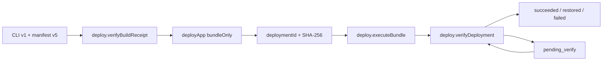

# @h-ai/deploy API Reference

<!-- translation: partial -->

[Chinese source](deploy.md) · [Configuration](../configuration/deploy.en.md) · [Data structures](../data/deploy.en.md)

<a id="module-dependencies"></a>

## Dependencies

| Dependency | Purpose | When required | Setup order |
| --- | --- | --- | --- |
| Node.js and `@h-ai/cli` | Run the deployment SDK or `hai deploy` | The SDK and CLI run on Node.js. The scaffolded deployment command uses the CLI | SDK callers prepare deployment settings and call `deploy.init()`. The CLI reads the project settings and initializes Deploy |
| `@h-ai/core`, `@h-ai/api-contract` and `@h-ai/crypto` | Settings and diagnostics, feedback operations contracts, and encrypted gateway checks | Installed with Deploy | Use Deploy directly. It calls the utilities it needs |
| Docker or Podman | Prepare, import and verify container images | For the corresponding `docker-ssh` image operations | Install and start the engine on the machine performing the operation |
| OpenSSH, Linux and Compose | Deploy over SSH or apply an offline bundle on Linux | Remote delivery requires local OpenSSH. Applying a container release requires a Linux target, a Compose implementation supporting `--pull never` and deployment account permissions | Set up SSH authentication, the target engine and Compose. See the [host tools list](../configuration/delivery.md#离线交付与服务器条件) |
| Vercel account, access token and prebuilt artifact | Publish a build to Vercel | When selecting `vercel` | Prepare a token and a Vercel Build Output API directory before initialization and deployment |

## Quick start

### Example

Scan the app and generate a deployment plan before making remote changes. Validate artifact identity and target. Use the documented recovery flow if a remote command has an uncertain result.

```sh
# Read the prod settings and report the deployment plan without applying it. Invalid inputs produce a diagnostic.
pnpm run deploy --env prod --plan
# Build and deploy the current app for prod. Build, connection, or remote deployment failure exits nonzero.
pnpm run deploy --env prod --build
```


<a id="api-reference"></a>

## Features

Each section lists individual interfaces, then follows the calls through a task. Parameters and defaults describe the arguments; call examples show the invocation, and returns describe the result or successful data as noted below. Check `success` on `HaiResult` before reading `data`. Detailed parameter defaults and advanced constraints remain linked to the Chinese reference.

Import the module as in the quick start. Except for lifecycle examples, run scenarios after initialization and before closure. Each call checks HaiResult.success before reading data and returns the original failed result to its caller. Scenarios without a function declaration are fragments inside an async application function. Use isolated test data and explicit cleanup.

<a id="delivery"></a>

### Scan and deliver applications: `deploy`

Scan requirements and artifacts before choosing a read-only plan, offline bundle or deployment. SDK and CLI share the same capabilities.

#### Interface list

| API | Purpose | Parameters and defaults | Return value or failure | Call example |
| --- | --- | --- | --- | --- |
| `deploy.init(config)` | Prepare the configured deployment provider | Required `config: DeployConfigInput` selects the deployment provider. See [deployment settings](../configuration/deploy.en.md) for fields and defaults. | `Promise<HaiResult<void>>` | `await deploy.init(config)` |
| `deploy.close()` | Release deployment provider resources | None | `Promise<void>` | `await deploy.close()` |
| `deploy.scan(appDir, options?)` | Inspect a project and delivery target | Required application directory `appDir`, resolved relative to the current directory. `options.environment` defaults to `prod`, and an explicit value requires the matching environment file. Omit `options.envDir` to search the app or workspace. | `Promise<HaiResult<ScanResult>>` | `await deploy.scan('./apps/orders', { environment: 'prod' })` |
| `deploy.provisionAll(projectName, services?)` | Provision selected middleware | Required string `projectName`. Optional `services` selects service types. Omitting it uses all configured provisioners, while `[]` provisions none. | `Promise<HaiResult<ProvisionResult[]>>` | `await deploy.provisionAll('orders', ['db', 'cache'])` |
| `deploy.deployApp(appDir, options?)` | Deploy an app or produce a delivery bundle | Required application directory `appDir`. Optional `options` selects the environment, Compose services, image inputs, packaging, and progress, as listed below. | `Promise<HaiResult<DeployResult>>` | `await deploy.deployApp('./apps/orders', { environment: 'prod', bundleOnly: true })` |

##### SDK delivery options

Omit `deploy.deployApp()`'s `options` or supply the fields required by your delivery workflow.

| Field | Default or requirement | Effect |
| --- | --- | --- |
| `environment`, `envDir` | Uses the initialized environment or falls back to `prod`. Finds the directory from the app or workspace. | An explicitly selected environment requires the matching `.env.<environment>` file. |
| `selectedServices` | Full artifacts update all services. Partial artifacts update their included images. | Pass an array of Compose service names such as `['web']` to update just those services. |
| `serviceModes`, `skipMiddleware` | Modes default to `'default'`. `skipMiddleware` defaults to `false`. | Map env prefixes or service names to `'default'`, `'custom'`, or `'keep'`. Prefix mappings take precedence. `skipMiddleware: true` skips middleware configuration and provisioning. |
| `artifactDir`, `runtime` | Finds the existing artifacts and packaging engine automatically. | You can provide the built-image directory. Choose `'auto'`, `'podman'`, or `'docker'`. Auto prefers Podman. |
| `bundleOnly`, `output` | Deploys by default, with delivery paths derived from the app and version. | `bundleOnly: true` is supported by docker-ssh and prepares an archive and scripts without SSH. Set `output` to name the output path. An existing delivery directory is rejected. |
| `imageSource`, `proxy` | Official image sources and inherited process proxy. | Set `imageSource.type` to `'official'`, `'cn'`, or `'custom'` and add `registries` for custom maps. Set `proxy.mode` to `'inherit'`, `'system'`, `'custom'`, or `'none'`. Custom proxy settings take an HTTP(S) `url` and optional `bypass`. |
| `onProgress(stage)` | No callback when omitted. | Report the active stage, such as `packaging` or `health`. Other stages are `preflight`, `images`, `dependencies`, `start`, `https`, and `complete`. |

#### Scenario: Scan and deliver applications

To release the orders service, review a read-only plan first. Once the artifacts and dependencies are ready, choose an offline bundle or deploy to a server.

This is the caller’s delivery workflow. plan is read-only, build prepares artifacts, and deploy changes the target environment.



Review applications, middleware, variables and capacity before delivering verified artifacts. Startup or health failures use available recovery information; recovery can also fail and must be reported. Restoring images/configuration does not undo migrations or external business effects.

Supply a built project and its real deployment config. scan reads requirements; provisionAll provisions selected services and belongs after plan review. The quick-start --plan is read-only.

```ts

import { type DeployConfigInput, deploy } from '@h-ai/deploy'

async function deliver(appDir: string, config: DeployConfigInput) {
  // Scan the supplied app directory using production config. Success reports the app and its middleware requirements. Return the failed result on failure.
  const scanResult = await deploy.scan(appDir, { environment: 'prod' })
  if (!scanResult.success)
    return scanResult
  const scan = scanResult.data
  // Initialize the deployment service with the supplied provider and credentials. Return the failed result on invalid config or failed initialization.
  const initResult = await deploy.init(config)
  if (!initResult.success)
    return initResult
  try {
    // Provision database and cache for orders. Success lists each provisioned resource. Return the failed result on a failed provisioning result.
    const provisionedResult = await deploy.provisionAll('orders', ['db', 'cache'])
    if (!provisionedResult.success)
      return provisionedResult
    const provisioned = provisionedResult.data
    // Package the supplied app for prod in offline bundle mode. Success contains its bundle path and instructions. Return the failed result on failure.
    const deliveredResult = await deploy.deployApp(appDir, { environment: 'prod', bundleOnly: true })
    if (!deliveredResult.success)
      return deliveredResult
    const delivered = deliveredResult.data
    return { scan, provisioned, delivered } // bundlePath/instructions do not imply remote readiness
  }
  finally {
    // Release deployment providers and resources opened by init. The promise resolves without data.
    await deploy.close()
  }
}
```

<a id="credentials"></a>

### Manage local private credentials: `deploy.credentials`

The deploy operator owns the private file. Display loaded names rather than credential values.

#### Interface list

| API | Purpose | Parameters and defaults | Return value or failure | Call example |
| --- | --- | --- | --- | --- |
| `deploy.credentials.getPath()` | Locate local credentials | None | `string` | `deploy.credentials.getPath()` |
| `deploy.credentials.load()` | Read local credentials | None | `HaiResult<string[]>` | `deploy.credentials.load()` |
| `deploy.credentials.save(key, value)` | Save credentials for a target | Required environment variable name `key` and credential string `value` from the trusted administration workflow. | `HaiResult<void>` | `deploy.credentials.save(key, secret)` |
| `deploy.credentials.saveAll(entries)` | Save the credential set | Required `entries` object mapping environment variable names to credential values. | `HaiResult<void>` | `deploy.credentials.saveAll(privateEntries)` |

#### Scenario: Manage local private credentials

```ts
// Fragment inside an async application function; return failed results to its caller.
// Read the current user's private credentials file path. This requires no initialized deployment provider.
const credentialPath = deploy.credentials.getPath() // operator-private path
// Load saved credentials for this process. Success lists loaded variable names. Return the failed result on a failed read.
const loadedNamesResult = deploy.credentials.load()
if (!loadedNamesResult.success)
  return loadedNamesResult
const loadedNames = loadedNamesResult.data // loaded environment variable names
// Save only credentials supplied securely by the operator:
function saveCredential(providerToken: string) {
  // Save the operator-supplied token under HAI_DEPLOY_PROVIDER_TOKEN. Return the failed result on persistence failure.
  const saveResult = deploy.credentials.save('HAI_DEPLOY_PROVIDER_TOKEN', providerToken)
  if (!saveResult.success)
    return saveResult
  // Save the same token using the batch API. Return the failed result if the credentials file cannot be updated.
  const saveAllResult = deploy.credentials.saveAll({ HAI_DEPLOY_PROVIDER_TOKEN: providerToken })
  if (!saveAllResult.success)
    return saveAllResult
}
```

Save inputs come from a secure channel; success has no business data. load returns loaded names only. The example contains no real secret.

[Detailed parameters and workflows](deploy.md#credentials)

<a id="environments"></a>

### Read, merge and save deployment variables: environment helpers

Read deployment and runtime files separately, merge by explicit precedence and save only the selected environment.

#### Interface list

| API | Purpose | Parameters and defaults | Return value or failure | Call example |
| --- | --- | --- | --- | --- |
| `deploy.loadDeploymentEnvironment(options)` | Read deployment environment layers | Required `options` selects the target environment and directory. See [environment arguments](#deployment-environment-options). | `HaiResult<DeploymentEnvironment>` | `deploy.loadDeploymentEnvironment({ environment: 'prod', envDir: './deployment', requireFile: true })` |
| `deploy.mergeEnvironmentLayers(layers, prefix?)` | Merge environment layers by priority | Required variable maps `layers`, ordered from lowest to highest precedence. Omit `prefix` to include every name, or supply it to include just that name and its underscore-prefixed descendants. | 扁平变量映射 | `deploy.mergeEnvironmentLayers([workspaceValues, targetValues], 'HAI_CACHE')` |
| `deploy.loadDeploymentConfig(name, path, values)` | Read target deployment configuration | Required module `name`, YAML or project JSON `path`, and `values` for environment overrides. | `HaiResult<Record<string, unknown>>` | `deploy.loadDeploymentConfig('cache', './config/_cache.yml', environment.values)` |
| `deploy.saveDeploymentEnvironment(environment, values, options?)` | Save deployment environment variables | Required loaded target `environment` and variable map `values`. Optional `options` controls private writes and replacement. See [environment arguments](#deployment-environment-options). | `HaiResult<string[]>` | `deploy.saveDeploymentEnvironment(environment, { HAI_DB_HOST: 'db' })` |
| `deploy.saveMiddlewareEnvironment(environment, options)` | Save middleware environment variables | Required target `environment` and connection-selection `options`. See [environment arguments](#deployment-environment-options). | `HaiResult<string[]>` | `deploy.saveMiddlewareEnvironment(environment, { appDir: '.', requirement, backend: 'memory', configuration: { type: 'memory' } })` |

<a id="deployment-environment-options"></a>

#### Environment read and write arguments

| Field | Default and conditions | Purpose |
| --- | --- | --- |
| `deploy.loadDeploymentEnvironment.options.environment` / `envDir` | Both required | Selects the environment name and dotenv directory, such as `prod` and `./deployment`. |
| `deploy.loadDeploymentEnvironment.options.requireFile` | Default `true` | Set to `false` to continue with existing layers when the target file is absent. |
| `deploy.saveDeploymentEnvironment.options.private` | Default `false` | Set to `true` to write all supplied variables to `.env.<environment>.local`. The default still routes recognized secrets to that private file. |
| `deploy.saveDeploymentEnvironment.options.replace` | Default empty list | Before saving, clears the matching keys and their underscore-prefixed descendants from the target public and private files. Use with a complete replacement. |
| `deploy.saveMiddlewareEnvironment.options.appDir` / `requirement` / `backend` | All required | Supplies the application root containing config, the scanned config path, and the chosen backend name. |
| `deploy.saveMiddlewareEnvironment.options.configuration` / `updates` | Optional. The connection can be omitted before cloud provisioning. | When supplied, combines the selected backend’s complete connection and other variable updates. |

For example, `deploy.saveDeploymentEnvironment(environment, { HAI_DB_HOST: "db" })` for `prod` returns `["HAI_DB_HOST"]` on success and writes the public value to the target `.env.prod`.

The deployment launcher reads the Node runtime dotenv file. Values that require escaping, such as those with single quotes, carriage returns, or CRLF, use JSON encoding. Keep the trailing `# hai:json` marker when editing these lines.

#### Scenario: Read, merge and save deployment variables: environment helpers

The operator selects the prod directory. Only run this after confirming it: load/merge read values and save returns written key names, without displaying secrets.

```ts

import { type MiddlewareRequirement, deploy } from '@h-ai/deploy'

function updateEnvironment(envDir: string, appDir: string, requirement: MiddlewareRequirement) {
  // Load the required prod environment from envDir. Success contains the merged values and file information. Return the failed result if loading fails.
  const environmentResult = deploy.loadDeploymentEnvironment({ environment: 'prod', envDir, requireFile: true })
  if (!environmentResult.success)
    return environmentResult
  const environment = environmentResult.data
  // Merge the loaded values and select the later cache type override under the HAI_CACHE prefix.
  const values = deploy.mergeEnvironmentLayers([environment.values, { HAI_CACHE_TYPE: 'memory' }], 'HAI_CACHE')
  // Resolve this app's _cache.yml with those environment values. Success is a cache config object. Return the failed result on load or expansion failure.
  const configResult = deploy.loadDeploymentConfig('cache', `${appDir}/config/_cache.yml`, values)
  if (!configResult.success)
    return configResult
  const config = configResult.data
  // Write the memory override to the private production environment. Success lists written variable names. Return the failed result on failure.
  const writtenResult = deploy.saveDeploymentEnvironment(environment, { HAI_CACHE_TYPE: 'memory' }, { private: true })
  if (!writtenResult.success)
    return writtenResult
  const written = writtenResult.data
  // Save the given cache requirement as the memory backend for this app. Success lists updated names. Return the failed result if configuration cannot be written.
  const middlewareResult = deploy.saveMiddlewareEnvironment(environment, { appDir, requirement, backend: 'memory', configuration: { type: 'memory' } })
  if (!middlewareResult.success)
    return middlewareResult
  const middleware = middlewareResult.data
  return { config, written, middleware } // use the memory cache requirement from this app's scan
}
```

<a id="middleware-fields"></a>

### Validate middleware forms: deployment helpers

Check backend suitability, then convert form strings into actual booleans, ports and other typed fields.

#### Interface list

| API | Purpose | Parameters and defaults | Return value or failure | Call example |
| --- | --- | --- | --- | --- |
| `deploy.canKeepMiddleware(requirement, backend, environment)` | Check whether middleware can be retained | Required scanned `requirement`, selected catalog `backend`, and target `environment` snapshot. | 能否保留该中间件的 boolean | `deploy.canKeepMiddleware(requirement, backend, environment)` |
| `deploy.describeMiddlewareBackend(backend)` | Describe a middleware backend | Required `backend`, either a full catalog entry or an object containing its `purpose`. | 本地化的功能说明 | `deploy.describeMiddlewareBackend(backend)` |
| `deploy.validateMiddlewareField(options)` | Validate a middleware form field | Required `options` contains the form value, field definition, and actual backend. See [middleware field arguments](#middleware-field-options). | 校验是否通过的 boolean | `deploy.validateMiddlewareField({ value: '5432', field: { name: 'port', kind: 'port' }, backend: 'postgresql' })` |
| `deploy.parseMiddlewareField(options)` | Parse a middleware form field | Required `options` contains the form value, field definition, and backend. It can enable managed provisioning. See [middleware field arguments](#middleware-field-options). | `HaiResult<unknown>` | `deploy.parseMiddlewareField({ value: 'false', field: { name: 'secure', kind: 'boolean' }, backend: 'smtp' })` |

<a id="middleware-field-options"></a>

#### Middleware form arguments

| Field | Default and conditions | Purpose |
| --- | --- | --- |
| `options.value` / `field` / `backend` | All required | Supplies the raw form string, catalog field descriptor, and actual backend. The field and backend jointly determine validation. |
| `options.managed` | Off by default and available in `deploy.parseMiddlewareField` only | Set to `true` to accept an empty value for fields declared `secret` or `managed`, returning `undefined`. |

For example, `deploy.parseMiddlewareField({ value: "false", field: { name: "secure", kind: "boolean" }, backend: "smtp" })` returns boolean `false` on success.

#### Scenario: Validate middleware forms: deployment helpers

```ts
// Keep imports at module scope; run the remaining fragment inside an async application function and return failures to its caller.
import { deploy } from '@h-ai/deploy'
// Check the PostgreSQL port field with input 5432. It is valid and returns true. Invalid ports return false.
deploy.validateMiddlewareField({ value: '5432', field: { name: 'port', kind: 'port' }, backend: 'postgresql' }) // true
// Parse SMTP secure from the string false. The result is the boolean false. Return the failed result if parsing fails.
const parseMiddlewareFieldResult = deploy.parseMiddlewareField({ value: 'false', field: { name: 'secure', kind: 'boolean' }, backend: 'smtp' })
if (!parseMiddlewareFieldResult.success)
  return parseMiddlewareFieldResult
parseMiddlewareFieldResult.data // false
```

String false produces successful boolean false. canKeepMiddleware returns suitability and describeMiddlewareBackend returns localized purpose for a supplied catalog entry.

[Detailed parameters and workflows](deploy.md#middleware-fields)

<a id="artifacts-recovery"></a>

### Check artifact identity and recovery: deployment helpers

Use a stable project identity and verify artifact digests. Inspect structured recovery information after failures.

#### Interface list

| API | Purpose | Parameters and defaults | Return value or failure | Call example |
| --- | --- | --- | --- | --- |
| `deploy.normalizeProjectName(name)` | Normalize a project identifier | Required application `name`, optionally with an npm scope. | 规范化的部署项目名 | `deploy.normalizeProjectName('@shop/orders')` |
| `deploy.artifactChecksum(file)` | Compute a delivery artifact checksum | Required `file` is the path to an existing local image or delivery artifact. | `Promise<string>` | `await deploy.artifactChecksum('./serv.tar')` |
| `deploy.getDeployRecovery(error)` | Read deployment recovery information | Required deployment `error` is a `HaiError` from which to read recovery information. | `DeployRecoveryInfo \| undefined` | `deploy.getDeployRecovery(result.error)`（在 `!result.success` 分支调用） |

#### Scenario: Check artifact identity and recovery: deployment helpers

Build this run’s artifact first; digest is its SHA-256. A failed receipt can contain recovery details; reading them neither performs recovery nor confirms unknown remote effects.

```ts
import { deploy } from '@h-ai/deploy'

async function inspectDelivery(appDir: string, artifactFile: string) {
  // Normalize the supplied scoped name to the deploy project identifier orders.
  const project = deploy.normalizeProjectName('@shop/orders') // 'orders'
  // Hash the existing artifact at the supplied path. Success is its SHA-256 digest. An unreadable path rejects.
  const digest = await deploy.artifactChecksum(artifactFile) // existing artifact; failures reject
  // Package the supplied app for prod without publishing. Success contains bundle details. On failure inspect recovery below.
  const delivered = await deploy.deployApp(appDir, { environment: 'prod', bundleOnly: true })
  if (!delivered.success)
    // Extract the recovery information attached to this deploy failure, when available.
    return { project, digest, error: delivered.error, recovery: deploy.getDeployRecovery(delivered.error) }
  return { project, digest, delivery: delivered.data }
}
```

<a id="programmatic-release-verification"></a>

### Stage and verify a release from a build receipt

A platform can read the CLI build receipt through the SDK and persist the deployment ID, path, and SHA-256 of the private deployment bundle. Prepare the bundle with `deploy.deployApp(..., { bundleOnly: true })` and execute it after saving the receipt. A separate process can verify the same deployment ID after the SSH connection ends.

#### Interface list

| API | Purpose | Input | Return | Example |
| --- | --- | --- | --- | --- |
| `deploy.buildReceipt` | Create the CLI v1 receipt and output path | Project root, project name, v5 manifest | `HaiResult<BuildReceipt>` | `deploy.buildReceipt(projectDir, 'shop', manifest)` |
| `deploy.verifyBuildReceipt` | Check the JSON line and local archives | stdout, trusted paths and expected source or images | `HaiResult<BuildReceipt>` | `await deploy.verifyBuildReceipt(stdout, { projectDir, projectName: 'shop' })` |
| `deploy.executeBundle` | Upload and apply a private docker-ssh bundle | Persisted bundle receipt, trusted target, optional abort signal | Execution result and deployment ID | `await deploy.executeBundle(bundle, { signal })` |
| `deploy.verifyDeployment` | Independently inspect the remote release | Target, requested and optional previous releases, health URL | Verified, restored, failed, or pending | `await deploy.verifyDeployment(verification, { signal })` |

#### Verify the same ID after launching

```ts
import { type DeployBundleExecution, type DeployReleaseVerification, deploy } from '@h-ai/deploy'

export async function identifyBuild(stdout: string, projectDir: string, commit: string) {
  // Check the CLI stdout and archives against the expected clean Git commit before preparing the deployment package.
  const receipt = await deploy.verifyBuildReceipt(stdout, {
    projectDir, projectName: 'shop', sourceCommit: commit, cleanSource: true,
  })
  if (!receipt.success) throw new Error(receipt.error.message)
  return receipt.data.artifactDir
}

export async function runRelease(bundle: DeployBundleExecution, verification: DeployReleaseVerification, signal: AbortSignal) {
  // The app persists the bundle ID, absolute path, and SHA-256 first. The SDK checks the bundle and pinned SSH target before launching.
  const launched = await deploy.executeBundle(bundle, { signal })
  // Use the original ID after either launch result. The SDK compares the receipt, running images, and health endpoint and leaves incomplete evidence pending.
  const checked = await deploy.verifyDeployment(verification)
  return { launched, checked }
}
```

Both operations use the same registered SSH target and local engine. With [Rootless Docker and external HTTPS](../configuration/deploy.en.md#rootless-docker-external-https), supply a health URL under the public origin that returns success directly, such as `https://app.example.com/health`. Hai checks the frozen archive and its image configuration, then matches them to the running container. For Docker with the containerd image store, Hai reads the running container’s OCI platform manifest to establish the configuration digest. The same release and containers must be present before and after the health probe. A replacement worker can use `prepareImages` to materialize the archives for the observed release. Repeat the read-only check for `pending_verify`. The proof for `restored` identifies the previous release.


