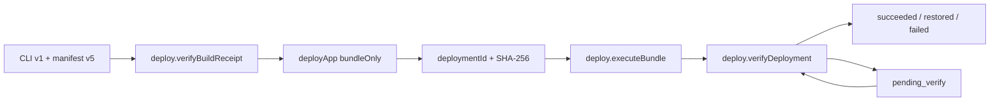

# @h-ai/deploy API リファレンス

<!-- translation: partial -->

[原文（中国語）](deploy.md) · [設定](../configuration/deploy.ja.md) · [データ構造](../data/deploy.ja.md)

<a id="quick-start"></a>

## クイックスタート

リモート変更の前にアプリを調べ、デプロイ計画を作成します。成果物の識別情報と対象を検証します。リモートコマンドの結果が不明な場合は復旧手順に従います。

```sh
# Read the prod settings and report the deployment plan without applying it. Invalid inputs produce a diagnostic.
pnpm run deploy --env prod --plan
# Build and deploy the current app for prod. Build, connection, or remote deployment failure exits nonzero.
pnpm run deploy --env prod --build
```

<a id="api-一覧"></a>

<a id="api-reference"></a>

## 機能

各節では個別のインターフェースを列挙し、その後に作業の流れを説明します。入力欄は呼び出し例、出力欄は成功時のデータです。`HaiResult` は `success` を確認してから `data` を読みます。引数の詳細な既定値と高度な制約は中国語の対応節を参照してください。

モジュールの import は入門例と同じです。開始・終了の例以外は初期化成功後、終了前に実行します。各呼び出しで HaiResult.success を確認し、失敗時は元の結果を返して、成功時だけ data を読みます。関数宣言のない例はアプリの非同期業務関数内の断片です。独立したテストデータと明示した後片付けを使います。

<a id="delivery"></a>

### 工程の確認と配布：`deploy`

要件と成果物を確認し、読み取り計画・オフライン包・実配置を選びます。SDK と CLI は同じ能力を使います。

#### インターフェース一覧

| API | 用途 | 引数と既定値 | 戻り値・失敗 | 呼び出し例 |
| --- | --- | --- | --- | --- |
| `deploy.init(config)` | 設定済みのデプロイ先を準備 | 必須の `config: DeployConfigInput` でデプロイ Provider を指定。[デプロイ設定](../configuration/deploy.ja.md)を参照。 | `Promise<HaiResult<void>>` | `await deploy.init(config)` |
| `deploy.close()` | デプロイ先のリソースを解放 | 引数なし | `Promise<void>` | `await deploy.close()` |
| `deploy.scan(appDir, options?)` | プロジェクトと配布先を調査 | アプリのディレクトリ `appDir` が必須。相対指定は現在のディレクトリから解決。`options.environment` の既定値は `prod`。明示する場合は対応する環境ファイルが必要。`options.envDir` を省略するとアプリまたはワークスペースを検索。 | `Promise<HaiResult<ScanResult>>` | `await deploy.scan('./apps/orders', { environment: 'prod' })` |
| `deploy.provisionAll(projectName, services?)` | 選択したミドルウェアを準備 | プロジェクトの識別文字列 `projectName` が必須。任意の `services` で対象種類を選択。省略時は設定済みの全 Provisioner、`[]` の場合は開通なし。 | `Promise<HaiResult<ProvisionResult[]>>` | `await deploy.provisionAll('orders', ['db', 'cache'])` |
| `deploy.deployApp(appDir, options?)` | アプリを配布・配布パッケージを生成 | アプリのディレクトリ `appDir` が必須。任意の `options` で環境、Compose サービス、イメージ入力、配布パッケージ、進捗を指定する。下記参照。 | `Promise<HaiResult<DeployResult>>` | `await deploy.deployApp('./apps/orders', { environment: 'prod', bundleOnly: true })` |

#### 利用例：工程の確認と配布

`deploy.deployApp()` の `options` は省略できます。配布手順に応じて次の項目を指定できます。

| 項目 | 既定値・必須条件 | 用途 |
| --- | --- | --- |
| `environment`、`envDir` | 初期化時の環境を使用し、なければ `prod`。アプリかワークスペースからディレクトリを自動検出。 | 環境を明示すると、対応する `.env.<environment>` が必要。 |
| `selectedServices` | 完全な成果物は全サービス、部分成果物は含まれるイメージを更新。 | `['web']` などの Compose サービス名を配列で渡すと、そのサービスだけ更新。 |
| `serviceModes`、`skipMiddleware` | 方式の既定値は `'default'`。`skipMiddleware` は既定で `false`。 | 環境変数の接頭辞またはサービス名ごとに `'default'`、`'custom'`、`'keep'` を指定。接頭辞が優先。`skipMiddleware: true` はミドルウェアの設定と開通を省略。 |
| `artifactDir`、`runtime` | 成果物とパッケージングエンジンを自動検出。 | ビルド済みイメージの場所を指定可能。エンジンは `'auto'`、`'podman'`、`'docker'`。`'auto'` は Podman を優先。 |
| `bundleOnly`、`output` | 既定ではデプロイを実行。アプリとバージョンから出力先を決定。 | docker-ssh の `bundleOnly: true` で SSH 接続を行わず、アーカイブとスクリプトを作成。`output` で出力先を指定。既存の出力ディレクトリがあればエラー。 |
| `imageSource`、`proxy` | 公式イメージ配布元と、プロセスのプロキシ設定を使用。 | `imageSource.type` は `'official'`、`'cn'`、`'custom'`。カスタム時は `registries` を渡す。`proxy.mode` は `'inherit'`、`'system'`、`'custom'`、`'none'`。カスタム時は HTTP(S) の `url` と任意の `bypass` を渡す。 |
| `onProgress(stage)` | 省略時は通知なし。 | `packaging`、`health` などの実行段階を進捗 UI に通知。他の値は `preflight`、`images`、`dependencies`、`start`、`https`、`complete`。 |

呼び出し側の配置手順です。plan は読取専用、build は成果物の準備、deploy が対象環境を変更します。


配置前にアプリ・ミドルウェア・変数・容量を確認し、検証済み成果物を配置します。起動・ヘルス確認の失敗は既存情報で回復し、回復自体の失敗も報告します。イメージ・設定の復元では DB 移行や外部処理を取り消せません。

ビルド済み工程と実際の設定を渡します。scan は要件を読み、provisionAll はサービスを作成するため計画確認後に実行します。--plan は読み取り専用です。

```ts
import type { DeployConfigInput } from '@h-ai/deploy'
import { deploy } from '@h-ai/deploy'

async function deliver(appDir: string, config: DeployConfigInput) {
  // Scan the supplied app directory using production config. Success reports the app and its middleware requirements. Return the failed result on failure.
  const scanResult = await deploy.scan(appDir, { environment: 'prod' })
  if (!scanResult.success)
    return scanResult
  const scan = scanResult.data
  // Initialize the deployment service with the supplied provider and credentials. Return the failed result on invalid config or failed initialization.
  const initResult = await deploy.init(config)
  if (!initResult.success)
    return initResult
  try {
    // Provision database and cache for orders. Success lists each provisioned resource. Return the failed result on a failed provisioning result.
    const provisionedResult = await deploy.provisionAll('orders', ['db', 'cache'])
    if (!provisionedResult.success)
      return provisionedResult
    const provisioned = provisionedResult.data
    // Package the supplied app for prod in offline bundle mode. Success contains its bundle path and instructions. Return the failed result on failure.
    const deliveredResult = await deploy.deployApp(appDir, { environment: 'prod', bundleOnly: true })
    if (!deliveredResult.success)
      return deliveredResult
    const delivered = deliveredResult.data
    return { scan, provisioned, delivered } // bundlePath/instructions do not imply remote readiness
  }
  finally {
    // Release deployment providers and resources opened by init. The promise resolves without data.
    await deploy.close()
  }
}
```

<a id="credentials"></a>

### ローカルの秘密情報管理：`deploy.credentials`

配置を実行する利用者が秘密ファイルを所有し、値でなく読み込んだ変数名だけを示します。

#### インターフェース一覧

| API | 用途 | 引数と既定値 | 戻り値・失敗 | 呼び出し例 |
| --- | --- | --- | --- | --- |
| `deploy.credentials.getPath()` | ローカル資格情報の保存先を取得 | 引数なし | `string` | `deploy.credentials.getPath()` |
| `deploy.credentials.load()` | ローカル資格情報を取得 | 引数なし | `HaiResult<string[]>` | `deploy.credentials.load()` |
| `deploy.credentials.save(key, value)` | 配布先の資格情報を保存 | 信頼済みの管理手順から得た環境変数名 `key` と資格情報文字列 `value` が必須。 | `HaiResult<void>` | `deploy.credentials.save(key, secret)` |
| `deploy.credentials.saveAll(entries)` | 資格情報一式を保存 | 環境変数名を資格情報の値に対応付けた `entries` オブジェクトが必須。 | `HaiResult<void>` | `deploy.credentials.saveAll(privateEntries)` |

#### 利用例：ローカルの秘密情報管理

```ts
// アプリの非同期業務関数内の断片です。失敗結果は呼び出し元へ返します。
// Read the current user's private credentials file path. This requires no initialized deployment provider.
const credentialPath = deploy.credentials.getPath() // operator-private path
// Load saved credentials for this process. Success lists loaded variable names. Return the failed result on a failed read.
const loadedNamesResult = deploy.credentials.load()
if (!loadedNamesResult.success)
  return loadedNamesResult
const loadedNames = loadedNamesResult.data // loaded environment variable names
// Save only credentials supplied securely by the operator:
function saveCredential(providerToken: string) {
  // Save the operator-supplied token under HAI_DEPLOY_PROVIDER_TOKEN. Return the failed result on persistence failure.
  const saveResult = deploy.credentials.save('HAI_DEPLOY_PROVIDER_TOKEN', providerToken)
  if (!saveResult.success)
    return saveResult
  // Save the same token using the batch API. Return the failed result if the credentials file cannot be updated.
  const saveAllResult = deploy.credentials.saveAll({ HAI_DEPLOY_PROVIDER_TOKEN: providerToken })
  if (!saveAllResult.success)
    return saveAllResult
}
```

save の値は安全な経路で取得し、成功時に業務データはありません。load は読み込んだキーだけを返します。

[引数と手順の詳細](deploy.md#credentials)

<a id="environments"></a>

### 配置変数の読込・統合・保存：環境補助関数

配置環境と実行設定を別々に読み、明確な優先順で統合し、選択した環境だけを保存します。

#### インターフェース一覧

| API | 用途 | 引数と既定値 | 戻り値・失敗 | 呼び出し例 |
| --- | --- | --- | --- | --- |
| `loadDeploymentEnvironment(options)` | 配布環境の変数を取得 | 必須の `options` で対象環境とディレクトリーを指定。[環境の引数](#deployment-environment-options)を参照。 | `HaiResult<DeploymentEnvironment>` | `loadDeploymentEnvironment({ environment: 'prod', envDir: './deployment', requireFile: true })` |
| `mergeEnvironmentLayers(layers, prefix?)` | 優先順位で環境変数を統合 | 変数マップ `layers` が必須。優先度の低い順に指定。`prefix` を省略すると全件、指定するとその名前とアンダースコアで続く項目だけを結合。 | 扁平变量映射 | `mergeEnvironmentLayers([workspaceValues, targetValues], 'HAI_CACHE')` |
| `loadDeploymentConfig(name, path, values)` | 配布先の設定を取得 | モジュール名 `name`、YAML またはプロジェクト JSON の `path`、環境の上書き `values` が必須。 | `HaiResult<Record<string, unknown>>` | `loadDeploymentConfig('cache', './config/_cache.yml', environment.values)` |
| `saveDeploymentEnvironment(environment, values, options?)` | 配布環境変数を保存 | 読込済みの対象 `environment` と変数マップ `values` が必須。任意の `options` で非公開保存と置き換えを指定。[環境の引数](#deployment-environment-options)を参照。 | `HaiResult<string[]>` | `saveDeploymentEnvironment(environment, { HAI_DB_HOST: 'db' })` |
| `saveMiddlewareEnvironment(environment, options)` | ミドルウェア環境変数を保存 | 対象 `environment` と接続を選択する `options` が必須。[環境の引数](#deployment-environment-options)を参照。 | `HaiResult<string[]>` | `saveMiddlewareEnvironment(environment, { appDir: '.', requirement, backend: 'memory', configuration: { type: 'memory' } })` |

<a id="deployment-environment-options"></a>

#### 環境の読込・保存引数

| 項目 | 既定値と条件 | 用途 |
| --- | --- | --- |
| `loadDeploymentEnvironment.options.environment` / `envDir` | 両方必須 | 環境名と dotenv ディレクトリー。例は `prod` と `./deployment`。 |
| `loadDeploymentEnvironment.options.requireFile` | 既定は `true` | `false` にすると対象ファイルがない場合も既存レイヤーから読み込む。 |
| `saveDeploymentEnvironment.options.private` | 既定は `false` | `true` で渡した変数をすべて `.env.<environment>.local` に保存。既定でも秘密として検出した変数はこのファイルに保存。 |
| `saveDeploymentEnvironment.options.replace` | 既定は空リスト | 保存前に対象の公開・非公開ファイルから同名キーとアンダースコアで続く項目を除く。全件置換時に使用。 |
| `saveMiddlewareEnvironment.options.appDir` / `requirement` / `backend` | いずれも必須 | config ディレクトリーを持つアプリのルート、スキャンした設定パス、選んだバックエンド名。 |
| `saveMiddlewareEnvironment.options.configuration` / `updates` | 任意。クラウドの作成前には接続情報を省略可。 | 指定時は選んだバックエンドの接続情報一式と、同時に更新する他の変数をまとめる。 |

たとえば `prod` で `saveDeploymentEnvironment(environment, { HAI_DB_HOST: "db" })` を呼ぶと、成功時は `["HAI_DB_HOST"]` を返し、対象の `.env.prod` に値を保存します。

#### 利用例：配置変数の読込・統合・保存

操作者が prod のディレクトリーを確認してから実行。読込・合成後、保存されたキー名を返し、秘密値は表示しません。

```ts
import type { MiddlewareRequirement } from '@h-ai/deploy'
import { loadDeploymentEnvironment, loadDeploymentConfig, mergeEnvironmentLayers, saveDeploymentEnvironment, saveMiddlewareEnvironment } from '@h-ai/deploy'

function updateEnvironment(envDir: string, appDir: string, requirement: MiddlewareRequirement) {
  // Load the required prod environment from envDir. Success contains the merged values and file information. Return the failed result if loading fails.
  const environmentResult = loadDeploymentEnvironment({ environment: 'prod', envDir, requireFile: true })
  if (!environmentResult.success)
    return environmentResult
  const environment = environmentResult.data
  // Merge the loaded values and select the later cache type override under the HAI_CACHE prefix.
  const values = mergeEnvironmentLayers([environment.values, { HAI_CACHE_TYPE: 'memory' }], 'HAI_CACHE')
  // Resolve this app's _cache.yml with those environment values. Success is a cache config object. Return the failed result on load or expansion failure.
  const configResult = loadDeploymentConfig('cache', `${appDir}/config/_cache.yml`, values)
  if (!configResult.success)
    return configResult
  const config = configResult.data
  // Write the memory override to the private production environment. Success lists written variable names. Return the failed result on failure.
  const writtenResult = saveDeploymentEnvironment(environment, { HAI_CACHE_TYPE: 'memory' }, { private: true })
  if (!writtenResult.success)
    return writtenResult
  const written = writtenResult.data
  // Save the given cache requirement as the memory backend for this app. Success lists updated names. Return the failed result if configuration cannot be written.
  const middlewareResult = saveMiddlewareEnvironment(environment, { appDir, requirement, backend: 'memory', configuration: { type: 'memory' } })
  if (!middlewareResult.success)
    return middlewareResult
  const middleware = middlewareResult.data
  return { config, written, middleware } // use the memory cache requirement from this app's scan
}
```

<a id="middleware-fields"></a>

### ミドルウェア入力の検証：配置補助関数

環境に適したバックエンドか確認し、フォームの文字列を真偽値・ポートなどに変換します。

#### インターフェース一覧

| API | 用途 | 引数と既定値 | 戻り値・失敗 | 呼び出し例 |
| --- | --- | --- | --- | --- |
| `canKeepMiddleware(requirement, backend, environment)` | 既存ミドルウェアの保持可否を確認 | スキャンした依存 `requirement`、カタログで選んだ `backend`、対象の環境スナップショット `environment` が必須。 | 能否保留该中间件的 boolean | `canKeepMiddleware(requirement, backend, environment)` |
| `describeMiddlewareBackend(backend)` | ミドルウェアのバックエンドを説明 | 必須の `backend` は `purpose` を含むカタログ項目、またはその項目だけを含むオブジェクト。 | 本地化的功能说明 | `describeMiddlewareBackend(backend)` |
| `validateMiddlewareField(options)` | ミドルウェアの入力を検証 | 必須の `options` にフォーム値、項目定義、実際のバックエンドを渡す。[ミドルウェア項目の引数](#middleware-field-options)を参照。 | 校验是否通过的 boolean | `validateMiddlewareField({ value: '5432', field: { name: 'port', kind: 'port' }, backend: 'postgresql' })` |
| `parseMiddlewareField(options)` | ミドルウェアの入力を解析 | 必須の `options` にフォーム値、項目定義、バックエンドを渡す。任意でマネージド作成を指定。[ミドルウェア項目の引数](#middleware-field-options)を参照。 | `HaiResult<unknown>` | `parseMiddlewareField({ value: 'false', field: { name: 'secure', kind: 'boolean' }, backend: 'smtp' })` |

<a id="middleware-field-options"></a>

#### ミドルウェアフォームの引数

| 項目 | 既定値と条件 | 用途 |
| --- | --- | --- |
| `options.value` / `field` / `backend` | いずれも必須 | 元のフォーム文字列、カタログ項目定義、実際のバックエンド。項目とバックエンドで検証規則が決まる。 |
| `options.managed` | 既定では無効。 `parseMiddlewareField` 専用 | `true` の場合、`secret` または `managed` の空値を許可し、`undefined` を返す。 |

たとえば `parseMiddlewareField({ value: "false", field: { name: "secure", kind: "boolean" }, backend: "smtp" })` は成功時に真偽値 `false` を返します。

#### 利用例：ミドルウェア入力の検証

```ts
// import はモジュールの先頭へ置き、残りはアプリの非同期業務関数内で実行します。失敗結果は呼び出し元へ返します。
import { parseMiddlewareField, validateMiddlewareField } from '@h-ai/deploy'
// Check the PostgreSQL port field with input 5432. It is valid and returns true. Invalid ports return false.
validateMiddlewareField({ value: '5432', field: { name: 'port', kind: 'port' }, backend: 'postgresql' }) // true
// Parse SMTP secure from the string false. The result is the boolean false. Return the failed result if parsing fails.
const parseMiddlewareFieldResult = parseMiddlewareField({ value: 'false', field: { name: 'secure', kind: 'boolean' }, backend: 'smtp' })
if (!parseMiddlewareFieldResult.success)
  return parseMiddlewareFieldResult
parseMiddlewareFieldResult.data // false
```

文字列 false は正常な boolean false です。canKeepMiddleware は適合性、describeMiddlewareBackend は指定のカタログ項目の用途を返します。

[引数と手順の詳細](deploy.md#middleware-fields)

<a id="artifacts-recovery"></a>

### 成果物の識別と復旧情報：配置補助関数

安定した工程名とファイル要約を使い、失敗時は構造化された復旧情報から次を判断します。

#### インターフェース一覧

| API | 用途 | 引数と既定値 | 戻り値・失敗 | 呼び出し例 |
| --- | --- | --- | --- | --- |
| `normalizeProjectName(name)` | プロジェクト識別名を正規化 | アプリ名 `name` が必須。npm スコープ付きも可。 | 规范化的部署项目名 | `normalizeProjectName('@shop/orders')` |
| `artifactChecksum(file)` | 配布成果物のチェックサムを計算 | 必須の `file` は既存のローカルイメージまたは配布成果物へのパス。 | `Promise<string>` | `await artifactChecksum('./serv.tar')` |
| `getDeployRecovery(error)` | 配布の復旧情報を取得 | 必須の `error` はデプロイ失敗の `HaiError`。復旧情報の取得元となる。 | `DeployRecoveryInfo \| undefined` | `getDeployRecovery(result.error)`（在 `!result.success` 分支调用） |

#### 利用例：成果物の識別と復旧情報

今回の成果物を先に作成。digest はその SHA-256 です。失敗結果の復旧情報を読むだけでは復旧せず、未知の遠隔結果も成功に変わりません。

```ts
import { artifactChecksum, getDeployRecovery, normalizeProjectName } from '@h-ai/deploy'

async function inspectDelivery(appDir: string, artifactFile: string) {
  // Normalize the supplied scoped name to the deploy project identifier orders.
  const project = normalizeProjectName('@shop/orders') // 'orders'
  // Hash the existing artifact at the supplied path. Success is its SHA-256 digest. An unreadable path rejects.
  const digest = await artifactChecksum(artifactFile) // existing artifact; failures reject
  // Package the supplied app for prod without publishing. Success contains bundle details. On failure inspect recovery below.
  const delivered = await deploy.deployApp(appDir, { environment: 'prod', bundleOnly: true })
  if (!delivered.success)
    // Extract the recovery information attached to this deploy failure, when available.
    return { project, digest, error: delivered.error, recovery: getDeployRecovery(delivered.error) }
  return { project, digest, delivery: delivered.data }
}
```

<a id="programmatic-release-verification"></a>

### ビルド受領書から段階的に公開して検証する

プラットフォームは SDK で CLI のビルド受領書を読み、非公開バンドルの配置 ID、パス、SHA-256 を保存できます。`deploy.deployApp(..., { bundleOnly: true })` で梱包し、保存後に実行します。接続が切れても、別プロセスで同じ配置 ID を検証できます。

#### インターフェース一覧

| API | 用途 | 入力 | 戻り値 | 例 |
| --- | --- | --- | --- | --- |
| `deploy.buildReceipt` | CLI v1 受領書と出力パスを生成 | プロジェクトルート、名前、v5 マニフェスト | `HaiResult<BuildReceipt>` | `deploy.buildReceipt(projectDir, 'shop', manifest)` |
| `deploy.verifyBuildReceipt` | JSON 1 行とローカルのアーカイブを照合 | 標準出力、信頼済みのパス、期待するソースやイメージ | `HaiResult<BuildReceipt>` | `await deploy.verifyBuildReceipt(stdout, { projectDir, projectName: 'shop' })` |
| `deploy.executeBundle` | 非公開 docker-ssh バンドルを転送して適用 | 保存した受領書、接続先、任意の中断シグナル | 実行結果と配置 ID | `await deploy.executeBundle(bundle, { signal })` |
| `deploy.verifyDeployment` | 公開先の状態を独立に検証 | 対象、検証対象と直前のリリース、ヘルス URL | 成功・復元・失敗・検証待ち | `await deploy.verifyDeployment(verification, { signal })` |

#### 実行後に同じ ID を検証する

```ts
import { deploy, type DeployBundleExecution, type DeployReleaseVerification } from '@h-ai/deploy'

export async function identifyBuild(stdout: string, projectDir: string, commit: string) {
  // CLI の標準出力とアーカイブを固定コミットと照合してから、配置バンドルを作成します。
  const receipt = await deploy.verifyBuildReceipt(stdout, {
    projectDir, projectName: 'shop', sourceCommit: commit, cleanSource: true,
  })
  if (!receipt.success) throw new Error(receipt.error.message)
  return receipt.data.artifactDir
}

export async function runRelease(bundle: DeployBundleExecution, verification: DeployReleaseVerification, signal: AbortSignal) {
  // 先にバンドルの ID、絶対パス、SHA-256 を永続化します。SDK でバンドルと固定 SSH 接続先を確認してから実行します。
  const launched = await deploy.executeBundle(bundle, { signal })
  // 実行結果にかかわらず元の ID で受領書、稼働イメージ、ヘルス URL を検証します。証拠が不足すると検証待ちになります。
  const checked = await deploy.verifyDeployment(verification)
  return { launched, checked }
}
```

どちらも登録済みの SSH ホスト鍵と固定の Docker または Podman を使います。保存された Docker イメージアーカイブの情報から構成 ID を求め、ヘルスチェックの前後に現在のリリースと稼働イメージを読み取ります。ワーカーを交換した場合は `prepareImages` で検証対象のアーカイブを準備できます。`pending_verify` は読み取り専用の検証を繰り返せます。`restored` の証拠は直前のリリースを指します。


