# @h-ai/deploy API リファレンス

<!-- translation: partial -->

[原文（中国語）](deploy.md) · [設定](../configuration/deploy.ja.md) · [データ構造](../data/deploy.ja.md)

<a id="quick-start"></a>

## クイックスタート

リモート変更の前にアプリを調べ、デプロイ計画を作成します。成果物の識別情報と対象を検証します。リモートコマンドの結果が不明な場合は復旧手順に従います。

```sh
pnpm run deploy --env prod --plan
pnpm run deploy --env prod --build
```

<a id="api-一覧"></a>

<a id="api-reference"></a>

## 機能

各節では個別のインターフェースを列挙し、その後に作業の流れを説明します。入力欄は呼び出し例、出力欄は成功時のデータです。`HaiResult` は `success` を確認してから `data` を読みます。引数の詳細な既定値と高度な制約は中国語の対応節を参照してください。

モジュールの import は入門例と同じです。開始・終了の例以外は初期化成功後、終了前に実行します。value は HaiResult.success を確認し元エラーを保持します。独立したテストデータと明示した後片付けを使います。

```ts
import type { HaiResult } from '@h-ai/core'

function value<T>(result: HaiResult<T>): T {
  if (!result.success)
    throw new Error(result.error.message, { cause: result.error })
  return result.data
}
```

<a id="delivery"></a>

### 工程の確認と配布：`deploy`

要件と成果物を確認し、読み取り計画・オフライン包・実配置を選びます。SDK と CLI は同じ能力を使います。

#### インターフェース一覧

| API | 用途 | 引数と既定値 | 戻り値・失敗 | 呼び出し例 |
| --- | --- | --- | --- | --- |
| `deploy.init` | 設定済みのデプロイ先を準備 | `config`（必填） | `void` | `await deploy.init(config)` |
| `deploy.close` | デプロイ先のリソースを解放 | 无参数 | `Promise<void>` | `await deploy.close()` |
| `deploy.scan` | プロジェクトと配布先を調査 | appDir, options | `ScanResult` | `await deploy.scan('./apps/orders', { environment: 'prod' })` |
| `deploy.provisionAll` | 選択したミドルウェアを準備 | projectName, services | `ProvisionResult[]` | `await deploy.provisionAll('orders', ['db', 'cache'])` |
| `deploy.deployApp` | アプリを配布・配布パッケージを生成 | appDir, options | `DeployResult` | `await deploy.deployApp('./apps/orders', { environment: 'prod', bundleOnly: true })` |

#### 利用例：工程の確認と配布

呼び出し側の配置手順です。plan は読取専用、build は成果物の準備、deploy が対象環境を変更します。



配置前にアプリ・ミドルウェア・変数・容量を確認し、検証済み成果物を配置します。起動・ヘルス確認の失敗は既存情報で回復し、回復自体の失敗も報告します。イメージ・設定の復元では DB 移行や外部処理を取り消せません。

ビルド済み工程と実際の設定を渡します。scan は要件を読み、provisionAll はサービスを作成するため計画確認後に実行します。--plan は読み取り専用です。

```ts
import type { DeployConfigInput } from '@h-ai/deploy'
import { deploy } from '@h-ai/deploy'

async function deliver(appDir: string, config: DeployConfigInput) {
  const scan = value(await deploy.scan(appDir, { environment: 'prod' }))
  value(await deploy.init(config))
  try {
    const provisioned = value(await deploy.provisionAll('orders', ['db', 'cache']))
    const delivered = value(await deploy.deployApp(appDir, { environment: 'prod', bundleOnly: true }))
    return { scan, provisioned, delivered } // bundlePath/instructions do not imply remote readiness
  }
  finally {
    await deploy.close()
  }
}
```

<a id="credentials"></a>

### ローカルの秘密情報管理：`deploy.credentials`

配置を実行する利用者が秘密ファイルを所有し、値でなく読み込んだ変数名だけを示します。

#### インターフェース一覧

| API | 用途 | 引数と既定値 | 戻り値・失敗 | 呼び出し例 |
| --- | --- | --- | --- | --- |
| `deploy.credentials.getPath` | ローカル資格情報の保存先を取得 | 无参数 | `string` | `deploy.credentials.getPath()` |
| `deploy.credentials.load` | ローカル資格情報を取得 | 无参数 | `HaiResult<string[]>` | `deploy.credentials.load()` |
| `deploy.credentials.save` | 配布先の資格情報を保存 | key, value | `HaiResult<void>` | `deploy.credentials.save(key, secret)` |
| `deploy.credentials.saveAll` | 資格情報一式を保存 | entries | `HaiResult<void>` | `deploy.credentials.saveAll(privateEntries)` |

#### 利用例：ローカルの秘密情報管理

```ts
const credentialPath = deploy.credentials.getPath() // operator-private path
const loadedNames = value(deploy.credentials.load()) // loaded environment variable names
// Save only credentials supplied securely by the operator:
export function saveCredential(providerToken: string) {
  value(deploy.credentials.save('HAI_DEPLOY_PROVIDER_TOKEN', providerToken))
  value(deploy.credentials.saveAll({ HAI_DEPLOY_PROVIDER_TOKEN: providerToken }))
}
```

save の値は安全な経路で取得し、成功時に業務データはありません。load は読み込んだキーだけを返します。

[引数と手順の詳細](deploy.md#credentials)

<a id="environments"></a>

### 配置変数の読込・統合・保存：環境補助関数

配置環境と実行設定を別々に読み、明確な優先順で統合し、選択した環境だけを保存します。

#### インターフェース一覧

| API | 用途 | 引数と既定値 | 戻り値・失敗 | 呼び出し例 |
| --- | --- | --- | --- | --- |
| `loadDeploymentEnvironment` | 配布環境の変数を取得 | 指定环境名、环境目录，可要求文件存在 | `HaiResult<DeploymentEnvironment>` | `loadDeploymentEnvironment({ environment: 'prod', envDir: './deployment', requireFile: true })` |
| `mergeEnvironmentLayers` | 優先順位で環境変数を統合 | 依优先顺序传入变量映射，可按前缀筛选 | 扁平变量映射 | `mergeEnvironmentLayers([workspaceValues, targetValues], 'HAI_CACHE')` |
| `loadDeploymentConfig` | 配布先の設定を取得 | 运行时模块名、配置文件路径、解析时使用的环境变量 | `HaiResult<Record<string, unknown>>` | `loadDeploymentConfig('cache', './config/_cache.yml', environment.values)` |
| `saveDeploymentEnvironment` | 配布環境変数を保存 | 已读取的部署环境、新变量、可选 private/replace 参数 | `HaiResult<string[]>` | `saveDeploymentEnvironment(environment, { HAI_DB_HOST: 'db' })` |
| `saveMiddlewareEnvironment` | ミドルウェア環境変数を保存 | 部署环境及包含应用路径、后端与配置的选项 | `HaiResult<string[]>` | `saveMiddlewareEnvironment(environment, { appDir: '.', requirement, backend: 'memory', configuration: { type: 'memory' } })` |

#### 利用例：配置変数の読込・統合・保存

操作者が prod のディレクトリーを確認してから実行。読込・合成後、保存されたキー名を返し、秘密値は表示しません。

```ts
import type { MiddlewareRequirement } from '@h-ai/deploy'
import { loadDeploymentEnvironment, loadDeploymentConfig, mergeEnvironmentLayers, saveDeploymentEnvironment, saveMiddlewareEnvironment } from '@h-ai/deploy'

function updateEnvironment(envDir: string, appDir: string, requirement: MiddlewareRequirement) {
  const environment = value(loadDeploymentEnvironment({ environment: 'prod', envDir, requireFile: true }))
  const values = mergeEnvironmentLayers([environment.values, { HAI_CACHE_TYPE: 'memory' }], 'HAI_CACHE')
  const config = value(loadDeploymentConfig('cache', `${appDir}/config/_cache.yml`, values))
  const written = value(saveDeploymentEnvironment(environment, { HAI_CACHE_TYPE: 'memory' }, { private: true }))
  const middleware = value(saveMiddlewareEnvironment(environment, { appDir, requirement, backend: 'memory', configuration: { type: 'memory' } }))
  return { config, written, middleware } // use the memory cache requirement from this app's scan
}
```

<a id="middleware-fields"></a>

### ミドルウェア入力の検証：配置補助関数

環境に適したバックエンドか確認し、フォームの文字列を真偽値・ポートなどに変換します。

#### インターフェース一覧

| API | 用途 | 引数と既定値 | 戻り値・失敗 | 呼び出し例 |
| --- | --- | --- | --- | --- |
| `canKeepMiddleware` | 既存ミドルウェアの保持可否を確認 | 当前依赖需求、目录中选定的后端与目标环境 | 能否保留该中间件的 boolean | `canKeepMiddleware(requirement, backend, environment)` |
| `describeMiddlewareBackend` | ミドルウェアのバックエンドを説明 | 后端目录项，读取其 purpose | 本地化的功能说明 | `describeMiddlewareBackend(backend)` |
| `validateMiddlewareField` | ミドルウェアの入力を検証 | 表单字符串、字段定义与后端名 | 校验是否通过的 boolean | `validateMiddlewareField({ value: '5432', field: { name: 'port', kind: 'port' }, backend: 'postgresql' })` |
| `parseMiddlewareField` | ミドルウェアの入力を解析 | 表单字符串、字段定义与后端名，可声明托管模式 | `HaiResult<unknown>` | `parseMiddlewareField({ value: 'false', field: { name: 'secure', kind: 'boolean' }, backend: 'smtp' })` |

#### 利用例：ミドルウェア入力の検証

```ts
import { parseMiddlewareField, validateMiddlewareField } from '@h-ai/deploy'
validateMiddlewareField({ value: '5432', field: { name: 'port', kind: 'port' }, backend: 'postgresql' }) // true
value(parseMiddlewareField({ value: 'false', field: { name: 'secure', kind: 'boolean' }, backend: 'smtp' })) // false
```

文字列 false は正常な boolean false です。canKeepMiddleware は適合性、describeMiddlewareBackend は指定のカタログ項目の用途を返します。

[引数と手順の詳細](deploy.md#middleware-fields)

<a id="artifacts-recovery"></a>

### 成果物の識別と復旧情報：配置補助関数

安定した工程名とファイル要約を使い、失敗時は構造化された復旧情報から次を判断します。

#### インターフェース一覧

| API | 用途 | 引数と既定値 | 戻り値・失敗 | 呼び出し例 |
| --- | --- | --- | --- | --- |
| `normalizeProjectName` | プロジェクト識別名を正規化 | 应用名称 | 规范化的部署项目名 | `normalizeProjectName('@shop/orders')` |
| `artifactChecksum` | 配布成果物のチェックサムを計算 | 现有镜像或交付产物路径 | `Promise<string>` | `await artifactChecksum('./serv.tar')` |
| `getDeployRecovery` | 配布の復旧情報を取得 | 部署失败的 `HaiError` | `DeployRecoveryInfo \| undefined` | `getDeployRecovery(result.error)`（在 `!result.success` 分支调用） |

#### 利用例：成果物の識別と復旧情報

今回の成果物を先に作成。digest はその SHA-256 です。失敗結果の復旧情報を読むだけでは復旧せず、未知の遠隔結果も成功に変わりません。

```ts
import { artifactChecksum, getDeployRecovery, normalizeProjectName } from '@h-ai/deploy'

async function inspectDelivery(appDir: string, artifactFile: string) {
  const project = normalizeProjectName('@shop/orders') // 'orders'
  const digest = await artifactChecksum(artifactFile) // existing artifact; failures reject
  const delivered = await deploy.deployApp(appDir, { environment: 'prod', bundleOnly: true })
  if (!delivered.success)
    return { project, digest, error: delivered.error, recovery: getDeployRecovery(delivered.error) }
  return { project, digest, delivery: delivered.data }
}
```
