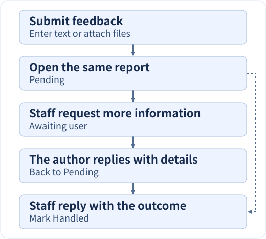

# @h-ai/feedback API Reference

[简体中文](feedback.md) · [日本語](feedback.ja.md) · [Configuration](../configuration/feedback.en.md) · [Data structures](../data/feedback.en.md) · [Feedback operations](../operations/feedback.en.md)

<a id="feedback-workflow"></a>

## Complete workflow

A signed-in user submits a report and uses **My feedback** to read and reply. Authorized staff handle reports from a shared list for the business scope, with no individual assignment. Each report holds the initial post, conversation, and current status. The author and staff see the same records.



<a id="feedback-steps"></a>

## Step by step

The menu names below are from the admin console.

1. **Submit a report.** On the signed-in page where the problem occurs, select **Report a problem**. Under **First-post diagnostics**, use **View material** to inspect the page screenshot, recent browser logs, and page replay. Use **Retake screenshot** to refresh the image and **Remove** to omit an item. Describe what happened, add files or a recording as needed, and optionally select **Include my recent server logs**. Select **Submit Feedback**.
2. **View the report.** Successful submission saves the first post and chosen material with the status **Pending**. The author opens it from **My feedback**. Staff use **Feedback** in the sidebar to filter the shared list by status and open the same report. Under **First-post diagnostics**, select **View material** to inspect screenshots, logs, replay, and recordings.
3. **Request more information.** Staff select **Request more information** to explain what is missing and can attach a reference image or steps file. Sending the message changes the status to **Awaiting user**. The author can open the request and its attachments.
4. **Reply with details.** Either side can send text, images, and files. The author can send a screenshot or file alone. A reply from the author moves a report marked **Awaiting user** back to **Pending**. Other ordinary replies keep the existing status. Replies and information requests contain the text and files selected for that message.
5. **Record the result.** Staff can reply with the outcome and mark the report **Handled**. Authors can still reply. Staff can return it to **Pending**, and the author can check the outcome under **My feedback**.

<a id="screen-recording"></a>

### Record and play a browser tab

1. Open the application in a desktop browser that supports screen sharing and media recording. Use a secure context such as HTTPS or a trusted local development address. If Chrome or Chromium omits the tab where sharing was requested, open a second tab and navigate it to the application page where you want to reproduce the issue.
2. In the feedback dialog, select **Record screen**, then **Start recording**. In the browser's own chooser, select **Chrome Tab** or **Chromium Tab**, select the application tab to capture, and click **Share**. The browser asks the user to choose a surface each time recording starts.
3. Reproduce the issue in the selected tab. Recording temporarily hides the feedback dialog in the tab that requested sharing. Switch back to that tab and select **Stop recording**. **Cancel recording** discards this take.
4. Use the play button in the preview under **Screen recording** to check the result. You can remove it or record another take. After you submit with the recording attached, staff open the report from **Feedback**, choose **View material** on the **Screen recording** row, and press play.
5. If the author cancels sharing or the browser cannot record, they can still complete the report with a screenshot or manual attachment.

A recording captures the visible pixels of the selected surface. It lasts up to 60 seconds, uses up to 5 MiB, and contains video only. The masking used for screenshots and operation replay does not apply to screen recordings. Check the chosen surface and preview before sending. [Chrome screen sharing chooser](https://developer.chrome.com/docs/web-platform/screen-sharing-controls#the_selfbrowsersurface_option)

<a id="feedback-limits"></a>

## Key limits

Opening feedback prepares a screenshot of the current page and freezes the preceding browser evidence. While collecting, the page buffers browser logs and events in memory. Submitting uploads only what the author kept.

| Evidence | Source and timing | Limit and scope |
| --- | --- | --- |
| Page screenshot | Attempted when the dialog opens, with an option to retake. | Masks form inputs and areas marked with `data-feedback-private`. Submitting can continue if the capture fails. |
| Browser logs | Core logs from the current page and uncaught error summaries, frozen when the dialog opens. | Up to five minutes, 1,000 entries, and 512 KiB. |
| Page replay | Page structure, clicks, and other events captured before the dialog opens, starting from restorable snapshots. | Up to five minutes, 2 MiB, and 2,000 buffered events. Text, input values, and sensitive attributes are masked. Iframes and private areas are excluded. Reloading or signing out starts a new collection. |
| Screen recording | Live recording of the surface the author authorizes. | Video only, up to 60 seconds and 5 MiB. |
| Server logs | Recent Core request logs from the current service instance, selected on submission if the author opts in. | Up to five minutes, 1,000 entries, and 512 KiB for the same user and business scope, subject to the remaining file budget. The author can still submit text or other evidence when logs are unavailable. |

Each send allows up to 5,000 UTF-16 code units of text, five manual attachments, and 5 MiB per file. The initial evidence and manual files share 10 MiB. Attachments to a reply or information request can also total up to 10 MiB. Send at least some text, a file, or a piece of first-post evidence that can be saved. The feedback contract sets the capacity, and the application sets the retention policy. [Configuration layers](../configuration/feedback.en.md#configuration-ownership) · [Retention](../data/feedback.en.md#retention)

<a id="permissions"></a>

### Who can view and handle reports

| Identity or permission | Actions |
| --- | --- |
| Signed in with `feedback:create` | Submit a report. |
| Report author | View and reply to their own reports and access the conversations and attachments. |
| `feedback:read` | View reports, conversations, and attachments in the same application and business scope. |
| `feedback:read` and `feedback:process` | Handle reports from the shared list, reply, request information, and change status. |

The host resolves the user, permissions, and business scope from a trusted server-side session. In the admin console, ordinary users have create permission and business operators have all three permissions.

<a id="module-dependencies"></a>

## Dependencies

| Dependency | Purpose | When required | Setup order |
| --- | --- | --- | --- |
| `@h-ai/reldb` | Store reports, messages, and files | Server | Initialize RelDB before Feedback |
| `@h-ai/kit` or `@h-ai/serv` | Mount authenticated feedback routes | HTTP service | Initialize Feedback, then give the adapter a trusted session resolver |
| `@h-ai/ui` | Form, list, and conversation views | Svelte UI | Pass authenticated API callbacks to the components |

<a id="quick-start"></a>

## Quick start

Connect the database, then initialize Feedback. This example assumes `author` comes from the authenticated server-side session and has `feedback:create`.

```ts
import type { FeedbackContext } from '@h-ai/feedback'
import { feedback } from '@h-ai/feedback'

const started = await feedback.init({ appId: 'orders' })
if (!started.success)
  throw new Error(started.error.message)

export async function submitIssue(author: FeedbackContext, id: string) {
  // The caller generates a UUID for this submission.
  const result = await feedback.submit({ id, body: 'I cannot open my order details' }, author)
  if (!result.success)
    return { error: result.error }
  return { reportId: result.data.id, status: result.data.status }
}
```

Use the successful result's `reportId` to open the report. The initial status is `pending`. On shutdown, call `await feedback.close()` before closing RelDB.

In SvelteKit, mount `kit.createFeedbackHandler({ feedback, resolveContext })` as GET, POST, and PATCH. In Serv, mount `apiContract.feedback` with `serv.createFeedbackProcedures({ feedback, resolveContext })`. With host transport encryption enabled, merge the file budget for the actual mount prefix. [Kit integration](kit.en.md#protocol-integrations) · [Transport capacity](../configuration/feedback.en.md#transport-budget)

<a id="feedback-capture"></a>

### Integrate first-post diagnostics

Mount `FeedbackModal` on the signed-in page. Pass a stable session or user identifier as `captureKey`, change it when the account changes, and unmount after sign-out. The component prepares the evidence on open. Its `onsubmit` passes the retained evidence and text to the host API. When `captureKey` is omitted, the dialog still accepts text and manual files.

Custom clients can use the following fields in `capture` on `reports.submit`.

| Field | Type and purpose |
| --- | --- |
| `screenshot?` | Screenshot as PNG, JPEG, or WebP. |
| `browserLogs?` | Recent browser logs as JSON. |
| `replay?` | Redacted JSON with a full page snapshot and subsequent events. |
| `recording?` | WebM or MP4 video recorded with user permission. |
| `includeServerLogs?` | Boolean, off by default. When set to `true`, the server selects any available recent logs for the authenticated submitter. |

The first four fields use `name`, `contentType`, and `dataBase64`. Original file metadata uses `kind` to distinguish evidence. The client retrieves the file when the viewer opens it. [Evidence categories and examples](../data/feedback.en.md#attachment-examples)

#### Which Core logs can be attached

After initialization, Feedback observes Core logs in its own process and buffers records that can be associated with a trusted request. It uses `core.context.get()` at the time of logging and requires `scopeId`, `userId`, and `requestId`. The logged message itself can omit these fields. Startup logs, anonymous requests, and requests without a business scope stay outside the buffer. The log snapshot also excludes the current submit request. Only an initial report whose author opts in persists the selected logs.

In a single-scope Kit application, use `core.context.run({ scopeId: 'orders' }, next)` in business requests. A Serv integration can provide the trusted scope from `createContext`. Use the same `scopeId` in `resolveContext` for feedback authorization. For example, when `user-42` browses an order in the `orders` scope, trusted-context logs from the order request can accompany that user's report. The snapshot excludes logs from other users, scopes, and instances. [Data and log buffers](../data/feedback.en.md#retention)

<a id="api-reference"></a>

## Interface reference

<a id="service"></a>
<a id="reports"></a>

### View, reply to, and handle reports

#### Interface list

| API | Purpose | Parameters and defaults | Return value or failure | Call example |
| --- | --- | --- | --- | --- |
| `feedback.init(config)` | Prepare database tables | `{ appId }` | `HaiResult<void>` | `await feedback.init({ appId: 'orders' })` |
| `feedback.close()` | Stop accepting calls and wait for in-flight requests | None | `HaiResult<void>` | `await feedback.close()` |
| `feedback.submit(input, context)` | File a report | UUID `id`, `body`, optional `attachments` and `capture` | Saved report | `await feedback.submit({ id, body }, author)` |
| `feedback.listMine(query, context)` | List the author's reports | `status?`, `page?`, `pageSize?` | Page of reports | `await feedback.listMine({}, author)` |
| `feedback.list(query, context)` | List reports in the staff member's scope | Same as `listMine` | Page of reports | `await feedback.list({ status: 'pending' }, staff)` |
| `feedback.get(id, context)` | Get a report and original file metadata | Report UUID | `{ report, attachments }` | `await feedback.get(id, author)` |
| `feedback.listMessages(query, context)` | Read the conversation, newest first | `id`, `page?`, `pageSize?` | Page of messages and file metadata | `await feedback.listMessages({ id }, staff)` |
| `feedback.addMessage(input, context)` | Reply or request information | Report `id`, UUID `messageId`, `kind: 'reply' \| 'request_info'`, `body`, optional `attachments` | Saved message | `await feedback.addMessage({ id, messageId, kind: 'reply', body }, author)` |
| `feedback.setStatus(input, context)` | Mark Pending or Handled | `id`, `status: 'pending' \| 'handled'` | Updated report | `await feedback.setStatus({ id, status: 'handled' }, staff)` |
| `feedback.getAttachment(input, context)` | Read a single attachment | Report `id`, `attachmentId` | `name`, `contentType`, `dataBase64` | `await feedback.getAttachment({ id, attachmentId }, author)` |

Results are returned as `HaiResult`. Check `success` first. Queries default to page one and 20 items, with one to 20 allowed per page. Report lists sort by recent activity. Filter by `pending`, `awaiting_user`, or `handled`. To send a file alone, pass an empty string for `body`. For attachment `dataBase64`, pass the Base64 content itself.

Kit or Serv exposes `apiContract.feedback` at the following HTTP paths under the host API prefix.

| Method and relative path | Operation |
| --- | --- |
| `POST /feedback/reports` | Submit a report |
| `GET /feedback/my-reports` | List your reports |
| `GET /feedback/reports` | Open the shared list for the business scope |
| `GET /feedback/reports/{id}` | Read the report and evidence list |
| `GET /feedback/reports/{id}/messages` | Page through the conversation |
| `POST /feedback/reports/{id}/messages` | Send a reply or request more information |
| `PATCH /feedback/reports/{id}/status` | Change status |
| `GET /feedback/reports/{id}/attachments/{attachmentId}` | Read one piece of evidence or attachment |

#### Scenario: Ask the author for a screenshot

Within an async function on a running service, use an existing report `id` and a trusted `staff` context with scope read and process permissions. The caller generates `messageId` before sending. If the response is lost, retry the same request with that UUID.

```ts
const request = await feedback.addMessage({
  id,
  messageId,
  kind: 'request_info',
  body: 'Follow the attached steps and send a screenshot of the error.',
  attachments: [{ name: 'steps.txt', contentType: 'text/plain', dataBase64: 'U3RlcHM=' }],
}, staff)
if (!request.success)
  return request
return request.data
```

After success, check the report details for `awaiting_user` and retrieve the request and the `steps.txt` attachment ID from the conversation. The author sends a `reply` with their own context, a new `messageId`, and the screenshot attached. Staff can then read the reply and load the screenshot using the report and attachment IDs. [Operations and troubleshooting](../operations/feedback.en.md)
