# @h-ai/feedback API リファレンス

[简体中文](feedback.md) · [English](feedback.en.md) · [設定](../configuration/feedback.ja.md) · [データ構造](../data/feedback.ja.md) · [フィードバックの運用](../operations/feedback.ja.md)

<a id="feedback-workflow"></a>

## 全体の流れ

ログインした利用者は問題を報告し、「自分のフィードバック」で確認や返信を行います。権限を持つ担当者は業務スコープ内の共通一覧から処理します。個別の割り当ては不要です。投稿者と担当者は同じフィードバックの初回投稿、会話、現在の状態を参照します。



<a id="feedback-steps"></a>

## 手順

以下のメニュー名は管理コンソールの例です。

1. **初回投稿を送る。** 問題が起きたページでログインし、「問題を報告」をクリックします。「最初の投稿の資料」にある「資料を見る」でスクリーンショット、直前のブラウザーログ、ページのリプレイを確認します。画像は「撮り直す」で更新し、不要な資料は「削除」できます。問題を説明し、必要に応じてファイル、録画、「自分の直近のサーバーログを添付」を選んで「フィードバックを送信」をクリックします。
2. **投稿を開く。** 送信に成功すると、初回投稿と選んだ資料が保存され、状態は「未処理」になります。投稿者は「自分のフィードバック」から開きます。担当者はサイドバーの「フィードバック」で共通一覧を状態で絞り込み、同じ投稿を開きます。「最初の投稿の資料」の「資料を見る」で画像、ログ、リプレイ、録画を確認します。
3. **追加情報を依頼する。** 担当者が「追加情報を依頼」を選び、必要な項目を記入します。操作の見本画像や手順ファイルも添付できます。送信すると「利用者の補足待ち」になり、投稿者が依頼と添付を確認できます。
4. **返信または情報を追加する。** 双方が文章、画像、ファイルを送れます。投稿者はエラーの画像やファイルだけでも返信できます。「利用者の補足待ち」の投稿に投稿者が返信すると「未処理」に戻ります。それ以外の通常の返信では現在の状態を保ちます。返信と追加情報の依頼では、そのメッセージに入力・添付した内容を送ります。
5. **処理結果を記録する。** 担当者は結果を返信して「処理済み」にできます。処理済みの投稿にも返信でき、担当者は「未処理」に戻せます。投稿者は「自分のフィードバック」で結果を確認します。

<a id="screen-recording"></a>

### タブを録画して再生する

1. 画面共有とメディア録画に対応したデスクトップブラウザーでアプリを開きます。HTTPS や、ブラウザーが信頼するローカル開発用アドレスなどのセキュアコンテキストが必要です。Chrome や Chromium の選択画面に共有を開始したタブが出ない場合は、新しいタブで問題を再現するアプリのページを開きます。
2. ダイアログで「画面録画」、「録画を開始」の順にクリックします。ブラウザーの共有画面で「Chrome タブ」または「Chromium タブ」を選択し、録画するアプリのタブを選んで「共有」をクリックします。録画を開始するたびに、ブラウザーで対象を選びます。
3. 選択したタブで問題を再現します。録画中は、共有を開始したタブのフィードバックダイアログが一時的に隠れます。再現したら共有を開始したタブに戻り、「録画を停止」をクリックします。「録画を取り消す」を選ぶと今回の録画を破棄します。
4. 「画面録画」のプレビューで再生ボタンを押して内容を確認します。削除や録り直しもできます。録画を添えて送信した後、担当者は「フィードバック」でその投稿を開き、「画面録画」の「資料を見る」から再生します。
5. ブラウザーの共有をキャンセルした場合や録画できない場合も、スクリーンショットや手動添付ファイルで投稿できます。

録画には選択した画面に表示される内容がそのまま入ります。最大 60 秒、5 MiB の無音動画です。スクリーンショットや操作リプレイのマスキングは画面録画に適用されません。送信前に共有対象とプレビューを確認してください。 [Chrome の画面共有の選択画面](https://developer.chrome.com/docs/web-platform/screen-sharing-controls#the_selfbrowsersurface_option)

<a id="feedback-limits"></a>

## 主な制限

ダイアログを開くと現在のページを撮影し、直前までのブラウザー資料を確定します。収集中は、ブラウザーログと操作イベントを現在のページのメモリに保持します。投稿に含めるのは利用者が残した資料です。

| 資料 | 収集元とタイミング | 上限と範囲 |
| --- | --- | --- |
| スクリーンショット | ダイアログを開いたときに撮影し、撮り直しもできます。 | フォーム入力と `data-feedback-private` の領域をマスクします。撮影できなくても送信できます。 |
| ブラウザーログ | 現在のページの Core ログと未捕捉エラーの概要。ダイアログを開いた時点で確定します。 | 直前の最大 5 分、1000 件、512 KiB。 |
| ページのリプレイ | ダイアログを開く前のページ構造、クリックなどのイベント。再生可能なスナップショットから記録します。 | 最大 5 分、2 MiB、2000 件の操作イベント。ページの文字、入力値、機密性のある属性をマスクし、iframe と非公開領域を除外します。再読み込みやログアウト後は新たに収集します。 |
| 画面録画 | 投稿者が許可した画面をリアルタイムに録画します。 | 動画のみ。最大 60 秒、5 MiB。 |
| サーバーログ | 投稿者が選択した場合、送信時に現在のサービスインスタンスの Core リクエストログを取得します。 | 同じ利用者と業務スコープの直近 5 分、最大 1000 件、512 KiB。ファイルの残り容量にも従います。取得できない場合も本文や別の資料を送れます。 |

1 回の送信で本文は UTF-16 のコード単位で 5000、手動添付は 5 件、1 ファイルは 5 MiB までです。初回投稿の資料と手動添付の合計は 10 MiB までです。返信や追加情報の依頼の添付も合計 10 MiB までです。本文、ファイル、保存可能な初回資料のうち一つ以上が必要です。容量はフィードバック契約で、保持期間はアプリのポリシーで決まります。 [設定の層](../configuration/feedback.ja.md#configuration-ownership) · [データの保持](../data/feedback.ja.md#retention)

<a id="permissions"></a>

### 参照と処理に必要な権限

| 利用者または権限 | 操作 |
| --- | --- |
| ログイン済みで `feedback:create` を持つ利用者 | 初回投稿を送信できます。 |
| 投稿者 | 自分の投稿、会話、添付を参照して返信できます。 |
| `feedback:read` | 同じアプリと業務スコープの投稿、会話、添付を参照できます。 |
| `feedback:read` と `feedback:process` | 共通一覧から処理し、返信、情報追加の依頼、状態変更ができます。 |

ホストは信頼できるサーバー側セッションから利用者、権限、業務スコープを決定します。管理コンソールでは一般利用者に投稿権限を、業務担当者に三つの権限を付与します。

<a id="module-dependencies"></a>

## 依存関係

| 依存先 | 用途 | 利用条件 | 初期化順序 |
| --- | --- | --- | --- |
| `@h-ai/reldb` | 投稿、メッセージ、添付を保存 | サーバー | RelDB の後に Feedback を初期化 |
| `@h-ai/kit` または `@h-ai/serv` | 認証付きルートを公開 | HTTP サービス | Feedback の初期化後、信頼できるセッション解決関数を渡す |
| `@h-ai/ui` | 入力フォーム、一覧、会話の表示 | Svelte の画面 | 認証付き API をコールバックとして渡す |

<a id="quick-start"></a>

## クイックスタート

データベースに接続してから Feedback を起動します。下の `author` はサーバーが認証済みセッションから取得し、`feedback:create` を持ちます。

```ts
import type { FeedbackContext } from '@h-ai/feedback'
import { feedback } from '@h-ai/feedback'

const started = await feedback.init({ appId: 'orders' })
if (!started.success)
  throw new Error(started.error.message)

export async function submitIssue(author: FeedbackContext, id: string) {
  // 呼び出し側が今回の投稿のために UUID を発行する。
  const result = await feedback.submit({ id, body: '注文の詳細を開けません' }, author)
  if (!result.success)
    return { error: result.error }
  return { reportId: result.data.id, status: result.data.status }
}
```

成功時の `reportId` で投稿の詳細を開けます。初回の状態は `pending` です。アプリを終了するときは RelDB を閉じる前に `await feedback.close()` を実行します。

SvelteKit は `kit.createFeedbackHandler({ feedback, resolveContext })` を GET、POST、PATCH に割り当てます。Serv は `serv.createFeedbackProcedures({ feedback, resolveContext })` で `apiContract.feedback` を公開します。暗号化を有効にする場合は、実際にマウントするパスに合わせてファイル用トランスポートの上限をマージします。 [Kit の接続](kit.ja.md#protocol-integrations) · [トランスポート容量](../configuration/feedback.ja.md#transport-budget)

<a id="feedback-capture"></a>

### 初回投稿の資料を組み込む

ログイン後のページに `FeedbackModal` を配置します。`captureKey` にセッションまたは利用者の固定識別子を渡し、アカウントが変わったら更新し、ログアウト時にコンポーネントを外します。ダイアログを開くと資料を準備し、`onsubmit` で残した資料と本文をホストの API に渡します。`captureKey` を省略した場合も、本文と手動添付を送れます。

独自クライアントでは `reports.submit` の `capture` に次の項目を指定できます。

| 項目 | 型と用途 |
| --- | --- |
| `screenshot?` | PNG、JPEG、WebP のスクリーンショット。 |
| `browserLogs?` | 直近のブラウザーログの JSON。 |
| `replay?` | ページ全体のスナップショットとそれ以降の操作を含む、マスキング済みの JSON。 |
| `recording?` | 利用者が許可した WebM または MP4 動画。 |
| `includeServerLogs?` | 真偽値。既定では添付しません。`true` の場合、認証済みの投稿者の直近のログをサーバーから取得します。 |

最初の四項目は `name`、`contentType`、`dataBase64` で指定します。添付メタデータの `kind` で資料の種類を区別し、閲覧時にファイルを個別に取得します。 [添付の種類と例](../data/feedback.ja.md#attachment-examples)

#### 添付できる Core ログ

Feedback は初期化後に自身のプロセスの Core ログを監視し、信頼できるリクエストに関連付けられるレコードをメモリに保持します。ログの書き込み時の `core.context.get()` に `scopeId`、`userId`、`requestId` が必要です。ログメッセージ自体にはこれらの項目を出力する必要はありません。起動ログ、匿名リクエスト、業務スコープのないリクエストはバッファーの対象外です。送信中のリクエストも添付から除外します。選択されたログは、投稿者が追加を選んだ初回投稿にだけ保存されます。

業務スコープが一つの Kit アプリでは、業務リクエストに `core.context.run({ scopeId: 'orders' }, next)` を使用できます。Serv では `createContext` で信頼できるスコープを渡せます。フィードバックの認可を行う `resolveContext` でも同じ `scopeId` を使います。たとえば `user-42` が `orders` スコープで注文を開いた場合、信頼できるコンテキストが設定された注文 API のログを、その利用者の投稿に添付できます。別の利用者、スコープ、インスタンスのログは対象外です。 [データとログバッファー](../data/feedback.ja.md#retention)

<a id="api-reference"></a>

## API 参照

<a id="service"></a>
<a id="reports"></a>

### 投稿の参照、返信、処理

#### インターフェース一覧

| API | 用途 | 引数と既定値 | 戻り値・失敗 | 呼び出し例 |
| --- | --- | --- | --- | --- |
| `feedback.init(config)` | テーブルを準備 | `{ appId }` | `HaiResult<void>` | `await feedback.init({ appId: 'orders' })` |
| `feedback.close()` | 新規受付を止め、実行中の呼び出しを待つ | なし | `HaiResult<void>` | `await feedback.close()` |
| `feedback.submit(input, context)` | 新規投稿 | UUID の `id`、`body`、省略可能な `attachments`、`capture` | 保存済み投稿 | `await feedback.submit({ id, body }, author)` |
| `feedback.listMine(query, context)` | 自分の投稿一覧 | `status?`、`page?`、`pageSize?` | 投稿のページ | `await feedback.listMine({}, author)` |
| `feedback.list(query, context)` | 業務スコープ内の共通一覧 | `listMine` と同じ | 投稿のページ | `await feedback.list({ status: 'pending' }, staff)` |
| `feedback.get(id, context)` | 初回投稿と添付のメタデータ | 投稿の UUID | `{ report, attachments }` | `await feedback.get(id, author)` |
| `feedback.listMessages(query, context)` | 新しい順に会話を取得 | 投稿の `id`、`page?`、`pageSize?` | メッセージのページと添付メタデータ | `await feedback.listMessages({ id }, staff)` |
| `feedback.addMessage(input, context)` | 返信や情報追加の依頼 | 投稿の `id`、UUID の `messageId`、`kind: 'reply' \| 'request_info'`、`body`、省略可能な `attachments` | 保存済みメッセージ | `await feedback.addMessage({ id, messageId, kind: 'reply', body }, author)` |
| `feedback.setStatus(input, context)` | 未処理または処理済みにする | `id`、`status: 'pending' \| 'handled'` | 更新済み投稿 | `await feedback.setStatus({ id, status: 'handled' }, staff)` |
| `feedback.getAttachment(input, context)` | 個別の添付を読む | 投稿の `id`、`attachmentId` | `name`、`contentType`、`dataBase64` | `await feedback.getAttachment({ id, attachmentId }, author)` |

結果は `HaiResult` で返るため、最初に `success` を確認します。一覧は既定で 1 ページ目を 20 件ずつ返し、1 ページの件数は 1〜20 です。投稿は最終更新の降順で、`status` は `pending`、`awaiting_user`、`handled` を指定できます。ファイルだけを送る場合は `body` に空文字を渡します。`dataBase64` には Base64 の内容を直接渡します。

Kit または Serv はホストの API プレフィックス配下で `apiContract.feedback` を次のパスに公開します。

| メソッドと相対パス | 操作 |
| --- | --- |
| `POST /feedback/reports` | 初回投稿を送信 |
| `GET /feedback/my-reports` | 自分の投稿一覧を取得 |
| `GET /feedback/reports` | 業務スコープの共通一覧を取得 |
| `GET /feedback/reports/{id}` | 初回投稿と資料一覧を取得 |
| `GET /feedback/reports/{id}/messages` | 会話をページ単位で取得 |
| `POST /feedback/reports/{id}/messages` | 返信または追加情報の依頼を送信 |
| `PATCH /feedback/reports/{id}/status` | 状態を変更 |
| `GET /feedback/reports/{id}/attachments/{attachmentId}` | 個別の資料や添付を取得 |

#### 利用例：スクリーンショットを依頼する

起動済みサービスの非同期関数で、読み取りと処理権限を持つ信頼できる `staff` のコンテキストと、保存済みの投稿の `id` を使います。呼び出し側が送信前に `messageId` を作成し、応答を受け取れなければ同じリクエストと UUID で再試行します。

```ts
const request = await feedback.addMessage({
  id,
  messageId,
  kind: 'request_info',
  body: '添付の手順で操作し、エラーの画面を送ってください。',
  attachments: [{ name: 'steps.txt', contentType: 'text/plain', dataBase64: 'U3RlcHM=' }],
}, staff)
if (!request.success)
  return request
return request.data
```

成功後は詳細で `awaiting_user` を確認し、会話から追加の依頼と `steps.txt` の添付 ID を取得できます。投稿者は自分のコンテキスト、新しい `messageId`、画像を指定して `reply` を送ります。担当者は返信を読み、投稿 ID と添付 ID から画像を開けます。 [運用とトラブルシューティング](../operations/feedback.ja.md)
