# @h-ai/feedback 功能说明

[English](feedback.en.md) · [日本語](feedback.ja.md)

在服务端用 `feedback` 接收、查询和处理用户报告。在浏览器中用 Feedback 客户端收集用户允许提供的日志、截图等排查材料。导出的 ZIP 可以用命令行工具离线查看。

[模块 README](../../../packages/feedback/README.md) · [配置清单](../configuration/feedback.md) · [数据结构](../data/feedback.md) · [反馈运维](../operations/feedback.md)

<a id="quick-start"></a>

## 最小接入示例

应用启动时先初始化 Core、RelDB 和私有 Storage，再初始化 Feedback。通知方式是 Reach 时，还须先初始化 Reach。生产部署为所有实例配置同一数据库和非公开对象存储，凭据从服务端私有配置读取。

示例在应用启动时初始化模块。提交函数接收可信服务端生成的 `context` 和客户端为本次提交生成的 `submissionId`。

```ts
import type { FeedbackContext } from '@h-ai/feedback'
import { feedback } from '@h-ai/feedback'

// 为 orders 初始化反馈服务。本地开发通过日志查看受理状态。
// 用 orders 1.0.0、控制台通知和下方管理页地址启动服务。成功无数据，初始化出错时不受理报告。
const initialized = await feedback.init({
  appId: 'orders',
  appVersion: '1.0.0',
  notificationMode: 'console',
  adminUrl: 'https://app.example.test/admin/feedback',
})
if (!initialized.success)
  throw new Error(initialized.error.message)

export async function submitFeedback(context: FeedbackContext, submissionId: string) {
  // 受理成功返回含编号的报告。遇到失败时，调用方读取 error。
  // 用可信会话 context 和调用方的稳定 submissionId 为 orders 提交报告。返回含 ID 和编号的受理记录；鉴权或预算失败返回 error。
  return feedback.submit({ appId: 'orders', submissionId }, context)
}
```

应用退出时先检查 `await feedback.close()`，再关闭 reach/storage/reldb。重复提交使用原 `submissionId`；不能在超时后换新标识绕过幂等。

<a id="api-reference"></a>

## 功能说明

下面的场景代码从本页最小接入中导入模块；除连接/关闭场景外，均在初始化成功后、关闭前运行。每次调用后先检查 `HaiResult.success`；失败分支返回原结果，成功分支再读取 `data`。未给出函数声明的场景是应用异步业务函数内的片段。各场景使用独立测试数据，不能把相邻片段当成无需清理的生产脚本。

<a id="service"></a>

### 准备服务与接入采集任务：`feedback`

服务端负责受理、异步采集、通知和保留期限；应用提供共享数据库、存储和可信上下文。

#### 接口清单

| API | 用途 | 参数与默认值 | 返回值或失败 | 调用示例 |
| --- | --- | --- | --- | --- |
| `feedback.init(config, options?)` | 准备反馈服务；先按快速开始连接数据库并准备依赖 | `config: FeedbackConfigInput`, `options?: FeedbackInitOptions` · [初始化参数](#feedback-init-options) | `Promise<HaiResult<void>>` | `await feedback.init(config)` |
| `feedback.close()` | 停止本实例的反馈后台工作并清理模块状态；共享依赖由应用关闭 | 共享依赖由应用关闭；无 | `Promise<HaiResult<void>>` | `await feedback.close()` |
| `feedback.runJobs()` | 执行当前可领取的后台任务 | 无参数 | `processed 处理数` | `await feedback.runJobs()` |

#### 场景：准备服务与接入采集任务

```ts
// 以下为应用异步业务函数体片段；失败时返回原结果。
// 无参轮询并处理反馈后台任务，data.processed 为本轮处理数，不代表每项通知都已送达。
const jobsResult = await feedback.runJobs()
if (!jobsResult.success)
  return jobsResult
const jobs = jobsResult.data // 本轮已处理数量
```

init 输入来自最小接入，成功无数据；runJobs 无参数，输出本轮处理结果；close 等待并停止本实例后台任务。业务采集与 Webhook 的真实输入、重试和取消见下文。

- 有界采集前后端日志、请求、错误、操作、版本与白名单环境信息；默认错误前后各最多 100 条。
- 数据库事务受理、提交/证据幂等、附件校验、独立的处理/采集/通知状态、持久化任务与租约恢复。
- 通知由 `notificationMode` 独立选择：`disabled` 不创建通知任务；`console` 默认仅输出定位与采集状态元数据（consoleContent: metadata）；显式 consoleContent: summary 才加入通用脱敏摘要，不依赖 Reach 或邮箱；`reach` 使用任意已配置 Provider 与接收方，仅此模式要求 recipients。默认 `reach`，生成工程显式使用 `console`。Reach 免打扰期间由反馈自己的 outbox 等待，不进入 Reach 延迟队列，也不修改其他通知策略。Reach 的生产 Console Provider 限制保持不变；sent 仅表示选定通道受理，不能证明收信。
- 浏览器截图、遮挡/标注、可选 rrweb 回放、失败重试与本地导出；`@h-ai/ui` 提供 `FeedbackModal`、`FeedbackList` 和 `FeedbackDetail`。
- 自包含 ZIP、SHA-256 校验、离线查看与按请求/错误/时间分页读取，不包含生产凭据。

初始化成功后才能调用业务方法。应用代码在调用前准备实际的业务参数，校验输入和权限。收到 `HaiResult` 时先检查 `success`，成功时读 `data`，失败时读 `error`。成功结果为 `void` 时没有业务数据。返回 `null` 时表示没有找到值。

input 中的 id 是反馈 ID，attachmentId/jobId 指向同一反馈；context 来自可信认证，包含当前主体/范围/权限。evidence、submission 和 base64 均受容量及归属检查。

<a id="feedback-init-options"></a>

#### 初始化参数

启动时使用的 `config: FeedbackConfigInput` 必填，字段见[配置文件](../configuration/feedback.md)。`options: FeedbackInitOptions` 可以省略，省略时不运行应用提供的业务采集函数。

可选的 `collectEvidence({ report, signal })` 在报告入库后运行。`report` 是只读反馈记录，`signal` 用于在超时或关闭时取消外部操作。回调同步或异步返回 `FeedbackCollectedEvidence`，可包含 `text: string`、结构化 `data: FeedbackEvidenceInput['data']` 或 `attachments`。每个附件传稳定的字符串 `id`、文件名 `name`、媒体类型 `contentType` 和 `bytes: Uint8Array`。下方异步采集示例展示如何用反馈编号给材料命名，并将取消信号传给文件读取。

#### 场景：在服务端异步补充业务证据

业务系统通过 `feedback.init(config, { collectEvidence })` 注册一个服务端采集函数。它在反馈可靠入库后由持久 `collect` 任务调用，支持直接返回或 `async/await`；提交请求无需等待业务日志生成。相比进程内事件订阅，任务在重启或切换实例后仍可恢复。所有处理同一 appId 的实例必须注册相同采集函数。

下例运行在依赖已初始化的服务端；`config` 是应用从服务端配置中读出的 `FeedbackConfigInput`，业务预先生成并脱敏 `diagnostics/sanitized-logs.zip`，生产中可在回调内等待自己的日志收集服务：

```ts
import type { FeedbackConfigInput } from '@h-ai/feedback'
import { readFile } from 'node:fs/promises'
import { feedback } from '@h-ai/feedback'

async function startFeedback(config: FeedbackConfigInput) {
  // 传入宿主配置和下方诊断采集回调。成功启动反馈服务；回调按报告和取消信号采集业务材料，初始化不预先读取日志。
  const result = await feedback.init(config, {
    collectEvidence: async ({ report, signal }) => ({
      text: `Diagnostics for ${report.number}`,
      data: { businessSystem: 'orders', scopeId: report.scopeId },
      attachments: [
        {
          id: 'business-logs',
          name: 'business-logs.zip',
          contentType: 'application/zip',
          bytes: await readFile('diagnostics/sanitized-logs.zip', { signal }),
        }
      ],
    }),
  })
  if (!result.success)
    return result
  return result
}
```

`text/data` 以 `source: server:business`、`kind: business` 写入证据，详情“业务信息”页签可分页查询；附件关联同一反馈，详情下载和离线导出均包含。短文本/JSON 遵循已有脱敏、字段截断和证据预算；完整日志使用 `text/plain` 附件，会全文脱敏。ZIP/GZIP 原样存储，仅校验类型标记、字节数与 SHA-256，不解压、不执行、不自动脱敏内部文件；业务须在压缩前清理凭据和个人敏感内容。浏览器 `addFiles` 同样支持 ZIP、GZ、TGZ。

回调最多等待 `businessCollectionTimeoutMs`（默认 30000ms，1–300000）；超时或关闭触发 `signal`，框架停止等待，回调必须把 `signal` 传给自己启动的异步操作，使其也能取消。抛错、超限、非法文件或存储失败均记录采集任务失败并按 `maxAttempts` 重试；耗尽后 `collectionStatus: failed`，管理员可 `retry({ id, target: 'collect' }, context)`。回调可能重新执行，使用 report.id 实现外部操作幂等。附件全部存储完成后，证据和附件索引在持有租约的同一事务发布；成功标记入库后不再调用回调。附件 ID 稳定且为 1–100 字符，框架自动加 `server:business:` 前缀；所有附件共享 20 项、单项/合计预算，不另开无限容量。

#### 场景：向业务系统发送受理回调

配置可信服务端 `webhookUrl` 后，每次新反馈在受理事务中创建一个独立 `webhook` 任务。任务等待采集进入 complete/partial/failed，再发送 `POST application/json` 的 `feedback.created`；采集失败仍会回调。Webhook 不依赖 Reach，也不受 notificationMode 或 Reach 免打扰影响。

```yaml
businessCollectionTimeoutMs: 30000
webhookUrl: ${HAI_FEEDBACK_WEBHOOKURL:}
webhookSecret: ${HAI_FEEDBACK_WEBHOOKSECRET:}
webhookTimeoutMs: ${HAI_FEEDBACK_WEBHOOKTIMEOUTMS:10000}
```

地址默认空字符串（禁用），只允许 HTTP(S)，禁止 URL 用户凭据/fragment，不跟随重定向。地址只能由可信部署配置提供；内网地址可用于内部系统回调。签名密钥仅放服务端 `.env.local` 或部署私有环境，不使用 `PUBLIC_`。`webhookTimeoutMs` 默认 10000ms（1–60000），非 2xx、重定向、网络错误及超时均进入指数退避重试（1s 起，最多 60s），最多 `maxAttempts`（默认 5）次。

公开载荷类型为 `FeedbackWebhookEvent`，包含 `event/eventId/createdAt/report/evidence/detailUrl?`。evidence 提供修订、业务材料是否成功和附件元数据；不发送附件正文、存储 key、配置密钥或全部日志。需要正文时使用现有受权 API 或离线包。首次发送前固定载荷，重试/重启保持相同正文和 `Idempotency-Key: eventId`。接收方应先持久化并按 eventId 去重，再返回 2xx；HTTP 副作用采用至少一次投递，响应丢失仍可能重发。修改回调地址后旧任务会失败，不会自动转投新地址；待旧任务处理完再切换。

每次请求发送 `X-Hai-Feedback-Event`、`X-Hai-Feedback-Timestamp`（Unix 秒）；配置密钥时额外发送 `X-Hai-Feedback-Signature: sha256=<hex>`，计算方式为 `HMAC-SHA256(secret, timestamp + '.' + 原始请求正文)`。接收方用原始字节验签、恒定时间比较，并限制时间偏差及按 eventId 防重放。任务终态和尝试次数见 `get().jobs`，`lastError` 仅为安全错误码；管理台/Fullstack 详情展示 Webhook 状态，管理员可重试或调用 `retry({ id, target: 'webhook' }, context)`。它与 `notificationStatus` 分开记录，发送成功表示接收端返回 2xx。

#### 运行状态与领域错误

前后端分别传入其实际产物的 `appVersion/buildId/commit`；前端不能使用后端返回的版本替代自身版本。同一 SSR 构建的浏览器与服务产物复用 buildId。管理台与 CLI 生成的 base/API/fullstack 项目已接入编译期标识；`hai build` 内部生成标识，Docker 经构建参数传递。各目标从自己的 package.json 读取版本，没有所属 Git 提交时记录 `unknown`。模板的 `build-metadata.json` 仅含这三个非敏感字段，与运行代码内联值保持一致。

默认 HTTP 接入来自 `@h-ai/serv/features/feedback` 的 `createFeedbackProcedures({ feedback, resolveContext })`。配合 `apiContract.feedback` 挂载；`resolveContext` 提供服务端确定的 `scopeId/userId/permissions`。普通提交用户只能补充自己的材料；管理权限分别为 `feedback:read/process/reopen/export`，客户端的租户 ID、requestId、附件名称不能作为授权。

范围、用户、应用及证据关联标识按精确字符串匹配，MySQL 的大小写、重音及尾空格排序规则不会放宽隔离。附件 ID 保留原值并区分大小写，接受 1–128 字符的有效 Unicode；ZIP 文件路径使用摘要生成，不能从附件 ID 或显示名称推导。非成对代理字符在受理前拒绝。

[反馈配置清单](../configuration/feedback.md)列出了 `FeedbackConfigSchema` 和 `HAI_FEEDBACK_*` 的映射规则。浏览器通过受权的配置接口读取允许公开的采集策略。

```ts
const ready = feedback.isInitialized // 无需参数，服务端反馈实例已发布时为 true。
const activeAppId = feedback.config?.appId // 无需参数，读取运行配置中的应用 ID；关闭后为 undefined。
```

`feedback.config` 未初始化时为 `null`。读取到的配置属于服务端，包含通知接收方等业务数据。

领域错误使用 `HaiFeedbackError`，包括未初始化、配置、权限、找不到、冲突、容量及 checksum 失败。所有领域 API 先检查 `success`；HTTP 200 或 Promise 完成不代表反馈、上传或邮件成功。SMTP 受理不等于管理员收件箱已投递；不确定发送存在重发边界。

#### 容量、保留与依赖故障

服务端从 `@h-ai/feedback` 导入 `feedback`。`maxTotalBytes` 默认 32 MiB（4–40 MiB）。`feedback.budget` 从同一总量推导单附件、附件总量、双份证据与 Base64/加密传输预算；默认单附件 5 MiB、附件合计 22 MiB、证据 4 MiB/2000 条，并预留 2 MiB 给历史、元数据和查看器。受理前检查附件声明总量，补采原子检查证据预算，处理历史限制 256 KiB，避免成功受理后因容量永久无法导出。客户端通过受权 `reports.policy({})` 取得有效值，表单展示容量；

普通业务仍使用 `transport.maxPlaintextBytes`（auto/省略为 1 MiB）；Feedback 的报告受理、证据、附件及 ZIP 下载路由通过 `routePlaintextBytes` 单独声明容量。启动时用 `@h-ai/api-contract/feedback` 的 `resolveFeedbackBudget(已校验的反馈配置).maxTransportBytes` 预计算，避免可选反馈故障/重试期间缓存模块默认预算。路径中的 `*` 仅匹配一个完整路径段；优先使用应用为该路由明确设置的值。握手、adapter-node 与代理使用各路由最大容量，普通业务不会随材料预算扩大。HTTP 适配器为单独声明且大于 1 MiB 的材料路由保留最多 2 个槽，普通业务另有 16 个槽，完整响应/失败后释放；忙碌返回 503 / `hai:crypto:072`，不自动重放业务写入。

服务端错误窗口待写材料同时限制 3000 条、8 MiB 和 5 分钟；按最多 32 条/256 KiB 批量幂等写入，数据库失败指数退避到 30 秒，丢失保留 missing 原因。worker 空闲指数退避到 30 秒，本节点提交/重试/导出会唤醒；`workerIntervalMs:0` 由专用 worker 驱动。临时证据按 appId 每批最多 100 条清理，使用复合过期索引。

`maxReportsPerUserDay` 默认 20，`maxBytesPerUserDay` 默认 2 GiB，`maxStoredBytesPerScope` 默认 10 GiB，`maxExportsPerReport` 默认 5，`exportRetentionHours` 默认 24。受理在同一共享数据库事务中按数据库 UTC 日、app/scope/user 预留 `maxTotalBytes * (maxExportsPerReport + 1)` 字节，覆盖报告及历史 ZIP；受理时固定报告容量与导出数量，调高配置不突破既有预留；是保守容量预留，非磁盘实时计量。重复 submissionId 不重复计费，超限返回 `QUOTA_EXCEEDED`（429）且不创建报告或对象。成功到期删除报告才释放 scope 预留；日累计计数不退还。导出到期禁止下载并限批删对象，固定快照/创建时间与条件写复用同一个 ZIP，业务补采首次上传前冻结文件清单，重试不能变化 ID/内容制造无限对象。运维可查看 `hai_feedback_quotas` 的 scope 行（period=0）已预留量及到期 cleanup 任务积压；它不等于云存储账单。

参考管理台与 fullstack 的 feedback 启动失败仅使反馈不可用，30 秒独立重试且同类故障不重复输出告警；策略接口也返回 503。业务必需的数据库、缓存、IAM 和审计仍遵守原失败策略；不能捕获整个 runtime.start 后继续使用已经回滚的模块。关闭先停止反馈与重试任务，再释放借用依赖。

#### 日志通知的隐私边界

`consoleContent` 默认为 `metadata`，只打印反馈编号、应用、版本、构建标识和采集状态。设置 `summary` 会额外打印经过通用脱敏的摘要。确认摘要不会包含应用自己的敏感数据后再启用。这个选项仅影响 `console` 通知方式，无需初始化 Reach。

服务端环境证据与反馈受理共同提交；环境写入失败不留下已受理但缺失环境的半成品，相同 submissionId 可安全重试。管理界面用 `createFeedbackReview(...).retryReport(id)` 重试可恢复材料与失败通知/Webhook，控制器去重目标并传播失败，退出调用 close 阻止迟到请求继续编排。

<a id="reports"></a>

### 提交、查询与处理反馈：`feedback`

用户提交反馈后保存受理 ID，管理员按权限读取现场并用版本号更新处理状态。

#### 接口清单

| API | 用途 | 参数与默认值 | 返回值或失败 | 调用示例 |
| --- | --- | --- | --- | --- |
| `feedback.submit(input, context)` | 受理一份反馈 | 必填 `input: FeedbackSubmitInput` 和 `context: FeedbackContext`。见[提交字段](#feedback-submission-fields)。 | `報告` | `await feedback.submit(submission, context)` |
| `feedback.list(input, context)` | 筛选并分页查询反馈 | `input: FeedbackListInput` 必填筛选对象，字段可省略。见[报告筛选](#feedback-report-options)。`context: FeedbackContext` 必填可信会话身份，见[调用者上下文](#feedback-submission-fields) | `报告分页` | `await feedback.list({ page: 1, pageSize: 20 }, context)` |
| `feedback.get(id, context)` | 读取反馈详情 | `id: string` 必填报告 ID。`context: FeedbackContext` 必填可信会话身份，见[调用者上下文](#feedback-submission-fields) | `报告、附件、历史、任务` | `await feedback.get(reportId, context)` |
| `feedback.getEvidence(input, context)` | 分页读取诊断证据 | `input: FeedbackEvidenceQuery` 必填 id，另可传 source、kind、requestId、errorId、Unix 毫秒范围 from/to 和分页 page/pageSize。见[证据字段](#feedback-evidence-fields)。`context: FeedbackContext` 必填可信会话身份，见[调用者上下文](#feedback-submission-fields) | `证据分页` | `await feedback.getEvidence({ id: reportId, page: 1, pageSize: 20 }, context)` |
| `feedback.setStatus(input, context)` | 按版本条件变更处理状态 | `input: FeedbackSetStatusInput` 报告、目标状态、版本与说明，见[处理字段](#feedback-report-options)。`context: FeedbackContext` 必填可信会话身份，见[调用者上下文](#feedback-submission-fields) | `更新后的报告` | `await feedback.setStatus({ id: reportId, status: 'handled', expectedVersion: version }, context)` |
| `feedback.retry(input, context)` | 重新调度指定失败任务 | `input: FeedbackRetryInput` 必填报告 id，选择 target 及适用的 targetId。见[重试字段](#feedback-report-options)。`context: FeedbackContext` 必填可信会话身份，见[调用者上下文](#feedback-submission-fields) | `void` | `await feedback.retry({ id: reportId, target: 'collect' }, context)` |

<a id="feedback-report-options"></a>

**报告筛选、处理状态与重试**

| 字段 | 类型 | 必填与默认 | 用途及生效条件 |
| --- | --- | --- | --- |
| `list.input.page / pageSize` | `number` | 默认 1 和 20 | 正整数页码和页大小，pageSize 最多 100。 |
| `list.input.sortDirection` | `'asc' \| 'desc'` | `desc` | 按创建时间排序。 |
| `list.input.status` | `'pending' \| 'handled'` | 可省略 | 按是否处理筛选。 |
| `list.input.collectionStatus` | `'collecting' \| 'complete' \| 'partial' \| 'failed'` | 可省略 | 按材料采集状态筛选。 |
| `list.input.notificationStatus` | `'disabled' \| 'pending' \| 'sending' \| 'sent' \| 'deferred' \| 'failed'` | 可省略 | 按通知状态筛选。 |
| `list.input.appId / appVersion` | `string` | 可省略 | 在当前受权范围内进一步筛选应用与版本，appVersion 最多 128 字符。 |
| `list.input.search` | `string` | 可省略 | 编号或摘要的字面量子串，最多 200 字符。 |
| `list.input.from / to` | `number` | 可省略 | 含端点的创建时间上下界，非负安全整数 Unix 毫秒。 |
| `setStatus.input.id / status` | `string / FeedbackStatus` | 必填 | 报告 ID 和目标状态。status 为 pending 或 handled。 |
| `setStatus.input.expectedVersion` | `number` | 必填 | 最后读取的报告版本，正整数。期间有变更时返回 CONFLICT。 |
| `setStatus.input.note` | `string` | 可省略 | 处理说明，最多 10000 字符。 |
| `retry.input.target` | `'collect' \| 'notify' \| 'webhook' \| 'export' \| 'attachment'` | 必填 | 要重新调度的失败类别。 |
| `retry.input.targetId` | `string` | 重试附件时指定 | 定位报告内失败附件的 ID。 |

例如只查询 `{ status: "pending", page: 1, pageSize: 5 }`，结果限于当前授权范围内待处理报告，首页至多 5 条。用其中报告的 `version` 更新状态期间若有并发变更，返回 `CONFLICT`。

<a id="feedback-submission-fields"></a>

**提交报告与调用者身份**

| 字段 | 类型 | 必填与默认 | 用途及生效条件 |
| --- | --- | --- | --- |
| `input.submissionId / appId` | `string` | 必填 | 稳定提交号与应用 ID，同次业务提交重试复用原编号。 |
| `input.description / category / contact` | `string` | 可省略 | 用户描述、应用分类、联系信息。最大长度分别为 10000、64、320。 |
| `input.url` | `string` | 可省略 | 现场页面地址，最多 2048 字符。 |
| `input.appVersion / buildId / commit` | `string` | 可省略 | 用于定位发生问题的构建，各最多 128 字符。 |
| `input.anchor` | `{ kind, timestamp, errorId? }` | 可省略 | 现场起点。kind 取 error 或 feedback，timestamp 使用 Unix 毫秒，errorId 可关联错误。 |
| `input.evidence / attachments` | `FeedbackEvidenceInput[] / FeedbackAttachmentInput[]` | 可省略 | 随报告声明的诊断事件与附件元数据，数组上限分别为 1000 和 20。附件字节后续上传。 |
| `context.scopeId / userId` | `string` | 必填 | 由可信会话取得的租户与用户身份。 |
| `context.permissions` | `readonly string[]` | 可省略 | 可信会话授权的权限集合，操作仍由服务核对访问范围。 |

#### 场景：提交、查询与处理反馈

输入 context 来自服务端认证并具备 feedback:create/read/process 权限。报告 ID 来自 submit 的成功数据，修改版本来自紧接着读取的 detail.report.version。重试通知只对确有可恢复失败的报告调用；成功不表示收件人已读。

```ts
import type { FeedbackContext } from '@h-ai/feedback'

async function processReport(context: FeedbackContext, submissionId: string) {
  // 用当前可信身份与持久提交号创建 orders 报告，返回同一报告 ID/编号；认证或持久化失败时返回原失败结果。
  const reportResult = await feedback.submit({ appId: 'orders', submissionId }, context)
  if (!reportResult.success)
    return reportResult
  const report = reportResult.data
  // 读取当前身份有权查看的第一页最多 20 条报告，返回分页记录；无匹配时 items 为空。
  const pageResult = await feedback.list({ page: 1, pageSize: 20 }, context)
  if (!pageResult.success)
    return pageResult
  const page = pageResult.data // 当前调用方有权读取的报告分页
  // 按刚创建的报告 ID 与当前身份读取详情和版本；不可访问或查询失败交给 value。
  const detailResult = await feedback.get(report.id, context)
  if (!detailResult.success)
    return detailResult
  const detail = detailResult.data
  // 按相同报告和当前身份读取前 20 条证据摘要，返回分页对象；没有证据时 items 为空。
  const evidenceResult = await feedback.getEvidence({ id: report.id, page: 1, pageSize: 20 }, context)
  if (!evidenceResult.success)
    return evidenceResult
  const evidence = evidenceResult.data
  // 用刚读到的版本为条件把报告标为 handled，返回升级版本的记录；并发版本变化或权限不足时失败。
  const handledResult = await feedback.setStatus({ id: report.id, status: 'handled', expectedVersion: detail.report.version }, context)
  if (!handledResult.success)
    return handledResult
  const handled = handledResult.data
  return { report, page, evidence, handled } // same report ID; handled has the new version
}

async function retryNotification(id: string, context: FeedbackContext) {
  // 为调用方指定且有权操作的报告安排通知重试，成功无数据；此回执不确认投递完成。
  return feedback.retry({ id, target: 'notify' }, context) // HaiResult<void>, caller checks success
}
```

#### 查询权限、版本冲突与保留边界

`list/get/getEvidence` 返回受权记录、详情与分页证据；`setStatus({ id, status, expectedVersion }, context)` 以版本检查执行处理/撤销。`retry` 仅重排可恢复项。`export` 固定证据修订并创建任务，通过 `getExport` 获取已生成的 ZIP；导出未完成不伪装成功。材料缺失和截断随包保留，回放不是重新执行业务。

用 `feedback.getExport()` 查询导出时，服务端先验证反馈归属和 `feedback:export` 权限。导出任务仍为 `pending` 或 `running`，且导出所用的报告副本还有效时，返回 `CONFLICT`（409），可在有限时间内继续查询。任务失败时返回 `OPERATION_FAILED`（500），管理员核对后可调用 `feedback.retry()`。任务不存在、不属于这份反馈或报告副本已过期时返回 `NOT_FOUND`（404）。缺少导出权限时返回 `FORBIDDEN`（403）。导出副本过期后可对当前版本重新调用 `feedback.export()`。已完成的 ZIP 在读取时仍会核对文件校验和。

按 `errorId` 查看错误时，用错误产生的来源、请求和日志位置来选取前后各最多 100 条。两处错误的日志范围重叠时，两处都能看到共有的日志。

报告到期后，后台任务删除报告、证据、附件、历史和待导出记录。未附着到报告的上传也按对象路径前缀删除。为了清掉较晚才传完的文件，后台额外保留该前缀和 24 小时的截止时间，其间多次扫描，不保留报告或附件内容。清理失败时会重试。

<a id="evidence"></a>

### 追加材料与读取附件：`feedback`

受理后的补充材料仍绑定原报告与身份；附件要检查类型、字节与内容摘要。

#### 接口清单

| API | 用途 | 参数与默认值 | 返回值或失败 | 调用示例 |
| --- | --- | --- | --- | --- |
| `feedback.appendEvidence(input, context)` | 追加一批诊断证据 | `input: FeedbackAppendEvidenceInput` 必填报告 id 与 evidence 数组（最多 1000 项）。见[证据字段](#feedback-evidence-fields)。`context: FeedbackContext` 必填可信会话身份，见[调用者上下文](#feedback-submission-fields) | `确认 ID 数组与证据修订` | `await feedback.appendEvidence({ id: reportId, evidence }, context)` |
| `feedback.completeCollection(input, context)` | 标记本轮证据采集完成 | `input: FeedbackCompleteInput` 必填报告 id，可选 missing 列表。见[缺失项字段](#feedback-evidence-fields)。`context: FeedbackContext` 必填可信会话身份，见[调用者上下文](#feedback-submission-fields) | `报告` | `await feedback.completeCollection({ id: reportId }, context)` |
| `feedback.uploadAttachment(input, context)` | 上传已授权的反馈附件 | `input: FeedbackUploadInput` 必填报告 id、已声明 attachmentId、对应字节 dataBase64。见[上传字段](#feedback-evidence-fields)。`context: FeedbackContext` 必填可信会话身份，见[调用者上下文](#feedback-submission-fields) | `附件元数据` | `await feedback.uploadAttachment({ id: reportId, attachmentId, dataBase64 }, context)` |
| `feedback.getAttachment(input, context)` | 读取已授权的附件 | `input: { id: string, attachmentId: string }` 必填报告与其附件 ID。`context: FeedbackContext` 必填可信会话身份，见[调用者上下文](#feedback-submission-fields) | `文件名、类型与 base64` | `await feedback.getAttachment({ id: reportId, attachmentId }, context)` |

<a id="feedback-evidence-fields"></a>

**证据与附件输入**

| 字段 | 类型 | 必填与默认 | 用途及生效条件 |
| --- | --- | --- | --- |
| `evidence[].id / source / sequence` | `string / string / number` | 必填 | 稳定证据 ID、采集来源（1–128 字符）及该来源内的非负安全整数序号。 |
| `evidence[].kind` | `'log' \| 'error' \| 'request' \| 'interaction' \| 'environment' \| 'snapshot' \| 'replay' \| 'business' \| 'missing'` | 必填 | 证据分类。 |
| `evidence[].timestamp` | `number` | 必填 | 发生时间，Unix 毫秒。 |
| `evidence[].data` | `Record<string, unknown>` | 必填 | 与证据类别对应的 JSON 对象。 |
| `evidence[].requestId / errorId / missingReason` | `string` | 可省略 | 关联请求/错误，或填缺失原因；后者最大 2000 字符。 |
| `attachments[].id / name / contentType` | `string` | 必填 | 提交时声明的稳定附件 ID、文件名和媒体类型。 |
| `attachments[].size / checksum` | `number / string` | 必填 | 声明原始字节数（0 至 5 MiB）与 64 字符小写十六进制 SHA-256。 |
| `uploadAttachment.input.dataBase64` | `string` | 必填 | 与声明对应的文件原字节的标准 Base64，不含 data URL 前缀。 |
| `completeCollection.input.missing` | `string[]` | 可省略 | 本轮仍缺少的诊断条目描述，最多 100 项，每项最多 2000 字符。 |

#### 场景：追加材料与读取附件

id 是原受理报告，context 与报告归属一致。每条证据携带稳定 id/source/sequence；上传输入来自已声明附件的字节编码，不能换 ID 绕过声明和配额。

```ts
import type { FeedbackContext, FeedbackUploadInput } from '@h-ai/feedback'

async function appendMaterials(context: FeedbackContext, upload: FeedbackUploadInput) {
  const id = upload.id
  // 为 upload.id 对应报告追加浏览器事件 event-demo-1，稳定事件 ID 用于去重。返回确认 ID 和证据修订号；失效身份或写入失败会报错。
  const receiptResult = await feedback.appendEvidence({ id, evidence: [{
    id: 'event-demo-1', source: 'browser', sequence: 1, kind: 'business',
    timestamp: Date.now(), data: { state: 'checkout-failed' },
  }] }, context)
  if (!receiptResult.success)
    return receiptResult
  const receipt = receiptResult.data // 已确认的证据编号及当前证据修订号
  // 把调用方准备的附件内容和标识写入当前报告，返回附件元数据；附件校验、预算或写入失败时返回原失败结果。
  const attachmentResult = await feedback.uploadAttachment(upload, context)
  if (!attachmentResult.success)
    return attachmentResult
  const attachment = attachmentResult.data // 已保存附件的元数据
  // 按报告 ID 和原上传附件 ID 读取授权附件，返回带 Base64 内容的 DTO；读取失败时返回原失败结果。
  const bytesResult = await feedback.getAttachment({ id, attachmentId: upload.attachmentId }, context)
  if (!bytesResult.success)
    return bytesResult
  const bytes = bytesResult.data
  // 为该报告确认采集结束且没有已知缺项，返回更新的报告；条件不满足时保持失败。
  const completedResult = await feedback.completeCollection({ id, missing: [] }, context)
  if (!completedResult.success)
    return completedResult
  const completed = completedResult.data // 更新后的报告
  return { receipt, attachment, bytes, completed }
}
```

<a id="exports"></a>

### 导出与读取离线诊断包：`feedback`

ZIP 压缩和解压使用 Core Worker。浏览器离线导出使用 Web Worker；归档的路径、容量及内容摘要按同一规则校验。

导出先创建任务并固定证据修订，完成后读取 ZIP；本地查看器不重新执行业务。

#### 接口清单

| API | 用途 | 参数与默认值 | 返回值或失败 | 调用示例 |
| --- | --- | --- | --- | --- |
| `feedback.export(input, context)` | 申请固定证据修订的离线包 | `input: FeedbackExportInput` 必填报告 id，可选正整数 evidenceRevision，默认该报告当前证据修订。`context: FeedbackContext` 必填可信会话身份，见[调用者上下文](#feedback-submission-fields) | `导出任务` | `await feedback.export({ id: reportId }, context)` |
| `feedback.getExport(input, context)` | 读取已完成的离线包 | `input: { id: string, jobId: string }` 必填报告 ID 与导出回执的任务 ID。`context: FeedbackContext` 必填可信会话身份，见[调用者上下文](#feedback-submission-fields) | `ZIP 文件名、类型与 base64` | `await feedback.getExport({ id: reportId, jobId }, context)` |

#### 场景：导出与读取离线诊断包

管理员从已读取报告取得 id，export 返回任务 ID。下面只检查一次生成结果：尚未完成返回 CONFLICT，调用方可以有界等待后再查；不要把它当空 ZIP。

```ts
import type { FeedbackContext } from '@h-ai/feedback'

async function requestArchive(id: string, context: FeedbackContext) {
  // 按需导出调用方指定且有权访问的报告，先返回持久任务回执；此时不保证归档已生成。
  const jobResult = await feedback.export({ id }, context)
  if (!jobResult.success)
    return jobResult
  const job = jobResult.data // 已持久化的任务回执
  // 用报告 ID 和刚获得的导出任务 ID 取归档 DTO；尚未生成或无权访问时返回失败。
  return feedback.getExport({ id, jobId: job.id }, context) // HaiResult<FeedbackAttachmentData>
}
```

#### 场景：在终端读取离线包

```sh
# 读取本地 feedback-FB-1.zip 并打印报告摘要，包无效时以错误退出。
hai feedback summary feedback-FB-1.zip
# 读取同一个归档，打印校验后的包清单 JSON。
hai feedback inspect feedback-FB-1.zip
# 取该归档中请求 req-1 的第一页证据，最多 20 条；没有匹配时返回空列表。
hai feedback evidence feedback-FB-1.zip --request-id req-1 --page 1 --page-size 20
# 启动本机查看器并输出访问地址，按 Ctrl+C 关闭；校验失败时不启动。
hai feedback view feedback-FB-1.zip
```

`view` 只监听本机 loopback，使用随机路径和内置查看器，Ctrl+C 关闭；无需生产网络。程序也可从 `@h-ai/feedback/bundle` 使用 `createFeedbackBundle`、`readFeedbackBundle`、`summarizeFeedbackBundle`、`queryFeedbackBundle`，无需初始化反馈服务。

#### 场景：解码附件并交给平台保存

从 `@h-ai/feedback/client` 导入 `createFeedbackClient()`。以下 `feedbackClient` 是返回的独立实例，`actions` 是应用提供的 typed HTTP 适配器。返回 `HaiResult` 的步骤须检查 `success`。

```ts
// import 放在模块顶部；其余片段位于应用的异步业务函数体内，失败时返回原结果。
import { getFeedbackBundleViewerFiles } from '@h-ai/feedback/bundle'
import { feedbackDataBytes, saveFeedbackFile } from '@h-ai/feedback/client'

// 将 sample.txt DTO 的 Base64 内容解码成单字节 a，返回 Uint8Array。
const bytes = feedbackDataBytes({ name: 'sample.txt', contentType: 'text/plain', dataBase64: 'YQ==' }) // 将附件 DTO 中的 Base64 解码成正文 Uint8Array。
// 用当前平台保存刚解码的文本，saved 和 cancelled 分别表示已交付保存和用户取消；平台出错时返回原失败结果。
const savedResult = await saveFeedbackFile(bytes, 'sample.txt', 'text/plain')
if (!savedResult.success)
  return savedResult
const saved = savedResult.data // 交给当前平台的保存工具。读取 HaiResult<FeedbackSaveResult>。
// 无参取得离线查看器文件映射，再取 HTML 入口的字节，不执行查看器。
const viewer = getFeedbackBundleViewerFiles()['viewer/index.html'] // 无需输入，取得离线包内置查看器入口的字节。
```

<a id="browser-capture"></a>

### 采集浏览器现场与草稿：`createFeedbackClient`

每个产品会话创建独立客户端；打开反馈面板前固定现场，发送或导出后按身份和预览生命周期清理。

#### 接口清单

| API | 用途 | 参数与默认值 | 返回值或失败 | 调用示例 |
| --- | --- | --- | --- | --- |
| `feedbackClient.init(config)` | 启动浏览器现场采集 | 必填 `config: FeedbackClientConfig`。见[应用身份和采集设置](#feedback-client-config)。 | `Promise<HaiResult<void>>` | `await feedbackClient.init(config)` |
| `feedbackClient.prepare()` | 为本次反馈准备现场材料 | `—` | `Promise<HaiResult<FeedbackDraft>>` | `await feedbackClient.prepare()` |
| `feedbackClient.captureScreenshot(attachmentId?)` | 采集当前页面截图 | `attachmentId?: string` 省略时新增截图，传草稿附件 ID 时替换该项 | `Promise<HaiResult<void>>` | `await feedbackClient.captureScreenshot()` |
| `feedbackClient.getDraft()` | 读取当前草稿 | `—` | `FeedbackDraft \| undefined` | `feedbackClient.getDraft()` |
| `feedbackClient.getView()` | 读取供界面展示的状态 | `—` | `FeedbackDraftView` | `feedbackClient.getView()` |
| `feedbackClient.releasePreviews()` | 释放临时预览资源 | `—` | `void` | `feedbackClient.releasePreviews()` |
| `feedbackClient.addFiles(files, removedAttachmentIds?)` | 添加用户选择的附件 | `files: readonly File[], removedAttachmentIds?: readonly string[]` 新选文件和可选的待移除草稿附件 ID。同一批执行 | `Promise<HaiResult<void>>` | `await feedbackClient.addFiles(files, removedAttachmentIds)` |
| `feedbackClient.annotate(id, annotation)` | 把标注与遮挡写入图片 | 必填 `id: string`（草稿附件 ID）与 `annotation: FeedbackImageAnnotation`（标注与遮挡数据） | `Promise<HaiResult<void>>` | `await feedbackClient.annotate(attachmentId, annotation)` |
| `feedbackClient.record(event)` | 记录一条应用现场事实 | 必填事件对象 `event`，包含证据类别 `kind` 和字段对象 `data`。可选 `requestId`、`errorId` 用于关联已有请求或错误 | `void` | `feedbackClient.record({ kind: 'business', data: { state: 'ready' } })` |
| `feedbackClient.submit(input?)` | 提交当前反馈草稿 | 可省略 `input: FeedbackClientSubmitInput`。见[浏览器提交字段](#feedback-client-submit-input)。 | `Promise<HaiResult<FeedbackReport>>` | `await feedbackClient.submit({ description: 'Checkout failed' })` |
| `feedbackClient.flush()` | 补交待确认的证据 | `—` | `Promise<HaiResult<void>>` | `await feedbackClient.flush()` |
| `feedbackClient.exportDraft(input?)` | 生成本地诊断包 | `input?: FeedbackClientSubmitInput`，指定离线包的补充文字和附件，省略时导出当前草稿 | `Promise<HaiResult<Uint8Array>>` | `await feedbackClient.exportDraft()` |
| `feedbackClient.saveDraft(input?)` | 保存本地草稿 | `input?: FeedbackClientSubmitInput`，同 `exportDraft`，随后调用宿主保存入口 | `Promise<HaiResult<FeedbackSaveResult>>` | `await feedbackClient.saveDraft()` |
| `feedbackClient.pause()` | 暂停现场采集 | `—` | `void` | `feedbackClient.pause()` |
| `feedbackClient.close(options?)` | 停止采集并释放资源 | `options?: { discard?: boolean }` 默认 false，等待有界收尾并清理。true 请求丢弃本机草稿 | `Promise<void>` | `await feedbackClient.close({ discard: true })` |

<a id="feedback-client-config"></a>

**FeedbackClientConfig**

| 字段 | 类型 | 必填与默认 | 用途及生效条件 |
| --- | --- | --- | --- |
| `appId` | `string` | 必填 | 当前应用标识，须匹配服务端反馈配置。 |
| `appVersion / buildId / commit` | `string` | 可省略 | 构建标识，随反馈提交。各最多 128 字符。 |
| `actions` | `FeedbackClientActions` | 必填 | 宿主提供 submit、appendEvidence、completeCollection、upload 异步回调，分别受理、补采、完成采集和上传附件。可选 policy 返回服务端预算。 |
| `budget` | `FeedbackBudget` | 可省略 | 离线或服务端预算不可用时使用。在线优先采用 actions.policy 返回的策略。 |
| `cookieAllowlist` | `readonly string[]` | 可省略 | 允许诊断时采集的 Cookie 名称列表。 |
| `screenshot / keyScreenshots` | `boolean` | `true / false` | 决定准备反馈时是否截图、是否额外自动捕获关键截图。 |
| `captureScreenshot` | `(options?: { signal: AbortSignal }) => Promise<Uint8Array>` | 可省略 | 替换默认截图方法，返回图像字节并响应取消信号。 |
| `screenshotTimeoutMs / maxKeyScreenshots / keyScreenshotThrottleMs` | `number` | `3000 / 3 / 10000` | 分别为截图超时毫秒、最多保留的关键截图数和自动截图最短间隔毫秒。关键截图数上限 5，0 禁用。 |
| `replay / replayStart` | `boolean / 'init' \| 'prepare'` | `false / prepare` | 是否采集 DOM 回放，以及启用后在初始化或准备反馈时开始。 |
| `captureConsole / persistDraft` | `boolean` | `false / false` | 显式开启控制台采集或本机持久化。 |
| `persistenceKey` | `string` | persistDraft 为 true 时必填 | 隔离本机用户和租户草稿的标识，不能使用凭据。 |
| `maxEvents / maxBytes / maxAgeMs` | `number` | `1000 / 2097152 / 300000` | 临时证据条数、字节数和保留毫秒数。条数与字节数受服务端预算进一步限制。 |
| `beforeCount / afterCount / afterTimeoutMs` | `number` | `100 / 100 / 30000` | 锚点前后事件数与锚点后最长采集毫秒数。数值选项须为非负安全整数。 |

例如 `{ screenshot: false, replay: true, replayStart: "prepare" }` 关闭截图，初始化后直到用户准备反馈时才启动回放。

<a id="feedback-client-submit-input"></a>

**FeedbackClientSubmitInput**

| 字段 | 类型 | 必填与默认 | 用途及生效条件 |
| --- | --- | --- | --- |
| `description / category / contact` | `string` | 可省略 | 故障描述、应用分类和回访信息。可单独提供。 |
| `files` | `readonly File[]` | 无新增文件 | 用户本次选择的附件。 |
| `removedAttachmentIds` | `readonly string[]` | 保留已有附件 | 提交时从待提交附件中移除，离线包中排除这些附件。 |

例如导出时传 `{ description: "Checkout failed", removedAttachmentIds: ["draft-image"] }`，成功的 ZIP 包包含补充描述，不含该草稿附件。

`submit`、`exportDraft` 和 `saveDraft` 共用可省略的 `FeedbackClientSubmitInput`。其中 `description` 是用户补充的故障描述，`category` 是应用分类，`contact` 是回访信息，三个字段均为可选字符串。`files?: readonly File[]` 接收本次新选的文件，`removedAttachmentIds?: readonly string[]` 接收草稿中要排除的附件 ID。省略文件字段时无需补传，省略移除列表时保留原附件。

#### 场景：采集浏览器现场与草稿

prepare 固定现场供用户检查，submit 才可靠提交。受理之后，浏览器续传和服务端采集仍可能继续。



首次发送后包络冻结，重试沿用同一提交编号及内容，不能悄悄换一份输入。受理回执不等于附件、业务证据或通知全部完成；详情以采集状态为准。服务端 Webhook 等待采集 complete/partial/failed 后独立执行，采集失败也会回调。关闭客户端要释放录制、轮询与预览。

```ts
import type { FeedbackClientConfig } from '@h-ai/feedback/client'
import { createFeedbackClient } from '@h-ai/feedback/client'
export async function capture(config: FeedbackClientConfig) {
  // 无参创建独立采集会话，配置和采集在调用 init 后生效。
  const feedbackClient = createFeedbackClient()
  // 用宿主传入的客户端配置启动本会话，成功无数据；无效配置或并发初始化失败时返回原失败结果。
  const initResult = await feedbackClient.init(config)
  if (!initResult.success)
    return initResult
  try {
    // 记录 state: ready 的业务事件到本次采集会话，不返回业务数据。
    feedbackClient.record({ kind: 'business', data: { state: 'ready' } })
    // 无参建立可编辑反馈草稿，返回草稿快照；会话未就绪时 返回原失败结果。
    const draftResult = await feedbackClient.prepare()
    if (!draftResult.success)
      return draftResult
    const draft = draftResult.data
    // 无参读取当前草稿，尚未建立或已清除时为 undefined。
    const current = feedbackClient.getDraft() // current draft or undefined
    // 无参生成当前草稿的界面投影，包含证据、缺项及可用的附件预览。
    const view = feedbackClient.getView() // preview URLs, evidence and missing materials
    // 不传附件 ID，采集当前可见页面截图到草稿；采集失败或草稿被并发冻结时 返回原失败结果。
    const captureScreenshotResult = await feedbackClient.captureScreenshot()
    if (!captureScreenshotResult.success)
      return captureScreenshotResult
    // 已更新草稿的截图附件，没有业务数据
    // 把内存生成的 demo.txt 批量加入草稿，成功无数据；超限、校验或并发失败不加入半批文件。
    const addFilesResult = await feedbackClient.addFiles([new File(['demo log'], 'demo.txt', { type: 'text/plain' })])
    if (!addFilesResult.success)
      return addFilesResult
    // 提交当前草稿并设置说明 Checkout failed，成功得到报告 ID 和编号；后续材料可能仍待上传。
    const receiptResult = await feedbackClient.submit({ description: 'Checkout failed' })
    if (!receiptResult.success)
      return receiptResult
    const receipt = receiptResult.data // 已受理的报告 ID 与编号
    // 无参续传当前报告未送达的证据及附件，成功无业务数据；未完成时保留可继续处理的状态。
    const flushResult = await feedbackClient.flush()
    if (!flushResult.success)
      return flushResult
    // 已续传待确认的证据，没有业务数据
    // 无参把本地草稿导出为 ZIP 字节，不发送给服务端；生成失败时返回原失败结果。
    const archiveResult = await feedbackClient.exportDraft()
    if (!archiveResult.success)
      return archiveResult
    const archive = archiveResult.data // ZIP 归档的 Uint8Array 字节
    // 无参将当前草稿归档交给平台保存。用 status 区分 saved 和 cancelled；平台错误时返回原失败结果。
    const savedResult = await feedbackClient.saveDraft()
    if (!savedResult.success)
      return savedResult
    const saved = savedResult.data // 检查 saved.status；cancelled 表示取消，不代表已保存
    // 无参撤销会话创建的附件预览 URL，不返回数据。
    feedbackClient.releasePreviews() // releases generated object URLs
    // 无参暂停主动采集，保留草稿及已受理的上传工作。
    feedbackClient.pause() // pauses active collection while retaining the draft
    return { draft, receipt, archive, saved }
  }
  finally {
    // 关闭采集会话并丢弃本地草稿，等待清理监听器和观察点；Promise 无业务数据。
    await feedbackClient.close({ discard: true })
  }
}
```

config.actions 由应用 typed HTTP 适配器提供，不是占位的网络实现。截图、文件、标注、submit/flush/saveDraft 的输入与结果按下面操作说明；保存成功也可能是用户取消，不能显示已保存。

#### 采集、脱敏与草稿并发边界

`keyScreenshots` 默认 false，需显式开启自动关键截图；手动 `prepare()` 仍可截图。截图超时会传递 AbortSignal，底层尚未结束时不允许重叠截图。默认渲染最多 10000 DOM 节点，继续受画布像素预算限制。`replay:true` 的默认 `replayStart` 为 `prepare`，打开反馈时才录制；明确需要预录时配置 `replayStart: init`。关闭反馈界面调用 `pause()` 停止 DOM 回放和截图，保留轻量日志、草稿及上传；退出身份仍调用 `close({ discard:true })`。自定义 `captureScreenshot({ signal })` 应尊重取消信号。

反馈受理后，SDK 后台补传附件和后续证据。网络、5xx、408 或 429 失败按 1、2、4、8、16 秒重试，连续六次失败后暂停；其他 4xx 立即暂停。草稿和附件保持不变，修复网络或重新认证后，通过 `flush()` 或再次准备反馈显式重试。未提交反馈、采集已完成时不发起后台补传。`close({ discard: true })` 等待已开始的请求结束，不再发起旧草稿的后续请求；切换账号时，应用应先等待关闭完成，再为新账号初始化客户端。

自动截图使用 html2canvas 渲染经遮挡的克隆 DOM。跨域图片、iframe、video 和尚未就绪的网络字体可能缺失；浏览器或 CSP 限制导致失败时明确标记 missing，用户仍可手动添加附件。

`saveDraft(input?)` 统一本地导出与保存：Web 下载、Tauri 原生保存对话框、Capacitor 缓存文件原生分享。取消返回 `status: 'cancelled'`；错误仍返回失败。生成的移动端和桌面端模板已声明插件与对应的 Tauri 权限。手工接入的应用要按目标平台安装对应插件。`createFeedbackReview(typedClient.feedback.reports)` 提供 `loadReplay(id)` 与可取消的 `exportReport(id)`，不再由应用分页和轮询。退出身份调用 `review.close()` 与 `client.close({ discard: true })`，停止采集、轮询，清理预览和持久草稿。

Web 客户端不解析或安装原生插件。手工搭建的 Tauri 应用从 `@h-ai/feedback/tauri` 导入 `saveTauriFeedbackFile`，Capacitor 应用从 `@h-ai/feedback/capacitor` 导入 `saveCapacitorFeedbackFile`，并在启动时调用 configureFeedbackSaving(saver)；生成工程已接入，业务无需处理原生文件生命周期。

浏览器从 `@h-ai/feedback/client` 创建自己的客户端实例，离线查看工具从 `@h-ai/feedback/bundle` 导入。

浏览器从 `@h-ai/feedback/client` 导入 `createFeedbackClient()`，通过 `init({ appId, actions })` 注入 typed API 的 submit、appendEvidence、completeCollection、upload。先调用 `prepare()` 固定现场，成功后再显示 `FeedbackModal`；`submit()` 返回受理回执，后台 `flush()` 续传。`close()` 释放监听器和记录器。Cookie 白名单、持久草稿与回放均由产品显式启用，凭证类值始终排除。

浏览器和服务端共用文本脱敏规则，覆盖常见凭据键、JSON/转义 JSON、Bearer/Basic 授权值；写入数据库、接口和离线包使用同样的脱敏规则。应用仍需标出页面上的敏感区域，并明确哪些字段允许采集。

`text/plain` 附件在 5 MiB 文件上限内全文脱敏，保留安全正文和末尾日志，不套用结构化证据的单字段截断。超过上限的原文件在读取前拒绝，脱敏结果仍受同一附件字节上限约束。JSON 附件和结构化证据继续限制字段长度、深度及数量，可能被裁剪；需要完整日志时使用纯文本附件。待提交附件与首次包络冻结后本地导出的新增附件使用相同规则。

完整客户端方法为 `init(config)`、`prepare/captureScreenshot(attachmentId?)/submit/flush/record/getDraft/getView/annotate/addFiles/exportDraft/saveDraft/pause/close`。将表单 `onfileschange` 连接 `addFiles` 后刷新草稿附件预览，用户便可在提交前标注、遮挡或删除新增图片。`data-feedback-action` 标记关键操作，`data-feedback-private` 遮挡敏感内容，`data-feedback-ignore` 排除反馈界面自身。首次发送后包络冻结；同一提交重试时修改输入会返回冲突并保留输入，可先本地导出。

`addFiles` 按批次原子添加：全部文件通过校验才合并，任一失败均保留原附件和缺失标记，不保存半批文件。并发成功批次不会相互覆盖，合并后仍最多 20 项；读取期间草稿切换或首次包络冻结时返回 `CONFLICT`，不会补入包络之外的隐藏上传。

本地附件支持 PNG/JPEG/WebP、WebM/MP4、TXT/LOG、JSON、PDF 和 ZIP/GZIP。浏览器未提供 MIME 或只提供 `application/octet-stream` 时按受支持扩展名补齐，常见 MIME 别名会规范化；服务端仍校验真实文件字节和 checksum。不支持的格式显示具体提示。普通输入控件的截图保留底色与边框，内容替换为固定遮罩字符；密码框、`data-feedback-private`、`.rr-block` 和 `.rr-mask` 继续整块遮挡。仅修改截图克隆，原页面和输入值不变。

`annotate(id, { ...rect, mode, coordinateSpace: 'ratio' })` 直接接受 UI 的 0–1 坐标，由 SDK 按解码后的原图换算，支持小数、小于 1% 的区域、反向拖动、边缘与 CSS 缩放。省略 coordinateSpace 仍使用原图像素。`getView()` 管理并复用预览 URL；替换、删除和关闭时释放。业务无需 Image.decode 或 URL.createObjectURL。

并发 `init` 返回 `INIT_IN_PROGRESS`；`close` 等待有界截图退出后清理会话。截图期间关闭使 `prepare` 返回失败，不复活草稿。异步标注完成时若草稿已冻结、关闭、删除图片或被另一标注更新，则返回 `CONFLICT`，不改变已提交附件的字节或 checksum。

草稿由 SDK 持有并通过 `annotate`、`addFiles` 等方法更新。在 Svelte 组件中保存这份草稿时使用 `$state.raw<FeedbackDraft>()`，操作成功后从 `getDraft()` 刷新附件视图；不要将 SDK 草稿放入深度 `$state` 代理，否则 SDK 替换图片字节后，代理可能继续返回已缓存的旧字节。

#### 场景：在反馈界面截图、遮挡与查看回放

当前页面截图优先展示；`captureScreenshot(attachmentId?)` 补充当前页面，传附件 ID 则替换原截图。`FeedbackModal` 的 `oncapture` 接入此方法，选取时隐藏弹窗，允许切换页面后点击“截取当前页面”，并保留说明。`FeedbackForm.evidence` 展开显示已脱敏的日志、请求、环境和回放事件；`evidenceSummary` 补充缺失说明。浏览器环境取实际 URL（去查询参数/hash）、视口、语言和构建标识；服务端环境仅采集 `envAllowlist` 中的非凭据键，缺失值为 null。

支持录屏的浏览器可在反馈中选择“录屏 → 开始录屏”，授权页面/窗口后录制无声视频，最多 60 秒 / 5 MiB，低帧率和码率；停止共享、取消、超时和组件销毁均释放流。录屏是用户主动选择的原始画面，不会自动遮挡敏感信息，停止后可预览和删除。WebM/MP4 与其他附件使用相同的私有存储、校验和及 5 MiB 限制；不支持录屏的浏览器可直接添加视频文件。

参考管理台和启用 feedback 的 fullstack 模板显式启用 `replay: true`；SDK 默认仍关闭。管理员在反馈详情的“页面回放”播放或定位页面操作，应用提供的 `onreplay` 回调需要分页读取完整 `kind: replay` 事件，不能只传普通材料的一页。无记录时明确提示；录屏在“操作现场”预览。保存反馈到本地后可用 `hai feedback view <zip>` 查看附件、录屏和回放；本地包明确缺少尚未取得的服务端材料。

构建身份统一限制 128 字符；显式非法 HAI_BUILD_ID/HAI_BUILD_COMMIT 在构建时拒绝，错误不回显私密值。默认脱敏包含 verificationCode、otpCode、短信/邮件/一次性/二次验证码；业务 code 字段不会一概隐藏。

服务策略暂不可用时，客户端按有界本地预算继续采集并标记 server-policy-unavailable，允许本地导出；在线提交前重新获取有效策略，失败不受理。addFiles(files, removedAttachmentIds?) 在同一原子批次移除已删除的旧附件，容量显示与实际合并一致。

console/disabled 无 Reach npm 依赖；选 reach 模式需显式安装 @h-ai/reach（optional peer）并由应用启动代码初始化。凭据通知只返回生成的 receiptId，不保存或回传可能携带载荷的 Provider messageId。

#### 场景：提交前遮挡选中的图片区域

annotation 来自用户在附件预览中选择的区域，attachmentId 来自同一草稿图片；在 submit 冻结包络之前调用。成功只表示图片修改已提交到草稿，随后刷新 getView。

```ts
import type { FeedbackBrowserClient } from '@h-ai/feedback/client'

async function redactImage(client: FeedbackBrowserClient, attachmentId: string,
  annotation: Parameters<FeedbackBrowserClient['annotate']>[1]) {
  // 对调用方选定的附件 ID 应用标注；成功无数据并更新附件，冻结或并发冲突失败且保留旧附件。
  const changed = await client.annotate(attachmentId, annotation)
  if (!changed.success)
    return changed
  // 无参读取标注后的界面投影，包含更新的附件和预览。
  return client.getView() // refreshed preview and attachment state
}
```

## 错误处理

调用返回 `HaiResult` 的操作后，先检查 `result.success`。失败时在服务端保留错误码、追踪编号和已去除敏感信息的原因。创建客户端、读取流和关闭模块的返回方式见各节示例。
