# @h-ai/iam API Reference

[简体中文](iam.md) · [日本語](iam.ja.md)

IAM authenticates users, issues sessions and reads current grants on a Node.js server. The application uses the verified identity to authorize the operation and access to the target resource.

[README](../../../packages/iam/README.en.md) · [Configuration](../configuration/iam.en.md) · [Data structures](../data/iam.en.md)

<a id="module-dependencies"></a>

## Dependencies

| Dependency | Purpose | When required | Setup order |
| --- | --- | --- | --- |
| Node.js | Runs authentication and authorization services. | The server uses Node.js 22.23.4, 24.22.1, or 26.12.1 or a later release in the same major version. | Start IAM before accepting authentication requests. |
| `@h-ai/reldb` | Stores accounts, roles, and permissions. | Required. | Initialize before `iam.init()`. |
| `@h-ai/cache` | Manages sessions, sign-in failure counts, one-time codes, and tickets. | Required. | Initialize before `iam.init()`. |
| `@h-ai/core` | Provides logging, errors, and request context. | Installed with IAM. | Configure Core first when the application uses custom logging or shared settings. |
| `@h-ai/crypto` | Provides password hashing and other cryptographic operations. | Installed with IAM. | `iam.init()` reuses the existing Crypto instance or initializes it as needed. |
| `@h-ai/audit` | Captures IAM security events. | Installed with IAM. Used when the application enables audit capture. | Start Audit with `capture` enabled before IAM. Close IAM first. |
| `@h-ai/reach` | Sends verification codes, password resets, and initial password setup invitations using standard templates. | Install when Reach handles delivery. The application can also supply its own delivery callbacks. | Initialize Reach first, then pass it to `iam.init({ ...config, reach })`. |
| LDAP directory and `ldapts` | Connects to a directory for LDAP sign-in. | LDAP sign-in requires a reachable directory. Install `ldapts` to use the default client. | Pass directory settings to IAM. To use a custom client, pass `ldapClientFactory`. |
| `altcha`, `zod` | Create and verify CAPTCHA challenges and validate configuration and input. | Installed with IAM. ALTCHA is used when CAPTCHA is enabled. | IAM invokes these libraries according to the configuration. |

<a id="quick-start"></a>

## Quick Start

Install these packages in a Node.js project. Save the example as `src/iam-example.ts` and run it through your TypeScript runner. Each run uses a fresh in-memory SQLite database and Memory cache. Production instances share a relational database and Redis.

```sh
pnpm add @h-ai/iam @h-ai/reldb @h-ai/cache @h-ai/core @h-ai/crypto
```

```ts
import { cache } from '@h-ai/cache'
import { core } from '@h-ai/core'
import { crypto } from '@h-ai/crypto'
import { iam } from '@h-ai/iam'
import { reldb } from '@h-ai/reldb'

async function run() {
  try {
    const db = await reldb.init({ type: 'sqlite', database: ':memory:' })
    if (!db.success) return db
    const store = await cache.init({ type: 'memory' })
    if (!store.success) return store
    const cryptography = await crypto.init()
    if (!cryptography.success) return cryptography
    const identity = await iam.init({ login: { otp: false } })
    if (!identity.success) return identity

    const account = { username: 'demo', password: 'ExampleOnly-123!' }
    const registered = await iam.user.register(account)
    if (!registered.success) return registered

    const login = await iam.auth.login({
      identifier: registered.data.user.username,
      password: account.password,
    })
    if (!login.success) return login

    const session = await iam.auth.verifyToken(login.data.tokens.accessToken)
    if (!session.success) return session

    const logout = await iam.auth.logout(login.data.tokens.accessToken)
    if (!logout.success) return logout
    return core.ok(session.data.userId)
  }
  finally {
    await iam.close()
    await crypto.close()
    const cacheClosed = await cache.close()
    if (!cacheClosed.success) core.logger.error('Cache shutdown failed', { code: cacheClosed.error.code })
    const dbClosed = await reldb.close()
    if (!dbClosed.success) core.logger.error('Database shutdown failed', { code: dbClosed.error.code })
  }
}

const result = await run()
if (!result.success) {
  core.logger.error('IAM example failed', { code: result.error.code })
  process.exitCode = 1
}
else {
  core.logger.info('IAM example authenticated a user', { userId: result.data })
}
```

The success log contains the authenticated user ID. Logout revokes both access and refresh credentials for that session. Browser clients use HTTP integrations for cookies and refresh. [Kit sign-in](kit.en.md#authorization-example) · [Serv authentication](serv.en.md#authentication)

<a id="api-reference"></a>

## API Reference

The scenarios below use `iam` from `@h-ai/iam` and `core` and `HaiCommonError` from `@h-ai/core` on a server where IAM is already running. Return types in the tables describe `HaiResult.data`, except for properties and explicitly identified synchronous methods. Successful `void` results carry no payload, while successful `null` results mean the record is absent. The application authorizes the caller and scope before invoking an administrative method.

<a id="lifecycle"></a>

### Start IAM and publish policy · `iam`

Start IAM before accepting requests. At shutdown, close IAM before releasing host-owned dependencies.

#### Interface list

| API | Purpose | Parameters and defaults | Return value or failure | Call example |
| --- | --- | --- | --- | --- |
| `iam.init(config)` | Start IAM once RelDB and Cache are ready | `config: IamConfigInput` is required. An empty object uses defaults. See [configuration](../configuration/iam.en.md). | `void` | `await iam.init({})` |
| `iam.close()` | Release IAM runtime resources | No arguments | `Promise<void>` | `await iam.close()` |
| `iam.getPublicConfig()` | Read public policy including stored sensitive operations | No arguments | `IamPublicConfig` | `await iam.getPublicConfig()` |
| `iam.config` | Read the current redacted config | Read-only property; no arguments | `IamConfig \| null` | `iam.config` |
| `iam.publicConfig` | Read the file-derived public snapshot | Read-only property | `IamPublicConfig \| null` | `iam.publicConfig` |
| `iam.isInitialized` | Check whether IAM is ready | Read-only property; no arguments | `boolean` | `iam.isInitialized` |
| `iam.isRegisterEnabled` | Read registration flag | Read-only property | `boolean` | [`iam.isRegisterEnabled`](#users) |
| `iam.auth` | Authentication operations | Read-only property | `AuthnOperations` | [`iam.auth`](#authentication) |
| `iam.user` | Account operations | Read-only property | `UserOperations` | [`iam.user`](#users) |
| `iam.authz` | Authorization operations | Read-only property | `AuthzOperations` | [`iam.authz`](#authorization) |
| `iam.session` | Session operations | Read-only property | `SessionOperations` | [`iam.session`](#sessions) |
| `iam.apiKey` | API key operations | Read-only property | `ApiKeyOperations` | [`iam.apiKey`](#api-keys) |
| `iam.ticket` | Single-use ticket operations | Read-only property | `TicketOperations` | [`iam.ticket`](#tickets) |

##### Object arguments and fields

| Type or field | Values and behavior |
| --- | --- |
| `IamConfigInput` | Pass defaultable configuration accepted by `IamConfigSchema`. Optionally add `reach`, `ldapClientFactory`, `ldapSyncUser` and delivery callbacks. |
| `IamPublicConfig` | Public settings for sign-in, registration, challenges, passwords, resets, reauthentication, agreements and form appearance. When reauthentication is enabled, `getPublicConfig()` merges file and database rules. |
| `config / publicConfig / isRegisterEnabled` | The first two properties are `null` before initialization. The registration flag defaults to true until initialization, so check readiness first. `config` is a redacted server-side snapshot. |

The browser entry exports schemas, public types and `HaiIamError`. `IamConfigSettingsInput` describes file input and `IamConfig` describes the parsed settings.

##### Runtime dependencies supplied by the host

| Field | Type | Default and use |
| --- | --- | --- |
| `reach?` | `ReachFunctions` | Install, initialize and close Reach in the application. IAM uses the initialized instance to resolve templates and gives explicit callbacks priority. Without either a usable callback or a template, the corresponding notification route is unavailable. |
| `ldapClientFactory?` | `(config: LdapConfig) => Promise<HaiResult<LdapClient>>` | When LDAP is enabled and no factory is supplied, the application installs `ldapts` for the default client. Custom factories return a client with `bind`, `search` and `unbind` and report failures through `HaiResult`. |
| `ldapSyncUser?` | `boolean` | Defaults to `true`, which allows local provisioning and profile synchronization. `false` accepts only an existing binding for an account that can sign in. |
| `onPasswordResetRequest?` | `(user: User, token: string, context: IamNotificationContext) => Promise<void>` | Delivers reset tokens by email or SMS, including initial password setup invitations. If omitted, a Reach reset template can provide the implementation. |
| `onOtpSendEmail?` | `(email: string, code: string, context: IamNotificationContext) => Promise<void>` | Sends an email verification code. If omitted, the Reach `otp_email` template can provide the implementation. |
| `onOtpSendSms?` | `(phone: string, code: string, context: IamNotificationContext) => Promise<void>` | Sends an SMS verification code. If omitted, the Reach `otp_sms` template can provide the implementation. |

Delivery callbacks receive `IamNotificationContext`. `expiresAt: Date` is the credential deadline, and `idempotencyKey: string` is a stable deduplication key for the publication. Reject the promise if sending fails or times out so IAM can report the result.

<a id="detailed-workflow"></a>

#### Scenario: Return the current policy to the sign-in page

With the standard Kit or Serv handler, the client calls `client.iam.auth.publicConfig()`. A custom handler can read the policy below and forward only its public result. The standard form prefers Markdown when the same agreement also has a URL.

```ts
async function publicSignInPolicy() {
  const result = await iam.getPublicConfig()
  if (!result.success) return result
  return core.ok(result.data)
}
```

<a id="authentication"></a>

### Sign in, verify ownership and approve sensitive operations · `iam.auth`

Use a sign-in method enabled by the server. Once the credential is valid, IAM still checks account state, request policy and session limits. The host then authorizes the business operation.

Use `iam.auth.verifyToken()` for protected requests. After locating the session, it reads account state, roles and permissions from one shared query result. The host checks the returned permissions for the requested operation. [Account and authorization cache record](../data/iam.en.md#cache-iam-result)

#### Interface list

| API | Purpose | Parameters and defaults | Return value or failure | Call example |
| --- | --- | --- | --- | --- |
| `iam.auth.login(credentials, context?)` | Authenticate with a password and create a session | `credentials: PasswordCredentials`, `context?: AuthRequestContext` · Password credentials; trusted host context supplies sign-in policy and tracing metadata · [Object arguments](#authentication-arguments) | `AuthResult` | `await iam.auth.login({ identifier, password })` |
| `iam.auth.loginWithOtp(credentials, context?)` | Authenticate with a one-time code | `credentials: OtpCredentials`, `context?: AuthRequestContext` · Account identifier and one-time code; context supplies policy and tracing metadata · [Object arguments](#authentication-arguments) | `AuthResult` | `await iam.auth.loginWithOtp({ identifier, code })` |
| `iam.auth.loginWithLdap(credentials, context?)` | Authenticate against a directory | `credentials: LdapCredentials`, `context?: AuthRequestContext` · Directory credentials; context supplies policy and tracing metadata · [Object arguments](#authentication-arguments) | `AuthResult` | `await iam.auth.loginWithLdap({ username, password })` |
| `iam.auth.loginWithApiKey(credentials, context?)` | Create a scoped session with an API key | `credentials: ApiKeyCredentials`, `context?: AuthRequestContext` · An issued key; context supplies policy and tracing metadata · [Object arguments](#authentication-arguments) | `AuthResult` | `await iam.auth.loginWithApiKey({ key: rawKey })` |
| `iam.auth.registerAndLogin(options, context?)` | Register and create a session when allowed | `options: RegisterOptions` provides the account, password and profile to register. `context` supplies terminal and request details for the new session · [Object arguments](#users-arguments) · `context?: AuthRequestContext` · [Object arguments](#authentication-arguments) | `AuthResult` | `await iam.auth.registerAndLogin({ username, password })` |
| `iam.auth.createCaptcha(input)` | Create a challenge for an operation | `input: { operation: CaptchaOperation }` is required. Set `operation` to `login`, `register`, `sendOtp`, `passwordReset`, or `renewPassword` | `IamCaptchaChallenge` | `await iam.auth.createCaptcha({ operation: 'login' })` |
| `iam.auth.sendOtp(identifier, options?)` | Send a code through an enabled channel | `identifier: string` account identifier for the enabled channel, such as email or phone · `options?: { captcha?: string }` supplies the challenge proof when asked for it | `{ expiresAt: Date; }` | `await iam.auth.sendOtp(identifier)` |
| `iam.auth.verifyToken(accessToken)` | Verify an access token and current identity | `accessToken: string` access token for the current session | `Session` | `await iam.auth.verifyToken(accessToken)` |
| `iam.auth.logout(accessToken)` | Revoke the presented access and refresh credentials | `accessToken: string` access token for the current session | `void` | `await iam.auth.logout(accessToken)` |
| `iam.auth.reauthenticate(accessToken, password, operation)` | Recheck a password and issue an operation ticket | `accessToken: string` access token for the current session · `password: string` password checked against the password policy · `operation: string` sensitive operation name registered by the server | `IssuedTicket` | `await iam.auth.reauthenticate(accessToken, password, 'orders.cancel')` |
| `iam.auth.checkSensitiveOperation(accessToken, operation, ticket?)` | Check and consume operation proof | `accessToken: string` access token for the current session · `operation: string` sensitive operation name registered by the server · `ticket?: string` one-time ticket issued by the server | `void` | `await iam.auth.checkSensitiveOperation(accessToken, 'orders.cancel', operationTicket)` |

<a id="authentication-arguments"></a>

##### Object arguments and fields

| Type or field | Values and behavior |
| --- | --- |
| `PasswordCredentials / OtpCredentials / LdapCredentials` | Password credentials use `identifier` and `password`. OTP takes a contact `identifier` and `code`. LDAP takes the directory `username` and `password`. Supply `captcha` when ALTCHA is enabled. A trusted recovery flow may bind `expectedUserId` to the original principal. |
| `ApiKeyCredentials` | `key` is the plaintext returned once on issuance. Grants are limited to the intersection of the owner’s current grants and the key scopes. |
| `AuthRequestContext` | `terminalType` is `web`, `app`, `desktop` or `api`. Interactive sign-in defaults to `web` and API-key sign-in to `api`. Supply `ip`, `userAgent` and `requestId` from the trusted host. |
| `CaptchaOperation / captcha` | Operations are `login`, `register`, `sendOtp`, `passwordReset` and `renewPassword`. The challenge returns `id` and `challenge`. Submit `{ id, solution }` as a JSON string. Each challenge can be submitted once. |
| `AuthResult` | Success supplies the public `user`, `tokens`, role and permission codes, and optional `agreements`. Manage access and refresh tokens at the trusted server boundary. |

#### Scenario: Open the workspace after registration

Public registration commits the account and its default role before attempting to create a session. The account can exist even if its initial state, login access policy, or session limit prevents sign-in. Use the error to guide the user to sign in or wait for activation. The standard client solves an enabled challenge first.


```ts
import { type AuthRequestContext, type RegisterOptions, iam } from '@h-ai/iam'

async function registerWorkspace(input: RegisterOptions, context: AuthRequestContext) {
  const signedIn = await iam.auth.registerAndLogin(input, context)
  if (!signedIn.success) return signedIn
  return core.ok({ userId: signedIn.data.user.id, tokens: signedIn.data.tokens })
}
```

<a id="可选-ldap-与通知接入"></a>
<a id="使用可选-reach-自动发送"></a>

#### Scenario: Sign in with an emailed code

Enable `login.otp` and `otp.email` and supply a working mail sender. Inject `onOtpSendEmail`, or initialize Reach with an `otp_email` template and pass the instance to IAM. For SMS use `otp.sms` with `onOtpSendSms` or `otp_sms`. Resets and invitations use `onPasswordResetRequest` or Reach’s `password_reset` (email) and `password_reset_sms` (SMS). OTP templates use `{code}`, and reset templates can use `{token}`, `{expiresAt}` and `{resetUrl}`. The built-in integration attempts immediate delivery and retains only sensitive-message metadata. [Reach and quiet hours](reach.en.md#reach-quiet-hours)

Request delivery using the email address from the form and show the expiry. In a separate request, submit the code the user received. Pass separate challenge proofs when enabled. Delivery callbacks run after credential publication and receive `idempotencyKey` and `expiresAt` in their third argument. A timeout leaves delivery uncertain. Check provider records before deciding whether to send again.

```ts
import { type AuthRequestContext, iam } from '@h-ai/iam'

async function sendEmailCode(email: string, captcha?: string) {
  const sent = await iam.auth.sendOtp(email, { captcha })
  if (!sent.success) return sent
  return core.ok({ expiresAt: sent.data.expiresAt })
}

async function signInWithEmailCode(email: string, code: string, context: AuthRequestContext, captcha?: string) {
  const login = await iam.auth.loginWithOtp({ identifier: email, code, captcha }, context)
  if (!login.success) return login
  return core.ok({ userId: login.data.user.id, tokens: login.data.tokens })
}
```

The code is bound to the account or unregistered contact resolved at issuance. Changing the contact binding does not transfer the code to a new principal. A consumed code expires immediately and the resend cooldown still applies. With public registration enabled (`register.enabled`), the account and default role commit together. [OTP records](../data/iam.en.md#cache-iam-otp)

#### Scenario: Use ALTCHA in a custom form

Enable `captcha.enabled`. The server issues a `login` challenge and the browser uses the Altcha solver to compute `solution`. The sign-in request submits the JSON string `{ id, solution }` with the credentials. Built-in forms do this automatically. Request a new challenge after a failed sign-in or expiry.

Return only `id` and `challenge` to the form. Applications can use the standard component or install `altcha` in a custom frontend to use its solver.

```ts
async function loginChallenge() {
  const challenge = await iam.auth.createCaptcha({ operation: 'login' })
  if (!challenge.success) return challenge
  return challenge
}

async function submitPassword(identifier: string, password: string, id: string, solution: object) {
  const login = await iam.auth.login({ identifier, password, captcha: JSON.stringify({ id, solution }) })
  if (!login.success) return login
  return core.ok({ userId: login.data.user.id, tokens: login.data.tokens })
}
```

#### Scenario: Sign in with a company directory account

Enable `login.ldap` and configure the directory URL, search base, `directoryId`, and immutable identity attribute. The default client requires `pnpm add ldapts`. A custom host can inject `ldapClientFactory`. Use LDAPS or enable StartTLS with `useTls: true`. OpenLDAP commonly uses `entryUUID`, and Active Directory can use `objectGUID`. A renamed bound entry retains its IAM user ID. With `ldapSyncUser: false`, only existing bindings are accepted. Conflicts and ambiguous matches are rejected.

[Directory configuration](../configuration/iam.en.md#ldap)

```ts
import { type AuthRequestContext, type LdapCredentials, iam } from '@h-ai/iam'

async function signInAtWork(credentials: LdapCredentials, context: AuthRequestContext) {
  const login = await iam.auth.loginWithLdap(credentials, context)
  if (!login.success) return login
  return core.ok({ userId: login.data.user.id, tokens: login.data.tokens })
}
```

<a id="ldap-identity-migration"></a>

#### Scenario: Bind existing accounts to verified directory entries

Pause LDAP sign-in. Have a directory administrator verify the mapping independently, then save the matching directory identifier, local user ID, and immutable entry ID in `approved-bindings.json`. `private-db.json` contains the private RelDB settings for the target database.

```json
{
  "directoryId": "company-directory",
  "identityAttribute": "entryUUID",
  "bindings": [
    { "entryId": "3dd5e1a0-6199-49b7-a8e3-9f2d260f7b76", "userId": "user-42" }
  ]
}
```

```sh
node ./node_modules/@h-ai/iam/dist/ldap-bindings.js --database private-db.json --manifest approved-bindings.json
node ./node_modules/@h-ai/iam/dist/ldap-bindings.js --database private-db.json --manifest approved-bindings.json --apply
```

Read `newBindings` and `existingBindings` from the dry run before applying. A conflict rolls back the batch, while importing the same binding again leaves it as it was. Check that the directory account signs in with its original IAM user ID before reopening sign-in.

#### Scenario: Confirm identity before cancelling an order

Register `orders.cancel` in the file or RBAC policy. The application first checks the session, grants and ownership of the order. If proof is required, ask for the current password and resubmit with the returned ticket. The standard HTTP header is `x-hai-reauthentication`. Proof is single-use and bound to the current user, session and operation.

```ts
async function proveCancellation(accessToken: string, password: string) {
  const proof = await iam.auth.reauthenticate(accessToken, password, 'orders.cancel')
  if (!proof.success) return proof
  return core.ok({ ticket: proof.data.ticket, expiresAt: proof.data.expiresAt })
}

async function checkCancellationProof(accessToken: string, ticket: string) {
  const checked = await iam.auth.checkSensitiveOperation(accessToken, 'orders.cancel', ticket)
  if (!checked.success) return checked
  return core.ok(undefined)
}
```

<a id="users"></a>

### Maintain accounts, profiles and passwords · `iam.user`

Self-service operations use the holder’s access token. Administrative operations use an authorized target user ID. Use the combined method to commit profile and role changes in one transaction.

#### Interface list

| API | Purpose | Parameters and defaults | Return value or failure | Call example |
| --- | --- | --- | --- | --- |
| `iam.user.createUser(options, management?)` | Create a user as an administrator | `options: RegisterOptions` supplies account details and initial credentials. Use `management.roleIds` to specify roles. [Object arguments](#users-arguments) | `RegisterResult` | `await iam.user.createUser({ username, password }, { roleIds: [reviewerRoleId] })` |
| `iam.user.register(options)` | Register under the public policy | `options: RegisterOptions` · Account details and password for public registration · [Object arguments](#users-arguments) | `RegisterResult` | `await iam.user.register({ username, password })` |
| `iam.user.inviteUser(options, management?)` | Create a user and send a password-setup invitation | `options: Omit<RegisterOptions, "password">` supplies account details and the contact for the invitation. Use `management.roleIds` to specify roles. [Object arguments](#users-arguments) | `RegisterResult` | `await iam.user.inviteUser({ username, email }, { roleIds: [reviewerRoleId] })` |
| `iam.user.getUser(userId, options?)` | Find a user by ID | `userId: string` target user ID · `options?: { include?: 'roles'[] }` requests roles when needed · [Object arguments](#users-arguments) | `User \| null` | `await iam.user.getUser(userId)` |
| `iam.user.getUsers(userIds, options?)` | Read users and requested relations in bulk | `userIds: readonly string[]` user IDs to look up together · `options?: { include?: 'roles'[] }` requests roles when needed · [Object arguments](#users-arguments) | `User[]` | `await iam.user.getUsers([userId], { include: ['roles'] })` |
| `iam.user.listUsers(options?)` | Filter and paginate users | `options?: ListUsersOptions` · Select accounts, ordering, pagination, and included relations · [Object arguments](#users-arguments) | `PaginatedResult<User>` | `await iam.user.listUsers({ page: 1, pageSize: 20 })` |
| `iam.user.getCurrentUser(accessToken)` | Read the current token holder profile | `accessToken: string` access token for the current session | `User` | `await iam.user.getCurrentUser(accessToken)` |
| `iam.user.updateCurrentUser(accessToken, data)` | Update the current token holder profile | `accessToken: string` access token for the current session · `data: UpdateCurrentUserInput` · [Object arguments](#users-arguments) | `User` | `await iam.user.updateCurrentUser(accessToken, { displayName: 'Alice' })` |
| `iam.user.updateUser(userId, data)` | Update a user by ID | `userId: string` target user ID · `data: Partial<User>` contains fields to change. See the writable-fields guidance in this section | `User` | `await iam.user.updateUser(userId, { displayName: 'Alice' })` |
| `iam.user.updateUserWithRoles(userId, input)` | Save profile and roles in one transaction | `userId: string` · `input: UpdateUserWithRolesInput` | `User` or an error after rollback | `await iam.user.updateUserWithRoles(userId, { profile: { displayName: 'Alice' }, roleIds: [reviewerRoleId] })` |
| `iam.user.deleteUser(userId)` | Delete a user | `userId: string` target user ID | `void` | `await iam.user.deleteUser(userId)` |
| `iam.user.adminResetPassword(userId, newPassword)` | Reset a password as an administrator | `userId: string` target user ID · `newPassword: string` new password subject to the current policy | `void` | `await iam.user.adminResetPassword(userId, newPassword)` |
| `iam.user.renewPassword(input)` | Replace an expired or initial password using original credentials | `input` requires `identifier`, current `password`, `newPassword`, and optional `captcha` | `void` | `await iam.user.renewPassword({ identifier, password, newPassword })` |
| `iam.user.changePassword(userId, oldPassword, newPassword)` | Change a password after verifying the old one | `userId: string` target user ID · `oldPassword: string` current password · `newPassword: string` new password subject to the current policy | `void` | `await iam.user.changePassword(userId, oldPassword, newPassword)` |
| `iam.user.changeCurrentUserPassword(accessToken, oldPassword, newPassword)` | Change the token holder password | `accessToken: string` access token for the current session · `oldPassword: string` current password · `newPassword: string` new password subject to the current policy | `void` | `await iam.user.changeCurrentUserPassword(accessToken, oldPassword, newPassword)` |
| `iam.user.requestPasswordReset(identifier, options?)` | Request reset delivery | `identifier: string` account identifier for the enabled channel, such as email or phone · `options?: { captcha?: string }` supplies the challenge proof when asked for it | `void` | `await iam.user.requestPasswordReset(identifier)` |
| `iam.user.confirmPasswordReset(token, newPassword)` | Consume reset credentials and replace a password | `token: string` one-time reset credential delivered to the user · `newPassword: string` new password subject to the current policy | `void` | `await iam.user.confirmPasswordReset(resetToken, newPassword)` |
| `iam.user.validatePassword(password)` | Check the password policy synchronously | `password: string` password checked against the password policy | `void` | `iam.user.validatePassword(newPassword)` |
| `iam.user.scanInactiveAccounts()` | Deactivate accounts under inactivity policy | No arguments | `number` | `await iam.user.scanInactiveAccounts()` |

<a id="users-arguments"></a>

##### Object arguments and fields

| Type or field | Values and behavior |
| --- | --- |
| `RegisterOptions` | `username` and `password` are required. Optional fields are `email`, `phone`, `displayName`, `metadata` and the public registration proof `captcha`. `accountType` defaults to `permanent`. A `temporary` account needs a future `accountExpiresAt: Date`. `accountStatus` is `active`, `dormant` or `closed`. Public registration uses `register.defaultAccountStatus`. |
| `management.roleIds / UpdateUserWithRolesInput` | On creation and invitation, supply the complete set of role IDs. Omit it to use the default role or pass `[]` to assign none. For updates, `profile` is a partial patch. Omitted `roleIds` preserves assignments and `[]` clears them. A role error rolls back the entire update. |
| `UpdateCurrentUserInput` | Writable fields are `username`, `email`, `phone`, `displayName`, `avatarUrl` and `metadata`. Omitted fields are preserved. Changing or clearing email or phone clears its verification and invalidates existing sessions and reset credentials. Ordinary profile changes such as display name allow the session to continue. |
| `ListUsersOptions / include` | `page` starts at 1. `pageSize` defaults to 20 and is capped at 200. `search` matches username, email, phone or display name. `roleCode` matches exactly before pagination. `accountStatus` filters account state. `sortBy` accepts `username`, `email`, `displayName`, `accountStatus`, `createdAt` and `updatedAt`. `sortDirection` is `asc` or `desc`, with newest creation first by default. `include: ['roles']` loads roles. Batch reads accept up to 1000 IDs, deduplicate in input order and omit missing records. |
| `User / RegisterResult` | `User` carries public profile details, account status, expiry, contact verification flags and timestamps. `RegisterResult` adds optional `agreements`. Applications still authorize field disclosure. |

#### Scenario: Invite a reviewer and confirm their role

The administrator is allowed to assign the reviewer role. Enable `initialCredentials.enabled` and `passwordReset.enabled` and set up the delivery channel. Use the verified role ID. IAM sends the one-time invitation after committing the account and roles. If delivery is uncertain, the committed account and roles remain. Check the provider before initiating recovery.

```ts
async function inviteReviewer(username: string, email: string, reviewerRoleId: string) {
  const invitation = await iam.user.inviteUser({ username, email }, { roleIds: [reviewerRoleId] })
  if (!invitation.success) return invitation

  const saved = await iam.user.getUser(invitation.data.user.id, { include: ['roles'] })
  if (!saved.success) return saved
  if (saved.data === null) return saved
  return core.ok(saved.data.roles ?? [])
}
```

#### Scenario: Change a profile and its roles together

Use the account and role IDs authorized for this administrator to update the display name and replace the role set. An unknown role rolls back the transaction. After a successful update, `iam.auth.verifyToken` reads the new grants for existing sessions.

```ts
async function moveToReview(userId: string, reviewerRoleId: string) {
  const updated = await iam.user.updateUserWithRoles(userId, {
    profile: { displayName: 'Alice' },
    roleIds: [reviewerRoleId],
  })
  if (!updated.success) return updated
  return core.ok({ id: updated.data.id, displayName: updated.data.displayName })
}
```

#### Scenario: Sign in again after changing an email address

The user submits the new email with the current session. After a successful save, prompt them to sign in again. Existing access and refresh tokens are invalidated. Follow the application’s verification flow before treating the new address as verified. Saving only a display name keeps the current session usable.

```ts
async function updateEmail(accessToken: string, email: string) {
  const before = await iam.user.getCurrentUser(accessToken)
  if (!before.success) return before

  const saved = await iam.user.updateCurrentUser(accessToken, { email })
  if (!saved.success) return saved
  return core.ok({ email: saved.data.email, changed: before.data.email !== saved.data.email })
}
```

#### Scenario: Restore access using a delivered reset link

Configure the reset channel and page. First pass the email or phone from the user. A successful request conceals whether an account exists. Read the delivered token on the reset page and submit it with the new password. The token becomes unusable after consumption. Request a new one after expiry, consumption, exhausted attempts or a security-state change, then sign in after changing the password.

```ts
async function requestReset(email: string, captcha?: string) {
  const request = await iam.user.requestPasswordReset(email, { captcha })
  if (!request.success) return request
  return core.ok(undefined)
}

async function finishReset(token: string, newPassword: string) {
  const changed = await iam.user.confirmPasswordReset(token, newPassword)
  if (!changed.success) return changed
  return core.ok(undefined)
}
```

Use `changeCurrentUserPassword` when a signed-in user supplies the current password. If a first change or expiry blocks sign-in, use original credentials with `renewPassword`. Before an administrative reset, authorize the target account. Hosts schedule `scanInactiveAccounts` as needed and receive the number of accounts moved to dormant.

<a id="authorization"></a>

### Assign roles and read current grants · `iam.authz`

Relationships use database IDs, while authorization and guards use stable business codes. Before invoking management operations, check which accounts, roles and permissions the caller may administer.

#### Interface list

| API | Purpose | Parameters and defaults | Return value or failure | Call example |
| --- | --- | --- | --- | --- |
| `iam.authz.getUserAuthorization(userId)` | Read roles and permissions together | `userId: string` target user ID | `Pick<Session, "roles" \| "permissions">` | `await iam.authz.getUserAuthorization(userId)` |
| `iam.authz.checkPermission(userId, permission)` | Check a user permission | `userId: string` target user ID · `permission: string` permission code to check | `boolean` | `await iam.authz.checkPermission(userId, 'orders:read')` |
| `iam.authz.getUserPermissions(userId)` | Read user permissions | `userId: string` target user ID | `Permission[]` | `await iam.authz.getUserPermissions(userId)` |
| `iam.authz.getUserRoles(userId)` | Read user roles | `userId: string` target user ID | `Role[]` | `await iam.authz.getUserRoles(userId)` |
| `iam.authz.getUserRolesForMany(userIds)` | Read roles for multiple users | `userIds: string[]` user IDs to look up together | `Map<string, Role[]>` | `await iam.authz.getUserRolesForMany([userId])` |
| `iam.authz.getRolePermissionsForMany(roleIds)` | Read permissions for multiple roles | `roleIds: string[]` target role IDs | `Map<string, Permission[]>` | `await iam.authz.getRolePermissionsForMany([roleId])` |
| `iam.authz.assignRole(userId, roleId, tx?)` | Assign a role to a user | `userId: string` target user ID · `roleId: string` role ID · `tx?: DmlWithTxOperations` optional RelDB transaction operations owned by the caller | `void` | `await iam.authz.assignRole(userId, roleId)` |
| `iam.authz.removeRole(userId, roleId, tx?)` | Remove a user role | `userId: string` target user ID · `roleId: string` role ID · `tx?: DmlWithTxOperations` optional RelDB transaction operations owned by the caller | `void` | `await iam.authz.removeRole(userId, roleId)` |
| `iam.authz.syncRoles(userId, roleIds, tx?)` | Replace a user role set | `userId: string` target user ID · `roleIds: string[]` target role IDs · `tx?: DmlWithTxOperations` optional RelDB transaction operations owned by the caller | `void` | `await iam.authz.syncRoles(userId, [roleId])` |
| `iam.authz.assignPermissionToRole(roleId, permissionId, tx?)` | Assign a permission to a role | `roleId: string` role ID · `permissionId: string` permission ID · `tx?: DmlWithTxOperations` optional RelDB transaction operations owned by the caller | `void` | `await iam.authz.assignPermissionToRole(roleId, permissionId)` |
| `iam.authz.removePermissionFromRole(roleId, permissionId, tx?)` | Remove a role permission | `roleId: string` role ID · `permissionId: string` permission ID · `tx?: DmlWithTxOperations` optional RelDB transaction operations owned by the caller | `void` | `await iam.authz.removePermissionFromRole(roleId, permissionId)` |
| `iam.authz.createRole(role, tx?)` | Create a role | `role` provides the new role’s code, name, description and system-role flag · [Object arguments](#authorization-arguments) · `tx?: DmlWithTxOperations` optional RelDB transaction operations owned by the caller | `Role` | `await iam.authz.createRole({ code: 'editor', name: 'Editor', isSystem: false })` |
| `iam.authz.getRole(roleId)` | Read a role by ID | `roleId: string` role ID | `Role \| null` | `await iam.authz.getRole(roleId)` |
| `iam.authz.getRoleByCode(code)` | Read a role by code | `code: string` business code of the role or permission | `Role \| null` | `await iam.authz.getRoleByCode('editor')` |
| `iam.authz.getAllRoles(options?)` | Read all roles | `options?: PaginationOptionsInput` selects the page and page size · [Object arguments](#authorization-arguments) | `PaginatedResult<Role>` | `await iam.authz.getAllRoles({ page: 1, pageSize: 20 })` |
| `iam.authz.getRoleUserCounts(roleIds)` | Count users for roles | `roleIds: string[]` target role IDs | `Map<string, number>` | `await iam.authz.getRoleUserCounts([roleId])` |
| `iam.authz.updateRole(roleId, data, tx?)` | Update a role | `roleId: string` role ID · `data` sets the role fields to patch, leaving omitted fields unchanged · [Object arguments](#authorization-arguments) · `tx?: DmlWithTxOperations` optional RelDB transaction operations owned by the caller | `Role` | `await iam.authz.updateRole(roleId, { name: 'Editor' })` |
| `iam.authz.deleteRole(roleId, tx?)` | Delete a role | `roleId: string` role ID · `tx?: DmlWithTxOperations` optional RelDB transaction operations owned by the caller | `void` | `await iam.authz.deleteRole(roleId)` |
| `iam.authz.createPermission(permission, tx?)` | Create a permission | `permission` provides the new permission code, display name and category · `tx?: DmlWithTxOperations` optional RelDB transaction operations owned by the caller | `Permission` | `await iam.authz.createPermission({ code: 'orders:read', name: 'Read orders', type: 'api' })` |
| `iam.authz.getPermission(permissionId)` | Read a permission by ID | `permissionId: string` permission ID | `Permission \| null` | `await iam.authz.getPermission(permissionId)` |
| `iam.authz.getPermissionByCode(code)` | Read a permission by code | `code: string` business code of the role or permission | `Permission \| null` | `await iam.authz.getPermissionByCode('orders:read')` |
| `iam.authz.getAllPermissions(options?)` | Read all permissions | `options?: PermissionQueryOptions` selects the page and page size, and can filter by permission category · [Object arguments](#authorization-arguments) | `PaginatedResult<Permission>` | `await iam.authz.getAllPermissions({ page: 1, pageSize: 20 })` |
| `iam.authz.deletePermission(permissionId, tx?)` | Delete a permission | `permissionId: string` permission ID · `tx?: DmlWithTxOperations` optional RelDB transaction operations owned by the caller | `void` | `await iam.authz.deletePermission(permissionId)` |
| `iam.authz.getRolePermissions(roleId)` | Read role permissions | `roleId: string` role ID | `Permission[]` | `await iam.authz.getRolePermissions(roleId)` |
| `iam.authz.getSensitiveOperations(operation?)` | Read effective sensitive-operation rules | `operation?: string` sensitive operation name registered by the server | `string[]` | `await iam.authz.getSensitiveOperations('orders.cancel')` |
| `iam.authz.setPermissionSensitiveOperations(permissionId, operations)` | Set sensitive-operation rules for a permission | `permissionId: string` permission ID · `operations: string[]` sensitive operation names to associate | `void` | `await iam.authz.setPermissionSensitiveOperations(permissionId, ['orders.cancel'])` |

<a id="authorization-arguments"></a>

##### Object arguments and fields

| Type or field | Values and behavior |
| --- | --- |
| `Role / permissionIds` | Creation requires unique `code` and a `name`. `description` and `isSystem` are optional. `permissionIds` replaces the complete set with duplicates removed. On update, omit to keep the set or pass `[]` to clear it. Set `expectedPermissionIds` from the verified current set to reject a stale update. |
| `Permission / PermissionQueryOptions` | Creation requires `code` and `name`. `type` can be `menu`, `api` or `button`. `resource`, `action`, `description` and `sensitiveOperations` are optional. Use `page` and `pageSize` for pagination and `search` or `type` for filtering. Sensitive IDs have up to 128 characters and each permission accepts up to 1000 entries. `[]` removes rules for that permission while file rules remain. |
| `tx` | IAM owns the write when omitted. When supplied, the host commits or rolls back. Roll back after any failure in a combined write. After a host-owned commit, read fresh grants if you need to update session snapshots. |

#### Scenario: Set up order-reading access for a reviewer

Run this in the trusted administration flow. Create the permission code, use its database ID to create the role with its complete grant set, then assign the role to an authorized account. Member counts are keyed by role ID. Surface a lookup error in the admin interface.

```ts
async function createOrderReviewer(userId: string) {
  const permission = await iam.authz.createPermission({ code: 'orders:read', name: 'Read orders', type: 'api' })
  if (!permission.success) return permission

  const role = await iam.authz.createRole({
    code: 'order-reviewer',
    name: 'Order reviewer',
    permissionIds: [permission.data.id],
  })
  if (!role.success) return role

  const assigned = await iam.authz.assignRole(userId, role.data.id)
  if (!assigned.success) return assigned

  const members = await iam.authz.getRoleUserCounts([role.data.id])
  if (!members.success) return members
  return core.ok({ roleId: role.data.id, memberCount: members.data.get(role.data.id) ?? 0 })
}
```

`checkPermission(userId, code)` checks the principal, including the configured super-admin role rule. For protected HTTP requests, check session grants returned by `iam.auth.verifyToken` through Kit or Serv guards and verify resource ownership. Retain the credential’s API key scope by using the grants returned at verification.

#### Scenario: Register a reauthentication rule on a permission record

Administrators store a stable operation ID on a permission record. When reauthentication is enabled, IAM combines file rules with rules on all permission records. A listed operation requires proof for every user. The host still authorizes the operation and target resource for each request. Stop if reading the rules fails.

```ts
async function configureOrderCancellationProof(permissionId: string) {
  const changed = await iam.authz.setPermissionSensitiveOperations(permissionId, ['orders.cancel'])
  if (!changed.success) return changed

  const rules = await iam.authz.getSensitiveOperations('orders.cancel')
  if (!rules.success) return rules
  return core.ok({ required: rules.data.includes('orders.cancel') })
}
```

<a id="sessions"></a>

### Rotate, inspect and revoke sessions · `iam.session`

Normal sign-in creates sessions through `iam.auth`. Use the methods below to inspect, rotate or revoke sessions and check each result. Treat both access and refresh tokens as opaque credentials.

#### Interface list

| API | Purpose | Parameters and defaults | Return value or failure | Call example |
| --- | --- | --- | --- | --- |
| `iam.session.create(options)` | Create a session and token pair | `options: CreateSessionOptions` · Set session details and lifetime for a trusted principal · [Object arguments](#sessions-arguments) | `Session` | `await iam.session.create(trustedSessionInput)` |
| `iam.session.get(accessToken)` | Read a session by access token | `accessToken: string` access token for the current session | `Session \| null` | `await iam.session.get(accessToken)` |
| `iam.session.verifyToken(accessToken)` | Verify a session token | `accessToken: string` access token for the current session | `Session` | `await iam.session.verifyToken(accessToken)` |
| `iam.session.update(accessToken, data, expectedVersion)` | Update session data | `accessToken: string` access token for the current session · `data: Partial<Session>` supplies allowed session updates, as shown in the low-level session example · `expectedVersion: string` version from the most recent session read, used to reject stale writes | `void` | `await iam.session.update(accessToken, sessionPatch, expectedVersion)` |
| `iam.session.delete(accessToken)` | Delete a session by token | `accessToken: string` access token for the current session | `void` | `await iam.session.delete(accessToken)` |
| `iam.session.deleteByUserId(userId)` | Revoke all user sessions | `userId: string` target user ID | `number` | `await iam.session.deleteByUserId(userId)` |
| `iam.session.refresh(refreshToken)` | Rotate refresh credentials | `refreshToken: string` refresh token to rotate or revoke | `TokenPair` | `await iam.session.refresh(refreshToken)` |
| `iam.session.revokeRefresh(refreshToken)` | Revoke refresh credentials | `refreshToken: string` refresh token to rotate or revoke | `void` | `await iam.session.revokeRefresh(refreshToken)` |
| `iam.session.patchUserSessions(userId, updates)` | Patch role and permission snapshots | `userId: string` target user ID · `updates: SessionFieldUpdates` · [Object arguments](#sessions-arguments) | `void` | `await iam.session.patchUserSessions(userId, sessionFieldUpdates)` |

<a id="sessions-arguments"></a>

##### Object arguments and fields

| Type or field | Values and behavior |
| --- | --- |
| `CreateSessionOptions` | `userId` must come from server-side authentication. Optional identity fields are `username`, `displayName` and `avatarUrl`, with trusted `roles`, `permissions`, `source`, `terminalType` and `data`. `maxAge` overrides access lifetime in seconds. Set `expectedCredentialVersion`, `apiKeyId` and `apiKeyScopes` only from verified server state. |
| `TokenPair / Session` | `TokenPair` has access and refresh tokens, `expiresIn` in seconds and `tokenType: 'Bearer'`. Read `Session.version` from a successful current lookup. `get` and the low-level `verifyToken` check account and credential state, but grants may be stored snapshots. For HTTP authorization, use the current grants returned by `iam.auth.verifyToken`. |
| `update / SessionFieldUpdates` | Update accepts profile fields, grants, `source`, `expiresAt`, `lastActiveAt` and shallow-merged `data`. A changed version causes a conflict. Read again before deciding whether to retry. Bulk updates accept only `roles` and `permissions`, preserving session activity and expiry. |

#### Scenario: Rotate tokens and replace the stored pair

Read the refresh token from trusted storage and replace both access and refresh tokens on success. Each old refresh token can produce at most one successor. Sign in again after failure or an uncertain response. An expired access token can be refreshed while its refresh credential, account, credential generation, idle deadline and absolute deadline remain valid. Refresh does not count as activity. Use HttpOnly cookies for the browser and secure TokenStorage on native clients. [Access, refresh, idle and absolute deadlines](../configuration/iam.en.md#session-deadlines)



```ts
async function rotateSession(refreshToken: string) {
  const refreshed = await iam.session.refresh(refreshToken)
  if (!refreshed.success) return refreshed
  return core.ok(refreshed.data)
}
```

#### Scenario: Store a session display preference using the latest version

The server first authorizes the current principal and writable data. This example reads the session and adds a display preference. Start sign-in again after a `null` result and fetch the latest version after a conflict.

```ts
async function rememberListLayout(accessToken: string) {
  const current = await iam.session.get(accessToken)
  if (!current.success) return current
  if (current.data === null) return current

  const saved = await iam.session.update(accessToken, { data: { listLayout: 'compact' } }, current.data.version)
  if (!saved.success) return saved
  return core.ok({ saved: true })
}
```

#### Scenario: End one session or revoke an account’s sessions

At logout, submit the access token the user holds. The associated refresh token is revoked even if the access token has expired. A scoped administrator can revoke all sessions and read the actual count. Page-exit requests are best effort, so keep server-side deadlines in place.

```ts
async function revokeAccountSessions(userId: string) {
  const removed = await iam.session.deleteByUserId(userId)
  if (!removed.success) return removed
  return core.ok({ count: removed.data })
}
```

<a id="api-keys"></a>

### Issue and revoke program credentials · `iam.apiKey`

Enable `login.apikey` to issue credentials for programs. Effective grants are the intersection of the account’s current grants and the key scopes. `verifyApiKey` works without creating a session.

#### Interface list

| API | Purpose | Parameters and defaults | Return value or failure | Call example |
| --- | --- | --- | --- | --- |
| `iam.apiKey.createApiKey(userId, options)` | Issue an API key with one-time plaintext access | `userId: string` target user ID · `options: CreateApiKeyOptions` · Set the key name, lifetime, and permission scope · [Object arguments](#api-keys-arguments) | `CreateApiKeyResult` | `await iam.apiKey.createApiKey(userId, { name: 'reporting', scopes: ['orders:read'] })` |
| `iam.apiKey.listApiKeys(userId, options?)` | Paginate a user API keys | `userId: string` target user ID · `options?: ListApiKeysOptions` · Filter, sort, and paginate keys for this user · [Object arguments](#api-keys-arguments) | `PaginatedResult<ApiKey>` | `await iam.apiKey.listApiKeys(userId, { page: 1, pageSize: 20 })` |
| `iam.apiKey.getApiKey(keyId)` | Read safe API key metadata by ID | `keyId: string` API key metadata ID | `ApiKey \| null` | `await iam.apiKey.getApiKey(keyId)` |
| `iam.apiKey.revokeApiKey(keyId)` | Revoke an API key | `keyId: string` API key metadata ID | `void` | `await iam.apiKey.revokeApiKey(keyId)` |
| `iam.apiKey.verifyApiKey(rawKey)` | Verify a key and its owner, and resolve current permissions | `rawKey: string` plaintext API key returned once when issued | `VerifiedApiKey` | `await iam.apiKey.verifyApiKey(rawKey)` |

<a id="api-keys-arguments"></a>

##### Object arguments and fields

| Type or field | Values and behavior |
| --- | --- |
| `CreateApiKeyOptions` | `name` is required. `expirationDays` defaults to `apikey.defaultExpirationDays`, and explicit `0` means no expiry. `scopes` defaults to `[]`, which grants no operations. Use permission codes, a namespace `:*` or global `*`. |
| `ListApiKeysOptions` | `page` and `pageSize` paginate. `search` matches the name or prefix, and `enabled` filters enabled state. `sortBy` accepts `name`, `createdAt`, `lastUsedAt` or `expiresAt`. `sortDirection` is `asc` or `desc`, with newest keys first by default. |
| `CreateApiKeyResult / VerifiedApiKey` | Issuance returns `apiKey` and shows `rawKey` once. A metadata lookup by `id` returns fields such as `keyPrefix`, scopes and timestamps. `verifyApiKey` returns current `permissions`. Concurrent issuance respects the per-account limit. A missing owner returns `USER_NOT_FOUND`. |

#### Scenario: Issue a read-only credential for a reporting service

The administrator first checks whether they may issue a key to this account and delegate `orders:read`. Deliver the raw key securely. The reporting service obtains the raw key from the request, checks effective grants and constrains results by the verified `userId`. An explicit `*` preserves roles, while other scopes remove role grants from key sessions. Revocation prevents direct verification and subsequent verification or refresh of derived sessions.

```ts
import { core, HaiCommonError } from '@h-ai/core'
import { iam } from '@h-ai/iam'

async function issueReportingKey(userId: string) {
  const issued = await iam.apiKey.createApiKey(userId, {
    name: 'Daily reports',
    scopes: ['orders:read'],
    expirationDays: 30,
  })
  if (!issued.success) return issued
  return core.ok({ keyId: issued.data.apiKey.id, rawKey: issued.data.rawKey })
}

async function verifyReportReader(rawKey: string) {
  const key = await iam.apiKey.verifyApiKey(rawKey)
  if (!key.success) return key
  if (!core.auth.matchPermission('orders:read', key.data.permissions)) {
    return core.err(HaiCommonError.FORBIDDEN, core.i18n.coreM('core_errorForbidden'))
  }
  return core.ok({ userId: key.data.userId })
}

async function revokeReportingKey(keyId: string) {
  const revoked = await iam.apiKey.revokeApiKey(keyId)
  if (!revoked.success) return revoked
  return core.ok(undefined)
}
```

<a id="tickets"></a>

### Issue and consume single-use tickets · `iam.ticket`

When a client connection cannot carry the usual access token, issue a short-lived ticket through an authenticated request. Issue only for an authorized operation and check its purpose and business grant at the destination.

#### Interface list

| API | Purpose | Parameters and defaults | Return value or failure | Call example |
| --- | --- | --- | --- | --- |
| `iam.ticket.issue(options)` | Issue a time-bound operation ticket | `options: IssueTicketOptions` · Bind the subject, purpose and expiry · [Object arguments](#tickets-arguments) | `IssuedTicket` | `await iam.ticket.issue(ticketInput)` |
| `iam.ticket.consume(ticket, options?)` | Verify the purpose and atomically consume a ticket | `ticket: string` one-time ticket issued by the server · `options?: ConsumeTicketOptions` · Optionally constrain the purpose before consuming · [Object arguments](#tickets-arguments) | `ConsumedTicket` | `await iam.ticket.consume(operationTicket, ticketBinding)` |

<a id="tickets-arguments"></a>

##### Object arguments and fields

| Type or field | Values and behavior |
| --- | --- |
| `IssueTicketOptions` | `subjectId` is the verified principal, `purpose` is a stable purpose, `grant` is a JSON-value object defined by the application and defaults to `{}`, and `ttlMs` defaults to 30,000 milliseconds. Issuance returns `ticket` and `expiresAt` in Unix milliseconds. |
| `ConsumeTicketOptions / ConsumedTicket` | Constrain the operation with `purpose`. A mismatch preserves the ticket and a match consumes it atomically. At most one concurrent consumer succeeds. Check the returned `subjectId`, `purpose` and `grant` against the current resource. |

#### Scenario: Authorize a one-off audio transcription connection

After checking sign-in and transcription permission, bind the verified `userId` to `ai-audio`. At the connection boundary, check purpose and read the grant. Stop the connection on a failure, expiry or already-consumed ticket.

```ts
async function issueAudioTicket(userId: string) {
  const issued = await iam.ticket.issue({
    subjectId: userId,
    purpose: 'ai-audio',
    grant: { operation: 'transcribe' },
  })
  if (!issued.success) return issued
  return core.ok({ ticket: issued.data.ticket, expiresAt: issued.data.expiresAt })
}

async function consumeAudioTicket(ticket: string) {
  const consumed = await iam.ticket.consume(ticket, { purpose: 'ai-audio' })
  if (!consumed.success) return consumed
  if (consumed.data.grant.operation !== 'transcribe') {
    return core.err(HaiCommonError.FORBIDDEN, core.i18n.coreM('core_errorForbidden'))
  }
  return core.ok(consumed.data.subjectId)
}
```

<a id="http-contract-extensions"></a>

### Expose IAM through HTTP

In Serv, mount standard authentication and administration with `serv.createIamProcedures({ iam })`. For per-account key management or complete role-permission replacement, also mount `serv.createIamManagementProcedures` and supply resource authorization. Kit applications reuse server-side authentication handlers and guards. Clients use the public settings to discover available actions and handle `HaiResult`.

[Endpoints and fields](api-contract.en.md#http-contract-extensions) · [Serv](serv.en.md#iam-procedures-api) · [Kit](kit.en.md#auth)

### Handle failures

Use `HaiIamError` codes for business failures. Return public error details to the interface, and keep codes and available trace IDs in internal logs. Keep access and refresh tokens, passwords, verification codes and tickets out of logs. Sign in again after session expiry. On a CAS conflict, reread the current value before deciding whether to submit again. When persistence or delivery is uncertain, reconcile the state using the relevant workflow.
