# @h-ai/iam API Reference

<!-- translation: partial -->

[Chinese source](iam.md) · [Configuration](../configuration/iam.en.md) · [Data structures](../data/iam.en.md)

## Quick start

<a id="module-dependencies"></a>

### Dependencies

| Dependency | Purpose | When required | Setup order |
| --- | --- | --- | --- |
| Node.js | Runs authentication and authorization services. | Server-side IAM features. | Start IAM before accepting authentication requests. |
| `@h-ai/reldb` | Stores accounts, roles, and permissions. | Required. | Initialize before `iam.init()`. |
| `@h-ai/cache` | Manages sessions, one-time codes, and tickets. | Required. | Initialize before `iam.init()`. |
| `@h-ai/core` | Provides logging, errors, and request context. | Installed with IAM. | Configure Core first when the application uses custom logging or shared settings. |
| `@h-ai/crypto` | Provides password hashing and other cryptographic operations. | Installed with IAM. | `iam.init()` reuses the existing Crypto instance or initializes it as needed. |
| `@h-ai/audit` | Captures IAM security events. | Installed with IAM. Used when the application enables audit capture. | Start Audit with `capture` enabled before IAM. Close IAM first. |
| `@h-ai/reach` | Sends verification codes, password resets, and initial password setup invitations using standard templates. | Install when Reach handles delivery. The application can also supply its own delivery callbacks. | Initialize Reach first, then pass it to `iam.init({ ...config, reach })`. |
| LDAP directory and `ldapts` | Connects to a directory for LDAP sign-in. | LDAP sign-in requires a reachable directory. Install `ldapts` to use the default client. | Pass directory settings to IAM. To use a custom client, pass `ldapClientFactory`. |
| `altcha`, `zod` | Create and verify CAPTCHA challenges and validate configuration and input. | Installed with IAM. ALTCHA is used when CAPTCHA is enabled. | IAM invokes these libraries according to the configuration. |

### Example

Initialize the server IAM instance before accepting authentication requests. The application verifies identity before invoking authorization and uses trusted IDs for administration.

```bash
pnpm add @h-ai/iam @h-ai/reldb @h-ai/cache @h-ai/core
```

```ts
import { cache } from '@h-ai/cache'
import { core } from '@h-ai/core'
import { iam } from '@h-ai/iam'
import { reldb } from '@h-ai/reldb'

// 基础密码认证不需要安装 Reach 或 ldapts。
async function example() {
  try {
    // Open project-local data.db as SQLite. Success has no data; failure stops IAM setup.
    const db = await reldb.init({ type: 'sqlite', database: './data.db' })
    if (!db.success)
      return db
    // Initialize a local cache for the development sign-in. Success has no data; shared-backend policy can reject it.
    const cached = await cache.init({ type: 'memory' })
    if (!cached.success)
      return cached
    // Apply default IAM settings over the ready database and cache. Success has no data; failure stops registration.
    const initialized = await iam.init({})
    if (!initialized.success)
      return initialized
    // Register demo with the sample password. Success returns the registration result; duplicate usernames or policy violations fail.
    const registered = await iam.user.register({ username: 'demo', password: 'Password123' })
    if (!registered.success)
      return registered
    // Sign in as the newly registered demo with the same password. Success returns user and tokens; invalid credentials fail.
    const login = await iam.auth.login({ identifier: 'demo', password: 'Password123' })
    if (!login.success)
      return login
    // Validate the access token from sign-in. Success returns the current authorized session; invalid or expired tokens fail.
    return await iam.auth.verifyToken(login.data.tokens.accessToken)
  }
  finally {
    // 应用关闭时按依赖的反向顺序释放。
    // Close IAM without arguments and stop using its current runtime. The host still owns the cache and database.
    await iam.close()
    // Release this example's in-memory cache and data with no arguments. The cache reports its own cleanup result.
    await cache.close()
    // Close data.db last without arguments. Its cleanup result is separate from sign-in.
    await reldb.close()
  }
}

const result = await example()
if (!result.success)
  // Write an error-level event with the failure code, omitting passwords and tokens.
  core.logger.error('Authentication example failed', { code: result.error.code })
```

<a id="api-reference"></a>

## Features

Each section lists individual interfaces, then follows the calls through a task. Parameters and defaults describe the arguments; call examples show the invocation, and returns describe the result or successful data as noted below. Check `success` on `HaiResult` before reading `data`. Detailed parameter defaults and advanced constraints remain linked to the Chinese reference.

Run these examples after IAM initialization. Check success after each call, return the original failed result, and read data only on success. Scenarios without a function declaration are fragments inside an async application function. Authorize management operations at the application boundary.


<a id="lifecycle"></a>

### Prepare IAM and public policies: `iam`

Prepare the database and cache before IAM. Public settings drive available authentication UI without exposing secrets.

#### Interface list

| API | Purpose | Parameters and defaults | Return value or failure | Call example |
| --- | --- | --- | --- | --- |
| `iam.init(config)` | 先连接 RelDB 和 Cache，再等待身份服务可用 | `config: IamConfigInput` is required. An empty object uses defaults. See [configuration](../configuration/iam.en.md). | `void` | `await iam.init({})` |
| `iam.close()` | 释放 IAM 运行时状态；缓存和数据库仍由应用关闭 | No arguments | `Promise<void>` | `await iam.close()` |
| `iam.getPublicConfig()` | Read public policy including stored sensitive operations | No arguments | `Promise<HaiResult<IamPublicConfig>>` | `await iam.getPublicConfig()` |
| `iam.config` | Read the current redacted config | Read-only property; no arguments | `IamConfig \| null` | `iam.config` |
| `iam.publicConfig` | Read the last public policy snapshot | Read-only property; no arguments | `IamPublicConfig \| null` | `iam.publicConfig` |
| `iam.isInitialized` | Check whether IAM is ready | Read-only property; no arguments | `boolean` | `iam.isInitialized` |

##### Parameters and result semantics: Public settings and lifecycle

The public settings exclude directory, database and notification credentials. Check `iam.isInitialized` before relying on `iam.isRegisterEnabled`, which is true before initialization or unless public registration is explicitly disabled.

[Detailed parameters and workflows](iam.md#lifecycle)

config/publicConfig are null before initialization. publicConfig is the last in-memory snapshot; call getPublicConfig to refresh persisted policy and check its result. isInitialized does not grant authorization.

#### Scenario: Prepare IAM and public policies

```ts
// Fragment inside an async application function; return failed results to its caller.
// Read merged public authentication policy with no arguments. Success omits private settings; return the failed result on failure.
const publicSettingsResult = await iam.getPublicConfig()
if (!publicSettingsResult.success)
  return publicSettingsResult
const publicSettings = publicSettingsResult.data // merged public IAM settings
// Read only the returned public policy; never return iam.config as a public response.
```

See the quick start for initialization and reverse shutdown. Public policy reflects current settings and cannot bypass server checks. File settings stay in the configuration guide.

Examples assume that IAM is initialized and that the application has checked permissions for the target user or resource. For a `HaiResult`, check `success` before reading `data` or `error`. The success column shows the value inside `data`; `void` means there is no data to read. `?` marks an optional argument.

<a id="authentication"></a>

### Sign in, register and reauthenticate: `iam.auth`

Follow enabled server authentication flows, including challenges, password expiry and operation-bound proof. The frontend does not establish identity.

#### Interface list

| API | Purpose | Parameters and defaults | Return value or failure | Call example |
| --- | --- | --- | --- | --- |
| `iam.auth.login(credentials, context?)` | Authenticate with a password and create a session | `credentials: PasswordCredentials`, `context?: AuthRequestContext` · Password credentials; trusted host context supplies sign-in policy and tracing metadata · [Object arguments](#authentication-arguments) | `AuthResult` | `await iam.auth.login({ identifier, password })` |
| `iam.auth.loginWithOtp(credentials, context?)` | Authenticate with a one-time code | `credentials: OtpCredentials`, `context?: AuthRequestContext` · Account identifier and one-time code; context supplies policy and tracing metadata · [Object arguments](#authentication-arguments) | `AuthResult` | `await iam.auth.loginWithOtp({ identifier, code })` |
| `iam.auth.loginWithLdap(credentials, context?)` | Authenticate against a directory | `credentials: LdapCredentials`, `context?: AuthRequestContext` · Directory credentials; context supplies policy and tracing metadata · [Object arguments](#authentication-arguments) | `AuthResult` | `await iam.auth.loginWithLdap({ username, password })` |
| `iam.auth.loginWithApiKey(credentials, context?)` | Create a scoped session with an API key | `credentials: ApiKeyCredentials`, `context?: AuthRequestContext` · An issued key; context supplies policy and tracing metadata · [Object arguments](#authentication-arguments) | `AuthResult` | `await iam.auth.loginWithApiKey({ key: rawKey })` |
| `iam.auth.registerAndLogin(options, context?)` | Register and create a session when allowed | `options: RegisterOptions` provides the account, password and profile to register. `context` supplies terminal and request details for the new session · [Object arguments](#users-arguments) · `context?: AuthRequestContext` · [Object arguments](#authentication-arguments) | `AuthResult` | `await iam.auth.registerAndLogin({ username, password })` |
| `iam.auth.createCaptcha(input)` | Create a challenge for an operation | `input: { operation: CaptchaOperation }` is required. Set `operation` to `login`, `register`, `sendOtp`, `passwordReset`, or `renewPassword` | `IamCaptchaChallenge` | `await iam.auth.createCaptcha({ operation: 'login' })` |
| `iam.auth.sendOtp(identifier, options?)` | Send a code through an enabled channel | `identifier: string` account identifier for the enabled channel, such as email or phone · `options?: { captcha?: string }` supplies the challenge proof when asked for it | `{ expiresAt: Date; }` | `await iam.auth.sendOtp(identifier)` |
| `iam.auth.verifyToken(accessToken)` | Verify an access token and current identity | `accessToken: string` access token for the current session | `Session` | `await iam.auth.verifyToken(accessToken)` |
| `iam.auth.logout(accessToken)` | Revoke the presented access and refresh credentials | `accessToken: string` access token for the current session | `void` | `await iam.auth.logout(accessToken)` |
| `iam.auth.reauthenticate(accessToken, password, operation)` | Recheck a password and issue an operation ticket | `accessToken: string` access token for the current session · `password: string` password checked against the password policy · `operation: string` sensitive operation name registered by the server | `IssuedTicket` | `await iam.auth.reauthenticate(accessToken, password, 'users:delete')` |
| `iam.auth.checkSensitiveOperation(accessToken, operation, ticket?)` | Check and consume operation proof | `accessToken: string` access token for the current session · `operation: string` sensitive operation name registered by the server · `ticket?: string` one-time ticket issued by the server | `void` | `await iam.auth.checkSensitiveOperation(accessToken, 'users:delete', operationTicket)` |

<a id="authentication-arguments"></a>

##### Object arguments

| Type or call | Fields and values |
| --- | --- |
| `PasswordCredentials` | Requires `identifier` (username, email, or phone) and `password`. |
| `OtpCredentials` | Requires `identifier` (email or phone) and one-time `code`. |
| `LdapCredentials` | Requires the directory `username` and `password`. |
| `PasswordCredentials / OtpCredentials / LdapCredentials` | Send `captcha` when an interactive challenge is required. For session recovery, use `expectedUserId` to bind the attempt to the original account. |
| `ApiKeyCredentials` | Required `key: string` is the original API key returned at issuance. |
| `AuthRequestContext` | Optional `terminalType` (`web`, `app`, `desktop`, `api`; ordinary sign-ins default to `web`), `ip`, `userAgent`, and `requestId`. Supply them from the trusted host. |

<a id="ldap-identity-migration"></a>

#### Migrate existing LDAP identity bindings

Pause LDAP sign-in and upgrade all nodes. Have a directory administrator independently verify each immutable directory entry ID against its IAM user ID. The example binds a verified OpenLDAP entry to the existing `user-42` account and preserves its roles and data. The username, DN and legacy metadata are only inputs to that review.

```json
{
  "directoryId": "company-directory",
  "identityAttribute": "entryUUID",
  "bindings": [{ "entryId": "3dd5e1a0-6199-49b7-a8e3-9f2d260f7b76", "userId": "user-42" }]
}
```

```sh
node ./node_modules/@h-ai/iam/dist/ldap-bindings.js --database private-db.json --manifest approved-bindings.json
node ./node_modules/@h-ai/iam/dist/ldap-bindings.js --database private-db.json --manifest approved-bindings.json --apply
```

`private-db.json` contains the private RelDB JSON configuration for the target database. The first command previews the number of new and existing bindings. Run `--apply` after reviewing the counts. The import commits in one transaction, supports reruns of the same bindings and rejects conflicts. Keep both input files private. Reopen LDAP sign-in after checking the verified accounts. Use `ldapSyncUser: false` to require an existing binding.

##### Parameters and result semantics: Sign-in and registration

IAM passes `ignoreDnd: true` when it sends built-in verification codes, password resets or initial password setup invitations through Reach. IAM validates credentials against their original deadlines. Applications using custom callbacks choose when to send. [Quiet-hours examples](reach.en.md#reach-quiet-hours)

Choose the method that matches the configured credentials. `context` is optional and carries trusted request metadata. Success returns the user, tokens, roles and permissions.

##### Parameters and result semantics: Challenges, verification and fresh proof

Create a challenge for the intended operation. Pass the access token to validate or end a session. Bind a reauthentication ticket to the operation for which it was issued.

[Detailed parameters and workflows](iam.md#authentication)

#### Scenario: Sign in, register and reauthenticate

Login requires valid input, challenge, account state and session policy. This follows password login; other strategies validate their own credentials.



An enabled challenge is consumed once for its operation, even when the password is wrong. Valid credentials and account state precede effective authorization and shared terminal/session-limit checks. Tokens and user data do not grant access to every resource.

The workflows cover registration, login, challenges, OTP/LDAP, session verification and reauthentication. Form values are inputs; use identities and proof only from successful results. Disabled methods fail.

<a id="users"></a>

### Maintain users and passwords: `iam.user`

Authorize the actor before looking up or modifying users. Distinguish self-service password changes from administrative resets.

#### Interface list

| API | Purpose | Parameters and defaults | Return value or failure | Call example |
| --- | --- | --- | --- | --- |
| `iam.user.createUser(options)` | Create a user as an administrator | `options: RegisterOptions` · Administrator-supplied account details and initial credentials · [Object arguments](#users-arguments) | `RegisterResult` | `await iam.user.createUser({ username, password })` |
| `iam.user.register(options)` | Register under the public policy | `options: RegisterOptions` · Account details and password for public registration · [Object arguments](#users-arguments) | `RegisterResult` | `await iam.user.register({ username, password })` |
| `iam.user.inviteUser(options)` | Create a user and send a password-setup invitation | `options: Omit<RegisterOptions, "password">` · Supply account details and the contact for the invitation · [Object arguments](#users-arguments) | `RegisterResult` | `await iam.user.inviteUser({ username, email })` |
| `iam.user.getUser(userId, options?)` | Find a user by ID | `userId: string` target user ID · `options?: { include?: 'roles'[] }` requests roles when needed · [Object arguments](#users-arguments) | `User \| null` | `await iam.user.getUser(userId)` |
| `iam.user.getUsers(userIds, options?)` | Read users and requested relations in bulk | `userIds: readonly string[]` user IDs to look up together · `options?: { include?: 'roles'[] }` requests roles when needed · [Object arguments](#users-arguments) | `User[]` | `await iam.user.getUsers([userId], { include: ['roles'] })` |
| `iam.user.listUsers(options?)` | Filter and paginate users | `options?: ListUsersOptions` · Select accounts, ordering, pagination, and included relations · [Object arguments](#users-arguments) | `PaginatedResult<User>` | `await iam.user.listUsers({ page: 1, pageSize: 20 })` |
| `iam.user.getCurrentUser(accessToken)` | Read the current token holder profile | `accessToken: string` access token for the current session | `User` | `await iam.user.getCurrentUser(accessToken)` |
| `iam.user.updateCurrentUser(accessToken, data)` | Update the current token holder profile | `accessToken: string` access token for the current session · `data: UpdateCurrentUserInput` · [Object arguments](#users-arguments) | `User` | `await iam.user.updateCurrentUser(accessToken, { displayName: 'Alice' })` |
| `iam.user.updateUser(userId, data)` | Update a user by ID | `userId: string` target user ID · `data: Partial<User>` contains fields to change. See the writable-fields guidance in this section | `User` | `await iam.user.updateUser(userId, { displayName: 'Alice' })` |
| `iam.user.updateUserWithRoles` | Save profile and roles in one transaction | userId, { profile?, roleIds? } | `User` or an error after rollback | `await iam.user.updateUserWithRoles(userId, { profile: { displayName: 'Alice' }, roleIds: [reviewerRoleId] })` |
| `iam.user.deleteUser(userId)` | Delete a user | `userId: string` target user ID | `void` | `await iam.user.deleteUser(userId)` |
| `iam.user.adminResetPassword(userId, newPassword)` | Reset a password as an administrator | `userId: string` target user ID · `newPassword: string` new password subject to the current policy | `void` | `await iam.user.adminResetPassword(userId, newPassword)` |
| `iam.user.renewPassword(input)` | Replace an expired or initial password using original credentials | `input` requires `identifier`, current `password`, `newPassword`, and optional `captcha` | `void` | `await iam.user.renewPassword({ identifier, password, newPassword })` |
| `iam.user.changePassword(userId, oldPassword, newPassword)` | Change a password after verifying the old one | `userId: string` target user ID · `oldPassword: string` current password · `newPassword: string` new password subject to the current policy | `void` | `await iam.user.changePassword(userId, oldPassword, newPassword)` |
| `iam.user.changeCurrentUserPassword(accessToken, oldPassword, newPassword)` | Change the token holder password | `accessToken: string` access token for the current session · `oldPassword: string` current password · `newPassword: string` new password subject to the current policy | `void` | `await iam.user.changeCurrentUserPassword(accessToken, oldPassword, newPassword)` |
| `iam.user.requestPasswordReset(identifier, options?)` | Request reset delivery | `identifier: string` account identifier for the enabled channel, such as email or phone · `options?: { captcha?: string }` supplies the challenge proof when asked for it | `void` | `await iam.user.requestPasswordReset(identifier)` |
| `iam.user.confirmPasswordReset(token, newPassword)` | Consume reset credentials and replace a password | `token: string` one-time reset credential delivered to the user · `newPassword: string` new password subject to the current policy | `void` | `await iam.user.confirmPasswordReset(resetToken, newPassword)` |
| `iam.user.validatePassword(password)` | Check the password policy synchronously | `password: string` password checked against the password policy | `void` | `iam.user.validatePassword(newPassword)` |
| `iam.user.scanInactiveAccounts()` | Deactivate accounts under inactivity policy | No arguments | `number` | `await iam.user.scanInactiveAccounts()` |

<a id="users-arguments"></a>

##### Object arguments

| Type or call | Fields and values |
| --- | --- |
| `RegisterOptions` | Requires `username` and, for direct creation or registration, `password`. Optional fields are `email`, `phone`, `displayName`, and `metadata`. Invitees set their own password. Public registration can require `captcha`. Admin callers may set `accountType`, `accountStatus`, and `accountExpiresAt`; temporary accounts need an expiry. |
| `getUser / getUsers include` | Omit `include` for users alone. Pass `{ include: ['roles'] }` to load their roles. |
| `ListUsersOptions` | Optional `page` and `pageSize` paginate. `search` searches username, email, phone, or display name. `roleCode` matches a role exactly. `accountStatus` filters `active`, `dormant`, or `closed`; `include` can load roles. Without `sortBy`, results are newest first. With `sortBy`, `sortDirection` defaults to `desc`. |
| `UpdateCurrentUserInput` | Pass only the profile fields to change: `username`, `email`, `phone`, `displayName`, `avatarUrl`, or `metadata`. |

##### User query options

| Field | Default or required | Effect and conditions |
| --- | --- | --- |
| `page: number` | `1` | One-based page to read |
| `pageSize: number` | `20` | Maximum users per page, capped at 200 |
| `search: string` | Optional | Match a substring of username, email, phone or display name |
| `roleCode: string` | Optional | Match exact role code before pagination |
| `accountStatus` | Optional | Select active, dormant, or closed. Omit for all statuses |
| `sortBy / sortDirection` | `createdAt / desc` | Choose username, email, displayName, accountStatus, or createdAt. Direction applies with an explicit field |
| `include: 'roles'[]` | `[]` | Include each user’s roles when the array contains roles |

Assume the initialized directory contains one dormant user, Ada, with the reader role. The result shows only the relevant fields.

```ts
import { iam } from '@h-ai/iam'

// Read at most two dormant users on page one with roles. Read error.code on failure.
const result = await iam.user.listUsers({ accountStatus: 'dormant', page: 1, pageSize: 2, include: ['roles'] })
if (result.success) {
  const items = result.data.items.map(user => ({ displayName: user.displayName, roles: user.roles?.map(role => role.code) }))
  void items // [{ displayName: 'Ada', roles: ['reader'] }]
}
else result.error.code
```

##### Parameters and result semantics: User records

Use the current-user methods with the caller’s access token. Authorize access to the target account before calling an administrative method. The optional read options can include roles; list options can set pagination.

##### Parameters and result semantics: Password and account maintenance

Use the submitted old password to change an existing credential. A reset link or an administrator can use the corresponding reset method. The account scan returns the number of affected users.

[Detailed parameters and workflows](iam.md#users)

#### Scenario: Maintain users and passwords

User scenarios cover create, ID/name/email lookup, pages, updates and deletion; password scenarios cover reset proof, expiry and account state. Handle missing users separately from failed database operations.

#### Scenario: Update the account profile and roles together

The admin endpoint has authorized the caller to manage the target account and assign the reviewer role. Omit `roleIds` to keep the current assignments, or pass `[]` to clear them. Role changes take effect in existing sessions through current authorization checks. Account lifecycle changes invalidate prior sessions.

```ts
// Use the authorized user and role IDs to save the display name and replace the assigned roles.
// Success returns the profile at commit. An invalid role rolls back both parts of the update.
const updated = await iam.user.updateUserWithRoles(userId, {
  profile: { displayName: 'Alice' },
  roleIds: [reviewerRoleId],
})
if (!updated.success) throw new Error(updated.error.message)
```

<a id="authorization"></a>

### Assign roles and check permissions: `iam.authz`

Store roles and permissions on the server and authorize sensitive operations against the current principal and purpose.

#### Interface list

| API | Purpose | Parameters and defaults | Return value or failure | Call example |
| --- | --- | --- | --- | --- |
| `iam.authz.getUserAuthorization(userId)` | Read roles and permissions together | `userId: string` target user ID | `Pick<Session, "roles" \| "permissions">` | `await iam.authz.getUserAuthorization(userId)` |
| `iam.authz.checkPermission(userId, permission)` | Check a user permission | `userId: string` target user ID · `permission: string` permission code to check | `boolean` | `await iam.authz.checkPermission(userId, 'orders:read')` |
| `iam.authz.getUserPermissions(userId)` | Read user permissions | `userId: string` target user ID | `Permission[]` | `await iam.authz.getUserPermissions(userId)` |
| `iam.authz.getUserRoles(userId)` | Read user roles | `userId: string` target user ID | `Role[]` | `await iam.authz.getUserRoles(userId)` |
| `iam.authz.getUserRolesForMany(userIds)` | Read roles for multiple users | `userIds: string[]` user IDs to look up together | `Map<string, Role[]>` | `await iam.authz.getUserRolesForMany([userId])` |
| `iam.authz.getRolePermissionsForMany(roleIds)` | Read permissions for multiple roles | `roleIds: string[]` target role IDs | `Map<string, Permission[]>` | `await iam.authz.getRolePermissionsForMany([roleId])` |
| `iam.authz.assignRole(userId, roleId, tx?)` | Assign a role to a user | `userId: string` target user ID · `roleId: string` role ID · `tx?: DmlWithTxOperations` optional RelDB transaction operations owned by the caller | `void` | `await iam.authz.assignRole(userId, roleId)` |
| `iam.authz.removeRole(userId, roleId, tx?)` | Remove a user role | `userId: string` target user ID · `roleId: string` role ID · `tx?: DmlWithTxOperations` optional RelDB transaction operations owned by the caller | `void` | `await iam.authz.removeRole(userId, roleId)` |
| `iam.authz.syncRoles(userId, roleIds, tx?)` | Replace a user role set | `userId: string` target user ID · `roleIds: string[]` target role IDs · `tx?: DmlWithTxOperations` optional RelDB transaction operations owned by the caller | `void` | `await iam.authz.syncRoles(userId, [roleId])` |
| `iam.authz.assignPermissionToRole(roleId, permissionId, tx?)` | Assign a permission to a role | `roleId: string` role ID · `permissionId: string` permission ID · `tx?: DmlWithTxOperations` optional RelDB transaction operations owned by the caller | `void` | `await iam.authz.assignPermissionToRole(roleId, permissionId)` |
| `iam.authz.removePermissionFromRole(roleId, permissionId, tx?)` | Remove a role permission | `roleId: string` role ID · `permissionId: string` permission ID · `tx?: DmlWithTxOperations` optional RelDB transaction operations owned by the caller | `void` | `await iam.authz.removePermissionFromRole(roleId, permissionId)` |
| `iam.authz.createRole(role, tx?)` | Create a role | `role` provides the new role’s code, name, description and system-role flag · [Object arguments](#authorization-arguments) · `tx?: DmlWithTxOperations` optional RelDB transaction operations owned by the caller | `Role` | `await iam.authz.createRole({ code: 'editor', name: 'Editor', description: null, isSystem: false })` |
| `iam.authz.getRole(roleId)` | Read a role by ID | `roleId: string` role ID | `Role \| null` | `await iam.authz.getRole(roleId)` |
| `iam.authz.getRoleByCode(code)` | Read a role by code | `code: string` business code of the role or permission | `Role \| null` | `await iam.authz.getRoleByCode('editor')` |
| `iam.authz.getAllRoles(options?)` | Read all roles | `options?: PaginationOptionsInput` selects the page, page size and sort order · [Object arguments](#authorization-arguments) | `PaginatedResult<Role>` | `await iam.authz.getAllRoles({ page: 1, pageSize: 20 })` |
| `iam.authz.getRoleUserCounts(roleIds)` | Count users for roles | `roleIds: string[]` target role IDs | `Map<string, number>` | `await iam.authz.getRoleUserCounts([roleId])` |
| `iam.authz.updateRole(roleId, data, tx?)` | Update a role | `roleId: string` role ID · `data` sets the role fields to patch, leaving omitted fields unchanged · [Object arguments](#authorization-arguments) · `tx?: DmlWithTxOperations` optional RelDB transaction operations owned by the caller | `Role` | `await iam.authz.updateRole(roleId, { name: 'Editor' })` |
| `iam.authz.deleteRole(roleId, tx?)` | Delete a role | `roleId: string` role ID · `tx?: DmlWithTxOperations` optional RelDB transaction operations owned by the caller | `void` | `await iam.authz.deleteRole(roleId)` |
| `iam.authz.createPermission(permission, tx?)` | Create a permission | `permission` provides the new permission code, display name and category · `tx?: DmlWithTxOperations` optional RelDB transaction operations owned by the caller | `Permission` | `await iam.authz.createPermission({ code: 'orders:read', name: 'Read orders', type: 'api' })` |
| `iam.authz.getPermission(permissionId)` | Read a permission by ID | `permissionId: string` permission ID | `Permission \| null` | `await iam.authz.getPermission(permissionId)` |
| `iam.authz.getPermissionByCode(code)` | Read a permission by code | `code: string` business code of the role or permission | `Permission \| null` | `await iam.authz.getPermissionByCode('orders:read')` |
| `iam.authz.getAllPermissions(options?)` | Read all permissions | `options?: PermissionQueryOptions` selects the page, page size and sort order, and can filter by permission category · [Object arguments](#authorization-arguments) | `PaginatedResult<Permission>` | `await iam.authz.getAllPermissions({ page: 1, pageSize: 20 })` |
| `iam.authz.deletePermission(permissionId, tx?)` | Delete a permission | `permissionId: string` permission ID · `tx?: DmlWithTxOperations` optional RelDB transaction operations owned by the caller | `void` | `await iam.authz.deletePermission(permissionId)` |
| `iam.authz.getRolePermissions(roleId)` | Read role permissions | `roleId: string` role ID | `Permission[]` | `await iam.authz.getRolePermissions(roleId)` |
| `iam.authz.getSensitiveOperations(operation?)` | Read effective sensitive-operation rules | `operation?: string` sensitive operation name registered by the server | `string[]` | `await iam.authz.getSensitiveOperations('users:delete')` |
| `iam.authz.setPermissionSensitiveOperations(permissionId, operations)` | Set sensitive-operation rules for a permission | `permissionId: string` permission ID · `operations: string[]` sensitive operation names to associate | `void` | `await iam.authz.setPermissionSensitiveOperations(permissionId, ['users:delete'])` |

<a id="authorization-arguments"></a>

##### Object arguments

| Type or call | Fields and values |
| --- | --- |
| `PaginationOptionsInput / PermissionQueryOptions` | Use `page` and `pageSize` to paginate. Permission queries also accept `type` and `search`. |
| `role / data` | A new role requires `code` and `name` and accepts `description`, `isSystem`, and `permissionIds`. Send only changed fields when updating. |
| `permission` | `code` and `name` are required. Optional fields are `description`, `type`, `resource`, `action`, and `sensitiveOperations`. |

##### Parameters and result semantics: Authorization reads

Pass trusted user or role IDs. The batch methods return maps keyed by the corresponding IDs.

##### Parameters and result semantics: Role and permission assignments

Assign or remove individual relations, or replace the user’s role set with `syncRoles`. Pass an existing transaction in `tx` only when grouping writes.

##### Parameters and result semantics: Managing roles and permissions

Create, retrieve, list, update or delete definitions. Lookups return `null` if nothing matches. The list options can specify pagination.

##### Parameters and result semantics: Policies for sensitive operations

Read the current RBAC operations that require additional proof. Omit `operation` to list all operations; when RBAC is disabled the list is empty. Assign a new list to a permission, or pass an empty list to clear the database rules for it and keep the file rules.

[Detailed parameters and workflows](iam.md#authorization)

#### Scenario: Assign roles and check permissions

Use isolated development data with RBAC enabled and a test user with no other roles. syncRoles replaces the whole role set. Pages and Maps reflect the database; every failure stops subsequent writes.

```ts
async function reviewReader(userId: string) {
  // Create the docs:read API permission and receive its ID. Return the failed result on a duplicate code or write failure.
  const permissionResult = await iam.authz.createPermission({ code: 'docs:read', name: 'Read docs', type: 'api' })
  if (!permissionResult.success)
    return permissionResult
  const permission = permissionResult.data
  // Create the docs_reader role with no permissions. Success returns its ID; a conflicting code fails.
  const roleResult = await iam.authz.createRole({ code: 'docs_reader', name: 'Docs reader', permissionIds: [] })
  if (!roleResult.success)
    return roleResult
  const role = roleResult.data
  // Link the newly created docs:read permission to docs_reader. Success has no data.
  const assignPermissionToRoleResult = await iam.authz.assignPermissionToRole(role.id, permission.id)
  if (!assignPermissionToRoleResult.success)
    return assignPermissionToRoleResult
  // Success has no business data.
  // Assign the new role to the supplied user. Success has no data; return the failed result on a write error.
  const assignRoleResult = await iam.authz.assignRole(userId, role.id)
  if (!assignRoleResult.success)
    return assignRoleResult
  // Success has no business data.
  // Replace this user's entire role set with the one newly created role. Success has no data.
  const syncRolesResult = await iam.authz.syncRoles(userId, [role.id])
  if (!syncRolesResult.success)
    return syncRolesResult
  // replaces the complete role set
  // Check docs:read for this user. Success is true in this example; false means denied. Return a failed lookup result to the caller.
  const checkPermissionResult = await iam.authz.checkPermission(userId, 'docs:read')
  if (!checkPermissionResult.success)
    return checkPermissionResult
  checkPermissionResult.data // true (RBAC enabled)
  // Read effective role and permission codes for the user, including docs_reader and docs:read.
  const getUserAuthorizationResult = await iam.authz.getUserAuthorization(userId)
  if (!getUserAuthorizationResult.success)
    return getUserAuthorizationResult
  getUserAuthorizationResult.data // role and permission codes
  // Read role records for the same user, including the assigned docs_reader.
  const getUserRolesResult = await iam.authz.getUserRoles(userId)
  if (!getUserRolesResult.success)
    return getUserRolesResult
  getUserRolesResult.data // Role[]
  // Read effective permission records for the user, including docs:read here.
  const getUserPermissionsResult = await iam.authz.getUserPermissions(userId)
  if (!getUserPermissionsResult.success)
    return getUserPermissionsResult
  getUserPermissionsResult.data // Permission[]
  // Read roles for the one-user batch. The Map keys are user IDs and the values are role arrays.
  const getUserRolesForManyResult = await iam.authz.getUserRolesForMany([userId])
  if (!getUserRolesForManyResult.success)
    return getUserRolesForManyResult
  getUserRolesForManyResult.data // Map keyed by user ID
  // Read permissions for the new role ID. The Map associates role IDs with permission arrays.
  const getRolePermissionsForManyResult = await iam.authz.getRolePermissionsForMany([role.id])
  if (!getRolePermissionsForManyResult.success)
    return getRolePermissionsForManyResult
  getRolePermissionsForManyResult.data // Map keyed by role ID
  // Read counts for the role batch and look up this role ID. It has one member in the isolated example.
  const getRoleUserCountsResult = await iam.authz.getRoleUserCounts([role.id])
  if (!getRoleUserCountsResult.success)
    return getRoleUserCountsResult
  getRoleUserCountsResult.data.get(role.id) // 1 in this isolated example
  // Look up the new role by ID. An absent record returns null.
  const getRoleResult = await iam.authz.getRole(role.id)
  if (!getRoleResult.success)
    return getRoleResult
  getRoleResult.data // the created Role
  // Look up the same role by stable code docs_reader. A miss gives null.
  const getRoleByCodeResult = await iam.authz.getRoleByCode('docs_reader')
  if (!getRoleByCodeResult.success)
    return getRoleByCodeResult
  getRoleByCodeResult.data // same Role
  // Read the first role page with up to 20 records and pagination metadata.
  const getAllRolesResult = await iam.authz.getAllRoles({ page: 1, pageSize: 20 })
  if (!getAllRolesResult.success)
    return getAllRolesResult
  getAllRolesResult.data // role page
  // Rename this role to Document readers and return the updated record.
  const updateRoleResult = await iam.authz.updateRole(role.id, { name: 'Document readers' })
  if (!updateRoleResult.success)
    return updateRoleResult
  updateRoleResult.data // updated Role
  // Look up the created permission by ID; a missing record gives null.
  const getPermissionResult = await iam.authz.getPermission(permission.id)
  if (!getPermissionResult.success)
    return getPermissionResult
  getPermissionResult.data // the created Permission
  // Find the same permission by stable code docs:read; a miss gives null.
  const getPermissionByCodeResult = await iam.authz.getPermissionByCode('docs:read')
  if (!getPermissionByCodeResult.success)
    return getPermissionByCodeResult
  getPermissionByCodeResult.data // same Permission
  // Read the first permission page, up to 20 records, with pagination metadata.
  const getAllPermissionsResult = await iam.authz.getAllPermissions({ page: 1, pageSize: 20 })
  if (!getAllPermissionsResult.success)
    return getAllPermissionsResult
  getAllPermissionsResult.data // permission page
  // Read the permissions attached to this role ID, including docs:read.
  const getRolePermissionsResult = await iam.authz.getRolePermissions(role.id)
  if (!getRolePermissionsResult.success)
    return getRolePermissionsResult
  getRolePermissionsResult.data // includes docs:read
  // Store docs:export as the sensitive operation for this permission. Success has no data.
  const setPermissionSensitiveOperationsResult = await iam.authz.setPermissionSensitiveOperations(permission.id, ['docs:export'])
  if (!setPermissionSensitiveOperationsResult.success)
    return setPermissionSensitiveOperationsResult
  // Success has no business data.
  // Read effective sensitive operations for docs:export. An enabled reauthentication policy includes this rule; no match yields an empty array.
  const getSensitiveOperationsResult = await iam.authz.getSensitiveOperations('docs:export')
  if (!getSensitiveOperationsResult.success)
    return getSensitiveOperationsResult
  getSensitiveOperationsResult.data // configured rule when reauthentication is enabled
  // Unlink the role and permission. Success has no data; their definitions remain.
  const removePermissionFromRoleResult = await iam.authz.removePermissionFromRole(role.id, permission.id)
  if (!removePermissionFromRoleResult.success)
    return removePermissionFromRoleResult
  // Success has no business data.
  // Remove this example's role assignment from the user. Success has no data.
  const removeRoleResult = await iam.authz.removeRole(userId, role.id)
  if (!removeRoleResult.success)
    return removeRoleResult
  // Success has no business data.
  // Delete the role created for this example. Success has no data; return the failed result on deletion failure.
  const deleteRoleResult = await iam.authz.deleteRole(role.id)
  if (!deleteRoleResult.success)
    return deleteRoleResult
  // Success has no business data.
  // Delete the permission created for this example. Success has no data; return the failed result on deletion failure.
  const deletePermissionResult = await iam.authz.deletePermission(permission.id)
  if (!deletePermissionResult.success)
    return deletePermissionResult
  // Success has no business data.
}
```

The flow creates permissions and roles, links them, assigns users, checks and revokes access, then covers sensitive-operation policy. Boolean false means denied; a failed HaiResult means the check failed to complete.

<a id="sessions"></a>

### Renew and revoke sessions: `iam.session`

Validate session tokens on the server. Refresh, list and revoke through the same session system; page-exit revocation is best effort.

#### Interface list

| API | Purpose | Parameters and defaults | Return value or failure | Call example |
| --- | --- | --- | --- | --- |
| `iam.session.create(options)` | Create a session and token pair | `options: CreateSessionOptions` · Set session details and lifetime for a trusted principal · [Object arguments](#sessions-arguments) | `Session` | `await iam.session.create(trustedSessionInput)` |
| `iam.session.get(accessToken)` | Read a session by access token | `accessToken: string` access token for the current session | `Session \| null` | `await iam.session.get(accessToken)` |
| `iam.session.verifyToken(accessToken)` | Verify a session token | `accessToken: string` access token for the current session | `Session` | `await iam.session.verifyToken(accessToken)` |
| `iam.session.update(accessToken, data, expectedVersion)` | Update session data | `accessToken: string` access token for the current session · `data: Partial<Session>` supplies allowed session updates, as shown in the low-level session example · `expectedVersion: string` version from the most recent session read, used to reject stale writes | `void` | `await iam.session.update(accessToken, sessionPatch, expectedVersion)` |
| `iam.session.delete(accessToken)` | Delete a session by token | `accessToken: string` access token for the current session | `void` | `await iam.session.delete(accessToken)` |
| `iam.session.deleteByUserId(userId)` | Revoke all user sessions | `userId: string` target user ID | `number` | `await iam.session.deleteByUserId(userId)` |
| `iam.session.refresh(refreshToken)` | Rotate refresh credentials | `refreshToken: string` refresh token to rotate or revoke | `TokenPair` | `await iam.session.refresh(refreshToken)` |
| `iam.session.revokeRefresh(refreshToken)` | Revoke refresh credentials | `refreshToken: string` refresh token to rotate or revoke | `void` | `await iam.session.revokeRefresh(refreshToken)` |
| `iam.session.patchUserSessions(userId, updates)` | Patch user profile snapshots in sessions | `userId: string` target user ID · `updates: SessionFieldUpdates` · [Object arguments](#sessions-arguments) | `void` | `await iam.session.patchUserSessions(userId, sessionFieldUpdates)` |

<a id="sessions-arguments"></a>

##### Object arguments

| Type or call | Fields and values |
| --- | --- |
| `CreateSessionOptions` | `userId` is required. The trusted host may supply `terminalType`, `expectedCredentialVersion`, and verified `apiKeyId` / `apiKeyScopes`. Other optional fields are `username`, `displayName`, `avatarUrl`, `roles`, `permissions`, `source`, `maxAge` in seconds, and application `data`. |
| `SessionFieldUpdates` | Optional `roles: string[]` and `permissions: string[]` update existing sessions for the user. |

##### Parameters and result semantics: Sessions

Verify or revoke credentials and rotate a token pair with a refresh token. Use the most recently read version for optimistic updates. Use `create` only with trusted session input.

[Detailed parameters and workflows](iam.md#sessions)

#### Scenario: Renew and revoke sessions

Refresh does not extend the same token string. IAM prepares a successor and atomically consumes the old refresh token while publishing the new session.


Two nodes using the same old token cannot both publish successors. Account, API Key and credential-version checks can reject refresh. After success the client replaces the credential pair. Storage or network failures must not be reported as completed refresh.

Session workflows explain create’s TokenPair, verify’s session, refresh’s replacement tokens and destroy/destroyAll revocation. Tokens are described by source and type rather than logged; optional policies remain server-enforced.

#### Scenario: Manage sessions and rotate tokens

Only trusted server code may build options after verifying the user. These low-level methods do not grant business authorization. The first function affects all sessions for the test user. Run the second separately with a refresh token from a successful login.

```ts
import type { CreateSessionOptions } from '@h-ai/iam'

async function manageTrustedSession(options: CreateSessionOptions, refreshToken: string) {
  // Create a Session from the host's trusted options. Return the failed result on storage failure.
  const createdResult = await iam.session.create(options)
  if (!createdResult.success)
    return createdResult
  const created = createdResult.data // Session, not TokenPair
  const token = created.accessToken
  // Look up the session by the access token just created. An absent session yields null.
  const foundResult = await iam.session.get(token)
  if (!foundResult.success)
    return foundResult
  const found = foundResult.data // Session or null
  // Validate the same access token at the session layer. Success yields a Session; an absent or expired token fails.
  const verifiedResult = await iam.session.verifyToken(token)
  if (!verifiedResult.success)
    return verifiedResult
  const verified = verifiedResult.data // Session; missing/expired fails
  // Set theme dark on this session using the observed version. Success has no data; a version mismatch fails.
  const updateResult = await iam.session.update(token, { data: { theme: 'dark' } }, verified.version)
  if (!updateResult.success)
    return updateResult
  // Success has no business data.
  // Apply the verified role and permission snapshot to this user's sessions. Success has no data; return the failed result on write failure.
  const patchUserSessionsResult = await iam.session.patchUserSessions(options.userId, { roles: verified.roles, permissions: verified.permissions })
  if (!patchUserSessionsResult.success)
    return patchUserSessionsResult
  // Success has no business data.
  // Revoke this session using its original access token. Success has no data; return the failed result on storage failure.
  const deleteResult2 = await iam.session.delete(token)
  if (!deleteResult2.success)
    return deleteResult2
  // undefined; revokes this session
  // Revoke the remaining sessions for the user ID in options and return the count.
  const deleteByUserIdResult = await iam.session.deleteByUserId(options.userId)
  if (!deleteByUserIdResult.success)
    return deleteByUserIdResult
  deleteByUserIdResult.data // remaining revoked count
}

async function rotateThenRevoke(refreshToken: string) {
  // Rotate the supplied refresh token to obtain a new token pair. A used or expired token fails.
  const pairResult = await iam.session.refresh(refreshToken)
  if (!pairResult.success)
    return pairResult
  const pair = pairResult.data // new TokenPair
  // Revoke the newly issued refresh token to prevent renewal. Success has no data; the access token is separate.
  const revokeRefreshResult = await iam.session.revokeRefresh(pair.refreshToken)
  if (!revokeRefreshResult.success)
    return revokeRefreshResult
  // undefined; access remains valid until expiry/revocation
  // Revoke the session for the access token issued in the same rotation. Success has no data.
  const deleteResult = await iam.session.delete(pair.accessToken)
  if (!deleteResult.success)
    return deleteResult
  // Success has no business data.
}
```

<a id="api-keys"></a>

### Issue and revoke API keys: `iam.apiKey`

Issue API keys with ownership and scopes for programmatic access. Give the raw key to its holder only at issuance.

#### Interface list

| API | Purpose | Parameters and defaults | Return value or failure | Call example |
| --- | --- | --- | --- | --- |
| `iam.apiKey.createApiKey(userId, options)` | Issue an API key with one-time plaintext access | `userId: string` target user ID · `options: CreateApiKeyOptions` · Set the key name, lifetime, and permission scope · [Object arguments](#api-keys-arguments) | `CreateApiKeyResult` | `await iam.apiKey.createApiKey(userId, { name: 'reporting', scopes: ['orders:read'] })` |
| `iam.apiKey.listApiKeys(userId, options?)` | Paginate a user API keys | `userId: string` target user ID · `options?: ListApiKeysOptions` · Filter, sort, and paginate keys for this user · [Object arguments](#api-keys-arguments) | `PaginatedResult<ApiKey>` | `await iam.apiKey.listApiKeys(userId, { page: 1, pageSize: 20 })` |
| `iam.apiKey.getApiKey(keyId)` | Read safe API key metadata by ID | `keyId: string` API key metadata ID | `ApiKey \| null` | `await iam.apiKey.getApiKey(keyId)` |
| `iam.apiKey.revokeApiKey(keyId)` | Revoke an API key | `keyId: string` API key metadata ID | `void` | `await iam.apiKey.revokeApiKey(keyId)` |
| `iam.apiKey.verifyApiKey(rawKey)` | Verify an API key | `rawKey: string` plaintext API key returned once when issued | `ApiKey` | `await iam.apiKey.verifyApiKey(rawKey)` |

<a id="api-keys-arguments"></a>

##### Object arguments

| Type or call | Fields and values |
| --- | --- |
| `CreateApiKeyOptions` | `name` is required. `expirationDays` is in days, defaults to configuration, and accepts `0` for no expiry. Optional `scopes` is a list of permission codes. |
| `ListApiKeysOptions` | Optional `page`, `pageSize`, `search` (name or prefix), and `enabled` narrow the list. Sort by `name`, `createdAt`, `lastUsedAt`, or `expiresAt` in `asc` or `desc` order. The default is newest first. |

##### Key issuance and listing options

| Field | Default or required | Effect and conditions |
| --- | --- | --- |
| `create.options.name: string` | Required | Display name used to identify the key |
| `create.options.expirationDays: number` | `config.apikey.defaultExpirationDays` | Lifetime in days. The framework setting defaults to 0; explicit 0 means no expiry |
| `create.options.scopes: string[]` | `[]` | Limit access to the listed permission codes |
| `list.options.page / list.options.pageSize` | `1 / 20` | Page number and keys per page |
| `list.options.search: string` | Optional | Match a substring of the key name or prefix |
| `list.options.enabled: boolean` | Optional | Select enabled or disabled keys. Omit for both |
| `list.options.sortBy / list.options.sortDirection` | `createdAt / desc` | Sort on name, createdAt, lastUsedAt or expiresAt |

##### Parameters and result semantics: API keys

Save the raw key securely when creating it; only the creation result contains it. List or get key metadata, verify a submitted secret, or revoke a key.

[Detailed parameters and workflows](iam.md#api-keys)

#### Scenario: Issue and revoke API keys

Use issuance results for validation, listing, updates and revocation. Stored summaries cannot reconstruct the secret. Pass the keyId or issued secret according to each method’s signature.

<a id="tickets"></a>

### Issue and consume one-time proof: `iam.ticket`

Allow a verified principal to perform one purpose for a short period. A successfully consumed ticket cannot be reused.

#### Interface list

| API | Purpose | Parameters and defaults | Return value or failure | Call example |
| --- | --- | --- | --- | --- |
| `iam.ticket.issue(options)` | Issue a time-bound operation ticket | `options: IssueTicketOptions` · Bind the subject, purpose and expiry · [Object arguments](#tickets-arguments) | `IssuedTicket` | `await iam.ticket.issue(ticketInput)` |
| `iam.ticket.consume(ticket, options?)` | Verify the purpose and atomically consume a ticket | `ticket: string` one-time ticket issued by the server · `options?: ConsumeTicketOptions` · Optionally constrain the purpose before consuming · [Object arguments](#tickets-arguments) | `ConsumedTicket` | `await iam.ticket.consume(operationTicket, ticketBinding)` |

<a id="tickets-arguments"></a>

##### Object arguments

| Type or call | Fields and values |
| --- | --- |
| `IssueTicketOptions` | `subjectId: string` and `purpose: string` are required. Optional `grant` binds authorization details. `ttlMs` defaults to 30000 milliseconds. |
| `ConsumeTicketOptions` | Specify `purpose: string` to require the issued purpose. A mismatch returns `TICKET_INVALID`. |

##### Ticket issuance and consumption fields

| Field | Default or required | Effect and conditions |
| --- | --- | --- |
| `subjectId: string` | Required | Principal bound to the ticket and returned when consumed |
| `purpose: string` | Required | Purpose recorded at issuance and checked on demand when consumed |
| `grant: TicketGrant` | Optional | Bind operation, model, sessionId or app fields for the server to check after consumption |
| `ttlMs: number` | `30000 ms` | Lifetime measured from issuance |
| `consume.options.purpose: string` | Optional | When supplied, check the issued purpose. A mismatch returns TICKET_INVALID |

##### Parameters and result semantics: One-time tickets

Issue a short-lived ticket for a purpose and subject. Consume it with the expected binding; a consumed ticket cannot be reused.

[Detailed parameters and workflows](iam.md#tickets)

#### Scenario: Issue and consume one-time proof

issue takes a purpose and binding and returns random proof. consume checks the proof and expected purpose before returning bound data. A purpose mismatch rejects the request and leaves the ticket available for its intended purpose. An expired or consumed ticket cannot be used.

<a id="http-contract-extensions"></a>

### Enable optional HTTP contracts

Admin services can mount API key management and role permission assignments. The raw key appears only in the create response. Replacing role permissions uses the operation ID `iam.roles.replacePermissions` in the host’s reauthentication policy. [Endpoints and fields](api-contract.en.md#http-contract-extensions)

Replacing permissions returns HTTP 409 if another write changed the permission snapshot. Read the current permissions and obtain a fresh ticket if required before retrying. Direct callers of `iam.authz.updateRole()` can pass `expectedPermissionIds` with `permissionIds` to check the snapshot under the role lock.
