# @h-ai/iam API リファレンス

<!-- translation: partial -->

[原文（中国語）](iam.md) · [設定](../configuration/iam.ja.md) · [データ構造](../data/iam.ja.md)

<a id="quick-start"></a>

## クイックスタート

認証リクエストを受ける前にサーバーの IAM を初期化します。アプリは本人を確認してから認可を行い、管理操作では信頼できる ID を使います。

```bash
pnpm add @h-ai/iam
```

```ts
import { cache } from '@h-ai/cache'
import { core } from '@h-ai/core'
import { iam } from '@h-ai/iam'
import { reldb } from '@h-ai/reldb'

// 基础密码认证不需要安装 Reach 或 ldapts。
async function example() {
  try {
    // プロジェクトの data.db を SQLite で開く。成功時データなし、失敗時は IAM の準備を止める。
    const db = await reldb.init({ type: 'sqlite', database: './data.db' })
    if (!db.success)
      return db
    // 開発用ログインのプロセス内キャッシュを初期化する。成功時データなし、共有バックエンドが必須なら失敗。
    const cached = await cache.init({ type: 'memory' })
    if (!cached.success)
      return cached
    // 準備済みの DB とキャッシュで IAM の既定値を使う。成功時データなし、失敗時は登録へ進まない。
    const initialized = await iam.init({})
    if (!initialized.success)
      return initialized
    // 例の demo とパスワードで登録する。成功時は登録結果、名前の重複やパスワード規則違反は失敗。
    const registered = await iam.user.register({ username: 'demo', password: 'Password123' })
    if (!registered.success)
      return registered
    // 登録した demo と同じパスワードでログインする。成功時はユーザーとトークン、資格情報が不正なら失敗。
    const login = await iam.auth.login({ identifier: 'demo', password: 'Password123' })
    if (!login.success)
      return login
    // ログインで受け取ったアクセストークンを検証する。成功時は現在の認可を含むセッション、無効・期限切れは失敗。
    return await iam.auth.verifyToken(login.data.tokens.accessToken)
  }
  finally {
    // 应用关闭时按依赖的反向顺序释放。
    // 引数なしで IAM の実行状態を終了する。キャッシュと DB はホストが別に閉じる。
    await iam.close()
    // 引数なしでインメモリキャッシュとデータを解放する。キャッシュが解放結果を返す。
    await cache.close()
    // 最後に data.db の接続を引数なしで解放する。解放結果はログイン結果とは別に返る。
    await reldb.close()
  }
}

const result = await example()
if (!result.success)
  // エラーコードを ERROR ログに出し、パスワードやトークンは含めない。
  core.logger.error('Authentication example failed', { code: result.error.code })
```

<a id="api-reference"></a>

## 機能

各節では個別のインターフェースを列挙し、その後に作業の流れを説明します。入力欄は呼び出し例、出力欄は成功時のデータです。`HaiResult` は `success` を確認してから `data` を読みます。引数の詳細な既定値と高度な制約は中国語の対応節を参照してください。

初期化成功後に実行します。各呼び出しで success を確認し、失敗時は元の結果を返し、成功時だけ data を読みます。関数宣言のない例はアプリの非同期業務関数内の断片です。管理操作の認可はアプリ入口で行います。


<a id="lifecycle"></a>

### 認証サービスと公開方針：`iam`

DB とキャッシュを先に準備します。公開設定は認証画面の選択肢を決め、秘密は含めません。

#### インターフェース一覧

| API | 用途 | 引数と既定値 | 戻り値・失敗 | 呼び出し例 |
| --- | --- | --- | --- | --- |
| `iam.init` | 先连接 RelDB 和 Cache，再等待身份服务可用 | config | `void` | `await iam.init({})` |
| `iam.close` | 释放 IAM 运行时状态；缓存和数据库仍由应用关闭 | なし | `Promise<void>` | `await iam.close()` |
| `iam.getPublicConfig` | 保存済み機密操作を含む公開方針を取得 | なし | `Promise<HaiResult<IamPublicConfig>>` | `await iam.getPublicConfig()` |
| `iam.config` | 現在のマスク済み設定を取得 | 読み取り専用プロパティ、引数なし | `IamConfig \| null` | `iam.config` |
| `iam.publicConfig` | 直近の公開ポリシーを取得 | 読み取り専用プロパティ、引数なし | `IamPublicConfig \| null` | `iam.publicConfig` |
| `iam.isInitialized` | 認証サービスの準備状態を確認 | 読み取り専用プロパティ、引数なし | `boolean` | `iam.isInitialized` |

#### 利用例：認証サービスと公開方針

```ts
// アプリの非同期業務関数内の断片です。失敗結果は呼び出し元へ返します。
// 引数なしで統合済みの公開認証ポリシーを読む。機密設定は含まず、失敗時は元の結果を返す。
const publicSettingsResult = await iam.getPublicConfig()
if (!publicSettingsResult.success)
  return publicSettingsResult
const publicSettings = publicSettingsResult.data // merged public IAM settings
// Read only the returned public policy; never return iam.config as a public response.
```

初期化と逆順の終了は入門例を参照してください。公開方針でサーバーの制限は回避できません。実際のファイル項目は設定ページにあります。

各例は IAM が初期化済みで、対象の利用者やリソースに対する権限をアプリ側で確認済みであることを前提とします。`HaiResult` では `success` を確認してから `data` または `error` を読みます。成功時の列は `data` の型です。`void` の場合は取得する値はありません。`?` は任意の引数を示します。

#### 引数と結果：公開設定とライフサイクル

公開設定にディレクトリ、データベース、通知の認証情報は含まれません。`iam.isRegisterEnabled` を参照する前に `iam.isInitialized` を確認してください。初期化前と、公開登録を明示的に無効にしていない場合に `true` になります。

未翻訳：LDAP、独自通知の送信、アカウントの詳しい操作例。[中国語の該当節](iam.md#detailed-workflow)を参照してください。

[引数と手順の詳細](iam.md#lifecycle)

初期化前の config/publicConfig は null です。publicConfig はメモリ内の直近の値で、永続ルールの再取得は getPublicConfig の結果を確認します。isInitialized は認可を意味しません。

<a id="authentication"></a>

### ログイン・登録・再認証：`iam.auth`

有効なサーバー認証方式に従い、チャレンジ・期限切れ・用途付き認証証明を扱います。クライアントだけで身元を決めません。

#### インターフェース一覧

| API | 用途 | 引数と既定値 | 戻り値・失敗 | 呼び出し例 |
| --- | --- | --- | --- | --- |
| `iam.auth.login` | パスワード認証でセッションを作成 | credentials, context? | `AuthResult` | `await iam.auth.login({ identifier, password })` |
| `iam.auth.loginWithOtp` | ワンタイムコードで認証 | credentials, context? | `AuthResult` | `await iam.auth.loginWithOtp({ identifier, code })` |
| `iam.auth.loginWithLdap` | ディレクトリーで認証 | credentials, context? | `AuthResult` | `await iam.auth.loginWithLdap({ username, password })` |
| `iam.auth.loginWithApiKey` | API キーでスコープ付きセッションを作成 | credentials, context? | `AuthResult` | `await iam.auth.loginWithApiKey({ key: rawKey })` |
| `iam.auth.registerAndLogin` | 登録後に許可されたセッションを作成 | options, context? | `AuthResult` | `await iam.auth.registerAndLogin({ username, password })` |
| `iam.auth.createCaptcha` | 操作に対応するチャレンジを作成 | input | `IamCaptchaChallenge` | `await iam.auth.createCaptcha({ operation: 'login' })` |
| `iam.auth.sendOtp` | 有効な経路にコードを送信 | identifier, options? | `{ expiresAt: Date; }` | `await iam.auth.sendOtp(identifier)` |
| `iam.auth.verifyToken` | トークンと現在の認証状態を検証 | accessToken | `Session` | `await iam.auth.verifyToken(accessToken)` |
| `iam.auth.logout` | 提示したアクセス・更新資格情報を失効 | accessToken | `void` | `await iam.auth.logout(accessToken)` |
| `iam.auth.reauthenticate` | 再認証して操作用チケットを発行 | accessToken, password, operation | `IssuedTicket` | `await iam.auth.reauthenticate(accessToken, password, 'users:delete')` |
| `iam.auth.checkSensitiveOperation` | 操作の証明を検証・消費 | accessToken, operation, ticket | `void` | `await iam.auth.checkSensitiveOperation(accessToken, 'users:delete', operationTicket)` |

<a id="ldap-identity-migration"></a>

#### 既存の LDAP ID 関連付けを移行する

LDAP ログインを停止し、全ノードを更新します。ディレクトリ管理者が不変のエントリー ID と IAM ユーザー ID の対応を独立に確認します。この例では確認済みの OpenLDAP エントリーを既存の `user-42` に関連付け、ロールと業務データを維持します。ユーザー名、DN、従来のメタデータは確認時の手掛かりに使います。

```json
{
  "directoryId": "company-directory",
  "identityAttribute": "entryUUID",
  "bindings": [{ "entryId": "3dd5e1a0-6199-49b7-a8e3-9f2d260f7b76", "userId": "user-42" }]
}
```

```sh
node ./node_modules/@h-ai/iam/dist/ldap-bindings.js --database private-db.json --manifest approved-bindings.json
node ./node_modules/@h-ai/iam/dist/ldap-bindings.js --database private-db.json --manifest approved-bindings.json --apply
```

`private-db.json` は対象データベースの非公開 RelDB JSON 設定です。最初のコマンドでは新規と既存の件数をプレビューします。確認後に `--apply` で一括トランザクションを実行します。同じ関連付けは再実行でき、競合時は一括で中断します。入力ファイルは非公開で管理し、確認済みアカウントで試してから再開します。既存の関連付けを必須にする場合は `ldapSyncUser: false` を使用します。

#### 利用例：ログイン・登録・再認証

入力、チャレンジ、アカウント状態、会話方針を満たしてログインできます。図はパスワード方式で、他方式は各自の資格情報を検証します。



有効なチャレンジは操作ごとに一度だけ消費し、パスワード誤りでも再利用できません。資格情報・アカウント状態の確認後に現在の認可と端末・会話数方針を適用します。トークンの取得は全リソースの許可ではありません。

登録からログイン、チャレンジ、OTP/LDAP、セッション検証、再認証の順に説明します。フォーム値を入力し、成功結果からのみ主体や証明を使います。無効な方式は失敗します。

#### 引数と結果：ログインと登録

設定で有効にした認証方式を使います。`context` は任意で、サーバーで確認済みのリクエスト情報を渡します。成功すると利用者、トークン、ロール、権限が返ります。

#### 引数と結果：チャレンジ、検証、再認証

実行する操作のチャレンジを作成します。セッションの確認や終了にはアクセストークンを渡します。再認証チケットは発行時に指定した操作にだけ使います。

[引数と手順の詳細](iam.md#authentication)

<a id="users"></a>

### 利用者情報とパスワード管理：`iam.user`

操作する人の権限を確認し、利用者 ID で照会・更新します。本人の変更と管理者のリセットは別の操作です。

#### インターフェース一覧

| API | 用途 | 引数と既定値 | 戻り値・失敗 | 呼び出し例 |
| --- | --- | --- | --- | --- |
| `iam.user.createUser` | 管理者としてユーザーを作成 | options | `RegisterResult` | `await iam.user.createUser({ username, password })` |
| `iam.user.register` | 一般登録方針で登録 | options | `RegisterResult` | `await iam.user.register({ username, password })` |
| `iam.user.inviteUser` | ユーザーを作成しパスワード設定に招待 | options | `RegisterResult` | `await iam.user.inviteUser({ username, email })` |
| `iam.user.getUser` | ID でユーザーを取得 | userId, options? | `User \| null` | `await iam.user.getUser(userId)` |
| `iam.user.getUsers` | ユーザーと指定した関連情報を一括取得 | userIds, options? | `User[]` | `await iam.user.getUsers([userId], { include: ['roles'] })` |
| `iam.user.listUsers` | 絞り込んでユーザーをページ取得 | options? | `PaginatedResult<User>` | `await iam.user.listUsers({ page: 1, pageSize: 20 })` |
| `iam.user.getCurrentUser` | 現在のトークン所有者の情報を取得 | accessToken | `User` | `await iam.user.getCurrentUser(accessToken)` |
| `iam.user.updateCurrentUser` | 現在のトークン所有者の情報を更新 | accessToken, data | `User` | `await iam.user.updateCurrentUser(accessToken, { displayName: 'Alice' })` |
| `iam.user.updateUser` | ID でユーザー情報を更新 | userId, data | `User` | `await iam.user.updateUser(userId, { displayName: 'Alice' })` |
| `iam.user.deleteUser` | 指定ユーザーを削除 | userId | `void` | `await iam.user.deleteUser(userId)` |
| `iam.user.adminResetPassword` | 管理者としてパスワードを再設定 | userId, newPassword | `void` | `await iam.user.adminResetPassword(userId, newPassword)` |
| `iam.user.renewPassword` | 元の資格情報で期限切れ・初期パスワードを更新 | input | `void` | `await iam.user.renewPassword({ identifier, password, newPassword })` |
| `iam.user.changePassword` | 旧パスワード検証後に変更 | userId, oldPassword, newPassword | `void` | `await iam.user.changePassword(userId, oldPassword, newPassword)` |
| `iam.user.changeCurrentUserPassword` | トークン所有者のパスワードを変更 | accessToken, oldPassword, newPassword | `void` | `await iam.user.changeCurrentUserPassword(accessToken, oldPassword, newPassword)` |
| `iam.user.requestPasswordReset` | 再設定通知を要求 | identifier, options? | `void` | `await iam.user.requestPasswordReset(identifier)` |
| `iam.user.confirmPasswordReset` | 再設定資格情報を消費して変更 | token, newPassword | `void` | `await iam.user.confirmPasswordReset(resetToken, newPassword)` |
| `iam.user.validatePassword` | パスワード方針を同期検証 | password | `void` | `iam.user.validatePassword(newPassword)` |
| `iam.user.scanInactiveAccounts` | 休眠方針に従いアカウントを停止 | なし | `number` | `await iam.user.scanInactiveAccounts()` |

#### 利用例：利用者情報とパスワード管理

作成、ID・名前・メールでの検索、一覧、更新、削除を示します。パスワードではリセット証明・期限・無効化を扱い、該当なしと DB エラーを区別します。

#### 引数と結果：利用者情報

本人用のメソッドには呼び出し元のアクセストークンを渡します。管理用のメソッドを呼ぶ前に対象アカウントへの操作権限を確認します。任意の取得オプションでロールを含め、一覧オプションでページを指定できます。

#### 引数と結果：パスワードとアカウントの管理

既存の認証情報を変更する際は現在のパスワードが必要です。再設定リンクと管理者による再設定には、それぞれ専用のメソッドを使います。アカウントの走査は対象となった利用者の件数を返します。

[引数と手順の詳細](iam.md#users)

<a id="authorization"></a>

### ロールの割当と権限確認：`iam.authz`

ロールと権限の関係はサーバーで管理し、機密操作を現在の主体と用途で確認します。

#### インターフェース一覧

| API | 用途 | 引数と既定値 | 戻り値・失敗 | 呼び出し例 |
| --- | --- | --- | --- | --- |
| `iam.authz.getUserAuthorization` | ロールと権限をまとめて取得 | userId | `Pick<Session, "roles" \| "permissions">` | `await iam.authz.getUserAuthorization(userId)` |
| `iam.authz.checkPermission` | ユーザー権限を検証 | userId, permission | `boolean` | `await iam.authz.checkPermission(userId, 'orders:read')` |
| `iam.authz.getUserPermissions` | ユーザー権限を取得 | userId | `Permission[]` | `await iam.authz.getUserPermissions(userId)` |
| `iam.authz.getUserRoles` | ユーザーロールを取得 | userId | `Role[]` | `await iam.authz.getUserRoles(userId)` |
| `iam.authz.getUserRolesForMany` | 複数ユーザーのロールを取得 | userIds | `Map<string, Role[]>` | `await iam.authz.getUserRolesForMany([userId])` |
| `iam.authz.getRolePermissionsForMany` | 複数ロールの権限を取得 | roleIds | `Map<string, Permission[]>` | `await iam.authz.getRolePermissionsForMany([roleId])` |
| `iam.authz.assignRole` | ユーザーにロールを付与 | userId, roleId, tx? | `void` | `await iam.authz.assignRole(userId, roleId)` |
| `iam.authz.removeRole` | ユーザーのロールを解除 | userId, roleId, tx? | `void` | `await iam.authz.removeRole(userId, roleId)` |
| `iam.authz.syncRoles` | ユーザーのロール集合を置換 | userId, roleIds, tx? | `void` | `await iam.authz.syncRoles(userId, [roleId])` |
| `iam.authz.assignPermissionToRole` | ロールに権限を付与 | roleId, permissionId, tx? | `void` | `await iam.authz.assignPermissionToRole(roleId, permissionId)` |
| `iam.authz.removePermissionFromRole` | ロールの権限を解除 | roleId, permissionId, tx? | `void` | `await iam.authz.removePermissionFromRole(roleId, permissionId)` |
| `iam.authz.createRole` | ロールを作成 | role, tx? | `Role` | `await iam.authz.createRole({ code: 'editor', name: 'Editor', description: null, isSystem: false })` |
| `iam.authz.getRole` | ID でロールを取得 | roleId | `Role \| null` | `await iam.authz.getRole(roleId)` |
| `iam.authz.getRoleByCode` | コードでロールを取得 | code | `Role \| null` | `await iam.authz.getRoleByCode('editor')` |
| `iam.authz.getAllRoles` | 全ロールを取得 | options? | `PaginatedResult<Role>` | `await iam.authz.getAllRoles({ page: 1, pageSize: 20 })` |
| `iam.authz.getRoleUserCounts` | ロール別ユーザー数を取得 | roleIds | `Map<string, number>` | `await iam.authz.getRoleUserCounts([roleId])` |
| `iam.authz.updateRole` | ロールを更新 | roleId, data, tx? | `Role` | `await iam.authz.updateRole(roleId, { name: 'Editor' })` |
| `iam.authz.deleteRole` | ロールを削除 | roleId, tx? | `void` | `await iam.authz.deleteRole(roleId)` |
| `iam.authz.createPermission` | 権限を作成 | permission, tx? | `Permission` | `await iam.authz.createPermission({ code: 'orders:read', name: 'Read orders', type: 'api' })` |
| `iam.authz.getPermission` | ID で権限を取得 | permissionId | `Permission \| null` | `await iam.authz.getPermission(permissionId)` |
| `iam.authz.getPermissionByCode` | コードで権限を取得 | code | `Permission \| null` | `await iam.authz.getPermissionByCode('orders:read')` |
| `iam.authz.getAllPermissions` | 全権限を取得 | options? | `PaginatedResult<Permission>` | `await iam.authz.getAllPermissions({ page: 1, pageSize: 20 })` |
| `iam.authz.deletePermission` | 権限を削除 | permissionId, tx? | `void` | `await iam.authz.deletePermission(permissionId)` |
| `iam.authz.getRolePermissions` | ロールの権限を取得 | roleId | `Permission[]` | `await iam.authz.getRolePermissions(roleId)` |
| `iam.authz.getSensitiveOperations` | 有効な機密操作規則を取得 | operation? | `string[]` | `await iam.authz.getSensitiveOperations('users:delete')` |
| `iam.authz.setPermissionSensitiveOperations` | 権限に付随する機密操作規則を設定 | permissionId, operations | `void` | `await iam.authz.setPermissionSensitiveOperations(permissionId, ['users:delete'])` |

#### 利用例：ロールの割当と権限確認

RBAC 有効の隔離開発データと、他のロールを持たないテストユーザーで実行します。syncRoles は集合全体を置換します。ページと Map は実データに依存し、失敗時は後続を中止します。

```ts
async function reviewReader(userId: string) {
  // docs:read の API 権限を作り、ID を受け取る。コード重複や書き込み失敗時は元の結果を返す。
  const permissionResult = await iam.authz.createPermission({ code: 'docs:read', name: 'Read docs', type: 'api' })
  if (!permissionResult.success)
    return permissionResult
  const permission = permissionResult.data
  // 権限なしの docs_reader を作る。成功時は役割 ID、コード衝突は失敗。
  const roleResult = await iam.authz.createRole({ code: 'docs_reader', name: 'Docs reader', permissionIds: [] })
  if (!roleResult.success)
    return roleResult
  const role = roleResult.data
  // 作成した二つの ID で docs:read を docs_reader に関連付ける。成功時データなし。
  const assignPermissionToRoleResult = await iam.authz.assignPermissionToRole(role.id, permission.id)
  if (!assignPermissionToRoleResult.success)
    return assignPermissionToRoleResult
  // 成功時の業務データはありません。
  // 指定ユーザーに新しい役割を割り当てる。成功時データなし、書き込み失敗時は元の結果を返す。
  const assignRoleResult = await iam.authz.assignRole(userId, role.id)
  if (!assignRoleResult.success)
    return assignRoleResult
  // 成功時の業務データはありません。
  // 同じユーザーの役割を、作成した一つだけに置き換える。成功時データなし。
  const syncRolesResult = await iam.authz.syncRoles(userId, [role.id])
  if (!syncRolesResult.success)
    return syncRolesResult
  // replaces the complete role set
  // このユーザーの docs:read を確認する。この例は true、false は拒否、照会エラー時は元の結果を返す。
  const checkPermissionResult = await iam.authz.checkPermission(userId, 'docs:read')
  if (!checkPermissionResult.success)
    return checkPermissionResult
  checkPermissionResult.data // true (RBAC enabled)
  // ユーザー ID で有効な役割・権限コードを読む。docs_reader と docs:read が含まれる。
  const getUserAuthorizationResult = await iam.authz.getUserAuthorization(userId)
  if (!getUserAuthorizationResult.success)
    return getUserAuthorizationResult
  getUserAuthorizationResult.data // role and permission codes
  // 同じユーザー ID で役割の記録を読む。割り当てた docs_reader が含まれる。
  const getUserRolesResult = await iam.authz.getUserRoles(userId)
  if (!getUserRolesResult.success)
    return getUserRolesResult
  getUserRolesResult.data // Role[]
  // ユーザー ID で有効な権限記録を読む。この例には docs:read が入る。
  const getUserPermissionsResult = await iam.authz.getUserPermissions(userId)
  if (!getUserPermissionsResult.success)
    return getUserPermissionsResult
  getUserPermissionsResult.data // Permission[]
  // このユーザー一件の ID 配列を渡す。ユーザー ID をキー、役割配列を値とする Map が返る。
  const getUserRolesForManyResult = await iam.authz.getUserRolesForMany([userId])
  if (!getUserRolesForManyResult.success)
    return getUserRolesForManyResult
  getUserRolesForManyResult.data // Map keyed by user ID
  // 作成した役割 ID の配列で権限を読む。役割 ID から権限配列への Map が返る。
  const getRolePermissionsForManyResult = await iam.authz.getRolePermissionsForMany([role.id])
  if (!getRolePermissionsForManyResult.success)
    return getRolePermissionsForManyResult
  getRolePermissionsForManyResult.data // Map keyed by role ID
  // 役割の人数をまとめて読み、現在の役割 ID で取り出す。分離した例では一人。
  const getRoleUserCountsResult = await iam.authz.getRoleUserCounts([role.id])
  if (!getRoleUserCountsResult.success)
    return getRoleUserCountsResult
  getRoleUserCountsResult.data.get(role.id) // 1 in this isolated example
  // 作成した役割を ID で照会する。記録がなければ null。
  const getRoleResult = await iam.authz.getRole(role.id)
  if (!getRoleResult.success)
    return getRoleResult
  getRoleResult.data // the created Role
  // 固定コード docs_reader から同じ役割を探す。該当しなければ null。
  const getRoleByCodeResult = await iam.authz.getRoleByCode('docs_reader')
  if (!getRoleByCodeResult.success)
    return getRoleByCodeResult
  getRoleByCodeResult.data // same Role
  // 役割の最初のページを最大 20 件取得する。items とページ情報が返る。
  const getAllRolesResult = await iam.authz.getAllRoles({ page: 1, pageSize: 20 })
  if (!getAllRolesResult.success)
    return getAllRolesResult
  getAllRolesResult.data // role page
  // この役割の表示名を Document readers に変更し、更新済み記録を返す。
  const updateRoleResult = await iam.authz.updateRole(role.id, { name: 'Document readers' })
  if (!updateRoleResult.success)
    return updateRoleResult
  updateRoleResult.data // updated Role
  // 作成した権限を ID で照会する。存在しなければ null。
  const getPermissionResult = await iam.authz.getPermission(permission.id)
  if (!getPermissionResult.success)
    return getPermissionResult
  getPermissionResult.data // the created Permission
  // 固定コード docs:read で同じ権限を探す。見つからなければ null。
  const getPermissionByCodeResult = await iam.authz.getPermissionByCode('docs:read')
  if (!getPermissionByCodeResult.success)
    return getPermissionByCodeResult
  getPermissionByCodeResult.data // same Permission
  // 権限の先頭ページを最大 20 件読む。items とページ情報が返る。
  const getAllPermissionsResult = await iam.authz.getAllPermissions({ page: 1, pageSize: 20 })
  if (!getAllPermissionsResult.success)
    return getAllPermissionsResult
  getAllPermissionsResult.data // permission page
  // 役割 ID に関連付いた権限を読む。docs:read が含まれる。
  const getRolePermissionsResult = await iam.authz.getRolePermissions(role.id)
  if (!getRolePermissionsResult.success)
    return getRolePermissionsResult
  getRolePermissionsResult.data // includes docs:read
  // この権限の機微操作として docs:export を保存する。成功時データなし。
  const setPermissionSensitiveOperationsResult = await iam.authz.setPermissionSensitiveOperations(permission.id, ['docs:export'])
  if (!setPermissionSensitiveOperationsResult.success)
    return setPermissionSensitiveOperationsResult
  // 成功時の業務データはありません。
  // docs:export に絞って有効な機微操作を読む。再認証が有効ならこの規則が入り、該当なしは空配列。
  const getSensitiveOperationsResult = await iam.authz.getSensitiveOperations('docs:export')
  if (!getSensitiveOperationsResult.success)
    return getSensitiveOperationsResult
  getSensitiveOperationsResult.data // configured rule when reauthentication is enabled
  // 役割と権限の関連だけを解除する。成功時データなし、定義は残る。
  const removePermissionFromRoleResult = await iam.authz.removePermissionFromRole(role.id, permission.id)
  if (!removePermissionFromRoleResult.success)
    return removePermissionFromRoleResult
  // 成功時の業務データはありません。
  // 指定ユーザーから例の役割を取り消す。成功時データなし。
  const removeRoleResult = await iam.authz.removeRole(userId, role.id)
  if (!removeRoleResult.success)
    return removeRoleResult
  // 成功時の業務データはありません。
  // 例で作成した役割を ID で削除する。成功時データなし、失敗時は元の結果を返す。
  const deleteRoleResult = await iam.authz.deleteRole(role.id)
  if (!deleteRoleResult.success)
    return deleteRoleResult
  // 成功時の業務データはありません。
  // 例で作成した権限を ID で削除する。成功時データなし、失敗時は元の結果を返す。
  const deletePermissionResult = await iam.authz.deletePermission(permission.id)
  if (!deletePermissionResult.success)
    return deletePermissionResult
  // 成功時の業務データはありません。
}
```

権限とロールの作成、関連付け、利用者への割当、検査、取消と機密操作方針を説明します。false は権限不足で、失敗 HaiResult は検査自体の失敗です。

#### 引数と結果：認可情報の取得

サーバーで確認済みの利用者 ID またはロール ID を渡します。一括取得は、該当する ID をキーにしたマップを返します。

#### 引数と結果：ロールと権限の割り当て

個別に割り当てや解除を行うか、`syncRoles` で利用者のロールを入れ替えます。複数の書き込みをまとめる場合は、既存のトランザクションを `tx` に渡します。

#### 引数と結果：ロールと権限の管理

定義を作成、取得、一覧表示、更新、削除します。対象が見つからない場合、単体取得は `null` を返します。一覧ではオプションでページを指定できます。

#### 引数と結果：機密操作のポリシー

追加の本人確認が必要な操作を現在の RBAC 設定から取得します。`operation` を省略すると全操作が対象になります。RBAC が無効なら空の一覧が返ります。権限に操作一覧を設定するか、空の一覧を渡してデータベース側のルールだけを解除できます。

[引数と手順の詳細](iam.md#authorization)

<a id="sessions"></a>

### セッションの更新と失効：`iam.session`

セッショントークンをサーバーで検証し、同じ仕組みで更新・一覧・失効します。ページ離脱時の失効要求は最善努力です。

#### インターフェース一覧

| API | 用途 | 引数と既定値 | 戻り値・失敗 | 呼び出し例 |
| --- | --- | --- | --- | --- |
| `iam.session.create` | セッションとトークン対を作成 | options | `Session` | `await iam.session.create(trustedSessionInput)` |
| `iam.session.get` | アクセストークンでセッションを取得 | accessToken | `Session \| null` | `await iam.session.get(accessToken)` |
| `iam.session.verifyToken` | セッショントークンを検証 | accessToken | `Session` | `await iam.session.verifyToken(accessToken)` |
| `iam.session.update` | セッション情報を更新 | accessToken, data, expectedVersion | `void` | `await iam.session.update(accessToken, sessionPatch, expectedVersion)` |
| `iam.session.delete` | トークンのセッションを削除 | accessToken | `void` | `await iam.session.delete(accessToken)` |
| `iam.session.deleteByUserId` | ユーザーの全セッションを失効 | userId | `number` | `await iam.session.deleteByUserId(userId)` |
| `iam.session.refresh` | 更新資格情報をローテーション | refreshToken | `TokenPair` | `await iam.session.refresh(refreshToken)` |
| `iam.session.revokeRefresh` | 指定更新資格情報を失効 | refreshToken | `void` | `await iam.session.revokeRefresh(refreshToken)` |
| `iam.session.patchUserSessions` | セッションのユーザー情報を更新 | userId, updates | `void` | `await iam.session.patchUserSessions(userId, sessionFieldUpdates)` |

#### 利用例：セッションの更新と失効

同じ文字列の有効期間を延ばす処理ではありません。後継を準備し、旧 refresh の消費と新会話の保存を共有ストレージで一度に行います。



同じ旧トークンを複数ノードで使っても、後継を両方から公開できません。アカウント・API Key・資格情報の版が無効なら拒否します。成功後は資格情報の組を置換し、保存や通信の失敗を成功として扱いません。

create の TokenPair、verify のセッション、refresh の新トークンと destroy/destroyAll の効果を示します。実際のトークンをログに出さず、追加方針もサーバーで適用します。

#### 引数と結果：セッション

認証情報の確認と失効、リフレッシュトークンによるトークンペアの更新を行います。楽観的に更新する際は直近に読み取ったバージョンを渡してください。`create` にはサーバーで検証済みの入力を渡します。

[引数と手順の詳細](iam.md#sessions)

#### 利用例：低層セッションの管理と輪換

options は検証後に信頼済みサーバーで作成します。低層 API は業務認可を行いません。最初の関数はテストユーザー全会話に影響します。二つ目は成功したログインの refreshToken で別途実行します。

```ts
import type { CreateSessionOptions } from '@h-ai/iam'

async function manageTrustedSession(options: CreateSessionOptions, refreshToken: string) {
  // ホストが信頼した設定から Session を作る。保存失敗時は元の結果を返す。
  const createdResult = await iam.session.create(options)
  if (!createdResult.success)
    return createdResult
  const created = createdResult.data // Session, not TokenPair
  const token = created.accessToken
  // 作成したアクセストークンでセッションを読む。存在しなければ null。
  const foundResult = await iam.session.get(token)
  if (!foundResult.success)
    return foundResult
  const found = foundResult.data // Session or null
  // 同じアクセストークンをセッション層で検証する。成功時は Session、存在しないか期限切れなら失敗。
  const verifiedResult = await iam.session.verifyToken(token)
  if (!verifiedResult.success)
    return verifiedResult
  const verified = verifiedResult.data // Session; missing/expired fails
  // 検証したバージョンを条件にこのセッションの theme を dark にする。成功時データなし、版競合は失敗。
  const updateResult = await iam.session.update(token, { data: { theme: 'dark' } }, verified.version)
  if (!updateResult.success)
    return updateResult
  // 成功時の業務データはありません。
  // 対象ユーザーのセッションに検証済みの役割・権限の写しを反映する。成功時データなし、失敗時は元の結果を返す。
  const patchUserSessionsResult = await iam.session.patchUserSessions(options.userId, { roles: verified.roles, permissions: verified.permissions })
  if (!patchUserSessionsResult.success)
    return patchUserSessionsResult
  // 成功時の業務データはありません。
  // 元のアクセストークンでこのセッションを失効させる。成功時データなし、保存失敗時は元の結果を返す。
  const deleteResult2 = await iam.session.delete(token)
  if (!deleteResult2.success)
    return deleteResult2
  // undefined; revokes this session
  // 設定内のユーザー ID で残りのセッションを失効させ、件数を返す。
  const deleteByUserIdResult = await iam.session.deleteByUserId(options.userId)
  if (!deleteByUserIdResult.success)
    return deleteByUserIdResult
  deleteByUserIdResult.data // remaining revoked count
}

async function rotateThenRevoke(refreshToken: string) {
  // 渡されたリフレッシュトークンで新しい二つのトークンを得る。使用済み・期限切れは失敗。
  const pairResult = await iam.session.refresh(refreshToken)
  if (!pairResult.success)
    return pairResult
  const pair = pairResult.data // new TokenPair
  // 新しいリフレッシュトークンを失効させ、再更新を止める。成功時データなし、アクセストークンは別に扱う。
  const revokeRefreshResult = await iam.session.revokeRefresh(pair.refreshToken)
  if (!revokeRefreshResult.success)
    return revokeRefreshResult
  // undefined; access remains valid until expiry/revocation
  // 同じ更新で発行したアクセストークンのセッションを失効させる。成功時データなし。
  const deleteResult = await iam.session.delete(pair.accessToken)
  if (!deleteResult.success)
    return deleteResult
  // 成功時の業務データはありません。
}
```

<a id="api-keys"></a>

### プログラム用資格情報の発行と失効：`iam.apiKey`

所有者と権限範囲のある API Key を発行し、生の秘密は発行時だけ所有者に渡します。

#### インターフェース一覧

| API | 用途 | 引数と既定値 | 戻り値・失敗 | 呼び出し例 |
| --- | --- | --- | --- | --- |
| `iam.apiKey.createApiKey` | 平文を一度だけ返す API キーを発行 | userId, options | `CreateApiKeyResult` | `await iam.apiKey.createApiKey(userId, { name: 'reporting', scopes: ['orders:read'] })` |
| `iam.apiKey.listApiKeys` | ユーザーの API キーをページ取得 | userId, options? | `PaginatedResult<ApiKey>` | `await iam.apiKey.listApiKeys(userId, { page: 1, pageSize: 20 })` |
| `iam.apiKey.getApiKey` | ID で安全な API キー情報を取得 | keyId | `ApiKey \| null` | `await iam.apiKey.getApiKey(keyId)` |
| `iam.apiKey.revokeApiKey` | API キーを失効 | keyId | `void` | `await iam.apiKey.revokeApiKey(keyId)` |
| `iam.apiKey.verifyApiKey` | API キーを検証 | rawKey | `ApiKey` | `await iam.apiKey.verifyApiKey(rawKey)` |

#### 利用例：プログラム用資格情報の発行と失効

発行結果から検証・一覧・更新・失効へ進みます。保存された概要から秘密は復元できません。各署名に従って keyId と発行された秘密を使い分けます。

#### 引数と結果：API キー

キーの平文は作成時にのみ返ります。安全な場所に保存してください。キー情報の取得、提出されたキーの検証、キーの失効ができます。

[引数と手順の詳細](iam.md#api-keys)

<a id="tickets"></a>

### 一回用の証明の発行と消費：`iam.ticket`

確認済みの主体に短期間だけ特定用途を許可し、消費済みの証明を再利用しません。

#### インターフェース一覧

| API | 用途 | 引数と既定値 | 戻り値・失敗 | 呼び出し例 |
| --- | --- | --- | --- | --- |
| `iam.ticket.issue` | 用途と期限を持つチケットを発行 | options | `IssuedTicket` | `await iam.ticket.issue(ticketInput)` |
| `iam.ticket.consume` | 用途を照合しチケットを一度だけ消費 | ticket, options | `ConsumedTicket` | `await iam.ticket.consume(operationTicket, ticketBinding)` |

#### 利用例：一回用の証明の発行と消費

issue は用途と関連付けを受け取りランダムな証明を返します。consume は期待する用途を検査し、成功時に関連データを返します。不一致・期限切れ・再利用では業務を止めます。

#### 引数と結果：一回用チケット

用途と主体を指定して短時間だけ有効なチケットを発行します。想定した関連情報とともに消費します。消費済みのチケットは再利用できません。

[引数と手順の詳細](iam.md#tickets)
