# @h-ai/iam 功能说明

[English](iam.en.md) · [日本語](iam.ja.md)

IAM 在 Node.js 服务端验证身份、签发会话并读取当前授权。应用以认证结果为依据核对操作权限和资源归属。

[README](../../../packages/iam/README.md) · [配置](../configuration/iam.md) · [数据结构](../data/iam.md)

<a id="module-dependencies"></a>

## 依赖

| 依赖 | 用途 | 何时需要 | 接入顺序 |
| --- | --- | --- | --- |
| Node.js | 运行认证和授权服务。 | 服务端使用 Node.js 22.23.4、24.22.1 或 26.12.1 及各自主版本内的更高版本。 | 在接收认证请求前启动 IAM。 |
| `@h-ai/reldb` | 保存账号、角色和权限。 | 必需。 | 在 `iam.init()` 前初始化。 |
| `@h-ai/cache` | 管理会话、登录失败计数、验证码和票据。 | 必需。 | 在 `iam.init()` 前初始化。 |
| `@h-ai/core` | 提供日志、错误和请求上下文。 | 随 IAM 安装。 | 应用使用自定义日志或共享配置时先配置 Core。 |
| `@h-ai/crypto` | 提供密码哈希等加密能力。 | 随 IAM 安装。 | `iam.init()` 复用已就绪的 Crypto，并在需要时自行初始化。 |
| `@h-ai/audit` | 采集 IAM 安全事件。 | 随 IAM 安装。应用启用审计采集时使用。 | 先启动 Audit 并启用 `capture`，再启动 IAM。关闭时先停 IAM。 |
| `@h-ai/reach` | 通过标准模板发送验证码、密码重置及初始设密邀请。 | 使用 Reach 发送时安装。应用也可以提供自己的发送回调。 | 先初始化 Reach，再传给 `iam.init({ ...config, reach })`。 |
| LDAP 目录与 `ldapts` | 连接目录执行 LDAP 登录。 | 启用 LDAP 需要可访问的目录。使用默认客户端时安装 `ldapts`。 | 初始化 IAM 时传目录配置。使用自定义客户端时传 `ldapClientFactory`。 |
| `altcha`、`zod` | 生成与验证验证码挑战，校验配置与输入。 | 随 IAM 安装。ALTCHA 用于开启人机验证的场景。 | IAM 按配置调用。 |

<a id="quick-start"></a>

## 最小接入示例

在 Node.js 项目中安装以下包。把示例保存为 `src/iam-example.ts` 并用项目的 TypeScript 运行入口执行。每次运行使用独立的 SQLite 内存数据库和 Memory 缓存。生产部署的各实例连接同一关系数据库和 Redis。

```sh
pnpm add @h-ai/iam @h-ai/reldb @h-ai/cache @h-ai/core @h-ai/crypto
```

```ts
import { cache } from '@h-ai/cache'
import { core } from '@h-ai/core'
import { crypto } from '@h-ai/crypto'
import { iam } from '@h-ai/iam'
import { reldb } from '@h-ai/reldb'

async function run() {
  try {
    const db = await reldb.init({ type: 'sqlite', database: ':memory:' })
    if (!db.success) return db
    const store = await cache.init({ type: 'memory' })
    if (!store.success) return store
    const cryptography = await crypto.init()
    if (!cryptography.success) return cryptography
    const identity = await iam.init({ login: { otp: false } })
    if (!identity.success) return identity

    const account = { username: 'demo', password: 'ExampleOnly-123!' }
    const registered = await iam.user.register(account)
    if (!registered.success) return registered

    const login = await iam.auth.login({
      identifier: registered.data.user.username,
      password: account.password,
    })
    if (!login.success) return login

    const session = await iam.auth.verifyToken(login.data.tokens.accessToken)
    if (!session.success) return session

    const logout = await iam.auth.logout(login.data.tokens.accessToken)
    if (!logout.success) return logout
    return core.ok(session.data.userId)
  }
  finally {
    await iam.close()
    await crypto.close()
    const cacheClosed = await cache.close()
    if (!cacheClosed.success) core.logger.error('Cache shutdown failed', { code: cacheClosed.error.code })
    const dbClosed = await reldb.close()
    if (!dbClosed.success) core.logger.error('Database shutdown failed', { code: dbClosed.error.code })
  }
}

const result = await run()
if (!result.success) {
  core.logger.error('IAM example failed', { code: result.error.code })
  process.exitCode = 1
}
else {
  core.logger.info('IAM example authenticated a user', { userId: result.data })
}
```

成功日志显示已通过认证的用户 ID。登出撤销该会话的访问及刷新凭据。浏览器接入通过 HTTP 处理 Cookie 和续期。 [Kit 登录接入](kit.md#authorization-example) · [Serv 身份接入](serv.md#authentication)

<a id="api-reference"></a>

## 接口参考

下列场景假定服务端已启动 IAM，并导入 `iam`（`@h-ai/iam`）及 `core` 和 `HaiCommonError`（`@h-ai/core`）。表中的返回类型描述 `HaiResult.data`，同步方法和属性单独注明。成功的 `void` 无业务数据，成功的 `null` 表示未找到。管理操作由应用预先校验操作者权限和资源归属。

<a id="lifecycle"></a>

### 启动 IAM 与提供公开策略 · `iam`

宿主在接收请求前初始化 IAM。退出时先关闭 IAM，再释放宿主拥有的依赖。

#### 接口清单

| API | 用途 | 参数与默认值 | 返回值或失败 | 调用示例 |
| --- | --- | --- | --- | --- |
| `iam.init(config)` | 在 RelDB 和 Cache 就绪后启动 IAM | `config: IamConfigInput` 必填，可传空对象。字段见[配置参考](../configuration/iam.md)。 | `void` | `await iam.init({})` |
| `iam.close()` | 释放 IAM 运行时状态 | 无参数 | `Promise<void>` | `await iam.close()` |
| `iam.getPublicConfig()` | 读取包含持久敏感操作规则的公开策略 | 无参数 | `IamPublicConfig` | `await iam.getPublicConfig()` |
| `iam.config` | 读取当前脱敏配置 | 只读属性，无参数 | `IamConfig \| null` | `iam.config` |
| `iam.publicConfig` | 读取文件生成的公开快照 | 只读属性 | `IamPublicConfig \| null` | `iam.publicConfig` |
| `iam.isInitialized` | 检查身份服务是否就绪 | 只读属性，无参数 | `boolean` | `iam.isInitialized` |
| `iam.isRegisterEnabled` | 读取注册开关 | 只读属性 | `boolean` | [`iam.isRegisterEnabled`](#users) |
| `iam.auth` | 认证操作 | 只读属性 | `AuthnOperations` | [`iam.auth`](#authentication) |
| `iam.user` | 账号操作 | 只读属性 | `UserOperations` | [`iam.user`](#users) |
| `iam.authz` | 授权操作 | 只读属性 | `AuthzOperations` | [`iam.authz`](#authorization) |
| `iam.session` | 会话操作 | 只读属性 | `SessionOperations` | [`iam.session`](#sessions) |
| `iam.apiKey` | 程序凭据操作 | 只读属性 | `ApiKeyOperations` | [`iam.apiKey`](#api-keys) |
| `iam.ticket` | 一次性票据操作 | 只读属性 | `TicketOperations` | [`iam.ticket`](#tickets) |

##### 对象参数与字段

| 类型或字段 | 取值与行为 |
| --- | --- |
| `IamConfigInput` | 传 `IamConfigSchema` 接受的可省略默认值配置。可追加 `reach`、`ldapClientFactory`、`ldapSyncUser` 和通知回调。 |
| `IamPublicConfig` | 登录、注册、挑战、密码、重置、再鉴别、协议和界面的公开字段。启用再鉴别时 `getPublicConfig()` 将文件规则与数据库规则合并。 |
| `config / publicConfig / isRegisterEnabled` | 前两项在未初始化时为 `null`。未初始化时注册标记默认为真，使用前检验 `isInitialized`。`config` 是服务端脱敏配置。 |

浏览器入口导出 Schema、公开类型和 `HaiIamError`。`IamConfigSettingsInput` 用于文件输入，`IamConfig` 对应解析结果。

##### 从运行时注入依赖

| 字段 | 类型 | 省略时及使用方式 |
| --- | --- | --- |
| `reach?` | `ReachFunctions` | 应用安装、初始化并关闭 Reach。IAM 使用已初始化实例匹配模板，显式注入的回调优先。缺少可用回调和模板时，相应通知入口不可用。 |
| `ldapClientFactory?` | `(config: LdapConfig) => Promise<HaiResult<LdapClient>>` | 启用 LDAP 且省略时使用默认客户端，由应用安装 `ldapts`。自定义工厂返回实现 `bind`、`search` 和 `unbind` 的客户端，失败通过 `HaiResult` 返回。 |
| `ldapSyncUser?` | `boolean` | 默认 `true`，允许创建本地账号并同步目录资料。设为 `false` 时仅接受已有且可登录的身份绑定。 |
| `onPasswordResetRequest?` | `(user: User, token: string, context: IamNotificationContext) => Promise<void>` | 发送邮件或短信重置令牌，也用于初始设密邀请。缺省时可由 Reach 的重置模板提供。 |
| `onOtpSendEmail?` | `(email: string, code: string, context: IamNotificationContext) => Promise<void>` | 发送邮件验证码。缺省时可由 Reach 的 `otp_email` 模板提供。 |
| `onOtpSendSms?` | `(phone: string, code: string, context: IamNotificationContext) => Promise<void>` | 发送短信验证码。缺省时可由 Reach 的 `otp_sms` 模板提供。 |

通知回调收到 `IamNotificationContext`，其中 `expiresAt: Date` 是凭据截止时间，`idempotencyKey: string` 是本次发布的稳定去重键。发送失败或超时时拒绝 Promise，IAM 将结果交给调用方处理。

<a id="detailed-workflow"></a>

#### 场景：向登录页返回当前策略

使用 Kit 或 Serv 的标准公开配置处理器时，可由客户端调用 `client.iam.auth.publicConfig()`。自定义服务端入口按下例读取，成功后只发布公开字段。标准界面遇到同主题 Markdown 和 URL 时优先显示 Markdown。

```ts
async function publicSignInPolicy() {
  const result = await iam.getPublicConfig()
  if (!result.success) return result
  return core.ok(result.data)
}
```

<a id="authentication"></a>

### 登录、验证码与敏感操作 · `iam.auth`

选择服务端公开策略启用的认证方式。凭据校验之后，IAM 仍检查账号状态、请求策略和会话容量。业务权限由宿主再核对。

受保护请求使用 `iam.auth.verifyToken()`。它定位会话后，从一条共享查询结果读取账号状态、角色和权限。宿主用返回的权限判断业务操作能否执行。[账号与授权缓存记录](../data/iam.md#cache-iam-result)

#### 接口清单

| API | 用途 | 参数与默认值 | 返回值或失败 | 调用示例 |
| --- | --- | --- | --- | --- |
| `iam.auth.login(credentials, context?)` | 用密码验证身份并创建会话 | `credentials: PasswordCredentials`、`context?: AuthRequestContext` · 前者提供密码凭据，上下文由宿主用于登录策略和追踪 · [对象参数](#authentication-arguments) | `AuthResult` | `await iam.auth.login({ identifier, password })` |
| `iam.auth.loginWithOtp(credentials, context?)` | 用验证码验证身份并创建会话 | `credentials: OtpCredentials`、`context?: AuthRequestContext` · 前者提供账号标识和验证码，上下文用于策略和追踪 · [对象参数](#authentication-arguments) | `AuthResult` | `await iam.auth.loginWithOtp({ identifier, code })` |
| `iam.auth.loginWithLdap(credentials, context?)` | 用目录账号验证身份 | `credentials: LdapCredentials`、`context?: AuthRequestContext` · 前者提供目录账号密码，上下文用于策略和追踪 · [对象参数](#authentication-arguments) | `AuthResult` | `await iam.auth.loginWithLdap({ username, password })` |
| `iam.auth.loginWithApiKey(credentials, context?)` | 用程序凭据建立受限会话 | `credentials: ApiKeyCredentials`、`context?: AuthRequestContext` · 前者提供已签发密钥，上下文用于策略和追踪 · [对象参数](#authentication-arguments) | `AuthResult` | `await iam.auth.loginWithApiKey({ key: rawKey })` |
| `iam.auth.registerAndLogin(options, context?)` | 注册并在允许时创建会话 | `options: RegisterOptions` 提供注册账号、密码和资料；`context` 补充本次登录会话的终端与请求信息 · [对象参数](#users-arguments) · `context?: AuthRequestContext` · [对象参数](#authentication-arguments) | `AuthResult` | `await iam.auth.registerAndLogin({ username, password })` |
| `iam.auth.createCaptcha(input)` | 为指定操作创建交互挑战 | `input: { operation: CaptchaOperation }` 必填，指定 `login`、`register`、`sendOtp`、`passwordReset` 或 `renewPassword` | `IamCaptchaChallenge` | `await iam.auth.createCaptcha({ operation: 'login' })` |
| `iam.auth.sendOtp(identifier, options?)` | 向已启用通道发送验证码 | `identifier: string` 按启用渠道识别的账号标识，例如邮箱或手机号 · `options?: { captcha?: string }` 为当前操作提供交互挑战证明 | `{ expiresAt: Date; }` | `await iam.auth.sendOtp(identifier)` |
| `iam.auth.verifyToken(accessToken)` | 校验访问令牌和当前身份状态 | `accessToken: string` 当前会话的访问令牌 | `Session` | `await iam.auth.verifyToken(accessToken)` |
| `iam.auth.logout(accessToken)` | 撤销所持访问及关联刷新令牌 | `accessToken: string` 当前会话的访问令牌 | `void` | `await iam.auth.logout(accessToken)` |
| `iam.auth.reauthenticate(accessToken, password, operation)` | 再次验密并签发用途票据 | `accessToken: string` 当前会话的访问令牌 · `password: string` 按密码策略校验的密码 · `operation: string` 服务端登记的敏感操作名 | `IssuedTicket` | `await iam.auth.reauthenticate(accessToken, password, 'orders.cancel')` |
| `iam.auth.checkSensitiveOperation(accessToken, operation, ticket?)` | 检查并消费当前操作的证明 | `accessToken: string` 当前会话的访问令牌 · `operation: string` 服务端登记的敏感操作名 · `ticket?: string` 服务端签发的一次性票据 | `void` | `await iam.auth.checkSensitiveOperation(accessToken, 'orders.cancel', operationTicket)` |

<a id="authentication-arguments"></a>

##### 对象参数与字段

| 类型或字段 | 取值与行为 |
| --- | --- |
| `PasswordCredentials / OtpCredentials / LdapCredentials` | 密码用 `identifier` 和 `password`。验证码用联系方式 `identifier` 和 `code`。LDAP 用目录 `username` 和 `password`。启用 ALTCHA 时提交 `captcha`。可信会话恢复可传 `expectedUserId` 限制为原主体。 |
| `ApiKeyCredentials` | `key` 是签发时返回一次的明文。权限按当前主体与密钥范围取交集。 |
| `AuthRequestContext` | `terminalType` 为 `web`、`app`、`desktop` 或 `api`，普通登录缺省为 `web`，Key 登录缺省为 `api`。可信宿主填写 `ip`、`userAgent`、`requestId`。 |
| `CaptchaOperation / captcha` | 操作为 `login`、`register`、`sendOtp`、`passwordReset`、`renewPassword`。挑战返回 `id`、`challenge`，提交 JSON 字符串 `{ id, solution }`，同一挑战仅可提交一次。 |
| `AuthResult` | 成功数据含公开 `user`、`tokens`、角色与权限码及可选 `agreements`。服务端按可信入口策略管理访问和刷新令牌。 |

#### 场景：注册后进入工作区

公开注册先提交用户和默认角色，再尝试建立会话。账号可能已创建，而默认状态、登录许可或容量规则拒绝建立会话。根据错误类别指导用户登录或等待账号启用。标准客户端在启用挑战时先求解。



```ts
import { type AuthRequestContext, type RegisterOptions, iam } from '@h-ai/iam'

async function registerWorkspace(input: RegisterOptions, context: AuthRequestContext) {
  const signedIn = await iam.auth.registerAndLogin(input, context)
  if (!signedIn.success) return signedIn
  return core.ok({ userId: signedIn.data.user.id, tokens: signedIn.data.tokens })
}
```

<a id="可选-ldap-与通知接入"></a>
<a id="使用可选-reach-自动发送"></a>

#### 场景：发送邮件验证码并登录

启用 `login.otp` 与 `otp.email`，先准备可用邮件发送函数。可注入 `onOtpSendEmail`，或先初始化 Reach 并配置 `otp_email` 模板后将该实例传入 IAM。短信使用 `otp.sms`、`onOtpSendSms` 或 `otp_sms`。重置与邀请通过 `onPasswordResetRequest`，或用 Reach 的 `password_reset`（邮件）与 `password_reset_sms`（短信）。OTP 模板使用 `{code}`，重置模板可用 `{token}`、`{expiresAt}`、`{resetUrl}`。自动发送尝试立即投递并只记录敏感通知的元数据。 [Reach 夜间发送](reach.md#reach-quiet-hours)

应用先接收用户输入的邮箱，请求发送并展示有效期限。用户收信后，在另一个请求中提交验证码。交互挑战按请求分别传入。通知回调只在凭据写入成功后执行，第三个参数给出 `idempotencyKey` 和 `expiresAt`。超时后凭据可能已送达，核对供应商回执再决定后续操作。

```ts
import { type AuthRequestContext, iam } from '@h-ai/iam'

async function sendEmailCode(email: string, captcha?: string) {
  const sent = await iam.auth.sendOtp(email, { captcha })
  if (!sent.success) return sent
  return core.ok({ expiresAt: sent.data.expiresAt })
}

async function signInWithEmailCode(email: string, code: string, context: AuthRequestContext, captcha?: string) {
  const login = await iam.auth.loginWithOtp({ identifier: email, code, captcha }, context)
  if (!login.success) return login
  return core.ok({ userId: login.data.user.id, tokens: login.data.tokens })
}
```

验证码只对应签发时确认的账号或未注册联系方式。同一联系方式更换绑定后，旧码不能登录新主体。成功消费后验证码失效，发送冷却仍计时。允许公开注册时（`register.enabled`），账号和默认角色一起提交。 [验证码数据](../data/iam.md#cache-iam-otp)

#### 场景：在自定义表单接入 ALTCHA

启用 `captcha.enabled`。服务端为 `login` 创建挑战，页面用 Altcha 求解器计算 `solution`，当前请求的登录凭据带上 JSON 字符串 `{ id, solution }`。内置认证表单负责此过程。挑战失效或登录失败需重新申请。

向表单返回一次性挑战时只发送 `id` 和 `challenge`；应用可直接使用标准组件，或在自定义前端安装 `altcha` 使用求解器。

```ts
async function loginChallenge() {
  const challenge = await iam.auth.createCaptcha({ operation: 'login' })
  if (!challenge.success) return challenge
  return challenge
}

async function submitPassword(identifier: string, password: string, id: string, solution: object) {
  const login = await iam.auth.login({ identifier, password, captcha: JSON.stringify({ id, solution }) })
  if (!login.success) return login
  return core.ok({ userId: login.data.user.id, tokens: login.data.tokens })
}
```

#### 场景：用企业目录账号登录

启用 `login.ldap` 并配置目录地址、搜索基点、`directoryId` 和不可变身份属性。默认客户端需要 `pnpm add ldapts`，自定义宿主可注入 `ldapClientFactory`。使用 LDAPS，或以 `useTls: true` 启用 StartTLS。OpenLDAP 常用 `entryUUID`，Active Directory 可用 `objectGUID`。已绑定条目重命名后继续使用原用户 ID。若设置 `ldapSyncUser: false`，仅接受已有绑定；映射冲突和多条匹配均拒绝。

[目录连接示例](../configuration/iam.md#ldap)

```ts
import { type AuthRequestContext, type LdapCredentials, iam } from '@h-ai/iam'

async function signInAtWork(credentials: LdapCredentials, context: AuthRequestContext) {
  const login = await iam.auth.loginWithLdap(credentials, context)
  if (!login.success) return login
  return core.ok({ userId: login.data.user.id, tokens: login.data.tokens })
}
```

<a id="ldap-identity-migration"></a>

#### 场景：将现有账号与已核验的目录条目绑定

暂时停止 LDAP 登录。目录管理员独立核验映射，在 `approved-bindings.json` 保存与应用一致的目录标识、本地用户 ID 和不可变条目标识。`private-db.json` 是目标 RelDB 的私有配置。

```json
{
  "directoryId": "company-directory",
  "identityAttribute": "entryUUID",
  "bindings": [
    { "entryId": "3dd5e1a0-6199-49b7-a8e3-9f2d260f7b76", "userId": "user-42" }
  ]
}
```

```sh
node ./node_modules/@h-ai/iam/dist/ldap-bindings.js --database private-db.json --manifest approved-bindings.json
node ./node_modules/@h-ai/iam/dist/ldap-bindings.js --database private-db.json --manifest approved-bindings.json --apply
```

先读预检报告的 `newBindings` 与 `existingBindings`；核对后添加 `--apply`。冲突会回滚整批，重复导入相同绑定不改动已有记录。用已绑定目录账号核对原用户 ID 后恢复登录。

#### 场景：取消订单前再次验证

在文件或 RBAC 配置登记 `orders.cancel`。应用先验证会话、操作权限和资源归属。第一次请求缺票据时提示再次输入密码。用 `reauthenticate` 的结果重发，标准 HTTP 传 `x-hai-reauthentication`。证明绑定当前用户、会话和用途，只使用一次。

```ts
async function proveCancellation(accessToken: string, password: string) {
  const proof = await iam.auth.reauthenticate(accessToken, password, 'orders.cancel')
  if (!proof.success) return proof
  return core.ok({ ticket: proof.data.ticket, expiresAt: proof.data.expiresAt })
}

async function checkCancellationProof(accessToken: string, ticket: string) {
  const checked = await iam.auth.checkSensitiveOperation(accessToken, 'orders.cancel', ticket)
  if (!checked.success) return checked
  return core.ok(undefined)
}
```

<a id="users"></a>

### 管理账号、资料和密码 · `iam.user`

本人操作绑定已认证的访问令牌，管理端操作使用授权后的目标用户 ID。提交多项资料和目标角色时用组合接口完成一次事务。

#### 接口清单

| API | 用途 | 参数与默认值 | 返回值或失败 | 调用示例 |
| --- | --- | --- | --- | --- |
| `iam.user.createUser(options, management?)` | 由管理端创建用户 | `options: RegisterOptions` · 新账号资料与初始凭据。可用 `management.roleIds` 指定角色 · [对象参数](#users-arguments) | `RegisterResult` | `await iam.user.createUser({ username, password }, { roleIds: [reviewerRoleId] })` |
| `iam.user.register(options)` | 按公共注册策略创建用户 | `options: RegisterOptions` · 待公开注册的账号资料与密码 · [对象参数](#users-arguments) | `RegisterResult` | `await iam.user.register({ username, password })` |
| `iam.user.inviteUser(options, management?)` | 创建用户并发送单次设密邀请 | `options: Omit<RegisterOptions, "password">` · 新账号资料及接收邀请的联系方式。可用 `management.roleIds` 指定角色 · [对象参数](#users-arguments) | `RegisterResult` | `await iam.user.inviteUser({ username, email }, { roleIds: [reviewerRoleId] })` |
| `iam.user.getUser(userId, options?)` | 按 ID 查询用户 | `userId: string` 目标用户 ID · `options?: { include?: 'roles'[] }` 决定是否同时读取角色 · [对象参数](#users-arguments) | `User \| null` | `await iam.user.getUser(userId)` |
| `iam.user.getUsers(userIds, options?)` | 批量查询用户及关联资料 | `userIds: readonly string[]` 要批量读取的用户 ID · `options?: { include?: 'roles'[] }` 决定是否同时读取角色 · [对象参数](#users-arguments) | `User[]` | `await iam.user.getUsers([userId], { include: ['roles'] })` |
| `iam.user.listUsers(options?)` | 筛选并分页查询用户 | `options?: ListUsersOptions` · 选择账号范围并设置排序、分页和关联资料 · [对象参数](#users-arguments) | `PaginatedResult<User>` | `await iam.user.listUsers({ page: 1, pageSize: 20 })` |
| `iam.user.getCurrentUser(accessToken)` | 按当前令牌读取本人资料 | `accessToken: string` 当前会话的访问令牌 | `User` | `await iam.user.getCurrentUser(accessToken)` |
| `iam.user.updateCurrentUser(accessToken, data)` | 按当前令牌更新本人资料 | `accessToken: string` 当前会话的访问令牌 · `data: UpdateCurrentUserInput` · [对象参数](#users-arguments) | `User` | `await iam.user.updateCurrentUser(accessToken, { displayName: 'Alice' })` |
| `iam.user.updateUser(userId, data)` | 按 ID 修改用户资料 | `userId: string` 目标用户 ID · `data: Partial<User>` 由管理员传入要修改的字段，参见本节可写字段说明 | `User` | `await iam.user.updateUser(userId, { displayName: 'Alice' })` |
| `iam.user.updateUserWithRoles(userId, input)` | 在一次事务中保存用户资料和角色 | `userId: string` · `input: UpdateUserWithRolesInput` | `User` 或回滚后的错误 | `await iam.user.updateUserWithRoles(userId, { profile: { displayName: 'Alice' }, roleIds: [reviewerRoleId] })` |
| `iam.user.deleteUser(userId)` | 删除指定用户 | `userId: string` 目标用户 ID | `void` | `await iam.user.deleteUser(userId)` |
| `iam.user.adminResetPassword(userId, newPassword)` | 由管理端重设用户密码 | `userId: string` 目标用户 ID · `newPassword: string` 要按当前策略设置的新密码 | `void` | `await iam.user.adminResetPassword(userId, newPassword)` |
| `iam.user.renewPassword(input)` | 用原凭据完成到期或首次改密 | `input` 必填，含 `identifier`、当前 `password`、`newPassword` 和可选 `captcha` | `void` | `await iam.user.renewPassword({ identifier, password, newPassword })` |
| `iam.user.changePassword(userId, oldPassword, newPassword)` | 验证旧密码后修改密码 | `userId: string` 目标用户 ID · `oldPassword: string` 当前密码 · `newPassword: string` 要按当前策略设置的新密码 | `void` | `await iam.user.changePassword(userId, oldPassword, newPassword)` |
| `iam.user.changeCurrentUserPassword(accessToken, oldPassword, newPassword)` | 为当前令牌持有者修改密码 | `accessToken: string` 当前会话的访问令牌 · `oldPassword: string` 当前密码 · `newPassword: string` 要按当前策略设置的新密码 | `void` | `await iam.user.changeCurrentUserPassword(accessToken, oldPassword, newPassword)` |
| `iam.user.requestPasswordReset(identifier, options?)` | 请求发送重置链接或验证码 | `identifier: string` 按启用渠道识别的账号标识，例如邮箱或手机号 · `options?: { captcha?: string }` 为当前操作提供交互挑战证明 | `void` | `await iam.user.requestPasswordReset(identifier)` |
| `iam.user.confirmPasswordReset(token, newPassword)` | 消费重置凭据并更新密码 | `token: string` 发送给用户的一次性重置凭据 · `newPassword: string` 要按当前策略设置的新密码 | `void` | `await iam.user.confirmPasswordReset(resetToken, newPassword)` |
| `iam.user.validatePassword(password)` | 同步检查密码策略 | `password: string` 按密码策略校验的密码 | `void` | `iam.user.validatePassword(newPassword)` |
| `iam.user.scanInactiveAccounts()` | 按策略停用长期未活动账号 | 无参数 | `number` | `await iam.user.scanInactiveAccounts()` |

<a id="users-arguments"></a>

##### 对象参数与字段

| 类型或字段 | 取值与行为 |
| --- | --- |
| `RegisterOptions` | `username` 与 `password` 必填；可提供 `email`、`phone`、`displayName`、`metadata` 和公开注册挑战 `captcha`。`accountType` 默认 `permanent`，`temporary` 要求未来的 `accountExpiresAt: Date`。`accountStatus` 为 `active`、`dormant` 或 `closed`，公开注册由 `register.defaultAccountStatus` 决定。 |
| `management.roleIds / UpdateUserWithRolesInput` | 管理端创建/邀请传完整角色 ID 集合。省略使用默认角色，`[]` 表示无角色。更新接口的 `profile` 是局部资料，`roleIds` 省略保留原分配，`[]` 清空。角色错误回滚整笔资料、状态与角色写入。 |
| `UpdateCurrentUserInput` | 可修改 `username`、`email`、`phone`、`displayName`、`avatarUrl`、`metadata`。省略字段保留原值。更换或清空邮箱或手机会清除相应验证，并使旧会话与重置凭据失效。仅修改显示名等普通资料可继续使用当前会话。 |
| `ListUsersOptions / include` | `page` 从 1 开始，`pageSize` 默认 20、上限 200。`search` 匹配用户名、邮箱、手机或显示名，`roleCode` 在分页前精确匹配。`accountStatus` 可按状态筛选。`sortBy` 可用 `username`、`email`、`displayName`、`accountStatus`、`createdAt`、`updatedAt`，`sortDirection` 为 `asc` 或 `desc`，默认按创建时间降序。`include: ['roles']` 加载角色。批量读取最多 1000 个 ID，去重并保留输入顺序，省略未找到项。 |
| `User / RegisterResult` | `User` 含公开资料、账号状态、期限、联系方式验证状态和时间戳。`RegisterResult` 另有可选 `agreements`。管理查询还要遵循应用字段权限。 |

#### 场景：邀请审核员并核对角色

管理员已获准分配审核角色。启用 `initialCredentials.enabled`、`passwordReset.enabled` 和对应通知渠道。传入已核验的角色 ID，账号与角色提交后才发送单次邀请。通知结果未知时保留账号及角色，核对渠道记录再发起恢复。

```ts
async function inviteReviewer(username: string, email: string, reviewerRoleId: string) {
  const invitation = await iam.user.inviteUser({ username, email }, { roleIds: [reviewerRoleId] })
  if (!invitation.success) return invitation

  const saved = await iam.user.getUser(invitation.data.user.id, { include: ['roles'] })
  if (!saved.success) return saved
  if (saved.data === null) return saved
  return core.ok(saved.data.roles ?? [])
}
```

#### 场景：在一次事务中调整资料与角色

用管理员已核验的账号与角色 ID 更新显示名并替换角色。未知角色让整个请求回滚。有效角色提交后，现有会话的授权由 `iam.auth.verifyToken` 读取当前值。

```ts
async function moveToReview(userId: string, reviewerRoleId: string) {
  const updated = await iam.user.updateUserWithRoles(userId, {
    profile: { displayName: 'Alice' },
    roleIds: [reviewerRoleId],
  })
  if (!updated.success) return updated
  return core.ok({ id: updated.data.id, displayName: updated.data.displayName })
}
```

#### 场景：更换邮箱后恢复会话

用户用当前会话提交新邮箱。保存成功后提示重新登录；已有访问令牌与刷新令牌都失效。使用新邮箱前按应用流程重新验证。若只保存显示名，当前会话可以继续使用。

```ts
async function updateEmail(accessToken: string, email: string) {
  const before = await iam.user.getCurrentUser(accessToken)
  if (!before.success) return before

  const saved = await iam.user.updateCurrentUser(accessToken, { email })
  if (!saved.success) return saved
  return core.ok({ email: saved.data.email, changed: before.data.email !== saved.data.email })
}
```

#### 场景：从已送达的通知恢复密码

配置重置渠道与页面。第一步传用户提供的邮箱或手机，成功响应不暴露账号是否存在。第二步从链接读取令牌，提交新密码。令牌一旦使用便失效。超期、已使用、尝试用尽或安全状态变更时重新请求；改密后重新登录。

```ts
async function requestReset(email: string, captcha?: string) {
  const request = await iam.user.requestPasswordReset(email, { captcha })
  if (!request.success) return request
  return core.ok(undefined)
}

async function finishReset(token: string, newPassword: string) {
  const changed = await iam.user.confirmPasswordReset(token, newPassword)
  if (!changed.success) return changed
  return core.ok(undefined)
}
```

已有会话的用户提交原密码时调用 `changeCurrentUserPassword`。首次改密或到期无法登录时，用原凭据调用 `renewPassword`。管理员重设密码前先检查目标归属。`scanInactiveAccounts` 返回本次转入休眠的账号数，由宿主按策略调度。

<a id="authorization"></a>

### 分配角色与读取授权 · `iam.authz`

角色和权限的关系使用数据库 ID；授权和守卫读取稳定的业务 code。调用端在进入管理接口前校验操作者可以管理的账号、角色和权限范围。

#### 接口清单

| API | 用途 | 参数与默认值 | 返回值或失败 | 调用示例 |
| --- | --- | --- | --- | --- |
| `iam.authz.getUserAuthorization(userId)` | 一起读取用户角色与权限 | `userId: string` 目标用户 ID | `Pick<Session, "roles" \| "permissions">` | `await iam.authz.getUserAuthorization(userId)` |
| `iam.authz.checkPermission(userId, permission)` | 检查用户是否具备所需权限 | `userId: string` 目标用户 ID · `permission: string` 要检查的权限代码 | `boolean` | `await iam.authz.checkPermission(userId, 'orders:read')` |
| `iam.authz.getUserPermissions(userId)` | 读取用户权限 | `userId: string` 目标用户 ID | `Permission[]` | `await iam.authz.getUserPermissions(userId)` |
| `iam.authz.getUserRoles(userId)` | 读取用户角色 | `userId: string` 目标用户 ID | `Role[]` | `await iam.authz.getUserRoles(userId)` |
| `iam.authz.getUserRolesForMany(userIds)` | 批量读取用户角色 | `userIds: string[]` 要批量读取的用户 ID | `Map<string, Role[]>` | `await iam.authz.getUserRolesForMany([userId])` |
| `iam.authz.getRolePermissionsForMany(roleIds)` | 批量读取角色权限 | `roleIds: string[]` 目标角色 ID 列表 | `Map<string, Permission[]>` | `await iam.authz.getRolePermissionsForMany([roleId])` |
| `iam.authz.assignRole(userId, roleId, tx?)` | 给用户添加角色 | `userId: string` 目标用户 ID · `roleId: string` 角色 ID · `tx?: DmlWithTxOperations` 由调用方提供的 RelDB 事务操作。省略时使用常规入口 | `void` | `await iam.authz.assignRole(userId, roleId)` |
| `iam.authz.removeRole(userId, roleId, tx?)` | 移除用户角色 | `userId: string` 目标用户 ID · `roleId: string` 角色 ID · `tx?: DmlWithTxOperations` 由调用方提供的 RelDB 事务操作。省略时使用常规入口 | `void` | `await iam.authz.removeRole(userId, roleId)` |
| `iam.authz.syncRoles(userId, roleIds, tx?)` | 替换用户的角色集合 | `userId: string` 目标用户 ID · `roleIds: string[]` 目标角色 ID 列表 · `tx?: DmlWithTxOperations` 由调用方提供的 RelDB 事务操作。省略时使用常规入口 | `void` | `await iam.authz.syncRoles(userId, [roleId])` |
| `iam.authz.assignPermissionToRole(roleId, permissionId, tx?)` | 给角色添加权限 | `roleId: string` 角色 ID · `permissionId: string` 权限 ID · `tx?: DmlWithTxOperations` 由调用方提供的 RelDB 事务操作。省略时使用常规入口 | `void` | `await iam.authz.assignPermissionToRole(roleId, permissionId)` |
| `iam.authz.removePermissionFromRole(roleId, permissionId, tx?)` | 移除角色权限 | `roleId: string` 角色 ID · `permissionId: string` 权限 ID · `tx?: DmlWithTxOperations` 由调用方提供的 RelDB 事务操作。省略时使用常规入口 | `void` | `await iam.authz.removePermissionFromRole(roleId, permissionId)` |
| `iam.authz.createRole(role, tx?)` | 创建角色 | `role` 定义新角色的业务代码、名称、说明及系统角色标记 · [对象参数](#authorization-arguments) · `tx?: DmlWithTxOperations` 由调用方提供的 RelDB 事务操作。省略时使用常规入口 | `Role` | `await iam.authz.createRole({ code: 'editor', name: 'Editor', isSystem: false })` |
| `iam.authz.getRole(roleId)` | 按 ID 查询角色 | `roleId: string` 角色 ID | `Role \| null` | `await iam.authz.getRole(roleId)` |
| `iam.authz.getRoleByCode(code)` | 按编码查询角色 | `code: string` 角色或权限的业务代码 | `Role \| null` | `await iam.authz.getRoleByCode('editor')` |
| `iam.authz.getAllRoles(options?)` | 读取全部角色 | `options?: PaginationOptionsInput` 选择页码和每页条数 · [对象参数](#authorization-arguments) | `PaginatedResult<Role>` | `await iam.authz.getAllRoles({ page: 1, pageSize: 20 })` |
| `iam.authz.getRoleUserCounts(roleIds)` | 批量统计角色用户数 | `roleIds: string[]` 目标角色 ID 列表 | `Map<string, number>` | `await iam.authz.getRoleUserCounts([roleId])` |
| `iam.authz.updateRole(roleId, data, tx?)` | 修改角色资料 | `roleId: string` 角色 ID · `data` 提供要修改的角色字段，未传的字段保持原值 · [对象参数](#authorization-arguments) · `tx?: DmlWithTxOperations` 由调用方提供的 RelDB 事务操作。省略时使用常规入口 | `Role` | `await iam.authz.updateRole(roleId, { name: 'Editor' })` |
| `iam.authz.deleteRole(roleId, tx?)` | 删除角色 | `roleId: string` 角色 ID · `tx?: DmlWithTxOperations` 由调用方提供的 RelDB 事务操作。省略时使用常规入口 | `void` | `await iam.authz.deleteRole(roleId)` |
| `iam.authz.createPermission(permission, tx?)` | 创建权限记录 | `permission` 提供要创建的权限代码、显示名称和分类 · `tx?: DmlWithTxOperations` 由调用方提供的 RelDB 事务操作。省略时使用常规入口 | `Permission` | `await iam.authz.createPermission({ code: 'orders:read', name: 'Read orders', type: 'api' })` |
| `iam.authz.getPermission(permissionId)` | 按 ID 查询权限 | `permissionId: string` 权限 ID | `Permission \| null` | `await iam.authz.getPermission(permissionId)` |
| `iam.authz.getPermissionByCode(code)` | 按编码查询权限 | `code: string` 角色或权限的业务代码 | `Permission \| null` | `await iam.authz.getPermissionByCode('orders:read')` |
| `iam.authz.getAllPermissions(options?)` | 读取全部权限 | `options?: PermissionQueryOptions` 选择页码和每页条数，可按权限分类筛选 · [对象参数](#authorization-arguments) | `PaginatedResult<Permission>` | `await iam.authz.getAllPermissions({ page: 1, pageSize: 20 })` |
| `iam.authz.deletePermission(permissionId, tx?)` | 删除权限 | `permissionId: string` 权限 ID · `tx?: DmlWithTxOperations` 由调用方提供的 RelDB 事务操作。省略时使用常规入口 | `void` | `await iam.authz.deletePermission(permissionId)` |
| `iam.authz.getRolePermissions(roleId)` | 读取角色权限 | `roleId: string` 角色 ID | `Permission[]` | `await iam.authz.getRolePermissions(roleId)` |
| `iam.authz.getSensitiveOperations(operation?)` | 读取生效的敏感操作规则 | `operation?: string` 服务端登记的敏感操作名 | `string[]` | `await iam.authz.getSensitiveOperations('orders.cancel')` |
| `iam.authz.setPermissionSensitiveOperations(permissionId, operations)` | 设置权限附带的敏感操作规则 | `permissionId: string` 权限 ID · `operations: string[]` 要绑定的敏感操作名称列表 | `void` | `await iam.authz.setPermissionSensitiveOperations(permissionId, ['orders.cancel'])` |

<a id="authorization-arguments"></a>

##### 对象参数与字段

| 类型或字段 | 取值与行为 |
| --- | --- |
| `Role / permissionIds` | 创建需要唯一 `code` 和 `name`；可选 `description`、`isSystem`。`permissionIds` 传完整集合，重复项去重；更新时省略保留、`[]` 清空。`expectedPermissionIds` 来自当前已核验集合，变化时拒绝提交。 |
| `Permission / PermissionQueryOptions` | 创建需要 `code`、`name`；`type` 可用 `menu`、`api`、`button`，`resource`、`action`、`description`、`sensitiveOperations` 可选。分页支持 `page`、`pageSize`，筛选支持 `search` 和 `type`。敏感操作名上限 128 字符，每个权限最多 1000 项，`[]` 移除该权限上的规则，不改变文件配置。 |
| `tx` | 省略时由 IAM 管理写入，传入时由宿主提交或回滚。同一事务中的任一失败都应回滚。宿主事务提交后如需同步会话快照，再读取当前 DB 授权并调用会话更新。 |

#### 场景：建立订单读取权限并分配给审核员

只在后台管理流程执行。第一个步骤创建业务权限 code，第二个步骤直接用权限 ID 创建完整角色，随后为通过应用校验的账号分配目标角色。成员数以角色 ID 为键，查询失败时向管理界面显示加载失败。

```ts
async function createOrderReviewer(userId: string) {
  const permission = await iam.authz.createPermission({ code: 'orders:read', name: 'Read orders', type: 'api' })
  if (!permission.success) return permission

  const role = await iam.authz.createRole({
    code: 'order-reviewer',
    name: 'Order reviewer',
    permissionIds: [permission.data.id],
  })
  if (!role.success) return role

  const assigned = await iam.authz.assignRole(userId, role.data.id)
  if (!assigned.success) return assigned

  const members = await iam.authz.getRoleUserCounts([role.data.id])
  if (!members.success) return members
  return core.ok({ roleId: role.data.id, memberCount: members.data.get(role.data.id) ?? 0 })
}
```

`checkPermission(userId, code)` 查询的是主体权限，包含配置的超管角色规则。受保护 HTTP 请求检查 `iam.auth.verifyToken` 返回的会话授权，可经 Kit 或 Serv 的守卫使用，并继续核验资源归属。API Key 的权限范围由验证结果约束，不用用户 ID 重新查询主体权限代替。

#### 场景：在权限记录中登记需要再鉴别的操作

管理员把稳定的操作 ID 写在权限记录上。启用再鉴别后，IAM 合并文件规则和数据库中所有权限记录的规则。操作一旦登记，全局需要再鉴别，不取决于当前用户是否拥有这条权限记录。宿主仍检查每个请求的操作权限和资源归属。规则读取失败时停止操作。

```ts
async function configureOrderCancellationProof(permissionId: string) {
  const changed = await iam.authz.setPermissionSensitiveOperations(permissionId, ['orders.cancel'])
  if (!changed.success) return changed

  const rules = await iam.authz.getSensitiveOperations('orders.cancel')
  if (!rules.success) return rules
  return core.ok({ required: rules.data.includes('orders.cancel') })
}
```

<a id="sessions"></a>

### 轮换、检查与撤销会话 · `iam.session`

日常登录由 `iam.auth` 创建会话。应用需要更新、轮换或撤销时使用本节接口，逐步核对返回结果。访问和刷新令牌都按不透明凭据保存。

#### 接口清单

| API | 用途 | 参数与默认值 | 返回值或失败 | 调用示例 |
| --- | --- | --- | --- | --- |
| `iam.session.create(options)` | 创建令牌对与会话 | `options: CreateSessionOptions` · 为可信主体设置会话资料和期限 · [对象参数](#sessions-arguments) | `Session` | `await iam.session.create(trustedSessionInput)` |
| `iam.session.get(accessToken)` | 按访问令牌查会话 | `accessToken: string` 当前会话的访问令牌 | `Session \| null` | `await iam.session.get(accessToken)` |
| `iam.session.verifyToken(accessToken)` | 校验会话令牌 | `accessToken: string` 当前会话的访问令牌 | `Session` | `await iam.session.verifyToken(accessToken)` |
| `iam.session.update(accessToken, data, expectedVersion)` | 修改会话数据 | `accessToken: string` 当前会话的访问令牌 · `data: Partial<Session>` 可更新的会话字段，参见下方低层会话示例 · `expectedVersion: string` 最近读取的会话版本，用来阻止覆盖更新后的会话 | `void` | `await iam.session.update(accessToken, sessionPatch, expectedVersion)` |
| `iam.session.delete(accessToken)` | 删除令牌对应会话 | `accessToken: string` 当前会话的访问令牌 | `void` | `await iam.session.delete(accessToken)` |
| `iam.session.deleteByUserId(userId)` | 撤销指定用户全部会话 | `userId: string` 目标用户 ID | `number` | `await iam.session.deleteByUserId(userId)` |
| `iam.session.refresh(refreshToken)` | 轮换刷新凭据并续期 | `refreshToken: string` 要轮换或撤销的刷新令牌 | `TokenPair` | `await iam.session.refresh(refreshToken)` |
| `iam.session.revokeRefresh(refreshToken)` | 撤销指定刷新凭据 | `refreshToken: string` 要轮换或撤销的刷新令牌 | `void` | `await iam.session.revokeRefresh(refreshToken)` |
| `iam.session.patchUserSessions(userId, updates)` | 更新用户会话中的资料快照 | `userId: string` 目标用户 ID · `updates: SessionFieldUpdates` · [对象参数](#sessions-arguments) | `void` | `await iam.session.patchUserSessions(userId, sessionFieldUpdates)` |

<a id="sessions-arguments"></a>

##### 对象参数与字段

| 类型或字段 | 取值与行为 |
| --- | --- |
| `CreateSessionOptions` | `userId` 必须来自服务端认证。可传身份快照 `username`、`displayName`、`avatarUrl`，以及可信的 `roles`、`permissions`、`source`、`terminalType`、`data`。`maxAge` 是覆盖会话配置的访问有效秒数。仅凭可信证据设置 `expectedCredentialVersion`、`apiKeyId` 与 `apiKeyScopes`。 |
| `TokenPair / Session` | `TokenPair` 包含访问/刷新令牌、`expiresIn` 秒数和 `tokenType: 'Bearer'`。`Session.version` 来自本次成功读取。`get` 和低层 `verifyToken` 核对账号和凭据，但角色可能为保存的快照，HTTP 业务授权改用 `iam.auth.verifyToken` 的当前值。 |
| `update / SessionFieldUpdates` | 更新允许资料、授权、`source`、`expiresAt`、`lastActiveAt` 和浅合并的 `data`。提交的版本已变化时失败，应重读再判断。批量更新只支持 `roles` 和 `permissions`，保留会话活动与到期时间。 |

#### 场景：刷新访问令牌并保存整对凭据

宿主从可信令牌存储读取 refresh token，提交后同时替换 access 和 refresh。每个旧 refresh 最多产生一个后继；收到失败或提交结果不明时重新登录。过期的 access 可以用仍有效的 refresh 更新，前提是账号、凭据代、闲置与绝对期限仍然合格。刷新不计作活跃使用。浏览器使用 HttpOnly Cookie，原生客户端使用安全 TokenStorage。 [访问、刷新、闲置与绝对期限](../configuration/iam.md#session-deadlines)



```ts
async function rotateSession(refreshToken: string) {
  const refreshed = await iam.session.refresh(refreshToken)
  if (!refreshed.success) return refreshed
  return core.ok(refreshed.data)
}
```

#### 场景：用最近版本保存会话显示偏好

服务端先校验当前主体和可写范围。示例读取访问令牌对应的会话并添加显示偏好。脚本收到 `null` 可以直接开始重新登录，冲突时重新读取版本。

```ts
async function rememberListLayout(accessToken: string) {
  const current = await iam.session.get(accessToken)
  if (!current.success) return current
  if (current.data === null) return current

  const saved = await iam.session.update(accessToken, { data: { listLayout: 'compact' } }, current.data.version)
  if (!saved.success) return saved
  return core.ok({ saved: true })
}
```

#### 场景：结束当前会话或注销整个账号的会话

用户登出传自己持有的 access token，可一并撤销关联 refresh。已过期的 access 仍可用于撤销该对凭据。管理员已核对目标用户范围时可批量撤销，检查返回的实际数量。页面离开事件触发的请求只能尽力送达，服务端仍需设置会话期限。

```ts
async function revokeAccountSessions(userId: string) {
  const removed = await iam.session.deleteByUserId(userId)
  if (!removed.success) return removed
  return core.ok({ count: removed.data })
}
```

<a id="api-keys"></a>

### 签发与撤销程序凭据 · `iam.apiKey`

启用 `login.apikey` 后，可为账号签发程序凭据。有效权限由账号的当前授权与 Key 的范围取交集。`verifyApiKey` 无须创建会话。

#### 接口清单

| API | 用途 | 参数与默认值 | 返回值或失败 | 调用示例 |
| --- | --- | --- | --- | --- |
| `iam.apiKey.createApiKey(userId, options)` | 签发只返回一次明文的程序凭据 | `userId: string` 目标用户 ID · `options: CreateApiKeyOptions` · 设置密钥的名称、期限和权限范围 · [对象参数](#api-keys-arguments) | `CreateApiKeyResult` | `await iam.apiKey.createApiKey(userId, { name: 'reporting', scopes: ['orders:read'] })` |
| `iam.apiKey.listApiKeys(userId, options?)` | 分页列出用户程序凭据 | `userId: string` 目标用户 ID · `options?: ListApiKeysOptions` · 筛选、排序和分页列出该用户的密钥 · [对象参数](#api-keys-arguments) | `PaginatedResult<ApiKey>` | `await iam.apiKey.listApiKeys(userId, { page: 1, pageSize: 20 })` |
| `iam.apiKey.getApiKey(keyId)` | 按 ID 查询安全凭据信息 | `keyId: string` API Key 元数据 ID | `ApiKey \| null` | `await iam.apiKey.getApiKey(keyId)` |
| `iam.apiKey.revokeApiKey(keyId)` | 撤销程序凭据 | `keyId: string` API Key 元数据 ID | `void` | `await iam.apiKey.revokeApiKey(keyId)` |
| `iam.apiKey.verifyApiKey(rawKey)` | 校验程序凭据、所属账户和当前权限 | `rawKey: string` 签发时一次性返回的原始 API Key | `VerifiedApiKey` | `await iam.apiKey.verifyApiKey(rawKey)` |

<a id="api-keys-arguments"></a>

##### 对象参数与字段

| 类型或字段 | 取值与行为 |
| --- | --- |
| `CreateApiKeyOptions` | `name` 必填。`expirationDays` 缺省使用 `apikey.defaultExpirationDays`，显式 `0` 表示永久。`scopes` 默认 `[]`，此时没有操作权限。可用权限 code、命名空间 `:*` 或全范围 `*`。 |
| `ListApiKeysOptions` | `page` 和 `pageSize` 用于分页。`search` 模糊匹配名称或前缀，`enabled` 筛选启用状态。`sortBy` 可用 `name`、`createdAt`、`lastUsedAt`、`expiresAt`；`sortDirection` 为 `asc` 或 `desc`，默认创建时间倒序。 |
| `CreateApiKeyResult / VerifiedApiKey` | 签发返回 `apiKey` 和仅出现一次的 `rawKey`。按 `id` 读取元数据时只见 `keyPrefix`、范围和时间等字段。`verifyApiKey` 返回当前 `permissions`。并发签发仍检查每账号上限，账号缺失返回 `USER_NOT_FOUND`。 |

#### 场景：给报表服务签发只读凭据

管理端先确认可为目标账号签发且可委派 `orders:read`。持有者通过安全渠道接收原始 Key。报表服务从请求获取原始 Key 并核对有效权限，再用 `userId` 限制返回的记录。显式 `*` 保留主体角色，其他范围清除会话的角色入口。删除 Key 后拒绝直接验证与派生会话的后续验证和刷新。

```ts
import { core, HaiCommonError } from '@h-ai/core'
import { iam } from '@h-ai/iam'

async function issueReportingKey(userId: string) {
  const issued = await iam.apiKey.createApiKey(userId, {
    name: 'Daily reports',
    scopes: ['orders:read'],
    expirationDays: 30,
  })
  if (!issued.success) return issued
  return core.ok({ keyId: issued.data.apiKey.id, rawKey: issued.data.rawKey })
}

async function verifyReportReader(rawKey: string) {
  const key = await iam.apiKey.verifyApiKey(rawKey)
  if (!key.success) return key
  if (!core.auth.matchPermission('orders:read', key.data.permissions)) {
    return core.err(HaiCommonError.FORBIDDEN, core.i18n.coreM('core_errorForbidden'))
  }
  return core.ok({ userId: key.data.userId })
}

async function revokeReportingKey(keyId: string) {
  const revoked = await iam.apiKey.revokeApiKey(keyId)
  if (!revoked.success) return revoked
  return core.ok(undefined)
}
```

<a id="tickets"></a>

### 签发和消费一次性票据 · `iam.ticket`

无法随客户端连接发送普通访问令牌时，可先通过已认证请求签发短期票据。只为已授权的操作签发，并在目标入口校验用途及业务授权。

#### 接口清单

| API | 用途 | 参数与默认值 | 返回值或失败 | 调用示例 |
| --- | --- | --- | --- | --- |
| `iam.ticket.issue(options)` | 签发有用途和期限的单次票据 | `options: IssueTicketOptions` · 绑定主体、用途和到期时间 · [对象参数](#tickets-arguments) | `IssuedTicket` | `await iam.ticket.issue(ticketInput)` |
| `iam.ticket.consume(ticket, options?)` | 校验用途并原子消费票据 | `ticket: string` 服务端签发的一次性票据 · `options?: ConsumeTicketOptions` · 可限定期望用途后再消费 · [对象参数](#tickets-arguments) | `ConsumedTicket` | `await iam.ticket.consume(operationTicket, ticketBinding)` |

<a id="tickets-arguments"></a>

##### 对象参数与字段

| 类型或字段 | 取值与行为 |
| --- | --- |
| `IssueTicketOptions` | `subjectId` 是已认证主体，`purpose` 是稳定用途，`grant` 是应用约定的 JSON 值对象，默认 `{}`，`ttlMs` 默认 30000 毫秒。签发返回 `ticket` 与 Unix 毫秒 `expiresAt`。 |
| `ConsumeTicketOptions / ConsumedTicket` | 按 `purpose` 验证。不匹配保留票据，匹配时原子消费；并发最多一次成功。成功返回 `subjectId`、`purpose` 与 `grant`，调用方核对与当前资源一致。 |

#### 场景：为一次语音转写连接签发短期票据

服务器在核对登录和转写权限后，将从认证上下文取得的 `userId` 绑定到 `ai-audio`。连接入口拿到票据后检查用途并读取授权；错误、过期或已消费均停止建连。

```ts
async function issueAudioTicket(userId: string) {
  const issued = await iam.ticket.issue({
    subjectId: userId,
    purpose: 'ai-audio',
    grant: { operation: 'transcribe' },
  })
  if (!issued.success) return issued
  return core.ok({ ticket: issued.data.ticket, expiresAt: issued.data.expiresAt })
}

async function consumeAudioTicket(ticket: string) {
  const consumed = await iam.ticket.consume(ticket, { purpose: 'ai-audio' })
  if (!consumed.success) return consumed
  if (consumed.data.grant.operation !== 'transcribe') {
    return core.err(HaiCommonError.FORBIDDEN, core.i18n.coreM('core_errorForbidden'))
  }
  return core.ok(consumed.data.subjectId)
}
```

<a id="http-contract-extensions"></a>

### 通过 HTTP 接入应用

Serv 用 `serv.createIamProcedures({ iam })` 挂载标准认证和管理入口。只在应用需要 API Key 管理或整组替换角色权限时，另挂载 `serv.createIamManagementProcedures` 并提供资源授权函数。Kit 应用在服务端复用认证处理器和资源守卫。客户端用公开配置判断入口是否可用，并处理 `HaiResult`。

[端点与字段](api-contract.md#http-contract-extensions) · [Serv](serv.md#iam-procedures-api) · [Kit](kit.md#auth)

### 处理失败

业务错误使用 `HaiIamError` 里的 `code`。向界面返回可公开错误信息，内部记录错误码和可用的追踪编号。访问、刷新、密码、验证码和短期票据都不写入日志。过期会话需要重新登录；CAS 冲突重新读取当前记录后再决定是否重新提交。持久化或通知结果不明时按对应场景核对状态。
