# @h-ai/kit API Reference

<!-- translation: partial -->

[Chinese source](kit.md) · [Configuration](../configuration/kit.en.md) · [Data structures](../data/kit.en.md)

## Quick start

<a id="module-dependencies"></a>

### Dependencies

| Dependency | Purpose | When required | Setup order |
| --- | --- | --- | --- |
| `svelte`, `@sveltejs/kit` | Host components and request hooks | Required for Kit | Set up a Svelte 5 project, then register hooks and routes |
| `@sveltejs/adapter-node` or `@sveltejs/adapter-static` | Build a Node service or static site | Choose the deployment target | Install the selected adapter before building. For Node SSR, include `sm-crypto@0.5.8` in the application's production dependencies |
| `vite`, `@sveltejs/vite-plugin-svelte` | Build the SvelteKit app and preprocess components | For the Vite setup below. Use `@tailwindcss/vite` when the app uses Tailwind | Install the build tooling and configure Vite and SvelteKit before building |
| `@h-ai/core`, `@h-ai/api-contract` | Provide request utilities, result types, and route contracts | Installed with Kit | Use contracts directly. The application loads its Core configuration |
| `zod` | Define validation rules for route input | Installed with Kit. Import it directly to write your own schemas | Define the schema and pass it to the appropriate `kit.validate` method |
| `@h-ai/iam` | Verify sessions and A2A API keys | Installed with Kit. Initialize it for IAM-backed verification | Call `iam.init()` before wiring its session verifier or `kit.a2a.createApiKeyAuthenticator()` |
| `@h-ai/crypto` | Encrypt selected cookies and HTTP bodies | Installed with Kit. Initialize it when enabling encryption | Initialize Crypto and prepare the relevant keys before `kit.createHandle()`. Transport encryption also needs a key ring and shared registration store |
| `@h-ai/audit` | Record audit events captured by request hooks | Installed with Kit. Initialize it when enabling auditing | Initialize Audit with the desired `capture` settings before serving requests |
| `@h-ai/cache` with Redis | Supply shared atomic rate-limit counters | When using the built-in Redis rate-limit store adapter | Connect to Redis, create the store with `kit.middleware.createCacheRateLimitStore()`, then pass it into the hook |
| `@h-ai/feedback` | Handle feedback REST routes | When using `kit.createFeedbackHandler()` | Initialize Feedback before passing it and a trusted context resolver to the handler |

### Example

Use Kit in SvelteKit hooks, route handlers and the browser client. Server code protects routes and validates input as well as translating domain results into HTTP responses.

```bash
npm install @h-ai/kit @h-ai/core sm-crypto@0.5.8
npm install svelte @sveltejs/kit zod
npm install -D @sveltejs/adapter-node @sveltejs/vite-plugin-svelte vite tailwindcss @tailwindcss/vite
```

Register the plugins in `vite.config.ts`.

```ts
import { sveltekit } from '@sveltejs/kit/vite'
import tailwindcss from '@tailwindcss/vite'
import { defineConfig } from 'vite'

export default defineConfig({
  plugins: [sveltekit(), tailwindcss()],
  ssr: { noExternal: ['@h-ai/ui', '@h-ai/kit'], external: ['@h-ai/core', 'sm-crypto'] },
})
```

Set the Node adapter, preprocessor, and paths in `svelte.config.js`.

```js
import adapter from '@sveltejs/adapter-node'
import { vitePreprocess } from '@sveltejs/vite-plugin-svelte'

export default {
  preprocess: vitePreprocess(),
  compilerOptions: { runes: true },
  kit: { adapter: adapter(), paths: { base: '', relative: false } },
}
```

<a id="api-reference"></a>

## Features

Each section lists individual interfaces, then follows the calls through a task. Parameters and defaults describe the arguments; call examples show the invocation, and returns describe the result or successful data as noted below. Check `success` on `HaiResult` before reading `data`. Detailed parameter defaults and advanced constraints remain linked to the Chinese reference.

<a id="hooks"></a>

### Compose SvelteKit hooks: `kit`

Compose authentication, access, rate limits and locale into hooks; map failures safely at the handler boundary.

#### Interface list

| API | Purpose | Parameters and defaults | Return value or failure | Call example |
| --- | --- | --- | --- | --- |
| `kit.createHandle(config?)` | 请求管道 | Optional `config` for auth, logging, middleware, and access. See [hook settings](#host-options). | `SvelteKit Handle` | `kit.createHandle({ logging: true })` |
| `kit.sequence(...handles)` | 组合 Hook | Pass zero or more SvelteKit `Handle` values in `handles`, in execution order. | `Handle preserving resolve options` | `kit.sequence(i18nHandle, authHandle)` |
| `kit.handler(fn)` | 端点异常边界 | Required `fn(event)` receiving a SvelteKit request event and returning a `Response` or a promise of one. | `SvelteKit request handler` | `kit.handler(async () => kit.response.ok({ ready: true }))` |
| `kit.middleware.rateLimit(config)` | Limit requests in a fixed window | Required `config` with integer `windowMs` from 1 to 2147483647 milliseconds, positive safe integer `maxRequests`, and atomic `store`. Optional `keyGenerator(event)` defaults to trusted address. `onLimitReached(event)` defaults to a 429 response. | Middleware. Returns 503 if the store fails. | `kit.middleware.rateLimit({ windowMs: 60000, maxRequests: 100, store })` |
| `kit.middleware.createCacheRateLimitStore(backend, options)` | 共享计数器 | Required initialized Redis `backend` and `options.namespace` of 1–128 characters. `allowMemory` is off by default and can only take effect in development or tests. | `RateLimitStore` | `kit.middleware.createCacheRateLimitStore(cache, { namespace: "orders" })` |
| `kit.middleware.createMemoryRateLimitStore()` | 开发计数器 | `none; development or explicit test only` | `MemoryRateLimitStore` | `kit.middleware.createMemoryRateLimitStore()` |
| `kit.i18n.setLocale(locale)` | 启动默认语言 | Required `locale` sets the startup default locale, such as `en-US`. | `void; do not change process default per request` | `kit.i18n.setLocale("zh-CN")` |
| `kit.i18n.runWithLocale(locale, operation)` | 请求语言隔离 | Required request `locale` and `operation` callback whose result is preserved. Node server only. | `same callback return value` | `kit.i18n.runWithLocale("en-US", () => resolve(event))` |

<a id="host-options"></a>

##### Hook arguments and runtime dependencies

| Field | Default and conditions | Purpose or concrete result |
| --- | --- | --- |
| `trustedProxies` / `access` | Defaults to `auto` / `false` | Determines caller addresses and application access rules. |
| `auth.verifyToken` / `operations` | Verifier required when `auth` is present | Loads a session from Bearer credentials or a cookie. An operations factory can defer access to initialized IAM. |
| `auth.cookieName` / `protectedPaths` / `publicPaths` / `loginUrl` | Cookie defaults to `hai_access_token` | Set public and protected routes using deployed paths. Public paths take precedence. |
| `guards` / `middleware` / `onError` | Optional. The default handler returns a safe 500 response. | Runs business guards after authentication and custom middleware after built-in logging and rate limiting. |
| `rateLimit.store` / `windowMs` / `maxRequests` / `keyGenerator` / `onLimitReached` | Omitted or `false` disables it. An atomic store is required when enabled. Defaults are 60,000 ms and 100 requests. | Customize the counting key and the response. Exceeding the limit defaults to 429. |
| `logging` / `logging.logBody` | Logging is on and body logging is off by default | Records request diagnostics. Apply redaction when needed. |
| `crypto.transport` / `encryptedCookies` / `cookieEncryptionKey` | Encryption is disabled when omitted. The cookie key can also come from `HAI_KIT_COOKIE_KEY`. | Enables authenticated encryption for named cookies. Transport needs the runtime key ring and registration store. |
| `a2a.operations` / `cardPath` / `rpcPath` / `authenticate` | Operations required when enabled. Paths default to `/.well-known/agent-card.json` and `/a2a`. | Mounts discovery and protocol endpoints and can add endpoint authentication. |

For example, `kit.createHandle({ logging: true, auth: { verifyToken, protectedPaths: ["/admin/**"] } })` requires a session on matching routes.

#### Scenario: Compose SvelteKit hooks

The workflow starts with createHandle and sequence, using an application-initialized Cache for rate-limit storage. Limits return 429, store failures 503. Locale callbacks preserve their result; do not mutate global defaults per request.

<a id="responses"></a>

### Validate and respond: `kit.validate`, `kit.response`

When reusing an HTTP contract, export the request method from the SvelteKit `+server.ts` file. Its location determines the URL. Pass the shared Zod schema to `kit.validate.body`, `query` or `params`, then return a matching payload with `kit.response`. A typed client needs the file route’s HTTP method, path and response to match the contract. See [reuse a contract with Kit](./api-contract.en.md#use-with-kit).

Parse endpoint input before constructing success, no-content, validation or domain-error responses.

#### Interface list

| API | Purpose | Parameters and defaults | Return value or failure | Call example |
| --- | --- | --- | --- | --- |
| `kit.response.ok(data, requestId?)` | 成功响应 | Required success `data`. Optional `requestId` correlates the response. | `Response with HTTP 200 and success data` | `kit.response.ok({ id: "o1" })` |
| `kit.response.created(data, requestId?)` | 创建响应 | Required created resource `data`. Optional `requestId` correlates the response. | `Response with HTTP 201 and success data` | `kit.response.created({ id: "o1" })` |
| `kit.response.noContent()` | 无正文 | `none` | `Response with HTTP 204` | `kit.response.noContent()` |
| `kit.response.error(code, message, status?, requestId?, details?)` | 指定失败 | Required error `code` and public `message`. `status` defaults to 400. Optionally add `requestId` and safe public `details`, which are omitted for 5xx. | `safe failure Response` | `kit.response.error("app:orders:001", "请求无效", 400)` |
| `kit.response.badRequest(message, requestId?, details?)` | 无效请求 | Required public validation `message`. Optional `requestId` and safe public `details`. | `HTTP 400 Response` | `kit.response.badRequest("Invalid request")` |
| `kit.response.unauthorized(message?, requestId?)` | 未认证 | Optional public `message` defaults to the framework text. Optional `requestId` correlates the request. | `HTTP 401 Response` | `kit.response.unauthorized()` |
| `kit.response.forbidden(message?, requestId?)` | 无权限 | Optional public `message` defaults to the framework text. Optional `requestId` correlates the request. | `HTTP 403 Response` | `kit.response.forbidden()` |
| `kit.response.notFound(message?, requestId?)` | 未找到 | Optional public `message` defaults to the framework text. Optional `requestId` correlates the request. | `HTTP 404 Response` | `kit.response.notFound()` |
| `kit.response.conflict(message, requestId?)` | 版本冲突 | Required public `message` describes the conflict. Optional `requestId` correlates the request. | `HTTP 409 Response` | `kit.response.conflict("Data changed")` |
| `kit.response.validationError(errors, requestId?)` | 字段校验 | Required `errors` array with field name `field` and public validation `message` per entry. Optional `requestId`. | `HTTP 422 Response; errors in safe error.cause` | `kit.response.validationError([{ field: "title", message: "请输入标题" }])` |
| `kit.response.internalError(message?, requestId?)` | 内部失败 | Optional safe public `message` defaults to the 500 message. Optional `requestId` correlates the request. | `HTTP 500 Response with safe message` | `kit.response.internalError()` |
| `kit.response.redirect(url, status?)` | 重定向 | Required target URL string `url`. The redirect `status` defaults to 302. | `redirect Response` | `kit.response.redirect("/auth/login")` |
| `kit.response.fromResult(result, httpStatusMap?, requestId?)` | 映射领域结果 | Required business `result`. Optional `httpStatusMap` overrides status by error code, and `requestId` supplies correlation. | `HTTP Response; preserves safe code/status/traceId` | `kit.response.fromResult(result)` |
| `kit.response.fromError(haiError, requestId?)` | 映射领域错误 | Required `haiError`. `requestId` is optional and falls back to the current request context. | `safe HTTP failure Response` | `kit.response.fromError(result.error)` |
| `kit.validate.body(request, schema)` | JSON/表单校验 | Required HTTP `request` and Zod `schema` for its JSON or form data. | `Promise<schema data>; invalid input throws Response` | `kit.validate.body(request, InputSchema)` |
| `kit.validate.query(url, schema)` | 查询校验 | Required `url: URL` and Zod `schema` for its search parameters. | `schema data; invalid input throws Response` | `kit.validate.query(url, QuerySchema)` |
| `kit.validate.params(params, schema)` | 路径参数校验 | Required `params`, a route parameter string map, and the Zod `schema`. | `schema data; invalid input throws Response` | `kit.validate.params(params, IdSchema)` |
| `kit.validate.IdParamSchema` | 通用资源编号 | `{ id: string }` | `Zod parsed ID object` | `kit.validate.IdParamSchema.parse({ id: "o1" })` |
| `kit.validate.PaginationQuerySchema` | 分页输入 | `page/pageSize/search query` | `normalized pagination object` | `kit.validate.PaginationQuerySchema.parse({ page: "1" })` |

#### Scenario: Validate and respond

```ts
import { core } from '@h-ai/core'
import { z } from 'zod'
const schema = z.object({ title: z.string().min(1) })
const request = new Request('https://app.example.com/orders', { method: 'POST', headers: { 'content-type': 'application/json' }, body: JSON.stringify({ title: 'Order' }) })
// Validate the sample JSON POST body with the title schema. On success body is { title: 'Order' }. Invalid JSON or fields fail validation.
const body = await kit.validate.body(request, schema) // { title: 'Order' }
// Parse page=1 from this URL and normalize it with pagination defaults. Invalid query values fail validation.
kit.validate.query(new URL('https://app.example.com/?page=1'), kit.validate.PaginationQuerySchema) // normalized page
// Validate the sample route parameters. id remains o1 and invalid values fail validation.
kit.validate.params({ id: 'o1' }, kit.validate.IdParamSchema) // { id: 'o1' }
// Validate the same id with the schema directly. Returns { id: 'o1' } or throws a Zod error.
kit.validate.IdParamSchema.parse({ id: 'o1' }) // { id: 'o1' }
// Convert the query string page to a numeric page and fill its defaults. An invalid page throws a Zod error.
kit.validate.PaginationQuerySchema.parse({ page: '1' }) // normalized page defaults
// Wrap the validated order body as a successful JSON response with status 200.
kit.response.ok(body).status // 200
// Return a success envelope for the new order o1 with status 201.
kit.response.created({ id: 'o1' }).status // 201
// Return an empty response with status 204.
kit.response.noContent().status // 204
// Return HTTP 400 with the supplied Invalid request message.
kit.response.badRequest('Invalid request').status // 400
// Return the default authentication error envelope with HTTP 401.
kit.response.unauthorized().status // 401
// Return the default permission-denied error envelope with HTTP 403.
kit.response.forbidden().status // 403
// Return the default missing-resource error envelope with HTTP 404.
kit.response.notFound().status // 404
// Use the supplied Data changed message for HTTP 409.
kit.response.conflict('Data changed').status // 409
// Include the supplied title field issue in the HTTP 422 response.
kit.response.validationError([{ field: 'title', message: 'Required' }]).status // 422
// Return the default internal-error envelope with HTTP 500.
kit.response.internalError().status // 500
// Create a redirect response whose Location is /auth/login.
kit.response.redirect('/auth/login').headers.get('location') // '/auth/login'
// Return the supplied app error code and message with HTTP 400.
kit.response.error('app:orders:001', 'Invalid request', 400).status // 400
// Wrap { id: 'o1' } in a successful HaiResult and convert it to HTTP 200. Failed results use their recorded error status.
kit.response.fromResult(core.ok({ id: 'o1' })).status // 200
```

Concrete JSON, query and path inputs produce the values and statuses shown. Invalid validate calls throw Response and belong inside a handler boundary. fromError accepts failed HaiResult.error, never raw private exception text.

[Detailed parameters and workflows](kit.md#responses)

<a id="auth"></a>

### Authentication cookies and guards: `kit.auth`, `kit.guard`

Check permissions against the current session on the server. Auth APIs manage cookies; UI permission matching does not grant server access.

#### Interface list

| API | Purpose | Parameters and defaults | Return value or failure | Call example |
| --- | --- | --- | --- | --- |
| `kit.guard.check(session, permission)` | 检查权限 | Required `session` is the current session and can be `null`. Required `permission` is the permission to check. | `boolean` | `kit.guard.check(session, "orders.read")` |
| `kit.guard.require(session, permission)` | 要求权限 | Required `session` is the current session and can be `null`. Required `permission` is the permission to check. | `void; denied access throws Response` | `kit.guard.require(session, "orders.write")` |
| `kit.guard.requireSensitive(iam, event, operation)` | 确认操作用途 | Required initialized `iam`, current request `event`, and server-registered `operation`. | `Promise<void>; invalid proof throws Response` | `kit.guard.requireSensitive(iam, event, "orders.approve")` |
| `kit.auth.publicPaths` | 匿名端点名单 | Obtain public authentication paths for authentication guards. | Obtain public authentication paths for authentication guards. | `kit.auth.publicPaths` |
| `kit.auth.createApi(iam)` | 认证 handler 集合 | Required initialized `iam` service providing authentication operations. | `RequestHandler map for login/OTP/reset/config/etc.` | `kit.auth.createApi(iam)` |
| `kit.auth.login(cookies, credentials, context?)` | 密码登录 | Required `cookies` and `credentials` with `identifier` and `password`. Optional `captcha` follows IAM policy and `expectedUserId` is for same-user recovery. See [authentication parameters](#kit-auth-context) for optional `context`. | `Promise<HaiResult<AuthResult>>; writes token cookies on success` | `kit.auth.login(cookies, { identifier: "alice", password })` |
| `kit.auth.loginWithOtp(cookies, credentials, context?)` | 验证码登录 | Required `cookies` and `credentials` with `identifier` and `code`. Optional `captcha` follows IAM policy and `expectedUserId` is for same-user recovery. See [authentication parameters](#kit-auth-context) for optional `context`. | `Promise<HaiResult<AuthResult>>` | `kit.auth.loginWithOtp(cookies, otpCredentials)` |
| `kit.auth.loginWithLdap(cookies, credentials, context?)` | LDAP 登录 | Required `cookies` and `credentials` with `username` and `password`. Optional `captcha` follows IAM policy and `expectedUserId` is for same-user recovery. See [authentication parameters](#kit-auth-context) for optional `context`. | `Promise<HaiResult<AuthResult>>` | `kit.auth.loginWithLdap(cookies, ldapCredentials)` |
| `kit.auth.loginWithApiKey(cookies, credentials, context?)` | API Key 登录 | Required `cookies` and `credentials` with `key`. See [authentication parameters](#kit-auth-context) for optional `context`. | `Promise<HaiResult<AuthResult>>` | `kit.auth.loginWithApiKey(cookies, apiKeyCredentials)` |
| `kit.auth.registerAndLogin(cookies, options, context?)` | 注册并登录 | Required `cookies`, `options.username`, and `options.password`. See [authentication parameters](#kit-auth-context) for optional `context` and registration fields. | `Promise<HaiResult<AuthResult>>` | `kit.auth.registerAndLogin(cookies, registration)` |
| `kit.auth.logout(cookies, accessToken?)` | 显式退出 | `cookies` is the current SvelteKit cookie writer. Optional `accessToken` revokes that session at the server. Cookies are cleared even when omitted. | `Promise<HaiResult<void>>` | `kit.auth.logout(cookies, accessToken)` |
| `kit.auth.setBrowserToken(token)` | 页面内存凭据 | Required `token` is the access-token string to keep in page memory. | `void; no Web Storage persistence` | `kit.auth.setBrowserToken(accessToken)` |
| `kit.auth.clearBrowserToken()` | 清理页面凭据 | `none` | `void` | `kit.auth.clearBrowserToken()` |
| `@h-ai/kit` 的 `kit.matchPermission(required, userPermissions)` | Match permissions for frontend display | Required `required` permission code and trusted session `userPermissions` array. | `boolean` | `kit.matchPermission('reports:read', ['reports:read'])` |

<a id="kit-auth-context"></a>

#### Authentication context and registration options

| Field | Default and conditions | Purpose or concrete result |
| --- | --- | --- |
| `context.terminalType` | Default `web` | Classifies sessions with `web`, `app`, `desktop`, or `api`. |
| `context.ip` / `userAgent` / `requestId` | All optional | Passes the caller address, client metadata, and correlation ID from the trusted host request to IAM. |
| `options.username` / `password` | Required and validated by IAM policy | Names the account to register and supplies its password. |
| `options.email` / `phone` / `displayName` / `metadata` / `captcha` | Supply according to the form and IAM policy | Supplies contact information, a display name, application metadata, or a CAPTCHA value. Select fields with the public registration schema. |

For example, pass `{ terminalType: "desktop", requestId: "req-1" }` to classify a successful login as a desktop session and correlate the request.

#### Scenario: Authentication cookies and guards

Authentication examples take cookies, forms and trusted request context and produce auth results plus cookie changes. check may return false; require throws Response on denial. Sensitive actions also require purpose-bound proof.

[Detailed parameters and workflows](kit.md#auth)

<a id="browser-client"></a>

### Connect a same-origin browser: `kit.client`

Use the client for same-origin cookies, CSRF and transport; components consume actions and results.

#### Interface list

| API | Purpose | Parameters and defaults | Return value or failure | Call example |
| --- | --- | --- | --- | --- |
| `kit.client.create(config?)` | Create a same-origin client | Optional `config` with the fields below | `KitClient { apiFetch, init, destroy, ready }` | `kit.client.create()` |
| `kit.client.createAuthActions(options?)` | Create standard authentication actions | Optional `options`. `apiFetch` defaults to a new default client and `basePath` defaults to `/api/auth`. | AuthPanel-compatible actions | `kit.client.createAuthActions({ basePath: "/api/auth" })` |
| `kit.client.installBrowserTransport(config, deps)` | 按公共配置安装加密 | Required public `config` and `deps.crypto`. Optional `deps.basePath` defaults to an empty string for a root mount. | `void; installs same-origin global fetch wrapper when enabled` | `kit.client.installBrowserTransport(publicKitConfig, { crypto })` |
| `kit.client.installBrowserTransportFetch(transportConfig?)` | 自定义传输安装 | In a browser pass `transportConfig` with the fields in the `transport` row below. Omission or a server-side call installs no Fetch wrapper. | `void; installs browser global fetch wrapper` | `kit.client.installBrowserTransportFetch(transportOptions)` |
| `kit.client.create(config?)` from `@h-ai/kit/client` | Create a same-origin client | Optional `config` with the same fields as `kit.client.create()`. | `KitClient` | `kit.client.create({})` |
| `kit.client.createAuthActions(options?)` from `@h-ai/kit/client` | Create same-origin authentication actions | Optional `options` with the same `apiFetch` and `basePath` as `kit.client.createAuthActions()`. | `AuthActions` | `kit.client.createAuthActions({ apiFetch: client.apiFetch })` |
| `@h-ai/kit/client` 的 `kit.client.createSvelteKitNavAdapter()` | Adapt SvelteKit navigation for CRUD | `kit.client.createSvelteKitNavAdapter()` | `CrudNavAdapter` | `kit.client.createSvelteKitNavAdapter()` |

#### Scenario: Connect a same-origin browser

Run in a browser module with an existing same-origin /api/ping endpoint. Defaults create a client; apiFetch returns Response. Destroy on owner teardown. authActions and nav are UI-facing objects.

| Client option | Default or requirement | Effect |
| --- | --- | --- |
| `auth` | Omit or use `false` to skip access token injection | `true` uses the current page's in-memory token. You can also supply a `BrowserTokenStore` shared with the authentication flow. |
| `terminalType` | `'web'` | Also accepts `'app'`, `'desktop'`, or `'api'`. `X-Hai-Terminal` tells the server which session terminal group to use. |
| `recoverSession` | No recovery when omitted | Provide an async function that returns `true` only when it restored the same user's session. An eligible authentication failure is retried at most once. |
| `csrfCookieName`, `csrfHeaderName` | `hai_csrf`, `X-CSRF-Token` | Write requests copy the token from this cookie to this header. Match both names to the server. |
| `transport` | Disabled when omitted | Supply initialized `crypto` to enable it. `basePath` defaults to an empty string and `keyExchangeUrl` to `/api/_hai/key-exchange`. Match `excludePaths` to the server's plaintext paths. `maxPlaintextBytes` limits plaintext in bytes and defaults to the negotiated server limit. |

`client.apiFetch(input, init?, options?)` takes a request, URL, or path and native Fetch options such as `method`, `body`, and `signal`. Set `recoverSession: false` in its third argument to disable normal recovery for that call, for example when calling an authentication endpoint from the recovery flow. Optional `reauthorize` obtains a new operation credential for an eligible retry. Return a credential string to replace the previous header, `null` to cancel, or `undefined` to continue without that credential.

```ts
import { kit } from '@h-ai/kit/client'

// Create a browser client with defaults. The returned object has its own request and transport methods.
const client = kit.client.create({}) // same factory as kit.client.create
// Return form actions that call routes under /api/auth through this client's apiFetch.
const actions = kit.client.createAuthActions({ apiFetch: client.apiFetch, basePath: '/api/auth' })
// Create a navigation adapter for the current SvelteKit runtime.
const nav = kit.client.createSvelteKitNavAdapter()
// Initialize this client's transport if enabled. A failed enabled handshake rejects.
await client.init()
try {
  // Fetch /api/ping through the configured client. Inspect the returned HTTP status and handle network rejection as for fetch.
  const response = await client.apiFetch('/api/ping')
  const body: unknown = await response.json() // the application endpoint's JSON
  client.ready // whether an enabled transport session is ready
}
finally {
  // Destroy this client's transport state without changing other clients.
  client.destroy()
}
```

The factories return client, actions and navigation adapters. Initialize before apiFetch and destroy to release page resources. Named exports follow the same contracts and public entry paths.

[Detailed parameters and workflows](kit.md#browser-client)

<a id="crud"></a>

### Declare resources and form fields: `kit.crud`

Declare CRUD fields and operations, and authorize the principal and resource on every server operation.

#### Interface list

| API | Purpose | Parameters and defaults | Return value or failure | Call example |
| --- | --- | --- | --- | --- |
| `kit.crud.define(resource)` | 声明 CRUD 资源 | Required CRUD `resource` definition with available actions, routes, and fields. | `resource operation object` | `kit.crud.define(resourceDefinition)` |
| `@h-ai/kit` 的 `kit.crud.define(resource)` | Define a resource and form fields | Same as `kit.crud.define()`. The `resource` definition is required. | `CrudOperations<T>` | `kit.crud.define(resource)` |
| `@h-ai/kit` 的 `kit.resolveText(text)` | Resolve static or deferred text | Required `text`, a string or zero-argument function returning one. | `string` | `kit.resolveText('Name')` |
| `@h-ai/kit` 的 `kit.resolveOptions(options)` | Resolve static or deferred options | Required `options` array or zero-argument function returning it, with a `label` and `value` in each item. | `CrudOption[]` | `kit.resolveOptions([{ label: 'Active', value: true }])` |

#### Scenario: Declare resources and form fields

resource contains application-owned fields and authorized callbacks typed by CrudResource. Both factories return resource operations without executing writes. true is an option value.

```ts
import { kit } from '@h-ai/kit'

function buildResource(resource: Parameters<typeof kit.crud.define>[0]) {
  // Build the operations for the supplied resource declaration.
  const operations = kit.crud.define(resource)
  // Build the equivalent operations through kit.crud using the same declaration.
  const equivalent = kit.crud.define(resource)
  // Evaluate the supplied label function. The resolved label is Name.
  const label = kit.resolveText(() => 'Name') // 'Name'
  // Resolve the supplied Active option with boolean true. This array is returned as the available choices.
  const choices = kit.resolveOptions([{ label: 'Active', value: true }]) // same option array
  return { operations, equivalent, label, choices }
}
```

The resource definition produces CrudOperations. resolveText returns text from a value or callback; resolveOptions returns option arrays. Definitions do not confer write permissions.

[Detailed parameters and workflows](kit.md#crud)

<a id="transport"></a>

### Assemble encrypted transport: client and middleware

Prepare Crypto and shared Cache, give public policy to the client and a trusted manager to the server.

#### Interface list

| API | Purpose | Parameters and defaults | Return value or failure | Call example |
| --- | --- | --- | --- | --- |
| `@h-ai/kit` 的 `kit.resolveTransportConfig(input?)` | Resolve Kit transport arguments | `input` is `false` or deployment transport settings. See [transport arguments](#kit-transport-arguments). | `false \| KitTransportConfig` | `kit.resolveTransportConfig(false)` |
| `@h-ai/kit/crypto` 的 `kit.crypto.transportEncryptionMiddleware(config, encryption?)` | Create transport authentication middleware | Required runtime `config`. Optional `encryption(pathname, method)` supplies per-method path policy. See [transport arguments](#kit-transport-arguments). | `Middleware` | `kit.crypto.transportEncryptionMiddleware(transportConfig)` |

<a id="kit-transport-arguments"></a>

#### Public transport configuration and middleware arguments

| Field | Default and conditions | Purpose or concrete result |
| --- | --- | --- |
| `input` | Omit or pass `false` to disable it | `kit.resolveTransportConfig` parses public settings. An object receives the default exchange path and exclusions. The runtime applies the size and time defaults. |
| `enabled` / `crypto` / `serverKeyRing` / `keyStore` | Required when constructing middleware directly | Pass the enable flag, initialized Crypto, server key ring, and registration store from the host. Share the store in production. |
| `keyExchangePath` / `excludePaths` / `basePath` | Defaults to `/api/_hai/key-exchange`, `[]`, and the empty string | Sets the exchange route, excluded request paths, and build mount path. Supply `basePath` only at runtime. |
| `maxPlaintextBytes` / `routePlaintextBytes` | Defaults to 1 MiB with no route overrides. Limits are integers from 1 KiB to 64 MiB. | Limits plaintext UTF-8 bytes. `*` in a route override matches one complete segment. The public config accepts `"auto"` and the middleware takes a number. |
| `maxFutureSkewSeconds` / `maxRequestAgeSeconds` | Defaults to 30 seconds (0–300) and 300 seconds (1–600) | Controls the permitted clock lead and the request lifetime from issuance, in seconds. |

`kit.resolveTransportConfig({ excludePaths: ["/api/health"] })` returns that exclusion and the default `keyExchangePath`.

#### Scenario: Assemble encrypted transport: client and middleware

This covers ordinary business routes with transport enabled. Handshake, A2A, preflight and explicit plaintext paths have separate branches. Access decisions are computed first; ordinary denials run inside the authenticated transport boundary.



Access or session/guard rejection prevents resolve. Transport encrypts normal responses and errors produced inside its boundary, followed by audit and response headers. Custom middleware must not treat encrypted bytes as business input; endpoints or load/actions still validate application data.

resolveKitTransportConfig returns false or complete options. The middleware returns a SvelteKit handler. Preserve real HTTP failures for overload and handshake errors; the application owns dependencies.

[Detailed parameters and workflows](kit.md#transport)

<a id="protocol-integrations"></a>

### Mount feedback and A2A routes: `kit`

Mount services at explicit paths with host-resolved trusted contexts and authorization. Route factories do not decide business ownership.

#### Interface list

| API | Purpose | Parameters and defaults | Return value or failure | Call example |
| --- | --- | --- | --- | --- |
| `kit.createFeedbackHandler(options)` | 受控反馈入口 | Required `options.feedback` initialized service and `options.resolveContext(event)` to derive feedback identity from a trusted session. `null` denies access. `options.basePath` defaults to `/api/feedback`. | `catch-all RequestHandler` | `kit.createFeedbackHandler({ feedback, resolveContext })` |
| `kit.a2a.createApiKeyAuthenticator(config)` | Create an A2A API-key authenticator | Required `config.in` (`header` or `query`) and `config.name` (parameter name). | `A2AAuthenticator` | `kit.a2a.createApiKeyAuthenticator({ in: 'header', name: 'x-api-key' })` |
| `kit.a2a.createAgentCardHandler(getAgentCard)` | Create an agent-card handler | Required `getAgentCard()` supplying the current Agent Card or its promise. | `RequestHandler` | `kit.a2a.createAgentCardHandler(() => card)` |
| `kit.a2a.createHandler(handleRequest, config?)` | Create an A2A request handler | Required JSON-RPC `handleRequest`. Optional `config.authenticate` enables authentication with `apiKey` or a custom callback. A callback returning `null` or `undefined` denies access. | `RequestHandler` | `kit.a2a.createHandler(handleRequest, { authenticate })` |
| `kit.a2a.resolveConfig(input)` | Resolve A2A arguments | `input` is an operations object or `{ operations, cardPath?, rpcPath?, authenticate? }`. `undefined` returns `null`. | `ResolvedA2AConfig \| null` | `kit.a2a.resolveConfig({ operations, rpcPath: '/a2a' })` |
| `kit.a2a.handleRequest(event, requestId, config)` | Handle an assembled A2A request | Required current `event`, correlation `requestId`, and resolved A2A `config`. | `Promise<Response \| null>` | `await kit.a2a.handleRequest(event, requestId, config)` |

#### Scenario: Mount feedback and A2A routes

Feedback, Agent Card GET and A2A POST examples take handlers and authenticators and produce JSON/SSE. Unmatched A2A dispatch returns null to continue the hook pipeline.

[Detailed parameters and workflows](kit.md#protocol-integrations)
