# @h-ai/kit API リファレンス

[中文](kit.md) · [English](kit.en.md) · [注文運用コンソールのチュートリアル](../getting-started/kit.ja.md) · [設定](../configuration/kit.ja.md) · [データ構造](../data/kit.ja.md)

<a id="module-dependencies"></a>

## 依存関係

| 依存先 | 用途 | 利用条件 | 初期化順序 |
| --- | --- | --- | --- |
| `svelte`、`@sveltejs/kit` | コンポーネントとリクエストフックの実行環境を提供 | Kit の利用時に必須 | Svelte 5 プロジェクトを用意してからフックとルートを登録 |
| `@sveltejs/adapter-node` または `@sveltejs/adapter-static` | Node サービスまたは静的サイトを生成 | デプロイ先に応じて選択 | アダプターを導入してからビルド。Node SSR では `sm-crypto@0.5.8` をアプリの本番依存関係に追加 |
| `vite`、`@sveltejs/vite-plugin-svelte` | SvelteKit アプリのビルドとコンポーネントの前処理を実行 | 注文運用コンソールのチュートリアルで使用。アプリで Tailwind を使う場合は `@tailwindcss/vite` も導入 | ビルド用の依存関係を入れ、Vite と SvelteKit を設定してからビルド |
| `@h-ai/core`、`@h-ai/api-contract` | リクエスト用の機能、結果型、API 契約を提供 | Kit とともにインストール | 契約はそのまま使用。Core の設定はアプリで読み込む |
| `zod` | ルート入力の検証ルールを定義 | Kit とともにインストール。独自のスキーマを定義する場合は直接インポート | スキーマを定義して対応する `kit.validate` のメソッドに渡す |
| `@h-ai/iam` | セッションと A2A API キーを検証 | Kit とともにインストール。IAM で検証する場合に初期化 | `iam.init()` 後にセッション検証関数または `ai.a2a.createHttpHandler()` を接続 |
| `@h-ai/crypto` | 指定した Cookie と HTTP 本文を暗号化 | Kit とともにインストール。暗号化する場合に初期化 | Crypto を初期化して鍵を用意してから `kit.createHandle()` を呼び出す。通信暗号化ではキーリングと共有の鍵登録ストアも用意 |
| `@h-ai/audit` | フックが捕捉した監査イベントを記録 | Kit とともにインストール。監査を有効にする場合に初期化 | リクエストの受付前に `capture` を指定して Audit を初期化 |
| `@h-ai/cache` と Redis | レート制限の共有カウンターを提供 | 組み込みの Redis レート制限ストアを使う場合 | Redis に接続し、`core.access.createCacheRateLimitStore()` でストアを作成してフックへ渡す |
| `@h-ai/feedback` | フィードバックの REST ルートを処理 | `kit.createFeedbackHandler()` を使う場合 | Feedback を初期化し、信頼できるコンテキスト解決関数とともにハンドラーに渡す |

## クイックスタート

状態確認エンドポイントが HTTP 200 と `data.status: "ready"` を返すことを確かめ、同じ SvelteKit アプリに注文プレビュー、認可、レート制限、通信暗号化を追加します。 [注文運用コンソールのチュートリアル](../getting-started/kit.ja.md#quick-start)

<a id="api-reference"></a>

## 機能

API ごとに引数、戻り値、組み込み方法を確認できます。いずれの利用例も注文運用コンソールを使います。導入からデプロイまでの手順は上のチュートリアルを参照してください。

Serv の同様の利用例。

[クイックスタート](../getting-started/serv.ja.md#quick-start) · [アクセス制御](serv.ja.md#request-access-example) · [レート制限とリセット](serv.ja.md#rate-limit-example) · [認証と権限](serv.ja.md#authorization-example) · [入力検証](serv.ja.md#validation-example) · [通信暗号化](serv.ja.md#transport-example)

サーバーでは `@h-ai/kit` から `kit` を読み込みます。ブラウザー条件付きの入口には、クライアント、メモリー内トークン、CRUD、権限照合、言語、設定の各機能があります。SvelteKit のブラウザーコードでは `@h-ai/kit/client` からルートナビゲーション用のアダプターも使えます。`@h-ai/kit/adapter` はビルド用です。`kit.crypto` はサーバー側のルート入口から利用します。ブラウザーでは `kit.guard.matchPermission()` でメニューの表示を判断し、サーバーでは `kit.guard.require()` などでリクエストを認可します。

<a id="build-config"></a>

### `kit.adapter.create()`

vite.config.ts で @h-ai/kit/adapter を読み込み、ビルド先に合わせて SvelteKit アダプターを選びます。

#### インターフェース一覧

| API | 用途 | 引数と既定値 | 戻り値・失敗 | 呼び出し例 |
| --- | --- | --- | --- | --- |
| `kit.adapter.create(options?)` | ビルド用アダプターを選択 | 任意の `options.nodeBuildDir` の既定は `build`、`staticBuildDir` は `build-static`、`staticFallback` は `index.html`。`VITE_ADAPTER=static` の場合は静的ビルド、その他は Node。 | `Promise<Adapter>`。アダプターが未導入だと失敗 | `await kit.adapter.create({ staticBuildDir: "dist-spa" })` |

#### 利用例：同じアプリを Node と静的サイトにビルドする

両方のビルド依存関係を導入し、`vite.config.ts` で環境変数から形式を選択します。Node 形式は API と SSR を提供できます。静的形式ではプリレンダリングを設定するか、静的ホストに SPA フォールバックへの転送を設定します。

```sh
pnpm add -D @sveltejs/adapter-node @sveltejs/adapter-static
```

```ts
import { kit } from '@h-ai/kit/adapter'
import { sveltekit } from '@sveltejs/kit/vite'
import { defineConfig } from 'vite'

const adapter = await kit.adapter.create()
export default defineConfig({
  plugins: [sveltekit({ adapter, paths: { base: '', relative: false } })],
})
```

`pnpm build` は `build/`、`VITE_ADAPTER=static pnpm build` は `build-static/` を生成します。静的な配布先ではサーバーフックや API は実行されません。

<a id="kit-resolve-config"></a>

### `kit.resolveConfig()`

`KitConfigSchema` は読み込んだ設定を検証します。メモリー上の設定を検証して既定値を補う場合は `kit.resolveConfig()` を使います。[設定ファイルと環境変数](../configuration/kit.ja.md)

#### インターフェース一覧

| API | 用途 | 引数と既定値 | 戻り値・失敗 | 呼び出し例 |
| --- | --- | --- | --- | --- |
| `kit.resolveConfig(input?)` | Kit の設定を解決 | 任意の `input: KitConfigInput` の既定は空オブジェクト。`server`、`transport`、`http.trustedProxies`、`http.access`、`http.rateLimit` を解析。 | `KitConfig`。不正な入力では `ZodError` をスロー | `kit.resolveConfig({ transport: false })` |
| `KitConfigSchema` | 読み込み済みの Kit 設定を検証 | ルートの名前付きエクスポート。`core.config.validate` にも渡せる。 | Zod スキーマ。`safeParse` は検証結果を返す | `KitConfigSchema.safeParse({ transport: false })` |

#### 利用例：起動前に Kit の設定と既定値を確認する

注文ポータルは通常、ホスト管理の Node プロセスで実行します。運用担当者が独自のランチャーでローカル起動を調べるため、ポート 3100 と、暗号化・アクセス制御・レート制限を省略した場合の既定値を確認します。

```ts
import { kit, KitConfigSchema } from '@h-ai/kit'

// ホストが設定を読み込んだあとに検証し、safeParse が不正な項目を報告したら起動を止める。
const parsed = KitConfigSchema.safeParse({ transport: false })
if (!parsed.success)
  throw parsed.error

// 独自の起動プログラムにポート 3100 を指定する。省略項目は既定値になり、無効な値は ZodError を投げる。
export const listener = kit.resolveConfig({ server: { port: 3100 } }).server
// 検証済みの HTTP 設定を SvelteKit のフックに渡す。この例ではレート制限を無効にする。
export const handle = kit.createHandle({
  http: { ...parsed.data.http, rateLimit: false },
})
```

`parsed.data.transport`、`http.access`、`http.rateLimit` は `false`、`http.trustedProxies` は `auto` です。独自の起動プログラムでは `listener.port` の `3100` を Node の HTTP サーバーに渡せます。環境変数 `PORT` に有効な値があれば、例のポートより優先されます。通常の adapter-node プロセスは `HOST` と `PORT` を読み取ります。

<a id="hooks"></a>

### `kit.createHandle()`

`kit.createHandle()` が返すフックを `src/hooks.server.ts` からエクスポートします。セッション、アクセス制御、レート制限を設定できます。各 API のエラー処理には [`kit.handler()`](#kit-handler) を使います。

#### インターフェース一覧

| API | 用途 | 引数と既定値 | 戻り値・失敗 | 呼び出し例 |
| --- | --- | --- | --- | --- |
| `kit.createHandle(config?)` | リクエスト処理 | 認証、ログ、ミドルウェア、アクセスを指定する任意の `config`。[Hook 設定](#host-options)を参照。 | `SvelteKit Handle`。不正な設定や必須の暗号化設定、Cookie の鍵が不足している場合は例外をスロー。 | `kit.createHandle({ logging: true })` |

<a id="host-options"></a>

##### フック引数と実行時の依存

| 項目 | 既定値と条件 | 用途と結果 |
| --- | --- | --- |
| `http.trustedProxies` / `http.access` | 既定は `auto` / `false` | 接続元アドレスとアクセス規則を決める。 |
| `auth.iam` / `auth.verifyToken` | 省略可。独自検証が優先され、`HaiResult` を返します。 | Bearer または Cookie からセッションを復元します。無効なトークンは未認証として扱い、認証サービス障害は安全な 5xx を返します。 |
| `auth.cookieName` / `protectedPaths` / `publicPaths` / `loginUrl` | Cookie の既定は `hai_access_token` | 公開・保護ルートは配置後の実パスで指定。公開ルートが優先。 |
| `guards` / `middleware` / `onError` | 任意。既定の処理は安全な 500 応答を返す。 | 認証後に業務ガード、組み込みログと回数制限の後にカスタムミドルウェアを実行。 |
| `http.rateLimit.store` / `windowMs` / `maxRequests` / `keyGenerator` / `onLimitReached` | 省略または `false` で無効。有効時はアトミックなストアが必要。既定は 60,000 ms と 100 回。 | 既定の IP 制限は通信処理とセッション検証の前に適用。独自の `keyGenerator` はセッションの解決とガード通過後に実行。超過時は既定で 429。[レート制限の利用例](#rate-limit-example)を参照。 |
| `logging` / `logging.logBody` | 既定でログ有効、`logBody` は無効 | `logBody: true` は本文ストリームの有無を示す真偽値 `hasBody` だけを追加。本文の読み取りや記録は行わない。 |
| `crypto.encryptedCookies` / `crypto.cookieEncryptionKey` | 未指定時は暗号化無効。Cookie 鍵は `HAI_KIT_COOKIE_KEY` からも読み込める。 | 指定の Cookie を認証付きで暗号化。 |
| `transport` | 省略時または `false` で無効 | 初期化済みの `crypto`、サーバーの鍵リング、共有登録ストアを渡します。[通信引数](#kit-transport-arguments)を参照してください。 |
| `a2a` | 既定で無効。`ai.a2a.createHttpHandler()` の戻り値を渡します。 | Agent Card と JSON-RPC をマウントします。パスと認証は共通の処理器で設定します。 |
| `cors` | 省略または `false` で無効。 | クロスオリジンの許可元、資格情報、公開ヘッダーを設定します。 |
| `contract` | 省略時はファイルルートを使用。 | 共通の API 契約と OpenAPI をマウントします。 |

たとえば `kit.createHandle({ logging: true, auth: { verifyToken, protectedPaths: ["/admin/**"] } })` は、該当ルートにセッションを要求します。

<a id="orders-console-cookie"></a>

#### 利用例：ブラウザーに保存する注文表示設定を暗号化する

既存のフック設定に `crypto: { crypto, encryptedCookies: ["order_preferences"] }` を追加します。[ステップ 5](../getting-started/kit.ja.md#orders-console-transport)の Crypto を利用するか、通信暗号化を省く場合は別途初期化します。開発時は 32 桁の 16 進数を `HAI_KIT_COOKIE_KEY` に設定します。対象は指定した Cookie です。

`src/routes/api/v1/orders/preferences/+server.ts` を追加します。運用担当者がコンパクト表示に切り替えるときは POST、再表示時には GET で読み取ります。[ステップ 3](../getting-started/kit.ja.md#orders-console-auth)の `protectedPaths` にこのパスを加えます。

```ts
import { kit } from '@h-ai/kit'

export const POST = kit.handler(({ cookies, url }) => {
  cookies.set('order_preferences', 'compact', {
    path: url.pathname,
    httpOnly: true,
    sameSite: 'lax',
  })
  return kit.response.ok({ compact: true })
})
export const GET = kit.handler(({ cookies }) =>
  kit.response.ok({ compact: cookies.get('order_preferences') === 'compact' }),
)
```

切り替え後の `Set-Cookie` には暗号化された `order_preferences` が入ります。同じブラウザーで読み直すと `data.compact: true` になります。 [Cookie の鍵と設定](../configuration/kit.ja.md#cookie-environment)

<a id="detailed-workflow"></a>

#### 利用例：管理画面へのログインを必須にし、インスタンス間でレート制限を共有する

[ステップ 3 のセッションと権限](../getting-started/kit.ja.md#orders-console-auth)と[ステップ 4 の HTTP オプション](../getting-started/kit.ja.md#orders-console-access)を使います。複数台の場合は同じ Redis の名前空間、1 プロセスの場合はメモリーカウンターを使えます。管理画面を保護するには `protectedPaths` に含め、`loginUrl: base + "/auth/login"` を指定し、ログインパスを `publicPaths` で公開します。認証されていない API 呼び出しは 401 です。

<a id="rate-limit-example"></a>

#### 利用例：3 回のリクエストでレート制限とリセットを確認する

[ステップ 4](../getting-started/kit.ja.md#orders-console-access)の単一プロセス用の設定でアプリを起動します。新しいウィンドウ内に同じ端末からこの 3 回を実行します。最初の 2 回は HTTP 200、3 回目は HTTP 429 です。`Retry-After`、`X-RateLimit-Remaining: 0`、`X-RateLimit-Reset` を確認します。`Retry-After` の秒数だけ待ち、もう一度送ると 200 に戻ります。共有 Redis では、異なるレプリカを経由しても上限が共有されることを確認できます。

```sh
for attempt in 1 2 3; do
  curl -i http://localhost:5173/api/v1/status
done
```

<a id="request-access-example"></a>

#### 利用例：取引先ネットワークからのレポート閲覧だけを許可する

[ステップ 4](../getting-started/kit.ja.md#orders-console-access)で同じアプリに取引先ルートを加え、信頼するクライアント IP と 200／403 を確認します。サブディレクトリーに置く場合は、[ステップ 5](../getting-started/kit.ja.md#orders-console-transport)のように規則の完全パスを変更します。

<a id="orders-console-diagnostics"></a>

#### 利用例：注文リクエストを計測して安全なエラーを返す

プレビューが遅い場合は既存の `src/hooks.server.ts` に次の三つの設定を追加します。`logBody` は本文ストリームの有無を記録し、ミドルウェアは `next()` にかかる時間を計測します。フックに届いた処理されていない例外には汎用の 500 を返せます。

```ts
logging: { logBody: true },
middleware: [
  async (_context, next) => {
    const started = performance.now()
    const response = await next()
    const headers = new Headers(response.headers)
    headers.set('Server-Timing', 'orders;dur=' + (performance.now() - started).toFixed(1))
    return new Response(response.body, { status: response.status, statusText: response.statusText, headers })
  },
],
onError: () => kit.response.internalError(),
```

プレビューのレスポンスから `Server-Timing` を確認します。`kit.handler()` でレスポンスに変換された失敗は、そのレスポンスを使います。フックの `onError` はそこまで伝わった未処理の例外を扱います。

<a id="orders-console-guards"></a>

#### 利用例：注文承認ページを許可された担当者に限定する

承認ページ `src/routes/admin/orders/approve/+page.svelte` を追加したら、[ステップ 3](../getting-started/kit.ja.md#orders-console-auth)の `auth.protectedPaths` に `base + "/admin/orders/approve"` を含め、次のガードを追加します。ログイン画面への転送は `auth.loginUrl` が指定します。

```ts
guards: [{
  paths: [base + '/admin/orders/approve'],
  guard: (_event, session) => ({
    allowed: kit.guard.check(session, 'orders:approve'),
    status: 403,
  }),
}],
```

匿名リクエストには認証ガードが先に働きます。ログイン済みでも `orders:approve` がなければ 403 です。承認 API では、対象の注文を処理できるかを別途確認します。

<a id="kit-middleware-rate-limit"></a>

### `kit.middleware.rateLimit()`

#### インターフェース一覧

| API | 用途 | 引数と既定値 | 戻り値・失敗 | 呼び出し例 |
| --- | --- | --- | --- | --- |
| `kit.middleware.rateLimit(config)` | 固定時間枠でリクエストを制限 | アトミックな `store` が必須。`windowMs` は 1～2147483647 ミリ秒の整数で既定値は 60000。`maxRequests` は正の安全な整数で既定値は 100。任意の `keyGenerator(event)` は既定で信頼済み接続元、`onLimitReached(event)` は既定で 429。 | ミドルウェア。ストア障害時は 503。 | `kit.middleware.rateLimit({ windowMs: 60000, maxRequests: 100, store })` |

#### 利用例：注文エクスポートに個別の上限を設定する

運用担当者がポータルから注文をエクスポートします。`GET /api/v1/orders/export` は通常の参照より負荷が高いため、接続元ごとに 10 秒で 2 回まで許可します。エクスポートの権限を確認するルートを用意し、このフックを `src/hooks.server.ts` に配置します。例ではメモリー上のカウンターを使います。

`src/hooks.server.ts` に次のミドルウェアを置き、既存の `middleware` に `limitOrdersExport` を追加します。`auth`、`http`、`transport` は引き継ぎます。エクスポート API を `auth.protectedPaths` に加え、エンドポイントで `orders:export` と注文の帰属を確認します。全体と各ルートのカウンターは別々です。

```ts
import { core } from '@h-ai/core'
import { type Middleware, kit } from '@h-ai/kit'

// エクスポートを 10 秒間に 2 回まで許可します。上限を超えると 429 を返します。
const limitExport = kit.middleware.rateLimit({
  windowMs: 10_000,
  maxRequests: 2,
  store: core.access.createMemoryRateLimitStore(),
})

// エクスポートだけを数え、それ以外のルートは SvelteKit で処理します。
const limitOrdersExport: Middleware = (context, next) =>
  context.event.request.method === 'GET' && context.event.route.id === '/api/v1/orders/export'
    ? limitExport(context, next)
    : next()
```

同じ接続元から 10 秒以内に 3 回リクエストします。最初の 2 回だけ処理され、3 回目は 429 になり、他のルートは通常どおりです。複数インスタンスでは Redis を共有します。

<a id="kit-sequence"></a>

### `kit.sequence()`

`kit.sequence()` は SvelteKit のフックを渡した順に実行します。この例では言語を決めてから Kit で処理します。`transformPageChunk` は内側から実行します。`preload` とシリアライズ対象ヘッダーのフィルターにはそれぞれ最初の設定を使います。

#### インターフェース一覧

| API | 用途 | 引数と既定値 | 戻り値・失敗 | 呼び出し例 |
| --- | --- | --- | --- | --- |
| `kit.sequence(...handles)` | フックの合成 | `handles` は実行順の SvelteKit `Handle`。0 個以上を渡す。 | `resolve のオプションを保持する Handle` | `kit.sequence(i18nHandle, authHandle)` |

#### 利用例：同時にアクセスした利用者にそれぞれの言語で応答する

注文運用コンソールを英語と日本語の担当者が同時に使います。二つのローカルリクエストで `orders_locale` Cookie を切り替えます。本番では検証済みプロフィールまたはルートで言語を指定します。

ドメインのルートに置いたサンプルアプリの `src/hooks.server.ts` に次のコードを置きます。

```ts
import type { Handle } from '@sveltejs/kit/hooks'
import { kit } from '@h-ai/kit'

// 起動時の既定言語を英語にする。個々のリクエストではこの値を変更しない。
kit.i18n.setLocale('en-US')

const setRequestLocale: Handle = ({ event, resolve }) => {
  const locale = event.cookies.get('orders_locale') === 'ja-JP' ? 'ja-JP' : 'en-US'
  // Cookie の既知の言語をこのリクエストと、その非同期処理に適用する。
  // resolve(event) がリクエスト処理を続け、runWithLocale は応答をそのまま返す。
  return kit.i18n.runWithLocale(locale, () => resolve(event))
}

// 既定のフックとエンドポイントを実行する前に言語を設定する。
export const handle = kit.sequence(setRequestLocale, kit.createHandle())
```

`src/routes/api/v1/orders/locale/+server.ts` にエンドポイントを配置します。

```ts
import { core } from '@h-ai/core'
import { kit } from '@h-ai/kit'

// 現在のリクエストの言語を読み、HTTP 200 と画面表示用の locale を返す。
export const GET = kit.handler(() => kit.response.ok({ locale: core.i18n.getGlobalLocale() }))
```

開発サーバーを起動して 2 件を並行実行します。日本語のリクエストは `data.locale: "ja-JP"`、Cookie のないリクエストは `data.locale: "en-US"` を返します。応答の順番は前後する場合があります。

```bash
curl -sS --cookie 'orders_locale=ja-JP' http://localhost:5173/api/v1/orders/locale &
curl -sS http://localhost:5173/api/v1/orders/locale &
wait
```

<a id="kit-i18n"></a>

### `kit.i18n`

`setLocale()` は起動時の既定言語を設定し、`runWithLocale()` はサーバーの非同期処理中に使う言語を設定します。[言語の分離を確認する例](#kit-sequence)では既定言語と日本語をそれぞれ確認します。

#### インターフェース一覧

| API | 用途 | 引数と既定値 | 戻り値・失敗 | 呼び出し例 |
| --- | --- | --- | --- | --- |
| `kit.i18n.setLocale(locale)` | 起動時の既定言語 | 必須の `locale` は起動時の既定言語。例は `ja-JP`。 | `void。起動時に設定` | `kit.i18n.setLocale("zh-CN")` |
| `kit.i18n.runWithLocale(locale, operation)` | リクエスト単位の言語 | リクエストの `locale` と結果をそのまま返す `operation` が必須。Node サーバー専用。 | `コールバックの戻り値` | `kit.i18n.runWithLocale("en-US", () => resolve(event))` |

<a id="kit-handler"></a>

### `kit.handler()`

`+server.ts` で `kit.handler(fn)` の戻り値を HTTP メソッドとしてエクスポートします。投げられた `Response` をそのまま返します。SvelteKit の `redirect()` と `error()` はフレームワークに伝播し、予期しない例外は安全な HTTP 500 になります。

#### インターフェース一覧

| API | 用途 | 引数と既定値 | 戻り値・失敗 | 呼び出し例 |
| --- | --- | --- | --- | --- |
| `kit.handler(fn)` | ルートの例外処理 | SvelteKit のイベントを受け取り、`Response` またはその Promise を返す `fn(event)` が必須。 | `SvelteKit request handler` | `kit.handler(async () => kit.response.ok({ ready: true }))` |

<a id="validation-example"></a>

#### 利用例：書き込み権限のある利用者だけが注文をプレビューできるようにする

[ステップ 2](../getting-started/kit.ja.md#orders-console-validation)で注文プレビューと本文の検証を追加します。[ステップ 3](../getting-started/kit.ja.md#orders-console-auth)では、同じ URL とファイルを維持して認可を加えます。

チュートリアルの開発用トークンを設定して起動したら、正しいプレビューと、必須のタイトルがないリクエストを送ります。最初は HTTP 200 で `data.preview.title` が `Office supplies` になります。次は `kit.handler()` が検証結果の HTTP 400 を返します。アクセストークンを省くと HTTP 401 です。

```sh
curl -i http://localhost:5173/api/v1/orders/preview \
  -H "Authorization: Bearer $KIT_ORDERS_EDITOR" \
  -H 'Content-Type: application/json' \
  --data '{"title":"  Office supplies  "}'
curl -i http://localhost:5173/api/v1/orders/preview \
  -H "Authorization: Bearer $KIT_ORDERS_EDITOR" \
  -H 'Content-Type: application/json' \
  --data '{}'
```

<a id="kit-validate"></a>

### `kit.validate`

Zod で JSON、フォーム、クエリ、パス引数を検証します。無効な場合は HTTP 400 を投げ、[`kit.handler()`](#kit-handler) が呼び出し元に返します。型付きクライアントを使う場合はルート、HTTP メソッド、レスポンスを[共通の契約](./api-contract.ja.md#use-with-kit)とそろえます。

#### インターフェース一覧

| API | 用途 | 引数と既定値 | 戻り値・失敗 | 呼び出し例 |
| --- | --- | --- | --- | --- |
| `kit.validate.body(request, schema)` | JSON またはフォームの検証 | HTTP `request` と JSON またはフォームを検証する Zod `schema` が必須。 | `Promise<schema data>; invalid input throws Response` | `kit.validate.body(request, InputSchema)` |
| `kit.validate.query(url, schema)` | クエリの検証 | `url: URL` と検索パラメータを検証する Zod `schema` が必須。 | `schema data; invalid input throws Response` | `kit.validate.query(url, QuerySchema)` |
| `kit.validate.params(params, schema)` | パスパラメーターの検証 | ルート引数の文字列マップ `params` と Zod `schema` が必須。 | `schema data; invalid input throws Response` | `kit.validate.params(params, IdSchema)` |
| `kit.validate.IdParamSchema` | リソース ID | 空でない `id: string` が必須。`IdParamSchema` はルートの名前付きエクスポートにもある。 | `Zod parsed ID object` | `kit.validate.IdParamSchema.parse({ id: "o1" })` |
| `kit.validate.PaginationQuerySchema` | ページネーション | 正の整数 `page` は既定 1、`pageSize` は既定 20・最大 100。`search` は任意。`PaginationQuerySchema` はルートの名前付きエクスポートにもある。 | `normalized pagination object` | `kit.validate.PaginationQuerySchema.parse({ page: "1" })` |

#### 利用例：注文タイトル、ページ指定、注文 ID を検証する

注文の入力を Node で検証します。編集画面はタイトル `Office supplies` を送信し、注文 ID やページ指定は一覧から受け取ります。以下は HTTP リクエストを直接作るテストで、実際のルートは[注文プレビュー](#validation-example)を参照してください。

```ts
import { kit } from '@h-ai/kit'
import { z } from 'zod'
const schema = z.object({ title: z.string().min(1) })
const request = new Request('https://app.example.com/api/v1/orders/preview', { method: 'POST', headers: { 'content-type': 'application/json' }, body: JSON.stringify({ title: 'Office supplies' }) })
// サンプルの POST 本文を title のスキーマで検証する。成功時は { title: 'Office supplies' }、不正な JSON や値は HTTP 400。
await kit.validate.body(request, schema) // { title: 'Office supplies' }
// URL から page=1 を読み、数値への変換と既定値の補完を行う。不正なクエリは HTTP 400。
kit.validate.query(new URL('https://app.example.com/api/orders?page=1'), kit.validate.PaginationQuerySchema) // normalized page
// ルートの識別子を共通スキーマで検証する。有効な id は o1 のまま返り、不正な値は HTTP 400。
kit.validate.params({ id: 'o1' }, kit.validate.IdParamSchema) // { id: 'o1' }
// 同じ id をスキーマで直接検証する。{ id: 'o1' } を返し、不正なら ZodError をスローする。
kit.validate.IdParamSchema.parse({ id: 'o1' }) // { id: 'o1' }
// 文字列のページ番号を数値に変換し、既定値を補う。不正なページ番号は ZodError をスローする。
kit.validate.PaginationQuerySchema.parse({ page: '1' }) // normalized page defaults
```

<a id="kit-response"></a>

### `kit.response`

業務データや `HaiResult` を HTTP レスポンスに変換します。クライアントはステータス、`success`、エラーコードで作成成功、本文なし、業務エラーを区別できます。

#### インターフェース一覧

| API | 用途 | 引数と既定値 | 戻り値・失敗 | 呼び出し例 |
| --- | --- | --- | --- | --- |
| `kit.response.ok(data, requestId?)` | 成功レスポンス | 成功データ `data` が必須。任意の `requestId` でリクエストと関連付ける。 | `Response with HTTP 200 and success data` | `kit.response.ok({ id: "o1" })` |
| `kit.response.created(data, requestId?)` | リソース作成 | 作成したリソースの `data` が必須。任意の `requestId` でリクエストと関連付ける。 | `Response with HTTP 201 and success data` | `kit.response.created({ id: "o1" })` |
| `kit.response.noContent()` | 本文なしのレスポンス | `none` | `Response with HTTP 204` | `kit.response.noContent()` |
| `kit.response.error(code, message, status?, requestId?, details?)` | 任意のエラー | エラーコード `code` と公開メッセージ `message` が必須。`status` の既定値は 400。`requestId` と公開可能な `details` は省略可。5xx では詳細を返さない。 | `safe failure Response` | `kit.response.error("app:orders:001", "無効なリクエスト", 400)` |
| `kit.response.badRequest(message, requestId?, details?)` | 不正なリクエスト | 公開する検証メッセージ `message` が必須。`requestId` と公開可能な `details` は省略可。 | `HTTP 400 Response` | `kit.response.badRequest("Invalid request")` |
| `kit.response.unauthorized(message?, requestId?)` | 認証が必要 | 任意の公開 `message` は省略時にフレームワーク文言を使用。任意の `requestId` で要求と関連付ける。 | `HTTP 401 Response` | `kit.response.unauthorized()` |
| `kit.response.forbidden(message?, requestId?)` | 権限不足 | 任意の公開 `message` は省略時にフレームワーク文言を使用。任意の `requestId` で要求と関連付ける。 | `HTTP 403 Response` | `kit.response.forbidden()` |
| `kit.response.notFound(message?, requestId?)` | リソース未検出 | 任意の公開 `message` は省略時にフレームワーク文言を使用。任意の `requestId` で要求と関連付ける。 | `HTTP 404 Response` | `kit.response.notFound()` |
| `kit.response.conflict(message, requestId?)` | バージョンの競合 | 必須の公開 `message` で競合を説明。任意の `requestId` で要求と関連付ける。 | `HTTP 409 Response` | `kit.response.conflict("Data changed")` |
| `kit.response.validationError(errors, requestId?)` | フィールドの検証 | `errors` が必須。各要素にフィールド名 `field` と公開検証メッセージ `message`。`requestId` は省略可。 | `HTTP 422 Response; errors in safe error.cause` | `kit.response.validationError([{ field: "title", message: "タイトルは必須です" }])` |
| `kit.response.internalError(message?, requestId?)` | 内部エラー | 任意の `message` はサーバー側の診断用。クライアントには 500 の一般メッセージを返す。 | `HTTP 500 Response with safe message` | `kit.response.internalError()` |
| `kit.response.redirect(url, status?)` | リダイレクト | 移動先の URL 文字列 `url` が必須。リダイレクトの `status` の既定値は 302。 | `redirect Response` | `kit.response.redirect("/auth/login")` |
| `kit.response.fromResult(result, httpStatusMap?, requestId?)` | 業務結果の変換 | 業務 `result` が必須。`httpStatusMap` はコード別の状態上書き、`requestId` は関連 ID。どちらも省略可。 | `HTTP Response; preserves safe code/status/traceId` | `kit.response.fromResult(result)` |
| `kit.response.fromError(haiError, requestId?)` | 業務エラーの変換 | `haiError` が必須。任意の `requestId` は省略時に現在のリクエストから取得。 | `safe HTTP failure Response` | `kit.response.fromError(result.error)` |

#### 利用例：作成、削除、未検出の HTTP ステータスを区別する

注文一覧は作成後に詳細を開き、削除後に行を消します。注文が見つからないときは 404 の表示に切り替えます。リポジトリの結果から生成する HTTP レスポンスをテストします。

```ts
import assert from 'node:assert/strict'
import { core, HaiCommonError } from '@h-ai/core'
import { kit } from '@h-ai/kit'

// 新しい注文 ID を HTTP 201 で返し、画面で遷移先に使います。
const created = kit.response.created({ id: 'o1' })
assert.equal(created.status, 201)
assert.equal((await created.json()).data.id, 'o1')

// 削除後は本文のない HTTP 204 を返し、一覧で対象の行を消します。
const removed = kit.response.noContent()
assert.equal(removed.status, 204)
assert.equal(await removed.text(), '')

// 未検出の業務結果から公開エラーコード付きの HTTP 404 を生成します。
const missing = kit.response.fromResult(core.err(HaiCommonError.NOT_FOUND, 'Order not found'))
assert.equal(missing.status, 404)
assert.equal((await missing.json()).error.code, HaiCommonError.NOT_FOUND.code)
```

HTTP 201 に注文データが入り、204 の本文は空です。404 では `error.code` を確認できます。フォームの項目エラーには `validationError()` を使い、422 の `error.cause` を読みます。

<a id="kit-guard"></a>

### `kit.guard`

`kit.guard.require()` は IAM が検証した `locals.session.permissions` を確認します。セッションがなければ 401、権限がなければ 403 を投げます。`requirePermission()` は `assertPermission()` と `matchPermission()` を使います。ロールやリソースの範囲はアプリの要件に従って確認します。 [ガードの実装](../../../packages/kit/src/guards/kit-permission.ts)

#### インターフェース一覧

| API | 用途 | 引数と既定値 | 戻り値・失敗 | 呼び出し例 |
| --- | --- | --- | --- | --- |
| `kit.guard.check(session, permission)` | 権限を確認 | 現在の `session` は必須で、`null` も指定可能。 `permission` は必須で確認する権限名。 | `boolean` | `kit.guard.check(session, "orders:read")` |
| `kit.guard.require(session, permission)` | 権限を要求 | 現在の `session` は必須で、`null` も指定可能。 `permission` は必須で確認する権限名。 | `void; denied access throws Response` | `kit.guard.require(session, "orders:write")` |
| `kit.guard.requireSensitive(iam, event, operation)` | 操作専用の証明を要求 | 初期化済み `iam`、現在の `event`、登録済みの `operation` が必須。 | `Promise<void>; invalid proof throws Response` | `kit.guard.requireSensitive(iam, event, "orders.approve")` |
| `kit.guard.matchPermission(required, userPermissions)` | 表示用の権限をパターン照合 | 権限コード `required` と信頼済みセッションの `userPermissions` 配列が必須。 | `boolean` | `kit.guard.matchPermission('reports:read', ['reports:read'])` |

#### 利用例：レポートの閲覧権限を持つ監査担当者に閲覧を許可する

[ステップ 3](../getting-started/kit.ja.md#orders-console-auth)で同じ注文運用コンソールに監査担当者のレポートを加えます。権限に続いて `auditor` ロールを確認します。

#### 利用例：閲覧権限に応じてレポートのリンクを表示する

管理画面のレイアウトから、検証済みセッションの `permissions` をレポートのメニューへ渡します。未ログインなら `undefined` を渡します。メニューはリンクの表示を決め、エンドポイントはそのリクエストのセッションとレポート閲覧権限を確認します。

```ts
import { kit } from '@h-ai/kit/client'

export function showReportLink(permissions?: string[]) {
  // レイアウトから受け取った権限でメニューを表示します。未ログイン時は空の配列を使います。
  return kit.guard.matchPermission('reports:read', permissions ?? [])
}
```

`reports:*` または `reports:read` を持つ利用者にリンクを表示します。全体を対象とする `*` も一致します。未ログイン時や別の領域の権限しか持たない場合はリンクを隠します。

<a id="kit-sensitive-guard"></a>

#### 利用例：監査ログをアーカイブする前に操作者を再認証する

IAM と Audit を初期化し、`audit.backup` を再認証の対象にします。監査担当者は管理画面からバックアップを開始し、再認証で得た `X-Hai-Reauthentication` を送信します。下のコードを `src/routes/api/audit/backup/+server.ts` に配置します。

```ts
import { AuditBackupInputSchema } from '@h-ai/api-contract'
import { audit } from '@h-ai/audit'
import { iam } from '@h-ai/iam'
import { kit } from '@h-ai/kit'

export const POST = kit.handler(async (event) => {
  // audit:backup を確認し、認証や権限の確認に失敗したら開始しません。
  kit.guard.require(event.locals.session, 'audit:backup')
  // audit.backup 専用の短期証明を検証します。失敗したら公開エラーを投げます。
  await kit.guard.requireSensitive(iam, event, 'audit.backup')
  // 入力を検証してバックアップを実行します。キャンセルのシグナルを Audit に渡します。
  const input = await kit.validate.body(event.request, AuditBackupInputSchema)
  const result = await audit.backup.run({ ...input, signal: event.request.signal })
  // 実行結果を HTTP レスポンスに変換します。失敗時は公開エラーを保持します。
  return kit.response.fromResult(result)
})
```

権限や再認証の証明が要件を満たさない場合はバックアップを開始しません。確認を通過すると成功レスポンスに実行結果が含まれます。 [管理画面での実装](../../../apps/admin-console/src/routes/api/audit/backup/+server.ts) · [IAM の再認証](iam.ja.md)

<a id="auth"></a>

### `kit.auth`

`kit.auth.createApi(iam)` は、ログイン、登録、CAPTCHA、パスワード変更のハンドラーを提供します。ログイン後はブラウザーが同一オリジンの HttpOnly Cookie を送信します。有効期限が切れた場合は[再ログインからリクエストを復旧](#kit-client-recovery)できます。

#### インターフェース一覧

| API | 用途 | 引数と既定値 | 戻り値・失敗 | 呼び出し例 |
| --- | --- | --- | --- | --- |
| `kit.auth.publicPaths` | 匿名で利用できる認証パス | `none` | `string[]; prepend the host base path when needed` | `kit.auth.publicPaths` |
| `kit.auth.createApi(iam)` | 認証ハンドラーを作成 | 初期化済みの `iam` を渡す。ハンドラーはこのサービスと現在のリクエストで設定された Cookie 名を使う。 | `RequestHandler map for login/OTP/reset/config/etc.` | `kit.auth.createApi(iam)` |
| `kit.auth.login(cookies, credentials, context?)` | パスワード認証 | `cookies` と `identifier` と `password` を含む `credentials` が必須。 `captcha` は IAM 方針に従い、`expectedUserId` は同じ利用者の復旧用。 任意の `context` は[認証の引数](#kit-auth-context)を参照。 | `Promise<HaiResult<AuthResult>>; writes token cookies on success` | `kit.auth.login(cookies, { identifier: "alice", password })` |
| `kit.auth.loginWithOtp(cookies, credentials, context?)` | ワンタイムコード認証 | `cookies` と `identifier` と `code` を含む `credentials` が必須。 `captcha` は IAM 方針に従い、`expectedUserId` は同じ利用者の復旧用。 任意の `context` は[認証の引数](#kit-auth-context)を参照。 | `Promise<HaiResult<AuthResult>>` | `kit.auth.loginWithOtp(cookies, otpCredentials)` |
| `kit.auth.loginWithLdap(cookies, credentials, context?)` | LDAP 認証 | `cookies` と `username` と `password` を含む `credentials` が必須。 `captcha` は IAM 方針に従い、`expectedUserId` は同じ利用者の復旧用。 任意の `context` は[認証の引数](#kit-auth-context)を参照。 | `Promise<HaiResult<AuthResult>>` | `kit.auth.loginWithLdap(cookies, ldapCredentials)` |
| `kit.auth.loginWithApiKey(cookies, credentials, context?)` | API キー認証 | `cookies` と `key` を含む `credentials` が必須。 任意の `context` は[認証の引数](#kit-auth-context)を参照。 | `Promise<HaiResult<AuthResult>>` | `kit.auth.loginWithApiKey(cookies, apiKeyCredentials)` |
| `kit.auth.registerAndLogin(cookies, options, context?)` | 登録してログイン | `cookies`、`options.username`、`options.password` が必須。任意の `context` と登録項目は[認証の引数](#kit-auth-context)を参照。 | `Promise<HaiResult<AuthResult>>` | `kit.auth.registerAndLogin(cookies, registration)` |
| `kit.auth.logout(cookies, accessToken?)` | 明示的なログアウト | 現在の SvelteKit Cookie ライター `cookies` が必須。`accessToken` を渡すとサーバーで無効化し、省略時も Cookie は削除。 | `Promise<HaiResult<void>>` | `kit.auth.logout(cookies, accessToken)` |
| `kit.auth.sessionFingerprint(accessToken?)` | ページ離脱時の要求とセッションを関連付ける | サーバーで検証したアクセストークンを渡す。 | フィンガープリント文字列。トークンがなければ `undefined` | `kit.auth.sessionFingerprint(accessToken)` |
| `kit.auth.setBrowserToken(token)` | メモリーにトークンを保持 | 必須の `token` はページメモリーに保持するアクセストークン文字列。 | `void。ページ内メモリーに保持` | `kit.auth.setBrowserToken(accessToken)` |
| `kit.auth.clearBrowserToken()` | メモリーのトークンを消去 | `none` | `void` | `kit.auth.clearBrowserToken()` |

<a id="kit-auth-context"></a>

##### 認証 context と登録 options

| 項目 | 既定値と条件 | 用途と結果 |
| --- | --- | --- |
| `context.terminalType` | 既定は `web` | `web`、`app`、`desktop`、`api` でセッションを分類。 |
| `context.ip` / `userAgent` / `requestId` | いずれも任意 | 信頼できるホスト要求の接続元、利用環境、追跡 ID を IAM に渡す。 |
| `options.username` / `password` | 必須。IAM ポリシーで検証 | 登録する利用者名とパスワード。 |
| `options.email` / `phone` / `displayName` / `metadata` / `captcha` | 登録フォームと IAM ポリシーに応じて指定 | 連絡先、表示名、追加情報、CAPTCHA を渡す。公開登録 API のスキーマで項目を選ぶ。 |

たとえば、ログイン時に `{ terminalType: "desktop", requestId: "req-1" }` を渡すと、成功時のセッションはデスクトップに分類され、要求 ID で追跡できます。

##### 標準の認証ハンドラーとクライアント操作

`kit.auth.createApi(iam)` は次のハンドラーを返します。対応する SvelteKit のファイルルートからエクスポートします。`kit.client.createAuthActions()` の非同期メソッドは `HaiResult` を返し、通信エラーやレスポンス形式の不一致では Promise を拒否します。`actions.bindPageExit(options?)` は解除関数を返し、既定ではリスナーを登録しません。

| サーバーのハンドラー | `/api/auth` 配下のメソッドとパス | ブラウザーの操作 |
| --- | --- | --- |
| `publicConfig` | `GET /config` | `actions.publicConfig()` |
| `login` | `POST /login` | `actions.login(input)` |
| `loginWithLdap` | `POST /login/ldap` | `actions.login({ ...input, method: 'ldap' })` |
| `loginWithOtp` | `POST /login/otp` | `actions.login({ ...input, method: 'email', code })` |
| `register` | `POST /register` | `actions.register(input)` |
| `createCaptcha` | `POST /captcha` | `actions.createCaptcha(input)` |
| `sendOtp` | `POST /otp/send` | `actions.sendOtp(identifier, options?)` |
| `requestPasswordReset` | `POST /password-reset/request` | `actions.requestPasswordReset(identifier, options?)` |
| `confirmPasswordReset` | `POST /password-reset/confirm` | `actions.confirmPasswordReset(token, newPassword)` |
| `renewPassword` | `POST /password/renew` | `actions.renewPassword(input)` |
| `reauthenticate` | `POST /reauthenticate` | `actions.reauthenticate(password, operation)` |
| `closeSession` | `POST /session/close` | `actions.bindPageExit(options?)` |

<a id="authorization-example"></a>

#### 利用例：パスワードでログインして保護された API を呼び出す

次のコードを `src/routes/api/auth/login/+server.ts` に置きます。IAM を初期化し、[リクエストフック](#detailed-workflow)に検証関数と公開パスを設定します。ブラウザーはフォームの識別子とパスワードを同一オリジンのクライアントから送ります。成功した本文にはユーザーが入ります。CAPTCHA、セッション期限、パスワード更新の設定は IAM が適用します。

パスワード認証に成功すると HttpOnly Cookie が設定され、後続の同一オリジンの保護エンドポイントでセッションが識別されます。ブラウザーは `success` を確認してから認証状態を更新します。API キーでのログインはサーバーで `kit.auth.loginWithApiKey` を使います。直接呼ぶログインヘルパーは `auth.iam` の認証操作を利用します。`kit.guard.require` とリソース単位の権限確認を組み合わせ、機密性の高い操作には必要に応じて操作専用の再認証を要求します。

```ts
import { iam } from '@h-ai/iam'
import { kit } from '@h-ai/kit'

// 初期化済み IAM で認証ハンドラーを作る。パスワード認証の成功時は HttpOnly Cookie を設定し、失敗時はエラーレスポンスを返す。
export const POST = kit.auth.createApi(iam).login
```

```ts
import { kit } from '@h-ai/kit/client'

export async function signIn(identifier: string, password: string) {
  // 既定の同一オリジンの基準 URL でブラウザークライアントを作る。
  const client = kit.client.create()
  try {
    // クライアントの apiFetch を渡し、認証操作でも同じリクエスト設定を使う。
    const actions = kit.client.createAuthActions({ apiFetch: client.apiFetch })
    // フォームの識別子とパスワードを送る。成功時は利用者データ、失敗時はエラーを使用する。通信障害では Promise が拒否される。
    const result = await actions.login({ identifier, password })
    return result.success
      ? { signedIn: true as const, response: result.data }
      : { signedIn: false as const, error: result.error }
  }
  finally {
    // 認証の成功・失敗にかかわらず、一時クライアントを解放する。
    client.destroy()
  }
}
```

<a id="auth-current-account"></a>

#### 利用例：ログインしたアカウントを確認する

ログインしたポータルは `GET /api/auth/me` の `data.user` から現在のアカウントを取得します。[認証フック](#detailed-workflow)でセッションを検証し、[注文プレビュー](#validation-example)と同様に `locals.session` を宣言します。`src/routes/api/auth/me/+server.ts` に次のコードを置きます。ログイン後は HTTP 200 と現在の利用者、匿名のアクセスには 401 が返ることを確認します。

```ts
import { kit } from '@h-ai/kit'

// フックで検証済みのセッションを HTTP 200 で返す。セッションがなければ HTTP 401 を返す。
export const GET = kit.handler(({ locals }) => locals.session
  ? kit.response.ok({ user: locals.session })
  : kit.response.unauthorized())
```

フックでは `iam.auth.verifyToken` でセッションを検証し、標準の公開認証ルートは `kit.auth.publicPaths` で許可します。サブディレクトリに配置するときは、パスの先頭にアプリの配置先を付けます。`/api/auth/me` などのアカウント用ルートにはセッションが必要です。

ブラウザーの `createAuthActions` と対応する認証ルートを使います。CAPTCHA を有効にする場合は `createApi(iam).createCaptcha` を `POST /api/auth/captcha` に割り当てます。標準の認証操作を通じて、チャレンジ結果とフォームの CAPTCHA 証明を渡します。IAM が証明を確認し、パスワード更新ポリシーも適用します。

#### 利用例：ポータルのページから離れるときにセッションの終了を試みる

ページ離脱時にセッション終了を試みるには IAM の `session.endOnPageHide` を有効にし、`src/routes/api/auth/session/close/+server.ts` で `kit.auth.createApi(iam).closeSession` を `POST` として公開します。初期化済みの IAM と認証フックを使います。最初の例を `src/routes/+layout.server.ts`、次の例を `src/routes/+layout.svelte` に追加します。既存のレイアウトデータと暗号通信の設定は引き続き使います。

```ts
import type { LayoutServerLoad } from './$types'
import { iam } from '@h-ai/iam'
import { kit } from '@h-ai/kit'
import { error } from '@sveltejs/kit'

export const load: LayoutServerLoad = async ({ depends, locals, setHeaders }) => {
  depends('hai:session')
  const config = await iam.getPublicConfig()
  if (!config.success)
    error(503)

  // 公開設定と現在のセッションのフィンガープリントだけを返す。指紋を含むレスポンスの共有キャッシュを無効にする。
  const endOnPageHide = config.data.session.endOnPageHide
  const sessionFingerprint = endOnPageHide
    ? kit.auth.sessionFingerprint(locals.accessToken)
    : undefined
  if (sessionFingerprint)
    setHeaders({ 'cache-control': 'private, no-store' })
  return { endOnPageHide, sessionFingerprint }
}
```

```svelte
<script lang="ts">
  import type { LayoutProps } from './$types'
  import { resolve } from '$app/paths'
  import { kit } from '@h-ai/kit/client'

  const { data, children }: LayoutProps = $props()
  const actions = kit.client.createAuthActions({ basePath: resolve('/').replace(/\/$/, '') + '/api/auth' })

  // ページから離れるときにセッション終了を試みる。レイアウトの破棄やデータ変更時に Svelte が解除処理を実行する。
  $effect(() => actions.bindPageExit({
    enabled: data.endOnPageHide,
    sessionFingerprint: data.sessionFingerprint,
  }))
</script>

{@render children()}
```

ログイン後、ブラウザーのネットワークログを残して再読み込みすると、`POST /api/auth/session/close` を確認できます。サーバーがセッションを失効させた場合、次の[現在のアカウント取得](#auth-current-account)は 401 になります。終了リクエストが届かなかった場合も IAM のセッション期限が適用されます。

Cookie だけで認証されたページ離脱時の要求は、フィンガープリントが一致したときにセッションを閉じます。フィンガープリントがない場合や一致しない場合はセッションに影響しません。明示的な `accessToken` または Bearer がある場合は、指定したトークンを使います。再読み込みやページ全体の移動が対象で、往復キャッシュに入るページは対象外です。

離脱時のリクエストは認証情報の更新や消去を行いません。利用可能であれば keepalive を使い、配信はベストエフォートです。IAM のアイドル期限や絶対期限でセッションの寿命を設定してください。

アクセストークンをアプリが受け取る Bearer フローでは、`kit.auth.setBrowserToken()` でブラウザーのメモリーに保持し、`kit.client.create({ auth: true })` で同一オリジンのリクエストに付与します。終了時は `kit.auth.clearBrowserToken()` で消去します。ブラウザー専用で、サーバーではそのリクエストで検証したセッションを使います。

<a id="browser-client"></a>

### `kit.client`

ブラウザーでは `@h-ai/kit/client` を使います。メモリ上の Bearer トークンと CSRF ヘッダーの自動付与は同一オリジンのリクエストに対して行います。自動付与した認証情報を含む Fetch は同一オリジンのリダイレクトに従い、別オリジンへのリダイレクトを拒否します。別オリジンの API には `@h-ai/api-client` を使います。

#### インターフェース一覧

| API | 用途 | 引数と既定値 | 戻り値・失敗 | 呼び出し例 |
| --- | --- | --- | --- | --- |
| `kit.client.create(config?)` | 同一オリジンのクライアントを作成 | 省略できる `config`。項目は下表を参照。 | `KitClient { apiFetch, init, destroy, ready }` | `kit.client.create()` |
| `kit.client.createAuthActions(options?)` | 標準の認証操作を作成 | `options` は省略可。`apiFetch` は新規の既定クライアント、`basePath` は `/api/auth` が既定。 | AuthPanel と互換性のある操作 | `kit.client.createAuthActions({ basePath: "/api/auth" })` |
| `kit.client.installBrowserTransport(config, deps)` | 公開設定から通信暗号化を導入 | 公開 `config` と `deps.crypto` が必須。`deps.basePath` の既定は空文字列。契約にカスタムプレフィックスを使う場合は `deps.contractApiPrefix` に完全なサイトパスを渡します。 | `void; installs same-origin global fetch wrapper when enabled` | `kit.client.installBrowserTransport(publicKitConfig, { crypto })` |
| `kit.client.installBrowserTransportFetch(transportConfig?)` | 独自の通信暗号化設定 | ブラウザーでは下表の `transport` と同じ `transportConfig` を指定。省略時やサーバーからの呼び出しでは Fetch を置き換えない。 | `void; installs browser global fetch wrapper` | `kit.client.installBrowserTransportFetch(transportOptions)` |
| `kit.client.createSvelteKitNavAdapter()` | SvelteKit の移動を CRUD に接続 | 引数なし | `{ pathname, navigate, refresh }` | `kit.client.createSvelteKitNavAdapter()` |

| `client.apiFetch(input, init?, options?)` | リクエストを送信 | `input` は URL、パス、Request。`init` は Fetch のオプション。第 3 引数は下記参照。 | `Promise<Response>`。通信・転送に失敗すると拒否 | `await client.apiFetch('/api/v1/status')` |
| `client.init()` | 先に鍵を交換 | 引数なし。通信暗号化を使わない場合はすぐ完了。 | `Promise<void>`。鍵交換に失敗すると拒否 | `await client.init()` |
| `client.ready` | 準備状態を読む | 読み取り専用。通信暗号化が無効なら常に true。 | `boolean` | `client.ready` |
| `client.destroy()` | 暗号化状態を破棄 | 引数なし。クライアントの所有側が呼ぶ。 | `void` | `client.destroy()` |
| `nav.pathname` | 現在のパスを読む | 読み取り専用。SvelteKit の `page.url.pathname` を使う。 | `string` | `nav.pathname` |
| `nav.navigate(url)` | 移動してページデータを更新 | 移動先の `url` が必須。ブラウザーの操作から呼ぶ。 | `Promise<void>`。ナビゲーションのエラーを返す | `await nav.navigate('/orders/notices')` |
| `nav.refresh()` | 現在ページのデータを読み直す | 引数なし。書き込み後に使用。 | `Promise<void>` | `await nav.refresh()` |

##### ブラウザークライアントのオプション

| クライアントの項目 | 既定値・必須条件 | 用途 |
| --- | --- | --- |
| `auth` | 省略または `false` でアクセストークンを付けない | ブラウザーで `true` を指定すると、そのページのメモリー中のトークンを使います。独自の `BrowserTokenStore` オブジェクトは `auth` に渡します。 |
| `terminalType` | `'web'` | `'app'`、`'desktop'`、`'api'` も指定可能。サーバーは `X-Hai-Terminal` でセッションの端末グループを判断します。 |
| `recoverSession` | 省略時は復旧しない | 同じ利用者のセッションを復元したときに限り `true` を返す非同期関数。対象となる認証失敗のあと、最大 1 回再試行します。 |
| `csrfCookieName`、`csrfHeaderName` | `hai_csrf`、`X-CSRF-Token` | 書き込みリクエストではこの Cookie の値を指定ヘッダーに設定します。両方ともサーバーの設定と合わせます。 |
| `transport` | 省略時は無効 | 初期化済みの `crypto` を渡すと有効になります。`contractApiPrefix` に契約 API の完全なプレフィックスを指定できます。`basePath` の既定値は空文字列、`keyExchangePath` は `/api/v1/_hai/key-exchange`。`excludePaths` はサーバーの平文パスと合わせます。`maxPlaintextBytes` はバイト単位の平文上限で、省略時はサーバーと交渉した値です。 |

`client.apiFetch(input, init?, options?)` にリクエスト、URL、パスのいずれかを渡します。`init` は `method`、`body`、`signal` などの標準 Fetch 設定です。第 3 引数に `recoverSession: false` を指定すると、その呼び出しの通常のセッション復旧を無効にします。たとえば復旧処理自身が認証 API を呼ぶ場合に使います。`reauthorize` は再試行前に新しい操作証明を取得する任意の関数です。証明文字列は古いヘッダーを置換し、`null` は再試行を取り消し、`undefined` は証明なしで続行します。

Kit が Bearer と CSRF のヘッダーを追加するのは、モードが許可する同一オリジンのリクエストだけです。追加後は Fetch のリダイレクトも同一オリジンに制限されます。別オリジンの公開 API には [API Client](api-client.ja.md) を使います。HTTP エラーでも Response が返るため、`response.ok` または `status` を確認してください。

#### 利用例：同一オリジン API の準備状態をページに表示する

ポータルに API の準備状態を表示します。[クイックスタート](../getting-started/kit.ja.md#quick-start)の `GET /api/v1/status` を用意し、ブラウザーのコンポーネントから `loadReadiness()` を呼びます。成功時は `payload.data.status === 'ready'` なら利用可能と表示します。4xx や 5xx では HTTP ステータスを含むエラーが投げられるので、コンポーネントで問い合わせの失敗を表示します。

```ts
import { resolve } from '$app/paths'
import { kit } from '@h-ai/kit/client'

// 現在のルートを使うコンポーネントにアダプターを渡す。
export const nav = kit.client.createSvelteKitNavAdapter()

// 成功レスポンスを読み、このクライアントの通信状態を破棄する。
export async function loadReadiness() {
  const client = kit.client.create()
  try {
    await client.init()
    const response = await client.apiFetch(resolve('/api/v1/status'))
    if (!response.ok)
      throw new Error(String(response.status))
    return { payload: await response.json(), ready: client.ready }
  }
  finally {
    client.destroy()
  }
}
```

工場は client・actions・navAdapter を返します。apiFetch の前に初期化し、destroy で解放します。名前付き出力も同じ契約と公開入口に従います。

注文画面に再読み込みボタンを設ける場合は、ナビゲーションの `refresh()` で現在のページデータを取得し直せます。保存後に `navigate("/orders")` で一覧を開き、完了後に `pathname` を取得できます。`$app` モジュールを使うため SvelteKit のアプリ内でインポートします。

<a id="kit-client-recovery"></a>

#### 利用例：ログインの期限が切れたら注文フォームを保持して再試行する

注文を編集中にセッションの期限が切れます。フォームを保持し、アプリの `askForCredentials()` でログインダイアログを開きます。元の検証済みセッションの `userId` を渡します。[パスワードログイン](#authorization-example)と[現在のアカウント](#auth-current-account)のルートを用意します。

```ts
import { kit } from '@h-ai/kit/client'

export function createOrderClient(
  userId: string,
  askForCredentials: () => Promise<{ identifier: string, password: string } | null>,
) {
  const client = kit.client.create({
    async recoverSession() {
      // 復旧対象の 401 でログインを求めます。false の場合はそのレスポンスを返します。
      const credentials = await askForCredentials()
      if (!credentials)
        return false

      // 元のユーザー ID を渡し、同じアカウントの再ログインを IAM が検証します。
      const result = await actions.login({ ...credentials, expectedUserId: userId })
      return result.success
    },
  })
  // 同一オリジンのクライアントを再利用します。標準ログインには復旧処理が適用されません。
  const actions = kit.client.createAuthActions({ apiFetch: client.apiFetch })
  return client
}
```

`await client.apiFetch("/api/auth/me")` で確認します。復旧対象の 401 でダイアログが開きます。ログインに成功すると 1 回再試行して 200 を受け取り、キャンセルやログイン失敗時は元の 401 を返します。ページ破棄時は `client.destroy()` を呼びます。通信失敗・5xx・結果不明の書き込みは再試行しません。機密操作の新しい証明は `reauthorize` で取得します。Kit はアプリが同じアカウントに再ログインする仕組みです。Serv の API Client は設定に応じて有効な更新 Cookie を使ってトークンを再発行できます。

<a id="crud"></a>

### `kit.crud.define()`

項目と操作を定義し、サーバーの各操作で主体と資源の所有を確認します。

#### インターフェース一覧

| API | 用途 | 引数と既定値 | 戻り値・失敗 | 呼び出し例 |
| --- | --- | --- | --- | --- |
| `kit.crud.define(resource)` | CRUD リソースの定義 | 操作、ルート、フィールドを含む CRUD の `resource` 定義が必須。 | `CrudOperations<T>` | `kit.crud.define(resourceDefinition)` |
| `kit.crud.resolveText(text)` | 静的・遅延翻訳テキストを取得 | 文字列または文字列を返す引数なしの関数 `text` が必須。 | `string` | `kit.crud.resolveText('Name')` |
| `kit.crud.resolveOptions(options)` | 静的・遅延生成した選択肢を取得 | 配列、または配列を返す引数なしの関数。`undefined` では空配列。 | `CrudFieldOption[]` | `kit.crud.resolveOptions([{ label: 'Active', value: true }])` |
| `crud.resource` | リソースのメタデータを読む | 渡されたリソース定義。 | `CrudResourceDef<T>` | `crud.resource.name` |
| `crud.getListFields()` | 一覧の項目を選択 | 明示的に false の項目を除き、既定値 0 の `order` の昇順で返す。 | `CrudFieldDef[]` | `crud.getListFields()` |
| `crud.getFilterFields()` | 絞り込みの項目を選択 | `filterable` で絞り込む。 | `CrudFieldDef[]` | `crud.getFilterFields()` |
| `crud.getCreateFields()` | 新規作成の項目を選択 | 明示的に false の項目を除き、既定値 0 の `order` の昇順で返す。 | `CrudFieldDef[]` | `crud.getCreateFields()` |
| `crud.getEditFields()` | 編集の項目を選択 | 明示的に false の項目を除き、既定値 0 の `order` の昇順で返す。 | `CrudFieldDef[]` | `crud.getEditFields()` |
| `crud.getDetailFields()` | 詳細の項目を選択 | 明示的に false の項目を除き、既定値 0 の `order` の昇順で返す。 | `CrudFieldDef[]` | `crud.getDetailFields()` |
| `crud.toTableColumns()` | テーブル列を生成 | 一覧項目から見出しと列の設定を生成。 | `CrudTableColumn[]` | `crud.toTableColumns()` |
| `crud.getDefaultValues()` | フォームの初期値を読む | 全項目の明示値を使用する。省略時は真偽・チェックボックスが false、複数選択が空配列、数値が undefined、その他が空文字。 | `Record<string, unknown>` | `crud.getDefaultValues()` |
| `crud.api` | アプリの業務操作を呼ぶ | `list(params)` は必須。`get(id)`、`create(data)`、`update(id, data)`、`remove(id)` は任意。 | アプリの非同期結果。単件が見つからない場合は null を返せる | `await crud.api.list({ page: 1, pageSize: 20 })` |

#### 利用例：注文のお知らせを一覧に表示し、新規登録は未公開にする

注文運用チームがお知らせを投稿します。一覧にタイトルを表示し、新規登録フォームの公開欄は未チェックにします。認可済みのページ取得処理を `createOrderNoticeResource()` に渡し、一覧とフォームで同じ定義を使います。

```ts
import { type CrudApiDef, kit } from '@h-ai/kit'

type OrderNotice = { id: string, title: string, published: boolean }

export function createOrderNoticeResource(list: CrudApiDef<OrderNotice>['list']) {
  // アプリの権限確認済みのページ付きクエリを接続する。
  const crud = kit.crud.define<OrderNotice>({
    name: 'order-notices',
    label: () => 'Order notices',
    api: { list },
    fields: [
      { id: 'title', label: () => 'Title', type: 'string', inList: true, inCreate: true },
      { id: 'published', label: 'Published', type: 'boolean', inList: false, inCreate: true, defaultValue: false },
    ],
  })
  // 一覧には Title の列があり、作成フォームの published は false で始まる。
  const title = kit.crud.resolveText(crud.resource.fields[0]!.label)
  const choices = kit.crud.resolveOptions(() => [{ label: 'Published', value: true }])
  const columns = crud.toTableColumns()
  const defaults = crud.getDefaultValues()
  return { crud, title, choices, columns, defaults }
}
```

既存の認可済みページングクエリを渡します。注文のお知らせのテーブルでは `rows`、`total`、`columns` を使い、新規登録フォームには `defaults` を渡します。クエリが Promise を拒否した場合、ページで読み込み失敗を表示します。

```ts
export async function loadOrderNotices(list: CrudApiDef<OrderNotice>['list']) {
  const { crud, columns, defaults } = createOrderNoticeResource(list)
  // 認可済みのお知らせを 20 件取得し、行データと全件数を返す。
  const { items: rows, total } = await crud.api.list({ page: 1, pageSize: 20 })
  return { rows, total, columns, defaults }
}
```

<a id="transport"></a>

### `kit.crypto.transportEncryptionMiddleware()` / `kit.createHandle({ transport })`

`kit.createHandle({ transport })` でサーバー側の暗号化を有効にし、ブラウザーでは [`kit.client.installBrowserTransport()`](#browser-client) を使います。ミドルウェアチェーンを独自に構成する場合は暗号化ミドルウェアを直接作成できます。 [公開通信設定](#transport-from-config)

CORS の対象パスでは、フックがアクセス規則を適用してブラウザーのプリフライトに応答します。それ以外の `OPTIONS` にはルートのアクセス、レート制限、暗号化の規則を適用します。 [通信設定](../configuration/kit.ja.md#transport)

`/console` などのサブディレクトリーに配置する場合は、SvelteKit のビルド時のマウント先からサーバーとブラウザーで同じ `basePath` を取得します。鍵交換先や除外先をカスタマイズする場合は、実際のリクエストパスをプレフィックスから指定します。 [サブディレクトリーで API リクエストと鍵交換を確認](../getting-started/kit.ja.md#orders-console-transport)

#### インターフェース一覧

| API | 用途 | 引数と既定値 | 戻り値・失敗 | 呼び出し例 |
| --- | --- | --- | --- | --- |
| `kit.crypto.transportEncryptionMiddleware(config, encryption?)` | 転送認証ミドルウェアを作成 | 実行時 `config` が必須。任意の `encryption(pathname, method)` でパスとメソッドの暗号化方針を取得。[通信の引数](#kit-transport-arguments)を参照。 | `Middleware` | `kit.crypto.transportEncryptionMiddleware(transportConfig)` |

<a id="kit-transport-arguments"></a>

#### 公開 transport 設定とミドルウェア引数

| 項目 | 既定値と条件 | 用途と結果 |
| --- | --- | --- |
| `input` | 省略または `false` で無効 | `kit.resolveTransportConfig` は公開設定を解析する。オブジェクトに鍵交換パスと除外リストの既定値を補い、容量と時間の既定値は実行時に適用する。 |
| `enabled` / `crypto` / `serverKeyRing` / `keyStore` | 直接ミドルウェアを作る場合は必須 | 有効フラグ、初期化済み Crypto、サーバー鍵リング、登録ストアをホストから渡す。本番では共有ストアを使う。 |
| `keyExchangePath` / `excludePaths` / `basePath` | 既定は `/api/v1/_hai/key-exchange`、`[]`、空文字列 | 鍵交換ルート、除外する要求パス、ビルドのマウント先。 `basePath` は実行時にのみ渡す。 |
| `contractApiPrefix` | 省略可 | ミドルウェアを直接作成する場合はマウント済み契約の完全なサイトプレフィックスを渡す。`kit.createHandle({ contract, transport })` は `contract.apiPrefix` から取得する。 |
| `maxPlaintextBytes` / `routePlaintextBytes` | 既定は 1 MiB、ルートの上書きなし。上限は 1 KiB～64 MiB の整数。 | 平文の UTF-8 バイト数を制限。経路の `*` は完全な 1 セグメントに一致。公開設定は `"auto"` を許可し、ミドルウェアには数値を渡す。 |
| `maxFutureSkewSeconds` / `maxRequestAgeSeconds` | 既定は 30 秒（0–1800）と 300 秒（1–3600） | クライアント時計の進みの許容秒数と、発行からの要求の有効秒数。 |

<a id="transport-example"></a>

#### 利用例：JSON の状態確認リクエストを暗号化する

[ステップ 5](../getting-started/kit.ja.md#orders-console-transport)では既存の認証とアクセス設定を維持しつつ、同じフックに暗号化を追加します。サーバー、ブラウザー、起動状態ボタン、検証する URL まで設定します。

図は通信暗号化層に届いた業務リクエストの流れです。既定の IP 単位のレート制限は入口で適用します。稼働確認ボタンが暗号化した GET を送ると、フックが復号し、ルートが稼働状態を返し、通信暗号化層がレスポンスを暗号化します。



<a id="kit-custom-contract-transport"></a>

#### 利用例：サブディレクトリーのレポート API を暗号化する

注文管理画面を `/console` に配置し、監査担当者が共有契約の `GET /orders/status` で注文の状態を確認できるようにします。手順 5 の通信暗号化とレイアウトを使い、既存の認証とアクセス規則に契約を追加します。ローカルモジュールは[共有契約の例](#kit-contract)の `contract` と `procedures` をエクスポートします。

```ts
// src/hooks.server.ts
import { serv } from '@h-ai/serv'
import { contract, procedures } from './lib/server/orders-contract.js'

const reports = serv.createContractHandler({
  contract,
  procedures,
  http: { apiPrefix: `${base}/reports` as `/${string}` },
})
```

同じファイルの既存の `kit.createHandle()` オプションに `contract: reports` を追加します。ルートレイアウトのブラウザー分岐でインストーラーの呼び出しを置き換えます。独立した Kit クライアントには `transport.contractApiPrefix` として契約の完全なプレフィックスを渡します。

```ts
// src/routes/+layout.svelte
const base = resolve('/').replace(/\/$/, '')
kit.client.installBrowserTransport(untrack(() => data.kitConfig), {
  crypto,
  basePath: base,
  contractApiPrefix: `${base}/reports` as `/${string}`,
})
```

サインイン後、ブラウザーのネットワークパネルで鍵交換が成功すること、`GET /console/reports/orders/status` のリクエストとレスポンスに `X-Encrypted: true` が付くこと、復号後の結果が `data.ready: true` であることを確認します。契約の完全なプレフィックスには `/console` も含めます。

同じサイトで A2A も公開する場合、連携先は専用の A2A クライアントで Agent Card の GET と RPC の POST を送ります。Kit のグローバル通信暗号化を導入したページから呼び出す場合、導入前に保存した標準の Fetch を使います。この二つのメソッドとパスの組み合わせは HTTPS で元のプロトコルを送信し、ホストのアクセス規則と信頼済み IP によるレート制限が適用されます。

<a id="kit-transport-middleware-example"></a>

#### 利用例：監視を導入済みのポータルで暗号化リクエストにかかる時間を測る

ポータルにはリクエスト全体の時間を測る `metrics` ミドルウェアがあります。前の例で初期化した Crypto、鍵リング、鍵管理ストアとパスの設定を `TransportEncryptionConfig` にまとめ、`enabled: true` を指定します。計測を暗号化層の外に置き、鍵交換、復号、エンドポイントの処理を計測に含めます。

```ts
import { type Middleware, type TransportEncryptionConfig, kit } from '@h-ai/kit'

export function createMeasuredPortalHandle(metrics: Middleware, config: TransportEncryptionConfig) {
  // 計測の対象になる暗号化層を作ります。鍵リングやストアの設定が無効ならフックの組み立てを中止します。
  const encrypt = kit.crypto.transportEncryptionMiddleware(config)
  // 暗号化層を計測で包みます。middleware 経由で追加するため createHandle の transport は省略します。
  return kit.createHandle({ middleware: [metrics, encrypt] })
}
```

[ステップ 5](../getting-started/kit.ja.md#orders-console-transport)のブラウザー設定と起動確認ボタンで計測します。成功レスポンスには `data.status: "ready"` が入ります。

<a id="kit-resolve-transport-config"></a>

### `kit.resolveTransportConfig()`

通信の設定オブジェクトがある場合は `kit.resolveTransportConfig()` で既定値を補います。`_kit.yml` 全体は `KitConfigSchema` で検証し、ブラウザーに公開する値を選びます。

#### インターフェース一覧

| API | 用途 | 引数と既定値 | 戻り値・失敗 | 呼び出し例 |
| --- | --- | --- | --- | --- |
| `kit.resolveTransportConfig(input?)` | Kit の転送引数を統合 | `input` は `false` またはデプロイの通信設定。[通信の引数](#kit-transport-arguments)を参照。 | `false \| KitTransportConfig` | `kit.resolveTransportConfig(false)` |

<a id="kit-transport-resolver-example"></a>

#### 利用例：公開メニューを通常の HTTPS で配信する

ポータルがコードから公開通信設定を作ります。`GET /api/public/menu` は標準 HTTPS のクライアントでも読めるようにします。次のオプションをサーバーの通信設定で使用し、ブラウザーのインストーラーにも同じ公開フィールドを渡します。

```ts
import { kit } from '@h-ai/kit'

// 既定の鍵交換パスを補い、メニューを除外します。設定が無効なら ZodError が発生するため起動を中止します。
export const transport = kit.resolveTransportConfig({ excludePaths: ['/api/public/menu'] })
```

解析した `keyExchangePath` は `/api/v1/_hai/key-exchange` です。メニューは通常の JSON を返し、他の保護対象 API では鍵交換と暗号化を適用します。YAML 全体を読み込む場合は次のスキーマ例を使います。

<a id="transport-from-config"></a>

#### 利用例：鍵交換のパスをブラウザーに渡す

[ステップ 4](../getting-started/kit.ja.md#orders-console-access)の `orders-http.ts` で設定全体を検証します。[ステップ 5](../getting-started/kit.ja.md#orders-console-transport)で `transport` を追加し、レイアウトから公開設定だけを返します。完全パスにはデプロイ先の接頭辞が含まれ、`basePath` はホストから渡します。

<a id="protocol-integrations"></a>

### `kit.createFeedbackHandler()`

初期化済みの Feedback サービスと検証済みセッションを SvelteKit のルートに接続します。 `@h-ai/feedback` を導入し、[Feedback を初期化](feedback.ja.md#quick-start)してからハンドラーを登録します。

#### インターフェース一覧

| API | 用途 | 引数と既定値 | 戻り値・失敗 | 呼び出し例 |
| --- | --- | --- | --- | --- |
| `kit.createFeedbackHandler(options)` | アクセス範囲を限定したフィードバックルートを設定する | 初期化済み `options.feedback` と、信頼済みセッションから主体を取得する `options.resolveContext(event)` が必須。`null` は拒否。`options.basePath` の既定は `/api/feedback`。サブディレクトリに配置するときは実際のパスを渡す。 | `catch-all RequestHandler` | `kit.createFeedbackHandler({ feedback, resolveContext })` |

アプリケーション層の暗号化を有効にする場合は、実際に適用される `limits.maxTotalFileBytes` から書き込みルートの通信上限を計算し、`routePlaintextBytes` に追加します。添付の取得は 16 MiB です。 [フィードバックの通信上限](api-contract.ja.md#feedback-budget)

#### 利用例：注文のエクスポートで選択した行が欠けたことを報告する

ログイン中のユーザーが、注文のエクスポートに選択行が含まれないことを報告します。下記のハンドラーを登録し、ユーザーに `feedback:create` を付与します。送信時に報告の `id` として UUID を一度生成し、応答を待つ間はフォームの入力を保持します。`feedbackPath` に、ルート配置なら `/api/feedback` のように実際のマウント先を指定します。

```ts
import { apiContract } from '@h-ai/api-contract'
import { FeedbackReportSchema } from '@h-ai/api-contract/feedback'
import { kit } from '@h-ai/kit/client'

export async function submitExportFeedback(feedbackPath: string, id: string, signal?: AbortSignal) {
  const client = kit.client.create()
  try {
    // 発行した報告 ID と概要を、同一オリジンの Cookie、CSRF、設定済みの通信暗号化で送信する。
    const response = await client.apiFetch(feedbackPath + '/reports', {
      method: 'POST',
      headers: { 'Content-Type': 'application/json' },
      body: JSON.stringify({ id, body: 'The export omitted my selected rows.' }),
      signal,
    })
    // 応答全体を検証する。成功時は保存済み ID、業務エラー時は error を返す。
    return apiContract.haiResultSchema(FeedbackReportSchema).parse(await response.json())
  }
  finally {
    client.destroy()
  }
}
```

成功時の `data.id` で保存済みの報告を開けます。`data.status` は `pending` です。失敗時はフォームを維持して `error` を処理します。未認証・権限不足は拒否され、通信エラーや予期しない応答では Promise が拒否されます。

#### 利用例：ログイン中の利用者からフィードバックを受け付けてログを確認する

受付前に Feedback を初期化します。このハンドラーを `src/routes/api/feedback/[...path]/+server.ts` からエクスポートします。ホストで認証、CSRF 対策、通信暗号化を設定します。フィードバックを送るプロダクトと対応するサーバー管理のスコープを使います。

```ts
import { resolve } from '$app/paths'
import { feedback } from '@h-ai/feedback'
import { type SessionData, kit } from '@h-ai/kit'

const handler = kit.createFeedbackHandler({
  basePath: `${resolve('/').replace(/\/$/, '')}/api/feedback`,
  feedback,
  resolveContext: (event) => {
    const session: SessionData | undefined = (event.locals as { session?: SessionData }).session
    return session
      ? { scopeId: 'orders-console', userId: session.userId, permissions: session.permissions }
      : null
  },
})
export const GET = handler
export const POST = handler
export const PATCH = handler
```

アプリを `/portal` 配下に配置すると `basePath` は `/portal/api/feedback` になります。信頼できるセッションがなければ 401 を返します。スコープ付きの投稿ではセッションのユーザー ID と権限を使います。業務ログを関連付けるには同じサーバー管理のスコープで処理し、レスポンスのリクエスト ID を照合します。

<a id="kit-contract"></a>

### `kit.createHandle({ contract })` · 注文コンソールの API を提供する

既存の SvelteKit ページを維持しながら、独立サービスと状態確認用の契約を共用します。サーバー側で契約と実装を定義し、`src/hooks.server.ts` に宣言済みのルートを登録します。例では `/api/v1` を使います。`/console` に配置する場合は各パスにそのディレクトリーを含めます。

```ts
import { apiContract } from '@h-ai/api-contract'
import { core } from '@h-ai/core'
import { kit } from '@h-ai/kit'
import { type ServContext, serv } from '@h-ai/serv'
import { z } from 'zod'

const status = apiContract.route({ method: 'GET', path: '/orders/status' })
  .output(apiContract.haiResultSchema(z.object({ ready: z.boolean() })))
const contract = apiContract.create({ status })
const procedures = serv.implement(contract).context<ServContext>()
  .route('status', () => core.ok({ ready: true }))
  .build()

export const handle = kit.createHandle({
  contract: serv.createContractHandler({
    contract,
    procedures,
    http: { apiPrefix: '/api/v1', openapi: { path: '/openapi.json' } },
  }),
})
```

`GET /api/v1/orders/status` が `data.ready: true` を返します。`/openapi.json` で同じ状態確認 API の仕様を確認できます。既存の注文ページは引き続き SvelteKit が表示します。

明示的に宣言した HEAD 操作も契約ハンドラーが実行し、そのステータスとヘッダーを本文なしで返します。別オリジンから添付ファイルを送信する場合は、SvelteKit のフォームの Origin チェックも設定します。 [クロスオリジン multipart の設定](../configuration/kit.ja.md#cors-multipart)

<a id="kit-a2a"></a>

### `kit.createHandle({ a2a })` · 取引先に注文アシスタントを公開する

取引先は Agent Card を読み、API キーで未処理注文の要約を依頼します。AI と IAM を初期化し、注文用の実行処理を登録してからキーを発行します。`_ai.yml` に公開 URL と認証方式を指定します。

```yaml
a2a:
  agentCard:
    name: Orders Assistant
    url: https://orders.example.com/a2a
  security:
    apiKey:
      in: header
      name: X-Agent-Key
```

共通の処理器を既存の `src/hooks.server.ts` に追加します。カードは公開され、RPC が `X-Agent-Key` を検証します。実行処理は対象の注文へのアクセス権を確認します。

```ts
import { ai } from '@h-ai/ai'
import { iam } from '@h-ai/iam'
import { kit } from '@h-ai/kit'

export const handle = kit.createHandle({
  a2a: ai.a2a.createHttpHandler({
    authenticate: { verifyApiKey: key => iam.apiKey.verifyApiKey(key) },
  }),
})
```

取引先の端末で次のコマンドを実行します。実際の HTTPS オリジンに置き換え、`ORDERS_AGENT_KEY` を環境変数で指定します。

```sh
orders_origin=https://orders.example.com
curl -i "$orders_origin/.well-known/agent-card.json"
curl -i "$orders_origin/a2a" \
  -H "X-Agent-Key: ${ORDERS_AGENT_KEY:?}" \
  -H 'Content-Type: application/json' \
  --data '{"jsonrpc":"2.0","id":"order-summary-1","method":"SendMessage","params":{"message":{"messageId":"order-summary-1","role":"ROLE_USER","parts":[{"text":"Summarize today’s order backlog."}]}}}'
```

発見は公開 Agent Card を返します。成功時は JSON-RPC の `result` を読みます。資格情報がない場合は HTTP `401` です。ストリームは SSE を返します。購読の終了とタスクの取り消しは別の操作です。サブディレクトリーに配置する場合、`cardPath`、`rpcPath`、公開 RPC URL にディレクトリー名を含めます。

## エラーレスポンスと診断

ルートは `kit.handler` でラップします。検証やガードが投げた `Response` は呼び出し側に返ります。SvelteKit のリダイレクトと HTTP エラーはフレームワークの制御フローに従います。予期しない例外は安全な HTTP 500 になります。ページの `load` では SvelteKit のページエラー処理を使います。

レスポンスには安定したエラーコードと翻訳済みのメッセージが入ります。`error.traceId` と `X-Trace-Id` は同じ値です。`kit.response.validationError` の `error.cause` には項目名とメッセージが入ります。有効な 4xx では安全な業務エラーを返せます。状態が不明な場合やサーバー障害では一般的なメッセージになります。サーバーの構造化ログには診断情報を保持し、要求本文、クエリの値、認証情報は含めません。

Audit の初期化後、フックはガードによる拒否を含め、ルートパターンと状態、結果を記録します。成功した読み取りは既定で省略されます。`capture.includeReads` で読み取りを追加し、`capture.enabled` で自動収集を無効にできます。アプリ固有の監査イベントは業務処理の結果が確定した時点で記録します。
