# @h-ai/kit 功能说明

[English](kit.en.md) · [日本語](kit.ja.md)

在 SvelteKit 中使用 `kit` 组合处理请求的 hooks、编写 API 路由和创建同源 HTTP 客户端。根入口会按服务端或浏览器选择可用功能。需要 Node 部署适配器、传输加密中间件或 A2A 接入时，见下文对应的导入路径。

SvelteKit 的服务端和浏览器代码都可以导入 `kit`。请求校验和访问控制由服务端执行。浏览器可以创建同源客户端和绑定登录表单的操作。

[模块 README](../../../packages/kit/README.md) · [订单运营台教程](../getting-started/kit.md) · [配置清单](../configuration/kit.md) · [数据结构](../data/kit.md) · [前后端接入](../development/frontend-backend.md)

<a id="module-dependencies"></a>

## 依赖

| 依赖 | 用途 | 何时需要 | 接入顺序 |
| --- | --- | --- | --- |
| `svelte`、`@sveltejs/kit` | 提供组件和请求 Hook 宿主 | 接入 Kit 时必需 | 先准备 Svelte 5 项目，再注册 Hook 和路由 |
| `@sveltejs/adapter-node` 或 `@sveltejs/adapter-static` | 生成 Node 服务或静态站点 | 按部署方式选择 | 安装所选适配器后再构建。使用 Node SSR 时，在应用生产依赖中保留 `sm-crypto@0.5.8` |
| `vite`、`@sveltejs/vite-plugin-svelte` | 构建 SvelteKit 应用并预处理组件 | 使用下面的 Vite 接入示例时。应用使用 Tailwind 时引入 `@tailwindcss/vite` | 安装构建依赖后配置 Vite 和 SvelteKit，再构建应用 |
| `@h-ai/core`、`@h-ai/api-contract` | 提供请求工具、结果类型和接口契约 | 随 Kit 安装 | 契约可直接使用。由应用负责加载 Core 配置 |
| `zod` | 编写路由输入校验规则 | 随 Kit 安装。应用手动编写 Schema 时可直接导入 | 定义 Schema 后传给 `kit.validate` 的对应方法 |
| `@h-ai/iam` | 验证会话和 A2A API Key | 随 Kit 安装。使用 IAM 验证时需要初始化 | 先调用 `iam.init()`，再接入 IAM 会话验证器或 `ai.a2a.createHttpHandler()` |
| `@h-ai/crypto` | 加密指定 Cookie 和 HTTP 正文 | 随 Kit 安装。启用加密时需要初始化 | 初始化 Crypto 并准备相应密钥，再调用 `kit.createHandle()`。传输加密还需密钥环和共享登记存储 |
| `@h-ai/audit` | 记录由 Hook 捕获的审计事件 | 随 Kit 安装。应用启用审计时需要初始化 | 开始处理请求前初始化 Audit 并设置 `capture` |
| `@h-ai/cache` 与 Redis | 提供共享的原子限流计数 | 使用内置 Redis 限流存储适配器时需要 | 先连接 Redis，再用 `core.access.createCacheRateLimitStore()` 创建存储并传给 Hook |
| `@h-ai/feedback` | 处理反馈 REST 路由 | 使用 `kit.createFeedbackHandler()` 时需要 | 初始化 Feedback，再将服务和可信上下文解析函数传给处理器 |

## 快速开始

从状态接口开始，验证返回 HTTP 200 和 `data.status: "ready"`，再为同一个 SvelteKit 应用加入订单预览、权限、限流和传输加密。 [订单运营台教程](../getting-started/kit.md#quick-start)

<a id="api-reference"></a>

## 功能说明

按 API 查阅输入、返回值和可选接法。每个场景都以订单运营台为例。对于从安装到部署的连续步骤，使用上方的教程。

对照 Serv 的同类请求场景。

[最小接入](../getting-started/serv.md#quick-start) · [访问策略](serv.md#request-access-example) · [限流与恢复](serv.md#rate-limit-example) · [认证与权限](serv.md#authorization-example) · [输入校验](serv.md#validation-example) · [传输加密](serv.md#transport-example)

服务端从 `@h-ai/kit` 导入 `kit`。浏览器条件入口只提供客户端、页面令牌、CRUD、权限匹配、语言及配置工具。SvelteKit 浏览器代码可直接使用 `@h-ai/kit/client`，该入口也提供路由适配器。`@h-ai/kit/adapter` 供构建时使用。`kit.crypto` 由服务端根入口提供。浏览器可用 `kit.guard.matchPermission()` 决定是否显示菜单，服务端使用 `kit.guard.require()` 等守卫授权请求。

<a id="build-config"></a>

### `kit.adapter.create()`

在 `vite.config.ts` 从 `@h-ai/kit/adapter` 导入，用一个项目按构建目标选择 SvelteKit 适配器。

#### 接口清单

| API | 用途 | 参数与默认值 | 返回值或失败 | 调用示例 |
| --- | --- | --- | --- | --- |
| `kit.adapter.create(options?)` | 按构建目标创建适配器 | 可选 `options.nodeBuildDir` 默认 `build`，`staticBuildDir` 默认 `build-static`，`staticFallback` 默认 `index.html`。`VITE_ADAPTER=static` 时选择静态构建，其他值选择 Node。 | `Promise<Adapter>`，所选适配器未安装时拒绝 | `await kit.adapter.create({ staticBuildDir: "dist-spa" })` |

#### 场景：同一应用生成 Node 或静态产物

安装两种构建依赖，在 `vite.config.ts` 让适配器按进程变量选择目标。Node 构建可部署 API 与 SSR，静态构建还需可预渲染的页面或 SPA fallback，由静态宿主提供路由回退。

```sh
pnpm add -D @sveltejs/adapter-node @sveltejs/adapter-static
```

```ts
import { kit } from '@h-ai/kit/adapter'
import { sveltekit } from '@sveltejs/kit/vite'
import { defineConfig } from 'vite'

const adapter = await kit.adapter.create()
export default defineConfig({
  plugins: [sveltekit({ adapter, paths: { base: '', relative: false } })],
})
```

执行 `pnpm build` 生成 `build/`。执行 `VITE_ADAPTER=static pnpm build` 生成 `build-static/`。静态产物不运行服务端 Hook 和 API。

<a id="kit-resolve-config"></a>

### `kit.resolveConfig()`

`KitConfigSchema` 校验应用已经加载的设置。`kit.resolveConfig()` 可直接解析内存对象并补齐默认值。[文件读取与环境覆盖](../configuration/kit.md)

#### 接口清单

| API | 用途 | 参数与默认值 | 返回值或失败 | 调用示例 |
| --- | --- | --- | --- | --- |
| `kit.resolveConfig(input?)` | 解析 Kit 应用配置 | 可选 `input: KitConfigInput` 默认空对象。解析 `server`、`transport`、 `http.trustedProxies`、`http.access`、`http.rateLimit`。 | `KitConfig`，非法输入抛出 `ZodError` | `kit.resolveConfig({ transport: false })` |
| `KitConfigSchema` | 校验已加载的 Kit 配置 | 从根入口具名导入，可用于 `core.config.validate`。 | Zod Schema，`safeParse` 返回校验结果 | `KitConfigSchema.safeParse({ transport: false })` |

#### 场景：启动前检查 Kit 配置和默认值

客服订单门户平时由托管 Node 进程运行。维护人员要在本地以自定义启动器读取 3100 端口，并检查没有启用额外的传输、访问控制和限流配置时的缺省值。

```ts
import { kit, KitConfigSchema } from '@h-ai/kit'

// 接入前由宿主加载配置；safeParse 失败时停止启动，并保存字段级诊断。
const parsed = KitConfigSchema.safeParse({ transport: false })
if (!parsed.success)
  throw parsed.error

// 解析自定义启动器使用的监听端口，未提供的字段补默认值。遇到非法配置会抛 ZodError。
export const listener = kit.resolveConfig({ server: { port: 3100 } }).server
// 只把上面已验证的 HTTP 设置交给 SvelteKit Hook。此例保持限流关闭。
export const handle = kit.createHandle({
  http: { ...parsed.data.http, rateLimit: false },
})
```

`parsed.data.transport`、`http.access`、`http.rateLimit` 均为 `false`，`http.trustedProxies` 为 `auto`。自定义启动器可用 `listener.port` 得到 `3100`，并自行将它交给 Node HTTP 服务器。已设置的 `PORT` 会覆盖示例端口。默认的 adapter-node 进程从 `HOST` 和 `PORT` 取监听设置。

<a id="hooks"></a>

### `kit.createHandle()`

`kit.createHandle()` 返回需要从 `src/hooks.server.ts` 导出的服务端 Hook。在此配置会话、访问规则和限流。单个 API 端点的错误响应由 [`kit.handler()`](#kit-handler) 处理。

#### 接口清单

| API | 用途 | 参数与默认值 | 返回值或失败 | 调用示例 |
| --- | --- | --- | --- | --- |
| `kit.createHandle(config?)` | 请求管道 | 可省略的 `config`，包括认证、日志、中间件与访问策略。见 [Hook 参数](#host-options)。 | `SvelteKit Handle`。无效配置、缺少必须的加密配置或 Cookie 密钥时同步抛错。 | `kit.createHandle({ logging: true })` |

##### 选择服务端与浏览器入口

服务端代码从 `@h-ai/kit` 导入 `kit`。SvelteKit 的浏览器代码使用 `@h-ai/kit/client`，TypeScript 会选择客户端声明。Vite 配置从 `@sveltejs/kit/vite` 导入 SvelteKit 插件。

- `@h-ai/kit`：主入口，提供 `kit` 命名空间与类型。
- `@h-ai/kit/client`：浏览器端客户端。
- `@h-ai/kit/adapter`：双构建 adapter（`kit.adapter.create()`）。
- `@h-ai/kit` 的 `kit.crypto`：服务端传输加密中间件。

<a id="host-options"></a>

##### Hook 参数与业务 Cookie 加密

在服务端代码中调用 `kit.createHandle()` 时传这些参数。地址等设置可以来自 `_kit.yml`，函数、私钥和已初始化的存储对象由服务端代码提供。

| 参数 | 默认与用途 | 输入改变后的结果和限制 |
| --- | --- | --- |
| `http.trustedProxies` / `http.access` | 默认 `auto` / `false` | 设置可信代理与请求访问策略。见[配置清单](../configuration/kit.md#request-access)。 |
| `transport` | 省略或 `false` 时不启用 | 传入已初始化的 `crypto`、服务端密钥环和共享密钥登记存储。见[传输参数](#kit-transport-arguments)。 |
| `auth.iam` / `auth.verifyToken` | 可选；自定义验证函数优先，返回 `HaiResult`。 | 验证 Bearer 或 Cookie。令牌无效视为未登录，验证服务故障返回安全的 5xx。 |
| `auth.cookieName` / `protectedPaths` / `publicPaths` / `loginUrl` | Cookie名 `hai_access_token`，路径由应用明确配置 | publicPaths 优先；匿名API返回401，页面按 loginUrl 跳转。路径含实际挂载目录 |
| `guards[].guard/paths/exclude` | 可省略，exclude 优先于 paths | auth 自动守卫之后检查业务权限；返回 allowed 不代替资源所有权校验 |
| `http.rateLimit` | 省略或 `false` 不启用。对象内默认 `windowMs: 60000`、`maxRequests: 100` | 必须提供原子 `store`。默认按可信 IP 在传输处理和会话验证前限流。提供 `keyGenerator` 时在会话解析及守卫通过后计算限流键。超限时由 `onLimitReached` 返回响应，默认 429。见[限流与恢复示例](#rate-limit-example)。 |
| `logging` / `logging.logBody` | 请求日志默认启用，`logBody` 默认关闭 | `logBody: true` 只增加表示请求是否有正文流的布尔字段 `hasBody`。正文不会被读取或写入日志 |
| `middleware` / `onError` | 可选；默认错误为安全500响应 | 自定义中间件在内置日志/限流之后；自定义异常响应同样不能泄露堆栈、SQL和密钥 |
| `crypto.encryptedCookies` / `crypto.cookieEncryptionKey` | 未列Cookie不加密；密钥可从 `HAI_KIT_COOKIE_KEY` 读取 | 指定Cookie保存为认证加密格式 `enc:v2`，读取时先验真；密钥必须为32个十六进制字符，缺失/非法时创建Handle失败 |
| `a2a` | 默认关闭；传入 `ai.a2a.createHttpHandler()` 的返回值。 | 发布 Agent Card 与 JSON-RPC。路径和认证在共享处理器里设置。 |
| `cors` | 省略或 `false` 时关闭。 | 配置明确的跨域来源、凭据和响应头。 |
| `contract` | 省略时由原文件路由提供 API。 | 挂载共享契约和 OpenAPI。 |

<a id="orders-console-cookie"></a>

#### 场景：加密浏览器保存的订单偏好

把 `crypto: { crypto, encryptedCookies: ["order_preferences"] }` 加到现有 Hook 选项。用[第 5 步](../getting-started/kit.md#orders-console-transport)启动好的 Crypto，或者在未启用传输时单独初始化它。为开发过程设置 32 位十六进制 `HAI_KIT_COOKIE_KEY`。这个配置只影响指定的 Cookie。

新增 `src/routes/api/v1/orders/preferences/+server.ts`。运营人员切换紧凑视图时调用 POST，刷新页面后用 GET 读取当前偏好。将该路由加入[第 3 步](../getting-started/kit.md#orders-console-auth) Hook 的 `protectedPaths`。

```ts
import { kit } from '@h-ai/kit'

export const POST = kit.handler(({ cookies, url }) => {
  cookies.set('order_preferences', 'compact', {
    path: url.pathname,
    httpOnly: true,
    sameSite: 'lax',
  })
  return kit.response.ok({ compact: true })
})
export const GET = kit.handler(({ cookies }) =>
  kit.response.ok({ compact: cookies.get('order_preferences') === 'compact' }),
)
```

切换后响应的 `Set-Cookie` 包含加密的 `order_preferences`。同一浏览器再读取时得到 `data.compact: true`。 [Cookie 密钥和配置](../configuration/kit.md#cookie-environment)

<a id="detailed-workflow"></a>

#### 场景：为管理页查验登录并给多个实例共享限流

沿用[第 3 步的会话与权限](../getting-started/kit.md#orders-console-auth)及[第 4 步的 HTTP 选项](../getting-started/kit.md#orders-console-access)。给多个副本提供同一个 Redis 计数空间，单机可以使用内存计数器。管理页面需要登录跳转时，将页面放进 `protectedPaths` 并设 `loginUrl: base + "/auth/login"`，让登录公开路径保留在 `publicPaths` 中。API 请求未登录时返回 401。

<a id="rate-limit-example"></a>

#### 场景：用三次请求验证限流与恢复

用[第 4 步](../getting-started/kit.md#orders-console-access)的单进程配置启动应用。在一个新窗口内从同一个终端执行以下三次请求。前两次返回 HTTP 200，第三次返回 HTTP 429。查看 `Retry-After`、`X-RateLimit-Remaining: 0` 和 `X-RateLimit-Reset`。按 `Retry-After` 的秒数等待后，重发一条请求，应恢复为 200。换成共享 Redis 后，可对不同副本发请求，确认它们共享同一个额度。

```sh
for attempt in 1 2 3; do
  curl -i http://localhost:5173/api/v1/status
done
```

<a id="request-access-example"></a>

#### 场景：只允许合作方网段读取报告

[第 4 步](../getting-started/kit.md#orders-console-access)从之前已上线的运营台继续增加合作方路由，示例包含真实可信 IP 与具体的 200、403 判定。部署在子目录时按[第 5 步](../getting-started/kit.md#orders-console-transport)更新规则里匹配的请求绝对路径。

<a id="orders-console-diagnostics"></a>

#### 场景：给订单路由加计时和通用错误响应

当运营人员反馈预览变慢时，修改同一个 `src/hooks.server.ts`。把下面三个属性合并到现有 Hook 选项。 `logBody` 记录是否存在正文流。计时覆盖这段中间件的 `next()`。Hook 这一层未处理的异常可返回通用 500。

```ts
logging: { logBody: true },
middleware: [
  async (_context, next) => {
    const started = performance.now()
    const response = await next()
    const headers = new Headers(response.headers)
    headers.set('Server-Timing', 'orders;dur=' + (performance.now() - started).toFixed(1))
    return new Response(response.body, { status: response.status, statusText: response.statusText, headers })
  },
],
onError: () => kit.response.internalError(),
```

检查预览响应的 `Server-Timing` 值。已在 `kit.handler()` 中转换的路由异常使用它的响应；Hook 的 `onError` 用于继续传播到这一层的普通异常。

<a id="orders-console-guards"></a>

#### 场景：只让授权人员进入订单审批页

运营台新增审批页 `src/routes/admin/orders/approve/+page.svelte` 后，把 `base + "/admin/orders/approve"` 加到[第 3 步](../getting-started/kit.md#orders-console-auth)的 `auth.protectedPaths`，并加上以下自定义守卫字段。登录回跳由 `auth.loginUrl` 负责。

```ts
guards: [{
  paths: [base + '/admin/orders/approve'],
  guard: (_event, session) => ({
    allowed: kit.guard.check(session, 'orders:approve'),
    status: 403,
  }),
}],
```

匿名先被认证守卫拦截。已登录但没有 `orders:approve` 的用户收到 403。具体审批 API 仍需按订单 ID 检查用户是否有权处理该订单。

<a id="kit-middleware-rate-limit"></a>

### `kit.middleware.rateLimit()`

#### 接口清单

| API | 用途 | 参数与默认值 | 返回值或失败 | 调用示例 |
| --- | --- | --- | --- | --- |
| `kit.middleware.rateLimit(config)` | 固定窗口限流 | `config` 必填。`windowMs` 默认为 60000，为 1–2147483647 毫秒的整数，`maxRequests` 默认为 100，为正安全整数，`store` 提供原子计数。可选 `keyGenerator(event)` 默认按可信地址，`onLimitReached(event)` 默认 429。 | 中间件。存储故障返回 503 | `kit.middleware.rateLimit({ windowMs: 60000, maxRequests: 100, store })` |

#### 场景：给订单导出接口单独设置额度

运营人员可从门户导出订单。导出接口 `GET /api/v1/orders/export` 比普通查询耗用更多资源，单独限制到每个客户端 10 秒 2 次。以下代码放到 `src/hooks.server.ts`，假定当前端点已注册并校验会话与导出权限。开发示例用内存计数。

将下面的中间件放在 `src/hooks.server.ts`，把 `limitOrdersExport` 追加到已有 `middleware`，继续保留 `auth`、`http` 和 `transport`。先把导出 API 加进 `auth.protectedPaths`，再在导出端点检查 `orders:export` 与订单归属。路由限流和全局限流各自计数。

```ts
import { core } from '@h-ai/core'
import { type Middleware, kit } from '@h-ai/kit'

// 给导出路由分配每 10 秒 2 次额度。连续超限时返回 429。
const limitExport = kit.middleware.rateLimit({
  windowMs: 10_000,
  maxRequests: 2,
  store: core.access.createMemoryRateLimitStore(),
})

// 只给导出请求计数。其余请求继续走 SvelteKit。
const limitOrdersExport: Middleware = (context, next) =>
  context.event.request.method === 'GET' && context.event.route.id === '/api/v1/orders/export'
    ? limitExport(context, next)
    : next()
```

同一客户端在 10 秒内请求三次。前两次进入导出端点，第三次返回 429，其他路由仍正常。部署多个实例时用 Redis 共享计数。

<a id="kit-sequence"></a>

### `kit.sequence()`

`kit.sequence()` 按传入顺序执行多个 SvelteKit Hook。下例先选语言，再运行 Kit 请求处理。多个 `transformPageChunk` 按内层到外层运行，`preload` 与序列化响应头过滤各用首个配置。

#### 接口清单

| API | 用途 | 参数与默认值 | 返回值或失败 | 调用示例 |
| --- | --- | --- | --- | --- |
| `kit.sequence(...handles)` | 组合 Hook | `handles` 为按执行顺序传入的零个或多个 SvelteKit `Handle`。 | `保留 resolve 选项的 Handle` | `kit.sequence(i18nHandle, authHandle)` |

#### 场景：让同时访问门户的用户收到自己的语言

订单运营台要同时为英语和日语用户返回各自的语言。下面用 `orders_locale` Cookie 准备两个本地请求。真实应用可从服务端验证过的用户偏好或路由选择语言。

在根目录部署的示例应用中，把以下代码放进 `src/hooks.server.ts`。

```ts
import type { Handle } from '@sveltejs/kit/hooks'
import { kit } from '@h-ai/kit'

// 应用启动时设置英语默认，不为单个请求改动此值。
kit.i18n.setLocale('en-US')

const setRequestLocale: Handle = ({ event, resolve }) => {
  const locale = event.cookies.get('orders_locale') === 'ja-JP' ? 'ja-JP' : 'en-US'
  // 将 Cookie 中的已知语言用于当前请求和它启动的异步工作。
  // resolve(event) 继续处理此次请求，返回值由 runWithLocale 原样传回。
  return kit.i18n.runWithLocale(locale, () => resolve(event))
}

// 先设定请求语言，再执行默认 Hook 的请求日志和端点处理。
export const handle = kit.sequence(setRequestLocale, kit.createHandle())
```

把以下端点放进 `src/routes/api/v1/orders/locale/+server.ts`。

```ts
import { core } from '@h-ai/core'
import { kit } from '@h-ai/kit'

// 在端点读取当前请求语言，返回 HTTP 200 和可用于显示的 locale。
export const GET = kit.handler(() => kit.response.ok({ locale: core.i18n.getGlobalLocale() }))
```

启动开发服务后并发调用这两个请求。日语请求返回 `data.locale: "ja-JP"`，没有 Cookie 的请求返回 `data.locale: "en-US"`。返回顺序可以不同，语言值不受另一个请求影响。

```bash
curl -sS --cookie 'orders_locale=ja-JP' http://localhost:5173/api/v1/orders/locale &
curl -sS http://localhost:5173/api/v1/orders/locale &
wait
```

<a id="kit-i18n"></a>

### `kit.i18n`

`setLocale()` 在应用启动时设定默认语言，`runWithLocale()` 为指定服务端异步操作绑定语言。[语言隔离示例](#kit-sequence)分别验证默认语言及日语。

#### 接口清单

| API | 用途 | 参数与默认值 | 返回值或失败 | 调用示例 |
| --- | --- | --- | --- | --- |
| `kit.i18n.setLocale(locale)` | 启动默认语言 | 必填 `locale` 设置启动阶段的默认语言，例如 `zh-CN`。 | `void，启动时设置` | `kit.i18n.setLocale("zh-CN")` |
| `kit.i18n.runWithLocale(locale, operation)` | 请求语言隔离 | 必填请求 `locale` 和保留返回值的 `operation` 回调，只用于 Node 服务端。 | `回调的原返回值` | `kit.i18n.runWithLocale("en-US", () => resolve(event))` |

<a id="kit-handler"></a>

### `kit.handler()`

在 `+server.ts` 导出 `kit.handler(fn)` 返回的 HTTP 处理器。业务抛出的 `Response` 原样返回，SvelteKit 的 `redirect()` 和 `error()` 保留框架控制流，意外异常返回安全的 500。

#### 接口清单

| API | 用途 | 参数与默认值 | 返回值或失败 | 调用示例 |
| --- | --- | --- | --- | --- |
| `kit.handler(fn)` | 端点异常边界 | 必填 `fn(event)`，输入 SvelteKit 请求事件，返回同步或异步 `Response`。 | `SvelteKit request handler` | `kit.handler(async () => kit.response.ok({ ready: true }))` |

<a id="validation-example"></a>

#### 场景：只给有写入权限的用户预览订单

[第 2 步](../getting-started/kit.md#orders-console-validation)给本应用的预览路由加正文校验。随后在[第 3 步](../getting-started/kit.md#orders-console-auth)给同一个处理器加权限边界。两步共用同一 URL、文件与入参。

按教程提供的开发令牌启动后，向同一个预览接口发送成功和失败两种请求。第一条返回 HTTP 200，`data.preview.title` 为 `Office supplies`。第二条少了必填字段，`kit.handler()` 返回校验产生的 HTTP 400。不发送访问令牌时返回 HTTP 401。

```sh
curl -i http://localhost:5173/api/v1/orders/preview \
  -H "Authorization: Bearer $KIT_ORDERS_EDITOR" \
  -H 'Content-Type: application/json' \
  --data '{"title":"  Office supplies  "}'
curl -i http://localhost:5173/api/v1/orders/preview \
  -H "Authorization: Bearer $KIT_ORDERS_EDITOR" \
  -H 'Content-Type: application/json' \
  --data '{}'
```

<a id="kit-validate"></a>

### `kit.validate`

用 Zod 校验请求的 JSON、表单、查询或路径参数。无效输入抛 HTTP 400，由 [`kit.handler()`](#kit-handler) 返回。使用类型化客户端时，文件路由、HTTP 方法、响应结构应符合[共享契约](./api-contract.md#use-with-kit)。

#### 接口清单

| API | 用途 | 参数与默认值 | 返回值或失败 | 调用示例 |
| --- | --- | --- | --- | --- |
| `kit.validate.body(request, schema)` | JSON/表单校验 | 必填 HTTP `request` 与验证 JSON 或表单数据的 Zod `schema`。 | `Promise<schema data>; invalid input throws Response` | `kit.validate.body(request, InputSchema)` |
| `kit.validate.query(url, schema)` | 查询校验 | 必填 `url: URL` 与用于解析搜索参数的 Zod `schema`。 | `schema data; invalid input throws Response` | `kit.validate.query(url, QuerySchema)` |
| `kit.validate.params(params, schema)` | 路径参数校验 | 必填 `params`（路径参数字符串映射）与 Zod `schema`。 | `schema data; invalid input throws Response` | `kit.validate.params(params, IdSchema)` |
| `kit.validate.IdParamSchema` | 通用资源编号 | 非空 `id: string`。根入口也具名导出 `IdParamSchema`。 | `Zod parsed ID object` | `kit.validate.IdParamSchema.parse({ id: "o1" })` |
| `kit.validate.PaginationQuerySchema` | 分页输入 | `page` 默认 1，`pageSize` 默认 20、最大 100，两者均为正整数。`search` 可省略。根入口也具名导出 `PaginationQuerySchema`。 | `normalized pagination object` | `kit.validate.PaginationQuerySchema.parse({ page: "1" })` |

#### 场景：校验订单标题、分页与资源编号

在 Node 服务端测试校验订单数据。在编辑页提交标题 `Office supplies` 前，先从列表解析页码和订单编号，再验证写入请求的标题。下例模拟 HTTP 请求，实际路由写法见[订单预览](#validation-example)。

```ts
import { kit } from '@h-ai/kit'
import { z } from 'zod'
const schema = z.object({ title: z.string().min(1) })
const request = new Request('https://app.example.com/api/v1/orders/preview', { method: 'POST', headers: { 'content-type': 'application/json' }, body: JSON.stringify({ title: 'Office supplies' }) })
// 用 title 规则校验示例 POST 的 JSON。成功得到 { title: 'Office supplies' }，JSON 或字段无效时抛 400。
await kit.validate.body(request, schema) // { title: 'Office supplies' }
// 从示例 URL 读取 page=1，转换为数字并补分页默认值。无效查询参数抛 400。
kit.validate.query(new URL('https://app.example.com/api/orders?page=1'), kit.validate.PaginationQuerySchema) // normalized page
// 用统一资源编号规则校验示例路由参数。合法 id 保持为 o1，无效值抛 400。
kit.validate.params({ id: 'o1' }, kit.validate.IdParamSchema) // { id: 'o1' }
// 直接用 Schema 校验相同的 id。成功返回 { id: 'o1' }，失败抛 ZodError。
kit.validate.IdParamSchema.parse({ id: 'o1' }) // { id: 'o1' }
// 直接解析分页字段，字符串 page 转为数字，缺省项填默认值。不合法时抛 ZodError。
kit.validate.PaginationQuerySchema.parse({ page: '1' }) // normalized page defaults
```

<a id="kit-response"></a>

### `kit.response`

将业务值或 `HaiResult` 转成 HTTP 响应。客户端根据状态、`success` 及错误码区分创建成功、无正文和业务失败。

#### 接口清单

| API | 用途 | 参数与默认值 | 返回值或失败 | 调用示例 |
| --- | --- | --- | --- | --- |
| `kit.response.ok(data, requestId?)` | 成功响应 | 必填成功数据 `data`。可传同一请求的 `requestId`。 | `Response with HTTP 200 and success data` | `kit.response.ok({ id: "o1" })` |
| `kit.response.created(data, requestId?)` | 创建响应 | 必填新建资源的 `data`。可传同一请求的 `requestId`。 | `Response with HTTP 201 and success data` | `kit.response.created({ id: "o1" })` |
| `kit.response.noContent()` | 无正文 | `none` | `Response with HTTP 204` | `kit.response.noContent()` |
| `kit.response.error(code, message, status?, requestId?, details?)` | 指定失败 | 必填错误码 `code` 和公开 `message`。`status` 默认 400。可传 `requestId` 和允许对外展示的 `details`，5xx 不返回详情。 | `safe failure Response` | `kit.response.error("app:orders:001", "请求无效", 400)` |
| `kit.response.badRequest(message, requestId?, details?)` | 无效请求 | 必填公开校验提示 `message`。可传 `requestId` 和允许对外展示的 `details`。 | `HTTP 400 Response` | `kit.response.badRequest("Invalid request")` |
| `kit.response.unauthorized(message?, requestId?)` | 未认证 | 可选公开 `message`，省略时使用框架默认文案。可选 `requestId` 用于关联请求。 | `HTTP 401 Response` | `kit.response.unauthorized()` |
| `kit.response.forbidden(message?, requestId?)` | 无权限 | 可选公开 `message`，省略时使用框架默认文案。可选 `requestId` 用于关联请求。 | `HTTP 403 Response` | `kit.response.forbidden()` |
| `kit.response.notFound(message?, requestId?)` | 未找到 | 可选公开 `message`，省略时使用框架默认文案。可选 `requestId` 用于关联请求。 | `HTTP 404 Response` | `kit.response.notFound()` |
| `kit.response.conflict(message, requestId?)` | 版本冲突 | 必填公开 `message` 说明冲突。可选 `requestId` 用于关联请求。 | `HTTP 409 Response` | `kit.response.conflict("Data changed")` |
| `kit.response.validationError(errors, requestId?)` | 字段校验 | 必填 `errors` 数组，每项 `field` 是字段名，`message` 是公开校验提示。可传 `requestId`。 | `HTTP 422 Response; errors in safe error.cause` | `kit.response.validationError([{ field: "title", message: "请输入标题" }])` |
| `kit.response.internalError(message?, requestId?)` | 内部失败 | 可选 `message` 供服务端诊断。客户端得到通用 500 文案。 | `HTTP 500 Response with safe message` | `kit.response.internalError()` |
| `kit.response.redirect(url, status?)` | 重定向 | 必填目标地址字符串 `url`。重定向 `status` 默认 302。 | `redirect Response` | `kit.response.redirect("/auth/login")` |
| `kit.response.fromResult(result, httpStatusMap?, requestId?)` | 映射领域结果 | 必填领域 `result`。可传按错误码覆盖状态的 `httpStatusMap` 和当前 `requestId`。 | `HTTP Response; preserves safe code/status/traceId` | `kit.response.fromResult(result)` |
| `kit.response.fromError(haiError, requestId?)` | 映射领域错误 | 必填 `haiError`。`requestId` 省略时从当前请求关联。 | `safe HTTP failure Response` | `kit.response.fromError(result.error)` |

#### 场景：用响应状态区分创建、删除和找不到订单

订单列表在新建成功后跳转详情，删除后移除一行。后台查不到指定订单时，列表根据 404 显示提示。下列测试把仓库层的结果转换为这些 HTTP 响应。

```ts
import assert from 'node:assert/strict'
import { core, HaiCommonError } from '@h-ai/core'
import { kit } from '@h-ai/kit'

// 将新单号放进 HTTP 201 响应，供页面跳转。
const created = kit.response.created({ id: 'o1' })
assert.equal(created.status, 201)
assert.equal((await created.json()).data.id, 'o1')

// 删除成功时返回 HTTP 204 空正文，页面可移除该行。
const removed = kit.response.noContent()
assert.equal(removed.status, 204)
assert.equal(await removed.text(), '')

// 将订单不存在的业务错误转换为 HTTP 404，保留公开错误码。
const missing = kit.response.fromResult(core.err(HaiCommonError.NOT_FOUND, 'Order not found'))
assert.equal(missing.status, 404)
assert.equal((await missing.json()).error.code, HaiCommonError.NOT_FOUND.code)
```

只有 HTTP 201 有订单数据，204 正文为空。页面可从 404 读取 `error.code`。内联表单校验用 `validationError()` 返回 422，字段详情在 `error.cause`。

<a id="kit-guard"></a>

### `kit.guard`

`kit.guard.require()` 检查 IAM 验证过的 `locals.session.permissions`。没有会话时抛 401，缺少权限时抛 403。`requirePermission()` 依次调用 `assertPermission()` 和 `matchPermission()`。角色与资源归属按应用需要单独检查。 [实现位置](../../../packages/kit/src/guards/kit-permission.ts)

#### 接口清单

| API | 用途 | 参数与默认值 | 返回值或失败 | 调用示例 |
| --- | --- | --- | --- | --- |
| `kit.guard.check(session, permission)` | 检查权限 | 必填 `session` 为当前会话，可为 `null`。必填 `permission` 是所需权限标识。 | `boolean` | `kit.guard.check(session, "orders:read")` |
| `kit.guard.require(session, permission)` | 要求权限 | 必填 `session` 为当前会话，可为 `null`。必填 `permission` 是所需权限标识。 | `void; denied access throws Response` | `kit.guard.require(session, "orders:write")` |
| `kit.guard.requireSensitive(iam, event, operation)` | 确认操作用途 | 必填已初始化的 `iam`、当前请求事件 `event` 和服务端登记的操作标识 `operation`。 | `Promise<void>; invalid proof throws Response` | `kit.guard.requireSensitive(iam, event, "orders.approve")` |
| `@h-ai/kit` 的 `kit.guard.matchPermission(required, userPermissions)` | 按通配符匹配前端展示权限 | 必填 `required` 权限代码与可信会话的 `userPermissions` 代码数组。 | `boolean` | `kit.guard.matchPermission('reports:read', ['reports:read'])` |

#### 场景：只允许具备读报告权限的审计员查看报告

[第 3 步](../getting-started/kit.md#orders-console-auth)为同一个订单运营台挂载审计员报告，代码演示先核对权限，再核对 `auditor` 角色。两个条件都通过才返回报告。

#### 场景：按报告权限决定是否显示链接

在后台布局把已验证会话的 `permissions` 传给报告菜单。未登录时传 `undefined`。菜单按匹配结果显示链接，报告端点继续检查当前请求的会话和报告权限。

```ts
import { kit } from '@h-ai/kit/client'

export function showReportLink(permissions?: string[]) {
  // 根据布局提供的权限渲染入口。未登录时按空列表处理。
  return kit.guard.matchPermission('reports:read', permissions ?? [])
}
```

有 `reports:*` 或直接权限 `reports:read` 的用户看到链接。全局 `*` 也匹配报告权限。只有其他业务权限或未登录时隐藏链接。

<a id="kit-sensitive-guard"></a>

#### 场景：归档审计日志前再次核验操作者

初始化 IAM 和 Audit，将 `audit.backup` 加入 IAM 要求再次验证的操作。审计员在管理台提交备份，携带再鉴别接口发出的 `X-Hai-Reauthentication`。下例放到 `src/routes/api/audit/backup/+server.ts`。

```ts
import { AuditBackupInputSchema } from '@h-ai/api-contract'
import { audit } from '@h-ai/audit'
import { iam } from '@h-ai/iam'
import { kit } from '@h-ai/kit'

export const POST = kit.handler(async (event) => {
  // 先校验 audit:backup 权限，匿名或越权直接拒绝。
  kit.guard.require(event.locals.session, 'audit:backup')
  // 核验短期单次凭据对应 audit.backup，失败会抛公开错误响应。
  await kit.guard.requireSensitive(iam, event, 'audit.backup')
  // 校验备份输入并执行归档。将当前请求的取消信号交给 Audit。
  const input = await kit.validate.body(event.request, AuditBackupInputSchema)
  const result = await audit.backup.run({ ...input, signal: event.request.signal })
  // 将归档结果转换为 HTTP 响应，失败保留公开错误。
  return kit.response.fromResult(result)
})
```

缺少权限或再鉴别证明不满足策略时，归档不会启动。通过检查后才执行，成功响应包含归档结果。 [管理台实现](../../../apps/admin-console/src/routes/api/audit/backup/+server.ts) · [IAM 再鉴别](iam.md)

<a id="auth"></a>

### `kit.auth`

`kit.auth.createApi(iam)` 提供登录、注册、验证码和改密的服务端处理器。登录成功后，浏览器自动携带同源 HttpOnly Cookie；前端不用读取令牌。如果会话已失效，可配置[重新登录恢复请求](#kit-client-recovery)。

#### 接口清单

| API | 用途 | 参数与默认值 | 返回值或失败 | 调用示例 |
| --- | --- | --- | --- | --- |
| `kit.auth.publicPaths` | 匿名端点名单 | `none` | `string[]; prepend the host base path when needed` | `kit.auth.publicPaths` |
| `kit.auth.createApi(iam)` | 认证 handler 集合 | 传入已初始化的 `iam`。处理器直接使用该 IAM 实例，Cookie 名称按当前请求的 Hook 配置。 | `RequestHandler map for login/OTP/reset/config/etc.` | `kit.auth.createApi(iam)` |
| `kit.auth.login(cookies, credentials, context?)` | 密码登录 | 必填 `cookies` 与 `credentials`，其中必填 `identifier` 和 `password`。`captcha` 按策略传入，`expectedUserId` 用于恢复同一用户。 可选 `context` 见[认证参数](#kit-auth-context)。 | `Promise<HaiResult<AuthResult>>; writes token cookies on success` | `kit.auth.login(cookies, { identifier: "alice", password })` |
| `kit.auth.loginWithOtp(cookies, credentials, context?)` | 验证码登录 | 必填 `cookies` 与 `credentials`，其中必填 `identifier` 和 `code`。`captcha` 按策略传入，`expectedUserId` 用于恢复同一用户。 可选 `context` 见[认证参数](#kit-auth-context)。 | `Promise<HaiResult<AuthResult>>` | `kit.auth.loginWithOtp(cookies, otpCredentials)` |
| `kit.auth.loginWithLdap(cookies, credentials, context?)` | LDAP 登录 | 必填 `cookies` 与 `credentials`，其中必填 `username` 和 `password`。`captcha` 按策略传入，`expectedUserId` 用于恢复同一用户。 可选 `context` 见[认证参数](#kit-auth-context)。 | `Promise<HaiResult<AuthResult>>` | `kit.auth.loginWithLdap(cookies, ldapCredentials)` |
| `kit.auth.loginWithApiKey(cookies, credentials, context?)` | API Key 登录 | 必填 `cookies` 与 `credentials`，其中必填 `key`。 可选 `context` 见[认证参数](#kit-auth-context)。 | `Promise<HaiResult<AuthResult>>` | `kit.auth.loginWithApiKey(cookies, apiKeyCredentials)` |
| `kit.auth.registerAndLogin(cookies, options, context?)` | 注册并登录 | 必填 `cookies` 与 `options.username`、`options.password`。可选 `context` 和注册字段见[认证参数](#kit-auth-context)。 | `Promise<HaiResult<AuthResult>>` | `kit.auth.registerAndLogin(cookies, registration)` |
| `kit.auth.logout(cookies, accessToken?)` | 显式退出 | `cookies` 是当前 SvelteKit Cookie 写入器。可传本会话的 `accessToken` 让服务端撤销它，省略时仍清理 Cookie。 | `Promise<HaiResult<void>>` | `kit.auth.logout(cookies, accessToken)` |
| `kit.auth.sessionFingerprint(accessToken?)` | 绑定页面离开时的会话 | 在服务端传入已验证的当前访问令牌。 | 无令牌时返回 `undefined`，否则返回指纹字符串 | `kit.auth.sessionFingerprint(accessToken)` |
| `kit.auth.setBrowserToken(token)` | 页面内存凭据 | 必填 `token` 是保存在页面内存的访问令牌字符串。 | `void，保留在页面内存` | `kit.auth.setBrowserToken(accessToken)` |
| `kit.auth.clearBrowserToken()` | 清理页面凭据 | `none` | `void` | `kit.auth.clearBrowserToken()` |

<a id="kit-auth-context"></a>

##### 认证 context 与注册 options

| 字段 | 默认与条件 | 用途或具体结果 |
| --- | --- | --- |
| `context.terminalType` | 默认 `web` | 按 `web`、`app`、`desktop`、`api` 对会话分类。 |
| `context.ip` / `userAgent` / `requestId` | 均可省略 | 从可信宿主请求取得地址、客户端信息和关联 ID，供 IAM 记录。 |
| `options.username` / `password` | 必填，按 IAM 策略校验 | 指定要注册的用户名和密码。 |
| `options.email` / `phone` / `displayName` / `metadata` / `captcha` | 按注册表单和 IAM 策略传入 | 传入联系方式、显示名、自定义资料或验证码。按公开注册端点的 Schema 选取字段。 |

例如登录传入 `{ terminalType: "desktop", requestId: "req-1" }` 时，成功的会话归类为桌面端，对应记录可使用请求 ID 关联。

##### 标准认证处理器和客户端动作

`kit.auth.createApi(iam)` 返回下面的可导出处理器。按表挂载到 SvelteKit 文件路由。`kit.client.createAuthActions()` 的异步方法返回 `HaiResult`，网络失败或响应格式错误会拒绝 Promise。`actions.bindPageExit(options?)` 返回解除绑定的函数，默认不监听。

| 服务器处理器 | 方法和相对路径（前缀 `/api/auth`） | 客户端动作 |
| --- | --- | --- |
| `publicConfig` | `GET /config` | `actions.publicConfig()` |
| `login` | `POST /login` | `actions.login(input)` |
| `loginWithLdap` | `POST /login/ldap` | `actions.login({ ...input, method: 'ldap' })` |
| `loginWithOtp` | `POST /login/otp` | `actions.login({ ...input, method: 'email', code })` |
| `register` | `POST /register` | `actions.register(input)` |
| `createCaptcha` | `POST /captcha` | `actions.createCaptcha(input)` |
| `sendOtp` | `POST /otp/send` | `actions.sendOtp(identifier, options?)` |
| `requestPasswordReset` | `POST /password-reset/request` | `actions.requestPasswordReset(identifier, options?)` |
| `confirmPasswordReset` | `POST /password-reset/confirm` | `actions.confirmPasswordReset(token, newPassword)` |
| `renewPassword` | `POST /password/renew` | `actions.renewPassword(input)` |
| `reauthenticate` | `POST /reauthenticate` | `actions.reauthenticate(password, operation)` |
| `closeSession` | `POST /session/close` | `actions.bindPageExit(options?)` |

<a id="authorization-example"></a>

#### 场景：用账号密码登录并访问受保护的接口

把下面内容放到 `src/routes/api/auth/login/+server.ts`。应用初始化 IAM，按[请求 Hook](#detailed-workflow)配置认证及公开路由。浏览器将表单里的账号和密码传给同源客户端，成功响应只返回用户，长期凭据不会放入 JSON。配置的会话失效、验证码或首次改密分支由 IAM 执行。

密码登录的成功响应会设置 HttpOnly Cookie，随后受保护的同源端点可识别会话。浏览器读取 `success` 再更新登录状态。程序端需要 API Key 登录时在服务端使用 `kit.auth.loginWithApiKey`，其余服务端登录助手也由传入的 `auth.iam` 提供认证操作。把 `kit.guard.require` 与资源归属检查放在读写端点，再按需要求用途绑定的再鉴别凭据。

```ts
import { iam } from '@h-ai/iam'
import { kit } from '@h-ai/kit'

// 用已初始化的 IAM 构建认证处理器，导出密码登录。成功写入 HttpOnly Cookie，认证失败返回错误响应。
export const POST = kit.auth.createApi(iam).login
```

```ts
import { kit } from '@h-ai/kit/client'

export async function signIn(identifier: string, password: string) {
  // 使用默认的同源基址创建浏览器客户端，令登录请求发送到当前站点。
  const client = kit.client.create()
  try {
    // 将该客户端的 apiFetch 提供给认证动作，让它复用同源请求配置。
    const actions = kit.client.createAuthActions({ apiFetch: client.apiFetch })
    // 提交表单取得的账号和密码。success 为 true 时使用返回的用户数据，false 时保留业务错误供页面处理。网络错误会拒绝 Promise。
    const result = await actions.login({ identifier, password })
    return result.success
      ? { signedIn: true as const, response: result.data }
      : { signedIn: false as const, error: result.error }
  }
  finally {
    // 本次登录完成或失败后，释放这个临时客户端持有的资源。
    client.destroy()
  }
}
```

<a id="auth-current-account"></a>

#### 场景：登录后查询当前账号

密码登录只提交 `identifier` 和 `password`；`AuthPanel` 将 `LoginForm` 的 `username` 映射为 `identifier`。会话有效期由服务端 `session.maxAge` / `session.refreshTokenMaxAge` 配置决定，登录表单不提供按次登录的持久会话选项。

服务端可在认证配置中提供用户协议和隐私政策的 Markdown 正文或 URL。如果正文和 URL 同时存在，登录页面的弹窗优先显示经过安全处理的 Markdown。

登录后，门户页调用 `GET /api/auth/me`，从 `data.user` 取得当前账号。先按[认证 Hook 示例](#detailed-workflow)用 IAM 验证会话，并按[订单预览示例](#validation-example)声明 `locals.session`。把下面的代码放进 `src/routes/api/auth/me/+server.ts`。在浏览器登录后访问该接口，应返回 HTTP 200 和当前用户。匿名访问返回 401。

```ts
import { kit } from '@h-ai/kit'

// 返回 Hook 验证过的会话，响应为 HTTP 200。缺少会话时返回 HTTP 401。
export const GET = kit.handler(({ locals }) => locals.session
  ? kit.response.ok({ user: locals.session })
  : kit.response.unauthorized())
```

[IAM 配置清单](../configuration/iam.md)

`kit.auth.logout(cookies, accessToken)` 返回 `Promise<HaiResult<void>>`。无令牌时仅清除 Cookie 并成功；有令牌但未配置认证操作时返回失败。无论服务端结果如何都清除本地 Cookie，调用方仍必须把失败转换为错误响应或提示；仅成功结果代表服务端撤销已经确认。底层控制流异常继续传播。

#### 场景：登录需要验证码时让浏览器完成验证

要在 IAM 要求验证码时让登录表单能够继续，在 `src/routes/api/auth/captcha/+server.ts` 将 `kit.auth.createApi(iam).createCaptcha` 导出为 `POST`。这个路径已包含在 `kit.auth.publicPaths`。将 `kit.client.createAuthActions()` 返回的动作交给 AuthPanel，组件通过 `createCaptcha` 取得挑战，并在提交时带上 `captcha` 证明。验证时先确认没有通过挑战的登录被 IAM 拒绝，再完成挑战并用有效凭据登录。首次或过期改密还需要暴露 `/api/auth/password/renew`。

何时要求验证、验证失败后如何处理，见 [IAM 配置](../configuration/iam.md)和 [IAM 功能说明](./iam.md)。

#### 场景：离开门户页面时尝试结束当前会话

在门户要尝试关闭离页会话时，启用 IAM 的 `session.endOnPageHide`，并在 `src/routes/api/auth/session/close/+server.ts` 将 `kit.auth.createApi(iam).closeSession` 导出为 `POST`。沿用已初始化的 IAM 和认证 Hook。把第一个代码块合入 `src/routes/+layout.server.ts`，第二个合入 `src/routes/+layout.svelte`。若已有布局数据或传输初始化，将下列逻辑合入原有布局。

```ts
import type { LayoutServerLoad } from './$types'
import { iam } from '@h-ai/iam'
import { kit } from '@h-ai/kit'
import { error } from '@sveltejs/kit'

export const load: LayoutServerLoad = async ({ depends, locals, setHeaders }) => {
  depends('hai:session')
  const config = await iam.getPublicConfig()
  if (!config.success)
    error(503)

  // 只返回公开设置和对应当前会话的指纹，带指纹的布局响应禁用共享缓存。
  const endOnPageHide = config.data.session.endOnPageHide
  const sessionFingerprint = endOnPageHide
    ? kit.auth.sessionFingerprint(locals.accessToken)
    : undefined
  if (sessionFingerprint)
    setHeaders({ 'cache-control': 'private, no-store' })
  return { endOnPageHide, sessionFingerprint }
}
```

```svelte
<script lang="ts">
  import type { LayoutProps } from './$types'
  import { resolve } from '$app/paths'
  import { kit } from '@h-ai/kit/client'

  const { data, children }: LayoutProps = $props()
  const actions = kit.client.createAuthActions({ basePath: resolve('/').replace(/\/$/, '') + '/api/auth' })

  // 在页面挂载后尝试发送离页关闭请求。布局卸载或数据变化时，Svelte 调用返回的清理函数。
  $effect(() => actions.bindPageExit({
    enabled: data.endOnPageHide,
    sessionFingerprint: data.sessionFingerprint,
  }))
</script>

{@render children()}
```

已登录用户刷新页面时，可在浏览器 Network 保留日志中观察封装后的 `POST /api/auth/session/close`。若服务端成功撤销会话，随后再次访问[当前账号接口](#auth-current-account)返回 401。若关闭请求未送达，原会话仍由 IAM 的超时策略处理。

浏览器离开页面时会尝试调用 `POST /api/auth/session/close`。刷新或整页导航会触发此行为，进入往返缓存（BFCache）时会跳过。请求沿用 CSRF 防护和已启用的传输加密，并设置 `keepalive`。如果只收到 Cookie，服务端只在指纹与该 Cookie 对应的会话匹配时撤销会话。缺少或不匹配的指纹不会撤销会话。显式 `accessToken` 和 Bearer 请求继续使用各自提供的令牌。关闭请求不会刷新会话，也不会清除 Cookie 或本地凭据。

浏览器可能根本没有发出请求。服务端仍需用 `idleTimeout` 或 `absoluteTimeout` 限制会话寿命。用户主动退出时，应正常调用应用的 logout 接口，让服务端撤销凭据，并清除客户端保存的登录状态。

应用确实拿到访问令牌并使用 Bearer 时，可用 `kit.auth.setBrowserToken()` 保存在浏览器内存，并用 `kit.client.create({ auth: true })` 在同源请求中发送；退出时用 `kit.auth.clearBrowserToken()` 清除。浏览器页面专用，服务端从当前请求读取已验证的身份。

<a id="browser-client"></a>

### `kit.client`

从 `@h-ai/kit/client` 导入浏览器客户端，用它处理同源 Cookie、CSRF 和传输。客户端只向同源请求自动添加内存 Bearer 令牌和 CSRF 头。注入凭据后可跟随同源重定向，跨源重定向会因 Fetch 的同源模式而失败。跨域请求由 `@h-ai/api-client` 处理。

#### 接口清单

| API | 用途 | 参数与默认值 | 返回值或失败 | 调用示例 |
| --- | --- | --- | --- | --- |
| `kit.client.create(config?)` | 同源客户端 | 可省略的 `config`，字段见下表 | `KitClient { apiFetch, init, destroy, ready }` | `kit.client.create()` |
| `kit.client.createAuthActions(options?)` | 标准认证动作 | `options` 可省略。`apiFetch` 默认使用新建的默认客户端，`basePath` 默认 `/api/auth`。 | 与 AuthPanel 兼容的动作对象 | `kit.client.createAuthActions({ basePath: "/api/auth" })` |
| `kit.client.installBrowserTransport(config, deps)` | 按公共配置安装加密 | 必填公开 `config` 与 `deps.crypto`。可选 `deps.basePath` 默认空字符串。使用自定义契约前缀时，`deps.contractApiPrefix` 传完整站点路径。 | `void; installs same-origin global fetch wrapper when enabled` | `kit.client.installBrowserTransport(publicKitConfig, { crypto })` |
| `kit.client.installBrowserTransportFetch(transportConfig?)` | 自定义传输安装 | 浏览器可传 `transportConfig`，字段见本节 `transport` 行。省略或在服务端调用时不安装全局 Fetch 包装。 | `void; installs browser global fetch wrapper` | `kit.client.installBrowserTransportFetch(transportOptions)` |
| `@h-ai/kit/client` 的 `kit.client.createSvelteKitNavAdapter()` | 把路由导航连接到 CRUD | 无参数 | `{ pathname, navigate, refresh }` | `kit.client.createSvelteKitNavAdapter()` |
| `client.apiFetch(input, init?, options?)` | 发送请求 | `input` 为 URL、路径或 Request，`init` 为 Fetch 选项。第三项见下。 | `Promise<Response>`，网络或传输失败会拒绝 | `await client.apiFetch('/api/v1/status')` |
| `client.init()` | 预先协商密钥 | 无参数，未启用加密时直接完成。 | `Promise<void>`，握手失败会拒绝 | `await client.init()` |
| `client.ready` | 读取就绪状态 | 只读属性，未启用加密时恒为 true。 | `boolean` | `client.ready` |
| `client.destroy()` | 释放加密状态 | 无参数，创建客户端的组件或模块负责调用。 | `void` | `client.destroy()` |
| `nav.pathname` | 读取当前路径 | 只读属性，来自 SvelteKit 的 `page.url.pathname`。 | `string` | `nav.pathname` |
| `nav.navigate(url)` | 导航与刷新页面数据 | 必填目标地址 `url`，在浏览器交互中调用。 | `Promise<void>`，保留宿主导航错误 | `await nav.navigate('/orders/notices')` |
| `nav.refresh()` | 重读当前页面数据 | 无参数，常用于写入完成后。 | `Promise<void>` | `await nav.refresh()` |

##### 浏览器客户端选项

| 客户端选项 | 默认或必填条件 | 用途 |
| --- | --- | --- |
| `auth` | 省略或 `false` 不注入访问令牌 | 在浏览器中，`true` 使用当前页面的内存令牌。若需要自定义存储，把 `BrowserTokenStore` 对象作为 `auth` 的值。 |
| `terminalType` | `'web'` | 可选 `'app'`、`'desktop'`、`'api'`。作为 `X-Hai-Terminal` 传给服务端判断该会话终端组。 |
| `recoverSession` | 省略时不恢复 | 应用提供异步函数，确认已恢复同一用户会话时返回 `true`。收到符合条件的认证失效响应后最多重试一次。 |
| `csrfCookieName`、`csrfHeaderName` | `hai_csrf`、`X-CSRF-Token` | 写请求从指定 Cookie 取值并写入指定请求头。两项均须与服务端约定一致。 |
| `transport` | 省略时不启用 | 启用时传已初始化的 `crypto`。`basePath` 默认空字符串，`contractApiPrefix` 可设置自定义契约 API 的完整前缀，`keyExchangePath` 默认 `/api/v1/_hai/key-exchange`。`excludePaths` 指定不加密的路径，应与服务端一致。`maxPlaintextBytes` 以字节限制本地明文大小，省略时使用服务端协商值。 |

`client.apiFetch(input, init?, options?)` 的 `input` 是请求、URL 或路径，`init` 使用原生 Fetch 的请求选项，包括 `method`、`body` 和 `signal`。第三个参数的 `recoverSession: false` 只关闭本次调用的标准会话恢复，避免认证操作回到自己的恢复回调。可选 `reauthorize` 在需要重新获得操作凭据后重试时调用。返回新凭据字符串可替换请求头中的旧值，`null` 取消重试，`undefined` 继续但不附带该凭据。

Kit 只在同源且请求模式允许时注入 Bearer 和 CSRF 请求头。注入后 Fetch 按同源模式处理重定向。Kit 不为跨源调用读取页面令牌，跨源公共 API 请使用 [API Client](api-client.md)。HTTP 非成功状态仍返回 Response，调用方检查 `response.ok` 或 `status`。

#### 场景：在页面中读取同源 API 的就绪状态

给门户页加一个 API 就绪指示。沿用[最小接入](../getting-started/kit.md#quick-start)的 `GET /api/v1/status`，在浏览器组件中调用 `loadReadiness()`。成功时使用 `payload.data.status === 'ready'` 显示就绪。收到 4xx 或 5xx 时，函数抛出带 HTTP 状态的错误，由组件显示请求失败。

```ts
import { resolve } from '$app/paths'
import { kit } from '@h-ai/kit/client'

// 把导航适配器交给需要读取当前路由的组件。
export const nav = kit.client.createSvelteKitNavAdapter()

// 请求成功时读取 JSON，离开后释放客户端加密状态。
export async function loadReadiness() {
  const client = kit.client.create()
  try {
    await client.init()
    const response = await client.apiFetch(resolve('/api/v1/status'))
    if (!response.ok)
      throw new Error(String(response.status))
    return { payload: await response.json(), ready: client.ready }
  }
  finally {
    client.destroy()
  }
}
```

同一个客户端可放在 `src/lib/utils/api.ts` 供多个组件共用，由创建它的代码在应用卸载时调用 `destroy()`。同源写请求用 `apiFetch` 自动附上 CSRF 头。已有认证设置时，服务器从 HttpOnly Cookie 验证会话。

前端在订单详情页提供「重新加载」按钮，可以调用导航对象的 `refresh()` 重新执行当前页面的数据加载；保存后跳转到列表可调用 `navigate("/orders")`，等它完成后再读取 `pathname`。该适配器使用 SvelteKit 的 `$app` 模块，只在 SvelteKit 页面代码里导入。

<a id="kit-client-recovery"></a>

#### 场景：登录过期后保留订单表单并重试请求

用户编辑订单时登录过期。让表单保持挂载，并由应用的 `askForCredentials()` 打开登录对话框。`userId` 从服务端已经验证的原会话取得。先挂载[密码登录](#authorization-example)和[当前用户](#auth-current-account)接口。

```ts
import { kit } from '@h-ai/kit/client'

export function createOrderClient(
  userId: string,
  askForCredentials: () => Promise<{ identifier: string, password: string } | null>,
) {
  const client = kit.client.create({
    async recoverSession() {
      // 收到符合恢复条件的 401 时显示登录对话框。返回 false 时保留原响应。
      const credentials = await askForCredentials()
      if (!credentials)
        return false

      // 让 IAM 用原用户 ID 限定只能恢复同一账号。
      const result = await actions.login({ ...credentials, expectedUserId: userId })
      return result.success
    },
  })
  // 标准登录动作复用同源客户端，并跳过自身的会话恢复。
  const actions = kit.client.createAuthActions({ apiFetch: client.apiFetch })
  return client
}
```

先用 `await client.apiFetch("/api/auth/me")` 检查流程。符合恢复条件的 401 会调出对话框，登录成功后重试一次并返回 200，取消或登录失败则返回最初的 401。页面销毁时调用 `client.destroy()`。网络错误、5xx 或写入结果未知时不重试。敏感操作可用 `reauthorize` 获取新的凭据。Kit 的恢复由应用重新登录同一账号触发。Serv 若通过 API Client 启用了刷新，可用仍有效的刷新 Cookie 换取新令牌。

<a id="crud"></a>

### `kit.crud.define()`

用字段与资源操作定义 CRUD，再在每次服务端操作中核对身份和资源归属。

#### 接口清单

| API | 用途 | 参数与默认值 | 返回值或失败 | 调用示例 |
| --- | --- | --- | --- | --- |
| `kit.crud.define(resource)` | 声明 CRUD 资源 | 必填 CRUD `resource` 定义，包括可用操作、路由和字段。 | `CrudOperations<T>` | `kit.crud.define(resourceDefinition)` |
| `@h-ai/kit` 的 `kit.crud.resolveText(text)` | 读取静态或延迟翻译的文案 | 必填 `text` 字符串或返回字符串的无参函数。 | `string` | `kit.crud.resolveText('Name')` |
| `@h-ai/kit` 的 `kit.crud.resolveOptions(options)` | 读取静态或延迟生成的选项 | 数组或返回数组的无参函数。传 `undefined` 返回空数组。 | `CrudFieldOption[]` | `kit.crud.resolveOptions([{ label: 'Active', value: true }])` |
| `crud.resource` | 读取资源元信息 | 资源定义对象。 | `CrudResourceDef<T>` | `crud.resource.name` |
| `crud.getListFields()` | 选出列表字段 | 包括未显式设为 false 的字段，按 `order` 升序排列，默认 0。 | `CrudFieldDef[]` | `crud.getListFields()` |
| `crud.getFilterFields()` | 选出筛选字段 | 按 `filterable` 过滤。 | `CrudFieldDef[]` | `crud.getFilterFields()` |
| `crud.getCreateFields()` | 选出新建字段 | 包括未显式设为 false 的字段，按 `order` 升序排列，默认 0。 | `CrudFieldDef[]` | `crud.getCreateFields()` |
| `crud.getEditFields()` | 选出编辑字段 | 包括未显式设为 false 的字段，按 `order` 升序排列，默认 0。 | `CrudFieldDef[]` | `crud.getEditFields()` |
| `crud.getDetailFields()` | 选出详情字段 | 包括未显式设为 false 的字段，按 `order` 升序排列，默认 0。 | `CrudFieldDef[]` | `crud.getDetailFields()` |
| `crud.toTableColumns()` | 生成表列 | 从列表字段解析标题与列配置。 | `CrudTableColumn[]` | `crud.toTableColumns()` |
| `crud.getDefaultValues()` | 准备表单初值 | 对全部字段使用显式默认值。未设置时，布尔和复选框为 false，多选为空数组，数字为 undefined，其余为空字符串。 | `Record<string, unknown>` | `crud.getDefaultValues()` |
| `crud.api` | 调用应用的业务操作 | `list(params)` 必填。`get(id)`、`create(data)`、`update(id, data)`、`remove(id)` 可选。 | 应用的异步结果，查询未找到可返回 null | `await crud.api.list({ page: 1, pageSize: 20 })` |

##### 字段布局与校验文案

声明式 CRUD 字段支持 `colSpan: 'auto' | 1 | 2`，供 UI 双列表单决定字段宽度；`validation.message` 支持字符串或 `() => string`，便于随当前语言显示校验错误。UI 布局在 `CrudPage.form` 上配置，服务端仍须独立校验。

#### 场景：显示订单公告标题，新建公告默认未发布

运营台的订单公告列表显示标题。运营人员新建公告时，发布选项默认未勾选。把现有授权分页查询传给 `createOrderNoticeResource()`，列表和表单共用以下定义。

```ts
import { type CrudApiDef, kit } from '@h-ai/kit'

type OrderNotice = { id: string, title: string, published: boolean }

export function createOrderNoticeResource(list: CrudApiDef<OrderNotice>['list']) {
  // 把应用的已授权分页查询接给 CRUD。
  const crud = kit.crud.define<OrderNotice>({
    name: 'order-notices',
    label: () => 'Order notices',
    api: { list },
    fields: [
      { id: 'title', label: () => 'Title', type: 'string', inList: true, inCreate: true },
      { id: 'published', label: 'Published', type: 'boolean', inList: false, inCreate: true, defaultValue: false },
    ],
  })
  // 列表列为 Title，新建初值包含 published: false。
  const title = kit.crud.resolveText(crud.resource.fields[0]!.label)
  const choices = kit.crud.resolveOptions(() => [{ label: 'Published', value: true }])
  const columns = crud.toTableColumns()
  const defaults = crud.getDefaultValues()
  return { crud, title, choices, columns, defaults }
}
```

列表页把原有的授权分页查询传给下列函数，并将 `rows`、`total` 和 `columns` 交给订单公告表。新建表单用 `defaults` 初始化。如果分页查询拒绝 Promise，由列表页显示加载失败。

```ts
export async function loadOrderNotices(list: CrudApiDef<OrderNotice>['list']) {
  const { crud, columns, defaults } = createOrderNoticeResource(list)
  // 读取前 20 条已授权的公告，取得当前页记录和总数。
  const { items: rows, total } = await crud.api.list({ page: 1, pageSize: 20 })
  return { rows, total, columns, defaults }
}
```

<a id="transport"></a>

### `kit.crypto.transportEncryptionMiddleware()` / `kit.createHandle({ transport })`

SvelteKit 应用用 `kit.createHandle({ transport })` 启用服务端加密，再让浏览器安装 [`kit.client.installBrowserTransport()`](#browser-client)。自行组装中间件链时可以直接创建加密中间件。 [公开传输配置](#transport-from-config)

在 CORS 配置覆盖的路径上，Hook 检查请求访问规则后处理浏览器预检。其余 `OPTIONS` 请求和其他业务请求一样，执行适用的访问、限流与加密规则。 [传输设置](../configuration/kit.md#transport)

部署在 `/console` 等子目录时，服务端和浏览器都从 SvelteKit 的构建挂载目录取得同一个 `basePath`。自定义协商路径和排除路径填写实际请求的完整路径。 [子目录下的请求与密钥交换验证](../getting-started/kit.md#orders-console-transport)

#### 接口清单

| API | 用途 | 参数与默认值 | 返回值或失败 | 调用示例 |
| --- | --- | --- | --- | --- |
| `@h-ai/kit` 的 `kit.crypto.transportEncryptionMiddleware(config, encryption?)` | 创建传输认证中间件 | 必填运行时 `config`。可选 `encryption(pathname, method)` 返回匹配路径的方法级加密策略。见[传输参数](#kit-transport-arguments)。 | `Middleware` | `kit.crypto.transportEncryptionMiddleware(transportConfig)` |

<a id="kit-transport-arguments"></a>

##### 公开 transport 配置与中间件参数

| 字段 | 默认与条件 | 用途或具体结果 |
| --- | --- | --- |
| `input` | 省略或传 `false` 表示关闭 | `kit.resolveTransportConfig` 只解析公开配置。对象形式至少补齐协商路径与排除列表，容量和时间限制交由运行时补齐。 |
| `enabled` / `crypto` / `serverKeyRing` / `keyStore` | 直接创建中间件时必填 | 从宿主传入启用状态、已初始化 Crypto、服务端密钥环与登记存储。生产应选共享存储。 |
| `keyExchangePath` / `excludePaths` / `basePath` | 默认 `/api/v1/_hai/key-exchange`、`[]`、空字符串 | 分别指定协商路由、排除的请求路径和构建挂载目录。只在运行时提供 `basePath`。 |
| `contractApiPrefix` | 可省略 | 直接装配中间件时传已挂载契约的完整前缀。`kit.createHandle({ contract, transport })` 从 `contract.apiPrefix` 取得。 |
| `maxPlaintextBytes` / `routePlaintextBytes` | 默认 1 MiB，无路由覆盖。上限值的整数范围为 1 KiB 至 64 MiB。 | 限制正文的 UTF-8 明文字节数，路由映射的 `*` 匹配一个完整路径段。公开设置允许 `"auto"`，运行时直接传数字。 |
| `maxFutureSkewSeconds` / `maxRequestAgeSeconds` | 默认 30 秒（0–1800）与 300 秒（1–3600） | 允许客户端时间领先服务端的秒数，以及从请求签发起的有效秒数。 |

<a id="transport-example"></a>

#### 场景：加密一条 JSON 状态请求

在[第 5 步](../getting-started/kit.md#orders-console-transport)保留会话和访问选项，并给同一个 Hook 叠加传输。该步骤有服务端配置、浏览器安装、状态按钮和验收路径。

图中从已进入传输层的加密业务请求开始。默认按 IP 限流在入口进行。以状态按钮发出的加密 GET 为例，Hook 解密请求，让路由返回就绪状态，再加密响应。



<a id="kit-custom-contract-transport"></a>

#### 场景：加密子目录下的订单报告 API

订单运营台部署在 `/console`，用共享契约的 `GET /orders/status` 为审计员提供订单状态。沿用第 5 步的加密与布局配置。在已有 Hook 中保留认证和访问策略，按下列方式挂载契约。示例从本地模块导入[共享契约示例](#kit-contract)中的 `contract` 和 `procedures`。

```ts
// src/hooks.server.ts
import { serv } from '@h-ai/serv'
import { contract, procedures } from './lib/server/orders-contract.js'

const reports = serv.createContractHandler({
  contract,
  procedures,
  http: { apiPrefix: `${base}/reports` as `/${string}` },
})
```

在同一文件把 `contract: reports` 加入现有的 `kit.createHandle()` 选项。在根布局现有的浏览器分支替换安装调用。独立创建 Kit 客户端时，把契约前缀作为 `transport.contractApiPrefix` 传入。

```ts
// src/routes/+layout.svelte
const base = resolve('/').replace(/\/$/, '')
kit.client.installBrowserTransport(untrack(() => data.kitConfig), {
  crypto,
  basePath: base,
  contractApiPrefix: `${base}/reports` as `/${string}`,
})
```

登录后在浏览器网络面板确认密钥交换返回 200，`GET /console/reports/orders/status` 请求和响应包含 `X-Encrypted: true`，应用读到 `data.ready: true`。契约前缀写完整路径，包括 `/console`。

同一站点也提供 A2A 时，合作方用 A2A 专用客户端发送 Agent Card GET 和 RPC POST。若从已安装 Kit 全局传输的页面发起 A2A 调用，使用安装前保存的原生 Fetch。这两个方法与路径组合使用 HTTPS 传送协议原文，仍执行宿主访问策略和可信 IP 限流。

<a id="kit-transport-middleware-example"></a>

#### 场景：在已有监控的门户中测量加密请求耗时

门户已有一个 `metrics` 中间件，负责记录每次请求的总耗时。将上一个场景中初始化的 Crypto、密钥环、密钥登记存储与路径配置合成 `TransportEncryptionConfig`，并设 `enabled: true`。把测量中间件放在加密层外面，这样测量范围同时包含协商、解密和业务处理。

```ts
import { type Middleware, type TransportEncryptionConfig, kit } from '@h-ai/kit'

export function createMeasuredPortalHandle(metrics: Middleware, config: TransportEncryptionConfig) {
  // 创建处于计时范围内的加密层。密钥环或存储配置无效时停止 Hook 装配。
  const encrypt = kit.crypto.transportEncryptionMiddleware(config)
  // 计时包住加密层。通过 middleware 直接安装时，省略 createHandle 的 transport 选项。
  return kit.createHandle({ middleware: [metrics, encrypt] })
}
```

沿用[第 5 步](../getting-started/kit.md#orders-console-transport)的浏览器安装与状态按钮来验证计时。状态成功体为 `data.status: "ready"`。

<a id="kit-resolve-transport-config"></a>

### `kit.resolveTransportConfig()`

手头已有传输选项对象时，用 `kit.resolveTransportConfig()` 补默认值。读取完整的 `_kit.yml` 时用 `KitConfigSchema`，再选出允许向浏览器公开的字段。

#### 接口清单

| API | 用途 | 参数与默认值 | 返回值或失败 | 调用示例 |
| --- | --- | --- | --- | --- |
| `@h-ai/kit` 的 `kit.resolveTransportConfig(input?)` | 合并 Kit 传输调用参数 | `input` 为 `false` 或部署层的传输参数。对象字段见[传输参数](#kit-transport-arguments)。 | `false \| KitTransportConfig` | `kit.resolveTransportConfig(false)` |

<a id="kit-transport-resolver-example"></a>

#### 场景：让公开菜单接口保留普通 HTTPS

门户从代码生成公开传输选项，希望菜单 `GET /api/public/menu` 继续兼容只支持普通 HTTPS 的客户端。将以下选项用于服务端传输设置，并把同样的公开字段传给浏览器安装器。

```ts
import { kit } from '@h-ai/kit'

// 补齐默认密钥交换路径并保留菜单排除项。配置不合法时抛出 ZodError，应用应停止启动。
export const transport = kit.resolveTransportConfig({ excludePaths: ['/api/public/menu'] })
```

解析结果的 `keyExchangePath` 是 `/api/v1/_hai/key-exchange`。菜单请求仍能直接返回 JSON，其他受保护的 API 继续使用协商和加密。若应用读取完整 YAML，再使用下面的 Schema 示例。

<a id="transport-from-config"></a>

#### 场景：向浏览器提供密钥交换路径

使用[第 4 步](../getting-started/kit.md#orders-console-access)的 `orders-http.ts` 读取并校验原有配置。然后按[第 5 步](../getting-started/kit.md#orders-console-transport)新增 `transport`，布局只返回公开值。本文中的完整请求路径包括构建挂载目录，`basePath` 由宿主代码传入。

<a id="protocol-integrations"></a>

### `kit.createFeedbackHandler()`

将已初始化的 Feedback 服务和服务端验证过的会话接入 SvelteKit 路由。 需要安装 `@h-ai/feedback` 并先 [初始化 Feedback](feedback.md#quick-start)。

#### 接口清单

| API | 用途 | 参数与默认值 | 返回值或失败 | 调用示例 |
| --- | --- | --- | --- | --- |
| `kit.createFeedbackHandler(options)` | 受控反馈入口 | 必填 `options.feedback`（已初始化服务）与 `options.resolveContext(event)`（由可信会话得出的反馈主体，`null` 拒绝）。`options.basePath` 默认 `/api/feedback`。子目录部署时传入含挂载前缀的实际反馈路径。 | `catch-all RequestHandler` | `kit.createFeedbackHandler({ feedback, resolveContext })` |

启用应用层加密时，用部署生效的 `limits.maxTotalFileBytes` 计算反馈写入路由的传输额度，再合并到 `routePlaintextBytes`。附件读取使用 16 MiB。 [反馈传输容量](api-contract.md#feedback-budget)

#### 场景：报告订单导出漏掉选中行

登录用户发现导出漏掉选中行。先按下方场景挂载反馈处理器，并给当前用户授予 `feedback:create`。提交表单时生成一次 UUID 作为 `id`，等待响应期间保留表单内容。下面的浏览器函数可用于根路径和子目录部署，`feedbackPath` 取实际挂载的 `/api/feedback` 路径。

```ts
import { apiContract } from '@h-ai/api-contract'
import { FeedbackReportSchema } from '@h-ai/api-contract/feedback'
import { kit } from '@h-ai/kit/client'

export async function submitExportFeedback(feedbackPath: string, id: string, signal?: AbortSignal) {
  const client = kit.client.create()
  try {
    // 提交已生成的反馈编号和问题说明，沿用同源 Cookie、CSRF 和已安装的传输。
    const response = await client.apiFetch(feedbackPath + '/reports', {
      method: 'POST',
      headers: { 'Content-Type': 'application/json' },
      body: JSON.stringify({ id, body: 'The export omitted my selected rows.' }),
      signal,
    })
    // 检查整个反馈响应。成功可按 data.id 打开反馈，业务失败保留 error。
    return apiContract.haiResultSchema(FeedbackReportSchema).parse(await response.json())
  }
  finally {
    client.destroy()
  }
}
```

成功时 `data.id` 是可打开的反馈编号，`data.status` 为 `pending`。失败时保留原表单并读取 `error`。未认证或缺少权限的请求会被拒绝，传输失败或非契约响应会使 Promise 拒绝。

#### 场景：挂载反馈处理器

在 `src/routes/api/feedback/[...path]/+server.ts` 中，将 `kit.createFeedbackHandler()` 返回的函数导出为 GET、POST、PATCH。应用用 `basePath` 指定浏览器实际请求的反馈路径，例如部署在 `/portal` 时传 `/portal/api/feedback`。从 SvelteKit 的路由配置计算这个值。Kit 和 Serv 使用同一份 Feedback API 契约，服务端限制正文大小。应用实现 `resolveContext`，从已经验证的 `locals.session` 取用户信息并决定反馈范围和权限。返回 `null` 表示拒绝。应用配置认证、写请求的 CSRF 防护和需要的传输加密。

反馈业务范围由应用从已验证会话和部署配置解析。提交和回复的附件随正文在一次请求中发送。

```ts
import { resolve } from '$app/paths'
import { feedback } from '@h-ai/feedback'
import { type SessionData, kit } from '@h-ai/kit'

// 把应用提供的反馈服务装配到 GET、POST 和 PATCH。缺少已验证会话时拒绝访问反馈数据。
const handler = kit.createFeedbackHandler({
  basePath: `${resolve('/').replace(/\/$/, '')}/api/feedback`,
  feedback,
  resolveContext: (event) => {
    const session = (event.locals as { session?: SessionData }).session
    return session
      ? { scopeId: 'orders-console', userId: session.userId, permissions: session.permissions }
      : null
  },
})
export const GET = handler
export const POST = handler
export const PATCH = handler
```

<a id="kit-contract"></a>

### `kit.createHandle({ contract })` · 让订单运营台提供同一套 API

订单运营台保留原来的 SvelteKit 页面，同时让独立服务和网页使用同一份状态契约。把契约和实现放在服务端模块，在 `src/hooks.server.ts` 中只把已声明的路由交给契约处理器。例子使用 `/api/v1`，部署到 `/console` 时，各路径加上该目录。

```ts
import { apiContract } from '@h-ai/api-contract'
import { core } from '@h-ai/core'
import { kit } from '@h-ai/kit'
import { type ServContext, serv } from '@h-ai/serv'
import { z } from 'zod'

const status = apiContract.route({ method: 'GET', path: '/orders/status' })
  .output(apiContract.haiResultSchema(z.object({ ready: z.boolean() })))
const contract = apiContract.create({ status })
const procedures = serv.implement(contract).context<ServContext>()
  .route('status', () => core.ok({ ready: true }))
  .build()

export const handle = kit.createHandle({
  contract: serv.createContractHandler({
    contract,
    procedures,
    http: { apiPrefix: '/api/v1', openapi: { path: '/openapi.json' } },
  }),
})
```

请求 `GET /api/v1/orders/status` 返回 `data.ready: true`。请求 `/openapi.json` 可以查看同一契约生成的状态接口，已有的订单页面继续由 SvelteKit 渲染。

显式声明的 HEAD 操作也由契约处理器分发，保留操作的状态与响应头，返回空正文。跨源附件上传还需配置 SvelteKit 的表单 Origin 检查。 [跨源 multipart 设置](../configuration/kit.md#cors-multipart)

<a id="kit-a2a"></a>

### `kit.createHandle({ a2a })` · 给合作方发布订单助手

合作方先读取 Agent Card，再用 API Key 请求订单助手汇总积压订单。初始化 AI 和 IAM，注册订单执行器，为合作方签发 API Key。下面是 `_ai.yml` 的公开地址和认证方案。

```yaml
a2a:
  agentCard:
    name: Orders Assistant
    url: https://orders.example.com/a2a
  security:
    apiKey:
      in: header
      name: X-Agent-Key
```

把共享处理器加到现有 `src/hooks.server.ts`。发现端点公开，RPC 验证 `X-Agent-Key`，任务权限由服务端执行器进一步检查。

```ts
import { ai } from '@h-ai/ai'
import { iam } from '@h-ai/iam'
import { kit } from '@h-ai/kit'

export const handle = kit.createHandle({
  a2a: ai.a2a.createHttpHandler({
    authenticate: { verifyApiKey: key => iam.apiKey.verifyApiKey(key) },
  }),
})
```

用合作方终端执行下列请求。以当前 HTTPS 部署域名替换示例值，`ORDERS_AGENT_KEY` 由部署环境提供。

```sh
orders_origin=https://orders.example.com
curl -i "$orders_origin/.well-known/agent-card.json"
curl -i "$orders_origin/a2a" \
  -H "X-Agent-Key: ${ORDERS_AGENT_KEY:?}" \
  -H 'Content-Type: application/json' \
  --data '{"jsonrpc":"2.0","id":"order-summary-1","method":"SendMessage","params":{"message":{"messageId":"order-summary-1","role":"ROLE_USER","parts":[{"text":"Summarize today’s order backlog."}]}}}'
```

发现返回公开的 Agent Card。RPC 成功时读取 JSON-RPC `result`，无凭据时返回 `401`。流式请求返回 SSE；断开订阅与取消任务是独立操作。子目录部署时，`cardPath`、`rpcPath` 和公布的 RPC URL 都要包含目录。

## 错误处理

- 推荐使用 `kit.handler()` 包装 API 端点。
- `kit.validate.body` / `kit.guard.require` 抛出 `Response`，由 `kit.handler` 处理 API 控制流。页面 `load` 使用 `kit.guard.check` 和 SvelteKit `error`；校验查询参数用 `schema.safeParse` 后返回原生页面错误，不能直接抛 API Response。
- 非控制流异常会由 `kit.handler()` 统一转换为 `500 INTERNAL_ERROR` 响应。

### 错误提示与关联日志

`kit.response.fromError/fromResult` 保留安全的字段校验 `cause`、显式公开的 `publicExt`（映射为 `ext`）和 `httpStatus`。4xx 响应以 `debug` 记录错误码、状态和追踪编号。5xx 响应以 `error` 记录，并在服务端保留脱敏的异常诊断。

HTTP/UI 边界只对明确的有效 4xx 状态公开业务提示；错误缺少 `httpStatus` 或状态非法时按 500 返回安全提示。手写业务错误须提供完整错误定义或显式状态，不能依赖缺省状态展示原文。

`kit.response.validationError(errors)` 也沿用同一白名单：响应 `error.cause` 只含本地化的 `field/message`，不回显 rejectedValue、SQL 或其他额外字段，字段校验从 `error.cause` 读取。

快捷响应、认证守卫和限流均使用 `HaiCommonError` 标准错误码，附带 `httpStatus`、`traceId` 与 `X-Trace-Id`。未认证返回 `UNAUTHORIZED.code`，无权限返回 `FORBIDDEN.code`，限流返回 `RATE_LIMIT_EXCEEDED.code`（429）；限流存储故障返回安全的 503，原始原因只记服务端日志。

HTTP 错误向浏览器返回当前语言的提示和追踪编号。编号既在响应的 `error.traceId`，也在 `X-Trace-Id` 响应头，等于本次请求的 `requestId`。用户可在 Toast 的排查信息中展开并复制编号，开发人员可用它查找前后端日志。异常详情、堆栈和操作信息去除凭据后写入服务端日志。字段校验仅返回字段名和可显示的错误提示。

服务端把错误发给浏览器之前，可用 `core.error.toPublic(error, traceId)` 去除内部信息。界面需要重新显示错误时，可用 `core.error.formatMessage(error)` 格式化提示，重复调用也只附一次追踪编号。

写服务端日志时传入完整的 Error 对象，保留堆栈和错误原因。数据库操作失败时，可按驱动错误码、表和列定位问题。日志不记录 SQL 原文、参数值或数据库凭据。

audit 已初始化时，createHandle 为业务 audit.log 绑定已验证会话的身份/角色快照、平台 getClientAddress 地址和请求编号。自动入口事件 request.execute 包含路由模板、方法、状态和成功/失败/拒绝，包含守卫跳转及 SvelteKit HTTP 控制流；不复制请求体或错误详情。capture.enabled 可关闭自动采集，capture.includeReads 可开启成功读取；默认保留失败读取、跳过成功读取。业务含义仍在应用完成/失败边界显式记录，关闭自动采集不影响业务 log。
