# @h-ai/payment API reference

<!-- translation: partial -->

[Chinese source](payment.md) · [Configuration](../configuration/payment.en.md) · [Data structures](../data/payment.en.md)

## Quick start

Initialize Payment before creating orders. Validate amounts and authorize operations in application code. Treat provider callbacks and query results as inputs to the app’s own order state machine.

```typescript
import type { PaymentConfigInput } from '@h-ai/payment'
import { payment } from '@h-ai/payment'

export async function paymentExample(trustedConfig: PaymentConfigInput, trustedOpenid: string) {
  // 常驻服务在启动/停机时分别 init/close；此函数演示完整生命周期。
  // 如启用 Stripe，应用已先调用 reldb.init() 打开共享数据库并检查 success。
  const initialized = await payment.init(trustedConfig)
  if (!initialized.success)
    throw new Error(initialized.error.message)
  try {
    const created = await payment.createOrder('wechat', {
      orderNo: 'ORD001',
      amount: 100,
      description: '测试商品',
      tradeType: 'jsapi',
      userId: trustedOpenid,
      notifyUrl: 'https://api.example.com/payment/notify/wechat',
    })
    if (!created.success)
      throw new Error(created.error.message)
    const query = await payment.queryOrder('wechat', 'ORD001')
    if (!query.success)
      throw new Error(query.error.message)
    return { order: created.data, status: query.data.status }
  }
  finally {
    await payment.close() // 随后关闭应用打开的 reldb。
  }
}
```

```typescript
import type { PaymentOrder } from '@h-ai/payment'
import { invokePayment } from '@h-ai/payment/client'

export async function startPayment(orderData: PaymentOrder) {
  // 用订单及渠道参数发起支付，检查接口调用是否成功。
  const invoked = await invokePayment(orderData)
  if (!invoked.success)
    throw new Error(invoked.error.message)
  if (!invoked.data.invoked)
    throw new Error(invoked.data.message)
  // 返回调起结果。成交状态由服务端查询或异步通知确认。
  return invoked.data
}
```

<a id="api-list"></a>

<a id="api-reference"></a>

## Features

Each section lists individual interfaces, then follows the calls through a task. Parameters and defaults describe the arguments; call examples show the invocation, and returns describe the result or successful data as noted below. Check `success` on `HaiResult` before reading `data`. Detailed parameter defaults and advanced constraints remain linked to the Chinese reference.

<a id="providers"></a>

### Connect payment providers: `payment`

Prepare providers with validated server settings. Custom providers implement the public contract; merchant secrets stay on the server.

#### Interface list

| API | Purpose | Parameters and defaults | Return value or failure | Call example |
| --- | --- | --- | --- | --- |
| `payment.init` | Initialize configured payment channels | `config` | `void` | `await payment.init(config)` |
| `payment.close` | Release module state | None | `Promise<void>` | `await payment.close()` |
| `payment.getProvider` | Read a registered payment provider | `name` | `PaymentProvider or undefined` | `payment.getProvider(name)` |
| `payment.registerProvider` | Register an application payment provider | `provider` | `void` | `payment.registerProvider(customProvider)` |

#### Scenario: Connect payment providers

Input is an application PaymentProvider instance. Registration and lookup are synchronous; initialization and shutdown are in the quick start.

```ts
import type { PaymentProvider } from '@h-ai/payment'

function installProvider(provider: PaymentProvider) {
  payment.registerProvider(provider)
  return payment.getProvider(provider.name) === provider // true
}
payment.getProvider('not-registered') // undefined
```

<a id="orders"></a>

### Create, query and close orders: `payment`

Create a provider order with your business order number, query its status and close unpaid orders when appropriate.

#### Interface list

| API | Purpose | Parameters and defaults | Return value or failure | Call example |
| --- | --- | --- | --- | --- |
| `payment.createOrder` | Create a payment order | `providerName, input` | `PaymentOrder` | `await payment.createOrder(providerName, orderInput)` |
| `payment.queryOrder` | Query payment status | `providerName, orderNo` | `OrderStatus` | `await payment.queryOrder(providerName, orderNo)` |
| `payment.closeOrder` | Close a payment order | `providerName, orderNo` | `void` | `await payment.closeOrder(providerName, orderNo)` |

When WeChat returns `204 No Content`, `payment.closeOrder('wechat', orderNo)` succeeds with `undefined` data. Pass the channel status through the proxy. Other statuses and network errors return `CLOSE_ORDER_FAILED`.

#### Scenario: Create, query and close orders

Order creation is in the quick start. Supply its provider and business order number; this function closes only pending orders and returns a final query result or failure.

```ts
async function inspectAndClose(providerName: string, orderNo: string) {
  const queried = await payment.queryOrder(providerName, orderNo)
  if (!queried.success)
    return queried
  if (queried.data.status !== 'pending')
    return queried
  const closed = await payment.closeOrder(providerName, orderNo)
  if (!closed.success)
    return closed
  return payment.queryOrder(providerName, orderNo)
}
```

<a id="refunds"></a>

### Refund and inspect outcomes: `payment.refund`

Request a refund using the original order and a distinct refund number; distinguish acceptance from final settlement.

#### Interface list

| API | Purpose | Parameters and defaults | Return value or failure | Call example |
| --- | --- | --- | --- | --- |
| `payment.refund` | Request a refund and read acceptance | `providerName, input` | `RefundResult` | `await payment.refund(providerName, refundInput)` |

#### Scenario: Refund and inspect outcomes

Input is a verified order and a unique refund number; 100 is in minor currency units. Neither failure nor processing confirms a completed refund.

```ts
async function refundOrder(providerName: string, orderNo: string, refundNo: string) {
  const refunded = await payment.refund(providerName, { orderNo, refundNo, amount: 100 })
  if (!refunded.success)
    return refunded
  return refunded // data.status distinguishes success from processing
}
```

<a id="notifications"></a>

### Verify payment callbacks: `payment.handleNotify`

Use the original body and signature headers, verify the provider and update business state idempotently.

#### Interface list

| API | Purpose | Parameters and defaults | Return value or failure | Call example |
| --- | --- | --- | --- | --- |
| `payment.handleNotify` | Verify provider notifications and invoke callbacks | `providerName, request` | `PaymentNotifyResult` | `await payment.handleNotify(providerName, originalNotification)` |

#### Scenario: Verify payment callbacks

This follows the successful-payment branch. Valid pending, failed or closed events must not create fulfillment jobs. handleNotify verifies the provider; the application owns order updates, durable deduplication and fulfillment.



In one transaction the application checks order, amount, currency and event ID, updates state conditionally and inserts a unique fulfillment outbox item. Acknowledge after commit. Duplicates or reordered events cannot repeat fulfillment or regress paid to pending. External fulfillment still needs its own idempotency key.

Input is the original route Request; output is HaiResult<PaymentNotifyResult>. Read the body once. After verification, validate and commit the order, amount, currency and event ID before acknowledging the provider.

```ts
async function verifyNotification(providerName: string, request: Request) {
  return payment.handleNotify(providerName, {
    body: await request.text(),
    headers: Object.fromEntries(request.headers),
  })
}
```


<a id="browser-payment"></a>

### Start payment in the browser: `invokePayment`

Use startPayment in the quick start with an order successfully created by the server.

#### Interface list

| API | Purpose | Parameters and defaults | Return value or failure | Call example |
| --- | --- | --- | --- | --- |
| `invokePayment` | Open the provider payment UI | `orderData: PaymentOrder` | `Promise<HaiResult<InvokePaymentResult>>` | `await invokePayment(orderData)` |

#### Scenario: Handle invocation results

startPayment checks success and data.invoked and returns the invocation result. Cancellation, redirects and page loads do not confirm payment.
