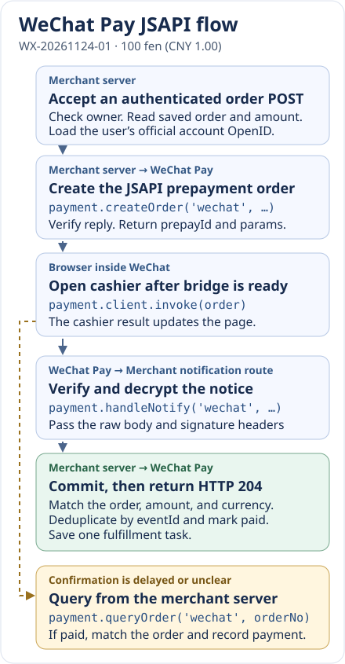
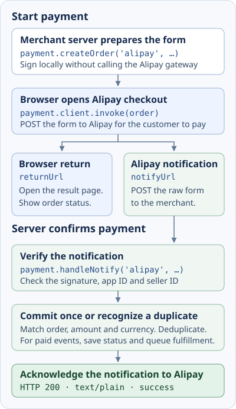

# @h-ai/payment API Reference

<!-- translation: partial -->

[Chinese source](payment.md) · [Configuration](../configuration/payment.en.md) · [Data structures](../data/payment.en.md)

[WeChat JSAPI payment](#wechat-jsapi-flow) · [Alipay mobile web payment](#alipay-wap-flow)

## Quick start

<a id="module-dependencies"></a>

### Dependencies

| Dependency | Purpose | When required | Setup order |
| --- | --- | --- | --- |
| Node.js and a browser | Create orders and verify signatures on the server, and open the payment flow in the browser | Node.js runs server-side `payment`. Browser checkout uses `@h-ai/payment/client` | Call `payment.init()` on the server. Call `payment.client.invoke()` after the browser receives order parameters from the server |
| `@h-ai/core` | Logging, results and error types | Installed with Payment | Use Payment's public operations |
| `@h-ai/reldb` | Stores Stripe provider references and idempotency results | Installed with Payment. A database connection is required when Stripe is enabled | Call `reldb.init()` and check the result before `payment.init()`. Use a shared database in production |
| `@h-ai/audit` | Records successful order creation, notification handling, refunds and order closures | Installed with Payment. Initialize it to persist payment audit events | Call `reldb.init()` and `audit.init()` before handling payments |
| WeChat Pay, Alipay or Stripe | Create provider orders, collect payments and verify notifications | When configuring the corresponding provider | Obtain merchant credentials. Set up an application endpoint before receiving provider notifications. See the provider examples below for browser requirements |

### Example

Initialize Payment before creating orders. Validate amounts and authorize operations in application code. Treat provider callbacks and query results as inputs to the app’s own order state machine.

```typescript

import { type PaymentConfigInput, payment } from '@h-ai/payment'

export async function paymentExample(trustedConfig: PaymentConfigInput, trustedOpenid: string) {
  // 常驻服务在启动/停机时分别 init/close；此函数演示完整生命周期。
  // 如启用 Stripe，应用已先调用 reldb.init() 打开共享数据库并检查 success。
  // Initialize configured providers with the host's trustedConfig. Success has no data; an invalid configuration stops order creation.
  const initialized = await payment.init(trustedConfig)
  if (!initialized.success)
    throw new Error(initialized.error.message)
  try {
    // Create the 100-minor-unit WeChat JSAPI order ORD001 with the trusted openid. Success supplies payment launch parameters; provider rejection stops the lookup.
    const created = await payment.createOrder('wechat', {
      orderNo: 'ORD001',
      amount: 100,
      description: '测试商品',
      tradeType: 'jsapi',
      userId: trustedOpenid,
      notifyUrl: 'https://api.example.com/payment/notify/wechat',
    })
    if (!created.success)
      throw new Error(created.error.message)
    // Read WeChat's current state for the newly created ORD001. Success returns OrderStatus; a lookup failure is separate.
    const query = await payment.queryOrder('wechat', 'ORD001')
    if (!query.success)
      throw new Error(query.error.message)
    return { order: created.data, status: query.data.status }
  }
  finally {
    // Close Payment with no arguments. Existing provider orders are unaffected and the host still owns its database.
    await payment.close() // 随后关闭应用打开的 reldb。
  }
}
```

```typescript
import type { PaymentOrder } from '@h-ai/payment'
import { payment } from '@h-ai/payment/client'

export async function startPayment(orderData: PaymentOrder) {
  // 用订单及渠道参数发起支付，检查接口调用是否成功。
  // Launch payment using the server-created order and channel parameters. Check data.invoked for launch and message when unavailable; the server confirms settlement.
  const invoked = await payment.client.invoke(orderData)
  if (!invoked.success)
    throw new Error(invoked.error.message)
  if (!invoked.data.invoked)
    throw new Error(invoked.data.message)
  // 返回调起结果。成交状态由服务端查询或异步通知确认。
  return invoked.data
}
```


<a id="api-reference"></a>

## Features

Each section lists individual interfaces, then follows the calls through a task. Parameters and defaults describe the arguments; call examples show the invocation, and returns describe the result or successful data as noted below. Check `success` on `HaiResult` before reading `data`. Detailed parameter defaults and advanced constraints remain linked to the Chinese reference.

<a id="providers"></a>

### Connect payment providers: `payment`

Prepare providers with validated server settings. Custom providers implement the public contract; merchant secrets stay on the server.

#### Interface list

| API | Purpose | Parameters and defaults | Return value or failure | Call example |
| --- | --- | --- | --- | --- |
| `payment.init(config)` | Initialize configured payment channels | `config` | `Promise<HaiResult<void>>` | `await payment.init(config)` |
| `payment.close()` | Release module state | None | `Promise<void>` | `await payment.close()` |
| `payment.config` | Read the parsed configuration | No arguments. Contains secrets. Keep it on the server. | `PaymentConfig \| null` | `payment.config?.stripe?.successUrl` |
| `payment.isInitialized` | Check whether initialization succeeded | No arguments | `boolean` | `payment.isInitialized` |
| `payment.getProvider(name)` | Read a registered payment provider | `name: string` Registered name used to look up the instance in this process | `PaymentProvider or undefined` | `payment.getProvider(name)` |
| `payment.registerProvider(provider)` | Register an application payment provider | `provider: PaymentProvider` Fully implemented provider instance. Registering the same name replaces it in this process | `void` | `payment.registerProvider(customProvider)` |

#### Scenario: Connect payment providers

Finish `payment.init()` before registering an application provider. Read `payment.isInitialized` to check module state and `payment.config` for the server-side configuration. After closing, they read `false` and `null`.

Input is an application PaymentProvider instance. Registration and lookup are synchronous; initialization and shutdown are in the quick start.

```ts
import { type PaymentProvider, payment } from '@h-ai/payment'

function installProvider(provider: PaymentProvider) {
  // Register the supplied provider under provider.name, replacing a provider with the same name. Returns no data.
  payment.registerProvider(provider)
  // Look up the name just registered. The returned instance equals provider; an unknown name yields undefined.
  return payment.getProvider(provider.name) === provider // true
}
// Look up the unregistered name not-registered. The result is undefined.
payment.getProvider('not-registered') // undefined
```

<a id="orders"></a>

### Create, query and close orders: `payment`

Create a provider order with your business order number, query its status and close unpaid orders when appropriate.

#### Interface list

| API | Purpose | Parameters and defaults | Return value or failure | Call example |
| --- | --- | --- | --- | --- |
| `payment.createOrder(providerName, input)` | Create a payment order | Required `providerName: string` names a registered provider. See [order fields](#payment-create-order-input) for required `input: CreateOrderInput`. | `Promise<HaiResult<PaymentOrder>>` | `await payment.createOrder(providerName, orderInput)` |
| `payment.queryOrder(providerName, orderNo)` | Query payment status | `providerName: string` Registered provider that owns the order. `orderNo: string` Merchant order number used at creation | `Promise<HaiResult<OrderStatus>>` | `await payment.queryOrder(providerName, orderNo)` |
| `payment.closeOrder(providerName, orderNo)` | Close a payment order | `providerName: string` Registered provider that owns the order. `orderNo: string` Merchant order number used at creation | `Promise<HaiResult<void>>` | `await payment.closeOrder(providerName, orderNo)` |

<a id="payment-create-order-input"></a>

**CreateOrderInput**

| Field | Type | Required and default | Purpose and when it applies |
| --- | --- | --- | --- |
| `orderNo` | `string` | Required | Persistent merchant order number. Keep it stable when retrying the same business order. |
| `amount` | `number` | Required | Order amount in the currency’s minor unit, such as fen for CNY. |
| `currency` | `string` | CNY for WeChat and Alipay, USD for Stripe | Uppercase currency matching the business order. |
| `description` | `string` | Required | Product or service description. |
| `tradeType` | `'jsapi' \| 'h5'` | Required | WeChat uses jsapi. Alipay and Stripe use h5. |
| `userId` | `string` | Required for WeChat jsapi | For WeChat, supply an openid that belongs to the server-configured appId. |
| `notifyUrl` | `string` | Required | Application callback URL for provider notifications. |
| `metadata` | `Record<string, string>` | Optional | Attach application fields where the provider supports them. |

Creating a Stripe order with `amount: 100, currency: "USD", tradeType: "h5"` returns hosted Checkout redirect data on success. Confirm the final payment via query or notification.

##### WeChat order queries and closure

`queryOrder('wechat', orderNo)` verifies the response signature and checks the app ID, merchant ID, and order number. Unpaid or closed orders can omit the amount, in which case `OrderStatus.amount` is `undefined`. Read your business order to obtain the expected total. A paid result requires a valid amount and transaction ID. WeChat’s `REFUND` is returned as `refund_started`. Check the individual refund for its outcome.

`payment.closeOrder('wechat', orderNo)` requires a valid signature for the HTTP 204 response and its empty body. Other statuses, a signature failure, or a network error return `CLOSE_ORDER_FAILED`.

<a id="stripe-amounts"></a>

##### Stripe amounts

Order creation, refunds, queries, and notifications use the business currency’s smallest unit. USD 100 is one US dollar and JPY 100 is 100 yen. Supply whole units for ISK and UGX. For example, pass `amount: 10000, currency: 'ISK'` for 10,000 ISK. The module sends 1,000,000 to Stripe and converts query and notification amounts back to 10,000. [Stripe currency rules](https://docs.stripe.com/currencies#special-cases)

##### Stripe Checkout and closing an order

The server creates hosted Checkout for `mode=payment` and `tradeType=h5`. The account and test or live mode scope the saved Checkout Session ID. When the same order is submitted again, the module checks the stored session and returns its current URL only while it can take payment. A closed, expired, or completed session returns `CREATE_ORDER_FAILED` and keeps the original mapping. `closeOrder` expires an open, unpaid session or confirms it already expired.

Alipay creation prepares a signed form. The backend confirms payments through a provider query or verified notification.

#### Scenario: Create, query and close orders

Order creation is in the quick start. Supply its provider and business order number; this function closes only pending orders and returns a final query result or failure.

```ts
async function inspectAndClose(providerName: string, orderNo: string) {
  // Query the named provider using the merchant order number. Success returns the order status record; return the query error unchanged.
  const queried = await payment.queryOrder(providerName, orderNo)
  if (!queried.success)
    return queried
  if (queried.data.status !== 'pending')
    return queried
  // Request closure only for the order observed as pending. Success has no business data; propagate a provider rejection.
  const closed = await payment.closeOrder(providerName, orderNo)
  if (!closed.success)
    return closed
  // Query the same provider and order again after closure. Use the returned state and handle lookup failure independently.
  return payment.queryOrder(providerName, orderNo)
}
```

<a id="refunds"></a>

### Refund and inspect outcomes: `payment.refund`

Request a refund using the original order and a distinct refund number; distinguish acceptance from final settlement.

#### Interface list

| API | Purpose | Parameters and defaults | Return value or failure | Call example |
| --- | --- | --- | --- | --- |
| `payment.refund(providerName, input)` | Request a refund and read acceptance | Required `providerName: string` specifies the original provider. See [refund fields](#payment-refund-input) for `input: RefundInput`. | `Promise<HaiResult<RefundResult>>` | `await payment.refund(providerName, refundInput)` |

<a id="payment-refund-input"></a>

**RefundInput**

| Field | Type | Required and default | Purpose and when it applies |
| --- | --- | --- | --- |
| `orderNo / refundNo` | `string` | Required | Original merchant order number and stable refund number. Reuse the number and amount on retry. |
| `amount` | `number` | Required | Refund amount in the original currency’s minor unit. |
| `totalAmount` | `number` | Provide the original order amount for WeChat | Original order total for WeChat. A partial refund must carry the full original total. |
| `reason` | `string` | Optional | Reason for the refund. |

For a 50-fen refund on a 100-fen WeChat order, pass `{ amount: 50, totalAmount: 100 }`. Check the refund status if the provider only acknowledges receipt.

##### Check the individual refund

WeChat `PROCESSING` returns `processing`, and `CLOSED` or `ABNORMAL` returns `failed`. An order with `refund_started` has entered the refund flow, which includes partial refunds. Use the [WeChat single refund query](https://pay.wechatpay.cn/doc/v3/merchant/4012791863) to check the amount and outcome.

Alipay verifies the original signed API response for order queries, refunds, and closure, then checks the operation, business result, and order number. A refund with `fund_change=Y` returns `success`. For `N` or an absent value, the result is `processing`. Look up the original order and refund number through [Alipay’s refund query](https://developer.alibaba.com/docs/api.htm?apiId=1049&docType=4). A Stripe receipt describes initial acceptance. Save the returned `refundId` and [retrieve the refund from Stripe](https://docs.stripe.com/api/refunds/retrieve) when the receipt is `processing`.

#### Scenario: Refund and inspect outcomes

Read the original total and persisted refund number from the business database. This example refunds 50 minor units of a 100-unit WeChat order.

```ts
import { payment } from '@h-ai/payment'

async function refundWeChatOrder(orderNo: string, refundNo: string) {
  // Submit with the verified business order and stable refund number. Check the receipt and query the provider if it is processing.
  const refunded = await payment.refund('wechat', {
    orderNo,
    refundNo,
    amount: 50,
    totalAmount: 100,
  })
  return refunded.success
    ? { status: refunded.data.status, refundId: refunded.data.refundId }
    : { error: refunded.error }
}
```

<a id="notifications"></a>

### Verify payment callbacks: `payment.handleNotify`

Use the original body and signature headers, verify the provider and update business state idempotently.

#### Interface list

| API | Purpose | Parameters and defaults | Return value or failure | Call example |
| --- | --- | --- | --- | --- |
| `payment.handleNotify(providerName, request)` | Verify provider notifications and return parsed details | `providerName: string` Registered name from the trusted notification route. `request: PaymentNotifyRequest` Required raw body string and string-valued headers for provider verification | `Promise<HaiResult<PaymentNotifyResult>>` | `await payment.handleNotify(providerName, originalNotification)` |

#### Scenario: Verify payment callbacks

This follows the successful-payment branch. Valid pending, failed or closed events must not create fulfillment jobs. handleNotify verifies the provider; the application owns order updates, durable deduplication and fulfillment.


In one transaction the application checks order, amount, currency and event ID, updates state conditionally and inserts a unique fulfillment outbox item. Acknowledge after commit. Duplicates or reordered events cannot repeat fulfillment or regress paid to pending. External fulfillment still needs its own idempotency key.

Input is the original route Request; output is HaiResult<PaymentNotifyResult>. Read the body once. After verification, validate and commit the order, amount, currency and event ID before acknowledging the provider.

```ts
async function verifyNotification(providerName: string, request: Request) {
  // Verify and parse the notification with the provider name, unmodified request body, and headers. Success returns event, order, and status data; invalid signatures fail. Check state and deduplicate before fulfillment.
  return payment.handleNotify(providerName, {
    body: await request.text(),
    headers: Object.fromEntries(request.headers),
  })
}
```

<a id="alipay-notification-ack"></a>

#### Scenario: Acknowledge Alipay notifications

Alipay sends a form request. Return HTTP 200 with the exact text `success` when the transaction commits or the application recognizes a duplicate. Mount the returned middleware in `serv.createApp({ ...options, middlewares: [...] })` using the app’s API prefix. If enabling application transport encryption, add the complete notification path to `transport.excludePaths` so the provider can use its normal form request. For a deny-by-default `http.access` policy, allow the provider’s POST requests on that path. Implement `recordVerified` as the application transaction that checks the order, deduplicates the event, and enqueues fulfillment. Its success indicates a committed transaction or an already processed duplicate.

Enqueue fulfillment only for a `paid` event. If the service composes the entire `apiContract.payment`, provide an Alipay procedure that fails closed when the raw middleware is absent. You can also compose only the order routes and the other notifications the app implements.

Pass the Alipay notification operation `apiContract.payment.notifications.alipay` to `apiContract.pathOf` to get `/payment/notifications/alipay`. Prepend the application’s API prefix to mount the middleware. See [read an operation path](./api-contract.en.md#read-route-path).

```ts
import type { HaiResult } from '@h-ai/core'
import type { PaymentNotifyResult } from '@h-ai/payment'
import type { ServMiddlewareMount } from '@h-ai/serv'
import { apiContract } from '@h-ai/api-contract'
import { payment } from '@h-ai/payment'

export function alipayNotification(
  apiPrefix: string,
  recordVerified: (notification: PaymentNotifyResult) => Promise<HaiResult<unknown>>,
): ServMiddlewareMount {
  // Read the notification operation’s business path and prepend the host prefix.
  const path = apiPrefix + apiContract.pathOf(apiContract.payment.notifications.alipay)
  return {
    path,
    async middleware(c, next) {
      if (c.req.method !== 'POST')
        return next()

      const request = c.req.raw
      // Read the original form once. Pass verified data to the business transaction. Invalid notifications return HTTP 400.
      const verified = await payment.handleNotify('alipay', {
        body: await request.text(),
        headers: Object.fromEntries(request.headers),
      })
      if (!verified.success)
        return c.text('fail', 400)

      // Check the business order and commit. Return HTTP 500 on failure so the provider retries.
      const committed = await recordVerified(verified.data)
      if (!committed.success)
        return c.text('fail', 500)
      return c.text('success', 200)
    },
  }
}
```

Acknowledge WeChat and Stripe after the business commit as well. WeChat accepts HTTP 200 or 204. Stripe accepts HTTP 2xx. The module checks the signed Stripe event against the persisted account-and-mode-scoped Session ID, order, amount, and currency before returning it. Return a non-2xx response when the mapping has yet to be saved or application processing fails so Stripe can retry. A completed Checkout event can still be `pending`. Fulfill only on `paid`.

<a id="browser-payment"></a>

### Start payment in the browser: `payment.client.invoke`

Use startPayment in the quick start with an order successfully created by the server.

#### Interface list

| API | Purpose | Parameters and defaults | Return value or failure | Call example |
| --- | --- | --- | --- | --- |
| `payment.client.invoke(order)` | Open the provider payment UI | Required `order: PaymentOrder` from the successful server-side order creation | `Promise<HaiResult<InvokePaymentResult>>` | `await payment.client.invoke(orderData)` |

#### Scenario: Handle invocation results

startPayment checks success and data.invoked and returns the invocation result. Cancellation, redirects and page loads do not confirm payment.

<a id="wechat-jsapi-flow"></a>

#### Scenario: Pay inside WeChat with JSAPI

A customer opens the order in WeChat and selects Pay. Initialize the module with the [WeChat JSAPI configuration](../configuration/payment.en.md#wechat-jsapi-configuration). Authenticate the customer and load their pending order `WX-20261124-01` for CNY 100 fen, or one yuan. Read the saved OpenID for your official account and obtain the notification URL from server configuration.



Pass the authorized order, OpenID, and notification URL to this server function. Send its `PaymentOrder` to the browser. When the WeChat bridge is available or `WeixinJSBridgeReady` fires, call `startPayment(orderData)` from the quick start. After cancellation or return, show the order state from the application backend.

```ts
import { type CreateOrderInput, payment } from '@h-ai/payment'

export async function prepareWeChatPayment(
  order: Pick<CreateOrderInput, 'orderNo' | 'amount' | 'description'>,
  openid: string,
  notifyUrl: string,
) {
  // Request JSAPI prepayment for the merchant order. Success returns launch parameters. Stop this attempt on failure.
  const created = await payment.createOrder('wechat', {
    ...order,
    currency: 'CNY',
    tradeType: 'jsapi',
    userId: openid,
    notifyUrl,
  })
  if (!created.success)
    throw new Error(created.error.message)
  return created.data
}
```

Mount `receiveWeChatNotify` as the POST handler at `notifyUrl`. Supply `recordVerified` from your application. In one transaction, match the provider, merchant, order, amount and currency, deduplicate the event, mark the order `paid`, and create a unique fulfillment job. See the [business transaction example](../../../packages/payment/examples/payment-notify-consumer.ts).

```ts
import type { HaiResult } from '@h-ai/core'
import { type PaymentNotifyResult, payment } from '@h-ai/payment'

export async function receiveWeChatNotify(
  request: Request,
  recordVerified: (notification: PaymentNotifyResult) => Promise<HaiResult<unknown>>,
): Promise<Response> {
  // Verify the original body and signature headers. Return HTTP 400 if verification or parsing fails.
  const verified = await payment.handleNotify('wechat', {
    body: await request.text(),
    headers: Object.fromEntries(request.headers),
  })
  if (!verified.success)
    return Response.json({ code: 'FAIL', message: 'Notification verification failed' }, { status: 400 })

  // Return an empty 204 after commit or duplicate detection. Return 500 on a transaction failure so WeChat retries.
  const committed = await recordVerified(verified.data)
  if (!committed.success)
    return Response.json({ code: 'FAIL', message: 'Notification processing failed' }, { status: 500 })
  return new Response(null, { status: 204 })
}
```

The verified notification includes `WX-20261124-01`, 100 fen, CNY, and the WeChat transaction ID. Once the app commits, the browser sees paid when it reloads the order. If the notification is delayed, the backend can call `payment.queryOrder('wechat', 'WX-20261124-01')`. Confirm a `paid` result against the order, amount, and transaction ID, using the channel’s fixed CNY currency, before applying the same idempotent transition and job. The lookup has no notification event ID. Use the order state and unique fulfillment job to prevent repeated delivery.

<a id="alipay-wap-flow"></a>

#### Scenario: Pay with Alipay on a mobile website

A customer opens a pending order in a mobile browser. Initialize the module with the [Alipay sandbox configuration](../configuration/payment.en.md#alipay-sandbox-configuration) before switching to production settings. Authenticate the customer and load their order `AL-20261124-01` for CNY 100 fen. Obtain the notification URL from server configuration and set `alipay.returnUrl` to the application’s payment result page.



Pass the authorized order and notification URL to this server function. The returned `PaymentOrder.clientParams` contains the Alipay gateway and signed form fields. The browser calls `startPayment(orderData)` to submit the form to Alipay and open the checkout. On return to `returnUrl`, the page reads the order state from the application backend.

```ts
import { type CreateOrderInput, payment } from '@h-ai/payment'

export async function prepareAlipayPayment(
  order: Pick<CreateOrderInput, 'orderNo' | 'amount' | 'description'>,
  notifyUrl: string,
) {
  // Sign the WAP form parameters for the merchant order. The browser can submit them on success. Stop before opening checkout on failure.
  const created = await payment.createOrder('alipay', {
    ...order,
    currency: 'CNY',
    tradeType: 'h5',
    notifyUrl,
  })
  if (!created.success)
    throw new Error(created.error.message)
  return created.data
}
```

Alipay posts a separate form notification to `notifyUrl`. The [Alipay acknowledgement example](#alipay-notification-ack) reads the original body and verifies the signature. The business transaction checks the order, 100-fen amount, currency and transaction identity, then commits the order state and unique job. After commit or duplicate detection, respond with HTTP 200 and the exact body `success`. If the app is still awaiting confirmation on return, the backend can call `payment.queryOrder('alipay', 'AL-20261124-01')`. Confirm `paid` against the order, amount and transaction ID before applying the same idempotent transition and fulfillment.

<a id="http-contract-extensions"></a>

### Enable optional HTTP contracts

Call the shared close operation with `provider` and `orderNo`. The host authorizes the session and checks the provider and merchant order number against its order record. [Endpoints and fields](api-contract.en.md#http-contract-extensions)
