# @h-ai/payment API リファレンス

<!-- translation: partial -->

[原文（中国語）](payment.md) · [設定](../configuration/payment.ja.md) · [データ構造](../data/payment.ja.md)

<a id="quick-start"></a>

## クイックスタート

注文作成前に Payment を初期化します。金額の検証と操作の認可はアプリ側で行います。決済サービスの通知と照会結果はアプリ独自の注文状態の入力として扱います。

```typescript

import { type PaymentConfigInput, payment } from '@h-ai/payment'

export async function paymentExample(trustedConfig: PaymentConfigInput, trustedOpenid: string) {
  // 常驻服务在启动/停机时分别 init/close；此函数演示完整生命周期。
  // 如启用 Stripe，应用已先调用 reldb.init() 打开共享数据库并检查 success。
  // ホストが検証した trustedConfig で決済チャネルを準備する。成功時データなし、設定不正なら注文を作らない。
  const initialized = await payment.init(trustedConfig)
  if (!initialized.success)
    throw new Error(initialized.error.message)
  try {
    // 信頼済み openid で最小通貨単位 100 の WeChat JSAPI 注文 ORD001 を作る。成功時は支払起動用の値、拒否時は照会へ進まない。
    const created = await payment.createOrder('wechat', {
      orderNo: 'ORD001',
      amount: 100,
      description: '测试商品',
      tradeType: 'jsapi',
      userId: trustedOpenid,
      notifyUrl: 'https://api.example.com/payment/notify/wechat',
    })
    if (!created.success)
      throw new Error(created.error.message)
    // 作成した ORD001 の現在状態を WeChat に照会する。成功時は OrderStatus、照会失敗は個別に扱う。
    const query = await payment.queryOrder('wechat', 'ORD001')
    if (!query.success)
      throw new Error(query.error.message)
    return { order: created.data, status: query.data.status }
  }
  finally {
    // 引数なしで決済モジュールの状態を解放する。チャネル上の注文は残り、DB はホストが別に閉じる。
    await payment.close() // 随后关闭应用打开的 reldb。
  }
}
```

```typescript
import type { PaymentOrder } from '@h-ai/payment'
import { payment } from '@h-ai/payment/client'

export async function startPayment(orderData: PaymentOrder) {
  // 用订单及渠道参数发起支付，检查接口调用是否成功。
  // サーバーが作った注文とチャネルの値で決済を起動する。起動可否は data.invoked、不可時は message、成立はサーバーで確認する。
  const invoked = await payment.client.invoke(orderData)
  if (!invoked.success)
    throw new Error(invoked.error.message)
  if (!invoked.data.invoked)
    throw new Error(invoked.data.message)
  // 返回调起结果。成交状态由服务端查询或异步通知确认。
  return invoked.data
}
```

<a id="api-一覧"></a>

<a id="api-reference"></a>

## 機能

各節では個別のインターフェースを列挙し、その後に作業の流れを説明します。入力欄は呼び出し例、出力欄は成功時のデータです。`HaiResult` は `success` を確認してから `data` を読みます。引数の詳細な既定値と高度な制約は中国語の対応節を参照してください。

<a id="providers"></a>

### 決済経路への接続：`payment`

検証済みのサーバー設定で決済経路を準備します。独自 Provider は公開契約を実装し、加盟店の秘密はサーバーに保持します。

#### インターフェース一覧

| API | 用途 | 引数と既定値 | 戻り値・失敗 | 呼び出し例 |
| --- | --- | --- | --- | --- |
| `payment.init(config)` | 設定済みの決済チャネルを初期化 | 必須の `config: PaymentConfigInput` | `void` | `await payment.init(config)` |
| `payment.close()` | モジュールの状態を解放 | なし | `Promise<void>` | `await payment.close()` |
| `payment.getProvider(name)` | 登録済み決済プロバイダーを取得 | `name: string` このプロセス内でインスタンスを検索する登録名 | `PaymentProvider or undefined` | `payment.getProvider(name)` |
| `payment.registerProvider(provider)` | 独自決済プロバイダーを登録 | `provider: PaymentProvider` 決済インターフェースを実装したインスタンス。同名ならこのプロセス内の登録を置換 | `void` | `payment.registerProvider(customProvider)` |

#### 利用例：決済経路への接続

入力はアプリが実装した PaymentProvider。登録・取得は同期処理です。初期化と終了は最小例を参照してください。

```ts
import type { PaymentProvider } from '@h-ai/payment'

function installProvider(provider: PaymentProvider) {
  // 受け取ったチャネルを provider.name で登録し、同名の実装があれば置き換える。戻り値はない。
  payment.registerProvider(provider)
  // 登録した名前から同じチャネルを取得する。登録のない名前なら undefined。
  return payment.getProvider(provider.name) === provider // true
}
// 未登録の not-registered を検索する。結果は undefined。
payment.getProvider('not-registered') // undefined
```

<a id="orders"></a>

### 注文の作成・照会・終了：`payment`

業務注文番号で決済注文を作り、状態を照会します。未払い注文の終了は返金とは別です。

#### インターフェース一覧

| API | 用途 | 引数と既定値 | 戻り値・失敗 | 呼び出し例 |
| --- | --- | --- | --- | --- |
| `payment.createOrder(providerName, input)` | 決済注文を作成 | 必須の `providerName: string` は登録済み事業者名。必須の `input: CreateOrderInput` は[注文項目](#payment-create-order-input)を参照。 | `PaymentOrder` | `await payment.createOrder(providerName, orderInput)` |
| `payment.queryOrder(providerName, orderNo)` | 決済状態を取得 | `providerName: string` 注文に対応する登録済み事業者名。`orderNo: string` 作成時の加盟店注文番号 | `OrderStatus` | `await payment.queryOrder(providerName, orderNo)` |
| `payment.closeOrder(providerName, orderNo)` | 決済注文をクローズ | `providerName: string` 注文に対応する登録済み事業者名。`orderNo: string` 作成時の加盟店注文番号 | `void` | `await payment.closeOrder(providerName, orderNo)` |

<a id="payment-create-order-input"></a>

**CreateOrderInput**

| フィールド | 型 | 必須と既定値 | 用途と適用条件 |
| --- | --- | --- | --- |
| `orderNo` | `string` | 必須 | 永続化済みの加盟店注文番号。同じ業務注文の再試行時に維持します。 |
| `amount` | `number` | 必須 | 通貨の最小単位で指定する注文金額。CNY なら分。 |
| `currency` | `string` | WeChat と Alipay は CNY、Stripe は USD | 業務注文と一致する大文字の通貨コード。 |
| `description` | `string` | 必須 | 商品またはサービスの説明。 |
| `tradeType` | `'jsapi' \| 'h5'` | 必須 | WeChat は jsapi、Alipay と Stripe は h5。 |
| `userId` | `string` | WeChat jsapi で必須 | WeChat ではサーバー設定の appId に属する openid を指定。 |
| `notifyUrl` | `string` | 必須 | 決済事業者からアプリへの通知用 URL。 |
| `metadata` | `Record<string, string>` | 任意 | 事業者が対応する場合に業務項目を添付。 |

Stripe で `amount: 100, currency: "USD", tradeType: "h5"` を指定すると、成功時にホスト型 Checkout の遷移データが返ります。最終的な決済状態は照会または通知で確認します。

微信支付が `204 No Content` を返すと、`payment.closeOrder('wechat', orderNo)` は成功し、`data` は `undefined` です。プロキシは決済サービスのステータスをそのまま転送します。他のステータスや通信エラーは `CLOSE_ORDER_FAILED` です。

#### 利用例：注文の作成・照会・終了

作成は最小例を参照。元の決済先と注文番号を渡すと pending の注文だけを終了し、再照会結果または失敗を返します。

```ts
async function inspectAndClose(providerName: string, orderNo: string) {
  // 業務記録のチャネル名と加盟店注文番号で状態を照会する。成功時は注文状態、照会失敗はそのまま返す。
  const queried = await payment.queryOrder(providerName, orderNo)
  if (!queried.success)
    return queried
  if (queried.data.status !== 'pending')
    return queried
  // 直前の照会で pending だった注文だけを閉じる。成功時に業務データはなく、チャネルが拒否した場合は失敗を返す。
  const closed = await payment.closeOrder(providerName, orderNo)
  if (!closed.success)
    return closed
  // 閉じたあとに同じチャネルと注文番号で再照会する。返った状態で確認し、再照会の失敗も個別に扱う。
  return payment.queryOrder(providerName, orderNo)
}
```

<a id="refunds"></a>

### 返金と結果の確認：`payment.refund`

元の注文番号と独立した返金番号で申請し、受付と最終的な返金完了を区別します。

#### インターフェース一覧

| API | 用途 | 引数と既定値 | 戻り値・失敗 | 呼び出し例 |
| --- | --- | --- | --- | --- |
| `payment.refund(providerName, input)` | 返金要求と受付結果を取得 | 必須の `providerName: string` は元の決済事業者を指定。`input: RefundInput` は[返金項目](#payment-refund-input)を参照。 | `RefundResult` | `await payment.refund(providerName, refundInput)` |

<a id="payment-refund-input"></a>

**RefundInput**

| フィールド | 型 | 必須と既定値 | 用途と適用条件 |
| --- | --- | --- | --- |
| `orderNo / refundNo` | `string` | 必須 | 元の加盟店注文番号と今回の安定した返金番号。再試行時も番号と金額を維持。 |
| `amount` | `number` | 必須 | 元の通貨の最小単位で指定する返金額。 |
| `totalAmount` | `number` | WeChat では元の注文金額を指定 | WeChat の元の注文総額。部分返金でも注文全体の金額を指定。 |
| `reason` | `string` | 任意 | 返金理由。 |

WeChat の 100 分の注文から 50 分を返金する場合は `{ amount: 50, totalAmount: 100 }`。事業者で受理しただけなら返金状態を確認します。

#### 利用例：返金と結果の確認

確認済み注文と今回の一意な返金番号を入力。100 は最小通貨単位です。失敗や processing は返金完了を意味しません。

```ts
async function refundOrder(providerName: string, orderNo: string, refundNo: string) {
  // 加盟店注文番号と保存済みの返金番号で最小通貨単位 100 の返金を申請する。受理後も processing の場合があり、拒否は失敗。同じ返金の再試行では番号を再利用する。
  const refunded = await payment.refund(providerName, { orderNo, refundNo, amount: 100 })
  if (!refunded.success)
    return refunded
  return refunded // data.status distinguishes success from processing
}
```

<a id="notifications"></a>

### 決済通知の検証：`payment.handleNotify`

元の HTTP 本文と署名ヘッダーで経路を検証し、業務注文を重複なく更新します。

#### インターフェース一覧

| API | 用途 | 引数と既定値 | 戻り値・失敗 | 呼び出し例 |
| --- | --- | --- | --- | --- |
| `payment.handleNotify(providerName, request)` | 通知を検証してコールバックを実行 | `providerName: string` 信頼できる通知ルートの登録済み事業者名。`request: PaymentNotifyRequest` 事業者の検証に必要な生の body 文字列と文字列の headers | `PaymentNotifyResult` | `await payment.handleNotify(providerName, originalNotification)` |

#### 利用例：決済通知の検証

支払成功通知の分岐を示します。正当な pending・failed・closed でも履行処理を作成してはいけません。handleNotify は送信元を検証し、注文更新・永続重複排除・履行はアプリが担当します。



同じトランザクションで注文・金額・通貨・イベントを確認し、条件付き更新と一意な履行 outbox を保存してから受領を返します。重複・順序逆転で再履行や paid から pending への逆戻りを防ぎます。外部処理も独自の冪等 ID が必要です。

入力はルートの元の Request、出力は HaiResult<PaymentNotifyResult>。本文は一度だけ読み、成功後も注文・金額・通貨・イベント ID をトランザクションで確認してから応答します。

```ts
async function verifyNotification(providerName: string, request: Request) {
  // チャネル名、未変更の HTTP 本文とヘッダーで通知を検証・解析する。成功時はイベント ID と注文・支払状態を取得し、署名不正は失敗。履行前に状態確認と重複排除を行う。
  return payment.handleNotify(providerName, {
    body: await request.text(),
    headers: Object.fromEntries(request.headers),
  })
}
```


<a id="browser-payment"></a>

### ブラウザーで支払いを開始：`payment.client.invoke`

最小例の startPayment を使い、サーバーで作成済みの注文を渡します。

#### インターフェース一覧

| API | 用途 | 引数と既定値 | 戻り値・失敗 | 呼び出し例 |
| --- | --- | --- | --- | --- |
| `payment.client.invoke(order)` | 決済画面を開く | サーバー側で注文の作成に成功したときの `order: PaymentOrder` が必須 | `Promise<HaiResult<InvokePaymentResult>>` | `await payment.client.invoke(orderData)` |

#### 利用例：呼び出し結果を確認

startPayment は success と data.invoked を確認して結果を返します。キャンセル・遷移・画面表示は入金確認になりません。
