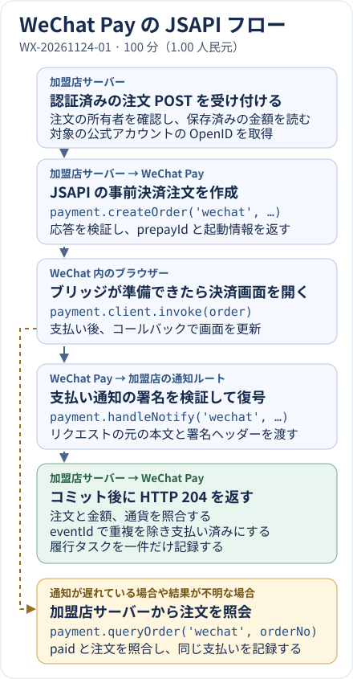
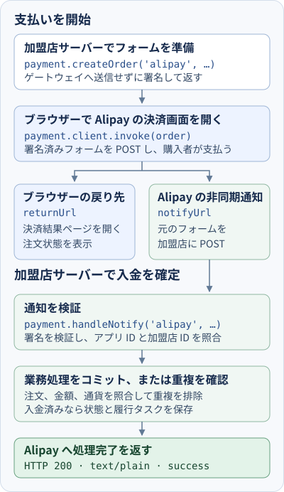

# @h-ai/payment API リファレンス

<!-- translation: partial -->

[原文（中国語）](payment.md) · [設定](../configuration/payment.ja.md) · [データ構造](../data/payment.ja.md)

[WeChat JSAPI 決済](#wechat-jsapi-flow) · [Alipay モバイル Web 決済](#alipay-wap-flow)

<a id="quick-start"></a>

## クイックスタート

<a id="module-dependencies"></a>

### 依存関係

| 依存先 | 用途 | 利用条件 | 初期化順序 |
| --- | --- | --- | --- |
| Node.js とブラウザー | サーバーでの注文作成と署名検証、ブラウザーでの支払い開始 | サーバーの `payment` は Node.js で動作します。ブラウザーの支払いには `@h-ai/payment/client` を使用します | サーバーで `payment.init()` を呼びます。注文パラメーターを受け取った後、ブラウザーで `payment.client.invoke()` を呼びます |
| `@h-ai/core` | ログ、結果、エラー型 | Payment と同時にインストールされます | Payment の公開 API を使用します |
| `@h-ai/reldb` | Stripe のプロバイダー参照と冪等処理の結果を保存 | Payment と同時にインストールされます。Stripe を有効にする場合はデータベース接続が必須です | `reldb.init()` の成功を確認してから `payment.init()` を呼びます。本番環境では共有データベースを使用します |
| `@h-ai/audit` | 成功した注文作成、通知処理、返金、注文終了を記録 | Payment と同時にインストールされます。決済の監査記録を保存する場合に初期化します | `reldb.init()` と `audit.init()` を順に呼んだ後に決済を処理します |
| WeChat Pay、Alipay、Stripe | 決済サービスでの注文作成、支払いの受領、通知の検証 | 対応する決済サービスを設定するとき | 加盟店の認証情報を準備します。決済通知を受け取る前にアプリのエンドポイントを設定します。ブラウザーの条件は下記の利用例を参照してください |

### 利用例

注文作成前に Payment を初期化します。金額の検証と操作の認可はアプリ側で行います。決済サービスの通知と照会結果はアプリ独自の注文状態の入力として扱います。

```typescript

import { type PaymentConfigInput, payment } from '@h-ai/payment'

export async function paymentExample(trustedConfig: PaymentConfigInput, trustedOpenid: string) {
  // 常驻服务在启动/停机时分别 init/close；此函数演示完整生命周期。
  // 如启用 Stripe，应用已先调用 reldb.init() 打开共享数据库并检查 success。
  // ホストが検証した trustedConfig で決済チャネルを準備する。成功時データなし、設定不正なら注文を作らない。
  const initialized = await payment.init(trustedConfig)
  if (!initialized.success)
    throw new Error(initialized.error.message)
  try {
    // 信頼済み openid で最小通貨単位 100 の WeChat JSAPI 注文 ORD001 を作る。成功時は支払起動用の値、拒否時は照会へ進まない。
    const created = await payment.createOrder('wechat', {
      orderNo: 'ORD001',
      amount: 100,
      description: '测试商品',
      tradeType: 'jsapi',
      userId: trustedOpenid,
      notifyUrl: 'https://api.example.com/payment/notify/wechat',
    })
    if (!created.success)
      throw new Error(created.error.message)
    // 作成した ORD001 の現在状態を WeChat に照会する。成功時は OrderStatus、照会失敗は個別に扱う。
    const query = await payment.queryOrder('wechat', 'ORD001')
    if (!query.success)
      throw new Error(query.error.message)
    return { order: created.data, status: query.data.status }
  }
  finally {
    // 引数なしで決済モジュールの状態を解放する。チャネル上の注文は残り、DB はホストが別に閉じる。
    await payment.close() // 随后关闭应用打开的 reldb。
  }
}
```

```typescript
import type { PaymentOrder } from '@h-ai/payment'
import { payment } from '@h-ai/payment/client'

export async function startPayment(orderData: PaymentOrder) {
  // 用订单及渠道参数发起支付，检查接口调用是否成功。
  // サーバーが作った注文とチャネルの値で決済を起動する。起動可否は data.invoked、不可時は message、成立はサーバーで確認する。
  const invoked = await payment.client.invoke(orderData)
  if (!invoked.success)
    throw new Error(invoked.error.message)
  if (!invoked.data.invoked)
    throw new Error(invoked.data.message)
  // 返回调起结果。成交状态由服务端查询或异步通知确认。
  return invoked.data
}
```

<a id="api-一覧"></a>

<a id="api-reference"></a>

## 機能

各節では個別のインターフェースを列挙し、その後に作業の流れを説明します。入力欄は呼び出し例、出力欄は成功時のデータです。`HaiResult` は `success` を確認してから `data` を読みます。引数の詳細な既定値と高度な制約は中国語の対応節を参照してください。

<a id="providers"></a>

### 決済経路への接続：`payment`

検証済みのサーバー設定で決済経路を準備します。独自 Provider は公開契約を実装し、加盟店の秘密はサーバーに保持します。

#### インターフェース一覧

| API | 用途 | 引数と既定値 | 戻り値・失敗 | 呼び出し例 |
| --- | --- | --- | --- | --- |
| `payment.init(config)` | 設定済みの決済チャネルを初期化 | 必須の `config: PaymentConfigInput` | `Promise<HaiResult<void>>` | `await payment.init(config)` |
| `payment.close()` | モジュールの状態を解放 | なし | `Promise<void>` | `await payment.close()` |
| `payment.config` | 解析済みの設定を取得 | 引数なし。秘密情報を含むためサーバー内部で使います。 | `PaymentConfig \| null` | `payment.config?.stripe?.successUrl` |
| `payment.isInitialized` | 初期化が完了したか確認 | 引数なし | `boolean` | `payment.isInitialized` |
| `payment.getProvider(name)` | 登録済み決済プロバイダーを取得 | `name: string` このプロセス内でインスタンスを検索する登録名 | `PaymentProvider or undefined` | `payment.getProvider(name)` |
| `payment.registerProvider(provider)` | 独自決済プロバイダーを登録 | `provider: PaymentProvider` 決済インターフェースを実装したインスタンス。同名ならこのプロセス内の登録を置換 | `void` | `payment.registerProvider(customProvider)` |

#### 利用例：決済経路への接続

`payment.init()` の完了後にアプリ独自の事業者を登録します。`payment.isInitialized` でモジュールの状態、`payment.config` でサーバー側の設定を参照できます。終了後の値はそれぞれ `false` と `null` です。

入力はアプリが実装した PaymentProvider。登録・取得は同期処理です。初期化と終了は最小例を参照してください。

```ts
import { type PaymentProvider, payment } from '@h-ai/payment'

function installProvider(provider: PaymentProvider) {
  // 受け取ったチャネルを provider.name で登録し、同名の実装があれば置き換える。戻り値はない。
  payment.registerProvider(provider)
  // 登録した名前から同じチャネルを取得する。登録のない名前なら undefined。
  return payment.getProvider(provider.name) === provider // true
}
// 未登録の not-registered を検索する。結果は undefined。
payment.getProvider('not-registered') // undefined
```

<a id="orders"></a>

### 注文の作成・照会・終了：`payment`

業務注文番号で決済注文を作り、状態を照会します。未払い注文の終了は返金とは別です。

#### インターフェース一覧

| API | 用途 | 引数と既定値 | 戻り値・失敗 | 呼び出し例 |
| --- | --- | --- | --- | --- |
| `payment.createOrder(providerName, input)` | 決済注文を作成 | 必須の `providerName: string` は登録済み事業者名。必須の `input: CreateOrderInput` は[注文項目](#payment-create-order-input)を参照。 | `Promise<HaiResult<PaymentOrder>>` | `await payment.createOrder(providerName, orderInput)` |
| `payment.queryOrder(providerName, orderNo)` | 決済状態を取得 | `providerName: string` 注文に対応する登録済み事業者名。`orderNo: string` 作成時の加盟店注文番号 | `Promise<HaiResult<OrderStatus>>` | `await payment.queryOrder(providerName, orderNo)` |
| `payment.closeOrder(providerName, orderNo)` | 決済注文をクローズ | `providerName: string` 注文に対応する登録済み事業者名。`orderNo: string` 作成時の加盟店注文番号 | `Promise<HaiResult<void>>` | `await payment.closeOrder(providerName, orderNo)` |

<a id="payment-create-order-input"></a>

**CreateOrderInput**

| フィールド | 型 | 必須と既定値 | 用途と適用条件 |
| --- | --- | --- | --- |
| `orderNo` | `string` | 必須 | 永続化済みの加盟店注文番号。同じ業務注文の再試行時に維持します。 |
| `amount` | `number` | 必須 | 通貨の最小単位で指定する注文金額。CNY なら分。 |
| `currency` | `string` | WeChat と Alipay は CNY、Stripe は USD | 業務注文と一致する大文字の通貨コード。 |
| `description` | `string` | 必須 | 商品またはサービスの説明。 |
| `tradeType` | `'jsapi' \| 'h5'` | 必須 | WeChat は jsapi、Alipay と Stripe は h5。 |
| `userId` | `string` | WeChat jsapi で必須 | WeChat ではサーバー設定の appId に属する openid を指定。 |
| `notifyUrl` | `string` | 必須 | 決済事業者からアプリへの通知用 URL。 |
| `metadata` | `Record<string, string>` | 任意 | 事業者が対応する場合に業務項目を添付。 |

Stripe で `amount: 100, currency: "USD", tradeType: "h5"` を指定すると、成功時にホスト型 Checkout の遷移データが返ります。最終的な決済状態は照会または通知で確認します。

##### WeChat の注文照会とクローズ

`queryOrder('wechat', orderNo)` は応答の署名とアプリ ID、加盟店 ID、注文番号を確認します。未払いまたは終了済みの注文で事業者が金額を省略した場合、`OrderStatus.amount` は `undefined` です。予定の請求額はアプリの注文から参照できます。支払済みを返すには事業者の有効な金額と取引番号が必要です。WeChat の `REFUND` は `refund_started` として返るため、個々の返金状態を別途確認します。

`payment.closeOrder('wechat', orderNo)` は HTTP 204 と空の本文の署名を検証してから成功します。他の応答コード、署名エラー、通信エラーの場合は `CLOSE_ORDER_FAILED` を返します。

<a id="stripe-amounts"></a>

##### Stripe の金額

作成、返金、照会、通知では業務通貨の最小単位を使用します。USD の 100 は 1 米ドル、JPY の 100 は 100 円です。ISK と UGX は整数の通貨単位を指定します。たとえば 10,000 ISK は `amount: 10000, currency: 'ISK'` と指定します。モジュールから Stripe に 1,000,000 を送り、照会と通知の金額は 10,000 に戻して返します。[Stripe の通貨ルール](https://docs.stripe.com/currencies#special-cases)

##### Stripe Checkout と注文のクローズ

サーバーは `mode=payment`、`tradeType=h5` のホスト型 Checkout を作成します。Checkout セッション ID はアカウントとテスト・本番モードごとに保存します。同じ注文の再送時は保存済みセッションを照会し、支払い可能な間だけ現在の URL を返します。終了、期限切れ、完了の場合は `CREATE_ORDER_FAILED` を返し、元の記録を保持します。`closeOrder` は未払いで開いているセッションの期限を切るか、すでに期限切れであることを確認します。

Alipay の注文作成は署名付きフォームを準備します。入金はバックエンドで照会または検証済み通知を使って確定します。

#### 利用例：注文の作成・照会・終了

作成は最小例を参照。元の決済先と注文番号を渡すと pending の注文だけを終了し、再照会結果または失敗を返します。

```ts
async function inspectAndClose(providerName: string, orderNo: string) {
  // 業務記録のチャネル名と加盟店注文番号で状態を照会する。成功時は注文状態、照会失敗はそのまま返す。
  const queried = await payment.queryOrder(providerName, orderNo)
  if (!queried.success)
    return queried
  if (queried.data.status !== 'pending')
    return queried
  // 直前の照会で pending だった注文だけを閉じる。成功時に業務データはなく、チャネルが拒否した場合は失敗を返す。
  const closed = await payment.closeOrder(providerName, orderNo)
  if (!closed.success)
    return closed
  // 閉じたあとに同じチャネルと注文番号で再照会する。返った状態で確認し、再照会の失敗も個別に扱う。
  return payment.queryOrder(providerName, orderNo)
}
```

<a id="refunds"></a>

### 返金と結果の確認：`payment.refund`

元の注文番号と独立した返金番号で申請し、受付と最終的な返金完了を区別します。

#### インターフェース一覧

| API | 用途 | 引数と既定値 | 戻り値・失敗 | 呼び出し例 |
| --- | --- | --- | --- | --- |
| `payment.refund(providerName, input)` | 返金要求と受付結果を取得 | 必須の `providerName: string` は元の決済事業者を指定。`input: RefundInput` は[返金項目](#payment-refund-input)を参照。 | `Promise<HaiResult<RefundResult>>` | `await payment.refund(providerName, refundInput)` |

<a id="payment-refund-input"></a>

**RefundInput**

| フィールド | 型 | 必須と既定値 | 用途と適用条件 |
| --- | --- | --- | --- |
| `orderNo / refundNo` | `string` | 必須 | 元の加盟店注文番号と今回の安定した返金番号。再試行時も番号と金額を維持。 |
| `amount` | `number` | 必須 | 元の通貨の最小単位で指定する返金額。 |
| `totalAmount` | `number` | WeChat では元の注文金額を指定 | WeChat の元の注文総額。部分返金でも注文全体の金額を指定。 |
| `reason` | `string` | 任意 | 返金理由。 |

WeChat の 100 分の注文から 50 分を返金する場合は `{ amount: 50, totalAmount: 100 }`。事業者で受理しただけなら返金状態を確認します。

##### 個別の返金を確認する

WeChat の `PROCESSING` は `processing`、`CLOSED` と `ABNORMAL` は `failed` として返ります。注文が `refund_started` の場合、部分返金も含めて返金処理に入っています。[WeChat の個別返金照会](https://pay.wechatpay.cn/doc/v3/merchant/4012791863)で金額と結果を確認してください。

Alipay では照会、返金、クローズの元の応答を署名検証し、操作、結果、注文番号を確認します。`fund_change=Y` の返金は `success`、`N` または値がない場合は `processing` です。[Alipay の返金照会](https://developer.alibaba.com/docs/api.htm?apiId=1049&docType=4)で元の注文番号と返金番号を照合します。Stripe の返金結果は初回の受付時点の情報です。`processing` の場合は `refundId` を保存し、[Stripe で返金状態を取得](https://docs.stripe.com/api/refunds/retrieve)します。

#### 利用例：返金と結果の確認

元の注文総額と保存した返金番号は業務 DB から取得します。ここでは WeChat の 100 分の注文から 50 分を返金します。

```ts
import { payment } from '@h-ai/payment'

async function refundWeChatOrder(orderNo: string, refundNo: string) {
  // 確認済みの注文と保存した返金番号で申請します。受付結果が processing の場合は事業者に照会します。
  const refunded = await payment.refund('wechat', {
    orderNo,
    refundNo,
    amount: 50,
    totalAmount: 100,
  })
  return refunded.success
    ? { status: refunded.data.status, refundId: refunded.data.refundId }
    : { error: refunded.error }
}
```

<a id="notifications"></a>

### 決済通知の検証：`payment.handleNotify`

元の HTTP 本文と署名ヘッダーで経路を検証し、業務注文を重複なく更新します。

#### インターフェース一覧

| API | 用途 | 引数と既定値 | 戻り値・失敗 | 呼び出し例 |
| --- | --- | --- | --- | --- |
| `payment.handleNotify(providerName, request)` | チャネルの通知を検証して解析結果を返す | `providerName: string` 信頼できる通知ルートの登録済み事業者名。`request: PaymentNotifyRequest` 事業者の検証に必要な生の body 文字列と文字列の headers | `Promise<HaiResult<PaymentNotifyResult>>` | `await payment.handleNotify(providerName, originalNotification)` |

#### 利用例：決済通知の検証

支払成功通知の分岐を示します。正当な pending・failed・closed でも履行処理を作成してはいけません。handleNotify は送信元を検証し、注文更新・永続重複排除・履行はアプリが担当します。


同じトランザクションで注文・金額・通貨・イベントを確認し、条件付き更新と一意な履行 outbox を保存してから受領を返します。重複・順序逆転で再履行や paid から pending への逆戻りを防ぎます。外部処理も独自の冪等 ID が必要です。

入力はルートの元の Request、出力は HaiResult<PaymentNotifyResult>。本文は一度だけ読み、成功後も注文・金額・通貨・イベント ID をトランザクションで確認してから応答します。

```ts
async function verifyNotification(providerName: string, request: Request) {
  // チャネル名、未変更の HTTP 本文とヘッダーで通知を検証・解析する。成功時はイベント ID と注文・支払状態を取得し、署名不正は失敗。履行前に状態確認と重複排除を行う。
  return payment.handleNotify(providerName, {
    body: await request.text(),
    headers: Object.fromEntries(request.headers),
  })
}
```

<a id="alipay-notification-ack"></a>

#### 利用例：Alipay 通知に応答する

Alipay の通知はフォームリクエストです。処理をコミットした場合、または処理済みの通知だと確認できた場合は、HTTP 200 と本文 `success` のプレーンテキストを返します。アプリの API プレフィックスを使い、返されたミドルウェアを `serv.createApp({ ...options, middlewares: [...] })` に渡します。アプリ側の通信暗号化を有効にしている場合は、通知の完全なパスを `transport.excludePaths` に追加して事業者のフォームを受け付けます。`http.access` の既定が拒否の場合は、このパスへの事業者の POST を許可する設定を追加します。`recordVerified` には注文照合、重複排除、履行キューの書き込みを行うアプリのトランザクション関数を渡します。成功はコミット済み、または処理済みの通知を意味します。

`paid` のイベントだけ履行タスクを作成します。 サービスで `apiContract.payment` 全体を組み込む場合、元の本文を扱うミドルウェアを通らない Alipay procedure は失敗を返すようにします。注文ルートとアプリが実装する他の通知だけを組み込む方法もあります。

`apiContract.payment.notifications.alipay` は一つの通知操作です。`apiContract.pathOf` に渡すと `/payment/notifications/alipay` を取得できます。先頭にアプリの API プレフィックスを連結してミドルウェアを配置します。[宣言済み操作のパスを読み取る](./api-contract.ja.md#read-route-path)を参照してください。

```ts
import type { HaiResult } from '@h-ai/core'
import type { PaymentNotifyResult } from '@h-ai/payment'
import type { ServMiddlewareMount } from '@h-ai/serv'
import { apiContract } from '@h-ai/api-contract'
import { payment } from '@h-ai/payment'

export function alipayNotification(
  apiPrefix: string,
  recordVerified: (notification: PaymentNotifyResult) => Promise<HaiResult<unknown>>,
): ServMiddlewareMount {
  // 通知操作に宣言されたパスを読み、ホストのプレフィックスを連結する。
  const path = apiPrefix + apiContract.pathOf(apiContract.payment.notifications.alipay)
  return {
    path,
    async middleware(c, next) {
      if (c.req.method !== 'POST')
        return next()

      const request = c.req.raw
      // 元のフォームを一度だけ読み、検証済みデータを業務処理に渡します。通知が無効な場合は HTTP 400 を返します。
      const verified = await payment.handleNotify('alipay', {
        body: await request.text(),
        headers: Object.fromEntries(request.headers),
      })
      if (!verified.success)
        return c.text('fail', 400)

      // 業務注文を照合してコミットします。失敗時は事業者が再送できるよう HTTP 500 を返します。
      const committed = await recordVerified(verified.data)
      if (!committed.success)
        return c.text('fail', 500)
      return c.text('success', 200)
    },
  }
}
```

WeChat と Stripe にも業務データのコミット後に応答します。WeChat は HTTP 200 または 204、Stripe は HTTP 2xx を受理します。モジュールは署名付き Stripe イベントを、アカウントとモードごとに保存されたセッション ID、注文、金額、通貨と照合します。セッション記録が未確定の場合や業務処理が失敗した場合は 2xx 以外を返し、Stripe の再送を待ちます。Checkout が完了しても `pending` のことがあり、履行は `paid` のときに行います。

<a id="browser-payment"></a>

### ブラウザーで支払いを開始：`payment.client.invoke`

最小例の startPayment を使い、サーバーで作成済みの注文を渡します。

#### インターフェース一覧

| API | 用途 | 引数と既定値 | 戻り値・失敗 | 呼び出し例 |
| --- | --- | --- | --- | --- |
| `payment.client.invoke(order)` | 決済画面を開く | サーバー側で注文の作成に成功したときの `order: PaymentOrder` が必須 | `Promise<HaiResult<InvokePaymentResult>>` | `await payment.client.invoke(orderData)` |

#### 利用例：呼び出し結果を確認

startPayment は success と data.invoked を確認して結果を返します。キャンセル・遷移・画面表示は入金確認になりません。

<a id="wechat-jsapi-flow"></a>

#### 利用例：WeChat 内で JSAPI 決済を行う

顧客が WeChat 内で注文を開き、支払いを選びます。[WeChat JSAPI の設定](../configuration/payment.ja.md#wechat-jsapi-configuration)でモジュールを初期化します。顧客を認証してから、業務 DB の未払い注文 `WX-20261124-01` を読み込みます。金額は CNY 100 分（1 元）です。アプリに保存された対象の公式アカウントの OpenID と、サーバー設定の通知 URL を使います。



認可済みの注文、OpenID、通知 URL を次のサーバー関数に渡します。返された `PaymentOrder` はブラウザーに渡します。WeChat のブリッジが利用可能になった時点、または `WeixinJSBridgeReady` の受信後に、クイックスタートの `startPayment(orderData)` を呼び出します。キャンセルや復帰後は、アプリのバックエンドから取得した注文状態を表示します。

```ts
import { type CreateOrderInput, payment } from '@h-ai/payment'

export async function prepareWeChatPayment(
  order: Pick<CreateOrderInput, 'orderNo' | 'amount' | 'description'>,
  openid: string,
  notifyUrl: string,
) {
  // この加盟店注文番号で JSAPI の事前決済を作成します。成功時は起動用の値を返し、失敗時は決済の起動を止めます。
  const created = await payment.createOrder('wechat', {
    ...order,
    currency: 'CNY',
    tradeType: 'jsapi',
    userId: openid,
    notifyUrl,
  })
  if (!created.success)
    throw new Error(created.error.message)
  return created.data
}
```

`notifyUrl` に対応する POST ハンドラーとして `receiveWeChatNotify` を登録します。アプリ側の `recordVerified` は、同じトランザクションでチャネル、加盟店、注文、金額、通貨を照合します。イベントの重複を除き、注文を `paid` に更新して一意な履行タスクを作ります。[業務トランザクションの例](../../../packages/payment/examples/payment-notify-consumer.ts)を参照してください。

```ts
import type { HaiResult } from '@h-ai/core'
import { type PaymentNotifyResult, payment } from '@h-ai/payment'

export async function receiveWeChatNotify(
  request: Request,
  recordVerified: (notification: PaymentNotifyResult) => Promise<HaiResult<unknown>>,
): Promise<Response> {
  // 元の本文と署名ヘッダーを検証し、署名の検証や解析に失敗した場合は HTTP 400 を返します。
  const verified = await payment.handleNotify('wechat', {
    body: await request.text(),
    headers: Object.fromEntries(request.headers),
  })
  if (!verified.success)
    return Response.json({ code: 'FAIL', message: 'Notification verification failed' }, { status: 400 })

  // コミットまたは処理済みの確認後に空の 204 を返します。処理失敗時は WeChat が再送できるよう 500 を返します。
  const committed = await recordVerified(verified.data)
  if (!committed.success)
    return Response.json({ code: 'FAIL', message: 'Notification processing failed' }, { status: 500 })
  return new Response(null, { status: 204 })
}
```

検証済みの支払通知には `WX-20261124-01`、100 分、CNY、WeChat の取引番号が含まれます。業務処理が確定した後、画面で注文を読み直すと支払済みになります。通知が遅れている場合はバックエンドから `payment.queryOrder('wechat', 'WX-20261124-01')` を呼べます。`paid` なら、注文、金額、取引番号とチャネルの固定通貨 CNY を照合して、同じ冪等な状態更新と履行処理に進みます。照会結果に通知イベント ID は含まれないため、注文状態と一意な履行タスクで重複を防ぎます。

<a id="alipay-wap-flow"></a>

#### 利用例：モバイルサイトで Alipay で支払う

顧客がモバイルブラウザーで未払い注文を開きます。[Alipay サンドボックスの設定](../configuration/payment.ja.md#alipay-sandbox-configuration)で初期化し、動作確認後に本番設定へ切り替えます。認証した顧客の注文 `AL-20261124-01` を読み込みます。金額は CNY 100 分です。通知 URL はサーバー設定から取得し、`alipay.returnUrl` はアプリの決済結果ページに設定します。



認可済みの注文と通知 URL を次のサーバー関数に渡します。返される `PaymentOrder.clientParams` には Alipay のゲートウェイと署名済みフォームの項目が含まれます。ブラウザーから `startPayment(orderData)` を呼び出し、フォームを送信すると Alipay の決済画面に進みます。`returnUrl` への復帰後は、アプリのバックエンドから取得した注文状態を表示します。

```ts
import { type CreateOrderInput, payment } from '@h-ai/payment'

export async function prepareAlipayPayment(
  order: Pick<CreateOrderInput, 'orderNo' | 'amount' | 'description'>,
  notifyUrl: string,
) {
  // 加盟店注文番号に対応する WAP フォームを署名します。成功時はブラウザーから送信でき、失敗時は決済画面を開きません。
  const created = await payment.createOrder('alipay', {
    ...order,
    currency: 'CNY',
    tradeType: 'h5',
    notifyUrl,
  })
  if (!created.success)
    throw new Error(created.error.message)
  return created.data
}
```

Alipay は画面復帰とは別に `notifyUrl` へフォーム通知を POST します。[Alipay の通知応答例](#alipay-notification-ack)では、元の本文を読み込んで署名を検証します。業務トランザクションで注文、100 分の金額、通貨、取引情報を照合し、状態更新と一意な履行タスクを保存します。コミットまたは処理済みの確認後に HTTP 200 と本文 `success` を返します。画面復帰時に注文が確認待ちなら、バックエンドから `payment.queryOrder('alipay', 'AL-20261124-01')` を呼べます。`paid` の場合は注文、金額、取引番号を照合して、同じ冪等な状態更新と履行処理を行います。

<a id="http-contract-extensions"></a>

### 必要な HTTP 契約を有効にする

共有の注文終了操作に `provider` と `orderNo` を渡します。ホストはセッションを認可し、チャネルと加盟店注文番号を信頼できる注文記録と照合します。 [エンドポイントと項目](api-contract.ja.md#http-contract-extensions)
