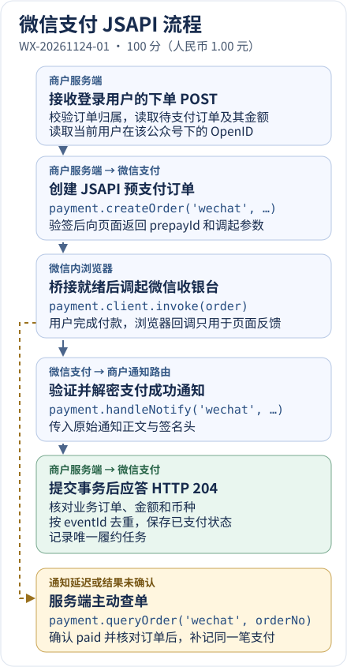
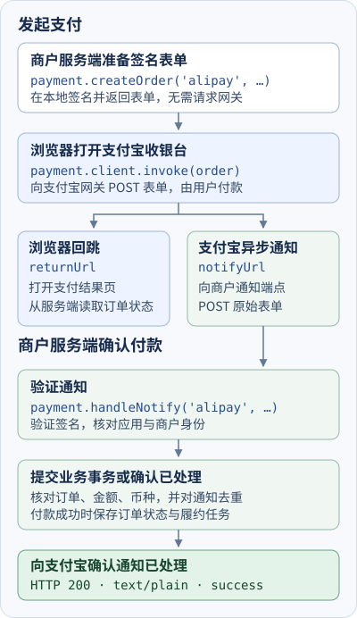

# @h-ai/payment 功能说明

[English](payment.en.md) · [日本語](payment.ja.md)

在服务端用 `payment` 创建订单、接收支付平台发来的通知、查单和退款。浏览器接收后端返回的支付参数，再用对应平台的页面或原生界面发起付款。

服务端以 `payment` 对象调用支付业务。浏览器需要引入 `@h-ai/payment/client` 的 `payment.client.invoke()`，它使用服务端已经创建的订单参数打开支付流程。

[模块 README](../../../packages/payment/README.md) · [配置清单](../configuration/payment.md) · [数据结构](../data/payment.md) · [业务集成](../development/integrations.md)

[微信公众号 JSAPI 付款](#wechat-jsapi-flow) · [支付宝手机网站付款](#alipay-wap-flow)

<a id="quick-start"></a>

## 最小接入示例

<a id="module-dependencies"></a>

### 依赖

| 依赖 | 用途 | 何时需要 | 接入顺序 |
| --- | --- | --- | --- |
| Node.js、浏览器 | 服务端创建订单和验签，浏览器调起付款 | 服务端调用 `payment` 时使用 Node.js。浏览器付款使用 `@h-ai/payment/client` | 服务端先调用 `payment.init()`。客户端拿到后端的订单参数后调用 `payment.client.invoke()` |
| `@h-ai/core` | 日志、结果与错误类型 | 随 Payment 安装 | 使用 Payment 提供的业务入口 |
| `@h-ai/reldb` | 保存 Stripe 渠道映射和幂等结果 | 随 Payment 安装，启用 Stripe 时必须连接数据库 | 先执行 `reldb.init()` 并检查结果，再执行 `payment.init()`。生产环境使用共享数据库 |
| `@h-ai/audit` | 记录成功的下单、通知、退款和关单操作 | 随 Payment 安装，需要持久化支付审计时启用 | 先执行 `reldb.init()` 和 `audit.init()`，再处理支付业务 |
| 微信支付、支付宝或 Stripe | 创建渠道订单、收款与验证通知 | 配置了对应渠道时 | 准备商户凭据。接收渠道通知前配置应用的通知端点。客户端调起条件见下方渠道示例 |

### 接入示例

如果 `init()` 尚未结束就调用 `close()`，这次初始化不会把模块重新打开。需要重新启动时，先等上一次初始化和关闭结束。

#### Node.js 服务端

```typescript

import { type PaymentConfigInput, payment } from '@h-ai/payment'

export async function paymentExample(trustedConfig: PaymentConfigInput, trustedOpenid: string) {
  // 常驻服务在启动/停机时分别 init/close；此函数演示完整生命周期。
  // 如启用 Stripe，应用已先调用 reldb.init() 打开共享数据库并检查 success。
  // 用宿主已验证的 trustedConfig 装配可用支付渠道。成功无数据；配置出错时不创建订单。
  const initialized = await payment.init(trustedConfig)
  if (!initialized.success)
    throw new Error(initialized.error.message)
  try {
    // 用可信 openid 创建 100 分的微信 JSAPI 订单 ORD001。成功取得调起支付参数；渠道拒绝时不继续查单。
    const created = await payment.createOrder('wechat', {
      orderNo: 'ORD001',
      amount: 100,
      description: '测试商品',
      tradeType: 'jsapi',
      userId: trustedOpenid,
      notifyUrl: 'https://api.example.com/payment/notify/wechat',
    })
    if (!created.success)
      throw new Error(created.error.message)
    // 向微信读取刚创建的 ORD001 当前状态，成功返回 OrderStatus；查询失败独立处理。
    const query = await payment.queryOrder('wechat', 'ORD001')
    if (!query.success)
      throw new Error(query.error.message)
    return { order: created.data, status: query.data.status }
  }
  finally {
    // 无参释放支付模块状态，不改变渠道中现有订单；宿主要另行关闭借用的数据库。
    await payment.close() // 随后关闭应用打开的 reldb。
  }
}
```

#### 浏览器客户端

将后端 `payment.createOrder` 成功返回的订单数据传给 `startPayment`。在微信内使用时，先等待 `WeixinJSBridgeReady`。

```typescript
import type { PaymentOrder } from '@h-ai/payment'
import { payment } from '@h-ai/payment/client'

export async function startPayment(orderData: PaymentOrder) {
  // 用订单及渠道参数发起支付，检查接口调用是否成功。
  // 用服务端成功创建的订单与渠道参数调起支付。成功 data.invoked 表示已调起，未调起要看 message，成交由服务端确认。
  const invoked = await payment.client.invoke(orderData)
  if (!invoked.success)
    throw new Error(invoked.error.message)
  if (!invoked.data.invoked)
    throw new Error(invoked.data.message)
  // 返回调起结果。成交状态由服务端查询或异步通知确认。
  return invoked.data
}
```

<a id="api-reference"></a>

## 功能说明

<a id="providers"></a>

### 连接支付渠道：`payment`

应用用已校验的服务端配置准备渠道；自定义 Provider 必须实现公开契约，不把商户密钥交给浏览器。

#### 接口清单

| API | 用途 | 参数与默认值 | 返回值或失败 | 调用示例 |
| --- | --- | --- | --- | --- |
| `payment.init(config)` | 按配置加载支付渠道；启用 Stripe 前先连接共享数据库 | `config: PaymentConfigInput`（必填） | `Promise<HaiResult<void>>` | `await payment.init(config)` |
| `payment.close()` | 停止当前支付模块；支付渠道中已创建的交易仍由渠道处理 | 无参数 | `Promise<void>` | `await payment.close()` |
| `payment.config` | 读取已解析配置 | 无参数。包含商户密钥，仅限服务端内部使用 | `PaymentConfig \| null` | `payment.config?.stripe?.successUrl` |
| `payment.isInitialized` | 判断模块是否已完成初始化 | 无参数 | `boolean` | `payment.isInitialized` |
| `payment.getProvider(name)` | 取得已注册支付渠道 | `name: string` 已注册渠道名，用于读取进程内实例 | `PaymentProvider \| undefined` | `payment.getProvider(providerName)` |
| `payment.registerProvider(provider)` | 注册应用提供的支付渠道 | `provider: PaymentProvider` 完整实现支付渠道接口的实例，同名会替换当前进程的注册项 | `void` | `payment.registerProvider(paymentProvider)` |

#### 场景：连接支付渠道

先完成 `payment.init()`，再注册应用实现的渠道。用 `payment.isInitialized` 检查模块状态，用 `payment.config` 读取服务端配置。关闭后分别返回 `false` 和 `null`。

输入是应用实现的 PaymentProvider 实例；注册和查找均为同步调用。初始化与关闭见最小接入。

```ts
import { type PaymentProvider, payment } from '@h-ai/payment'

function installProvider(provider: PaymentProvider) {
  // 注册传入的渠道实例，按 provider.name 保存或替换同名实例，无返回数据。
  payment.registerProvider(provider)
  // 用刚注册的名称读回同一个渠道实例；缺少名称对应的注册时返回 undefined。
  return payment.getProvider(provider.name) === provider // true
}
// 以未注册名称 not-registered 查询，结果为 undefined。
payment.getProvider('not-registered') // undefined
```

#### HTTP API 契约

支付 HTTP API 由 `@h-ai/api-contract` 的 `apiContract.payment` 定义。组合进应用 contract 后，可通过 typed client 调用：

```ts
import { apiClient } from '@h-ai/api-client'
import { apiContract } from '@h-ai/api-contract'

// 把框架公开的 Payment 契约挂到 payment 域，返回提供订单创建等路由的组合契约。
const contract = apiContract.create({ payment: apiContract.payment })
// 传入组合契约创建独立类型化客户端，获得 api.payment 下的调用入口，尚未配置服务端地址。
const api = apiClient.create(contract)
// 用服务端 API 基地址初始化该客户端。成功 data 为 undefined，配置失败则停止下方的下单请求。
const initialized = await api.init({ baseUrl: 'https://api.example.com/api/v1' })
if (!initialized.success)
  throw new Error(initialized.error.message)
try {
  // 向 Payment 订单接口提交支付宝 H5 订单，金额为 100 分，描述为 Demo。成功返回订单数据；失败保留服务端错误。
  const order = await api.payment.orders.create({
    provider: 'alipay', amount: 100,
    description: 'Demo', tradeType: 'h5',
  })
  if (!order.success)
    throw new Error(order.error.message)
  // order.data contains the provider's payment parameters for this order.
}
finally {
  // 不传参数关闭当前客户端，结束其运行时资源，Promise 不返回业务数据。
  await api.close()
}
```

<a id="orders"></a>

### 创建、查询与关单：`payment`

先用业务订单号创建渠道订单，再查询渠道状态；主动关单不等于退款。

#### 接口清单

| API | 用途 | 参数与默认值 | 返回值或失败 | 调用示例 |
| --- | --- | --- | --- | --- |
| `payment.createOrder(providerName, input)` | 向渠道创建支付订单 | 必填 `providerName: string` 为已注册渠道名。必填 `input: CreateOrderInput` 见[下单字段](#payment-create-order-input)。 | `Promise<HaiResult<PaymentOrder>>` | `await payment.createOrder(providerName, orderInput)` |
| `payment.queryOrder(providerName, orderNo)` | 查询渠道订单状态 | `providerName: string` 订单所属的已注册渠道名。`orderNo: string` 创建时使用的商户订单号 | `Promise<HaiResult<OrderStatus>>` | `await payment.queryOrder(providerName, orderNo)` |
| `payment.closeOrder(providerName, orderNo)` | 向渠道关闭订单 | `providerName: string` 订单所属的已注册渠道名。`orderNo: string` 创建时使用的商户订单号 | `Promise<HaiResult<void>>` | `await payment.closeOrder(providerName, orderNo)` |

<a id="payment-create-order-input"></a>

**CreateOrderInput**

| 字段 | 类型 | 必填与默认 | 用途及生效条件 |
| --- | --- | --- | --- |
| `orderNo` | `string` | 必填 | 商户已持久化的订单号。支付重试保留同一业务编号。 |
| `amount` | `number` | 必填 | 订单金额，使用币种的最小单位，例如 CNY 的分。 |
| `currency` | `string` | 微信和支付宝 CNY，Stripe USD | 大写币种，与业务订单币种一致。 |
| `description` | `string` | 必填 | 商品或服务说明。 |
| `tradeType` | `'jsapi' \| 'h5'` | 必填 | 微信使用 jsapi，支付宝和 Stripe 使用 h5。 |
| `userId` | `string` | 微信 jsapi 必填 | 微信场景填写所属服务端 appId 的 openid。 |
| `notifyUrl` | `string` | 必填 | 渠道用于通知应用的回调 URL。 |
| `metadata` | `Record<string, string>` | 可省略 | 渠道支持时附带业务字段。 |

例如用 `providerName: "stripe"` 创建 `amount: 100, currency: "USD", tradeType: "h5"` 的订单，成功回执包含托管 Checkout 的跳转数据。Stripe 下单成功时已持久化渠道会话。支付宝下单只生成签名表单。三个渠道均以服务端查单或验证后的通知确认付款。

微信关单成功需要通过渠道对 `204 No Content` 和空正文的签名校验。无业务数据返回，其他状态、验签失败或网络错误返回 `CLOSE_ORDER_FAILED`。

##### 微信查单与关单

`queryOrder('wechat', orderNo)` 核对签名、`appid`、`mchid` 和订单号。订单尚未支付或已经关闭时，渠道可以省略金额。此时 `OrderStatus.amount` 为 `undefined`，调用方可从自己的业务订单读取应收金额。只有渠道确认付款且给出有效金额和交易号时，状态才为 `paid`。微信 `REFUND` 返回 `refund_started`，单笔退款结果按退款号核对。

<a id="stripe-amounts"></a>

##### Stripe 金额

下单、退款、查单和通知都使用业务币种的最小单位。USD 100 表示 1 美元，JPY 100 表示 100 日元。ISK 和 UGX 的调用方传整单位，例如订单金额为 10,000 ISK 时传 `amount: 10000, currency: 'ISK'`。模块向 Stripe 发送 1,000,000，查询和通知转换回 10,000。[Stripe 币种规则](https://docs.stripe.com/currencies#special-cases)

##### Stripe 托管 Checkout 与主动关单

只实现 `mode=payment`、`ui_mode=hosted_page` 和 `tradeType=h5`，API 请求固定 `Stripe-Version: 2026-09-30.endive`。不支持 embedded/elements、JSAPI、App、Native 或小程序模式；创建入口、HTTP schema 与浏览器调用均拒绝未实现的场景。服务端 `successUrl` 必填，`cancelUrl` 可选，均为 HTTP(S) 地址；可在成功地址中保留 `{CHECKOUT_SESSION_ID}` 让 Stripe 替换。跳转配置属于服务端，不接受客户端覆盖；同订单重试也不能改变这组创建参数。

`closeOrder('stripe', orderNo)` 按持久映射读取 Session：open/unpaid 调用 `/checkout/sessions/:id/expire`；已 expired 确认后幂等成功，complete/paid 返回失败。遇到并发关闭或响应丢失会重新查询，只有确认过期才成功。成功页和取消页只负责导航。对相同订单重试下单时，模块复用原 Session，并确认它仍可付款。已关单、自然过期或已完成的 Session 返回 `CREATE_ORDER_FAILED`，原订单映射仍保留。

依据：[创建 Checkout Session](https://docs.stripe.com/api/checkout/sessions/create)、[主动过期 Session](https://docs.stripe.com/api/checkout/sessions/expire).

#### 场景：创建、查询与关单

创建订单见最小接入；此函数输入原渠道名和业务单号，只对 pending 订单申请关单，返回最终查询结果或失败。实际状态由渠道确认。

```ts
async function inspectAndClose(providerName: string, orderNo: string) {
  // 用业务记录里的渠道名称和商户订单号查渠道状态。成功返回订单状态对象；查询失败直接返回错误。
  const queried = await payment.queryOrder(providerName, orderNo)
  if (!queried.success)
    return queried
  if (queried.data.status !== 'pending')
    return queried
  // 只对上一步查询到的 pending 订单发送关闭请求。成功无业务数据；渠道拒绝时保留失败。
  const closed = await payment.closeOrder(providerName, orderNo)
  if (!closed.success)
    return closed
  // 关闭成功后用同一渠道和订单号重新查询，以渠道返回的新状态为准。查询仍可能独立失败。
  return payment.queryOrder(providerName, orderNo)
}
```

<a id="refunds"></a>

### 退款与核对结果：`payment.refund`

用原订单号和独立退款号申请退款；受理结果与最终到账状态分别核对。

#### 接口清单

| API | 用途 | 参数与默认值 | 返回值或失败 | 调用示例 |
| --- | --- | --- | --- | --- |
| `payment.refund(providerName, input)` | 申请退款并读取渠道受理结果 | 必填 `providerName: string` 指定原订单使用的渠道，`input: RefundInput` 见[退款字段](#payment-refund-input)。 | `Promise<HaiResult<RefundResult>>` | `await payment.refund(providerName, refundInput)` |

<a id="payment-refund-input"></a>

**RefundInput**

| 字段 | 类型 | 必填与默认 | 用途及生效条件 |
| --- | --- | --- | --- |
| `orderNo / refundNo` | `string` | 必填 | 原商户订单号与本次退款的稳定编号。重试复用同一编号并保持金额一致。 |
| `amount` | `number` | 必填 | 本次退款金额，使用订单币种的最小单位。 |
| `totalAmount` | `number` | 微信退款需传原订单金额 | 微信请求中的原订单总额。部分退款时传完整订单金额，不是本次退款金额。 |
| `reason` | `string` | 可省略 | 退款原因。 |

微信订单原金额 100 分、退款 50 分时传 `{ amount: 50, totalAmount: 100 }`，渠道仅受理时仍须依据退款状态核对结果。

##### 按退款单号核对结果

微信 `PROCESSING` 表示退款仍在处理，`CLOSED` 或 `ABNORMAL` 返回 `failed`。订单的 `refund_started` 只能说明进入退款流程，部分退款也会返回该状态。通过微信[查询单笔退款](https://pay.wechatpay.cn/doc/v3/merchant/4012791863)核对到账金额和结果。Stripe 的退款回执保存首次受理状态，收到 `processing` 时保存 `refundId`，通过 [Stripe 查询退款](https://docs.stripe.com/api/refunds/retrieve)读取最终状态。

##### 支付宝业务响应与退款状态

查单、退款和关单先用配置的支付宝公钥对对应方法的原始响应验签，再校验字符串 `code=10000`、关键字段及返回订单号。HTTP 200、缺失 envelope 或只有成功码均不能当作业务成功。交易不存在、权限/余额不足等业务错误返回对应 `QUERY_ORDER_FAILED` / `REFUND_FAILED` / `CLOSE_ORDER_FAILED`；错误 cause 只保留有界的渠道错误标识，不透传原始响应和 `msg/sub_msg`。查单拒绝未知状态及非法金额，不能伪造 pending 或零金额。

退款返回 `success: true` 仍需检查 `data.status`：只有 `fund_change=Y` 为 `success`；`N` 或缺失为 `processing`，需通过支付宝退款查询核实（本模块尚未提供退款查询 API）。`refund_fee` 为累计退款额，不能与本次退款金额直接比较。支付宝 `refundId` 是原交易号，本次退款以 `refundNo` 区分，重试必须保留相同退款号和参数。

```typescript
// 对支付宝订单 ORDER_1 提交 100 分退款，使用固定 REFUND_1；受理成功仍需检查 data.status，不能把 processing 当作到账。
const refund = await payment.refund('alipay', { orderNo: 'ORDER_1', refundNo: 'REFUND_1', amount: 100 })
if (refund.success && refund.data.status === 'success') {
  // 才可在共享业务数据库中幂等确认退款成功
}
// 请求支付宝关闭 ORDER_2，校验渠道回传的订单号后成功无数据；渠道拒绝或应答不符返回失败。
const closed = await payment.closeOrder('alipay', 'ORDER_2')
if (closed.success) {
  // 已核对关单响应中的订单号，才可更新业务订单
}
```

依据：[支付宝退款接口与成功判定](https://aipay.alipay.com/docs/subscribe/api-list/other-basic-interfaces/alipay-trade-refund.html).

#### 场景：退款与核对结果

从业务数据库取得原订单金额和已持久化的退款单号。本例为一笔 100 分的微信订单退回 50 分。

```ts
import { payment } from '@h-ai/payment'

async function refundWeChatOrder(orderNo: string, refundNo: string) {
  // 用可信业务订单和稳定退款单号提交退款。检查受理结果，processing 时继续通过渠道查询。
  const refunded = await payment.refund('wechat', {
    orderNo,
    refundNo,
    amount: 50,
    totalAmount: 100,
  })
  return refunded.success
    ? { status: refunded.data.status, refundId: refunded.data.refundId }
    : { error: refunded.error }
}
```

<a id="notifications"></a>

### 验证并接收支付通知：`payment.handleNotify`

从原始 HTTP 请求取得通知体与签名头，先验证渠道身份，再幂等更新业务订单。

#### 接口清单

| API | 用途 | 参数与默认值 | 返回值或失败 | 调用示例 |
| --- | --- | --- | --- | --- |
| `payment.handleNotify(providerName, request)` | 验证渠道通知并返回解析结果 | `providerName: string` 从可信通知路由取得的已注册渠道名。`request: PaymentNotifyRequest` 必填原始 body 字符串与 headers 字符串键值，用于渠道验签 | `Promise<HaiResult<PaymentNotifyResult>>` | `await payment.handleNotify(providerName, verifiedNotificationRequest)` |

##### Stripe 回调状态

Stripe Provider 只处理 `mode=payment` 的 `checkout.session.completed`、`checkout.session.async_payment_succeeded`、`checkout.session.async_payment_failed`、`checkout.session.expired`。Webhook 端点只订阅这些事件；其它资源事件或不完整 Session 返回 `NOTIFY_PARSE_FAILED`，不会伪造 pending 订单。

`completed` 且 `payment_status=unpaid` 返回 `pending`，不得履约；`paid` / `no_payment_required` 才返回 `paid`。异步失败返回 `failed`，过期返回 `closed`。只有 `paid` 结果带 `paidAt`，时间取支付成功事件的 `created`，重复接收不会改变它。

结果包含 `eventId`、大写 `currency`，`transactionId` 是 Checkout Session ID。模块按 Stripe 账户及 test/live 模式查共享记录，核对 Session ID、订单号、金额和币种。映射缺失、结果尚未持久化或不匹配时返回失败，不能确认通知成功。应用仍须在共享事务中核对业务订单并去重。回调成功结果也可能为 pending，不能仅判断 `success` 就发货。

依据：[Stripe 事件类型](https://docs.stripe.com/api/events/types)、[Checkout Session 字段](https://docs.stripe.com/api/checkout/sessions/object).

#### 场景：验证并接收支付通知

下图只展开支付成功通知的处理分支，合法的 pending、failed、closed 状态不能创建履约任务。handleNotify 负责验证渠道通知，订单更新、持久去重和履约任务由应用完成。


应用用同一事务核对订单、金额、币种和事件编号，条件更新状态并写唯一履约 outbox；提交后才向渠道确认。重复或乱序通知不能重复履约或把 paid 改回 pending。外部发货仍须携带稳定幂等编号；数据库提交不保证跨系统副作用恰好一次。

输入是路由收到的原始 Request；返回 HaiResult<PaymentNotifyResult>。正文只读取一次，成功后仍须按下面的事务示例核对订单、金额、币种和事件 ID，再向渠道确认。

```ts
async function verifyNotification(providerName: string, request: Request) {
  // 把收单渠道名称、HTTP 原始正文和头传入验签解析。成功返回事件 ID、订单号和支付状态；签名无效则失败。履约前须核对状态并去重。
  return payment.handleNotify(providerName, {
    body: await request.text(),
    headers: Object.fromEntries(request.headers),
  })
}
```

<a id="alipay-notification-ack"></a>

#### 场景：支付宝通知回执

支付宝通知使用原始表单请求，业务事务提交或识别为已处理后，返回 HTTP 200 和纯文本 `success`。下例使用 `@h-ai/serv` 自定义中间件。将返回的配置放入 `serv.createApp({ ...options, middlewares: [...] })`，使用应用的实际 API 前缀。如果启用了应用传输加密，将完整通知路径加入 `transport.excludePaths`。启用默认拒绝的 `http.access` 策略时，为该路径的渠道 POST 请求配置允许规则。输入的 `recordVerified` 是应用自己的事务函数，负责订单核对、去重和履约任务，成功表示已提交或同一事件已经处理。

只有 `paid` 事件可以产生履约任务。 如果将整个 `apiContract.payment` 组合进服务，仍须为支付宝 procedure 提供实现。用原始中间件处理平台通知，procedure 在未经过该挂载时返回失败。也可仅组合订单和由应用实际实现的其他通知。

把支付宝通知的操作节点 `apiContract.payment.notifications.alipay` 传给 `apiContract.pathOf`，得到 `/payment/notifications/alipay`。再拼上应用的 API 前缀作为中间件挂载路径。见[读取已声明的业务路径](./api-contract.md#read-route-path)。

```ts
import type { HaiResult } from '@h-ai/core'
import type { PaymentNotifyResult } from '@h-ai/payment'
import type { ServMiddlewareMount } from '@h-ai/serv'
import { apiContract } from '@h-ai/api-contract'
import { payment } from '@h-ai/payment'

export function alipayNotification(
  apiPrefix: string,
  recordVerified: (notification: PaymentNotifyResult) => Promise<HaiResult<unknown>>,
): ServMiddlewareMount {
  // 从单个通知操作读业务路径，再拼接宿主前缀。
  const path = apiPrefix + apiContract.pathOf(apiContract.payment.notifications.alipay)
  return {
    path,
    async middleware(c, next) {
      if (c.req.method !== 'POST')
        return next()

      const request = c.req.raw
      // 读取原始表单一次。成功后交给业务事务，验签或解析错误返回 HTTP 400。
      const verified = await payment.handleNotify('alipay', {
        body: await request.text(),
        headers: Object.fromEntries(request.headers),
      })
      if (!verified.success)
        return c.text('fail', 400)

      // 核对业务订单并提交事务，失败时返回 HTTP 500 让渠道重试。
      const committed = await recordVerified(verified.data)
      if (!committed.success)
        return c.text('fail', 500)
      return c.text('success', 200)
    },
  }
}
```

微信和 Stripe 也要在业务提交后确认。微信成功可返回 HTTP 200 或 204。Stripe 成功返回 HTTP 2xx，订单映射尚未落库或事务失败时返回非 2xx，供 Stripe 重试。在图中的事务核对步骤，Stripe Session 已先由模块对照持久记录验证。

#### 通知身份、时钟与业务幂等

微信 `platformKeys` 必填，key 是受信平台证书序列号或公钥 ID，value 为对应 PEM；通知只按 `Wechatpay-Serial` 精确选取，未知标识不自动信任。证书会核对自身序列号及有效期。轮换时在所有节点部署新旧项，确认渠道停止使用旧项后移除；不存在从通知中下载密钥的逻辑。微信签名时间戳必须为严格整数且与节点时钟相差不超过 300 秒，节点须同步时钟。通知只接受 `TRANSACTION.SUCCESS` / transaction 资源，解密后继续核对 `appid/mchid`。

支付宝必填 `sellerId`，验签后核对 `app_id/seller_id`，只接受配置的 RSA2/RSA 算法，拒绝重复表单字段、未知状态和非法日历时间。请求使用明确 `Asia/Shanghai` 的北京时间，签名和订单内容仅在 POST form body 中传输，不进入 URL。`notify_time/gmt_payment` 按北京时间解析；允许渠道跨日重试，不把交易时间或通知原始时间当作五分钟签名窗口。Stripe 校验严格签名时间，支持轮换期多个 v1 签名，并核对 test/live 模式；本 Provider 不支持 Connect/组织上下文事件，应为当前账户配置对应 Webhook secret。

三个内置 Provider 均返回必填 `eventId` 和大写 `currency`，自定义 Provider 也须提供。事件 ID 分别为微信 id、支付宝 notify_id、Stripe event.id。验签解析不创建业务订单、不持久去重，也不保证履约一次；接入层必须用共享数据库核对渠道、订单、金额和币种，以渠道/商户为命名空间去重，并防止乱序回退。业务订单号不能删除后复用。

[可运行消费者示例](../../../packages/payment/examples/payment-notify-consumer.ts) 将业务订单 pending→paid 的条件更新、唯一通知记录和唯一履约 outbox 放进同一事务，SQL 失败必须抛错以回滚。重复 paid 和晚到 pending 不重复生成 outbox；不同金额、币种、渠道或交易号不能更新订单。只有数据库提交成功才向渠道确认成功。示例表属于应用，payment 不会自动创建它们；外部发货由 outbox 投递者携带稳定 ID 做幂等，数据库事务不能保证跨系统副作用恰好一次。定向双进程测试使用两个真实 Node 进程共享 SQLite，证明重复通知和重启后仍仅产生一条业务 outbox；多主机生产使用同一 PostgreSQL/MySQL。

依据：[微信证书与签名时钟](https://pay.wechatpay.cn/doc/v3/merchant/4013053420)、[微信公钥轮换](https://pay.wechatpay.cn/doc/v3/merchant/4012154180)、[支付宝通知核对与重试](https://developer.alibaba.com/docs/doc.htm?articleId=103296&docType=1&treeId=346).

#### Stripe 持久化与幂等

启用 Stripe 前须先 `await reldb.init(dbConfig)` 并检查 success，再初始化 payment；关闭时先 payment 后 reldb。初始化会等待 `hai_payment_stripe_operations` 建表，失败不会发布 Stripe Provider。多节点使用同一 PostgreSQL/MySQL 数据库；SQLite 仅适合开发/明确共享文件的单机进程，不能把不同主机的本地文件当作共享存储。

首次需要订单映射的操作会读取 `/v1/account`，结合密钥的 test/live 模式隔离记录；同账户轮换密钥仍复用原映射。密钥必须为 `sk_test_`、`sk_live_`、`rk_test_` 或 `rk_live_` 前缀，受限密钥还须允许读取账户。

创建订单按账户、模式和 orderNo 生成稳定 `Idempotency-Key`，数据库唯一记录绑定规范请求摘要与 Session ID；metadata.orderNo 禁止被调用方覆盖。查单/退款只按该 Session ID 读取并核对订单号、金额、币种，再保存 PaymentIntent，未知订单明确失败。退款按 refundNo 保留独立幂等结果，同一标识改参数会失败；自由文本 reason 保存在退款 metadata，渠道 reason 使用 requested_by_customer。

网络响应丢失或结果落库失败不会删除预留，也不会伪装成功。未知结果仅在数据库时间计算的 23 小时窗口内沿用同一幂等键重试；超出窗口必须先核对 Stripe 并修复记录，禁止删除记录后盲重试。已确认结果长期保留，不能按普通缓存 TTL 清理；退款返回的是该次受理结果，processing 不等于资金已退回。依据：[Stripe 幂等保留边界](https://docs.stripe.com/api/idempotent_requests).

#### 审计日志

应用初始化 `@h-ai/audit` 后，关键支付操作执行成功时会自动尝试写入审计日志。审计写入失败仅输出 warn 日志，不影响支付操作。

| 操作     | `action`         | 记录内容                                |
| -------- | ---------------- | --------------------------------------- |
| 创建订单 | `create_order`   | provider、amount、tradeType             |
| 支付回调 | `payment_notify` | provider、transactionId、status、amount |
| 退款     | `refund`         | provider、refundNo、amount              |
| 关闭订单 | `close_order`    | provider                                |

> 订单查询（`queryOrder`）为只读操作，不写审计日志。

<a id="browser-payment"></a>

### 在浏览器发起付款：`payment.client.invoke`

使用最小接入中 startPayment 的完整示例；输入只能来自服务端成功创建的订单。

#### 接口清单

| API | 用途 | 参数与默认值 | 返回值或失败 | 调用示例 |
| --- | --- | --- | --- | --- |
| `payment.client.invoke(order)` | 打开渠道付款界面 | 必填 `order: PaymentOrder`，来自服务端创建订单的成功结果 | `Promise<HaiResult<InvokePaymentResult>>` | `await payment.client.invoke(orderData)` |

#### 场景：处理调起结果

最小接入中的 startPayment 检查 success 和 data.invoked，返回调起结果；客户取消、跳转或支付页加载均不能代替服务端到账确认。

<a id="wechat-jsapi-flow"></a>

#### 场景：在微信公众号内用 JSAPI 付款

用户在微信内打开订单并点击付款。按[微信公众号 JSAPI 配置](../configuration/payment.md#wechat-jsapi-configuration)初始化支付模块。认证后，应用从数据库读取该用户的待付款订单 `WX-20261124-01`，金额为 CNY 100 分，即 1 元。应用从服务端记录取得该用户在当前公众号下的 OpenID，从服务端配置取得通知 URL。



将已授权的订单、OpenID 和通知 URL 交给下面的服务端函数。将返回的 `PaymentOrder` 传给浏览器。微信桥接对象已可用或收到 `WeixinJSBridgeReady` 后，调用最小接入示例中的 `startPayment(orderData)`。用户取消或返回后，页面从应用后端读取订单状态。

```ts
import { type CreateOrderInput, payment } from '@h-ai/payment'

export async function prepareWeChatPayment(
  order: Pick<CreateOrderInput, 'orderNo' | 'amount' | 'description'>,
  openid: string,
  notifyUrl: string,
) {
  // 向微信申请该商户单号的 JSAPI 预支付。成功返回调起参数，失败则停止本次调起。
  const created = await payment.createOrder('wechat', {
    ...order,
    currency: 'CNY',
    tradeType: 'jsapi',
    userId: openid,
    notifyUrl,
  })
  if (!created.success)
    throw new Error(created.error.message)
  return created.data
}
```

把 `receiveWeChatNotify` 挂载到 `notifyUrl` 对应的 POST 路由。注入应用的 `recordVerified`，在同一事务中核对渠道、商户、订单、金额和币种，按事件去重，将订单更新为 `paid` 并写入唯一履约任务。可参考[业务事务示例](../../../packages/payment/examples/payment-notify-consumer.ts)。

```ts
import type { HaiResult } from '@h-ai/core'
import { type PaymentNotifyResult, payment } from '@h-ai/payment'

export async function receiveWeChatNotify(
  request: Request,
  recordVerified: (notification: PaymentNotifyResult) => Promise<HaiResult<unknown>>,
): Promise<Response> {
  // 保留原始正文和签名头。验签或解析失败时返回 HTTP 400。
  const verified = await payment.handleNotify('wechat', {
    body: await request.text(),
    headers: Object.fromEntries(request.headers),
  })
  if (!verified.success)
    return Response.json({ code: 'FAIL', message: 'Notification verification failed' }, { status: 400 })

  // 事务提交或确认重复后返回空正文 204。事务失败返回 500，让微信重试。
  const committed = await recordVerified(verified.data)
  if (!committed.success)
    return Response.json({ code: 'FAIL', message: 'Notification processing failed' }, { status: 500 })
  return new Response(null, { status: 204 })
}
```

验签通过的付款通知包含 `WX-20261124-01`、金额 100 分、CNY 和微信交易号。应用提交后，浏览器重新读取业务订单即可看到已付款。通知延迟时，后台调用 `payment.queryOrder('wechat', 'WX-20261124-01')`。只有拿到 `paid` 且订单、金额和交易号核对通过后，才按微信固定币种 CNY 提交同一个幂等的状态更新和履约任务。查询没有通知事件 ID，使用订单状态和唯一履约任务防止重复发货。

<a id="alipay-wap-flow"></a>

#### 场景：用支付宝手机网站付款

用户在手机浏览器打开待付款订单。先按[支付宝沙箱配置](../configuration/payment.md#alipay-sandbox-configuration)初始化模块，验收后切换生产配置。认证后，应用从数据库读取该用户的订单 `AL-20261124-01`，金额为 CNY 100 分。通知 URL 来自服务端配置，`alipay.returnUrl` 指向应用自己的付款结果页。



将已授权的订单和通知 URL 交给下面的服务端函数。返回的 `PaymentOrder.clientParams` 包含支付宝网关及签名表单字段。浏览器调用 `startPayment(orderData)`，向网关提交表单，用户进入支付宝收银台。回跳到 `returnUrl` 后，页面从应用后端读取订单状态。

```ts
import { type CreateOrderInput, payment } from '@h-ai/payment'

export async function prepareAlipayPayment(
  order: Pick<CreateOrderInput, 'orderNo' | 'amount' | 'description'>,
  notifyUrl: string,
) {
  // 为该商户订单生成签名表单参数。成功后浏览器才能向网关提交，失败则不打开收银台。
  const created = await payment.createOrder('alipay', {
    ...order,
    currency: 'CNY',
    tradeType: 'h5',
    notifyUrl,
  })
  if (!created.success)
    throw new Error(created.error.message)
  return created.data
}
```

支付宝另行向 `notifyUrl` POST 表单。[支付宝通知回执示例](#alipay-notification-ack)读取原始正文并验签，应用事务核对订单、100 分金额、币种和交易身份，提交状态及履约任务。事务提交或确认重复后返回 HTTP 200，正文恰好为 `success`。回跳时订单仍待确认，可由应用后台调用 `payment.queryOrder('alipay', 'AL-20261124-01')`。拿到 `paid` 并核对订单、金额和交易号后，走同一条幂等入账和履约路径。

## 错误处理

收到 `HaiResult<T>` 时先检查 `result.success`。成功时读取 `result.data`，失败时查看 `result.error`。记录故障时保留错误码和追踪编号，便于从日志找到对应请求。

```typescript
import { HaiPaymentError } from '@h-ai/payment'

const orderInput: Parameters<typeof payment.createOrder>[1] = {
  orderNo: 'ORD-ERROR-1', amount: 100, description: 'Demo', tradeType: 'h5',
  notifyUrl: 'https://api.example.com/payment/notify/alipay',
}
// 将上面定义的支付宝 H5 订单交给渠道；成功返回 PaymentOrder，失败按错误码区分金额和渠道故障。
const result = await payment.createOrder('alipay', orderInput)
if (!result.success) {
  switch (result.error.code) {
    case HaiPaymentError.INVALID_AMOUNT.code:
      // 金额不是正整数，或 refund.totalAmount < amount
      break
    case HaiPaymentError.PROVIDER_NOT_FOUND.code:
      // Provider 未注册
      break
    case HaiPaymentError.CREATE_ORDER_FAILED.code:
      // 创建订单失败
      break
  }
}
```

常用错误码：

| 错误码                                   | code              | 说明            |
| ---------------------------------------- | ----------------- | --------------- |
| `HaiPaymentError.CREATE_ORDER_FAILED`    | `hai:payment:001` | 创建订单失败    |
| `HaiPaymentError.NOT_INITIALIZED`        | `hai:payment:010` | 模块未初始化    |
| `HaiPaymentError.PROVIDER_NOT_FOUND`     | `hai:payment:030` | Provider 未注册 |
| `HaiPaymentError.INVALID_AMOUNT`         | `hai:payment:040` | 金额无效        |
| `HaiPaymentError.UNSUPPORTED_TRADE_TYPE` | `hai:payment:041` | 支付场景未实现  |
| `HaiPaymentError.NOTIFY_VERIFY_FAILED`   | `hai:payment:050` | 回调验签失败    |
| `HaiPaymentError.NOTIFY_PARSE_FAILED`    | `hai:payment:051` | 回调解析失败    |
| `HaiPaymentError.CONFIG_ERROR`           | `hai:payment:070` | 配置无效        |
