# @h-ai/payment 功能说明

[English](payment.en.md) · [日本語](payment.ja.md)

在服务端用 `payment` 创建订单、接收支付平台发来的通知、查单和退款。浏览器接收后端返回的支付参数，再用对应平台的页面或原生界面发起付款。

服务端以 `payment` 对象调用支付业务。浏览器需要引入 `@h-ai/payment/client` 的 `invokePayment()`，它使用服务端已经创建的订单参数打开支付流程。

[模块 README](../../../packages/payment/README.md) · [配置清单](../configuration/payment.md) · [数据结构](../data/payment.md) · [业务集成](../development/integrations.md)

<a id="quick-start"></a>

## 最小接入示例

### 依赖

- `@h-ai/audit` — 审计日志（支付操作自动审计），可选；已初始化时自动写入审计日志
- `@h-ai/reldb` — 启用 Stripe 时必需，先初始化共享数据库；持久化渠道映射和幂等结果。仅微信/支付宝时无此硬依赖。

如果 `init()` 尚未结束就调用 `close()`，这次初始化不会把模块重新打开。需要重新启动时，先等上一次初始化和关闭结束。

#### Node.js 服务端

```typescript
import type { PaymentConfigInput } from '@h-ai/payment'
import { payment } from '@h-ai/payment'

export async function paymentExample(trustedConfig: PaymentConfigInput, trustedOpenid: string) {
  // 常驻服务在启动/停机时分别 init/close；此函数演示完整生命周期。
  // 如启用 Stripe，应用已先调用 reldb.init() 打开共享数据库并检查 success。
  // 用宿主已验证的 trustedConfig 装配可用支付渠道。成功无数据；配置出错时不创建订单。
  const initialized = await payment.init(trustedConfig)
  if (!initialized.success)
    throw new Error(initialized.error.message)
  try {
    // 用可信 openid 创建 100 分的微信 JSAPI 订单 ORD001。成功取得调起支付参数；渠道拒绝时不继续查单。
    const created = await payment.createOrder('wechat', {
      orderNo: 'ORD001',
      amount: 100,
      description: '测试商品',
      tradeType: 'jsapi',
      userId: trustedOpenid,
      notifyUrl: 'https://api.example.com/payment/notify/wechat',
    })
    if (!created.success)
      throw new Error(created.error.message)
    // 向微信读取刚创建的 ORD001 当前状态，成功返回 OrderStatus；查询失败独立处理。
    const query = await payment.queryOrder('wechat', 'ORD001')
    if (!query.success)
      throw new Error(query.error.message)
    return { order: created.data, status: query.data.status }
  }
  finally {
    // 无参释放支付模块状态，不改变渠道中现有订单；宿主要另行关闭借用的数据库。
    await payment.close() // 随后关闭应用打开的 reldb。
  }
}
```

#### 浏览器客户端

将后端 `payment.createOrder` 成功返回的订单数据传给 `startPayment`。在微信内使用时，先等待 `WeixinJSBridgeReady`。

```typescript
import type { PaymentOrder } from '@h-ai/payment'
import { invokePayment } from '@h-ai/payment/client'

export async function startPayment(orderData: PaymentOrder) {
  // 用订单及渠道参数发起支付，检查接口调用是否成功。
  // 用服务端成功创建的订单与渠道参数调起支付。成功 data.invoked 表示已调起，未调起要看 message，成交由服务端确认。
  const invoked = await invokePayment(orderData)
  if (!invoked.success)
    throw new Error(invoked.error.message)
  if (!invoked.data.invoked)
    throw new Error(invoked.data.message)
  // 返回调起结果。成交状态由服务端查询或异步通知确认。
  return invoked.data
}
```

<a id="api-reference"></a>

## 功能说明

<a id="providers"></a>

### 连接支付渠道：`payment`

应用用已校验的服务端配置准备渠道；自定义 Provider 必须实现公开契约，不把商户密钥交给浏览器。

#### 接口清单

| API | 用途 | 参数与默认值 | 返回值或失败 | 调用示例 |
| --- | --- | --- | --- | --- |
| `payment.init` | 按配置加载支付渠道；启用 Stripe 前先连接共享数据库 | `config: PaymentConfigInput`（必填） | `Promise<HaiResult<void>>` | `await payment.init(config)` |
| `payment.close` | 停止当前支付模块；支付渠道中已创建的交易仍由渠道处理 | 无参数 | `Promise<void>` | `await payment.close()` |
| `payment.getProvider` | 取得已注册支付渠道 | name | `PaymentProvider \| undefined` | `payment.getProvider(providerName)` |
| `payment.registerProvider` | 注册应用提供的支付渠道 | provider | `void` | `payment.registerProvider(paymentProvider)` |

#### 场景：连接支付渠道

输入是应用实现的 PaymentProvider 实例；注册和查找均为同步调用。初始化与关闭见最小接入。

```ts
import type { PaymentProvider } from '@h-ai/payment'

function installProvider(provider: PaymentProvider) {
  // 注册传入的渠道实例，按 provider.name 保存或替换同名实例，无返回数据。
  payment.registerProvider(provider)
  // 用刚注册的名称读回同一个渠道实例；缺少名称对应的注册时返回 undefined。
  return payment.getProvider(provider.name) === provider // true
}
// 以未注册名称 not-registered 查询，结果为 undefined。
payment.getProvider('not-registered') // undefined
```

#### HTTP API 契约

支付 HTTP API 由 `@h-ai/api-contract` 的 `apiContract.payment` 定义。组合进应用 contract 后，可通过 typed client 调用：

```ts
import { apiClient } from '@h-ai/api-client'
import { apiContract } from '@h-ai/api-contract'

// 把框架公开的 Payment 契约挂到 payment 域，返回提供订单创建等路由的组合契约。
const contract = apiContract.create({ payment: apiContract.payment })
// 传入组合契约创建独立类型化客户端，获得 api.payment 下的调用入口，尚未配置服务端地址。
const api = apiClient.create(contract)
// 用服务端 API 基地址初始化该客户端。成功 data 为 undefined，配置失败则停止下方的下单请求。
const initialized = await api.init({ baseUrl: 'https://api.example.com/api/v1' })
if (!initialized.success)
  throw new Error(initialized.error.message)
try {
  // 向 Payment 订单接口提交支付宝 H5 订单，金额为 100 分，描述为 Demo。成功返回订单数据；失败保留服务端错误。
  const order = await api.payment.orders.create({
    provider: 'alipay', amount: 100,
    description: 'Demo', tradeType: 'h5',
  })
  if (!order.success)
    throw new Error(order.error.message)
  // order.data contains the provider's payment parameters for this order.
}
finally {
  // 不传参数关闭当前客户端，结束其运行时资源，Promise 不返回业务数据。
  await api.close()
}
```

<a id="orders"></a>

### 创建、查询与关单：`payment`

先用业务订单号创建渠道订单，再查询渠道状态；主动关单不等于退款。

#### 接口清单

| API | 用途 | 参数与默认值 | 返回值或失败 | 调用示例 |
| --- | --- | --- | --- | --- |
| `payment.createOrder` | 向渠道创建支付订单 | providerName, input | `PaymentOrder` | `await payment.createOrder(providerName, orderInput)` |
| `payment.queryOrder` | 查询渠道订单状态 | providerName, orderNo | `OrderStatus` | `await payment.queryOrder(providerName, orderNo)` |
| `payment.closeOrder` | 向渠道关闭订单 | providerName, orderNo | `void` | `await payment.closeOrder(providerName, orderNo)` |

微信回传 `204 No Content` 时，`payment.closeOrder('wechat', orderNo)` 返回成功，`data` 为 `undefined`。代理应透传微信的状态。其他响应状态或网络错误返回 `CLOSE_ORDER_FAILED`。

#### 场景：创建、查询与关单

创建订单见最小接入；此函数输入原渠道名和业务单号，只对 pending 订单申请关单，返回最终查询结果或失败。实际状态由渠道确认。

```ts
async function inspectAndClose(providerName: string, orderNo: string) {
  // 用业务记录里的渠道名称和商户订单号查渠道状态。成功返回订单状态对象；查询失败直接返回错误。
  const queried = await payment.queryOrder(providerName, orderNo)
  if (!queried.success)
    return queried
  if (queried.data.status !== 'pending')
    return queried
  // 只对上一步查询到的 pending 订单发送关闭请求。成功无业务数据；渠道拒绝时保留失败。
  const closed = await payment.closeOrder(providerName, orderNo)
  if (!closed.success)
    return closed
  // 关闭成功后用同一渠道和订单号重新查询，以渠道返回的新状态为准。查询仍可能独立失败。
  return payment.queryOrder(providerName, orderNo)
}
```

#### Stripe 托管 Checkout 与主动关单

只实现 `mode=payment`、`ui_mode=hosted_page` 和 `tradeType=h5`，API 请求固定 `Stripe-Version: 2026-09-30.endive`。不支持 embedded/elements、JSAPI、App、Native 或小程序模式；创建入口、HTTP schema 与浏览器调用均拒绝未实现的场景。服务端 `successUrl` 必填，`cancelUrl` 可选，均为 HTTP(S) 地址；可在成功地址中保留 `{CHECKOUT_SESSION_ID}` 让 Stripe 替换。跳转配置属于服务端，不接受客户端覆盖；同订单重试也不能改变这组创建参数。

`closeOrder('stripe', orderNo)` 按持久映射读取 Session：open/unpaid 调用 `/checkout/sessions/:id/expire`；已 expired 确认后幂等成功，complete/paid 返回失败。遇到并发关闭或响应丢失会重新查询，只有确认过期才成功。成功页/取消页跳转本身既不代表已支付，也不等于已关单。

依据：[创建 Checkout Session](https://docs.stripe.com/api/checkout/sessions/create)、[主动过期 Session](https://docs.stripe.com/api/checkout/sessions/expire).

<a id="refunds"></a>

### 退款与核对结果：`payment.refund`

用原订单号和独立退款号申请退款；受理结果与最终到账状态分别核对。

#### 接口清单

| API | 用途 | 参数与默认值 | 返回值或失败 | 调用示例 |
| --- | --- | --- | --- | --- |
| `payment.refund` | 申请退款并读取渠道受理结果 | providerName, input | `RefundResult` | `await payment.refund(providerName, refundInput)` |

#### 场景：退款与核对结果

输入是已核对订单及本次唯一退款号，金额100的单位为分；失败不更新业务账本，processing 也不能标为已退款。

```ts
async function refundOrder(providerName: string, orderNo: string, refundNo: string) {
  // 用商户订单号和持久化退款号申请退回 100 分。成功回执的 status 仍可能为 processing；渠道拒绝返回失败，重试同一退款须复用退款号。
  const refunded = await payment.refund(providerName, { orderNo, refundNo, amount: 100 })
  if (!refunded.success)
    return refunded
  return refunded // data.status distinguishes success from processing
}
```

#### 支付宝业务响应与退款状态

查单、退款和关单均校验对应方法的响应 envelope、字符串 `code=10000`、关键字段及返回订单号。HTTP 200、缺失 envelope 或只有成功码均不能当作业务成功。交易不存在、权限/余额不足等业务错误返回对应 `QUERY_ORDER_FAILED` / `REFUND_FAILED` / `CLOSE_ORDER_FAILED`；错误 cause 只保留有界的渠道错误标识，不透传原始响应和 `msg/sub_msg`。查单拒绝未知状态及非法金额，不能伪造 pending 或零金额。

退款返回 `success: true` 仍需检查 `data.status`：只有 `fund_change=Y` 为 `success`；`N` 或缺失为 `processing`，需通过支付宝退款查询核实（本模块尚未提供退款查询 API）。`refund_fee` 为累计退款额，不能与本次退款金额直接比较。支付宝 `refundId` 是原交易号，本次退款以 `refundNo` 区分，重试必须保留相同退款号和参数。

```typescript
// 对支付宝订单 ORDER_1 提交 100 分退款，使用固定 REFUND_1；受理成功仍需检查 data.status，不能把 processing 当作到账。
const refund = await payment.refund('alipay', { orderNo: 'ORDER_1', refundNo: 'REFUND_1', amount: 100 })
if (refund.success && refund.data.status === 'success') {
  // 才可在共享业务数据库中幂等确认退款成功
}
// 请求支付宝关闭 ORDER_2，校验渠道回传的订单号后成功无数据；渠道拒绝或应答不符返回失败。
const closed = await payment.closeOrder('alipay', 'ORDER_2')
if (closed.success) {
  // 已核对关单响应中的订单号，才可更新业务订单
}
```

依据：[支付宝退款接口与成功判定](https://aipay.alipay.com/docs/subscribe/api-list/other-basic-interfaces/alipay-trade-refund.html).

<a id="notifications"></a>

### 验证并接收支付通知：`payment.handleNotify`

从原始 HTTP 请求取得通知体与签名头，先验证渠道身份，再幂等更新业务订单。

#### 接口清单

| API | 用途 | 参数与默认值 | 返回值或失败 | 调用示例 |
| --- | --- | --- | --- | --- |
| `payment.handleNotify` | 验证渠道通知并执行回调 | providerName, request | `PaymentNotifyResult` | `await payment.handleNotify(providerName, verifiedNotificationRequest)` |

#### 场景：验证并接收支付通知

下图只展开支付成功通知的处理分支，合法的 pending、failed、closed 状态不能创建履约任务。handleNotify 负责验证渠道通知，订单更新、持久去重和履约任务由应用完成。



应用用同一事务核对订单、金额、币种和事件编号，条件更新状态并写唯一履约 outbox；提交后才向渠道确认。重复或乱序通知不能重复履约或把 paid 改回 pending。外部发货仍须携带稳定幂等编号；数据库提交不保证跨系统副作用恰好一次。

输入是路由收到的原始 Request；返回 HaiResult<PaymentNotifyResult>。正文只读取一次，成功后仍须按下面的事务示例核对订单、金额、币种和事件 ID，再向渠道确认。

```ts
async function verifyNotification(providerName: string, request: Request) {
  // 把收单渠道名称、HTTP 原始正文和头传入验签解析。成功返回事件 ID、订单号和支付状态；签名无效则失败。履约前须核对状态并去重。
  return payment.handleNotify(providerName, {
    body: await request.text(),
    headers: Object.fromEntries(request.headers),
  })
}
```

#### 通知身份、时钟与业务幂等

微信 `platformKeys` 必填，key 是受信平台证书序列号或公钥 ID，value 为对应 PEM；通知只按 `Wechatpay-Serial` 精确选取，未知标识不自动信任。证书会核对自身序列号及有效期。轮换时在所有节点部署新旧项，确认渠道停止使用旧项后移除；不存在从通知中下载密钥的逻辑。微信签名时间戳必须为严格整数且与节点时钟相差不超过 300 秒，节点须同步时钟。通知只接受 `TRANSACTION.SUCCESS` / transaction 资源，解密后继续核对 `appid/mchid`。

支付宝必填 `sellerId`，验签后核对 `app_id/seller_id`，只接受配置的 RSA2/RSA 算法，拒绝重复表单字段、未知状态和非法日历时间。请求使用明确 `Asia/Shanghai` 的北京时间，签名和订单内容仅在 POST form body 中传输，不进入 URL。`notify_time/gmt_payment` 按北京时间解析；允许渠道跨日重试，不把交易时间或通知原始时间当作五分钟签名窗口。Stripe 校验严格签名时间，支持轮换期多个 v1 签名，并核对 test/live 模式；本 Provider 不支持 Connect/组织上下文事件，应为当前账户配置对应 Webhook secret。

三个内置 Provider 均返回必填 `eventId` 和大写 `currency`，自定义 Provider 也须提供。事件 ID 分别为微信 id、支付宝 notify_id、Stripe event.id。验签解析不创建业务订单、不持久去重，也不保证履约一次；接入层必须用共享数据库核对渠道、订单、金额和币种，以渠道/商户为命名空间去重，并防止乱序回退。业务订单号不能删除后复用。

[可运行消费者示例](../../../packages/payment/examples/payment-notify-consumer.ts) 将业务订单 pending→paid 的条件更新、唯一通知记录和唯一履约 outbox 放进同一事务，SQL 失败必须抛错以回滚。重复 paid 和晚到 pending 不重复生成 outbox；不同金额、币种、渠道或交易号不能更新订单。只有数据库提交成功才向渠道确认成功。示例表属于应用，payment 不会自动创建它们；外部发货由 outbox 投递者携带稳定 ID 做幂等，数据库事务不能保证跨系统副作用恰好一次。定向双进程测试使用两个真实 Node 进程共享 SQLite，证明重复通知和重启后仍仅产生一条业务 outbox；多主机生产使用同一 PostgreSQL/MySQL。

依据：[微信证书与签名时钟](https://pay.wechatpay.cn/doc/v3/merchant/4013053420)、[微信公钥轮换](https://pay.wechatpay.cn/doc/v3/merchant/4012154180)、[支付宝通知核对与重试](https://developer.alibaba.com/docs/doc.htm?articleId=103296&docType=1&treeId=346).

#### Stripe 回调状态

Stripe Provider 只处理 `mode=payment` 的 `checkout.session.completed`、`checkout.session.async_payment_succeeded`、`checkout.session.async_payment_failed`、`checkout.session.expired`。Webhook 端点只订阅这些事件；其它资源事件或不完整 Session 返回 `NOTIFY_PARSE_FAILED`，不会伪造 pending 订单。

`completed` 且 `payment_status=unpaid` 返回 `pending`，不得履约；`paid` / `no_payment_required` 才返回 `paid`。异步失败返回 `failed`，过期返回 `closed`。只有 `paid` 结果带 `paidAt`，时间取支付成功事件的 `created`，重复接收不会改变它。

结果包含 `eventId`、大写 `currency`，`transactionId` 是 Checkout Session ID。应用须在共享数据库中核对订单、金额、币种，持久去重并防止乱序通知把已支付/已退款订单回退；Provider 验签解析不代替业务事务。回调成功结果也可能为 pending，不能仅判断 `success` 就发货。

依据：[Stripe 事件类型](https://docs.stripe.com/api/events/types)、[Checkout Session 字段](https://docs.stripe.com/api/checkout/sessions/object).

#### Stripe 持久化与幂等

启用 Stripe 前须先 `await reldb.init(dbConfig)` 并检查 success，再初始化 payment；关闭时先 payment 后 reldb。初始化会等待 `hai_payment_stripe_operations` 建表，失败不会发布 Stripe Provider。多节点使用同一 PostgreSQL/MySQL 数据库；SQLite 仅适合开发/明确共享文件的单机进程，不能把不同主机的本地文件当作共享存储。

首次需要订单映射的操作会读取 `/v1/account`，结合密钥的 test/live 模式隔离记录；同账户轮换密钥仍复用原映射。密钥必须为 `sk_test_`、`sk_live_`、`rk_test_` 或 `rk_live_` 前缀，受限密钥还须允许读取账户。

创建订单按账户、模式和 orderNo 生成稳定 `Idempotency-Key`，数据库唯一记录绑定规范请求摘要与 Session ID；metadata.orderNo 禁止被调用方覆盖。查单/退款只按该 Session ID 读取并核对订单号、金额、币种，再保存 PaymentIntent，未知订单明确失败。退款按 refundNo 保留独立幂等结果，同一标识改参数会失败；自由文本 reason 保存在退款 metadata，渠道 reason 使用 requested_by_customer。

网络响应丢失或结果落库失败不会删除预留，也不会伪装成功。未知结果仅在数据库时间计算的 23 小时窗口内沿用同一幂等键重试；超出窗口必须先核对 Stripe 并修复记录，禁止删除记录后盲重试。已确认结果长期保留，不能按普通缓存 TTL 清理；退款返回的是该次受理结果，processing 不等于资金已退回。依据：[Stripe 幂等保留边界](https://docs.stripe.com/api/idempotent_requests).

#### 审计日志

关键支付操作执行成功后会自动写入审计日志（依赖 `@h-ai/audit`），无需额外配置。审计写入失败仅输出 warn 日志，不影响支付操作。

| 操作     | `action`         | 记录内容                                |
| -------- | ---------------- | --------------------------------------- |
| 创建订单 | `create_order`   | provider、amount、tradeType             |
| 支付回调 | `payment_notify` | provider、transactionId、status、amount |
| 退款     | `refund`         | provider、refundNo、amount              |
| 关闭订单 | `close_order`    | provider                                |

> 订单查询（`queryOrder`）为只读操作，不写审计日志。

<a id="browser-payment"></a>

### 在浏览器发起付款：`invokePayment`

使用最小接入中 startPayment 的完整示例；输入只能来自服务端成功创建的订单。

#### 接口清单

| API | 用途 | 参数与默认值 | 返回值或失败 | 调用示例 |
| --- | --- | --- | --- | --- |
| `invokePayment` | 打开渠道付款界面 | `orderData: PaymentOrder` | `Promise<HaiResult<InvokePaymentResult>>` | `await invokePayment(orderData)` |

#### 场景：处理调起结果

最小接入中的 startPayment 检查 success 和 data.invoked，返回调起结果；客户取消、跳转或支付页加载均不能代替服务端到账确认。

## 错误处理

收到 `HaiResult<T>` 时先检查 `result.success`。成功时读取 `result.data`，失败时查看 `result.error`。记录故障时保留错误码和追踪编号，便于从日志找到对应请求。

```typescript
import { HaiPaymentError } from '@h-ai/payment'

const orderInput: Parameters<typeof payment.createOrder>[1] = {
  orderNo: 'ORD-ERROR-1', amount: 100, description: 'Demo', tradeType: 'h5',
  notifyUrl: 'https://api.example.com/payment/notify/alipay',
}
// 将上面定义的支付宝 H5 订单交给渠道；成功返回 PaymentOrder，失败按错误码区分金额和渠道故障。
const result = await payment.createOrder('alipay', orderInput)
if (!result.success) {
  switch (result.error.code) {
    case HaiPaymentError.INVALID_AMOUNT.code:
      // 金额不是正整数，或 refund.totalAmount < amount
      break
    case HaiPaymentError.PROVIDER_NOT_FOUND.code:
      // Provider 未注册
      break
    case HaiPaymentError.CREATE_ORDER_FAILED.code:
      // 创建订单失败
      break
  }
}
```

常用错误码：

| 错误码                                   | code              | 说明            |
| ---------------------------------------- | ----------------- | --------------- |
| `HaiPaymentError.CREATE_ORDER_FAILED`    | `hai:payment:001` | 创建订单失败    |
| `HaiPaymentError.NOT_INITIALIZED`        | `hai:payment:010` | 模块未初始化    |
| `HaiPaymentError.PROVIDER_NOT_FOUND`     | `hai:payment:030` | Provider 未注册 |
| `HaiPaymentError.INVALID_AMOUNT`         | `hai:payment:040` | 金额无效        |
| `HaiPaymentError.UNSUPPORTED_TRADE_TYPE` | `hai:payment:041` | 支付场景未实现  |
| `HaiPaymentError.NOTIFY_VERIFY_FAILED`   | `hai:payment:050` | 回调验签失败    |
| `HaiPaymentError.NOTIFY_PARSE_FAILED`    | `hai:payment:051` | 回调解析失败    |
| `HaiPaymentError.CONFIG_ERROR`           | `hai:payment:070` | 配置无效        |
