# @h-ai/reach API reference

<!-- translation: partial -->

[Chinese source](reach.md) · [Configuration](../configuration/reach.en.md) · [Data structures](../data/reach.en.md)

## Quick start

Initialize Reach and the configured backend. Send with a provider and a trusted recipient. For queued delivery inspect the recorded state before deciding to retry.

```bash
pnpm add @h-ai/reach
```

```ts
import { core } from '@h-ai/core'
import { reach } from '@h-ai/reach'
import { reldb } from '@h-ai/reldb'

// Create the host lifecycle with RelDB before its dependent Reach step. The returned runtime exposes start and close.
const runtime = core.module.createRuntime([
  {
    name: 'reldb',
    // Start in-memory SQLite for templates and delivery state. Success has no data; a database failure prevents Reach from starting.
    start: () => reldb.init({ type: 'sqlite', database: ':memory:' }),
    // Close the database with no arguments after Reach. Success has undefined data.
    close: () => reldb.close()
  },
  {
    name: 'reach',
    // Initialize the local console provider with the welcome template. Success enables sending; invalid config or template storage failure stops startup.
    start: () => reach.init({
      providers: [
        { name: 'local', type: 'console' }
      ],
      templates: [
        {
          name: 'welcome',
          provider: 'local',
          subject: 'Welcome',
          body: 'Hello {userName}'
        }
      ],
    }),
    // Close Reach with no arguments so subsequent sends are unavailable. The runtime reports any cleanup failure.
    close: () => reach.close()
  },
])
// Start the registered steps in dependency order. Success has undefined data; failure triggers cleanup of started steps and retains the error.
const initialized = await runtime.start()
if (!initialized.success)
  throw new Error(initialized.error.message)

let result: Awaited<ReturnType<typeof reach.send>>
try {
  // Render Hello Alice for user@example.com using welcome and dispatch to the local console provider. Immediate success has deferred false or omitted; render or send errors fail.
  result = await reach.send({
    to: 'user@example.com',
    template: 'welcome',
    vars: { userName: 'Alice' }
  })
}
catch (error) {
  // Close Reach and SQLite in reverse order. Success has no data; report cleanup errors separately.
  const closed = await runtime.close()
  throw new AggregateError(closed.success
    ? [error]
    : [error, closed.error], 'Reach operation failed')
}
// Close Reach and SQLite in reverse order. Success has no data; report cleanup errors separately.
const closed = await runtime.close()
if (!closed.success) {
  throw new AggregateError(result.success
    ? [closed.error]
    : [result.error, closed.error], 'Reach cleanup failed')
}
if (!result.success)
  throw new Error(result.error.message)
```

```ts
const ready = reach.isInitialized // 无需参数，至少一个通知 Provider 已发布时为 true。
const activeConfig = reach.config // 无需参数，读取脱敏快照；关闭后为 null。
```

<a id="api-list"></a>

<a id="api-reference"></a>

## Features

Each section lists individual interfaces, then follows the calls through a task. Parameters and defaults describe the arguments; call examples show the invocation, and returns describe the result or successful data as noted below. Check `success` on `HaiResult` before reading `data`. Detailed parameter defaults and advanced constraints remain linked to the Chinese reference.

Import the module as in the quick start. Except for lifecycle examples, run scenarios after initialization and before closure. The value helper checks HaiResult.success and preserves the original error. Use isolated test data and explicit cleanup.

```ts
import type { HaiResult } from '@h-ai/core'

function value<T>(result: HaiResult<T>): T {
  if (!result.success)
    throw new Error(result.error.message, { cause: result.error })
  return result.data
}
```

<a id="sending"></a>

### Start providers and send: `reach`

Prepare mail or SMS providers, then send using a template and recipient. Durable templates and queues require RelDB.

#### Interface list

| API | Purpose | Parameters and defaults | Return value or failure | Call example |
| --- | --- | --- | --- | --- |
| `reach.init` | Prepare providers and enabled queue dependencies | `config, options?` | `void` | `await reach.init(config)` |
| `reach.close` | Stop the service and release its resources | None | `Promise<void>` | `await reach.close()` |
| `reach.send` | Send a message or enqueue it durably | `message` | `SendResult` | `await reach.send(message)` |

#### Scenario: Start providers and send

reach.send may contact a provider or return a queue receipt for an ordinary notification. Sensitive credential messages use a separate receipt ledger without queuing their payload.



Ordinary messages may be durably deferred unless the caller selects reject. Sensitive messages are not automatically retried after quiet hours, expiry or unknown outcomes. Provider acceptance is not final delivery or a read receipt; reconcile unknown results before recovery.

```ts
// Render Ada into the stored demo-welcome template for demo@example.com. A deferred receipt means queued; value throws on a template or provider error.
const sent = value(await reach.send({ template: 'demo-welcome', to: 'demo@example.com', vars: { name: 'Ada' } }))
// sent: SendResult for this provider attempt, not proof that a person read the message
```

Use a configured template and test provider. Sending contacts an external service. init has no business data and close returns Promise<void>; queue acceptance is not delivery.

Delivery, template and queue methods return HaiResult; the table shows successful data. close returns no data.

Queue acceptance does not prove receipt. Only reconcile an unknown delivery after obtaining the provider’s actual outcome.

[Detailed parameters and workflows](reach.md#sending)

<a id="templates"></a>

### Maintain and preview templates: `reach.template`

Templates select a provider, body and subject. Render previews variable substitution without sending.

#### Interface list

| API | Purpose | Parameters and defaults | Return value or failure | Call example |
| --- | --- | --- | --- | --- |
| `reach.template.resolve` | Resolve an effective template | `name` | `ReachTemplate` | `await reach.template.resolve(name)` |
| `reach.template.save` | Save a template | `template` | `void` | `await reach.template.save(template)` |
| `reach.template.saveBatch` | Save multiple templates | `templates` | `void` | `await reach.template.saveBatch(templates)` |
| `reach.template.remove` | Remove a custom template | `name` | `void` | `await reach.template.remove(name)` |
| `reach.template.list` | List effective templates | None | `ReachTemplate[]` | `await reach.template.list()` |
| `reach.template.render` | Render template variables | `name, vars` | `RenderedTemplate` | `await reach.template.render(name, { code: '123456' })` |

#### Scenario: Maintain and preview templates

```ts
// Save demo-welcome with subject Welcome and body Hello {name} for the local provider. Success has no data; value throws on persistence failure.
value(await reach.template.save({ name: 'demo-welcome', provider: 'local', body: 'Hello {name}', subject: 'Welcome' }))
// Upsert the local demo-goodbye template with body Bye {name}. Success has no data; a failure does not roll back other completed writes.
value(await reach.template.saveBatch([{ name: 'demo-goodbye', provider: 'local', body: 'Bye {name}' }]))
// Look up the saved demo-welcome template by name; value throws if it cannot be found.
const template = value(await reach.template.resolve('demo-welcome')) // saved template
// Preview demo-welcome with name Ada. The result contains body Hello Ada and the subject without sending; a missing template fails.
const preview = value(await reach.template.render('demo-welcome', { name: 'Ada' })) // body 'Hello Ada'
// List stored templates with no arguments, including both saved entries. value throws on a lookup error.
const templates = value(await reach.template.list()) // includes both templates
// Delete demo-goodbye by name. Success has no data; value throws on a storage error.
value(await reach.template.remove('demo-goodbye')) // undefined
```

Configure a test provider named mail first. The name variable produces Hello Ada. Removing a template does not recall sent messages.

[Detailed parameters and workflows](reach.md#templates)

<a id="queue"></a>

### Inspect queued and failed sends: `reach.queue`

Save queue IDs when sends are queued. Read their status or list dead letters for investigation.

#### Interface list

| API | Purpose | Parameters and defaults | Return value or failure | Call example |
| --- | --- | --- | --- | --- |
| `reach.queue.get` | Read a delivery by ID | `queueId` | `ReachQueueEntry or null` | `await reach.queue.get(queueId)` |
| `reach.queue.list` | Filter and paginate deliveries | `options` | `ReachQueueEntry[]` | `await reach.queue.list({ status: 'unknown' })` |

#### Scenario: Inspect queued and failed sends

```ts
// Read up to 20 dead queue entries. An empty match yields an empty array; value throws on a read error.
const entries = value(await reach.queue.list({ status: 'dead', limit: 20 }))
if (entries.length > 0) {
  // Read the current entry for the first summary's queueId. A removed entry gives null; a query error fails.
  const entry = value(await reach.queue.get(entries[0].queueId)) // current entry or null
}
```

Results depend on the queue. An empty array means no matching records; get returns null for a missing ID. Obtain IDs from send receipts or the list.

[Detailed parameters and workflows](reach.md#queue)

<a id="recovery"></a>

### Recover after checking outcomes: `reach.queue`

A provider may have sent a message even when its receipt was lost. Check provider records before retrying or recording completion.

#### Interface list

| API | Purpose | Parameters and defaults | Return value or failure | Call example |
| --- | --- | --- | --- | --- |
| `reach.queue.requeueDead` | Requeue a reconciled dead letter | `queueId, options` | `void` | `await reach.queue.requeueDead(queueId, retryDecision)` |
| `reach.queue.resolveUnknown` | Reconcile an unknown delivery | `queueId, resolution` | `void` | `await reach.queue.resolveUnknown(queueId, verifiedOutcome)` |

#### Scenario: Recover after checking outcomes

Input is an authorized operator’s externally verified decision. Isolate the old sender first. Success has no business data and only confirms the stored resolution.

```ts
import type { ReachUnknownResolution } from '@h-ai/reach'

async function recordVerifiedDelivery(queueId: string, decision: ReachUnknownResolution) {
  // Read the current entry using the supplied queue receipt. A missing entry is null; only unknown proceeds to manual resolution.
  const current = value(await reach.queue.get(queueId))
  if (current?.status !== 'unknown')
    throw new Error('Expected an unknown delivery')
  // Record the verified decision for this unknown entry without resending. Success has no data; changed state or an invalid decision fails.
  value(await reach.queue.resolveUnknown(queueId, decision))
  // Read the same queueId after reconciliation to inspect sent or discarded. The read can independently fail.
  return value(await reach.queue.get(queueId)) // status is sent or discarded
}
```
