# @h-ai/reach API リファレンス

<!-- translation: partial -->

[原文（中国語）](reach.md) · [設定](../configuration/reach.ja.md) · [データ構造](../data/reach.ja.md)

<a id="quick-start"></a>

## クイックスタート

Reach と設定済みバックエンドを初期化します。プロバイダーと信頼できる宛先を指定して送信します。キュー配送を再試行するかは記録された状態から判断します。

```bash
pnpm add @h-ai/reach
```

```ts
import { core } from '@h-ai/core'
import { reach } from '@h-ai/reach'
import { reldb } from '@h-ai/reldb'

// RelDB を先に、その依存先として Reach を並べたランタイムを作る。戻り値から start と close を呼べる。
const runtime = core.module.createRuntime([
  {
    name: 'reldb',
    // テンプレートと通知状態の保存にインメモリ SQLite を起動する。成功時にデータはなく、DB の失敗で Reach の起動を止める。
    start: () => reldb.init({ type: 'sqlite', database: ':memory:' }),
    // Reach の終了後、引数なしで DB 接続を解放する。成功時の data は undefined。
    close: () => reldb.close()
  },
  {
    name: 'reach',
    // local コンソールチャネルと welcome テンプレートを用意する。成功後に送信可能になり、設定やテンプレートの保存失敗で起動を止める。
    start: () => reach.init({
      providers: [
        { name: 'local', type: 'console' }
      ],
      templates: [
        {
          name: 'welcome',
          provider: 'local',
          subject: 'Welcome',
          body: 'Hello {userName}'
        }
      ],
    }),
    // 引数なしで Reach を終了し、以降の送信を停止する。解放失敗はランタイムから報告される。
    close: () => reach.close()
  },
])
// 登録済みの手順を依存順に起動する。成功時の data は undefined、失敗時は起動済みの手順を解放してエラーを保持する。
const initialized = await runtime.start()
if (!initialized.success)
  throw new Error(initialized.error.message)

let result: Awaited<ReturnType<typeof reach.send>>
try {
  // welcome に Alice を渡し user@example.com 向けに Hello Alice を組み立て、local コンソールに渡す。即時成功の deferred は false または省略、描画・送信失敗はエラー。
  result = await reach.send({
    to: 'user@example.com',
    template: 'welcome',
    vars: { userName: 'Alice' }
  })
}
catch (error) {
  // Reach と SQLite を逆順に解放する。成功時にデータはなく、後片付けの失敗は別に報告する。
  const closed = await runtime.close()
  throw new AggregateError(closed.success
    ? [error]
    : [error, closed.error], 'Reach operation failed')
}
// Reach と SQLite を逆順に解放する。成功時にデータはなく、後片付けの失敗は別に報告する。
const closed = await runtime.close()
if (!closed.success) {
  throw new AggregateError(result.success
    ? [closed.error]
    : [result.error, closed.error], 'Reach cleanup failed')
}
if (!result.success)
  throw new Error(result.error.message)
```

```ts
const ready = reach.isInitialized // 无需参数，至少一个通知 Provider 已发布时为 true。
const activeConfig = reach.config // 无需参数，读取脱敏快照；关闭后为 null。
```

<a id="api-一覧"></a>

<a id="api-reference"></a>

## 機能

各節では個別のインターフェースを列挙し、その後に作業の流れを説明します。入力欄は呼び出し例、出力欄は成功時のデータです。`HaiResult` は `success` を確認してから `data` を読みます。引数の詳細な既定値と高度な制約は中国語の対応節を参照してください。

モジュールの import は入門例と同じです。開始・終了の例以外は初期化成功後、終了前に実行します。value は HaiResult.success を確認し元エラーを保持します。独立したテストデータと明示した後片付けを使います。

```ts
import type { HaiResult } from '@h-ai/core'

function value<T>(result: HaiResult<T>): T {
  if (!result.success)
    throw new Error(result.error.message, { cause: result.error })
  return result.data
}
```

<a id="sending"></a>

### 通知経路の起動と送信：`reach`

メール・SMS 経路を準備し、テンプレートと宛先を指定します。永続テンプレートとキューには RelDB が必要です。

#### インターフェース一覧

| API | 用途 | 引数と既定値 | 戻り値・失敗 | 呼び出し例 |
| --- | --- | --- | --- | --- |
| `reach.init` | プロバイダーと、キューを使う場合の依存先を準備 | `config` 必填，`options?` 可选 | `void` | `await reach.init(config)` |
| `reach.close` | サービスを停止してリソースを解放 | 无参数 | `Promise<void>` | `await reach.close()` |
| `reach.send` | 通知を送信・永続キューに追加 | message | `SendResult` | `await reach.send(message)` |

#### 利用例：通知経路の起動と送信

reach.send は送信先に接続する場合と、通常通知の待機番号を返す場合があります。機密情報を含む通知は本文なしの専用台帳を使い、遅延キューに入れません。



通常通知は許可されれば永続キューで待機し、reject 指定なら待機を拒否します。機密通知は通知禁止時間・期限切れ・結果不明で自動再送しません。送信先の受理は到達・既読ではなく、不明な結果は記録を照合してから回復します。

```ts
// 保存済みの demo-welcome に Ada を差し込み demo@example.com に通知する。deferred ならキュー登録済みであり、テンプレート・チャネルの失敗は value が例外にする。
const sent = value(await reach.send({ template: 'demo-welcome', to: 'demo@example.com', vars: { name: 'Ada' } }))
// sent: SendResult for this provider attempt, not proof that a person read the message
```

設定済みテンプレートとテスト経路を使います。外部サービスに送信する例です。init に業務データはなく、close は Promise<void> です。キューの受付は配信完了ではありません。

送信、テンプレート、キューの操作は HaiResult を返します。表は成功時のデータです。close に業務データはありません。

キューへの登録は受信の証明ではありません。結果不明の送信を照合する際は、プロバイダーの実際の結果を確認します。

未翻訳：送信結果の照合、失敗キューの復旧、本番での制約。[中国語の該当節](reach.md#detailed-workflow)を参照してください。

[引数と手順の詳細](reach.md#sending)

<a id="templates"></a>

### テンプレートの管理と確認：`reach.template`

テンプレートで経路・本文・件名を決めます。render は送信せず差し込み結果を確認します。

#### インターフェース一覧

| API | 用途 | 引数と既定値 | 戻り値・失敗 | 呼び出し例 |
| --- | --- | --- | --- | --- |
| `reach.template.resolve` | 有効なテンプレートを取得 | name | `ReachTemplate` | `await reach.template.resolve(name)` |
| `reach.template.save` | テンプレートを保存 | template | `void` | `await reach.template.save(template)` |
| `reach.template.saveBatch` | テンプレートを一括保存 | templates | `void` | `await reach.template.saveBatch(templates)` |
| `reach.template.remove` | 独自テンプレートを削除 | name | `void` | `await reach.template.remove(name)` |
| `reach.template.list` | 現在のテンプレートを列挙 | 无参数 | `ReachTemplate[]` | `await reach.template.list()` |
| `reach.template.render` | 変数を置き換えてプレビュー | name, vars | `RenderedTemplate` | `await reach.template.render(name, { code: '123456' })` |

#### 利用例：テンプレートの管理と確認

```ts
// local 向けの demo-welcome を件名 Welcome、本文 Hello {name} で保存する。成功時にデータはなく、保存エラーは value が例外にする。
value(await reach.template.save({ name: 'demo-welcome', provider: 'local', body: 'Hello {name}', subject: 'Welcome' }))
// local 向けの demo-goodbye を本文 Bye {name} で一括保存する。成功時にデータはなく、一部失敗でも他の成功済み項目のロールバックは保証されない。
value(await reach.template.saveBatch([{ name: 'demo-goodbye', provider: 'local', body: 'Bye {name}' }]))
// 上で保存した demo-welcome を名前で取得する。未登録なら value が例外にする。
const template = value(await reach.template.resolve('demo-welcome')) // saved template
// demo-welcome に Ada を渡してプレビューする。本文 Hello Ada と件名が返り、送信は行わない。テンプレートがなければ失敗。
const preview = value(await reach.template.render('demo-welcome', { name: 'Ada' })) // body 'Hello Ada'
// 引数なしで保存済みテンプレートを列挙する。上の二件を含み、読み取り失敗は value が例外にする。
const templates = value(await reach.template.list()) // includes both templates
// 名前 demo-goodbye のテンプレートを削除する。成功時にデータはなく、保存先のエラーは value が例外にする。
value(await reach.template.remove('demo-goodbye')) // undefined
```

mail というテスト Provider を先に設定します。name= Ada により Hello Ada を得ます。テンプレートの削除は送信済み内容を取り消しません。

[引数と手順の詳細](reach.md#templates)

<a id="queue"></a>

### 待機・失敗した通知の確認：`reach.queue`

待機キューの番号を保存し、状態や最終失敗の一覧を確認します。

#### インターフェース一覧

| API | 用途 | 引数と既定値 | 戻り値・失敗 | 呼び出し例 |
| --- | --- | --- | --- | --- |
| `reach.queue.get` | ID で送信記録を取得 | queueId | `ReachQueueEntry or null` | `await reach.queue.get(queueId)` |
| `reach.queue.list` | 送信記録を絞り込みページ取得 | options | `ReachQueueEntry[]` | `await reach.queue.list({ status: 'unknown' })` |

#### 利用例：待機・失敗した通知の確認

```ts
// dead のキュー項目を最大 20 件取得する。該当なしは空配列、読み取り失敗は value が例外にする。
const entries = value(await reach.queue.list({ status: 'dead', limit: 20 }))
if (entries.length > 0) {
  // 先頭の一覧項目の queueId から現在の詳細を読む。項目がなければ null、読み取りエラーは失敗。
  const entry = value(await reach.queue.get(entries[0].queueId)) // current entry or null
}
```

結果は実際のキューによります。空配列は該当なし、get の null は番号が不存在です。番号は受付結果か一覧から取得します。

[引数と手順の詳細](reach.md#queue)

<a id="recovery"></a>

### 結果を確認して復旧する：`reach.queue`

応答を失ってもサービス側では送信済みの可能性があります。確認してから再送・完了の判断をします。

#### インターフェース一覧

| API | 用途 | 引数と既定値 | 戻り値・失敗 | 呼び出し例 |
| --- | --- | --- | --- | --- |
| `reach.queue.requeueDead` | 確認後にデッドレターを再投入 | queueId, options | `void` | `await reach.queue.requeueDead(queueId, retryDecision)` |
| `reach.queue.resolveUnknown` | 不明な送信結果を確認 | queueId, resolution | `void` | `await reach.queue.resolveUnknown(queueId, verifiedOutcome)` |

#### 利用例：結果を確認して復旧する

入力は外部記録を確認した権限者の判断。古い送信処理を先に停止し、成功は保存された判断の反映のみを表します。

```ts
import type { ReachUnknownResolution } from '@h-ai/reach'

async function recordVerifiedDelivery(queueId: string, decision: ReachUnknownResolution) {
  // 渡されたキューの受付 ID で現在の項目を読む。存在しなければ null、unknown の場合だけ確認結果を登録する。
  const current = value(await reach.queue.get(queueId))
  if (current?.status !== 'unknown')
    throw new Error('Expected an unknown delivery')
  // 確認済みの結論を指定した unknown 項目に記録する。再送は行わず、成功時にデータはない。状態の変化や無効な結論は失敗。
  value(await reach.queue.resolveUnknown(queueId, decision))
  // 確認結果を書いた後、同じ queueId を再読込して sent または discarded を確認する。再読込は独立して失敗し得る。
  return value(await reach.queue.get(queueId)) // status is sent or discarded
}
```
