# @h-ai/reach 功能说明

[English](reach.en.md) · [日本語](reach.ja.md)

用 Reach 在服务端把登录验证码发给用户，或在订单创建后通知仓库。验证码通常需要立即尝试发送，订单通知可以等到白天。下面用实际发送流程说明怎么发、怎么查。

[模块 README](../../../packages/reach/README.md) · [配置清单](../configuration/reach.md) · [数据结构](../data/reach.md) · [业务集成](../development/integrations.md)

<a id="quick-start"></a>

## 最小接入示例

先安装 Reach。接入 SMTP 邮件时还需要安装 `nodemailer`。

```bash
pnpm add @h-ai/reach
```

### 先在本机试一次发送

```ts
import { reach } from '@h-ai/reach'

// 注册名为 local 的测试渠道。初始化失败时先处理错误。
const started = await reach.init({
  providers: [{ name: 'local', type: 'console' }],
})
if (!started.success)
  throw new Error(started.error.message)

try {
  // 发送一条测试消息。成功时返回 console- 开头的消息编号，失败时读取 error。
  const result = await reach.send({
    provider: 'local',
    to: 'demo@example.invalid',
    body: 'Hello',
  })
  if (!result.success)
    throw new Error(result.error.message)
}
finally {
  // 关闭测试渠道，返回 Promise<void>。
  await reach.close()
}
```

`local` 只在开发和测试环境记录发送动作。拿到 `console-` 开头的 `messageId` 就说明本机调用走通了。启动后可用 `reach.isInitialized` 查看当前进程是否有可用渠道，`reach.config` 可读到隐去密钥和请求头值的配置。文件写法见 [本地发送配置](../configuration/reach.md#reach-example-local)。

<a id="api-reference"></a>

## 功能说明

后续示例在服务端运行。启动时将 [Reach 配置](../configuration/reach.md#configuration-fields) 传给 `reach.init()` 并检查结果。使用发送历史、模板或夜间排队时，先启动 [RelDB](../configuration/reldb.md)。

<a id="sending"></a>

### 发验证码和业务通知 (`reach`)

#### 接口清单

| API | 用途 | 参数与默认值 | 返回值或失败 | 调用示例 |
| --- | --- | --- | --- | --- |
| `reach.init(config, options?)` | 准备配置中的通知渠道。存储模板或使用延迟队列时先连接 RelDB | `config: ReachConfigInput`, `options?: ReachInitOptions` · [初始化选项](#reach-init-options) | `Promise<HaiResult<void>>` | `await reach.init(config)` |
| `reach.close()` | 停止领取新消息，等待已开始的队列投递记录结果后释放渠道 | 无参数 | `Promise<void>` | `await reach.close()` |
| `reach.isInitialized` | 查询本机是否已有发布的渠道 | 无参数 | `boolean` | `reach.isInitialized` |
| `reach.config` | 读取当前脱敏配置 | 无参数 | `ReachConfig \| null` | `reach.config` |
| `reach.send(message)` | 发送消息或交给持久队列 | 必填 `message: ReachMessage` 包含收件人和内容，见[消息字段](#reach-message-fields)。 | `Promise<HaiResult<SendResult>>` · [返回的编号](#reach-send-result) | `await reach.send({ template: 'welcome', to: 'user@example.com', vars: { userName: 'Alice' } })` |

<a id="reach-message-fields"></a>

##### 发送字段 (`ReachMessage`)

| 字段 | 类型 | 必填与默认 | 用途及生效条件 |
| --- | --- | --- | --- |
| `to` | `string` | 必填 | 渠道收件人，例如邮箱或手机号。 |
| `template` | `string` | 可省略 | 按名称读取并渲染已保存模板。省略时使用直接发送字段。 |
| `provider` | `string` | 直接发送必填 | 覆盖渠道选择。模板发送省略时沿用模板的渠道。 |
| `vars` | `Record<string, string>` | 可省略 | 按键替换模板中的变量。 |
| `subject / body` | `string` | 可省略 | 直接发送时的标题和正文。标题用于需要主题的渠道，例如邮件。 |
| `extra` | `Record<string, unknown>` | 可省略 | 传渠道专有字段，例如短信模板编码或签名。 |
| `ignoreDnd` | `boolean` | `false` | 设为 `true` 时，这一条消息跳过免打扰检查并尝试立即发送。 |
| `deferPolicy` | `'queue' \| 'reject'` | `queue` | 遇到免打扰时由谁安排普通通知。`queue` 让 Reach 按 `dnd.strategy` 决定排队或跳过。`reject` 返回 `DND_BLOCKED`，由已有待发送任务的应用安排下一次发送。 |

<a id="reach-idempotency-key"></a>

##### HTTP 请求编号

每次直接发送 HTTP 通知时，Reach 生成一个新的请求编号。消息进队列后，首次发送和后台重试都用该条记录的 `queueId`。Reach 将编号填入 `Idempotency-Key` 请求头和 JSON 的 `idempotencyKey` 字段。

即时发送只尝试一次，超时或失败会直接返回给应用。队列保存了消息、请求编号和尝试次数，后台可以按队列策略继续处理。`idempotent: true` 允许 Reach 重试结果不明的排队请求。

接收方按业务需要选字段。

| 要识别的重复 | 接收方读取的字段 | 仓库收到时怎么做 |
| --- | --- | --- |
| Reach 重试同一条队列消息 | HTTP 请求头 `Idempotency-Key`，也可以读 JSON 中的同一个 `idempotencyKey` | 同一个编号已经处理过，就返回之前的结果。 |
| 应用先后提交了两次同一个订单事件 | JSON 的 `extra.event` 和 `extra.orderId` | 例如两次都收到 `order.received` 和 `order-42`，就复用这笔订单已创建的拣货任务。两次提交会有各自的请求编号。 |

<a id="reach-send-result"></a>

##### 发送结果里的编号 (`SendResult`)

先检查 `result.success`，成功后从 `result.data` 读取结果。

| 编号 | 什么时候返回 | 怎么用 |
| --- | --- | --- |
| `messageId` | 即时发送受理后，渠道提供编号时返回。例如阿里云的 `BizId`、SMTP 的 `messageId`，或 HTTP 响应的 `messageId`。本地测试返回 `console-` 开头的编号。 | 用于向渠道核对。HTTP API 返回空的 `204` 同样算受理。 |
| `queueId` | Reach 成功保存排队消息后，和 `deferred: true` 一起返回。 | 用 `reach.queue.get(queueId)` 查这一条记录的发送状态。 |

<a id="reach-providers"></a>

##### 内置发送渠道

Reach 内置四种发送方式。配置 `providers[]` 时，`type` 决定怎么发，`name` 由应用取名。调用 `reach.send()` 时，`provider` 填配置里的 `name`。

| `type` | 本页示例的 `name` | 用来做什么 |
| --- | --- | --- |
| `console` | `local` | 在开发或测试环境检查发送流程，只记录发送信息。 |
| `smtp` | `email` | 通过 SMTP 邮件服务器发送邮件，例如登录验证码。配置服务器、发件人和认证信息。 |
| `aliyun-sms` | `sms` | 用阿里云签名和短信模板发送短信。可直连阿里云，也可通过自有网关转发。 |
| `api` | `warehouse-webhook` | 向指定 URL 发送 JSON，例如把新订单通知给仓库服务。`warehouse-webhook` 是本页仓库示例选的渠道名。 |

<a id="reach-init-options"></a>

##### 初始化选项

启动时从[通知配置](../configuration/reach.md)取得 `config: ReachConfigInput`。可省略 `options: ReachInitOptions`，默认沿用配置中的网关请求头和请求体。

`gatewayHooks` 是按 Provider 名称索引的回调对象，只能绑定配置了 `gateway` 的 `aliyun-sms` Provider。回调获知 `method: POST`、网关 `url`、当前请求体 `body: string | undefined` 和请求期限内有效的 `signal: AbortSignal`。它可同步或异步返回 `{ headers?, body? }`，仅设置需要覆盖的字段，或返回 `undefined` 沿用静态配置。回调在服务端执行，避免将带签名的 URL 写入日志。

<a id="reach-sms-code"></a>

#### 场景：短信验证码

用户点「获取验证码」后，由应用或 IAM 签发验证码并保存校验期限。加载[短信验证码配置](../configuration/reach.md#reach-example-sms-code)后，用 `otp_sms` 模板发送。模板选择 `sms` 渠道，该渠道用 `templateCodes.otp_sms` 选阿里云模板，把 `vars.code` 填进短信。

```ts
import { reach } from '@h-ai/reach'

function sendSmsCode(phone: string, code: string) {
  // 发送本次签发的验证码。先检查 success，渠道受理后可读 messageId。
  return reach.send({
    to: phone,
    template: 'otp_sms',
    vars: { code },
    ignoreDnd: true,
  })
}
```

例如阿里云受理时返回 `BizId` 为 `aliyun-42`，调用结果如下。接入数据库时，Reach 会尝试把实际手机号、替换后的正文和变量写进发送历史。[短信发送记录示例](../data/reach.md#sms-code-record)

```json
{
  "success": true,
  "data": {
    "success": true,
    "messageId": "aliyun-42"
  }
}
```

<a id="reach-email-code"></a>

#### 场景：邮件验证码

用户选择邮箱验证时，先加载[邮件验证码配置](../configuration/reach.md#reach-example-email-code)，再用 `otp_email` 模板发送。Reach 选择 `email` 渠道，把 `vars.code` 填到邮件 HTML 正文的 `{code}`。

```ts
function sendEmailCode(email: string, code: string) {
  // 用 SMTP 尝试立即发送。成功后可读 messageId，失败时读 error。
  return reach.send({
    to: email,
    template: 'otp_email',
    vars: { code },
    ignoreDnd: true,
  })
}
```

应用在 14:00 签发验证码时，同时保存 14:05 这个截止时间。用户在 14:06 提交时，应用按原来保存的期限校验，结果是验证码已过期。用户可以按应用的重发规则申请新码。

<a id="reach-api-notification"></a>

#### 场景：通过 HTTP API 通知仓库

订单 `order-42` 创建后，用[仓库通知配置](../configuration/reach.md#reach-example-warehouse)中的 `order-received` 模板发送。`vars.orderId` 把正文中的 `{orderId}` 换成 `order-42`。`extra` 提供仓库处理所需的事件类型和订单 ID。

函数第二个参数 `deferPolicy` 用在免打扰时段。默认 `queue`，让 Reach 按配置处理。订单服务如果已经有自己的待发送任务，可以调用 `sendOrderNotice('order-42', 'reject')`。收到 `DND_BLOCKED` 时，订单服务保留自己的任务，等时段结束再发送。

```ts
function sendOrderNotice(orderId: string, deferPolicy: 'queue' | 'reject' = 'queue') {
  // 通知仓库订单已创建。直接受理后可读 messageId，延迟时读 queueId，失败时读 error。
  return reach.send({
    to: 'warehouse',
    template: 'order-received',
    vars: { orderId },
    extra: { event: 'order.received', orderId },
    deferPolicy,
  })
}
```

白天直接发送时，Reach 给仓库请求生成一个编号，放进 `Idempotency-Key` 和 JSON 的 `idempotencyKey`。请求超时后，订单服务可先用订单编号向仓库核对。后台重试排队消息时如何复用编号，见[夜间仓库通知配置](../configuration/reach.md#reach-example-warehouse)。

仓库受理后可以回 `200` 和 `{"messageId":"warehouse-42"}`，应用就能在 `result.data.messageId` 读到对方的编号。返回空的 `204` 也算受理，此时没有消息编号。若返回正文，必须是 JSON 对象，最多 64 KiB，`messageId` 可省略，填写时必须是最多 255 字符的字符串。

通过 HTTP API 发送验证码或重置链接时，在该渠道设置 `requireHttps: true`，使用 HTTPS 且拒绝重定向。见 [API 渠道配置](../configuration/reach.md#http-api)。

<a id="reach-quiet-hours"></a>

#### 场景：夜间遇到免打扰怎么办

免打扰（DND）是 Reach 暂缓或跳过普通通知的时段，按服务进程的本地时区判断。假设设为 `22:00` 到次日 `08:00`，并在 `23:10` 发送。

| 这时要发什么 | 23:10 会怎样 | 应用接下来做什么 |
| --- | --- | --- |
| 需要立刻发出的验证码、重置链接或设密邀请（`ignoreDnd: true`） | 立即尝试发送，渠道提供编号时返回 `messageId`。 | 让用户按业务期限完成验证或设密。 |
| 早上仍有用的订单通知（`strategy: delay`，`deferPolicy: queue`） | 消息保存成功后返回 `deferred: true` 和 `queueId`。 | 保存编号。08:00 起 Reach 后台开始检查并尝试发送。 |
| 过了今晚就不用发的提醒（`strategy: discard`） | 返回 `DND_BLOCKED`，直接跳过这次发送。 | 按业务规则结束本次提醒。 |
| 应用自己管理待发送任务（`deferPolicy: reject`） | 返回 `DND_BLOCKED`，由应用保留自己的任务。 | 等时段结束后，由应用再次处理该任务。 |

IAM 通过 Reach 发送内置验证码、密码重置和初始设密邀请时，都会传 `ignoreDnd: true`。使用自定义回调时，由应用决定何时发送。

下面用 `delay` 的[订单通知配置](../configuration/reach.md#reach-example-warehouse)，在 23:10 调用前面的函数。

```ts
// 在免打扰时段提交订单通知。只有持久入队成功才会得到 queueId。
const result = await sendOrderNotice('order-42')
if (!result.success)
  throw new Error(result.error.message)

if (result.data.deferred) {
  // 用返回的队列编号查进度。刚入队通常是 pending，记录不存在时返回 null。
  const lookup = await reach.queue.get(result.data.queueId)
  if (!lookup.success)
    throw new Error(lookup.error.message)
  const status = lookup.data?.status
}
```

“已排队”表示数据库已经存下通知，仓库还没收到请求。Reach 发出消息时使用这条记录的 `queueId` 作为请求编号，后台重试也用同一个编号。应用重复提交可能新增另一条记录。订单服务可保存首次入队的编号，仓库可按事件类型和订单编号确保一笔订单只生成一份拣货任务。



`order-42` 走图中的排队路径。23:10 返回 `queueId`，08:00 起才尝试联系仓库。应用传入 `deferPolicy: 'reject'` 时，直接收到 `DND_BLOCKED`。

#### 场景：启动时给短信网关补一个请求头

网关需要用 `X-Client` 区分调用它的服务时，应用可以在启动时注册一个函数，为每次短信请求加上这个头。[短信网关配置](../configuration/reach.md#reach-example-sms-gateway)

```ts
import { type ReachConfigInput, reach } from '@h-ai/reach'

function startReach(config: ReachConfigInput) {
  // 传入已配置 sms 网关的启动配置。成功时注册的回调会在下一次网关请求中加入 X-Client 请求头。
  return reach.init(config, {
    gatewayHooks: {
      sms: ({ signal }) => {
        signal.throwIfAborted()
        return { headers: { 'X-Client': 'delivery' } }
      },
    },
  })
}
```

<a id="templates"></a>

### 维护与预览通知模板：`reach.template`

模板决定使用哪个渠道、正文和标题；render 可先检查变量替换结果而不发送。

#### 接口清单

| API | 用途 | 参数与默认值 | 返回值或失败 | 调用示例 |
| --- | --- | --- | --- | --- |
| `reach.template.resolve(name)` | 读取一个生效模板 | `name: string` 用于查找模板的唯一名称 | `Promise<HaiResult<ReachTemplate>>` | `await reach.template.resolve('welcome')` |
| `reach.template.save(template)` | 保存一个模板 | `template: ReachTemplate` 必填 name、provider 和 body，可选邮件 subject。正文与标题可写 {var} 占位符 | `Promise<HaiResult<void>>` | `await reach.template.save({ name: 'welcome', provider: 'local', body: 'Hello {name}', subject: 'Welcome' })` |
| `reach.template.saveBatch(templates)` | 批量保存模板 | `templates: ReachTemplate[]` 批量保存的模板数组，每项与 save 的字段相同 | `Promise<HaiResult<void>>` | `await reach.template.saveBatch([{ name: 'welcome', provider: 'local', body: 'Hello {name}' }])` |
| `reach.template.remove(name)` | 删除自定义模板 | `name: string` 用于查找模板的唯一名称 | `Promise<HaiResult<void>>` | `await reach.template.remove('welcome')` |
| `reach.template.list()` | 列出当前模板 | 无参数 | `Promise<HaiResult<ReachTemplate[]>>` | `await reach.template.list()` |
| `reach.template.render(name, vars)` | 替换模板变量并预览 | `name: string` 用于查找模板的唯一名称。`vars: Record<string, string>` 占位符名称到替换值的映射 | `Promise<HaiResult<RenderedTemplate>>` | `await reach.template.render('welcome', { name: 'Alice' })` |

#### 场景：维护与预览通知模板

```ts
// 以下为应用异步业务函数体片段；失败时返回原结果。
// 将主题 Welcome、正文 Hello {name} 与 local 渠道关联并保存为 demo-welcome；成功无数据，持久化错误时返回原失败结果。
const saveResult = await reach.template.save({ name: 'demo-welcome', provider: 'local', body: 'Hello {name}', subject: 'Welcome' })
if (!saveResult.success)
  return saveResult
// 批量保存使用 local 渠道的 demo-goodbye，正文为 Bye {name}。成功无数据，部分失败时已写入项不保证回滚。
const saveBatchResult = await reach.template.saveBatch([{ name: 'demo-goodbye', provider: 'local', body: 'Bye {name}' }])
if (!saveBatchResult.success)
  return saveBatchResult
// 按 demo-welcome 名称读取上面保存的模板；未找到时时返回原失败结果。
const templateResult = await reach.template.resolve('demo-welcome')
if (!templateResult.success)
  return templateResult
const template = templateResult.data // 已保存的模板
// 传入 demo-welcome 和变量 Ada 预览，返回正文 Hello Ada 及主题，不发送通知；模板缺失会失败。
const previewResult = await reach.template.render('demo-welcome', { name: 'Ada' })
if (!previewResult.success)
  return previewResult
const preview = previewResult.data // 正文为 Hello Ada
// 无参读取已保存的模板列表，包含上面两项；查询失败时返回原失败结果。
const templatesResult = await reach.template.list()
if (!templatesResult.success)
  return templatesResult
const templates = templatesResult.data // 包含刚保存的两个模板
// 删除 demo-goodbye 模板，成功无数据；存储错误时返回原失败结果。
const removeResult = await reach.template.remove('demo-goodbye')
if (!removeResult.success)
  return removeResult
```

示例使用入门流程的 `local` 渠道。输出中的正文通过 `name: 'Ada'` 得到。`render()` 做文本替换，SMTP 会将正文作为 HTML 发送。来自表单等不可信来源的正文变量需要按模板中的 HTML 上下文转义。

<a id="queue"></a>

### 查询延迟与失败发送：`reach.queue`

订单被排队后，可以按编号看它是在等、已经受理，还是需要人工核对。

#### 接口清单

| API | 用途 | 参数与默认值 | 返回值或失败 | 调用示例 |
| --- | --- | --- | --- | --- |
| `reach.queue.get(queueId)` | 按 ID 查询发送记录 | `queueId: string` | `Promise<HaiResult<ReachQueueEntry \| null>>` | `await reach.queue.get(queueId)` |
| `reach.queue.list(options)` | 筛选并分页查询发送记录 | `options: ReachQueueListOptions` · [查询参数](#reach-queue-options) | `Promise<HaiResult<ReachQueueEntry[]>>` | `await reach.queue.list({ status: 'dead', limit: 20 })` |

<a id="reach-queue-options"></a>

##### 查询参数

查询选项 `ReachQueueListOptions` 必填。`status` 必填，取 `dead` 或 `unknown`。`limit` 取 1–100，默认 50。`offset` 取 0–1,000,000，默认 0，表示跳过多少条。

##### 按编号查看发送记录

用 `reach.queue.get(queueId)` 查原队列记录。即时发送获得的 `messageId` 可用于向渠道核对，写入历史后的数据见[直发 API 记录](../data/reach.md#direct-api-record)。

| 当前状态 | 对应的实际情况 |
| --- | --- |
| `pending` | 订单通知已保存，正在等免打扰结束或下次尝试。 |
| `processing` / `sending` | 后台已领到任务，或已经开始联系渠道。 |
| `sent` | 渠道已受理，或运维核对后记为已发送。 |
| `dead` | 处理已停止，例如确定失败或重试次数耗尽。查明原因后可[决定是否重排](#recovery)。 |
| `unknown` | 渠道可能已收到请求。先查渠道记录，再[登记核对结果](#recovery)。 |
| `discarded` | 运维核对后将这条记录标为停止处理。 |

#### 场景：查询延迟与失败发送

```ts
// 以下为应用异步业务函数体片段；失败时返回原结果。
// 从队列读取最多 20 条 dead 状态摘要，没有匹配返回空数组；读取错误时返回原失败结果。
const entriesResult = await reach.queue.list({ status: 'dead', limit: 20 })
if (!entriesResult.success)
  return entriesResult
const entries = entriesResult.data
if (entries.length > 0) {
  // 按第一条摘要的 queueId 重读当前状态；记录已不存在则成功返回 null，读取错误单独失败。
  const entryResult = await reach.queue.get(entries[0].queueId)
  if (!entryResult.success)
    return entryResult
  const entry = entryResult.data // 当前发送记录；已不存在时为 null
}
```

输出依赖实际队列；空数组表示没有符合条件的记录，get 的 null 表示该编号不存在。队列 ID 来自受理结果或列表。

<a id="recovery"></a>

### 人工核对后恢复发送：`reach.queue`

外部服务可能已发送但回执丢失；先核对渠道记录，再决定补发或记录已完成。

#### 接口清单

| API | 用途 | 参数与默认值 | 返回值或失败 | 调用示例 |
| --- | --- | --- | --- | --- |
| `reach.queue.requeueDead(queueId, options)` | 把停止重试的消息重新排队 | `queueId: string` 来自队列记录。`options.expectedUpdatedAt: number` 必填，原样传查询结果里的 `updatedAt`。 | `Promise<HaiResult<void>>` · 记录已更新或状态已变化时返回 `SEND_FAILED` | `await reach.queue.requeueDead(queueId, requeueDecision)` |
| `reach.queue.resolveUnknown(queueId, resolution)` | 人工确认未知的发送结果 | `queueId: string` 从发送回执或队列记录取得的 UUID。`resolution: ReachUnknownResolution` 必填人工核对结果，见[裁定字段](#reach-resolution-fields) | `Promise<HaiResult<void>>` | `await reach.queue.resolveUnknown(queueId, verifiedDecision)` |

<a id="reach-resolution-fields"></a>

##### 恢复与裁定输入

| 字段 | 类型 | 必填与默认 | 用途及生效条件 |
| --- | --- | --- | --- |
| `options.expectedUpdatedAt` | `number` | 必填 | 把 `reach.queue.get(queueId)` 返回的 `updatedAt` 原样传回。数据库里的记录仍为 `dead`，且更新时间等于这个值，才会重新排队。见[两位同事操作同一条通知](#detailed-workflow)。 |
| `resolution.status` | `'sent' \| 'discarded'` | 必填 | 只在外部核对后记录已发送或终止处理。 |
| `resolution.messageId` | `string` | 可省略 | 确认已发送时可记渠道回执编号，最多 255 字符。 |

#### 场景：人工核对后恢复发送

输入为已授权操作员在渠道核实后的决定；此函数不会自动替你作出决定。旧发送进程须先隔离。返回成功时没有业务数据，只表示数据库接受裁定。

```ts
import type { ReachUnknownResolution } from '@h-ai/reach'

async function recordVerifiedDelivery(queueId: string, decision: ReachUnknownResolution) {
  // 按调用方提供的队列回执读取当前记录。缺项是 null，只有仍为 unknown 才继续人工处置。
  const currentResult = await reach.queue.get(queueId)
  if (!currentResult.success)
    return currentResult
  const current = currentResult.data
  if (current?.status !== 'unknown')
    throw new Error('Expected an unknown delivery')
  // 把可信核验结论写到指定的 unknown 记录，成功无数据且不重发；状态已变化或结论无效则失败。
  const resolveUnknownResult = await reach.queue.resolveUnknown(queueId, decision)
  if (!resolveUnknownResult.success)
    return resolveUnknownResult
  // 用同一 queueId 读取已处理记录，检查当前状态是 sent 或 discarded；仍需处理独立的读取失败。
  const getResult = await reach.queue.get(queueId)
  if (!getResult.success)
    return getResult
  return getResult.data // 当前状态为 sent 或 discarded
}
```

#### 分布式锁

缓存锁让多个节点尽量分开扫描队列。锁在 300 秒后失效，多个节点仍可能同时扫描，所以数据库还会为每一条消息单独核对领取者身份及执行期限。每轮最多领取 100 条消息。准备实际发送时，数据库确认领取仍有效，并将状态改为 `sending`。发送期间每隔期限的三分之一续期。超时的领取者不能继续续期、开始发送或登记结果。免打扰时段结束后，每分钟继续检查剩余消息。

- 状态为 `pending → processing → sending → sent`；`processing` 过期可安全重领。
- API 只有配置 `idempotent: true` 才允许重领在途消息。这是对接收端能力的声明，不会凭空实现幂等。每次请求的 `Idempotency-Key` 请求头和 `idempotencyKey` 正文字段均固定为持久化 `queueId`；接收端必须把去重记录和副作用原子提交。去重记录必须覆盖所有迟到请求，包括暂停后恢复的旧节点；无法界定最长迟到时间时不能过期删除。各节点同名 Provider 必须连接同一目标和幂等存储。
- SMTP、阿里云短信、默认 API 没有外部幂等保证。已经进入 `sending` 后的失败、异常或租约丢失按未知结果处理，过期后转为 `unknown`，新消费者不会自动重发。未连接 Provider 按持久策略退避；发送前解析失败直接进入 dead。Console 仅输出开发元数据，不产生真实投递。
- 续租、数据库 owner 条件和取消信号都不能撤销已发出的邮件、短信或 HTTP 副作用；模块不提供通用 exactly-once 保证。

<a id="detailed-workflow"></a>

#### 场景：核对后重排死信

仓库通知用完了尝试次数，记录变成 `dead`，也就是 Reach 已停止自动重试。运维修复仓库地址后，两位同事都打开了这条记录。`reach.queue.get(queueId)` 返回 `status: 'dead'` 和 `updatedAt: 1795478460000`。他们点「重新排队」时，都把刚看到的 `1795478460000` 传给 `expectedUpdatedAt`。

第一位同事成功后，记录变为 `pending`，更新时间也跟着更新。第二位同事拿着旧值提交会收到 `SEND_FAILED`。重新查询发现已是 `pending`，界面就显示当前状态。如果任务又重试失败回到 `dead`，记录也有了新的更新时间，应先看这一次的失败原因，再决定是否重新排队。

下面用 `queueId` 查询这条通知，再把查询回来的时间原样传回。`updatedAt` 的单位是 Unix 毫秒，值来自 Reach 的记录。用 `Date.now()` 生成的当前时间无法代表你读到的那条记录。

```ts
async function restoreDead(queueId: string) {
  // 用通知的队列编号查状态和更新时间。记录不存在时 data 为 null。
  const state = await reach.queue.get(queueId)
  if (!state.success)
    throw new Error(state.error.message)
  if (state.data?.status === 'dead' && state.data.updatedAt !== undefined) {
    // 把读到的更新时间传回。成功时记录回到 pending；记录已变化时返回失败。
    const restored = await reach.queue.requeueDead(queueId, { expectedUpdatedAt: state.data.updatedAt })
    if (!restored.success)
      throw new Error(restored.error.message)
  }
}
```

重新排队会把尝试次数归零，同一条记录继续使用原来的 `queueId` 和重试等待策略。旧 HTTP 请求仍可能到达时，先确认接收方还能按原编号去重。看到 `unknown` 时，走下面的人工核对流程。

#### 未知结果人工核对

在服务端管理代码中，用 `reach.queue.get(queueId)` 查看发送状态。结果不会包含收件地址或消息正文。看到 `unknown` 时，先停止旧的发送进程，再用 `queueId` 对照发送渠道日志和第三方投递记录。

确认后调用 `reach.queue.resolveUnknown()` 把记录改为 `sent` 或 `discarded`。只有状态仍为 `unknown` 的记录可以修改，多位操作员同时提交时只接受一次。这个操作只更新记录，已经开始的外部发送仍可能生效。确认旧请求不会继续生效后，才可创建一条新消息补发。

## 错误处理

收到 `HaiResult<T>` 时先检查 `result.success`。成功时读取 `result.data`，失败时查看 `result.error`。记录故障时保留错误码和追踪编号，便于从日志找到对应请求。

发送、模板查询和队列处理返回 `HaiResult<T>`。错误码定义在 `HaiReachError`。

| 错误码                                 | code            | 说明             |
| -------------------------------------- | --------------- | ---------------- |
| `HaiReachError.SEND_FAILED`            | `hai:reach:001` | 发送失败         |
| `HaiReachError.TEMPLATE_NOT_FOUND`     | `hai:reach:002` | 模板不存在       |
| `HaiReachError.TEMPLATE_RENDER_FAILED` | `hai:reach:003` | 模板渲染失败     |
| `HaiReachError.INVALID_RECIPIENT`      | `hai:reach:004` | 无效接收方       |
| `HaiReachError.PROVIDER_NOT_FOUND`     | `hai:reach:005` | Provider 未注册  |
| `HaiReachError.DND_BLOCKED`            | `hai:reach:006` | 免打扰时本次没有发送 |
| `HaiReachError.NOT_INITIALIZED`        | `hai:reach:010` | 未初始化         |
| `HaiReachError.UNSUPPORTED_TYPE`       | `hai:reach:011` | 不支持的类型     |
| `HaiReachError.CONFIG_ERROR`           | `hai:reach:012` | 配置错误         |
| `HaiReachError.DELIVERY_REJECTED`      | `hai:reach:020` | API 明确永久拒绝 |

```ts
// 使用已配置的 email 渠道向 user@example.com 发送正文 hello。读取回执区分已发送与延迟入队，失败由下方处理。
const result = await reach.send({ provider: 'email', to: 'user@example.com', body: 'hello' })
if (!result.success) {
  // result.error.code / result.error.message
}
```
