# @h-ai/reldb API Reference

<!-- translation: partial -->

[Chinese source](reldb.md) · [Configuration](../configuration/reldb.en.md) · [Data structures](../data/reldb.en.md)

## Quick start

Initialize the configured database, then select SQL, a typed CRUD table or a transaction. Pass data as bound parameters and choose identifiers from trusted definitions. Check `HaiResult.success` before using data.

```ts
import { reldb } from '@h-ai/reldb'

// Open an in-memory SQLite database. Run SQL after initialization succeeds.
const initialized = await reldb.init({ type: 'sqlite', database: ':memory:' })
if (!initialized.success)
  throw new Error(initialized.error.message, { cause: initialized.error })

try {
  // Create the table and check the result before writing any data.
  const table = await reldb.ddl.createTable('users', {
    id: { type: 'INTEGER', primaryKey: true, autoIncrement: true },
    name: { type: 'TEXT', notNull: true },
    email: { type: 'TEXT', unique: true },
  })
  if (!table.success)
    throw new Error(table.error.message, { cause: table.error })

  // Bind the name and email. On success, changes is 1.
  const inserted = await reldb.sql.execute('INSERT INTO users (name, email) VALUES (?, ?)', ['Ada', 'ada@example.com'])
  if (!inserted.success)
    throw new Error(inserted.error.message, { cause: inserted.error })

  // Read the first page in ID order. The result contains Ada and total is 1.
  const page = await reldb.sql.queryPage<{ id: number, name: string }>({
    sql: 'SELECT id, name FROM users ORDER BY id',
    pagination: { page: 1, pageSize: 20 },
  })
  if (!page.success)
    throw new Error(page.error.message, { cause: page.error })

  // Create a repository for this table with the SQLite dialect and allowed columns.
  const users = reldb.crud.table<{ id: number, name: string, email: string | null }>({
    table: 'users',
    dbType: 'sqlite',
    select: ['id', 'name', 'email'],
    createColumns: ['name', 'email'],
    updateColumns: ['name', 'email'],
  })

  // Insert Lin through the repository. On success, changes is 1.
  const created = await users.create({ name: 'Lin', email: 'lin@example.com' })
  if (!created.success)
    throw new Error(created.error.message, { cause: created.error })

  // Find Ada by key 1. A successful lookup with no match has null data.
  const user = await users.findById(1)
  if (!user.success)
    throw new Error(user.error.message, { cause: user.error })
  user.data // { id: 1, name: 'Ada', email: 'ada@example.com' }
}
finally {
  // Close the database connection. Preserve the error details if cleanup fails.
  const closed = await reldb.close()
  if (!closed.success)
    throw new Error(closed.error.message, { cause: closed.error })
}
```

<a id="api-list"></a>

<a id="api-reference"></a>

## Features

Each section lists individual interfaces, then follows the calls through a task. Parameters and defaults describe the arguments; call examples show the invocation, and returns describe the result or successful data as noted below. Check `success` on `HaiResult` before reading `data`. Detailed parameter defaults and advanced constraints remain linked to the Chinese reference.

Import the module as in the quick start. Run SQL and schema operations after initialization and before closure. The pagination and identifier helpers also work independently. Each call checks HaiResult.success, returns the original failed result, and reads data only on success. Scenarios without a function declaration are fragments inside an async application function. Use isolated test data and explicit cleanup.


<a id="connection"></a>

### Connect, prepare and close: `reldb`

After connecting to SQLite, PostgreSQL, or MySQL, use `prepareSchema` to prepare a module’s tables, indexes, or seed data. PostgreSQL deployments can share a schema preparation key across instances. End active transactions before closing the connection.

#### Interface list

| API | Purpose | Parameters and defaults | Return value or failure | Call example |
| --- | --- | --- | --- | --- |
| `reldb.init(config)` | Create and verify the database connection | Required `config: ReldbConfigInput`. See [backend configuration](../configuration/reldb.en.md). | `Promise<HaiResult<void>>` | `await reldb.init({ type: 'sqlite', database: ':memory:' })` |
| `reldb.close()` | Release the connection after ending active transactions | None | `Promise<HaiResult<void>>` | `await reldb.close()` |
| `reldb.prepareSchema(key, prepare)` | Run schema preparation. PostgreSQL also takes a transaction lock keyed by module | Required `key: string` and async `prepare`. Use the same stable module key on every instance. The callback receives `{ ddl, sql }` | `Promise<HaiResult<T>>`. Returns the callback result on success, or `NOT_INITIALIZED` before connecting | `await reldb.prepareSchema('docs:demo:schema', ({ ddl }) => ddl.createTable('demo_prepared', { id: { type: 'TEXT', primaryKey: true, notNull: true } }))` |

#### Scenario: Connect and close

If an active connection exists and new settings fail schema validation or the deployment check for a shared backend, `init()` returns a configuration error and keeps the existing connection usable. Valid settings enter the replacement flow. If the new connection fails, initialize again.

[Detailed parameters and workflows](reldb.md#connection)

<a id="prepare-schema"></a>

#### Scenario: Prepare a module table and verify it can be read

SQLite, PostgreSQL, and MySQL all support this method. PostgreSQL holds a keyed transaction lock on one connection. Calls using the same key in the same database run their callbacks in sequence, and callback failure rolls back the transaction. Make external calls, such as calling a model, after the transaction ends. SQLite and MySQL run the callback with their ordinary `ddl` and `sql` operations, following each backend’s commit rules. On those backends `key` has no coordination effect.

Run this fragment during application startup. Connect to the [selected database](../configuration/reldb.en.md) and use an isolated test database without a `demo_prepared` table. Each instance uses the fixed key `docs:demo:schema`. The callback accesses the table using the supplied `ddl` and `sql`, and the application starts serving after preparation succeeds.

```ts
// Prepare with a fixed key. On success, return the IDs read by the callback.
const prepared = await reldb.prepareSchema('docs:demo:schema', async ({ ddl, sql }) => {
  // Ensure the demo table exists. Success carries no business data. Return the DDL failure as-is.
  const table = await ddl.createTable('demo_prepared', {
    id: { type: 'TEXT', primaryKey: true, notNull: true },
  }, true)
  if (!table.success)
    return table

  // Use the callback’s sql to read the table. A new table returns []. A failed read ends preparation.
  return sql.query<{ id: string }>('SELECT id FROM demo_prepared ORDER BY id')
})
if (!prepared.success)
  return prepared
prepared.data // []

// Remove the example table from the isolated database. Success carries no business data.
const removed = await reldb.ddl.dropTable('demo_prepared', true)
if (!removed.success)
  return removed
```

If table creation succeeds and the subsequent read fails, PostgreSQL rolls back the table creation. On SQLite and MySQL the table may already be committed. Check the failure and handle it under that backend’s rules.

<a id="schema"></a>

### Create and change tables: `reldb.ddl`

Use trusted table names, columns and definitions, and inspect destructive changes before executing them.

#### Interface list

| API | Purpose | Parameters and defaults | Return value or failure | Call example |
| --- | --- | --- | --- | --- |
| `reldb.ddl.createTable(tableName, columns, ifNotExists?)` | Create a table | `tableName: string` Trusted table name. `columns: ReldbTableDef` Object mapping names to column definitions. `ifNotExists?: boolean` Defaults to true, skipping an existing table. See [column and index fields](#reldb-ddl-fields) | `void` | `await reldb.ddl.createTable('orders', { id: { type: 'TEXT', primaryKey: true } })` |
| `reldb.ddl.dropTable(tableName, ifExists?)` | Drop a table and its data | `tableName: string` Trusted table name. `ifExists?: boolean` Defaults to true, skipping an absent target | `void` | `await reldb.ddl.dropTable('orders_archive', true)` |
| `reldb.ddl.addColumn(tableName, columnName, columnDef)` | Add a column | `tableName: string` Trusted table name. `columnName: string` Trusted column name. `columnDef: ReldbColumnDef` Definition of the new column. See [column and index fields](#reldb-ddl-fields) | `void` | `await reldb.ddl.addColumn('orders', 'note', { type: 'TEXT' })` |
| `reldb.ddl.dropColumn(tableName, columnName)` | Drop a column | `tableName: string` Trusted table name. `columnName: string` Trusted column name | `void` | `await reldb.ddl.dropColumn('orders', 'note')` |
| `reldb.ddl.renameTable(oldName, newName)` | Rename a table | `oldName: string, newName: string` Trusted former and new table names | `void` | `await reldb.ddl.renameTable('orders_draft', 'orders')` |
| `reldb.ddl.createIndex(tableName, indexName, indexDef)` | Create an index | `tableName: string` Trusted table name. `indexName: string` Trusted index name. `indexDef: ReldbIndexDef` Indexed columns and options. See [column and index fields](#reldb-ddl-fields) | `void` | `await reldb.ddl.createIndex('orders', 'orders_status', { columns: ['status'] })` |
| `reldb.ddl.dropIndex(indexName, ifExists?)` | Drop an index | `indexName: string` Trusted index name. `ifExists?: boolean` Defaults to true, skipping an absent target | `void` | `await reldb.ddl.dropIndex('orders_status', true)` |
| `reldb.ddl.raw(sql)` | Execute trusted DDL | `sql: string` Trusted schema SQL | `void` | `await reldb.ddl.raw('CREATE TABLE IF NOT EXISTS app_marker (id VARCHAR(255) PRIMARY KEY)')` |
| `reldb.schemaColumns(table, sql?)` | Inspect table columns | `table: string` Trusted table name. `sql?: DmlOperations` Optional existing SQL operations, defaulting to the current connection | `string[]` | `await reldb.schemaColumns('orders')` |

On MySQL, `addColumn()` creates the column and its `references` constraint in one schema change. If the same index name appears on multiple tables, `dropIndex()` returns `DDL_FAILED` and preserves those indexes. `ifExists: true` skips only a missing index. To delete an index from a specific table in a migration, name the table explicitly in trusted SQL.

Use `notNull: true` on a new SQLite text primary key to reject null values. For an existing table, [check its schema and rows](../data/reldb.en.md#schema-migration-checks). PostgreSQL `prepareSchema()` checks the definition of an existing partial index with the same name. A mismatched or unverifiable definition causes failure so the caller can migrate it explicitly. Repeated preparation of a partial index requires permission to create temporary tables.

<a id="reldb-ddl-fields"></a>

**Column and index definitions**

| Field | Type | Required and default | Purpose and when it applies |
| --- | --- | --- | --- |
| `ReldbColumnDef.type` | `ColumnType` | Required | Portable column type such as TEXT, INTEGER, BIGINT or JSON. |
| `ReldbColumnDef.primaryKey / autoIncrement` | `boolean` | `false` | Mark a primary key and auto-increment respectively. Auto-increment applies to primary keys only. |
| `ReldbColumnDef.notNull / unique` | `boolean` | `false` | Restrict null and duplicate values respectively. |
| `ReldbColumnDef.defaultValue` | `string \| number \| boolean \| null` | Optional | Database default when an insert omits the column. |
| `ReldbColumnDef.references` | `{ table, column, onDelete?, onUpdate? }` | Optional | Foreign table and column names are required when specified. Optional delete/update actions are CASCADE, SET NULL, RESTRICT, or NO ACTION. |
| `ReldbIndexDef.columns` | `string[]` | Required | Ordered list of index column names. |
| `ReldbIndexDef.unique` | `boolean` | `false` | Disallow duplicate indexed key combinations. |
| `ReldbIndexDef.where` | `string` | Optional | Trusted static SQL condition to restrict a partial index on supporting backends. |

For example, `{ id: { type: "TEXT", primaryKey: true }, paid: { type: "BOOLEAN", defaultValue: false } }` defines a text primary key and payment flag. Inserts omitting `paid` use `false`.

#### Scenario: Create and change tables

```ts
// Fragment inside an async application function; return failed results to its caller.
// Create the sample order table with a text ID primary key. Success has no data. Return the failed result on failure.
const createTableResult = await reldb.ddl.createTable('demo_orders', { id: { type: 'TEXT', primaryKey: true } })
if (!createTableResult.success)
  return createTableResult
// Add the nullable TEXT column note to demo_orders. Success updates the schema. Return the failed result on failure.
const addColumnResult = await reldb.ddl.addColumn('demo_orders', 'note', { type: 'TEXT' })
if (!addColumnResult.success)
  return addColumnResult
// Inspect the modified table. Success returns ['id', 'note']. Return the failed result on failure.
const schemaColumnsResult = await reldb.schemaColumns('demo_orders')
if (!schemaColumnsResult.success)
  return schemaColumnsResult
schemaColumnsResult.data // ['id', 'note']
// Create the named index on demo_orders.note. Success changes the schema. Return the failed result on failure.
const createIndexResult = await reldb.ddl.createIndex('demo_orders', 'demo_orders_note', { columns: ['note'] })
if (!createIndexResult.success)
  return createIndexResult
// Drop the new index by name. true allows it to be absent. Success has no data. Return the failed result on failure.
const dropIndexResult = await reldb.ddl.dropIndex('demo_orders_note', true)
if (!dropIndexResult.success)
  return dropIndexResult
// Drop note and its values from demo_orders. Success has no data. Return the failed result on failure.
const dropColumnResult = await reldb.ddl.dropColumn('demo_orders', 'note')
if (!dropColumnResult.success)
  return dropColumnResult
// Rename the table to demo_orders_old. Success has no data. Return the failed result on failure.
const renameTableResult = await reldb.ddl.renameTable('demo_orders', 'demo_orders_old')
if (!renameTableResult.success)
  return renameTableResult
// Drop the renamed table. true allows absence. Success has no data. Return the failed result on failure.
const dropTableResult = await reldb.ddl.dropTable('demo_orders_old', true)
if (!dropTableResult.success)
  return dropTableResult
// Execute the trusted constant DDL for the marker table. Success has no data. Return the failed result on failure.
const rawResult = await reldb.ddl.raw('CREATE TABLE IF NOT EXISTS demo_marker (id VARCHAR(255) PRIMARY KEY)')
if (!rawResult.success)
  return rawResult
// All successful DDL calls have no business data.
```

Use new demo_ tables and indexes. schemaColumns returns actual column names. raw accepts trusted SQL; DDL transaction support varies by database.

[Detailed parameters and workflows](reldb.md#schema)

<a id="sql"></a>

### Parameterized queries and pages: `reldb.sql`, `reldb.pagination`

Pass dynamic values as parameters, distinguish query rows from execution counts and use stable ordering for pages.

#### Interface list

| API | Purpose | Parameters and defaults | Return value or failure | Call example |
| --- | --- | --- | --- | --- |
| `reldb.sql.query(sql, params?)` | Query multiple rows with parameters | `sql: string` Trusted SQL with placeholders for runtime values. `params?: unknown[]` Bind values in placeholder order. Omit for no bindings | `T[]` | `await reldb.sql.query('SELECT id FROM orders WHERE status = ?', ['pending'])` |
| `reldb.sql.get(sql, params?)` | Query one row with parameters | `sql: string` Trusted SQL with placeholders for runtime values. `params?: unknown[]` Bind values in placeholder order. Omit for no bindings | `T \| null` | `await reldb.sql.get('SELECT id FROM orders WHERE id = ?', ['o1'])` |
| `reldb.sql.execute(sql, params?)` | Execute a parameterized write | `sql: string` Trusted SQL with placeholders for runtime values. `params?: unknown[]` Bind values in placeholder order. Omit for no bindings | `ExecuteResult` | `await reldb.sql.execute('UPDATE orders SET status = ? WHERE id = ?', ['paid', 'o1'])` |
| `reldb.sql.batch(statements)` | Execute a batch of statements | `statements` Ordered SQL entries, each containing sql and optional params | `void` | `await reldb.sql.batch([{ sql: 'DELETE FROM orders WHERE id = ?', params: ['o1'] }])` |
| `reldb.sql.queryPage(options)` | Read a result page and total | Required `options: PaginationQueryOptions`. See [query fields](#reldb-sql-page-options). | `PaginatedResult<T>` | `await reldb.sql.queryPage({ sql: 'SELECT id FROM orders ORDER BY id', pagination: { page: 1, pageSize: 20 } })` |
| `reldb.pagination.normalize(options?, overrides?)` | Convert the requested page and page size into SQL `LIMIT` and `OFFSET` before querying | Optional `options: PaginationOptionsInput` and `overrides: PaginationOverrides`. See [pagination fields](#reldb-sql-page-options). | `NormalizedPagination` | `reldb.pagination.normalize({ page: 1, pageSize: 20 })` |
| `reldb.pagination.build(items, total, pagination)` | Assemble the response after the rows and count have been fetched | `items: T[], total: number, pagination: PaginationOptions` Current rows, total matches, and normalized page and page size | `PaginatedResult<T>` | `reldb.pagination.build([], 0, { page: 1, pageSize: 20 })` |

<a id="reldb-sql-page-options"></a>

**SQL page query and defaults**

| Field | Type | Required and default | Purpose and when it applies |
| --- | --- | --- | --- |
| `PaginationQueryOptions.sql` | `string` | Required | Trusted SELECT without LIMIT/OFFSET. Use ORDER BY with a unique column for stable pages. |
| `PaginationQueryOptions.params` | `unknown[]` | `[]` | Bind query values in placeholder order. |
| `PaginationQueryOptions.pagination` | `PaginationOptionsInput` | Optional | Defaults to the first page. Contains page and pageSize and can also be passed separately to normalize. |
| `pagination.page / pageSize` | `number` | Default page 1 and size 20 | Explicit valid values are rounded down. Omitted values and values below 1 use their fallbacks. |
| `PaginationQueryOptions.overrides` | `PaginationOverrides` | Optional | Overrides the defaults and size cap. It is also the second argument to normalize. |
| `overrides.defaultPage / defaultPageSize` | `number` | Defaults 1 and 20 | Used when the corresponding value is missing or below 1. Use positive integers and keep the default size within the cap. |
| `overrides.maxPageSize` | `number` | `200` | Caps the explicitly requested page size. |

`params` binds business values in placeholder order and is optional when there are no values to bind. Pagination uses a one-based `page` and the `pageSize` in rows. An omitted value or one below 1 uses `defaultPage` or `defaultPageSize`. Valid inputs round down, and `maxPageSize` caps an explicit `pageSize`. Set `overrides` in application code using positive integers and keep the default size within the maximum.

#### Scenario: Parameterized queries and pages

```ts
// Fragment inside an async application function; return failed results to its caller.
// Create the query example table with a text primary key. Success has no data. Return the failed result on failure.
const createTableResult = await reldb.ddl.createTable('demo_sql', { id: { type: 'TEXT', primaryKey: true } })
if (!createTableResult.success)
  return createTableResult
// Bind o1 to the insert placeholder. The result includes affected rows. Return the failed result on failure.
const insertedResult = await reldb.sql.execute('INSERT INTO demo_sql (id) VALUES (?)', ['o1'])
if (!insertedResult.success)
  return insertedResult
const inserted = insertedResult.data // affected-row result
// Read the inserted ID column. Success returns [{ id: 'o1' }]. Return the failed result on failure.
const queryResult = await reldb.sql.query('SELECT id FROM demo_sql ORDER BY id')
if (!queryResult.success)
  return queryResult
queryResult.data // [{ id: 'o1' }]
// Bind o1 and read the first matching row, { id: 'o1' }. Return the failed result on failure.
const getResult2 = await reldb.sql.get('SELECT id FROM demo_sql WHERE id = ?', ['o1'])
if (!getResult2.success)
  return getResult2
getResult2.data // { id: 'o1' }
// Run the trusted SQL with the page settings. The page contains o1 and total 1. Return the failed result on failure.
const pageResult = await reldb.sql.queryPage({
  sql: 'SELECT id FROM demo_sql ORDER BY id',
  pagination: { page: 1, pageSize: 20 },
})
if (!pageResult.success)
  return pageResult
const page = pageResult.data
// page.items: [{ id: 'o1' }], total: 1
// Execute the deletion of o1 in this batch. Success removes the row and returns no data. Return the failed result on failure.
const batchResult = await reldb.sql.batch([{ sql: 'DELETE FROM demo_sql WHERE id = ?', params: ['o1'] }])
if (!batchResult.success)
  return batchResult
// Success has no business data.
// Look up o1 after deletion. Success returns null. Return the failed result on query failure.
const getResult = await reldb.sql.get('SELECT id FROM demo_sql WHERE id = ?', ['o1'])
if (!getResult.success)
  return getResult
getResult.data // null
```

o1 is a bound value. get returns successful null when missing, query returns an array and batch has no business data. Value parameters cannot substitute identifiers.

[Detailed parameters and workflows](reldb.md#sql)

<a id="pagination-utils"></a>

#### Scenario: Count orders and fetch page rows with separate queries

An orders screen displays each paid order with its line-item count. The page query joins order items and groups them by order. **The total query only counts paid orders.** When your application supplies both queries, call `normalize()` to compute the row range, then call `build()` to assemble the response from the query results. If one SELECT serves both the count and the page query, use `reldb.sql.queryPage()`. For a CRUD repository, use `repository.findPage()`. Both methods return the assembled page.

The screen sorts by order ID. The test database has five paid orders, `o1` through `o5`. Order `o3` has two items and `o4` has none. The screen requests page 2 with two orders per page. The `orders` table has an `id` primary key and a `status` column. The `order_items` table has an `id` primary key and an `order_id` column referencing its order. [Initialize the database](../configuration/reldb.en.md) before running the example.

```ts
import { core } from '@h-ai/core'
import { reldb } from '@h-ai/reldb'

async function listPaidOrders(page: number, pageSize: number) {
  // Convert the request to the SQL row range. Page 2 with two orders gives offset 2 and limit 2.
  const pagination = reldb.pagination.normalize({ page, pageSize })
  const status = 'paid'

  // Count matching orders, yielding 5 here. Pass the failure back if the query fails.
  const count = await reldb.sql.get<{ total: number | string }>(
    'SELECT COUNT(*) AS total FROM orders WHERE status = ?',
    [status],
  )
  if (!count.success)
    return count

  // Count items for each order and bind the page range. Keep orders with no items in the list.
  const rows = await reldb.sql.query<{ id: string, item_count: number | string }>(`
    SELECT o.id, COUNT(i.id) AS item_count
    FROM orders AS o
    LEFT JOIN order_items AS i ON i.order_id = o.id
    WHERE o.status = ?
    GROUP BY o.id
    ORDER BY o.id
    LIMIT ? OFFSET ?
  `, [status, pagination.limit, pagination.offset])
  if (!rows.success)
    return rows

  // Assemble the response from the fetched rows, total matches, and actual page settings.
  const items = rows.data.map(row => ({ id: row.id, itemCount: Number(row.item_count) }))
  return core.ok(reldb.pagination.build(items, Number(count.data?.total ?? 0), pagination))
}

const result = await listPaidOrders(2, 2)
if (!result.success)
  throw new Error(result.error.message, { cause: result.error })

result.data // { items: [{ id: 'o3', itemCount: 2 }, { id: 'o4', itemCount: 0 }], total: 5, page: 2, pageSize: 2 }
```

With this data, each page reports a `total` of 5, so the screen can show three pages. A request past the last page returns an empty `items` array and still uses the count query for `total`.

<a id="sql-identifiers"></a>

### Validate and quote SQL identifiers

Choose table and column names from a list the caller may access before checking their format. Identifier validation checks syntax only. The application still checks access and backend length limits. Bind business values as SQL parameters.

#### Interface list

| API | Purpose | Parameters and defaults | Return value or failure | Call example |
| --- | --- | --- | --- | --- |
| `reldb.validateIdentifier(name)` | Validate one SQL identifier | `name: string`. Start with an ASCII letter or underscore, followed by ASCII letters, digits, or underscores. Maximum 128 characters | `HaiResult<string>`. Returns the original name on success or `CONFIG_ERROR` on failure | `reldb.validateIdentifier('order_total')` |
| `reldb.validateIdentifiers(names)` | Validate SQL identifiers in order | `names: string[]`. The same rules apply to each name | `HaiResult<void>`. Success has no data. Returns the first failure | `reldb.validateIdentifiers(['order_id', 'order_total'])` |
| `reldb.quoteIdentifier(name)` | Quote a validated identifier with double quotes | `name: string`. For dialects that support double-quoted identifiers, including PostgreSQL and SQLite | `string`. Embedded double quotes are doubled | `reldb.quoteIdentifier('order_total')` |
| `reldb.escapeSqlString(value)` | Double single quotes in a SQL literal | `value: string`. For string literals that must be written into trusted DDL | `string`. Escapes single quotes only. The caller supplies the outer quotes | `reldb.escapeSqlString("O'Reilly")` |

#### Scenario: Check field names for an order report

The report can sort by order total and reference the order ID. The code obtains `order_total` and `order_id` from its predefined fields. These helpers can run before database initialization.

```ts
import { reldb } from '@h-ai/reldb'

// Validate the predefined sort column. On success, data contains order_total.
const column = reldb.validateIdentifier('order_total')
if (!column.success)
  throw new Error(column.error.message, { cause: column.error })

// Both predefined columns pass validation. Success carries no business data.
const columns = reldb.validateIdentifiers(['order_id', 'order_total'])
if (!columns.success)
  throw new Error(columns.error.message, { cause: columns.error })

// Double quotes apply to this report’s PostgreSQL or SQLite dialect.
const quoted = reldb.quoteIdentifier(column.data) // '"order_total"'

// A dot fails validation. The failure has error.code hai:reldb:013.
const invalid = reldb.validateIdentifier('orders.total')
if (!invalid.success)
  invalid.error.code // 'hai:reldb:013'

// Double the single quote for a trusted DDL literal. The helper returns no outer quotes.
const escaped = reldb.escapeSqlString("O'Reilly") // "O''Reilly"
```

<a id="transactions"></a>

### Commit or roll back together: `reldb.tx`

Use one transaction for related reads and writes. Manually opened transactions must commit or roll back on every path.

#### Interface list

| API | Purpose | Parameters and defaults | Return value or failure | Call example |
| --- | --- | --- | --- | --- |
| `reldb.tx.begin()` | Begin a manual transaction | None | `DmlWithTxOperations` | `await reldb.tx.begin()` |
| `reldb.tx.wrap(fn)` | Commit or roll back a transaction callback | `fn: TxWrapCallback<T>` Async callback receiving the transaction. Returning commits, and throwing rolls back | `T` | `await reldb.tx.wrap(async tx => { const found = await tx.get('SELECT 1 AS value'); if (!found.success) throw new Error(found.error.message); return found.data })` |
| `reldb.tx.wrapResult(fn)` | End the transaction according to the business result | Callback returning `Promise<HaiResult<T>>` | Commit on success. On business failure, preserve the original error after a successful rollback | `await reldb.tx.wrapResult(tx => tx.execute('UPDATE users SET name = ? WHERE id = ?', ['Alice', 'u1']))` |

Once `commit()` or `rollback()` starts, the transaction immediately rejects new operations and further finish requests with `TRANSACTION_FAILED`. The finish request waits for SQL operations already accepted by the transaction handle before sending its command to the database. An accepted `tx.batch()` returns its success or failure inside the transaction even if the caller has yet to await it. Check each operation and the final transaction result.

Both SQLite executors report unique constraint violations as `DUPLICATE_ENTRY`.

Ordinary global SQLite SQL and DDL wait for the connection in call order, with a 30-second queue timeout. Global operations called from a `wrap()` or `wrapResult()` callback fail immediately. Use its `tx` argument, or the handle returned by `begin()`, for work in the transaction. If a SQLite commit fails, RelDB attempts a rollback. If rollback also fails, the connection stops serving requests. Call `close()` and then `init()`. When PostgreSQL executes `COMMIT` as a rollback because the transaction was aborted, the commit returns `TRANSACTION_FAILED`.

#### Scenario: Commit or roll back together

This shows the automatic transaction boundary. Each operation still returns HaiResult: inspect it and throw on failure to prevent a commit.



Any normal callback return, including an unchecked failed HaiResult, enters commit. A throw enters rollback; commit/rollback failures must also be handled. The transaction covers its database operations, not messages, payments or file uploads in other systems.

Below, wrap returns the callback value and rolls back on throws; manual begin ends with commit or rollback. Check failed HaiResult values before allowing the callback to commit.

#### Scenario: Roll back and preserve a business error

The database is initialized and the `users` table contains `u1`. If opening, committing or rolling back fails, or the callback throws, the caller receives a transaction error.

```ts
// Update the known user ID. On success, data.changes counts the updated rows.
// If the statement returns a failure, return that error and roll back all writes made in this callback.
const changed = await reldb.tx.wrapResult(tx =>
  tx.execute('UPDATE users SET name = ? WHERE id = ?', ['Alice', 'u1']))
if (!changed.success) throw new Error(changed.error.message)
```

[Detailed parameters and workflows](reldb.md#transactions)

<a id="repositories"></a>

### Work with records: `reldb.crud`

Map table fields to application objects with a repository, then create, query, update or delete records and bind transactions when needed.

#### Interface list

| API | Purpose | Parameters and defaults | Return value or failure | Call example |
| --- | --- | --- | --- | --- |
| `reldb.crud.table(config)` | Create CRUD operations for a table | Required `config: CrudConfig<TItem>` maps the table to business records. See [configuration fields](#reldb-crud-config). | Create a typed table handle for common create/read/update/delete operations. | `reldb.crud.table('orders')` |
| `repository.create(data, tx?)` | Insert a record | `data: Record<string, unknown>` Business values keyed by database column name. `tx?: DmlWithTxOperations` Existing transaction. Omit for normal connection use | `Promise<HaiResult<ExecuteResult>>` | `await repository.create({ id: 'r1', name: 'Ada' })` |
| `repository.createMany(items, tx?)` | Insert records | `items: Array<Record<string, unknown>>` Each item maps a record’s columns to values. `tx?: DmlWithTxOperations` Existing transaction. Omit for normal connection use | `Promise<HaiResult<void>>` | `await repository.createMany([{ id: 'r2', name: 'Lin' }])` |
| `repository.createOrUpdate(data, tx?)` | Upsert by the configured key | `data: Record<string, unknown>` Business values keyed by database column name. `tx?: DmlWithTxOperations` Existing transaction. Omit for normal connection use | `Promise<HaiResult<ExecuteResult>>` | `await repository.createOrUpdate({ id: 'r1', name: 'Ada v2' })` |
| `repository.findById(id, tx?)` | Find, allowing a missing record | `id` Primary-key value matching the column type. `tx?: DmlWithTxOperations` Existing transaction. Omit for normal connection use | `Promise<HaiResult<TItem \| null>>` | `await repository.findById('r1')` |
| `repository.getById(id, tx?)` | Get, failing if missing | `id` Primary-key value matching the column type. `tx?: DmlWithTxOperations` Existing transaction. Omit for normal connection use | `Promise<HaiResult<TItem>>` | `await repository.getById('r1')` |
| `repository.findAll(options?, tx?)` | Query records | Optional `options` accepts `where`, `params`, `orderBy`, `limit`, and `offset`. Pass `tx` to use an existing transaction | `Promise<HaiResult<TItem[]>>` | `await repository.findAll({ orderBy: 'id ASC' })` |
| `repository.findPage(options, tx?)` | Query a page | The `options` object is required. Its fields are optional. `where`, `params`, and `orderBy` match `findAll`. `pagination` and `overrides` follow [SQL pagination](#sql). Optional `tx` | `Promise<HaiResult<PaginatedResult<TItem>>>` | `await repository.findPage({ pagination: { page: 1, pageSize: 10 } })` |
| `repository.updateById(id, data, tx?)` | Update by ID | `id` Primary-key value matching the column type. `data: Record<string, unknown>` Business values keyed by database column name. `tx?: DmlWithTxOperations` Existing transaction. Omit for normal connection use | `Promise<HaiResult<ExecuteResult>>` | `await repository.updateById('r1', { name: 'Ada v3' })` |
| `repository.deleteById(id, tx?)` | Delete by ID | `id` Primary-key value matching the column type. `tx?: DmlWithTxOperations` Existing transaction. Omit for normal connection use | `Promise<HaiResult<ExecuteResult>>` | `await repository.deleteById('r2')` |
| `repository.count(options?, tx?)` | Count records | Optional `options` accepts `where` and `params`. Without a condition, count all rows. Optional `tx` | `Promise<HaiResult<number>>` | `await repository.count()` |
| `repository.exists(options?, tx?)` | Test a condition | Optional `options` accepts `where` and `params`. Without a condition, check whether the table contains any rows. Optional `tx` | `Promise<HaiResult<boolean>>` | `await repository.exists({ where: 'name = ?', params: ['Lin'] })` |
| `repository.existsById(id, tx?)` | Test an ID | `id` Primary-key value matching the column type. `tx?: DmlWithTxOperations` Existing transaction. Omit for normal connection use | `Promise<HaiResult<boolean>>` | `await repository.existsById('r2')` |

For `createOrUpdate()`, `idColumn` must identify a primary key or a unique single column. In MySQL, with `idColumn: "id"`, inserting a new ID `o2` with an email that belongs to `o1` returns `DUPLICATE_ENTRY` and leaves `o1` intact. Without a target key, the operation performs a regular INSERT. Standalone MySQL upserts open a transaction and calls with `tx` use that transaction. On update, `changes` is the affected-row count from UPDATE. With MySQL, only the insert path may produce `lastInsertRowid`.

<a id="reldb-crud-config"></a>

**CrudConfig<TItem>**

| Field | Type | Required and default | Purpose and when it applies |
| --- | --- | --- | --- |
| `table` | `string` | Required | Trusted table name used by the repository. |
| `dbType` | `DbType` | Required | Dialect of the current connection, used to generate SQL. |
| `idColumn` | `string` | `id` | Column used for lookups, conflict updates, and deletes. |
| `select` | `string[]` | `*` | Columns to return. |
| `createColumns / updateColumns` | `string[]` | Use input data columns | Restrict writable columns. Omit a list to use the supplied fields. An explicit empty list allows no writes of that kind, and updates exclude the primary key |
| `mapRow` | `(row: QueryRow) => TItem` | Optional | Map each queried row into the application object. |

With `idColumn: "order_id"` and `select: ["order_id", "status"]` for `orders`, `findById("o1")` looks up by order_id and returns those columns or null if absent.

<a id="reldb-repository-query-options"></a>

**Repository query options**

| Field | Type | Required and default | Purpose and when it applies |
| --- | --- | --- | --- |
| `where` | `string` | Optional | Applies to findAll, findPage, count, and exists. Trusted static condition without WHERE. |
| `params` | `unknown[]` | `[]` | Bind dynamic values to where placeholders in order. |
| `orderBy` | `string` | Optional | Trusted sort expression without ORDER BY for findAll and findPage. Use a stable order with paging or offsets. |
| `limit / offset` | `number` | Unlimited / no rows skipped | Maximum rows and rows to skip for findAll. An offset alone is accepted. |
| `pagination / overrides` | `PaginationOptionsInput / PaginationOverrides` | Optional | Only for findPage. Uses the same fields as [SQL pagination](#reldb-sql-page-options). |

With IDs `r1` and `r2` stored, `findAll({ orderBy: "id ASC", offset: 1 })` skips `r1` and returns only `r2`. Optional `tx` joins an existing transaction.

`findAll({ orderBy, offset })` skips the specified number of rows and returns the rest. You can omit `limit` in SQLite, PostgreSQL, and MySQL.

`where` and `orderBy` are developer-written SQL fragments without the WHERE or ORDER BY keywords. Put dynamic values in `params` in placeholder order. Omitting `limit` allows all matching rows after the optional `offset`. Use a stable `orderBy` for an offset or page.

#### Scenario: Work with records

The full repository definition below is followed by instance-method scenarios with input records, pages, counts and missing-record behavior. BaseReldbCrudRepository supports custom repositories.

[Detailed parameters and workflows](reldb.md#repositories)

<a id="json-fields"></a>

### Read and write JSON fields: `reldb.json`

These helpers build parameterized SQL expressions; they do not modify the database until executed.

#### Interface list

| API | Purpose | Parameters and defaults | Return value or failure | Call example |
| --- | --- | --- | --- | --- |
| `reldb.json.extract(column, path)` | Build a JSON extraction SQL expression | `column: string` Trusted JSON column name or SQL column expression. `path: string` Target JSON path such as $.status | `JsonSqlExpr` | `reldb.json.extract('payload', '$.status')` |
| `reldb.json.set(column, path, value)` | Build a JSON path assignment | `column: string` Trusted JSON column name or SQL column expression. `path: string` Target JSON path such as $.status. `value` JSON value to write at the path | `JsonSqlExpr` | `reldb.json.set('payload', '$.status', 'paid')` |
| `reldb.json.insert(column, path, value)` | Build a JSON path insertion | `column: string` Trusted JSON column name or SQL column expression. `path: string` Target JSON path such as $.status. `value` JSON value to write at the path | `JsonSqlExpr` | `reldb.json.insert('payload', '$.note', 'checked')` |
| `reldb.json.remove(column, path)` | Build a JSON path removal | `column: string` Trusted JSON column name or SQL column expression. `path: string` Target JSON path such as $.status | `JsonSqlExpr` | `reldb.json.remove('payload', '$.note')` |
| `reldb.json.merge(column, patch)` | Build a JSON merge SQL expression | `column: string` Trusted JSON column name or SQL column expression. `patch: Record<string, unknown>` Fields and values to merge into the JSON object | `JsonSqlExpr` | `reldb.json.merge('payload', { status: 'paid' })` |
| `reldb.parseJsonPath(path)` | Split a JSON path | `path: string`, for example `$.profile.name` | `string[]`. May contain only the recognized prefix | `reldb.parseJsonPath('$.profile.name')` |
| `reldb.createJsonOps(dbType)` | Create an expression builder for the supplied dialect | Required `dbType: DbType`, one of `sqlite`, `postgresql` or `mysql` | `ReldbJsonOps`. Works before connecting | `reldb.createJsonOps('postgresql')` |

#### Scenario: Read and write JSON fields

The payload examples below cover extract, set, insert, remove and merge paths and resulting JSON. Match dialects to the backend; an expression is not persisted data.

#### Scenario: Build a JSON query expression before connecting

The configured path `$.profile.name` reads a name from the profile. This report targets PostgreSQL. Unrecognized syntax may leave only the parsed prefix, so validate the full path and allowed keys in application code when needed.

```ts
import { reldb } from '@h-ai/reldb'

const path = '$.profile.name'
// Return profile and name as separate path segments.
const segments = reldb.parseJsonPath(path) // ['profile', 'name']
// Select PostgreSQL and return its expression builder.
const pgJson = reldb.createJsonOps('postgresql')
// Bind the path as a parameter. Use the resulting expression after connecting.
const expression = pgJson.extract('payload', path)
expression // { sql: 'payload #> ?::text[]', params: [['profile', 'name']] }
```

[Detailed parameters and workflows](reldb.md#json-fields)
