# @h-ai/reldb API リファレンス

<!-- translation: partial -->

[原文（中国語）](reldb.md) · [設定](../configuration/reldb.ja.md) · [データ構造](../data/reldb.ja.md)

<a id="quick-start"></a>

## クイックスタート

設定したデータベースを初期化し、SQL、型付き CRUD テーブル、トランザクションから選びます。値をバインド引数で渡し、識別子には信頼できる定義を使います。値を読む前に `HaiResult.success` を確認します。

```ts
import { HaiReldbError, reldb } from '@h-ai/reldb'

// 初始化
// このプロセス用のインメモリ SQLite を開きます。成功後は SQL を実行でき、失敗時は error です。
const initialized = await reldb.init({ type: 'sqlite', database: ':memory:' })
if (!initialized.success)
  throw new Error(initialized.error.message)

// DDL
// 下の ID、名前、メールで users を作成します。成功時の data はなく、失敗は error に入ります。
await reldb.ddl.createTable('users', {
  id: { type: 'INTEGER', primaryKey: true, autoIncrement: true },
  name: { type: 'TEXT', notNull: true },
  email: { type: 'TEXT', unique: true },
})

// SQL
// サンプルの名前とメールをプレースホルダーへ束縛します。data.changes は挿入件数、失敗時は error です。
await reldb.sql.execute('INSERT INTO users (name, email) VALUES (?, ?)', ['张三', 'test@example.com'])
// users の全行を読みます。成功時は追加したユーザーを含む配列、失敗時は error です。
const users = await reldb.sql.query<{ id: number, name: string }>('SELECT * FROM users')

// 分页查询
// ID 順で 1 ページ目を最大 20 件取得します。成功時は items と total、失敗時は error です。
const page = await reldb.sql.queryPage<{ id: number, name: string }>({
  sql: 'SELECT id, name FROM users ORDER BY id',
  pagination: { page: 1, pageSize: 20 },
})

// CRUD
// 下の主キーと列指定で users の CRUD リポジトリを作り、後続の処理で使用します。
const userCrud = reldb.crud.table({
  table: 'users',
  idColumn: 'id',
  select: ['id', 'name', 'email'],
  createColumns: ['name', 'email'],
  updateColumns: ['name', 'email'],
  dbType: 'sqlite',
})
// 名前とメールで 2 人目を作成します。成功時は影響行数、失敗時は error です。
await userCrud.create({ name: '李四', email: 'li@test.com' })
// キー 1 で最初のユーザーを検索します。成功時は行または null、失敗時は error です。
const user = await userCrud.findById(1)

// 关闭
// 引数なしでこの DB 接続を閉じます。成功時の data はなく、失敗時は error です。
await reldb.close()
```

<a id="api-一覧"></a>

<a id="api-reference"></a>

## 機能

各節では個別のインターフェースを列挙し、その後に作業の流れを説明します。入力欄は呼び出し例、出力欄は成功時のデータです。`HaiResult` は `success` を確認してから `data` を読みます。引数の詳細な既定値と高度な制約は中国語の対応節を参照してください。

モジュールの import は入門例と同じです。開始・終了の例以外は初期化成功後、終了前に実行します。各呼び出しで HaiResult.success を確認し、失敗時は元の結果を返し、成功時だけ data を読みます。関数宣言のない例はアプリの非同期業務関数内の断片です。独立したテストデータと明示した後片付けを使います。


<a id="connection"></a>

### 接続・構造準備・終了：`reldb`

先に接続し、prepareSchema で同じ DB の構造準備を調整します。トランザクション終了後に閉じます。

#### インターフェース一覧

| API | 用途 | 引数と既定値 | 戻り値・失敗 | 呼び出し例 |
| --- | --- | --- | --- | --- |
| `reldb.init` | 创建并验证数据库连接 | `config`（必填） | `Promise<HaiResult<void>>` | `await reldb.init({ type: 'sqlite', database: ':memory:' })` |
| `reldb.close` | 释放连接；先结束应用仍持有的事务 | 先结束应用仍持有的事务；无 | `Promise<HaiResult<void>>` | `await reldb.close()` |
| `reldb.prepareSchema` | 同一个数据库连接上以指定名称协调表结构准备 | `key` 和异步回调 `prepare`；回调接收当前连接的 `ddl`、`sql` | `Promise<HaiResult<T>>` | `await reldb.prepareSchema('orders', db => db.ddl.createTable('orders', { id: { type: 'TEXT', primaryKey: true } }))` |

#### 利用例：接続・構造準備・終了

入門例は開発用 SQLite です。init と close に業務データはなく、prepareSchema は現在の接続の ddl/sql を渡してコールバック結果を返します。

未翻訳：SQL、JSON、トランザクション、リポジトリの各メソッドの例。[中国語の該当節](reldb.md#api-reference)を参照してください。

[引数と手順の詳細](reldb.md#connection)

<a id="schema"></a>

### テーブルの作成と変更：`reldb.ddl`

信頼するテーブル名・列名・定義を使い、既存データを失う変更は実行前に確認します。

#### インターフェース一覧

| API | 用途 | 引数と既定値 | 戻り値・失敗 | 呼び出し例 |
| --- | --- | --- | --- | --- |
| `reldb.ddl.createTable` | テーブルを作成 | tableName, columns, ifNotExists | `void` | `await reldb.ddl.createTable('orders', { id: { type: 'TEXT', primaryKey: true } })` |
| `reldb.ddl.dropTable` | テーブルとデータを削除 | tableName, ifExists | `void` | `await reldb.ddl.dropTable('orders_archive', true)` |
| `reldb.ddl.addColumn` | 列を追加 | tableName, columnName, columnDef | `void` | `await reldb.ddl.addColumn('orders', 'note', { type: 'TEXT' })` |
| `reldb.ddl.dropColumn` | 列を削除 | tableName, columnName | `void` | `await reldb.ddl.dropColumn('orders', 'note')` |
| `reldb.ddl.renameTable` | テーブルを改名 | oldName, newName | `void` | `await reldb.ddl.renameTable('orders_draft', 'orders')` |
| `reldb.ddl.createIndex` | インデックスを作成 | tableName, indexName, indexDef | `void` | `await reldb.ddl.createIndex('orders', 'orders_status', { columns: ['status'] })` |
| `reldb.ddl.dropIndex` | インデックスを削除 | indexName, ifExists | `void` | `await reldb.ddl.dropIndex('orders_status', true)` |
| `reldb.ddl.raw` | 信頼済み DDL を実行 | sql | `void` | `await reldb.ddl.raw('CREATE TABLE IF NOT EXISTS app_marker (id TEXT PRIMARY KEY)')` |
| `reldb.schemaColumns` | テーブル構造を取得 | table, sql | `string[]` | `await reldb.schemaColumns('orders')` |

#### 利用例：テーブルの作成と変更

```ts
// アプリの非同期業務関数内の断片です。失敗結果は呼び出し元へ返します。
// テキスト ID を主キーとする注文表を作ります。成功時の data はなく、失敗時は元の結果を返します。
const createTableResult = await reldb.ddl.createTable('demo_orders', { id: { type: 'TEXT', primaryKey: true } })
if (!createTableResult.success)
  return createTableResult
// demo_orders に NULL 可の TEXT 列 note を追加します。失敗時は元の結果を返します。
const addColumnResult = await reldb.ddl.addColumn('demo_orders', 'note', { type: 'TEXT' })
if (!addColumnResult.success)
  return addColumnResult
// 変更後の表の列名は ['id', 'note'] です。失敗時は元の結果を返します。
const schemaColumnsResult = await reldb.schemaColumns('demo_orders')
if (!schemaColumnsResult.success)
  return schemaColumnsResult
schemaColumnsResult.data // ['id', 'note']
// demo_orders.note に指定名の索引を作ります。失敗時は元の結果を返します。
const createIndexResult = await reldb.ddl.createIndex('demo_orders', 'demo_orders_note', { columns: ['note'] })
if (!createIndexResult.success)
  return createIndexResult
// 作成した索引を名前で削除します。true は存在しなくても許容し、失敗時は元の結果を返します。
const dropIndexResult = await reldb.ddl.dropIndex('demo_orders_note', true)
if (!dropIndexResult.success)
  return dropIndexResult
// demo_orders から note 列とその値を削除します。失敗時は元の結果を返します。
const dropColumnResult = await reldb.ddl.dropColumn('demo_orders', 'note')
if (!dropColumnResult.success)
  return dropColumnResult
// 表を demo_orders_old に改名します。失敗時は元の結果を返します。
const renameTableResult = await reldb.ddl.renameTable('demo_orders', 'demo_orders_old')
if (!renameTableResult.success)
  return renameTableResult
// 改名した表を削除します。true は表がなくても許容し、失敗時は元の結果を返します。
const dropTableResult = await reldb.ddl.dropTable('demo_orders_old', true)
if (!dropTableResult.success)
  return dropTableResult
// 固定 DDL でマーカー表を作ります。成功時の data はなく、失敗時は元の結果を返します。
const rawResult = await reldb.ddl.raw('CREATE TABLE IF NOT EXISTS demo_marker (id TEXT PRIMARY KEY)')
if (!rawResult.success)
  return rawResult
// All successful DDL calls have no business data.
```

新しい demo_ テーブルと索引を使います。schemaColumns は実際の列名です。raw は信頼する SQL だけに使い、DDL のトランザクション対応は DB ごとに確認します。

[引数と手順の詳細](reldb.md#schema)

<a id="sql"></a>

### パラメーター付き SQL とページング：`reldb.sql`・`reldb.pagination`

変動する値はパラメーターで渡し、行データと更新結果を区別します。ページングは安定した順序にします。

#### インターフェース一覧

| API | 用途 | 引数と既定値 | 戻り値・失敗 | 呼び出し例 |
| --- | --- | --- | --- | --- |
| `reldb.sql.query` | パラメーター付きで複数行を取得 | sql, params | `T[]` | `await reldb.sql.query('SELECT id FROM orders WHERE status = ?', ['pending'])` |
| `reldb.sql.get` | パラメーター付きで1行を取得 | sql, params | `T \| null` | `await reldb.sql.get('SELECT id FROM orders WHERE id = ?', ['o1'])` |
| `reldb.sql.execute` | パラメーター付きで書き込み | sql, params | `ExecuteResult` | `await reldb.sql.execute('UPDATE orders SET status = ? WHERE id = ?', ['paid', 'o1'])` |
| `reldb.sql.batch` | SQL を一括実行 | statements | `void` | `await reldb.sql.batch([{ sql: 'DELETE FROM orders WHERE id = ?', params: ['o1'] }])` |
| `reldb.sql.queryPage` | ページと総数を取得 | options | `PaginatedResult<T>` | `await reldb.sql.queryPage({ sql: 'SELECT id FROM orders ORDER BY id', pagination: { page: 1, pageSize: 20 } })` |
| `reldb.pagination.normalize` | ページ指定を正規化 | options, overrides | `NormalizedPagination` | `reldb.pagination.normalize({ page: 1, pageSize: 20 })` |
| `reldb.pagination.build` | ページ取得結果を作成 | items, total, pagination | `PaginatedResult<T>` | `reldb.pagination.build([], 0, { page: 1, pageSize: 20 })` |

#### 利用例：パラメーター付き SQL とページング

```ts
// アプリの非同期業務関数内の断片です。失敗結果は呼び出し元へ返します。
// テキスト主キーで照会用の表を作ります。失敗時は元の結果を返します。
const createTableResult = await reldb.ddl.createTable('demo_sql', { id: { type: 'TEXT', primaryKey: true } })
if (!createTableResult.success)
  return createTableResult
// 挿入のプレースホルダーに o1 を束縛します。結果は影響行数を含み、失敗時は元の結果を返します。
const insertedResult = await reldb.sql.execute('INSERT INTO demo_sql (id) VALUES (?)', ['o1'])
if (!insertedResult.success)
  return insertedResult
const inserted = insertedResult.data // affected-row result
// 挿入した ID を取得します。結果は [{ id: 'o1' }]、失敗時は元の結果を返します。
const queryResult = await reldb.sql.query('SELECT id FROM demo_sql ORDER BY id')
if (!queryResult.success)
  return queryResult
queryResult.data // [{ id: 'o1' }]
// o1 を束縛して最初の行 { id: 'o1' } を取得します。失敗時は元の結果を返します。
const getResult2 = await reldb.sql.get('SELECT id FROM demo_sql WHERE id = ?', ['o1'])
if (!getResult2.success)
  return getResult2
getResult2.data // { id: 'o1' }
// ページ 1、件数 20 から最初のページの上限とオフセットを得ます。
const pagination = reldb.pagination.normalize({ page: 1, pageSize: 20 })
// 固定 SQL と正規化済みページ設定を渡し、o1 のページと総数 1 を取得します。失敗時は元の結果を返します。
const pageResult = await reldb.sql.queryPage({ sql: 'SELECT id FROM demo_sql ORDER BY id', pagination })
if (!pageResult.success)
  return pageResult
const page = pageResult.data
// page.items: [{ id: 'o1' }], total: 1
// 例の行、総数、ページ設定から同等のページオブジェクトを作ります。
reldb.pagination.build([{ id: 'o1' }], 1, { page: 1, pageSize: 20 }) // equivalent page envelope
// バッチで o1 を削除します。成功時は行を削除して data はなく、失敗時は元の結果を返します。
const batchResult = await reldb.sql.batch([{ sql: 'DELETE FROM demo_sql WHERE id = ?', params: ['o1'] }])
if (!batchResult.success)
  return batchResult
// 成功時の業務データはありません。
// 削除後に o1 を検索すると null を返します。照会失敗時は元の結果を返します。
const getResult = await reldb.sql.get('SELECT id FROM demo_sql WHERE id = ?', ['o1'])
if (!getResult.success)
  return getResult
getResult.data // null
```

o1 はバインド値です。get の null は正常な該当なし、query は配列、batch は業務データなしです。識別子を値パラメーターにしません。

[引数と手順の詳細](reldb.md#sql)

<a id="transactions"></a>

### まとめて確定・取消する：`reldb.tx`

複数の読み書きを一貫させるため同じトランザクションに入れます。手動開始では必ず確定・取消します。

#### インターフェース一覧

| API | 用途 | 引数と既定値 | 戻り値・失敗 | 呼び出し例 |
| --- | --- | --- | --- | --- |
| `reldb.tx.begin` | 手動トランザクションを開始 | 无参数 | `DmlWithTxOperations` | `await reldb.tx.begin()` |
| `reldb.tx.wrap` | コールバックを自動コミット・ロールバック | fn | `T` | `await reldb.tx.wrap(async tx => { const found = await tx.get('SELECT 1 AS value'); if (!found.success) throw new Error(found.error.message); return found.data })` |

#### 利用例：まとめて確定・取消する

自動トランザクションの境界です。各操作の HaiResult を確認し、業務上の失敗では例外を発生させてコミットを防ぎます。



通常の戻り値は、未確認の失敗 HaiResult も含めてコミットへ進みます。例外でロールバックし、その終了処理の失敗も扱います。外部の送信・支払・ファイル操作は SQL の巻き戻しでは取り消せません。

以下では wrap の戻り値・例外時取消・begin 後の commit/rollback・一括処理を示します。失敗した HaiResult を正常な戻り値として確定しないでください。

[引数と手順の詳細](reldb.md#transactions)

<a id="repositories"></a>

### レコード単位の操作：`reldb.crud`

テーブルとアプリの項目をリポジトリで対応付け、作成・検索・更新・削除します。必要ならトランザクションに結び付けます。

#### インターフェース一覧

| API | 用途 | 引数と既定値 | 戻り値・失敗 | 呼び出し例 |
| --- | --- | --- | --- | --- |
| `reldb.crud.table` | テーブルの CRUD 操作を作成 | config | `ReldbCrudRepository<TItem>` | `reldb.crud.table('orders')` |

| `repository.create` | レコードを追加 | `data, tx?` | `Promise<HaiResult<ExecuteResult>>` | `await repository.create({ id: 'r1', name: 'Ada' })` |
| `repository.createMany` | 複数レコードを追加 | `items, tx?` | `Promise<HaiResult<void>>` | `await repository.createMany([{ id: 'r2', name: 'Lin' }])` |
| `repository.createOrUpdate` | ID で追加・更新 | `data, tx?` | `Promise<HaiResult<ExecuteResult>>` | `await repository.createOrUpdate({ id: 'r1', name: 'Ada v2' })` |
| `repository.findById` | 不存在なら null | `id, tx?` | `Promise<HaiResult<TItem \| null>>` | `await repository.findById('r1')` |
| `repository.getById` | 不存在なら失敗 | `id, tx?` | `Promise<HaiResult<TItem>>` | `await repository.getById('r1')` |
| `repository.findAll` | 条件検索 | `options?, tx?` | `Promise<HaiResult<TItem[]>>` | `await repository.findAll({ orderBy: 'id ASC' })` |
| `repository.findPage` | ページ検索 | `options, tx?` | `Promise<HaiResult<PaginatedResult<TItem>>>` | `await repository.findPage({ pagination: { page: 1, pageSize: 10 } })` |
| `repository.updateById` | ID で更新 | `id, data, tx?` | `Promise<HaiResult<ExecuteResult>>` | `await repository.updateById('r1', { name: 'Ada v3' })` |
| `repository.deleteById` | ID で削除 | `id, tx?` | `Promise<HaiResult<ExecuteResult>>` | `await repository.deleteById('r2')` |
| `repository.count` | 件数を取得 | `options?, tx?` | `Promise<HaiResult<number>>` | `await repository.count()` |
| `repository.exists` | 条件に一致するか確認 | `options?, tx?` | `Promise<HaiResult<boolean>>` | `await repository.exists({ where: 'name = ?', params: ['Lin'] })` |
| `repository.existsById` | ID の存在を確認 | `id, tx?` | `Promise<HaiResult<boolean>>` | `await repository.existsById('r2')` |

`findAll({ orderBy, offset })` は指定した行数をスキップし、残りの行を返します。SQLite、PostgreSQL、MySQL では `limit` を省略できます。

#### 利用例：レコード単位の操作

以下の完全な定義から、インスタンスの入力・行・ページ・件数・該当なしを確認できます。独自実装には BaseReldbCrudRepository を使えます。

[引数と手順の詳細](reldb.md#repositories)

<a id="json-fields"></a>

### JSON フィールドの読み書き：`reldb.json`

各関数はパラメーター付き SQL 式を組み立てます。実際の変更は SQL 実行時です。

#### インターフェース一覧

| API | 用途 | 引数と既定値 | 戻り値・失敗 | 呼び出し例 |
| --- | --- | --- | --- | --- |
| `reldb.json.extract` | JSON 値を取得する SQL 式を作成 | column, path | `JsonSqlExpr` | `reldb.json.extract('payload', '$.status')` |
| `reldb.json.set` | JSON パスを設定する SQL 式を作成 | column, path, value | `JsonSqlExpr` | `reldb.json.set('payload', '$.status', 'paid')` |
| `reldb.json.insert` | 未存在 JSON パスを追加する SQL 式を作成 | column, path, value | `JsonSqlExpr` | `reldb.json.insert('payload', '$.note', 'checked')` |
| `reldb.json.remove` | JSON パスを削除する SQL 式を作成 | column, path | `JsonSqlExpr` | `reldb.json.remove('payload', '$.note')` |
| `reldb.json.merge` | JSON を統合する SQL 式を作成 | column, patch | `JsonSqlExpr` | `reldb.json.merge('payload', { status: 'paid' })` |

#### 利用例：JSON フィールドの読み書き

以下では payload に対する各パスと実行後の JSON を示します。方言を DB に合わせ、式オブジェクトを保存済みデータと混同しません。

[引数と手順の詳細](reldb.md#json-fields)
