# @h-ai/reldb 功能说明

[English](reldb.en.md) · [日本語](reldb.ja.md)

通过 `reldb` 连接 SQLite、PostgreSQL 或 MySQL，执行 SQL、事务及增删改查。使用框架模块时，由模块初始化自己的表。应用的订单等业务表由应用定义和迁移。

[模块 README](../../../packages/reldb/README.md) · [配置清单](../configuration/reldb.md) · [数据结构](../data/reldb.md) · [数据服务接入](../development/data.md)

<a id="quick-start"></a>

## 最小接入示例

```ts
import { HaiReldbError, reldb } from '@h-ai/reldb'

// 初始化
// 打开本进程临时 SQLite 库，成功后可执行 SQL，失败读取 error。
const initialized = await reldb.init({ type: 'sqlite', database: ':memory:' })
if (!initialized.success)
  throw new Error(initialized.error.message)

// DDL
// 用下方 ID、姓名和邮件字段建表，成功 data 无值，DDL 失败在 error 中。
await reldb.ddl.createTable('users', {
  id: { type: 'INTEGER', primaryKey: true, autoIncrement: true },
  name: { type: 'TEXT', notNull: true },
  email: { type: 'TEXT', unique: true },
})

// SQL
// 将示例姓名及邮件绑定到两个占位符，data.changes 为插入行数，约束或执行失败读取 error。
await reldb.sql.execute('INSERT INTO users (name, email) VALUES (?, ?)', ['张三', 'test@example.com'])
// 读取 users 所有行，data 是记录数组，刚插入后包含张三，查询失败读取 error。
const users = await reldb.sql.query<{ id: number, name: string }>('SELECT * FROM users')

// 分页查询
// 按 ID 排序读取第一页，每页最多 20 条。成功 data 有记录与总数，失败读取 error。
const page = await reldb.sql.queryPage<{ id: number, name: string }>({
  sql: 'SELECT id, name FROM users ORDER BY id',
  pagination: { page: 1, pageSize: 20 },
})

// CRUD
// 用 users、主键和字段白名单创建 CRUD 仓库对象，下方用它执行写入和查询。
const userCrud = reldb.crud.table({
  table: 'users',
  idColumn: 'id',
  select: ['id', 'name', 'email'],
  createColumns: ['name', 'email'],
  updateColumns: ['name', 'email'],
  dbType: 'sqlite',
})
// 传李四和邮件创建第二位用户。成功包含影响行数，约束等失败读取 error。
await userCrud.create({ name: '李四', email: 'li@test.com' })
// 传主键 1 查找先前用户，成功 data 是对应记录或 null，查询失败读取 error。
const user = await userCrud.findById(1)

// 关闭
// 无参数关闭本例的数据库连接，成功无 data，释放失败读取 error。
await reldb.close()
```

`reldb.config` 返回的是**脱敏后的配置快照**：数据库 `password`、URL 内嵌凭证和 TLS 客户端私钥 `ssl.key` 会自动隐藏，便于排查状态但不应用于回放原始连接信息。

多个部署节点同时准备模块结构时，使用 `reldb.prepareSchema(key, ({ ddl, sql }) => ...)`。PostgreSQL 通过固定模块标识的事务锁协调建表、检查索引和更新种子行，回调失败回滚。请通过回调提供的操作访问数据库，并将模型服务、容器等外部调用放在事务结束之后。其他提供方沿用自身 DDL 提交规则。

<a id="api-reference"></a>

## 功能说明

下面的场景代码从本页最小接入中导入模块；除连接/关闭场景外，均在初始化成功后、关闭前运行。`value` 先检查 `HaiResult.success`，失败保留原错误，成功返回 data；只用于读取结果。各场景使用独立测试数据，不能把相邻片段当成无需清理的生产脚本。

```ts
import type { HaiResult } from '@h-ai/core'

function value<T>(result: HaiResult<T>): T {
  if (!result.success)
    throw new Error(result.error.message, { cause: result.error })
  return result.data
}
```

<a id="connection"></a>

### 连接、准备结构与关闭：`reldb`

应用先连接数据库；同库结构准备通过 prepareSchema 协调，结束事务后才关闭连接。

#### 接口清单

| API | 用途 | 参数与默认值 | 返回值或失败 | 调用示例 |
| --- | --- | --- | --- | --- |
| `reldb.init` | 创建并验证数据库连接 | `config`（必填） | `Promise<HaiResult<void>>` | `await reldb.init({ type: 'sqlite', database: ':memory:' })` |
| `reldb.close` | 释放连接；先结束应用仍持有的事务 | 先结束应用仍持有的事务；无 | `Promise<HaiResult<void>>` | `await reldb.close()` |
| `reldb.prepareSchema` | 同一个数据库连接上以指定名称协调表结构准备 | `key` 和异步回调 `prepare`；回调接收当前连接的 `ddl`、`sql` | `Promise<HaiResult<T>>` | `await reldb.prepareSchema('orders', db => db.ddl.createTable('orders', { id: { type: 'TEXT', primaryKey: true } }))` |

#### 场景：连接、准备结构与关闭

最小接入输入开发 SQLite 配置，init 与 close 成功无数据；prepareSchema 把当前连接的 ddl/sql 交给回调，成功数据是回调的结果。生产后端与清理边界见下文。

模块在健康检查通过后才允许业务读写。如果初始化失败，会尝试释放已经打开的资源。释放也失败时，返回的 `error.ext.cleanupPending` 为 `true`。

关闭会等待正在进行的初始化，多次同时关闭只执行一次清理。关闭期间 `isInitialized` 为 `false`，配置与读写操作暂停。关闭失败时，下次调用 `close()` 或 `init()` 会先重试释放原连接。检查 `await reldb.close()` 的结果，再停止数据库服务。

```ts
// 无参数关闭当前连接。成功释放资源，失败进入重试分支。
const closed = await reldb.close()
if (!closed.success) {
  // 处理清理故障后有限重试；再次失败应向应用报告。
  // 无参数再次清理原连接，成功无 data，再次失败向调用方抛出。
  const retried = await reldb.close()
  if (!retried.success)
    throw new Error(retried.error.message)
}
```

关闭会等待已借出的事务提交/回滚并释放句柄；应用必须结束事务才能完成关闭。SQLite 的 WAL 配置与 worker 握手也属于初始化资源链。PostgreSQL 空闲连接断开由连接池移除并在后续查询时替换，不使进程退出；日志仅记录安全错误标识，不输出驱动错误原文。

初始化成功后才能调用业务方法。应用代码在调用前准备实际的业务参数，校验输入和权限。收到 `HaiResult` 时先检查 `success`，成功时读 `data`，失败时读 `error`。成功结果为 `void` 时没有业务数据。返回 `null` 时表示没有找到值。

table/column/index 名必须来自可信代码；sql 是可信语句，params 绑定业务值；steps 是模块迁移步骤，options 控制预检和分页。

#### 场景：多个实例共同准备模块结构

输入是稳定的模块标识；回调仅使用它收到的 ddl/sql。成功返回回调的 data，本例没有业务数据。PostgreSQL 在事务锁下执行，失败回滚；其他后端遵守自身 DDL 提交规则。

```ts
// 用共享的结构准备键运行下方建表回调，成功返回回调结果，协调或 DDL 失败由 value 抛出。
value(await reldb.prepareSchema('docs:demo:schema', ({ ddl }) =>
  // 创建仅有文本主键 id 的表，true 允许已存在，成功无 data，失败交回 prepareSchema。
  ddl.createTable('demo_prepared', { id: { type: 'TEXT', primaryKey: true } }, true)))
// 读取刚建表的实际列名，返回 ['id']，查询失败由 value 抛出。
value(await reldb.schemaColumns('demo_prepared')) // ['id']
// 删除本例表，true 允许不存在，成功无 data，失败由 value 抛出。
value(await reldb.ddl.dropTable('demo_prepared', true))
```

#### 生产数据库要求

生产仅使用 PostgreSQL/MySQL；SQLite（含磁盘文件）只用于开发/明确测试，不能作为跨主机共享状态。 NODE_ENV 或 HAI_CORE_ENV 为 production 时在初始化发布成功前校验；仅 HAI_E2E=1/HAI_E2E_MOCK=1 明确测试可豁免。 [状态、并发和恢复边界](../../../.agents/instructions/distributed-state.md).

<a id="schema"></a>

### 创建与修改表：`reldb.ddl`

结构操作只接收可信表名、列名和定义；执行前确认不会删除已有业务数据。

#### 接口清单

| API | 用途 | 参数与默认值 | 返回值或失败 | 调用示例 |
| --- | --- | --- | --- | --- |
| `reldb.ddl.createTable` | 创建业务表 | tableName, columns, ifNotExists | `void` | `await reldb.ddl.createTable('orders', { id: { type: 'TEXT', primaryKey: true } })` |
| `reldb.ddl.dropTable` | 删除表及其中数据 | tableName, ifExists | `void` | `await reldb.ddl.dropTable('orders_archive', true)` |
| `reldb.ddl.addColumn` | 增加字段 | tableName, columnName, columnDef | `void` | `await reldb.ddl.addColumn('orders', 'note', { type: 'TEXT' })` |
| `reldb.ddl.dropColumn` | 删除字段 | tableName, columnName | `void` | `await reldb.ddl.dropColumn('orders', 'note')` |
| `reldb.ddl.renameTable` | 重命名表 | oldName, newName | `void` | `await reldb.ddl.renameTable('orders_draft', 'orders')` |
| `reldb.ddl.createIndex` | 创建索引 | tableName, indexName, indexDef | `void` | `await reldb.ddl.createIndex('orders', 'orders_status', { columns: ['status'] })` |
| `reldb.ddl.dropIndex` | 删除索引 | indexName, ifExists | `void` | `await reldb.ddl.dropIndex('orders_status', true)` |
| `reldb.ddl.raw` | 执行可信的结构变更语句 | sql | `void` | `await reldb.ddl.raw('CREATE TABLE IF NOT EXISTS app_marker (id TEXT PRIMARY KEY)')` |
| `reldb.schemaColumns` | 检查表结构 | table, sql | `string[]` | `await reldb.schemaColumns('orders')` |

#### 场景：创建与修改表

```ts
// 为例中的订单创建文本 ID 主键表，成功无 data，DDL 失败由 value 抛出。
value(await reldb.ddl.createTable('demo_orders', { id: { type: 'TEXT', primaryKey: true } }))
// 给 demo_orders 新增 TEXT 可空列 note，成功改变表结构，失败由 value 抛出。
value(await reldb.ddl.addColumn('demo_orders', 'note', { type: 'TEXT' }))
// 查询修改后的列名，data 为 ['id', 'note']，查询失败由 value 抛出。
value(await reldb.schemaColumns('demo_orders')) // ['id', 'note']
// 在 demo_orders.note 上创建示例索引，成功改变表结构，失败由 value 抛出。
value(await reldb.ddl.createIndex('demo_orders', 'demo_orders_note', { columns: ['note'] }))
// 按名称移除刚建的索引，true 允许不存在，成功无 data，失败由 value 抛出。
value(await reldb.ddl.dropIndex('demo_orders_note', true))
// 删除 demo_orders 的 note 列及其值，成功无 data，失败由 value 抛出。
value(await reldb.ddl.dropColumn('demo_orders', 'note'))
// 将原表重命名为 demo_orders_old，成功无 data，失败由 value 抛出。
value(await reldb.ddl.renameTable('demo_orders', 'demo_orders_old'))
// 删除已改名的表，true 允许不存在，成功无 data，失败由 value 抛出。
value(await reldb.ddl.dropTable('demo_orders_old', true))
// 执行示例常量 DDL 创建标记表，成功无 data，驱动失败由 value 抛出。
value(await reldb.ddl.raw('CREATE TABLE IF NOT EXISTS demo_marker (id TEXT PRIMARY KEY)'))
// All successful DDL calls have no business data.
```

输入限定全新的 demo_ 表和索引，schemaColumns 返回真实列名数组。raw 只使用可信 SQL；DDL 的事务支持取决于数据库，别把该演示直接用于生产迁移。

#### 场景：检查模块需要的表结构

`reldb.schemaColumns(table, sql?)` 只读查询实际列名。传入当前事务的 SQL 操作句柄，可在同一事务中检查表结构。框架模块初始化时校验各自的表结构，业务表由应用管理。

<a id="sql"></a>

### 参数化查询与分页：`reldb.sql`、`reldb.pagination`

动态值用参数传入，查询结果与执行结果分别处理；分页使用稳定排序。

#### 接口清单

| API | 用途 | 参数与默认值 | 返回值或失败 | 调用示例 |
| --- | --- | --- | --- | --- |
| `reldb.sql.query` | 参数化读取多行 | sql, params | `T[]` | `await reldb.sql.query('SELECT id FROM orders WHERE status = ?', ['pending'])` |
| `reldb.sql.get` | 参数化读取一行 | sql, params | `T \| null` | `await reldb.sql.get('SELECT id FROM orders WHERE id = ?', ['o1'])` |
| `reldb.sql.execute` | 参数化写入并读取影响行数 | sql, params | `ExecuteResult` | `await reldb.sql.execute('UPDATE orders SET status = ? WHERE id = ?', ['paid', 'o1'])` |
| `reldb.sql.batch` | 批量执行语句 | statements | `void` | `await reldb.sql.batch([{ sql: 'DELETE FROM orders WHERE id = ?', params: ['o1'] }])` |
| `reldb.sql.queryPage` | 查询分页数据与总数 | options | `PaginatedResult<T>` | `await reldb.sql.queryPage({ sql: 'SELECT id FROM orders ORDER BY id', pagination: { page: 1, pageSize: 20 } })` |
| `reldb.pagination.normalize` | 规范化页码和每页条数 | options, overrides | `NormalizedPagination` | `reldb.pagination.normalize({ page: 1, pageSize: 20 })` |
| `reldb.pagination.build` | 组合分页结果 | items, total, pagination | `PaginatedResult<T>` | `reldb.pagination.build([], 0, { page: 1, pageSize: 20 })` |

#### 场景：参数化查询与分页

```ts
// 建立有文本主键 id 的查询示例表，成功无 data，DDL 失败由 value 抛出。
value(await reldb.ddl.createTable('demo_sql', { id: { type: 'TEXT', primaryKey: true } }))
// 将 o1 绑定到插入占位符，结果包含受影响行数，失败由 value 抛出。
const inserted = value(await reldb.sql.execute('INSERT INTO demo_sql (id) VALUES (?)', ['o1'])) // affected-row result
// 读取刚写入的 ID 列，data 为 [{ id: 'o1' }]，查询失败由 value 抛出。
value(await reldb.sql.query('SELECT id FROM demo_sql ORDER BY id')) // [{ id: 'o1' }]
// 用参数 o1 读取首条匹配行，返回 { id: 'o1' }，查询失败由 value 抛出。
value(await reldb.sql.get('SELECT id FROM demo_sql WHERE id = ?', ['o1'])) // { id: 'o1' }
// 将页码 1 和每页 20 条规范化为分页参数，得到首段记录的限制和偏移量。
const pagination = reldb.pagination.normalize({ page: 1, pageSize: 20 })
// 传可信 SQL 及规范化分页选项，返回 o1 所在一页与总条数 1，失败由 value 抛出。
const page = value(await reldb.sql.queryPage({ sql: 'SELECT id FROM demo_sql ORDER BY id', pagination }))
// page.items: [{ id: 'o1' }], total: 1
// 用示例记录、总数和页参数构造等价分页对象，直接返回该对象。
reldb.pagination.build([{ id: 'o1' }], 1, { page: 1, pageSize: 20 }) // equivalent page envelope
// 执行批次中绑定 o1 的删除，成功后不再有该行且无 data，批次失败由 value 抛出。
value(await reldb.sql.batch([{ sql: 'DELETE FROM demo_sql WHERE id = ?', params: ['o1'] }])) // undefined
// 删除后再按 o1 查找，成功 data 为 null，查询失败由 value 抛出。
value(await reldb.sql.get('SELECT id FROM demo_sql WHERE id = ?', ['o1'])) // null
```

输入的 o1 是参数，不拼进 SQL。get 返回 null 是成功但没找到，query 返回数组；batch 成功没有业务数据。标识符不能用值参数占位。

#### 场景：验证可信标识符与选择 JSON 方言

动态值优先通过 SQL 参数绑定。表名和列名由调用方从已授权集合中选择，使用标识符工具校验。

```ts
import { createJsonOps, escapeSqlString, parseJsonPath, quoteIdentifier, validateIdentifier, validateIdentifiers } from '@h-ai/reldb'

// 校验可信列名 order_total，成功 data 为原串，非法标识符返回失败。
const column = validateIdentifier('order_total') // 成功的 data 为 'order_total'。
// 一次校验两个可信列名，全部合法时无 data，任一非法则失败。
const columns = validateIdentifiers(['order_id', 'order_total']) // 成功的 data 为 undefined，任一非法时返回失败。
// 按当前示例所用双引号规则包裹 order_total，返回引用后的标识符。
const quoted = quoteIdentifier('order_total') // 结果为 '"order_total"'，适用支持双引号的方言。
// 将示例 O'Reilly 的单引号加倍，返回用于可信 SQL 拼装的字符串。
const escaped = escapeSqlString('O\'Reilly') // 将单引号加倍，返回 "O''Reilly"。
// 将 $.profile.name 分解为 ['profile', 'name']，不支持的路径语法抛错。
const segments = parseJsonPath('$.profile.name') // 按支持的 JSON Path 语法返回路径段数组。
// 按 PostgreSQL 方言创建 JSON 表达式构造器，返回相应的操作对象。
const ops = createJsonOps('postgresql') // 返回 PostgreSQL 的 JSON 操作构造器，使用方式见 JSON 路径操作。
```

`parseJsonPath()` 按受支持的路径语法读取 JSON 字段。遇到无法识别的部分时，可能只返回此前识别的路径段，需要完整校验时应检查应用允许的键及路径格式。通常通过 `reldb.json` 构造 SQL，它会选择已连接数据库的方言。只有尚未连接数据库但需要为指定方言生成表达式时，才用独立的 `createJsonOps()`。

<a id="transactions"></a>

<a id="事务"></a>

### 一起提交或回滚：`reldb.tx`

多条读写要保持一致时放入同一事务；分步事务必须在所有路径提交或回滚。

#### 接口清单

| API | 用途 | 参数与默认值 | 返回值或失败 | 调用示例 |
| --- | --- | --- | --- | --- |
| `reldb.tx.begin` | 开启手工事务 | 无参数 | `DmlWithTxOperations` | `await reldb.tx.begin()` |
| `reldb.tx.wrap` | 自动提交或回滚回调中的事务 | fn | `T` | `await reldb.tx.wrap(async tx => { const found = await tx.get('SELECT 1 AS value'); if (!found.success) throw new Error(found.error.message); return found.data })` |

#### 场景：一起提交或回滚

下图展示自动事务的边界。回调中的每一步仍返回 HaiResult，必须逐步检查，业务失败时抛错才能阻止提交。



回调普通返回（包括误返回失败 HaiResult）都会进入提交。抛错才进入回滚；提交或回滚本身失败也要上报。事务只覆盖同一数据库连接上的操作，外部发消息、支付或文件上传不会随 SQL 回滚撤销。

下文分别演示 wrap 的返回值、抛错回滚、begin 后 commit/rollback，以及事务内分页和批量操作。业务 HaiResult 失败要先检查，不能把失败对象当回调的普通成功值提交。

#### 事务结束与失败规则

一个事务只允许一个结束操作。`commit()` 或 `rollback()` 开始后，新查询、重复提交和并发回滚立即返回 TRANSACTION_FAILED；连接只归还一次。调用方仍须等待首次结束结果，不能把并发结束当作故障恢复。

三种使用方式：

#### 场景：一起写入并自动提交

事务回调正常返回就会提交，返回失败 HaiResult 也不例外。必须检查每一步结果，并在失败时抛出异常触发回滚；wrap 会把异常转为 TRANSACTION_FAILED。需要保留原领域错误时，使用下方手动事务。各片段假定数据库已成功初始化且 users 表已经创建。

```ts
// 用回调运行两次插入，正常返回时提交并将 'ok' 放入 data，失败或抛错进入回滚。
const result = await reldb.tx.wrap(async (tx) => {
  for (const name of ['Alice', 'Bob']) {
    // 在当前事务中绑定循环中的姓名插入一行，data 含受影响行数，失败读取 error。
    const inserted = await tx.execute('INSERT INTO users (name) VALUES (?)', [name])
    if (!inserted.success)
      throw new Error(inserted.error.message, { cause: inserted.error })
  }
  return 'ok'
})
// 回调正常返回 → 自动提交；抛异常 → 自动回滚
```

#### 场景：手动提交并保留领域错误

```ts
// 放在 async 业务函数内，失败时向调用方返回 HaiResult。
// 无参数开启当前数据库事务，成功 data 是事务对象，失败返回或抛出其 error。
const txResult = await reldb.tx.begin()
if (!txResult.success)
  return txResult
const tx = txResult.data
try {
  for (const name of ['Alice', 'Bob']) {
    // 在当前事务中绑定循环中的姓名插入一行，data 含受影响行数，失败读取 error。
    const inserted = await tx.execute('INSERT INTO users (name) VALUES (?)', [name])
    if (!inserted.success) {
      // 无参数回滚当前事务，成功撤销未提交写入且无 data，回滚失败保留 error。
      const rolledBack = await tx.rollback()
      return rolledBack.success ? inserted : rolledBack
    }
  }
  // 无参数提交两次写入并结束事务，成功无 data，提交失败结果原样返回。
  return await tx.commit()
}
catch (error) {
  // 无参数回滚当前事务，成功撤销未提交写入且无 data，回滚失败保留 error。
  const rolledBack = await tx.rollback()
  if (!rolledBack.success)
    return rolledBack
  throw error // 只传播非业务异常，由应用统一的异常处理函数记录。
}
```

#### 场景：试写后主动回滚

```ts
// 独立脚本：试写后回滚，不保留用户数据。
// 无参数开启当前数据库事务，成功 data 是事务对象，失败返回或抛出其 error。
const txResult = await reldb.tx.begin()
if (!txResult.success)
  throw new Error(txResult.error.message, { cause: txResult.error })
const tx = txResult.data
// 两个 API 均返回 HaiResult；同时失败时保留执行和回滚两份原因。
// 将 Alice 绑定到试写语句，成功 data 含变更行数，写入尚待下方回滚，失败保留 error。
const inserted = await tx.execute('INSERT INTO users (name) VALUES (?)', ['Alice'])
// 无参数回滚当前事务，成功撤销未提交写入且无 data，回滚失败保留 error。
const rolledBack = await tx.rollback()
if (!inserted.success && !rolledBack.success)
  throw new AggregateError([inserted.error, rolledBack.error], rolledBack.error.message)
if (!inserted.success)
  throw new Error(inserted.error.message, { cause: inserted.error })
if (!rolledBack.success)
  throw new Error(rolledBack.error.message, { cause: rolledBack.error })
```

#### 场景：在事务内批量写入并分页查询

```ts
// 下列操作使用同一事务，正常返回时提交并返回回调 data，抛错则回滚并返回失败。
await reldb.tx.wrap(async (tx) => {
  // 把 Alice、Bob 两条带参数语句交给当前事务，成功无 data，执行失败读取 error 并抛出。
  const inserted = await tx.batch([
    {
      sql: 'INSERT INTO users (name) VALUES (?)',
      params: ['Alice']
    },
    {
      sql: 'INSERT INTO users (name) VALUES (?)',
      params: ['Bob']
    },
  ])
  if (!inserted.success)
    throw new Error(inserted.error.message, { cause: inserted.error })

  // 同一事务内读取按 ID 排序的第一页最多十条，data 含包括未提交写入的分页结果，失败读取 error。
  const page = await tx.queryPage<{ id: number, name: string }>({
    sql: 'SELECT id, name FROM users ORDER BY id',
    pagination: { page: 1, pageSize: 10 },
  })
  if (!page.success)
    throw new Error(page.error.message, { cause: page.error })
  return page.data
})
```

#### 场景：让仓库操作使用同一事务

所有方法均支持传入 `tx` 参数，自动路由到事务上下文：

```ts
// 用 users 的字段投影与写入列构建 SQLite 仓库，返回支持传入事务的操作对象。
const userCrud = reldb.crud.table<{ id: number, name: string, email: string }>({
  table: 'users', idColumn: 'id', dbType: 'sqlite',
  select: ['id', 'name', 'email'], createColumns: ['name', 'email'], updateColumns: ['name', 'email'],
})
// 下列操作使用同一事务，正常返回时提交并返回回调 data，抛错则回滚并返回失败。
await reldb.tx.wrap(async (tx) => {
  // 将 Alice 及邮箱写入当前事务，data 可能含 SQLite 插入 ID，失败读取 error。
  const created = await userCrud.create({ name: 'Alice', email: 'alice@example.com' }, tx)
  if (!created.success)
    throw new Error(created.error.message, { cause: created.error })
  if (created.data.lastInsertRowid === undefined)
    throw new Error('Insert did not return an ID')
  // 用刚取得的主键在同一事务修改姓名，成功 data 含变更行数，失败读取 error。
  const updated = await userCrud.updateById(created.data.lastInsertRowid, { name: 'Alice Smith' }, tx)
  if (!updated.success)
    throw new Error(updated.error.message, { cause: updated.error })
  // 在同一事务中按新主键读取已更新用户，成功为记录或 null，失败读取 error。
  const user = await userCrud.findById(created.data.lastInsertRowid, tx)
  if (!user.success)
    throw new Error(user.error.message, { cause: user.error })
  return user.data
})
```

<a id="repositories"></a>

### 按记录操作数据：`reldb.crud`

把表字段与应用对象映射为仓库，再创建、查询、更新或删除记录；事务内使用相应事务仓库。

#### 接口清单

| API | 用途 | 参数与默认值 | 返回值或失败 | 调用示例 |
| --- | --- | --- | --- | --- |
| `reldb.crud.table` | 创建指定表的 CRUD 操作对象 | config | `ReldbCrudRepository<TItem>` | `reldb.crud.table(orderRepositoryConfig)` |

| `repository.create` | 新增记录 | `data, tx?` | `Promise<HaiResult<ExecuteResult>>` | `await repository.create({ id: 'r1', name: 'Ada' })` |
| `repository.createMany` | 批量新增 | `items, tx?` | `Promise<HaiResult<void>>` | `await repository.createMany([{ id: 'r2', name: 'Lin' }])` |
| `repository.createOrUpdate` | 按主键新增或更新 | `data, tx?` | `Promise<HaiResult<ExecuteResult>>` | `await repository.createOrUpdate({ id: 'r1', name: 'Ada v2' })` |
| `repository.findById` | 查找一条，缺失为空 | `id, tx?` | `Promise<HaiResult<TItem \| null>>` | `await repository.findById('r1')` |
| `repository.getById` | 查找一条，缺失失败 | `id, tx?` | `Promise<HaiResult<TItem>>` | `await repository.getById('r1')` |
| `repository.findAll` | 条件查询 | `options?, tx?` | `Promise<HaiResult<TItem[]>>` | `await repository.findAll({ orderBy: 'id ASC' })` |
| `repository.findPage` | 分页查询 | `options, tx?` | `Promise<HaiResult<PaginatedResult<TItem>>>` | `await repository.findPage({ pagination: { page: 1, pageSize: 10 } })` |
| `repository.updateById` | 按主键更新 | `id, data, tx?` | `Promise<HaiResult<ExecuteResult>>` | `await repository.updateById('r1', { name: 'Ada v3' })` |
| `repository.deleteById` | 按主键删除 | `id, tx?` | `Promise<HaiResult<ExecuteResult>>` | `await repository.deleteById('r2')` |
| `repository.count` | 统计记录数 | `options?, tx?` | `Promise<HaiResult<number>>` | `await repository.count()` |
| `repository.exists` | 检查条件是否命中 | `options?, tx?` | `Promise<HaiResult<boolean>>` | `await repository.exists({ where: 'name = ?', params: ['Lin'] })` |
| `repository.existsById` | 检查主键是否存在 | `id, tx?` | `Promise<HaiResult<boolean>>` | `await repository.existsById('r2')` |

`findAll({ orderBy, offset })` 会跳过指定条数并返回剩余记录，在 SQLite、PostgreSQL 和 MySQL 中均可省略 `limit`。

#### 场景：按记录操作数据

下文先给出完整仓库定义，再逐场景展示各实例方法的输入、成功记录/分页/计数和未找到结果；BaseReldbCrudRepository 是自定义仓库的基类。

#### 场景：按同一记录完成创建、查询、更新与删除

输入为全新的 demo_repository 表和固定 ID r1/r2。先建表再创建仓库；所有 success 数据写在调用旁。where/orderBy 是可信代码，业务值放 params。各方法最后可选传入同一事务句柄。

```ts
// 创建 CRUD 示例表，使用文本主键和必填名称，成功无 data，失败由 value 抛出。
value(await reldb.ddl.createTable('demo_repository', {
  id: { type: 'TEXT', primaryKey: true },
  name: { type: 'TEXT', notNull: true },
}))
// 绑定示例表、列权限与 SQLite 方言，返回下方使用的仓库对象。
const repository = reldb.crud.table<{ id: string, name: string }>({
  table: 'demo_repository', idColumn: 'id', dbType: 'sqlite',
  select: ['id', 'name'], createColumns: ['id', 'name'], updateColumns: ['name'],
})
// 插入 r1 和 Ada，data.changes 为 1，失败由 value 抛出。
value(await repository.create({ id: 'r1', name: 'Ada' })).changes // 1
// 批量写入列表中的 r2，成功无 data，批量失败由 value 抛出。
value(await repository.createMany([{ id: 'r2', name: 'Lin' }])) // undefined
// 传已存在的 r1 并更新姓名为 Ada v2，data.changes 为 1，失败由 value 抛出。
value(await repository.createOrUpdate({ id: 'r1', name: 'Ada v2' })).changes // 1
// 查询已更新的 r1，返回该行或 null，查询失败由 value 抛出。
value(await repository.findById('r1')) // { id: 'r1', name: 'Ada v2' }
// 必须读取到 r1，成功返回该行，缺失或查询失败由 value 抛出。
value(await repository.getById('r1')) // same record; missing records fail
// 按 id 升序读取两条记录，成功 data 是数组，查询失败由 value 抛出。
value(await repository.findAll({ orderBy: 'id ASC' })).length // 2
// 按 id 升序读取第一页最多十条，分页对象中总数为 2，失败由 value 抛出。
value(await repository.findPage({ orderBy: 'id ASC', pagination: { page: 1, pageSize: 10 } })).total // 2
// 无条件统计示例表，data 为 2，查询失败由 value 抛出。
value(await repository.count()) // 2
// 用参数 Lin 绑定姓名条件，存在匹配时为 true，查询失败由 value 抛出。
value(await repository.exists({ where: 'name = ?', params: ['Lin'] })) // true
// 按主键核对刚批量插入的 r2，返回 true，查询失败由 value 抛出。
value(await repository.existsById('r2')) // true
// 将 r1 的名称更新为 Ada v3，data.changes 为 1，失败由 value 抛出。
value(await repository.updateById('r1', { name: 'Ada v3' })).changes // 1
// 按主键删除 r2，data.changes 为 1，删除失败由 value 抛出。
value(await repository.deleteById('r2')).changes // 1
// 按已删除的 r2 查询，成功 data 为 null，底层查询失败由 value 抛出。
value(await repository.findById('r2')) // null, a successful lookup with no match
// 要求读取已删除的 r2，返回失败 RECORD_NOT_FOUND。
const missing = await repository.getById('r2') // success: false, RECORD_NOT_FOUND
// 清理本例表，true 允许已不存在，成功无 data，失败由 value 抛出。
value(await reldb.ddl.dropTable('demo_repository', true)) // cleanup of this example's table
```

#### 场景：用字段映射扩展业务仓库

业务仓库继承 `BaseReldbCrudRepository`，通过 `fields` 定义字段映射，自动建表、类型转换：

Unix 毫秒字段使用 `BIGINT`（SQLite 为 64 位 INTEGER，PostgreSQL/MySQL 为 BIGINT），普通 INTEGER 在 PostgreSQL/MySQL 中无法容纳当前毫秒时间。BIGINT 的原始 SQL/CRUD 和基类读取值保留驱动的 number/string/bigint 类型；需要 number 的业务仓库须校验安全整数后转换，避免静默精度丢失。TIMESTAMP 字段由基类读取为 Date。

```ts
import type { DmlWithTxOperations, ReldbCrudFieldDefinition } from '@h-ai/reldb'
import { BaseReldbCrudRepository, reldb } from '@h-ai/reldb'

interface UserRow {
  id: number
  name: string
  email: string
  createdAt: Date
  updatedAt: Date
}

const USER_FIELDS: ReldbCrudFieldDefinition[] = [
  {
    fieldName: 'id',
    columnName: 'id',
    def: { type: 'INTEGER', primaryKey: true, autoIncrement: true },
    select: true,
    create: false,
    update: false
  },
  {
    fieldName: 'name',
    columnName: 'name',
    def: { type: 'TEXT', notNull: true },
    select: true,
    create: true,
    update: true
  },
  {
    fieldName: 'email',
    columnName: 'email',
    def: { type: 'TEXT', notNull: true },
    select: true,
    create: true,
    update: true
  },
  {
    fieldName: 'createdAt',
    columnName: 'created_at',
    def: { type: 'TIMESTAMP', notNull: true },
    select: true,
    create: true,
    update: false
  },
  {
    fieldName: 'updatedAt',
    columnName: 'updated_at',
    def: { type: 'TIMESTAMP', notNull: true },
    select: true,
    create: true,
    update: false
  },
]

class UserRepository extends BaseReldbCrudRepository<UserRow> {
  constructor() {
    // 把已初始化 RelDB、表名、主键和字段映射交给基类，配置当前仓库。
    super(reldb, { table: 'users', idColumn: 'id', fields: USER_FIELDS })
  }

  /** 自定义查询方法 */
  async findByEmail(email: string) {
    // 按调用方 email 参数查最多一条匹配记录，成功为数组，失败结果原样返回。
    return this.findAll({
      where: 'email = ?',
      params: [email],
      limit: 1
    })
  }

  /** 自定义方法中使用 this.sql(tx) 自动路由到事务 */
  async insertRaw(data: { name: string, email: string }, tx?: DmlWithTxOperations) {
    // 自定义原始写操作应先确保表已就绪（避免刚建库/建表较慢时的竞态）
    // 无参数等待基类准备好 users 表。成功后执行写入，失败结果原样返回。
    const ready = await this.ensureReady()
    if (!ready.success)
      return ready
    const now = Date.now()
    // sql 使用调用方事务或常规连接，execute 用姓名、邮箱和时间戳插入，返回影响行数或失败。
    return this.sql(tx).execute(
      'INSERT INTO users (name, email, created_at, updated_at) VALUES (?, ?, ?, ?)',
      [data.name, data.email, now, now],
    )
  }
}

// 使用
const repo = new UserRepository()
// 用示例姓名与邮件创建用户，库可生成主键，执行信息包含影响行数，失败由 value 抛出。
value(await repo.create({ name: '张三', email: 'test@example.com' }))
// 用主键 1 查询，返回映射后的 UserRow 或 null，失败由 value 抛出。
const user = value(await repo.findById(1)) // UserRow or null

// 创建或更新（upsert）
// 按 id 1 使用示例姓名和邮件更新或新增，返回执行信息，失败由 value 抛出。
value(await repo.createOrUpdate({ id: 1, name: '李四', email: 'test@example.com' }))
// id=1 已存在 → 更新 name；不存在 → 插入新记录

// 同一事务中全部成功才提交；value 在脚本中把失败转为异常触发回滚。
// 用同一事务执行下面的两次仓库写入。全部成功则提交，无业务数据，失败回滚后由 value 抛出。
value(await reldb.tx.wrap(async (tx) => {
  // 使用回调传入的事务创建用户 A，执行信息含影响行数，插入失败触发回滚。
  value(await repo.create({ name: '用户A', email: 'a@test.com' }, tx))
  // 用同一事务创建用户 B，执行信息含影响行数，失败时两次写入一起回滚。
  value(await repo.create({ name: '用户B', email: 'b@test.com' }, tx))
}))
```

<a id="json-fields"></a>

### 读写 JSON 字段：`reldb.json`

这些函数构造参数化 SQL 表达式，不会立即修改数据库；通过 sql.execute/query 执行表达式。

#### 接口清单

| API | 用途 | 参数与默认值 | 返回值或失败 | 调用示例 |
| --- | --- | --- | --- | --- |
| `reldb.json.extract` | 生成提取 JSON 值的 SQL 表达式 | column, path | `JsonSqlExpr` | `reldb.json.extract('payload', '$.status')` |
| `reldb.json.set` | 生成设置 JSON 路径的 SQL 表达式 | column, path, value | `JsonSqlExpr` | `reldb.json.set('payload', '$.status', 'paid')` |
| `reldb.json.insert` | 生成仅新增 JSON 路径的 SQL 表达式 | column, path, value | `JsonSqlExpr` | `reldb.json.insert('payload', '$.note', 'checked')` |
| `reldb.json.remove` | 生成删除 JSON 路径的 SQL 表达式 | column, path | `JsonSqlExpr` | `reldb.json.remove('payload', '$.note')` |
| `reldb.json.merge` | 生成合并 JSON 对象的 SQL 表达式 | column, patch | `JsonSqlExpr` | `reldb.json.merge('payload', { status: 'paid' })` |

#### 场景：读写 JSON 字段

下面从一份 payload 演示 extract、set、insert、remove、merge 的输入路径和执行后的 JSON。方言工具与实际数据库匹配，不把表达式对象当已保存数据。

#### 场景：逐步修改一份订单 JSON

下面在开发用 SQLite 中创建一条记录，输入 ID j1 和初始 JSON。表达式只描述 SQL；执行成功后再查回完整值。各后端提取 JSON 标量的原始返回类型不同，应用需按真实数据库处理；不要把字符串引号规则写死为跨库约定。

```ts
// 创建包含文本主键和 JSON 列的示例表，成功无 data，失败由 value 抛出。
value(await reldb.ddl.createTable('demo_json', {
  id: { type: 'TEXT', primaryKey: true }, payload: { type: 'JSON' },
}))
// 将 j1 和序列化的草稿 JSON 绑定到两个占位符，成功记录影响行数，失败由 value 抛出。
value(await reldb.sql.execute('INSERT INTO demo_json (id, payload) VALUES (?, ?)', [
  'j1', JSON.stringify({ status: 'draft', obsolete: true }),
]))
// 用当前方言为 payload 内的 $.status 生成 SQL 表达式及参数，交给下面的查询。
const initialStatus = reldb.json.extract('payload', '$.status')
// 用上一步表达式及绑定的记录 ID j1 查询状态，SQLite 本例返回 draft，查询失败由 value 抛出。
value(await reldb.sql.get(`SELECT ${initialStatus.sql} AS status FROM demo_json WHERE id = ?`, [...initialStatus.params, 'j1']))
// SQLite: { status: 'draft' }
// 为 payload 的 $.status 赋值 paid 生成 SQL 和绑定参数。
const changed = reldb.json.set('payload', '$.status', 'paid')
// 将刚生成的设置表达式应用到 j1。成功 data 含影响行数，失败由 value 抛出。
value(await reldb.sql.execute(`UPDATE demo_json SET payload = ${changed.sql} WHERE id = ?`, [...changed.params, 'j1']))
// 生成只在 reviewer 路径缺失时插入 Ada 的 SQL 和参数。
const inserted = reldb.json.insert('payload', '$.reviewer', 'Ada')
// 用上一表达式更新 j1 的缺失字段，成功返回受影响行数，失败由 value 抛出。
value(await reldb.sql.execute(`UPDATE demo_json SET payload = ${inserted.sql} WHERE id = ?`, [...inserted.params, 'j1']))
// 为从 payload 删除 obsolete 路径生成 SQL 和参数。
const removed = reldb.json.remove('payload', '$.obsolete')
// 对 j1 应用删除表达式，成功 data 含影响行数，失败由 value 抛出。
value(await reldb.sql.execute(`UPDATE demo_json SET payload = ${removed.sql} WHERE id = ?`, [...removed.params, 'j1']))
// 为版本号 2 和 reviewer 的 null 补丁生成 SQLite 合并表达式，后者移除该成员。
const merged = reldb.json.merge('payload', { version: 2, reviewer: null })
// 将合并表达式应用到 j1，返回影响行数，失败由 value 抛出。
value(await reldb.sql.execute(`UPDATE demo_json SET payload = ${merged.sql} WHERE id = ?`, [...merged.params, 'j1']))
// 按 j1 读取最终 payload，成功得到 JSON 文本所在行或 null，失败由 value 抛出。
const final = value(await reldb.sql.get<{ payload: string }>('SELECT payload FROM demo_json WHERE id = ?', ['j1']))
if (final)
  JSON.parse(final.payload) // { status: 'paid', version: 2 }
// 删除示例 JSON 表，true 允许不存在，成功无 data，失败由 value 抛出。
value(await reldb.ddl.dropTable('demo_json', true))
```

set 创建或替换路径，insert 仅新增，remove 删除路径；merge 递归保留未改键，补丁 null 删除键，数组整体替换。补丁根必须是可序列化的对象。PostgreSQL 使用单条参数化递归 CTE，不要求预装函数，不在应用先读后写。路径格式支持 `$.key`、`$.key.subkey` 和 `$[0]`；列名来自可信代码，路径和值作为参数。

## 错误处理

收到 `HaiResult<T>` 时先检查 `result.success`。成功时读取 `result.data`，失败时查看 `result.error`。记录故障时保留错误码和追踪编号，便于从日志找到对应请求。

执行 SQL 或操作事务得到 `HaiResult<T>`。SQL 标识符检查和 JSON 表达式构造工具的返回类型见各节示例。

```ts
import { HaiReldbError, reldb } from '@h-ai/reldb'

// 读取 users 全部行，成功 data 为记录数组，失败按下方错误码处理。
const result = await reldb.sql.query('SELECT * FROM users')
if (!result.success) {
  switch (result.error.code) {
    case HaiReldbError.NOT_INITIALIZED.code:
      // 请先调用 reldb.init()
      break
    case HaiReldbError.QUERY_FAILED.code:
      // SQL 执行错误
      break
    case HaiReldbError.CONSTRAINT_VIOLATION.code:
      // 约束违反（如唯一约束、外键等）
      break
  }
}
```

常用错误码：

| 错误码                               | code            | 说明                       |
| ------------------------------------ | --------------- | -------------------------- |
| `HaiReldbError.NOT_INITIALIZED`      | `hai:reldb:010` | 未初始化                   |
| `HaiReldbError.CONNECTION_FAILED`    | `hai:reldb:001` | 连接失败                   |
| `HaiReldbError.QUERY_FAILED`         | `hai:reldb:002` | 查询失败                   |
| `HaiReldbError.CONSTRAINT_VIOLATION` | `hai:reldb:003` | 约束违反                   |
| `HaiReldbError.TRANSACTION_FAILED`   | `hai:reldb:004` | 事务失败                   |
| `HaiReldbError.DDL_FAILED`           | `hai:reldb:020` | DDL 操作失败               |
| `HaiReldbError.CONFIG_ERROR`         | `hai:reldb:013` | 配置错误                   |
| `HaiReldbError.TIMEOUT`              | `hai:reldb:009` | MySQL 连接获取超过截止期限 |
| `HaiReldbError.POOL_EXHAUSTED`       | `hai:reldb:011` | MySQL 连接等待队列已满     |

派生 `BaseReldbCrudRepository` 的自定义 SQL 方法先检查 `await this.ensureReady()`；构造函数启动自动建表不等于仓库就绪，服务 init 必须等待候选仓库的就绪入口再发布。PostgreSQL 自动提交的单条 `CREATE TABLE/INDEX IF NOT EXISTS` 仅对 `23505/pg_class_relname_nsp_index`（建表还包括 `pg_type_typname_nsp_index`）目录竞争，以及建表时 `42710/heap_create_with_catalog`、`42710/TypeCreate` 或 `42P07/heap_create_with_catalog` 的目录竞争重执行一次。DDL 和 SQL 入口均保留重试后的错误。事务、业务唯一约束及其他错误不自动重试。初始化连接探测仅对临时 DNS 错误 `EAI_AGAIN` 最多尝试三次，间隔 250/500 ms；不重放业务 SQL。

### 错误提示与关联日志

唯一约束冲突统一返回 `HaiReldbError.DUPLICATE_ENTRY`（409）；超时、队列已满等已有错误码保持不变。业务按错误码分支，不解析本地化消息或驱动错误文本。日志保留驱动 code/schema/routine/constraint 和堆栈行号；数字绑定值不会误遮蔽这些诊断标识。

HTTP 错误向浏览器返回当前语言的提示和追踪编号。编号既在响应的 `error.traceId`，也在 `X-Trace-Id` 响应头，等于本次请求的 `requestId`。用户可在 Toast 的排查信息中展开并复制编号，开发人员可用它查找前后端日志。异常详情、堆栈和操作信息去除凭据后写入服务端日志。字段校验仅返回字段名和可显示的错误提示。

服务端把错误发给浏览器之前，可用 `core.error.toPublic(error, traceId)` 去除内部信息。界面需要重新显示错误时，可用 `core.error.formatMessage(error)` 格式化提示，重复调用也只附一次追踪编号。

写服务端日志时传入完整的 Error 对象，保留堆栈和错误原因。数据库操作失败时，可按驱动错误码、表和列定位问题。日志不记录 SQL 原文、参数值或数据库凭据。
