# @h-ai/runner API reference

[Chinese source](runner.md) · [Configuration](../configuration/runner.en.md) · [Data structures](../data/runner.en.md)

## Quick start

Initialize the runner after the database. The API may submit work, but only a node configured as executor runs handlers. Use the same scope and idempotency key to recover an uncertain submission.

```sh
pnpm add @h-ai/runner @h-ai/reldb
```

```ts
import { setTimeout as delay } from 'node:timers/promises' // 用于演示有界轮询。
import { reldb } from '@h-ai/reldb' // 提供 Runner 使用的关系数据库。
import { runner } from '@h-ai/runner' // 同一进程内共享的 Runner 实例。

const database = await reldb.init({ type: 'sqlite', database: ':memory:' }) // 成功为 { success: true, data: undefined }。
if (!database.success)
  throw new Error(database.error.message) // 数据库不可用时中止启动。

try {
  const started = await runner.init({ nodeId: 'worker-east' }) // 默认承担执行角色，成功后 isExecutor 为 true。
  if (!started.success)
    throw new Error(started.error.message) // 停止启动，不提交任务。

  // Bind report.v1 to the report handler on this node. Success returns a disposer; a duplicate kind fails.
  const registration = runner.register('report.v1', async (input, context) => { // 成功返回注销函数。
    if (typeof input !== 'string')
      throw new TypeError('Expected report title') // 处理器校验业务输入。
    // Persist phase: ready using the current task context. The first event has sequence 1; a write failure stops the handler.
    const event = await context.emit({ phase: 'ready' }) // 成功后事件序号为 1，可从另一节点读取。
    if (!event.success)
      throw new Error(event.error.message) // 写事件失败时结束处理器。
    return { title: input } // 作为任务成功时的 output。
  })
  if (!registration.success)
    throw new Error(registration.error.message) // 重复注册会失败。

  const scope = { tenantId: 'studio', userId: 'alice' } // 示例主体，生产来自服务端认证。
  // Submit report.v1 for studio/alice using report-nov as the durable key. The receipt contains the task ID and queue state; failure stops polling.
  const accepted = await runner.submit({
    scope,
    kind: 'report.v1',
    idempotencyKey: 'report-nov',
    input: 'Monthly report'
  }) // 返回 queued 回执和任务 id。
  if (!accepted.success)
    throw new Error(accepted.error.message) // 返回失败时没有可用回执。

  const deadline = Date.now() + 5_000 // 本示例最多等待五秒。
  let completed = false // 仅在读取到成功终态时设为 true。
  while (Date.now() < deadline) {
    // Read persisted state using the receipt ID and the same scope. A successful lookup still requires checking status for task success or failure.
    const task = await runner.get(scope, accepted.data.id) // 同一主体下读取当前状态与结果。
    if (!task.success)
      throw new Error(task.error.message) // 找不到或读取失败时终止示例。
    if (task.data.status === 'succeeded') {
      process.stdout.write(`${JSON.stringify(task.data.output)}\n`) // 输出 {"title":"Monthly report"}。
      completed = true
      break
    }
    if (task.data.status !== 'queued' && task.data.status !== 'running')
      throw new Error(task.data.failure ?? task.data.status) // 任务失败与查询失败是两个独立状态。
    await delay(100) // 100 ms 后继续查询，返回 undefined。
  }
  if (!completed)
    throw new Error('Timed out waiting for the report') // 等待超时由示例报告，Runner 会在退出阶段尝试取消本节点任务。
  // Call the disposer returned by register, with no arguments, to remove the local report.v1 handler. It returns no data.
  registration.data() // 注销当前处理器，返回 undefined。
}
finally {
  try {
    const closed = await runner.close() // 停止领取，取消本节点任务并等待清理确认。
    if (!closed.success) {
      process.stderr.write(`${closed.error.message}\n`) // 清理未确认时上报并保留连接供核对。
      process.exitCode = 1
    }
    else {
      const released = await reldb.close() // 释放数据库连接，成功为 { success: true, data: undefined }。
      if (!released.success) {
        process.stderr.write(`${released.error.message}\n`)
        process.exitCode = 1
      }
    }
  }
  catch (cause) {
    process.stderr.write(`${String(cause)}\n`) // 保留示例原任务的异常。
    process.exitCode = 1
  }
}
```

<a id="api-list"></a>

<a id="api-reference"></a>

## Features

Each section lists individual interfaces, then follows the calls through a task. Parameters and defaults describe the arguments; call examples show the invocation, and returns describe the result or successful data as noted below. Check `success` on `HaiResult` before reading `data`. Detailed parameter defaults and advanced constraints remain linked to the Chinese reference.

Import the module as in the quick start. Except for lifecycle examples, run scenarios after initialization and before closure. Each call checks HaiResult.success before reading data and returns the original failed result to its caller. Scenarios without a function declaration are fragments inside an async application function. Use isolated test data and explicit cleanup.

<a id="nodes"></a>

### Prepare nodes and handlers: `runner`

The database shares executions while handlers are registered per node. API nodes submit and executors claim work.

#### Interface list

| API | Purpose | Parameters and defaults | Return value or failure | Call example |
| --- | --- | --- | --- | --- |
| `runner.init(config)` | 为当前进程启动任务服务 | `config.nodeId` 必填。`executor` 默认 `true`。先初始化 RelDB | `HaiResult<void>` | `await runner.init({ nodeId: 'api-east', executor: false })` |
| `runner.close()` | 停止领取任务并核验本节点执行的清理 | 无参数 | `HaiResult<void>` | `await runner.close()` |
| `runner.isExecutor` | Check whether this ready node executes jobs | Read-only property | `boolean` | `runner.isExecutor` |
| `runner.environment(id)` | 读已登记的执行环境 | 执行环境 ID 必填 | `HaiResult<RunnerEnvironment>` | `runner.environment('docs')` |
| `runner.register(kind, handler)` | 登记一种任务及处理函数 | 任务类型和异步处理函数必填 | `HaiResult<() => void>`; `data` | `runner.register('reports.v1', async input => input)` |

#### Scenario: Prepare nodes and handlers

The quick start shows initialization, registration, submission and shutdown. environment(id) resolves a configured environment or fails. isExecutor reports the node role; register returns a deregistration function.

Check success before using the data shown below. environment, register and registerWarmPool return HaiResult synchronously.

Derive scope from the authenticated request. A cancellation request is not proof of stopped external work. Reconcile an unknown execution only after examining the original resources.

[Detailed parameters and workflows](runner.md#nodes)

<a id="tasks"></a>

### Submit, recover, inspect and cancel: `runner`

Save an idempotency key and execution ID for one intent. Recover receipts after disconnects and inspect cancellation through its confirmed state.

#### Interface list

| API | Purpose | Parameters and defaults | Return value or failure | Call example |
| --- | --- | --- | --- | --- |
| `runner.submit(request)` | 保存任务，等待可用节点领取 | `scope`、`kind`、`input` 必填。排队和运行的超时都默认 `300000` 毫秒 | `HaiResult<RunnerExecution>` | `await runner.submit({ scope, kind: 'reports.v1', input: { page: 1 } })` |
| `runner.find(scope, kind, key)` | 按任务类型和业务幂等键找现有执行 | 三个参数均必填 | `data`; `undefined` | `await runner.find(scope, 'reports.v1', 'monthly-2026-01')` |
| `runner.get(scope, id)` | 按可信归属读取执行记录 | `scope` 和 `id` 必填 | `HaiResult<RunnerExecution>` | `await runner.get(scope, id)` |
| `runner.cancel(scope, id)` | 保存取消请求 | `scope` 和 `id` 必填 | `HaiResult<RunnerExecution>` | `await runner.cancel(scope, id)` |
| `runner.events(scope, id, after?, limit?)` | 按序读取任务事件 | `scope` 和 `id` 必填。`after` 默认 `0`，`limit` 默认 `100` | `HaiResult<RunnerEvent[]>` | `await runner.events(scope, id, 0, 20)` |

#### Scenario: Submit, recover, inspect and cancel

submit returns a persisted execution receipt. This distinguishes queued work, cancellation requests and confirmed resource shutdown.



Queued work can become cancelled directly. Running work usually enters cancelling until shutdown is confirmed. Unconfirmed ownership or cleanup yields unknown, not a promise that effects were undone. reconcileUnknown verifies resources on the original node and preserves the unknown business outcome.

```ts
// Fragment inside an async application function; return failed results to its caller.
const scope = { tenantId: 'studio', userId: 'alice' } // supplied by server authentication
// Submit the monthly report for studio/alice and obtain an execution receipt. Use report-nov for the same business request; submission errors propagate.
const acceptedResult = await runner.submit({ scope, kind: 'report.v1', input: 'Monthly report', idempotencyKey: 'report-nov' })
if (!acceptedResult.success)
  return acceptedResult
const accepted = acceptedResult.data
// Look up the original execution by the same scope, kind, and durable key. A successful miss returns undefined.
const recoveredResult = await runner.find(scope, 'report.v1', 'report-nov')
if (!recoveredResult.success)
  return recoveredResult
const recovered = recoveredResult.data // execution or undefined
// Read state and any available output for the submitted receipt in this scope. A scope mismatch or read failure returns an error.
const currentResult = await runner.get(scope, accepted.id)
if (!currentResult.success)
  return currentResult
const current = currentResult.data // current persisted state
// Read up to 20 ordered events for the same task after cursor 0. With no events, the result is an empty array.
const eventsResult = await runner.events(scope, accepted.id, 0, 20)
if (!eventsResult.success)
  return eventsResult
const events = eventsResult.data // ordered RunnerEvent[]
// Request cancellation for the same task. The returned state may be cancelling if execution is still stopping.
const cancellingResult = await runner.cancel(scope, accepted.id)
if (!cancellingResult.success)
  return cancellingResult
const cancelling = cancellingResult.data // actual state after requesting cancellation
```

scope comes from authentication. This example uses quick start’s report.v1 handler. Concurrent execution affects returned state; queued/running/cancelling are not success. Save event sequence numbers for incremental reads.

[Detailed parameters and workflows](runner.md#tasks)

<a id="containers"></a>

### Isolated containers and warm pools: `runner.registerWarmPool`

For large artifacts and workspace snapshots, a Worker on the execution node performs Base64 encoding or JSON decoding and size validation. The source container still reads files within the caller’s limit.

Map tools to controlled environments with CPU, memory, process and disk budgets. Warm pools prepare reusable capacity in advance.

#### Interface list

| API | Purpose | Parameters and defaults | Return value or failure | Call example |
| --- | --- | --- | --- | --- |
| `runner.registerWarmPool(pool)` | 登记某类工具的预热目标和容量 | `pool` 必填，由应用给出环境、任务类型、预热数量和上限 | `HaiResult<() => void>`; `data` | `runner.registerWarmPool({ key: 'docs', kind: 'docs.v1', environmentId: 'docs', minReady: 1, maxRunning: 2, maxTotal: 3 })` |

#### Scenario: Isolated containers and warm pools

The pool input includes environment, kind, desired warm count and limits. Registration returns deregistration; check launch, file and artifact results and release resources.

[Detailed parameters and workflows](runner.md#containers)

<a id="reconciliation"></a>

### Review unknown executions: `runner.reconcileUnknown`

Record a reviewed outcome only after confirming original resources stopped. A database state change cannot undo external effects.

#### Interface list

| API | Purpose | Parameters and defaults | Return value or failure | Call example |
| --- | --- | --- | --- | --- |
| `runner.reconcileUnknown(scope, id, review)` | 在原执行节点记录对已停止资源的人工核验 | `scope`、`id` 和核验记录必填。无容器凭据时还须核对应用侧资源已停止 | `HaiResult<RunnerExecution>` | `await runner.reconcileUnknown(scope, id, { operatorId: 'ops-1', reason: '核验记录 OPS-42', hostResourcesStopped: true })` |

#### Scenario: Review unknown executions

Inputs are original scope/id, reviewer, evidence and stop confirmation; output is RunnerExecution. Cleaned resources do not prove a successful business outcome.

[Detailed parameters and workflows](runner.md#reconciliation)
