# @h-ai/runner API リファレンス

[原文（中国語）](runner.md) · [設定](../configuration/runner.ja.md) · [データ構造](../data/runner.ja.md)

<a id="quick-start"></a>

## クイックスタート

データベースの後に Runner を初期化します。API からジョブを登録できますが、ハンドラーを実行するのは実行ノードだけです。登録の結果が不明なら、同じスコープと冪等キーで既存ジョブを調べます。

```sh
pnpm add @h-ai/runner @h-ai/reldb
```

```ts
import { setTimeout as delay } from 'node:timers/promises' // 用于演示有界轮询。
import { reldb } from '@h-ai/reldb' // 提供 Runner 使用的关系数据库。
import { runner } from '@h-ai/runner' // 同一进程内共享的 Runner 实例。

const database = await reldb.init({ type: 'sqlite', database: ':memory:' }) // 成功为 { success: true, data: undefined }。
if (!database.success)
  throw new Error(database.error.message) // 数据库不可用时中止启动。

try {
  const started = await runner.init({ nodeId: 'worker-east' }) // 默认承担执行角色，成功后 isExecutor 为 true。
  if (!started.success)
    throw new Error(started.error.message) // 停止启动，不提交任务。

  // report.v1 をこのノードのレポート処理に割り当てる。成功時は登録解除関数、重複登録は失敗。
  const registration = runner.register('report.v1', async (input, context) => { // 成功返回注销函数。
    if (typeof input !== 'string')
      throw new TypeError('Expected report title') // 处理器校验业务输入。
    // 実行中タスクのコンテキストで phase: ready を保存する。最初の順序番号は 1。保存失敗時は処理を中断する。
    const event = await context.emit({ phase: 'ready' }) // 成功后事件序号为 1，可从另一节点读取。
    if (!event.success)
      throw new Error(event.error.message) // 写事件失败时结束处理器。
    return { title: input } // 作为任务成功时的 output。
  })
  if (!registration.success)
    throw new Error(registration.error.message) // 重复注册会失败。

  const scope = { tenantId: 'studio', userId: 'alice' } // 示例主体，生产来自服务端认证。
  // studio/alice として report.v1 を提出し、report-nov を永続キーに使う。受付には ID と待機状態が入り、失敗時は照会しない。
  const accepted = await runner.submit({
    scope,
    kind: 'report.v1',
    idempotencyKey: 'report-nov',
    input: 'Monthly report'
  }) // 返回 queued 回执和任务 id。
  if (!accepted.success)
    throw new Error(accepted.error.message) // 返回失败时没有可用回执。

  const deadline = Date.now() + 5_000 // 本示例最多等待五秒。
  let completed = false // 仅在读取到成功终态时设为 true。
  while (Date.now() < deadline) {
    // 受付 ID と同じ主体で保存済み状態を読む。照会が成功しても、タスクの成否は status で判定する。
    const task = await runner.get(scope, accepted.data.id) // 同一主体下读取当前状态与结果。
    if (!task.success)
      throw new Error(task.error.message) // 找不到或读取失败时终止示例。
    if (task.data.status === 'succeeded') {
      process.stdout.write(`${JSON.stringify(task.data.output)}\n`) // 输出 {"title":"Monthly report"}。
      completed = true
      break
    }
    if (task.data.status !== 'queued' && task.data.status !== 'running')
      throw new Error(task.data.failure ?? task.data.status) // 任务失败与查询失败是两个独立状态。
    await delay(100) // 100 ms 后继续查询，返回 undefined。
  }
  if (!completed)
    throw new Error('Timed out waiting for the report') // 等待超时由示例报告，Runner 会在退出阶段尝试取消本节点任务。
  // register が返した解除関数を引数なしで呼び、このノードの report.v1 を登録解除する。戻り値はない。
  registration.data() // 注销当前处理器，返回 undefined。
}
finally {
  try {
    const closed = await runner.close() // 停止领取，取消本节点任务并等待清理确认。
    if (!closed.success) {
      process.stderr.write(`${closed.error.message}\n`) // 清理未确认时上报并保留连接供核对。
      process.exitCode = 1
    }
    else {
      const released = await reldb.close() // 释放数据库连接，成功为 { success: true, data: undefined }。
      if (!released.success) {
        process.stderr.write(`${released.error.message}\n`)
        process.exitCode = 1
      }
    }
  }
  catch (cause) {
    process.stderr.write(`${String(cause)}\n`) // 保留示例原任务的异常。
    process.exitCode = 1
  }
}
```

<a id="api-一覧"></a>

<a id="api-reference"></a>

## 機能

各節では個別のインターフェースを列挙し、その後に作業の流れを説明します。入力欄は呼び出し例、出力欄は成功時のデータです。`HaiResult` は `success` を確認してから `data` を読みます。引数の詳細な既定値と高度な制約は中国語の対応節を参照してください。

モジュールの import は入門例と同じです。開始・終了の例以外は初期化成功後、終了前に実行します。各呼び出しで HaiResult.success を確認し、失敗時は元の結果を返して、成功時だけ data を読みます。関数宣言のない例はアプリの非同期業務関数内の断片です。独立したテストデータと明示した後片付けを使います。

<a id="nodes"></a>

### ノードとハンドラーの準備：`runner`

DB で実行記録を共有し、ハンドラーは各ノードで登録します。API ノードは投入、実行ノードは処理を担当します。

#### インターフェース一覧

| API | 用途 | 引数と既定値 | 戻り値・失敗 | 呼び出し例 |
| --- | --- | --- | --- | --- |
| `runner.init(config)` | 現在のプロセスでジョブサービスを開始 | `config: RunnerConfigInput`。`nodeId` は必須で、`executor` は既定で `true`。先に RelDB を初期化します。[Runner の設定](../configuration/runner.ja.md)を参照してください。 | `HaiResult<void>` | `await runner.init({ nodeId: 'api-east', executor: false })` |
| `runner.close()` | 取得を停止し、ノードの後処理を確認 | 引数なし | `HaiResult<void>` | `await runner.close()` |
| `runner.isExecutor` | このノードが実行を担当するか確認 | 読み取り専用プロパティ | `boolean` | `runner.isExecutor` |
| `runner.environment(id)` | 登録済みの実行環境を取得 | 実行環境 ID の `id: string` は必須です。 | `HaiResult<RunnerEnvironment>` | `runner.environment('docs')` |
| `runner.register(kind, handler)` | ジョブ種別とハンドラーを登録 | `kind: string` はジョブ種別です。必須の `handler: RunnerHandler` は JSON 入力と実行コンテキストを受け取り、JSON の Promise を返します。 | `HaiResult<() => void>`。`data` を呼び出すと登録を解除します。 | `runner.register('reports.v1', async input => input)` |

#### 利用例：ノードとハンドラーの準備

入門例は初期化・登録・投入・終了まで示します。environment(id) は環境定義か失敗、isExecutor は役割の真偽、register は解除関数を返します。

表の成功データを使う前に success を確認します。environment、register と registerWarmPool は同期で HaiResult を返します。

認証済みリクエストから範囲を決めます。中止要求は外部作業が停止した証拠ではありません。元のリソースを確認してから結果不明の実行を照合します。

[引数と手順の詳細](runner.md#nodes)

<a id="tasks"></a>

### 投入・復元・参照・取消：`runner`

一つの意図に対する再試行キーと実行 ID を保存します。切断後は受付を調べ、取消後も確認可能な状態まで読みます。

#### インターフェース一覧

| API | 用途 | 引数と既定値 | 戻り値・失敗 | 呼び出し例 |
| --- | --- | --- | --- | --- |
| `runner.submit(request)` | 空きノードが取得できるようジョブを保存 | `request: RunnerSubmit` の `scope`、`kind`、`input` は必須です。待機と実行の制限時間はそれぞれ既定で `300000` ミリ秒です。 | `HaiResult<RunnerExecution>` | `await runner.submit({ scope, kind: 'reports.v1', input: { page: 1 } })` |
| `runner.find(scope, kind, key)` | 種別と業務上の冪等キーから実行を検索 | `scope: RunnerScope`、`kind: string`、`key: string` はすべて必須です。送信時の冪等キーを渡します。 | `HaiResult<RunnerExecution \| undefined>`。検索が成功して該当なしの場合は `undefined` を返します。 | `await runner.find(scope, 'reports.v1', 'monthly-2026-01')` |
| `runner.get(scope, id)` | 信頼できる所有者範囲で実行を取得 | `scope: RunnerScope` と実行 ID の `id: string` は必須です。 | `HaiResult<RunnerExecution>` | `await runner.get(scope, id)` |
| `runner.cancel(scope, id)` | キャンセル要求を保存 | `scope: RunnerScope` と実行 ID の `id: string` は必須です。 | `HaiResult<RunnerExecution>` | `await runner.cancel(scope, id)` |
| `runner.events(scope, id, after?, limit?)` | ジョブイベントを順に取得 | `scope: RunnerScope` と `id: string` は必須です。カーソル `after: number` は既定で `0`、取得件数 `limit: number` は既定で `100` です。 | `HaiResult<RunnerEvent[]>` | `await runner.events(scope, id, 0, 20)` |

#### 投入・冪等・イベントページの条件

| 項目 | 必須条件、既定値、用途 |
| --- | --- |
| `scope`、`kind`、`input` | 必須。`scope` はサーバー認証に基づく `{ tenantId, userId }` で、ID は各 1〜200 文字。`kind` は登録済みの種別、`input` はハンドラーに渡す永続 JSON |
| `idempotencyKey`、`reuseKey` | 任意の 1〜200 文字。前者は同じ主体・種別・要求で元の受領情報を返し、内容が変わると `CONFLICT`。後者は信頼済みサービスで進行中の実行を再利用する。`find` は業務上の冪等キーを使う |
| `environmentId`、`resources`、`nodeId` | 登録済み環境、リソースの上書き、対象ノードを指定できる。リソースは `cpu`（コア数）、`memoryMiB`、`pids`、`scratchMiB`。単位と範囲は [Runner の設定](../configuration/runner.ja.md)を参照 |
| `parentId` | 任意の親実行 ID。子はスケジューリングの条件を引き継ぐ。`nodeId`、`environmentId`、`resources`、`reuseKey`、`concurrency` は省略し、容量クラスは `default` を使う |
| `capacityClass`、`concurrency`、`warmPool` | クラスは既定で `default`。信頼済みツールサービスは `tool` を使用できる。`{ key, limit }` で同じ種別・キーのノード横断並行数を制限し、上限は 1〜1000 の整数。`warmPool: true` では登録済みプールの環境と並行数に一致させ、ジョブ単位のリソース上書きは省略する |
| `queueTimeoutMs`、`runTimeoutMs` | 待機・実行の期限。ミリ秒単位の 1〜86400000 の整数で、既定は各 300000 |
| `events` の `after`、`limit` | `after` より大きな番号を返す。カーソルは既定 0 の非負の安全な整数。ページ件数は 1〜100 で既定 100 |

イベント番号が 1、2、3 の場合、`events(scope, id, 1, 2)` は 2、3 を返します。次は `after: 3` を使います。同じ冪等キーで `input: { page: 1 }` を再投入すると、成功時は元の実行 ID が返ります。

#### 利用例：投入・復元・参照・取消

submit は共有 DB の実行受付情報を返します。待機、取消の要求、資源停止の確認を分けて示します。



待機中は直接 cancelled、実行中は通常 cancelling を経て停止を確認します。所有権や後片付けを確認できなければ unknown で、業務取消済みとは言えません。reconcileUnknown は元のノードで資源を確認し、業務結果の不明状態を維持します。

```ts
// アプリの非同期業務関数内の断片です。失敗結果は呼び出し元へ返します。
const scope = { tenantId: 'studio', userId: 'alice' } // supplied by server authentication
// studio/alice の月次報告を登録し実行受付を得る。同じ要求には report-nov を使い、提出失敗はそのまま扱う。
const acceptedResult = await runner.submit({ scope, kind: 'report.v1', input: 'Monthly report', idempotencyKey: 'report-nov' })
if (!acceptedResult.success)
  return acceptedResult
const accepted = acceptedResult.data
// 同じ主体・種類・永続キーで元の実行を検索する。該当なしは成功結果の undefined。
const recoveredResult = await runner.find(scope, 'report.v1', 'report-nov')
if (!recoveredResult.success)
  return recoveredResult
const recovered = recoveredResult.data // execution or undefined
// 提出時の受付を同じ主体で読み、状態と取得可能な結果を確認する。主体の不一致や読み取りエラーは失敗。
const currentResult = await runner.get(scope, accepted.id)
if (!currentResult.success)
  return currentResult
const current = currentResult.data // current persisted state
// カーソル 0 の後から同じタスクの順序付きイベントを最大 20 件読む。イベントがなければ空配列。
const eventsResult = await runner.events(scope, accepted.id, 0, 20)
if (!eventsResult.success)
  return eventsResult
const events = eventsResult.data // ordered RunnerEvent[]
// 同じタスクのキャンセルを要求する。終了処理中なら返った状態は cancelling の場合がある。
const cancellingResult = await runner.cancel(scope, accepted.id)
if (!cancellingResult.success)
  return cancellingResult
const cancelling = cancellingResult.data // actual state after requesting cancellation
```

scope は認証から取り、入門例の report.v1 を登録済みとします。並行実行で状態は変わり、待機・実行中・取消中は成功終端ではありません。イベント番号で差分を読みます。

[引数と手順の詳細](runner.md#tasks)

<a id="containers"></a>

### 隔離コンテナーと予熱：`runner.registerWarmPool`

大きな成果物やワークスペースのスナップショットでは、実行ノードの Worker が Base64 エンコードや JSON の解析と容量の検証を行います。ファイルの読み込みは元のコンテナー内で指定された上限に従います。

ツールを制御された環境に結び、CPU・メモリ・プロセス・ディスクを制限します。予熱は再利用環境の事前準備です。

#### インターフェース一覧

| API | 用途 | 引数と既定値 | 戻り値・失敗 | 呼び出し例 |
| --- | --- | --- | --- | --- |
| `runner.registerWarmPool(pool)` | ツールのウォームプールと容量を登録 | 必須の `pool: RunnerWarmPool` に、環境、ジョブ種別、準備済みの目標数、容量上限を指定します。 | `HaiResult<() => void>`。`data` を呼び出すと登録を解除します。 | `runner.registerWarmPool({ key: 'docs', kind: 'docs.v1', environmentId: 'docs', minReady: 1, maxRunning: 2, maxTotal: 3 })` |

#### ウォームプールの項目

| 項目 | 必須条件と用途 |
| --- | --- |
| `key`、`kind`、`environmentId` | 必須 ID。ジョブ種別とキーでプールを特定する。登録済みのオフライン環境を使用し、実行ノードは先にハンドラーを登録する |
| `minReady`、`maxRunning`、`maxTotal` | 必須の整数。準備目標は 0〜1000、実行上限と合計上限は各 1〜1000。最初の二つは合計上限以下にする |

`{ minReady: 1, maxRunning: 2, maxTotal: 3 }` は準備済みを一枠目標とし、実行中は最大二件、合計は三枠です。戻された関数でプールの登録を解除します。

#### 利用例：隔離コンテナーと予熱

環境・種類・準備数・上限を入力し、解除関数を得ます。起動・ファイル・成果物も結果を確認して解放します。

[引数と手順の詳細](runner.md#containers)

<a id="reconciliation"></a>

### 不明な実行の手動確認：`runner.reconcileUnknown`

元の資源の停止を確認してから結論を記録します。DB の状態変更で外部の副作用は取り消せません。

#### インターフェース一覧

| API | 用途 | 引数と既定値 | 戻り値・失敗 | 呼び出し例 |
| --- | --- | --- | --- | --- |
| `runner.reconcileUnknown(scope, id, review)` | 元の実行ノードでリソースの手動確認結果を記録 | `scope: RunnerScope`、`id: string`、`review: RunnerReconciliation` は必須です。コンテナーの証跡を取得できない場合は、アプリのリソース停止も確認します。 | `HaiResult<RunnerExecution>`。業務結果は不明のままの場合があります。 | `await runner.reconcileUnknown(scope, id, { operatorId: 'ops-1', reason: '確認記録 OPS-42', hostResourcesStopped: true })` |

#### 手動確認の記録項目

| 項目 | 条件と結果 |
| --- | --- |
| `operatorId` | 必須。運用入口で認証した担当者 ID |
| `reason` | 必須。前後の空白を除いて空でなく、最大 300 文字。チケット番号や停止確認の根拠を記録できる |
| `hostResourcesStopped` | 明示的な `true` のみ。コンテナー証跡で確認できない場合は必須で、元のホストプロセスが停止した裏付けも必要 |

アプリのリソース停止を確認したら `{ operatorId: 'ops-1', reason: 'INC-48: host cleanup verified', hostResourcesStopped: true }` を渡します。成功した受領情報には `reconciledAt` が記録され、業務状態は `unknown` のままです。

#### 利用例：不明な実行の手動確認

元の scope/id・確認者・根拠・停止確認から RunnerExecution を得ます。解放完了を業務成功の証拠にはしません。

[引数と手順の詳細](runner.md#reconciliation)
