# @h-ai/runner 功能说明

[English](runner.en.md) · [日本語](runner.ja.md)

在 Node.js 服务端用 `runner` 提交、查询和取消任务。API 节点负责接收请求。启用了执行角色的节点从共享数据库领取任务，并按配置在容器中执行。

[模块 README](../../../packages/runner/README.md) · [配置清单](../configuration/runner.md) · [数据结构](../data/runner.md) · [Agent 与 Runner 接入](../development/agent.md)

<a id="quick-start"></a>

## 最小接入示例

```sh
pnpm add @h-ai/runner @h-ai/reldb
```

先启动 RelDB，再启动 Runner。下面用 SQLite 运行一个可信的服务端处理器，无需容器引擎。把示例放在 Node.js 应用的启动脚本中运行。业务接口应从已认证身份取得 `tenantId` 和 `userId`，并在调用 Runner 前检查业务权限。

```ts
import { setTimeout as delay } from 'node:timers/promises' // 用于演示有界轮询。
import { reldb } from '@h-ai/reldb' // 提供 Runner 使用的关系数据库。
import { runner } from '@h-ai/runner' // 同一进程内共享的 Runner 实例。

const database = await reldb.init({ type: 'sqlite', database: ':memory:' }) // 成功为 { success: true, data: undefined }。
if (!database.success)
  throw new Error(database.error.message) // 数据库不可用时中止启动。

try {
  const started = await runner.init({ nodeId: 'worker-east' }) // 默认承担执行角色，成功后 isExecutor 为 true。
  if (!started.success)
    throw new Error(started.error.message) // 停止启动，不提交任务。

  // 将 report.v1 绑定到当前节点的报表处理器，返回注销函数；同名处理器重复注册失败。
  const registration = runner.register('report.v1', async (input, context) => { // 成功返回注销函数。
    if (typeof input !== 'string')
      throw new TypeError('Expected report title') // 处理器校验业务输入。
    // 以当前任务的执行上下文持久写入 phase: ready，首次事件序号为 1；写入失败时处理器停止。
    const event = await context.emit({ phase: 'ready' }) // 成功后事件序号为 1，可从另一节点读取。
    if (!event.success)
      throw new Error(event.error.message) // 写事件失败时结束处理器。
    return { title: input } // 作为任务成功时的 output。
  })
  if (!registration.success)
    throw new Error(registration.error.message) // 重复注册会失败。

  const scope = { tenantId: 'studio', userId: 'alice' } // 示例主体，生产来自服务端认证。
  // 以 studio/alice 身份提交 report.v1，持久键为 report-nov。回执含任务 ID 和入队状态；未接受时不轮询。
  const accepted = await runner.submit({
    scope,
    kind: 'report.v1',
    idempotencyKey: 'report-nov',
    input: 'Monthly report'
  }) // 返回 queued 回执和任务 id。
  if (!accepted.success)
    throw new Error(accepted.error.message) // 返回失败时没有可用回执。

  const deadline = Date.now() + 5_000 // 本示例最多等待五秒。
  let completed = false // 仅在读取到成功终态时设为 true。
  while (Date.now() < deadline) {
    // 用刚收到的任务 ID 和同一身份读取持久状态。查询成功后仍需根据 status 区分已完成和业务失败。
    const task = await runner.get(scope, accepted.data.id) // 同一主体下读取当前状态与结果。
    if (!task.success)
      throw new Error(task.error.message) // 找不到或读取失败时终止示例。
    if (task.data.status === 'succeeded') {
      process.stdout.write(`${JSON.stringify(task.data.output)}\n`) // 输出 {"title":"Monthly report"}。
      completed = true
      break
    }
    if (task.data.status !== 'queued' && task.data.status !== 'running')
      throw new Error(task.data.failure ?? task.data.status) // 任务失败与查询失败是两个独立状态。
    await delay(100) // 100 ms 后继续查询，返回 undefined。
  }
  if (!completed)
    throw new Error('Timed out waiting for the report') // 等待超时由示例报告，Runner 会在退出阶段尝试取消本节点任务。
  // 调用 register 返回的无参注销函数，移除当前节点的 report.v1 处理器，无业务返回值。
  registration.data() // 注销当前处理器，返回 undefined。
}
finally {
  try {
    const closed = await runner.close() // 停止领取，取消本节点任务并等待清理确认。
    if (!closed.success) {
      process.stderr.write(`${closed.error.message}\n`) // 清理未确认时上报并保留连接供核对。
      process.exitCode = 1
    }
    else {
      const released = await reldb.close() // 释放数据库连接，成功为 { success: true, data: undefined }。
      if (!released.success) {
        process.stderr.write(`${released.error.message}\n`)
        process.exitCode = 1
      }
    }
  }
  catch (cause) {
    process.stderr.write(`${String(cause)}\n`) // 保留示例原任务的异常。
    process.exitCode = 1
  }
}
```

<a id="api-reference"></a>

## 功能说明

下面的场景代码从本页最小接入中导入模块；除连接/关闭场景外，均在初始化成功后、关闭前运行。每次调用后先检查 `HaiResult.success`；失败分支返回原结果，成功分支再读取 `data`。未给出函数声明的场景是应用异步业务函数内的片段。各场景使用独立测试数据，不能把相邻片段当成无需清理的生产脚本。

<a id="nodes"></a>

### 准备节点与任务处理器：`runner`

数据库共享任务记录，节点各自登记处理器；API 节点只提交，执行节点领取任务。

#### 接口清单

| API | 用途 | 参数与默认值 | 返回值或失败 | 调用示例 |
| --- | --- | --- | --- | --- |
| `runner.init(config)` | 为当前进程启动任务服务 | `config: RunnerConfigInput`。`nodeId` 必填，`executor` 默认 `true`。先初始化 RelDB，字段见 [Runner 配置](../configuration/runner.md) | `HaiResult<void>` | `await runner.init({ nodeId: 'api-east', executor: false })` |
| `runner.close()` | 停止领取任务并核验本节点执行的清理 | 无参数 | `HaiResult<void>` | `await runner.close()` |
| `runner.isExecutor` | 查询当前实例是否已启动并负责执行 | 只读属性 | `boolean` | `const canExecute = runner.isExecutor` |
| `runner.environment(id)` | 读已登记的执行环境 | 必填执行环境 ID `id: string` | `HaiResult<RunnerEnvironment>` | `runner.environment('docs')` |
| `runner.register(kind, handler)` | 登记一种任务及处理函数 | `kind: string` 是任务类型。`handler: RunnerHandler` 接收任务 JSON 和执行上下文，异步返回 JSON | `HaiResult<() => void>`，`data` 用于移除此登记 | `runner.register('reports.v1', async input => input)` |

#### 场景：准备节点与任务处理器

最小接入演示完整初始化、处理器登记、提交和反序关闭。environment(id) 输入已配置环境 ID，返回环境定义或失败；isExecutor 是本节点角色布尔值；register 成功返回解除登记函数。

`scope` 是应用根据可信身份建立的任务归属，`id` 来自已提交任务的执行记录。异步方法返回 `Promise`，下表描述等待完成后取得的结果。完整节点设置见 [Runner 配置](../configuration/runner.md)。

#### 场景：划分 API 与执行节点并读取环境

默认 PostgreSQL Store 可由多个节点同时初始化。建表、检查必需列、创建索引和初始化门闩在同一事务中完成。失败时回滚，修正权限或结构冲突后可在同一实例重试 `init`。

每个应用进程通常直接使用 `runner`。API 节点只负责提交和查询，执行节点负责领取和执行，两者都连接同一 PostgreSQL 或 MySQL 数据库，并使用相同的环境定义和并发上限。每台执行节点使用不同且重启后不变的 ID。以下示例假定 RelDB 已启动，`imageId` 是每台执行节点上已经准备好的 OCI 镜像 ID 或带摘要的镜像引用。若测试时需要在同一进程比较多个节点，可用 `runner.create()` 方法 创建彼此独立的实例，再分别调用各自的 `init()` 和 `close()`。

```ts
 // 用公开类型检查两类节点共用的设置。
import { type RunnerConfigInput, runner } from '@h-ai/runner' // 在 API 进程中使用默认实例。

async function startApi(imageId: string) {
  const settings: RunnerConfigInput = {
    nodeId: 'api-east', // 节点 ID，执行节点改用独立 ID。
    executor: false, // API 节点提交任务、查询和取消。
    environments: [
      {
        id: 'docs', // 提交任务时使用的 environmentId。
        image: imageId, // 固定且已准备的镜像摘要。
        capabilities: ['documents.extract'], // 供上层按能力选环境。
        resources: {
          cpu: 1,
          memoryMiB: 256,
          pids: 64,
          scratchMiB: 64
        }, // 环境允许的上限。
      }
    ],
  }
  const started = await runner.init(settings) // 校验配置、补齐默认值。成功时没有业务数据。
  if (!started.success)
    throw new Error(started.error.message)
  const docs = runner.environment('docs') // 成功返回配置副本，data.image 等于 imageId。
  if (!docs.success)
    throw new Error(docs.error.message)
  return docs.data // 应用停止时先调用并检查 runner.close()，再关闭 RelDB。
}
```

执行节点用 `runner.init({ ...settings, executor: true })` 启动，再用 `runner.register(kind, handler)` 登记应用编写的处理函数。若同一段启动代码也在 API 节点运行，`runner.register()` 会返回一个空的注销函数。`runner.environment(id)` 读取当前执行环境，未知 ID 返回 `NOT_FOUND`。

<a id="tasks"></a>

### 提交、恢复、读取与取消：`runner`

保存同一用户意图的幂等键和任务编号，断线后先查回执；取消后继续读取到可确认状态。

#### 接口清单

| API | 用途 | 参数与默认值 | 返回值或失败 | 调用示例 |
| --- | --- | --- | --- | --- |
| `runner.submit(request)` | 保存任务，等待可用节点领取 | `request: RunnerSubmit` 的 `scope`、`kind`、`input` 必填。排队和运行的超时均默认 `300000` 毫秒 | `HaiResult<RunnerExecution>` | `await runner.submit({ scope, kind: 'reports.v1', input: { page: 1 } })` |
| `runner.find(scope, kind, key)` | 按任务类型和业务幂等键找现有执行 | `scope: RunnerScope`、`kind: string` 和 `key: string` 均必填。传入提交时的业务幂等键 | `HaiResult<RunnerExecution \| undefined>`，成功但找不到时 `data` 为 `undefined` | `await runner.find(scope, 'reports.v1', 'monthly-2026-01')` |
| `runner.get(scope, id)` | 按可信归属读取执行记录 | 必填 `scope: RunnerScope` 和执行 ID `id: string` | `HaiResult<RunnerExecution>` | `await runner.get(scope, id)` |
| `runner.cancel(scope, id)` | 保存取消请求 | 必填 `scope: RunnerScope` 和执行 ID `id: string` | `HaiResult<RunnerExecution>`。后续从记录查看当前状态 | `await runner.cancel(scope, id)` |
| `runner.events(scope, id, after?, limit?)` | 按序读取任务事件 | 必填 `scope: RunnerScope` 和执行 ID `id: string`。游标 `after: number` 默认 `0`，每页条数 `limit: number` 默认 `100` | `HaiResult<RunnerEvent[]>` | `await runner.events(scope, id, 0, 20)` |

#### 提交条件、幂等与事件页

| 字段 | 必填、默认及作用 |
| --- | --- |
| `scope`、`kind`、`input` | 必填。`scope` 是服务端认证的 `{ tenantId, userId }`，两个 ID 均为 1–200 字符。`kind` 选择已登记任务类型，`input` 为交给处理器的持久 JSON |
| `idempotencyKey`、`reuseKey` | 可选 1–200 字符。相同主体和类型下，前者让相同请求找回原回执，内容冲突时返回 `CONFLICT`。后者让可信服务复用活跃执行；`find` 使用业务幂等键 |
| `environmentId`、`resources`、`nodeId` | 可选指定登记环境、资源覆盖和目标节点。资源可覆盖 `cpu`（核数）、`memoryMiB`、`pids`、`scratchMiB`，单位和边界见 [Runner 配置](../configuration/runner.md) |
| `parentId` | 可选已有父执行 ID。子任务继承调度约束；此时省略 `nodeId`、`environmentId`、`resources`、`reuseKey` 和 `concurrency`，容量类别用 `default` |
| `capacityClass`、`concurrency`、`warmPool` | 容量类别默认 `default`。可信工具服务可用 `tool`。`concurrency` 可传 `{ key, limit }`，同任务类型和键跨节点限并发，`limit` 为 1–1000 的整数。`warmPool: true` 还要求匹配登记池的环境与并发限制，省略单任务资源覆盖 |
| `queueTimeoutMs`、`runTimeoutMs` | 排队期限与开始执行后时限，单位毫秒，均为 1–86400000 的整数，默认 300000 |
| `events` 的 `after`、`limit` | 只返回序号大于 `after` 的事件。`after` 为默认 0 的非负安全整数，`limit` 为默认 100 的 1–100 整数 |

若任务已有序号 1、2、3，`events(scope, id, 1, 2)` 返回序号 2、3；下次传 `after: 3` 继续读取。若用同一幂等键重复提交含 `input: { page: 1 }` 的请求，成功回执仍使用原执行 ID。

#### 场景：提交、恢复、读取与取消

如果业务必须先保存候选记录，保存成功后的候选行本身可以作为待投递来源。提交扫描器在事务完成后用固定候选 ID 作为 `idempotencyKey` 重试同一请求，写入失败或进程退出后，下一次扫描可补投。处理器领取候选时再次核对业务作用域，发布产物前仍须通过应用自己的写入约束。Runner 的 `unknown` 需要业务核对，不能单凭任务终态推定外部部署或文件写入的结果。

submit 返回的是共享数据库中的执行回执。下图将“已排队”“请求取消”和“资源确实停止”分开。



排队时取消可直接得到 cancelled；运行中通常先是 cancelling，停止得到确认后才结束。租约或清理无法确认时为 unknown，不能宣称业务已撤销。reconcileUnknown 要在原执行节点核对资源，解除占用后仍保留未知业务结果，不会伪造 succeeded。

```ts
// 以下为应用异步业务函数体片段；失败时返回原结果。
const scope = { tenantId: 'studio', userId: 'alice' } // supplied by server authentication
// 提交 studio/alice 的月报，成功拿到执行回执；同业务重试使用 report-nov，状态未确定时保留错误。
const acceptedResult = await runner.submit({ scope, kind: 'report.v1', input: 'Monthly report', idempotencyKey: 'report-nov' })
if (!acceptedResult.success)
  return acceptedResult
const accepted = acceptedResult.data
// 按相同主体、任务种类和持久键查原执行；无匹配时成功返回 undefined。
const recoveredResult = await runner.find(scope, 'report.v1', 'report-nov')
if (!recoveredResult.success)
  return recoveredResult
const recovered = recoveredResult.data // 匹配的执行；未找到时为 undefined
// 读取该主体在提交回执中的任务状态及可用结果；无权访问或读取失败会返回错误。
const currentResult = await runner.get(scope, accepted.id)
if (!currentResult.success)
  return currentResult
const current = currentResult.data // 当前持久化状态
// 读取同一任务从游标 0 之后的最多 20 条有序事件，暂无数据是空数组。
const eventsResult = await runner.events(scope, accepted.id, 0, 20)
if (!eventsResult.success)
  return eventsResult
const events = eventsResult.data // 按顺序读取的 RunnerEvent 事件数组
// 对同一任务请求取消。返回实际执行状态，运行中任务可能先进入 cancelling。
const cancellingResult = await runner.cancel(scope, accepted.id)
if (!cancellingResult.success)
  return cancellingResult
const cancelling = cancellingResult.data // 取消请求受理后的实际状态
```

输入 scope 必须来自认证，不能用请求体自报。上例依赖最小接入的 report.v1 处理器。输出受并发执行影响，queued/running/cancelling 不是最终成功；事件序号供下次增量读取。

<a id="恢复任务读取事件和取消"></a>

#### 场景：断线后找到原任务并取消

同一主体、任务类型和幂等键重试相同的提交会取得原回执。改变原提交的内容会得到 `CONFLICT`。`reuseKey` 可让可信服务复用已有活跃执行，如同一用户的 Worker。幂等键可用于 `find`，复用键由服务端维护。以下函数接收已认证主体和已存在的 `report.v1` 回执对应的幂等键。

```ts
 // 主体包括 tenantId 和 userId。
import { type RunnerScope, runner } from '@h-ai/runner' // 此实例须已启动，并连接任务所在数据库。

async function cancelReport(scope: RunnerScope, key: string) {
  const found = await runner.find(scope, 'report.v1', key) // 命中返回原回执，未找到时成功且 data 为 undefined。
  if (!found.success || !found.data)
    return found // 保留查询错误或未命中结果。
  const id = found.data.id // 后续读取、取消和分页都使用同一任务 id。
  const page = await runner.events(scope, id, 0, 20) // 读取 sequence > 0 的前 20 个事件，空页为 []。
  if (!page.success)
    return page // 查询失败时保留原错误。
  const after = page.data.at(-1)?.sequence ?? 0 // 下一页以最后一个序号为游标。
  const next = await runner.events(scope, id, after, 20) // 按序读取游标之后的最多 20 项。
  if (!next.success)
    return next
  const cancelled = await runner.cancel(scope, id) // 排队任务直接 cancelled，运行中通常先变为 cancelling。
  if (!cancelled.success)
    return cancelled
  return runner.get(scope, id) // 重新读取当时状态，可继续轮询直至停止得到确认。
}
```

取消已结束的任务会返回其当前状态。`events` 的 `after` 默认 `0`，`limit` 默认 `100`，范围 `1–100`。提交、每条事件和输出分别有 512 KiB 的 JSON 大小上限。单个执行持久化事件总量上限为 16 MiB，条数另受 `maxEvents` 限制。大文件及密钥使用业务对象引用或执行节点的密钥管理。

执行节点按数据库时钟分批清理超过 `retentionMs` 的已结束任务、已核验未知任务和对应事件，默认保留七天。未核验的 `unknown` 及仍有关联子任务的父记录继续保留。清理后 `find` 返回空，`get` 和 `events` 返回 `NOT_FOUND`。相同幂等键此时可重新提交，调用方应在保留期内重试，并自行管理期限更长的外部幂等约束。

<a id="containers"></a>

### 隔离容器与预热池：`runner.registerWarmPool`

导出大制品或工作区快照时，Worker 在执行节点处理 Base64 编码或 JSON 解析与容量校验。文件仍由原容器按调用方指定的上限读取。

把工具映射到受控环境，明确 CPU、内存、进程与磁盘上限；预热只提前准备可复用环境。

#### 接口清单

| API | 用途 | 参数与默认值 | 返回值或失败 | 调用示例 |
| --- | --- | --- | --- | --- |
| `runner.registerWarmPool(pool)` | 登记某类工具的预热目标和容量 | 必填 `pool: RunnerWarmPool`，由应用指定执行环境、任务类型、预热数量和容量上限 | `HaiResult<() => void>`，`data` 用于移除此登记 | `runner.registerWarmPool({ key: 'docs', kind: 'docs.v1', environmentId: 'docs', minReady: 1, maxRunning: 2, maxTotal: 3 })` |

#### 预热池字段

| 字段 | 必填条件和作用 |
| --- | --- |
| `key`、`kind`、`environmentId` | 必填标识符。任务类型与池键共同标识一个池。环境须为已登记的离线环境，执行节点先登记任务处理器 |
| `minReady`、`maxRunning`、`maxTotal` | 必填整数。准备目标 0–1000，执行和总数上限各 1–1000。前两项均不超过总数上限 |

例如 `{ minReady: 1, maxRunning: 2, maxTotal: 3 }` 维持一份就绪目标，允许最多两个活跃任务，池总容量三份。调用返回的注销函数移除此池登记。

#### 场景：隔离容器与预热池

下文注册输入包含环境、工具类型、预热数量和容量，成功返回取消登记函数；容器启动、输入文件与取回产物都要检查结果并释放资源。

#### 场景：在隔离容器内处理授权文件

执行节点需要 Linux cgroup v2、支持 CPU/内存/PID 限额的 Podman 或 Docker，以及预先准备的固定镜像。镜像需要 `/bin/sh`，以 UID/GID 1000 运行，且不能声明额外的镜像卷。默认离线、根文件系统只读，`/state`、`/workspace` 和 `/tmp` 使用限额临时文件系统。联网环境使用 `networkPolicy: 'internal'` 和通过引擎检查的命名内部网络；部署方负责信任域与出口限制。

以下例子假定 `docs` 环境已登记，镜像另外提供 `cat` 和 `/usr/bin/python3`。处理器的示例输入是可信固定夹具。应用处理真实文件时，应在执行节点按 `context.scope` 复核授权文件 ID，并在发布产物后只返回业务产物 ID。

```ts
import { Buffer } from 'node:buffer' // 编码输入并核对返回的文件字节。
import { once } from 'node:events' // 等待标准输出通知产物已就绪。
import { core } from '@h-ai/core' // 记录未确认的清理结果。
import { runner } from '@h-ai/runner' // 需在实际执行节点上运行。

const registration = runner.register('copy.v1', async (_input, context) => { // 返回注销函数，处理器只运行在拥有任务租约的节点。
  // 在当前任务环境中启动下方命令。成功 data 为容器进程句柄，启动失败时不读取文件。
  const launched = await context.start({
    command: '/bin/sh', // 固定镜像内的可信入口。
    args: ['-ec', 'cat /input/source.txt > /output/result.txt; printf ready; read -r done || true'], // 文件就绪后等待 stdin 关闭。
    inputs: {
      'source.txt': Buffer.from('hello').toString('base64')
    }, // 只读 /input/source.txt，内容为 hello。
  }) // 成功返回含 stdin、stdout、stderr、wait、artifact 和 close 的容器句柄。
  if (!launched.success)
    throw new Error(launched.error.message)
  const process = launched.data // 在容器退出前读取产物。
  try {
    process.stderr.resume() // 消费错误流，避免写满后阻塞子进程。
    await once(process.stdout, 'data', { signal: context.signal }) // 首次输出来自固定命令的 ready 通知。
    const artifact = await process.artifact('result.txt', 64) // 成功为 { success: true, data: 'aGVsbG8=' }。
    if (!artifact.success)
      throw new Error(artifact.error.message)
    process.stdin.end() // 关闭输入流，使示例命令退出。
    const exit = await process.wait() // 本例正常退出为 { code: 0, signal: null }。
    if (exit.code !== 0)
      throw new Error('Copy failed')
    return {
      text: Buffer.from(artifact.data, 'base64').toString('utf8')
    } // 示例输出 { text: 'hello' }。
  }
  finally {
    const stopped = await process.close() // 成功时确认容器已移除，data 为 undefined。
    if (!stopped.success)
      // 把容器清理未确认的错误码写入 ERROR 日志，不返回业务数据。
      core.logger.error('Container cleanup unconfirmed', { code: stopped.error.code }) // Runner 在处理器结束后再次核对清理结果。
  }
})
if (!registration.success)
  throw new Error(registration.error.message)
```

提交 `{ scope, kind: 'copy.v1', input: null, environmentId: 'docs' }` 即可排队运行。`context.start` 每个任务至多调用一次。`files` 将启动文本文件放入 `/state`，`env` 只交给容器进程，`cwd` 默认 `/workspace`。`inputs` 最多 8 个平铺文件，输入合计不超过 50 MiB 与 `scratchMiB` 中的较小值。`artifact` 读取仍在运行的容器中 `/output` 的普通文件，并受传入的 `maxBytes` 与 50 MiB 硬上限约束。应用要检查产物归属后再提供下载。

#### 场景：为任务提供私有项目并读取快照

`context.start({ command, workspace })` 接收规范 Base64 普通文件树，可用 `src/main.ts` 这样的相对路径。执行器把初始文件复制到容器私有的 `/workspace`，容量受临时盘限制。项目最多 512 个文件，最多 50 MiB，拒绝路径逃逸和 Git 元数据。工作区与预热单次工具分别使用独立入口。

```ts
import type { RunnerContext } from '@h-ai/runner'

async function readWorkspace(context: RunnerContext) {
  // context 由 Runner 传入已登记的任务处理器。
  // 在当前任务环境中启动下方命令。成功 data 为容器进程句柄，启动失败时不读取文件。
  const launched = await context.start({
    command: '/bin/sh',
    args: ['-c', 'read -r done'],
    workspace: { 'src/readme.txt': 'aGk=' }
  })
  if (!launched.success)
    throw new Error(launched.error.message)
  // 输入允许读取的最大字节数，得到当前普通文件的 Base64 映射。
  // 从刚启动的进程读取最多 1 MiB 工作区快照。成功返回相对路径到 Base64 内容的映射，读取超限或失败时保留错误。
  const files = await launched.data.snapshot(1024 * 1024)
  if (!files.success)
    throw new Error(files.error.message)
  return files.data // 本例为 { 'src/readme.txt': 'aGk=' }，解码后是 hi。
}
```

快照需要镜像提供 Node.js，只读取仍属于当前任务的工作区，跳过链接和特殊文件。授权用户确认接收或 Git 发布前，调用应用核对产物所有者。任务处理器退出会由 Runner 确认清理容器及暂存。

#### 场景：提交子任务并登记预热容量

同一主体的运行中父任务可通过 `parentId` 接收子任务。子任务在同一节点及执行代次领取，适合转交已有连接的控制操作，使用 `maxControlRunning` 控制并发。`capacityClass: 'tool'` 使用独立工具资源。`concurrency: { key, limit }` 对相同任务类型和服务键设置跨节点活动上限。

```ts
 // 由服务端认证或可信父处理器提供。
import { type RunnerScope, runner } from '@h-ai/runner' // 连接共用数据库的实例。

async function sendControl(scope: RunnerScope, parentId: string) {
  // 用可信主体和父任务 ID 提交 worker.control 状态查询；成功返回 queued 回执。
  // 父任务已结束、归属不符或校验失败时，不创建控制任务。
  return runner.submit({
    scope,
    parentId,
    kind: 'worker.control',
    input: { operation: 'status' }
  }) // 返回 queued 回执；父任务已结束或不匹配时返回冲突。
}

function registerCopyPool() {
  // 为 docs 环境的 copy.v1 登记 docs-copy 池，以 1 个就绪实例为目标，最多 2 个运行和 3 个实例。
  // 成功返回注销函数；处理器未注册或容量无效时返回失败。
  return runner.registerWarmPool({
    key: 'docs-copy',
    kind: 'copy.v1',
    environmentId: 'docs',
    minReady: 1,
    maxRunning: 2,
    maxTotal: 3
  }) // 成功返回注销函数，执行节点须先注册 copy.v1。
}

async function queuePrewarmedCopy(scope: RunnerScope) {
  // 为此主体提交使用 docs 环境的 copy.v1，业务输入为 null，要求预热且同组并发上限为 2。
  // 成功返回任务回执；排队后由执行节点分配容器，提交失败不表示容器已启动。
  return runner.submit({
    scope,
    kind: 'copy.v1',
    input: null,
    environmentId: 'docs',
    capacityClass: 'tool',
    warmPool: true,
    concurrency: { key: 'docs-copy', limit: 2 }
  }) // 返回 queued 回执，执行节点分配一次性容器。
}
```

`worker.control` 由应用在执行节点注册。启动时调用一次 `registerCopyPool()` 并检查 `success`，API 与执行节点使用相同值。预热容器只处理一次任务，领取后才传入用户文件。`maxTotal` 包含准备、待命、运行、清理及未核验实例，`maxRunning` 限制活动作业。预热需要 `/usr/bin/python3` 和离线环境，启动作业必须提供 `inputs`，工作目录使用 `/workspace`，且 `env`、`files` 为空。应用停止接受相应工具后，可调用登记回执中的注销函数，释放本节点未领取的预热容器。

<a id="reconciliation"></a>

### 人工核验未知执行：`runner.reconcileUnknown`

只有核对原执行资源确实停止后才能记录结论；数据库里的状态变化不会撤销外部副作用。

#### 接口清单

| API | 用途 | 参数与默认值 | 返回值或失败 | 调用示例 |
| --- | --- | --- | --- | --- |
| `runner.reconcileUnknown(scope, id, review)` | 在原执行节点记录对已停止资源的人工核验 | `scope: RunnerScope`、`id: string` 和 `review: RunnerReconciliation` 均必填。无容器凭据时核对应用侧资源已停止 | `HaiResult<RunnerExecution>`，业务结果仍可能未知 | `await runner.reconcileUnknown(scope, id, { operatorId: 'ops-1', reason: '核验记录 OPS-42', hostResourcesStopped: true })` |

#### 人工核验记录字段

| 字段 | 条件和结果 |
| --- | --- |
| `operatorId` | 必填可信操作员 ID，由运维入口认证后提供 |
| `reason` | 必填核验记录，去空白后须非空，最多 300 字符。可填写工单号和停机依据 |
| `hostResourcesStopped` | 仅可显式传 `true`。无法用容器凭据核验时，必填并需要验证原宿主进程已停止 |

例如运维确认应用资源已停止后提交 `{ operatorId: 'ops-1', reason: 'INC-48: host cleanup verified', hostResourcesStopped: true }`，成功回执记录 `reconciledAt`，业务状态仍是 `unknown`。

#### 场景：人工核验未知执行

下文输入原 scope/id、操作员、核验依据和停止确认，输出更新后的 RunnerExecution。业务产物仍可能未知，不能把资源清理完成写成业务成功。

#### 场景：在原执行节点确认资源已经停止

失租或清理失败可能将任务标为 `unknown`，并保留资源占用。运维先确认实际容器和外部副作用，再在原执行节点调用管理入口。Runner 校验引擎身份、实际容器已移除及本地暂存已清理，保留审计记录。

如果任务不使用容器，先由运维确认应用启动的所有资源都已停止，再传 `hostResourcesStopped: true`。Runner 还会核对是否在原执行进程所在的 Linux 主机、同一次系统启动和同一个 PID 命名空间，并确认旧进程已经停止。控制子任务还要求父任务已结束或已核实停止。旧记录无法证明进程身份，或原任务应在容器中却找不到容器记录时，容量不会释放。

```ts
 // 从任务归属和可信管理会话取得。
import { type RunnerScope, runner } from '@h-ai/runner' // 此处必须是原执行节点上的实例。

async function reconcile(scope: RunnerScope, id: string) {
  const checked = await runner.reconcileUnknown(scope, id, { operatorId: 'ops-1', reason: 'INC-47: container cleanup verified' }) // 核验成功返回 unknown 回执和 reconciledAt。
  if (!checked.success)
    return checked // 缺少可信容器回执、仍在运行或引擎不匹配时保留原错误与占用。
  return checked // 可释放执行预算和复用键，外部业务结果仍待业务侧核对。
}

async function reconcileHost(scope: RunnerScope, id: string) {
  const checked = await runner.reconcileUnknown(scope, id, { operatorId: 'ops-1', reason: 'INC-48: host resources verified', hostResourcesStopped: true }) // 输入可信操作员核对结论，成功返回带 reconciledAt 的 unknown 回执。
  if (!checked.success)
    return checked // 旧进程尚存、父任务未核验或缺少本机证明时保留占用。
  return checked // 仅确认资源释放，业务结果仍需核对。
}
```

## 错误处理

先检查 `result.success`，再读 `data` 或 `error`。初始化、无效配置、不存在、冲突、容量不足、失租和清理未确认的错误由 `HaiRunnerError` 定义。处理器失败则写入执行状态，可通过成功的 `get()` 读取 `status: 'failed'` 及 `failure`。`cancel()` 成功表示取消请求已受理，停止结果由状态确认。`close()` 返回清理未确认时，应保留数据库连接以便检查或重试关闭。
