# @h-ai/scheduler API Reference

[简体中文](scheduler.md) · [日本語](scheduler.ja.md)

[Configuration](../configuration/scheduler.en.md) · [Data structures](../data/scheduler.en.md)

Scheduler runs timed and manual jobs in Node.js. A task can call an HTTP endpoint, run trusted JavaScript, or invoke the application's `onTaskExecute` hook. Nodes coordinate through shared RelDB.

<a id="quick-start"></a>

## Quick start with hooks

<a id="module-dependencies"></a>

### Dependencies

| Dependency | Purpose | When required | Setup order |
| --- | --- | --- | --- |
| `@h-ai/reldb` | Store tasks and execution records and coordinate claims across nodes | Required. Use SQLite locally and shared PostgreSQL or MySQL in production | Initialize RelDB before `scheduler.init()` |
| `@h-ai/core`, `croner` | Provide logging, common result handling, and cron parsing | Installed with Scheduler | Initialize Core first if the app uses its configuration service. Cron parsing needs no separate initialization |
| Application callback or external service | Run an app callback, make an HTTP request, or execute trusted JavaScript as defined by the task | Prepare what the selected task type requires | Pass any callbacks and settings at initialization. For scheduled execution, call `scheduler.start()` afterward |

### Example

Install `pnpm add @h-ai/core @h-ai/reldb @h-ai/scheduler`. This example runs a daily net sales calculation against in-memory SQLite. It configures a startup task and four hooks with `init({ tasks, hooks })`, then triggers the task and reports 1000 cents in net sales. [Configuration](../configuration/scheduler.en.md)

```ts
import { core } from '@h-ai/core'
import { reldb } from '@h-ai/reldb'
import { scheduler } from '@h-ai/scheduler'

const database = await reldb.init({ type: 'sqlite', database: ':memory:' })
if (!database.success) throw new Error(database.error.message)

try {
  const initialized = await scheduler.init({
    tasks: [{
      id: 'daily-net-sales',
      name: 'Daily net sales',
      cron: '0 2 * * *',
      timezone: 'Asia/Shanghai',
      params: { grossCents: 1200, refundCents: 200 },
    }],
    hooks: {
      onTaskStart: ({ task }) => { core.logger.info('Task started', { taskId: task.id }) },
      onTaskExecute: ({ context, signal }) => {
        signal.throwIfAborted()
        const { grossCents, refundCents } = context.params
        if (context.taskId !== 'daily-net-sales' || typeof grossCents !== 'number' || typeof refundCents !== 'number')
          throw new Error('Unsupported task or invalid sales amounts')
        return { netCents: grossCents - refundCents }
      },
      onTaskInterrupted: ({ task, signal }) => {
        core.logger.warn('Task interrupted', { taskId: task.id, cancelled: signal.aborted })
      },
      onTaskFinish: ({ task, log }) => {
        core.logger.info('Task handler finished', { taskId: task.id, status: log.status })
      },
    },
  })
  if (!initialized.success) throw new Error(initialized.error.message)

  const run = await scheduler.trigger('daily-net-sales', { source: 'ops', idempotencyKey: 'net-sales-2026-11-24' })
  if (!run.success) throw new Error(run.error.message)
  if (run.data.status === 'success')
    core.logger.info('Daily summary is ready', { result: run.data.result, logStatus: run.data.persistence.status })
}
finally {
  await scheduler.close()
  const closed = await reldb.close()
  if (!closed.success) throw new Error(closed.error.message)
}
```

Manual triggering works before the scanner starts. A long-running service calls `start()` after initialization. On shutdown, await `scheduler.close()` before closing RelDB.

<a id="api-reference"></a>
<a id="task-definitions"></a>

## Features

<a id="hooks"></a>

### Start the service and configure hooks

#### Interface list

| API | Purpose | Parameters and defaults | Return value or failure | Call example |
| --- | --- | --- | --- | --- |
| `scheduler.init(config?)` | Prepare tables, tasks, and hooks | `SchedulerInitInput` includes [scheduling settings](../configuration/scheduler.en.md), optional `tasks: TaskDefinition[]` and `hooks: SchedulerTaskHooks` | `Promise<HaiResult<void>>` | `await scheduler.init({ tasks, hooks })` |
| `scheduler.setHooks(hooks)` | Replace this process's hooks | `SchedulerTaskHooks`, all callbacks optional | `HaiResult<void>` | `scheduler.setHooks({ onTaskExecute })` |
| `scheduler.clearHooks()` | Clear this process's hooks | None | `HaiResult<void>` | `scheduler.clearHooks()` |
| `scheduler.start()` | Start scheduled scans | None | `HaiResult<void>` | `scheduler.start()` |
| `scheduler.stop()` | Stop future scans | None | `HaiResult<void>` | `scheduler.stop()` |
| `scheduler.close()` | Cancel and drain execution and log repair, then release process state | None | `Promise<void>` | `await scheduler.close()` |
| `scheduler.config`, `scheduler.hooks`, `scheduler.isInitialized`, `scheduler.isRunning` | Inspect the current process | Read-only properties | `SchedulerConfig \| null`, `Readonly<SchedulerTaskHooks>`, `boolean`, `boolean` | `scheduler.isRunning` |

Startup `tasks` load into the current process. Their execution records still go to the shared database. Each node supplies its own `hooks`, which default to `{}`. [Complete startup example](#quick-start)

| `hooks` field | When it runs and what it receives |
| --- | --- |
| `onTaskStart` | Before an attempt, with the task, trigger, start time, and available execution context |
| `onTaskExecute` | Handles tasks without a `handler`. Dispatch with `context.taskId`, read inputs from `context.params`, and throw on business failure |
| `onTaskInterrupted` | On cancellation or a skipped attempt, with the reason and cancellation signal. Shutdown delivers the callback and lets asynchronous observation finish independently |
| `onTaskFinish` | After the local attempt returns, with a read-only `log`. Read the ledger or receipt for the committed outcome |

Each callback receives a `signal`. Pass it to downstream operations that support cancellation. External work that already started can still complete.

<a id="scheduler-task-fields"></a>

### Register and maintain scheduled tasks

#### Interface list

| API | Purpose | Parameters and defaults | Return value or failure | Call example |
| --- | --- | --- | --- | --- |
| `scheduler.register(task)` | Save a shared task definition | `TaskDefinition` with a five-field `cron` and optional `handler` | `Promise<HaiResult<void>>`, or `TASK_ALREADY_EXISTS` for a duplicate ID | `await scheduler.register(task)` |
| `scheduler.updateTask(taskId, updates)` | Update an existing task | Task ID and `TaskUpdateInput`. Omitted fields keep their values | `Promise<HaiResult<void>>` | `await scheduler.updateTask('carrier-health', { enabled: false })` |
| `scheduler.unregister(taskId)` | Remove the definition | Task ID | `Promise<HaiResult<void>>` | `await scheduler.unregister('carrier-health')` |
| `scheduler.refreshTasks()` | Load current database definitions on this node | None | `Promise<HaiResult<void>>` | `await scheduler.refreshTasks()` |
| `scheduler.tasks` | Inspect loaded definitions | Read-only map | `ReadonlyMap<string, TaskDefinition>` | `scheduler.tasks.get('carrier-health')` |

| Task field | Default and behavior |
| --- | --- |
| `id`, `name`, `cron` | Required. Use minute, hour, day of month, month, and day of week |
| `timezone`, `description` | Default to UTC and no description. Use an IANA zone. Update with `timezone: null` to restore UTC |
| `handler`, `params` | Select HTTP or JS. Omit the handler or set `handler: null` on update to use `onTaskExecute`. JS and hooks read `context.params` |
| `enabled`, `deleteAfterRun` | Default to `true` and `false`. Disabled tasks skip execution. A successful one-time run consumes its definition |
| `idempotent`, `retry` | Default to `false` and no retry. Retries require persistent deduplication by execution ID. `maxAttempts` is 1–100 including the initial attempt. Each `backoffMs` value, from 0 to 2147483647 ms, applies from the second attempt onward. The last value repeats as needed |

##### `handler` fields

| Kind | Required | Optional fields and defaults |
| --- | --- | --- |
| `kind: 'api'` | `url` | `method` defaults to GET and supports GET, POST, PUT, DELETE, PATCH. Optional `headers` and JSON `body`. Request and response-body `timeout` defaults to 30000 ms. `maxResponseBytes` defaults to 1048576 bytes |
| `kind: 'js'` | `code`, a function string such as `(context) => …` | `timeout` defaults to 30000 ms including worker startup. Context and return value must support structured cloning |

`timeout` accepts 1–2147483647 ms. JS and hook results are recorded as JSON in `result`, with `null` for values that cannot be represented. The worker accepts trusted server code only. Its `vm` environment offers no security isolation for user-supplied code.

#### Scenario: Check a carrier API every five minutes

Register the task once in an initialized process. Set `CARRIER_HEALTH_URL` to the health endpoint supplied by deployment. After registration and startup, the task issues one GET every five minutes. A successful response body appears in `result`.

```ts
import { scheduler } from '@h-ai/scheduler'

const healthUrl = process.env.CARRIER_HEALTH_URL
if (!healthUrl) throw new Error('CARRIER_HEALTH_URL is required')
const registered = await scheduler.register({
  id: 'carrier-health', name: 'Carrier health', cron: '*/5 * * * *',
  handler: { kind: 'api', url: healthUrl, timeout: 5000, maxResponseBytes: 4096 },
})
if (!registered.success) throw new Error(registered.error.message)
const started = scheduler.start()
if (!started.success) throw new Error(started.error.message)
```

Before retrying an API with side effects, its receiver must commit both the effect and its deduplication record atomically. Scheduler sends the execution ID in `Idempotency-Key` and the order, attempt, and task ID in `X-Scheduler-Sequence`, `X-Scheduler-Attempt`, and `X-Scheduler-Task`.

#### Scenario: Count batches with a JS handler

In an initialized process, register trusted code to calculate how many batches are needed. A successful manual run returns `'{"batches":3}'` in `result`.

```ts
import { scheduler } from '@h-ai/scheduler'

const registered = await scheduler.register({
  id: 'batch-count', name: 'Batch count', cron: '0 3 * * *',
  params: { items: 125, batchSize: 50 },
  handler: { kind: 'js', code: '({ params }) => ({ batches: Math.ceil(params.items / params.batchSize) })', timeout: 1000 },
})
if (!registered.success) throw new Error(registered.error.message)
const run = await scheduler.trigger('batch-count', { source: 'ops', idempotencyKey: 'batch-count-2026-11-24' })
if (!run.success) throw new Error(run.error.message)
const result = run.data.result
```

<a id="execution"></a>

### Run a task manually and inspect history

#### Interface list

| API | Purpose | Parameters and defaults | Return value or failure | Call example |
| --- | --- | --- | --- | --- |
| `scheduler.trigger(taskId, options?)` | Manually run a task or retrieve its existing receipt | Task ID, optional `source` and `idempotencyKey` of 1–128 characters | `Promise<HaiResult<TaskExecutionLog>>` | `await scheduler.trigger('carrier-health', { idempotencyKey: 'verify-42' })` |
| `scheduler.getLogs(options?)` | Page through execution history | Filter by task, status, trigger type, source, and Unix millisecond range. Defaults to page 1 with 20 entries | `Promise<HaiResult<PaginatedResult<TaskExecutionLog>>>` | `await scheduler.getLogs({ taskId: 'carrier-health' })` |

<a id="scheduler-trigger-query-fields"></a>

#### Scenario: Verify a manual health check

Use the same key for the same operation. A repeated request retrieves the committed receipt even if the task has been removed. Check `status` for the outcome, then `persistence.status` for log storage.

```ts
import { scheduler } from '@h-ai/scheduler'

const run = await scheduler.trigger('carrier-health', { source: 'ops', idempotencyKey: 'verify-42' })
if (!run.success) throw new Error(run.error.message)
const history = await scheduler.getLogs({ taskId: 'carrier-health', triggerType: 'manual', triggerSource: 'ops' })
if (!history.success) throw new Error(history.error.message)
const { status, persistence } = run.data
const attempts = history.data.items
```

<a id="recovery"></a>

### Reconcile outcomes and repair logs

#### Interface list

| API | Purpose | Parameters and defaults | Return value or failure | Call example |
| --- | --- | --- | --- | --- |
| `scheduler.execution.get(occurrenceId)` | Read an execution and its current revision | `occurrenceId` from the run receipt | `Promise<HaiResult<SchedulerExecutionEntry \| null>>` | `await scheduler.execution.get(occurrenceId)` |
| `scheduler.execution.listUnknown(options?)` | Find executions awaiting review | `limit` defaults to 50, range 1–100. `offset` defaults to 0 | `Promise<HaiResult<SchedulerExecutionEntry[]>>` | `await scheduler.execution.listUnknown({ limit: 20 })` |
| `scheduler.execution.listLogFailures(options?)` | Find logs pending repair | Same pagination | `Promise<HaiResult<SchedulerExecutionEntry[]>>` | `await scheduler.execution.listLogFailures({ limit: 20 })` |
| `scheduler.execution.repairLog(occurrenceId)` | Restore logs from the ledger | Original execution ID | `Promise<HaiResult<void>>`, or `LOG_PERSIST_FAILED` on failure | `await scheduler.execution.repairLog(occurrenceId)` |
| `scheduler.execution.resolveUnknown(occurrenceId, resolution)` | Record a verified outcome | `status: 'success' \| 'discarded'` and `expectedUpdatedAt` from a fresh ledger lookup | `Promise<HaiResult<void>>` | `await scheduler.execution.resolveUnknown(occurrenceId, resolution)` |

<a id="scheduler-execution-options"></a>



#### Scenario: Reconcile executions after a restart

For an `unknown` run, stop the former executor and verify the external outcome. If its daily report was delivered, call `recordVerifiedDelivery` to record success. If the run has a confirmed outcome and its log is `pending`, repair the existing log. Start each repair batch from `offset: 0`.

```ts
import { scheduler } from '@h-ai/scheduler'

export async function recordVerifiedDelivery(occurrenceId: string) {
  const entry = await scheduler.execution.get(occurrenceId)
  if (!entry.success || entry.data?.status !== 'unknown') return entry
  return scheduler.execution.resolveUnknown(occurrenceId, {
    status: 'success', expectedUpdatedAt: entry.data.updatedAt,
  })
}

export async function repairLogBatch() {
  const pending = await scheduler.execution.listLogFailures({ limit: 20, offset: 0 })
  if (!pending.success) return pending
  for (const entry of pending.data) {
    const repaired = await scheduler.execution.repairLog(entry.occurrenceId)
    if (!repaired.success) return repaired
  }
  return pending
}
```

After an owner stops renewing, another node can take over a started attempt when the task declares idempotency and has attempts remaining. It uses the original receipt, saved history, and retry deadline. [Execution lease](../configuration/scheduler.en.md#execution-lease) · [Ledger and log tables](../data/scheduler.en.md)
