# @h-ai/scheduler API リファレンス

<!-- translation: partial -->

[原文（中国語）](scheduler.md) · [設定](../configuration/scheduler.ja.md) · [データ構造](../data/scheduler.ja.md)

<a id="quick-start"></a>

## クイックスタート

スケジューラーの開始前にタスクを登録します。安定した ID を使い、再試行するハンドラーは冪等にします。外部処理の結果が不明なら、やり直す前に結果を確認します。

この例はメモリ上の SQLite を使い、タスクを手動で 1 回実行します。cron を待つことも、ネットワークへのリクエストもありません。`trigger()` が成功しても失敗した実行の記録を返すことがあるため、`run.status` も確認します。この例では `success` になり、`logs.items` に 1 件の実行記録が入ります。定期実行する場合は、タスクを登録してから `scheduler.start()` を呼びます。開発環境（例: `NODE_ENV=development`）で実行してください。本番モードではノード間で共有するデータベースが必要です。

```ts
// 独立した開始・終了スクリプトです。この境界では元のエラーを送出し、HaiResult の業務関数では失敗結果を返します。
import { reldb } from '@h-ai/reldb'
import { scheduler } from '@h-ai/scheduler'

// インメモリ SQLite を開く。成功時にデータはなく、DB の失敗でスケジューラーの初期化を止める。
const initResult = await reldb.init({ type: 'sqlite', database: ':memory:' })
if (!initResult.success)
  throw new Error(initResult.error.message, { cause: initResult.error })

try {
  // RelDB 上で調停用テーブルを準備し、タスク ID を返すフックを設定する。初期化失敗時は登録へ進まない。
  const initResult2 = await scheduler.init({
    hooks: {
      onTaskExecute: ({ context }) => ({ taskId: context.taskId }),
    },
  })
  if (!initResult2.success)
    throw new Error(initResult2.error.message, { cause: initResult2.error })
  try {
    // 日次レポート daily を毎日 02:00 に登録する。成功時にデータはなく、ID 重複や不正なスケジュールは失敗。
    const registerResult = await scheduler.register({ id: 'daily', name: 'Daily report', cron: '0 2 * * *' })
    if (!registerResult.success)
      throw new Error(registerResult.error.message, { cause: registerResult.error })
    // daily を送信元 docs として手動実行する。実行ログを取得しても status で実行結果を確認する。
    const triggerResult = await scheduler.trigger('daily', { source: 'docs' })
    if (!triggerResult.success)
      throw new Error(triggerResult.error.message, { cause: triggerResult.error })
    const run = triggerResult.data
    if (run.status !== 'success')
      throw new Error(run.error ?? 'Task did not succeed')

    // 送信元 docs の daily のログを先頭から最大 20 件読む。この実行の記録は一件で、照会失敗は例外になる。
    const getLogsResult = await scheduler.getLogs({
      taskId: 'daily',
      triggerSource: 'docs',
      pagination: { page: 1, pageSize: 20 },
    })
    if (!getLogsResult.success)
      throw new Error(getLogsResult.error.message, { cause: getLogsResult.error })
    const logs = getLogsResult.data
    if (logs.items.length !== 1)
      throw new Error('Expected one execution record')
  }
  finally {
    // 引数なしで調停を終了し、新規取得を止めて終了を待つ。業務データは返さない。
    await scheduler.close()
  }
}
finally {
  // 調停の終了後に DB を解放する。成功時データはなく、失敗は 元の失敗結果を返す。
  const closeResult = await reldb.close()
  if (!closeResult.success)
    throw new Error(closeResult.error.message, { cause: closeResult.error })
}
```

<a id="api-一覧"></a>

<a id="api-reference"></a>

## 機能

各節では個別のインターフェースを列挙し、その後に作業の流れを説明します。入力欄は呼び出し例、出力欄は成功時のデータです。`HaiResult` は `success` を確認してから `data` を読みます。引数の詳細な既定値と高度な制約は中国語の対応節を参照してください。

モジュールの import は入門例と同じです。開始・終了の例以外は初期化成功後、終了前に実行します。各呼び出しで HaiResult.success を確認し、失敗時は元の結果を返して、成功時だけ data を読みます。関数宣言のない例はアプリの非同期業務関数内の断片です。独立したテストデータと明示した後片付けを使います。

<a id="task-definitions"></a>

### タスク定義の準備と管理：`scheduler`

RelDB 接続後に定義を登録し、保存された定義とプロセスのスナップショットを区別します。

#### インターフェース一覧

| API | 用途 | 引数と既定値 | 戻り値・失敗 | 呼び出し例 |
| --- | --- | --- | --- | --- |
| `scheduler.init(config?)` | 接続済みの RelDB を使って必要な表を用意 | 任意の `config: SchedulerInitInput`。省略時は既定設定 | `Promise<HaiResult<void>>` | `await scheduler.init()` |
| `scheduler.close()` | このインスタンスを終了し、後処理を待つ。RelDB はアプリが閉じる | なし | `Promise<void>` | `await scheduler.close()` |
| `scheduler.register(task)` | タスク定義を登録 | `task: TaskDefinition` 必須の定義。[登録項目](#scheduler-task-fields)を参照 | `Promise<HaiResult<void>>` | `await scheduler.register(task)` |
| `scheduler.unregister(taskId)` | タスク定義を削除 | `taskId: string` 対象タスクの登録済み ID | `Promise<HaiResult<void>>` | `await scheduler.unregister('daily')` |
| `scheduler.updateTask(taskId, updates)` | タスク定義を更新 | `taskId: string` 対象タスクの登録済み ID。`updates: TaskUpdateInput` 必須の変更オブジェクト。省略した項目は現在値を保持。[更新項目](#scheduler-task-fields)を参照 | `Promise<HaiResult<void>>` | `await scheduler.updateTask('daily', { enabled: false })` |
| `scheduler.refreshTasks()` | 現在のプロセスのタスクを取得 | なし | `Promise<HaiResult<void>>` | `await scheduler.refreshTasks()` |

<a id="scheduler-task-fields"></a>

**タスク定義と更新項目**

| フィールド | 型 | 必須と既定値 | 用途と適用条件 |
| --- | --- | --- | --- |
| `id` | `string` | 必須 | 登録時の一意なタスク ID。更新では別の taskId を渡します。 |
| `name / cron` | `string` | 登録時に必須 | 表示名と 5 項目の cron（分、時、日、月、曜日）。更新で省略した項目は元の値を保持。 |
| `description` | `string` | 任意 | タスクの用途を説明。 |
| `timezone` | `string` | `UTC` | cron の IANA タイムゾーン。更新で null を指定すると UTC に戻ります。 |
| `enabled / deleteAfterRun / idempotent` | `boolean` | `true / false / false` | スケジュール有効化、実行後の削除、副作用がすべて永続的に重複排除されることを指定。 |
| `retry` | `TaskRetryPolicy` | 任意 | 失敗時の再試行方針。更新で null を指定すると解除。結果不明の場合は確認手順に従います。 |
| `params` | `TaskParams` | 任意 | タスクハンドラーに渡す業務パラメーター。 |
| `handler` | `TaskHandlerConfig` | 任意 | API と JS の項目はこのページの実行例を参照。更新で null を指定すると組み込み処理を解除し、グローバルフックで処理できます。 |

登録済みの `daily` に `{ timezone: null, enabled: false }` を渡すとスケジュールが停止します。cron は維持され、再有効化すると UTC で解釈されます。

#### 利用例：タスク定義の準備と管理

```ts
// アプリの非同期業務関数内の断片です。失敗結果は呼び出し元へ返します。
// demo-daily を毎日 UTC 02:00 に登録する。成功時にデータはなく、設定不正は 元の失敗結果を返す。
const registerResult = await scheduler.register({ id: 'demo-daily', name: 'Demo daily', cron: '0 2 * * *', timezone: 'UTC' })
if (!registerResult.success)
  return registerResult
// 登録した demo-daily を無効化する。タスクは残り、更新失敗は 元の失敗結果を返す。
const updateTaskResult = await scheduler.updateTask('demo-daily', { enabled: false })
if (!updateTaskResult.success)
  return updateTaskResult
// 引数なしで保存済み定義を読み直す。成功時データはなく、読み取りエラーは失敗。
const refreshTasksResult = await scheduler.refreshTasks()
if (!refreshTasksResult.success)
  return refreshTasksResult
// ID demo-daily の定義を削除する。成功時にデータはなく、保存エラーは 元の失敗結果を返す。
const unregisterResult = await scheduler.unregister('demo-daily')
if (!unregisterResult.success)
  return unregisterResult
// Each successful result has no business data; only the stored definition changes.
```

UTC 毎日 02:00 の定義です。登録だけでは実行を開始しません。init は HaiResult を確認し、close は Promise<void> です。

末尾の 4 項目は任意のコールバックです。`scheduler.init({ hooks })` または `scheduler.setHooks(hooks)` で登録すると Scheduler が呼びます。

未翻訳：タスク、再試行、ログ修復、手動照合の例。[中国語の該当節](scheduler.md#api-reference)を参照してください。

[引数と手順の詳細](scheduler.md#task-definitions)

<a id="execution"></a>

### 実行の開始とログ確認：`scheduler`

start は時刻に応じた実行、trigger は指定タスクの実行です。stop は以後の予定を止めますが外部の結果は戻しません。

#### インターフェース一覧

| API | 用途 | 引数と既定値 | 戻り値・失敗 | 呼び出し例 |
| --- | --- | --- | --- | --- |
| `scheduler.start()` | スケジュール実行を開始 | なし | `HaiResult<void>` | `scheduler.start()` |
| `scheduler.stop()` | 新規実行の受付を停止 | なし | `HaiResult<void>` | `scheduler.stop()` |
| `scheduler.trigger(taskId, options?)` | タスクを手動実行 | 必須の `taskId: string` でタスクを選びます。任意の `options: TriggerTaskInput` は[フィールド](#scheduler-trigger-query-fields)を参照。 | `Promise<HaiResult<TaskExecutionLog>>` | `await scheduler.trigger('daily', { source: 'admin-console' })` |
| `scheduler.getLogs(options?)` | 実行ログをページ取得 | 任意の `options: LogQueryOptions` でログの絞り込みとページを指定。[フィールド](#scheduler-trigger-query-fields)を参照。 | `Promise<HaiResult<PaginatedResult<TaskExecutionLog>>>` | `await scheduler.getLogs({ pagination: { page: 1, pageSize: 20 } })` |

<a id="scheduler-trigger-query-fields"></a>

**手動起動とログフィルター**

| フィールド | 型 | 必須と既定値 | 用途と適用条件 |
| --- | --- | --- | --- |
| `TriggerTaskInput.source` | `string` | 発行元ラベルなし | admin-console などの呼び出し元をログに記録します。 |
| `TriggerTaskInput.idempotencyKey` | `string` | 任意 | 1–128 文字。同じタスクとキーは一つの永続実行に対応し、再送で再実行しません。 |
| `LogQueryOptions.taskId / triggerSource` | `string` | 任意 | タスクと手動実行元で絞り込みます。 |
| `LogQueryOptions.status` | `'success' \| 'failed' \| 'interrupted' \| 'unknown'` | 任意 | 記録された実行結果で絞り込みます。 |
| `LogQueryOptions.triggerType` | `'scheduled' \| 'manual'` | 任意 | 定時実行または手動実行を選択。 |
| `LogQueryOptions.startedAfter / startedBefore` | `number` | 任意 | 開始時刻の両端を含む Unix ミリ秒範囲。 |
| `LogQueryOptions.pagination` | `PaginationOptionsInput` | 1 ページ目、20 件 | page と pageSize を指定。 |

`{ taskId: "daily", triggerType: "manual", pagination: { page: 1, pageSize: 5 } }` を指定すると、このタスクの手動実行だけが最初のページに最大 5 件返ります。

#### 利用例：実行の開始とログ確認

cron と手動実行で occurrenceId を決定し、DB 上の実行資格を共有します。旧実行の期限が切れた場合を詳しく示します。



取得・延長・最終保存は DB 時刻と現在の実行 token を確認します。安全に再試行できる宣言と残り回数がある場合だけ同じ occurrenceId で引継ぎます。それ以外は unknown とし後続を止めて照合します。期限切れで外部処理は取り消されません。

初期化とタスク登録後に実行。start/stop は同期 HaiResult<void> で巡回を制御し、trigger の成功後も実行 status を確認します。

```ts
async function runAndRead(taskId: string) {
  // 引数なしで定期ポーリングを始める。成功時データはなく、未初期化時は 元の失敗結果を返す。
  const startResult = scheduler.start()
  if (!startResult.success)
    return startResult
  try {
    // 指定タスクを送信元 docs-console で手動実行し、返った実行記録の status で結果を確認する。
    const runResult = await scheduler.trigger(taskId, { source: 'docs-console' })
    if (!runResult.success)
      return runResult
    const run = runResult.data
    // 指定タスクの docs-console のログを先頭から最大 20 件読む。items は空の場合があり、照会失敗は 元の失敗結果を返す。
    const logsResult = await scheduler.getLogs({ taskId, triggerSource: 'docs-console', pagination: { page: 1, pageSize: 20 } })
    if (!logsResult.success)
      return logsResult
    const logs = logsResult.data
    return { status: run.status, logs: logs.items }
  }
  finally {
    // 引数なしで以降の定期取得を止める。成功時データはなく、開始済みの外部処理は取り消されない。
    const stopResult = scheduler.stop()
    if (!stopResult.success)
      return stopResult
  }
}
```

<a id="hooks"></a>

### 業務処理とコールバック：`scheduler.setHooks`

業務処理と開始・中断・終了のコールバックを登録します。引数は今回の実行コンテキストです。

#### インターフェース一覧

| API | 用途 | 引数と既定値 | 戻り値・失敗 | 呼び出し例 |
| --- | --- | --- | --- | --- |
| `scheduler.setHooks(hooks)` | 実行関数とフックを設定 | `hooks: SchedulerTaskHooks` 開始、実行、中断、完了のフックを設定。下のライフサイクル説明を参照 | `HaiResult<void>` | `scheduler.setHooks({ onTaskExecute })` |
| `scheduler.clearHooks()` | 現在のフックを削除 | なし | `HaiResult<void>` | `scheduler.clearHooks()` |

#### 利用例：業務処理とコールバック

onTask* は setHooks に渡すコールバックで、スケジューラーが呼び出します。handler のないタスクを実行すると start/finish と実行結果を確認できます。

```ts
// アプリの非同期業務関数内の断片です。失敗結果は呼び出し元へ返します。
const events: Array<{ stage: string, taskId: string }> = []
// 開始・中断・終了を記録する下記コールバックを設定する。成功するとフックが更新され、利用不能時は 元の失敗結果を返す。
const setHooksResult = scheduler.setHooks({
  onTaskStart: event => { events.push({ stage: 'start', taskId: event.task.id }) },
  onTaskExecute: event => ({ taskId: event.context.taskId }),
  onTaskInterrupted: event => { events.push({ stage: 'interrupted', taskId: event.task.id }) },
  onTaskFinish: event => { events.push({ stage: 'finish', taskId: event.task.id }) },
})
if (!setHooksResult.success)
  return setHooksResult
// フックを確認する demo-hook を毎日 02:00 に登録する。成功時にデータはなく、ID 重複は失敗。
const registerResult = await scheduler.register({ id: 'demo-hook', name: 'Hook demo', cron: '0 2 * * *' })
if (!registerResult.success)
  return registerResult
// demo-hook を手動実行してフックのイベントを発生させる。実行ログの status で結果を確認する。
const runResult = await scheduler.trigger('demo-hook')
if (!runResult.success)
  return runResult
const run = runResult.data
// run.status === 'success'; events contains start and finish for demo-hook.
// 例の demo-hook 定義を削除する。成功時にデータはなく、失敗は 元の失敗結果を返す。
const unregisterResult = await scheduler.unregister('demo-hook')
if (!unregisterResult.success)
  return unregisterResult
// 引数なしで登録済みフックを解除する。成功時にデータはない。
const clearHooksResult = scheduler.clearHooks()
if (!clearHooksResult.success)
  return clearHooksResult
// future tasks no longer use these callbacks
```

<a id="recovery"></a>

### 不明な結果の確認とログ修復：`scheduler.execution`

実行結果が不明なら外部の結果を調べます。ログだけの不具合で業務を再実行しません。

#### インターフェース一覧

| API | 用途 | 引数と既定値 | 戻り値・失敗 | 呼び出し例 |
| --- | --- | --- | --- | --- |
| `scheduler.execution.get(occurrenceId)` | 実行 ID で取得 | `occurrenceId: string` 実行結果から取得した安定した ID | `Promise<HaiResult<SchedulerExecutionEntry \| null>>` | `await scheduler.execution.get(occurrenceId)` |
| `scheduler.execution.listUnknown(options?)` | 結果不明の実行をページ取得 | `options?: { limit?: number, offset?: number }` [ページ指定](#scheduler-execution-options)を参照 | `Promise<HaiResult<SchedulerExecutionEntry[]>>` | `await scheduler.execution.listUnknown({ limit: 20 })` |
| `scheduler.execution.listLogFailures(options?)` | ログ記録失敗を取得 | `options?: { limit?: number, offset?: number }` [ページ指定](#scheduler-execution-options)を参照 | `Promise<HaiResult<SchedulerExecutionEntry[]>>` | `await scheduler.execution.listLogFailures({ limit: 20 })` |
| `scheduler.execution.repairLog(occurrenceId)` | 確認済みの実行ログを修復 | `occurrenceId: string` 実行結果から取得した安定した ID | `Promise<HaiResult<void>>` | `await scheduler.execution.repairLog(occurrenceId)` |
| `scheduler.execution.resolveUnknown(occurrenceId, resolution)` | 実行結果を確認 | `occurrenceId: string` 実行結果から取得した安定した ID。`resolution` 確認済みの裁定オブジェクトが必須。[裁定項目](#scheduler-execution-options)を参照 | `Promise<HaiResult<void>>` | `await scheduler.execution.resolveUnknown(occurrenceId, { status: 'success', expectedUpdatedAt })` |

<a id="scheduler-execution-options"></a>

**実行記録のページ指定と裁定**

| フィールド | 型 | 必須と既定値 | 用途と適用条件 |
| --- | --- | --- | --- |
| `options.limit` | `number` | `50` | 両方の一覧で使用。ページごとに 1–100 件。 |
| `options.offset` | `number` | `0` | 両方の一覧で使用。0–1000000 件を飛ばします。 |
| `resolution.status` | `'success' \| 'discarded'` | 必須 | 確認後に成功を確定するか、追跡を終了します。ここでは裁定を記録します。 |
| `resolution.expectedUpdatedAt` | `number` | 必須 | 最後に読み取った updatedAt。並行更新があった場合は読み直して確認します。 |

#### 利用例：不明な結果の確認とログ修復

ログ補完は業務処理を再実行しません。別の判断関数は外部確認済みの結論と最新 updatedAt で更新します。

```ts
async function repairPendingLogs() {
  // ログ保存に失敗した実行を先頭から最大 20 件取得する。対象がなければ空配列。
  const pendingResult = await scheduler.execution.listLogFailures({ limit: 20, offset: 0 })
  if (!pendingResult.success)
    return pendingResult
  const pending = pendingResult.data
  for (const entry of pending) {
    // この実行 ID の観測ログを修復する。成功時データはなく、タスクを再実行しない。
    const repairLogResult = await scheduler.execution.repairLog(entry.occurrenceId)
    if (!repairLogResult.success)
      return repairLogResult
  }
  return pending.length // at most 20; the next scan starts at offset 0 again
}
async function recordVerifiedOutcome(occurrenceId: string, status: 'success' | 'discarded') {
  // 結果の確認を待つ unknown の実行を先頭から最大 20 件読む。対象がなければ空配列。
  const unknownResult = await scheduler.execution.listUnknown({ limit: 20, offset: 0 })
  if (!unknownResult.success)
    return unknownResult
  const unknown = unknownResult.data
  // 確認対象の実行 ID から現在の状態と更新時刻を読む。存在しなければ null。
  const currentResult = await scheduler.execution.get(occurrenceId)
  if (!currentResult.success)
    return currentResult
  const current = currentResult.data
  if (current?.status !== 'unknown')
    throw new Error('Expected an unknown execution')
  // 照会した更新時刻を条件に success または discarded の確認結果を保存する。成功時データはなく、状態が変わっていれば失敗。
  const resolveUnknownResult = await scheduler.execution.resolveUnknown(occurrenceId, { status, expectedUpdatedAt: current.updatedAt })
  if (!resolveUnknownResult.success)
    return resolveUnknownResult
  // 同じ実行 ID を再読込して確定後の状態を見る。再読込失敗は 元の失敗結果を返す。
  const getResult = await scheduler.execution.get(occurrenceId)
  if (!getResult.success)
    return getResult
  return { scanned: unknown.length, entry: getResult.data }
}
```
