# @h-ai/scheduler 功能说明

[English](scheduler.en.md) · [日本語](scheduler.ja.md)

[模块配置](../configuration/scheduler.md) · [数据结构](../data/scheduler.md)

Scheduler 在 Node.js 服务中定时或手动运行任务。执行方式有三种：调用 HTTP 接口、运行受信任的 JavaScript，或调用应用的 `onTaskExecute`。各节点通过共享 RelDB 数据库协调。

<a id="module-dependencies"></a>

## 依赖

| 依赖 | 用途 | 何时需要 | 接入顺序 |
| --- | --- | --- | --- |
| `@h-ai/reldb` | 保存任务和执行记录，协调多节点领取 | 必需。本地开发可用 SQLite，生产使用共享 PostgreSQL 或 MySQL | 先初始化 RelDB，再调用 `scheduler.init()` |
| `@h-ai/core`、`croner` | 提供日志、统一结果和 Cron 表达式解析 | 随 Scheduler 安装 | 应用使用 Core 配置中心时先初始化 Core。Cron 解析器无需单独初始化 |
| 应用执行回调或外部服务 | 按任务定义执行应用回调、调用 HTTP 接口或运行受信任的 JavaScript | 按所选任务类型准备 | 初始化时传入所需的回调和配置。使用定时调度时，初始化后调用 `scheduler.start()` |

<a id="quick-start"></a>

## 快速开始

### 接入示例

用 `pnpm add @h-ai/core @h-ai/reldb @h-ai/scheduler` 安装依赖。下例用内存 SQLite 运行日结摘要，通过 `init({ tasks, hooks })` 装配任务和四个回调，再手动触发并得到净销售额 1000 分。[配置入口](../configuration/scheduler.md#配置入口)

```ts
import { core } from '@h-ai/core'
import { reldb } from '@h-ai/reldb'
import { scheduler } from '@h-ai/scheduler'

const database = await reldb.init({ type: 'sqlite', database: ':memory:' })
if (!database.success) throw new Error(database.error.message)

try {
  const initialized = await scheduler.init({
    tasks: [{
      id: 'daily-net-sales',
      name: 'Daily net sales',
      cron: '0 2 * * *',
      timezone: 'Asia/Shanghai',
      params: { grossCents: 1200, refundCents: 200 },
    }],
    hooks: {
      onTaskStart: ({ task }) => { core.logger.info('Task started', { taskId: task.id }) },
      onTaskExecute: ({ context, signal }) => {
        signal.throwIfAborted()
        const { grossCents, refundCents } = context.params
        if (context.taskId !== 'daily-net-sales' || typeof grossCents !== 'number' || typeof refundCents !== 'number')
          throw new Error('Unsupported task or invalid sales amounts')
        return { netCents: grossCents - refundCents }
      },
      onTaskInterrupted: ({ task, signal }) => {
        core.logger.warn('Task interrupted', { taskId: task.id, cancelled: signal.aborted })
      },
      onTaskFinish: ({ task, log }) => {
        core.logger.info('Task handler finished', { taskId: task.id, status: log.status })
      },
    },
  })
  if (!initialized.success) throw new Error(initialized.error.message)

  const run = await scheduler.trigger('daily-net-sales', { source: 'ops', idempotencyKey: 'net-sales-2026-11-24' })
  if (!run.success) throw new Error(run.error.message)
  if (run.data.status === 'success')
    core.logger.info('Daily summary is ready', { result: run.data.result, logStatus: run.data.persistence.status })
}
finally {
  await scheduler.close()
  const closed = await reldb.close()
  if (!closed.success) throw new Error(closed.error.message)
}
```

手动触发可以在扫描器启动前使用。常驻服务在初始化成功后用 `start()` 开启定时扫描，关停时先等待 `scheduler.close()`，再关闭 RelDB。

<a id="api-reference"></a>
<a id="task-definitions"></a>

## 功能说明

<a id="hooks"></a>

### 启动服务与接入 Hook

#### 接口清单

| API | 用途 | 参数与默认值 | 返回值或失败 | 调用示例 |
| --- | --- | --- | --- | --- |
| `scheduler.init(config?)` | 准备执行表并加载任务和回调 | `SchedulerInitInput` 含[调度配置](../configuration/scheduler.md)、可选 `tasks: TaskDefinition[]` 和 `hooks: SchedulerTaskHooks` | `Promise<HaiResult<void>>` | `await scheduler.init({ tasks, hooks })` |
| `scheduler.setHooks(hooks)` | 替换本进程回调 | `SchedulerTaskHooks`，各回调均可省略 | `HaiResult<void>` | `scheduler.setHooks({ onTaskExecute })` |
| `scheduler.clearHooks()` | 清除本进程回调 | 无 | `HaiResult<void>` | `scheduler.clearHooks()` |
| `scheduler.start()` | 开启定时扫描 | 无 | `HaiResult<void>` | `scheduler.start()` |
| `scheduler.stop()` | 停止后续定时扫描 | 无 | `HaiResult<void>` | `scheduler.stop()` |
| `scheduler.close()` | 取消并等待执行链和日志补写，释放本进程状态 | 无 | `Promise<void>` | `await scheduler.close()` |
| `scheduler.config`、`scheduler.hooks`、`scheduler.isInitialized`、`scheduler.isRunning` | 查看本进程配置、回调和状态 | 只读属性 | `SchedulerConfig \| null`、`Readonly<SchedulerTaskHooks>`、`boolean`、`boolean` | `scheduler.isRunning` |

启动时通过 `tasks` 提供的定义只加载到本进程，执行记录仍写入共享数据库。每个节点各自装配 `hooks`，省略时为 `{}`。[完整启动示例](#quick-start)

| `hooks` 字段 | 调用时机和入参 |
| --- | --- |
| `onTaskStart` | 尝试开始前，接收任务、触发来源、开始时间和可用的执行上下文 |
| `onTaskExecute` | 任务省略 `handler` 时执行业务。用 `context.taskId` 分派、`context.params` 取参数。业务失败时抛错 |
| `onTaskInterrupted` | 尝试取消或跳过时，接收原因和取消信号。关停时仍会通知，回调可自行完成异步观察工作 |
| `onTaskFinish` | 尝试得到本地结果后，接收只读 `log`。最终结果以账本或触发回执为准 |

每个回调都收到 `signal`。执行回调应把它传给支持取消的下游操作。已经开始的外部操作仍可能完成。

<a id="scheduler-task-fields"></a>

### 注册和维护定时任务

#### 接口清单

| API | 用途 | 参数与默认值 | 返回值或失败 | 调用示例 |
| --- | --- | --- | --- | --- |
| `scheduler.register(task)` | 登记共享任务定义 | `TaskDefinition`，含五字段 `cron` 和可选 `handler` | `Promise<HaiResult<void>>`，重复 ID 返回 `TASK_ALREADY_EXISTS` | `await scheduler.register(task)` |
| `scheduler.updateTask(taskId, updates)` | 修改任务 | 任务 ID 和 `TaskUpdateInput`。省略字段保留原值 | `Promise<HaiResult<void>>` | `await scheduler.updateTask('carrier-health', { enabled: false })` |
| `scheduler.unregister(taskId)` | 移除任务定义 | 任务 ID | `Promise<HaiResult<void>>` | `await scheduler.unregister('carrier-health')` |
| `scheduler.refreshTasks()` | 从数据库刷新本节点定义 | 无 | `Promise<HaiResult<void>>` | `await scheduler.refreshTasks()` |
| `scheduler.tasks` | 查看本节点已加载的定义 | 只读映射 | `ReadonlyMap<string, TaskDefinition>` | `scheduler.tasks.get('carrier-health')` |

| 任务字段 | 默认值和行为 |
| --- | --- |
| `id`、`name`、`cron` | 必填。Cron 按分、时、日、月、周填写 |
| `timezone`、`description` | 默认 UTC、无描述。时区用 IANA 名称，更新可传 `timezone: null` 恢复 UTC |
| `handler`、`params` | 指定 HTTP 或 JS 处理器。省略或更新为 `handler: null` 时用 `onTaskExecute`。JS 和 Hook 从 `context.params` 取参数 |
| `enabled`、`deleteAfterRun` | 默认 `true`、`false`。禁用时跳过执行；一次性任务成功后对应定义失效 |
| `idempotent`、`retry` | 默认 `false`、无重试。开启重试需按执行 ID 持久去重。次数 `maxAttempts` 为 1–100，含首次；`backoffMs` 从第二次起生效，每项为 0–2147483647 毫秒，数组用完后复用末项 |

##### `handler` 字段

| 种类 | 必填 | 可选及默认值 |
| --- | --- | --- |
| `kind: 'api'` | `url` | `method` 默认 GET，可用 GET、POST、PUT、DELETE、PATCH；可传 `headers` 和 JSON `body`。请求及响应体总超时 `timeout` 默认 30000 毫秒，`maxResponseBytes` 默认 1048576 字节 |
| `kind: 'js'` | `code`，如 `(context) => …` | `timeout` 默认 30000 毫秒，覆盖 Worker 启动和执行。上下文和返回值需支持结构化克隆 |

`timeout` 范围为 1–2147483647 毫秒。JS 和 Hook 的结果按 JSON 写入 `result`，无法表示时记为 `null`。Worker 只运行可信服务端 JS，`vm` 不提供安全沙箱。

#### 场景：每五分钟检查承运商 API

在已初始化的进程中首次注册。把部署配置中的健康检查地址传给 `CARRIER_HEALTH_URL`。成功注册并启动扫描后，任务每五分钟发出一次 GET，成功响应正文写到 `result`。

```ts
import { scheduler } from '@h-ai/scheduler'

const healthUrl = process.env.CARRIER_HEALTH_URL
if (!healthUrl) throw new Error('CARRIER_HEALTH_URL is required')
const registered = await scheduler.register({
  id: 'carrier-health', name: 'Carrier health', cron: '*/5 * * * *',
  handler: { kind: 'api', url: healthUrl, timeout: 5000, maxResponseBytes: 4096 },
})
if (!registered.success) throw new Error(registered.error.message)
const started = scheduler.start()
if (!started.success) throw new Error(started.error.message)
```

有副作用的 API 在启用重试前，需在接收端原子写入业务结果和去重记录。请求头 `Idempotency-Key` 使用执行 ID，`X-Scheduler-Sequence`、`X-Scheduler-Attempt` 和 `X-Scheduler-Task` 提供顺序、次数和任务 ID。

#### 场景：用 JS 计算分批数量

在已初始化的进程中登记可信计算脚本。手动试跑后，成功回执的 `result` 是 `'{"batches":3}'`。

```ts
import { scheduler } from '@h-ai/scheduler'

const registered = await scheduler.register({
  id: 'batch-count', name: 'Batch count', cron: '0 3 * * *',
  params: { items: 125, batchSize: 50 },
  handler: { kind: 'js', code: '({ params }) => ({ batches: Math.ceil(params.items / params.batchSize) })', timeout: 1000 },
})
if (!registered.success) throw new Error(registered.error.message)
const run = await scheduler.trigger('batch-count', { source: 'ops', idempotencyKey: 'batch-count-2026-11-24' })
if (!run.success) throw new Error(run.error.message)
const result = run.data.result
```

<a id="execution"></a>

### 手动补跑与查看历史

#### 接口清单

| API | 用途 | 参数与默认值 | 返回值或失败 | 调用示例 |
| --- | --- | --- | --- | --- |
| `scheduler.trigger(taskId, options?)` | 手动运行或取回已有回执 | 任务 ID。可填 `source`（日志来源）及 `idempotencyKey`（1–128 字符） | `Promise<HaiResult<TaskExecutionLog>>` | `await scheduler.trigger('carrier-health', { idempotencyKey: 'verify-42' })` |
| `scheduler.getLogs(options?)` | 分页读取历史 | 支持按任务、状态、触发类型、来源和 Unix 毫秒范围筛选。默认第 1 页、每页 20 条 | `Promise<HaiResult<PaginatedResult<TaskExecutionLog>>>` | `await scheduler.getLogs({ taskId: 'carrier-health' })` |

<a id="scheduler-trigger-query-fields"></a>

#### 场景：手动探测后核对结果

对同一次操作使用相同的键，重复请求会复用账本回执。任务已删除时仍能取回已提交的回执。先看 `status` 判断业务结果，再看 `persistence.status` 判断日志是否需要补写。

```ts
import { scheduler } from '@h-ai/scheduler'

const run = await scheduler.trigger('carrier-health', { source: 'ops', idempotencyKey: 'verify-42' })
if (!run.success) throw new Error(run.error.message)
const history = await scheduler.getLogs({ taskId: 'carrier-health', triggerType: 'manual', triggerSource: 'ops' })
if (!history.success) throw new Error(history.error.message)
const { status, persistence } = run.data
const attempts = history.data.items
```

<a id="recovery"></a>

### 核对未知结果与补写日志

#### 接口清单

| API | 用途 | 参数与默认值 | 返回值或失败 | 调用示例 |
| --- | --- | --- | --- | --- |
| `scheduler.execution.get(occurrenceId)` | 查共享账本和状态版本 | 触发回执中的 `occurrenceId` | `Promise<HaiResult<SchedulerExecutionEntry \| null>>` | `await scheduler.execution.get(occurrenceId)` |
| `scheduler.execution.listUnknown(options?)` | 查待核对的执行 | `limit` 默认 50，范围 1–100；`offset` 默认 0 | `Promise<HaiResult<SchedulerExecutionEntry[]>>` | `await scheduler.execution.listUnknown({ limit: 20 })` |
| `scheduler.execution.listLogFailures(options?)` | 查待补写的日志 | 分页同上 | `Promise<HaiResult<SchedulerExecutionEntry[]>>` | `await scheduler.execution.listLogFailures({ limit: 20 })` |
| `scheduler.execution.repairLog(occurrenceId)` | 按账本补写日志 | 原执行回执 ID | `Promise<HaiResult<void>>`，失败返回 `LOG_PERSIST_FAILED` | `await scheduler.execution.repairLog(occurrenceId)` |
| `scheduler.execution.resolveUnknown(occurrenceId, resolution)` | 核对后写入裁定 | `status: 'success' \| 'discarded'`，`expectedUpdatedAt` 用刚读取的状态版本 | `Promise<HaiResult<void>>` | `await scheduler.execution.resolveUnknown(occurrenceId, resolution)` |

<a id="scheduler-execution-options"></a>



#### 场景：服务重启后处理遗留回执

回执为 `unknown` 时，先终止旧执行者，再核对外部系统。如果确认日报已经发出，调用 `recordVerifiedDelivery` 登记成功。若是确定的终态只有日志 `pending`，从原执行记录补写即可。批量补写时下一批仍从 `offset: 0` 读取。

```ts
import { scheduler } from '@h-ai/scheduler'

export async function recordVerifiedDelivery(occurrenceId: string) {
  const entry = await scheduler.execution.get(occurrenceId)
  if (!entry.success || entry.data?.status !== 'unknown') return entry
  return scheduler.execution.resolveUnknown(occurrenceId, {
    status: 'success', expectedUpdatedAt: entry.data.updatedAt,
  })
}

export async function repairLogBatch() {
  const pending = await scheduler.execution.listLogFailures({ limit: 20, offset: 0 })
  if (!pending.success) return pending
  for (const entry of pending.data) {
    const repaired = await scheduler.execution.repairLog(entry.occurrenceId)
    if (!repaired.success) return repaired
  }
  return pending
}
```

节点失联后，已开始的任务须声明幂等且有剩余次数才能接管，并沿用原执行回执、已保存的尝试和退避期限。[执行租约](../configuration/scheduler.md#execution-lease) · [账本与日志表](../data/scheduler.md)
