# @h-ai/serv API Reference

<!-- translation: partial -->

[Chinese source](serv.md) · [Configuration](../configuration/serv.en.md) · [Data structures](../data/serv.en.md)

## Quick start

<a id="module-dependencies"></a>

### Dependencies

| Dependency | Purpose | When required | Setup order |
| --- | --- | --- | --- |
| Node.js | Open a listener and upgrade WebSocket connections | For `serv.listen()` | Create the app before listening. A Fetch host can use `serv.toFetch()` |
| `@h-ai/api-contract` | Define HTTP contracts shared by client and server | Installed with Serv. `serv.createApp()` requires a contract | Define the contract and procedures before passing them to `serv.createApp()` |
| `zod` | Define request and response schemas for custom contracts | Installed with Serv. Import it directly for your own contracts | Define schemas before assembling the contract. Built-in contracts are ready to compose |
| `@h-ai/core` | Provide request context, logging, and result types | Installed with Serv | Load Core configuration first if the application reads listener settings through it |
| `@h-ai/audit` | Record audit events captured by Serv | Installed with Serv. Initialize it when enabling auditing | Initialize Audit with the desired `capture` settings before serving requests |
| `@h-ai/crypto` | Encrypt HTTP requests and responses | Installed with Serv. Needed when `transport` is enabled | Initialize Crypto and prepare a key ring and shared registration store before calling `serv.createApp()` |
| `@h-ai/iam` | Supply IAM routes, token verification, and session refresh | For built-in IAM routes or IAM-backed verification and refresh | Initialize IAM before passing it to `serv.createIamProcedures()` or `serv.createApp()` |
| `@h-ai/storage`, `@h-ai/ai`, `@h-ai/feedback` | Supply built-in routes for each feature. AI also provides audio | Choose the features you mount | Initialize each selected service before calling its procedure factory. Enable audio through the `audio` option of `serv.createApp()` |

### Example

```sh
pnpm add @h-ai/serv @h-ai/core @h-ai/api-contract @h-ai/iam @h-ai/storage @h-ai/ai
```

Use Serv to mount a typed HTTP contract in a standalone Node server. Configure authentication, transport encryption and trusted request parsing before listening.
The root `serv` object includes the built-in procedure factories for IAM, Storage, AI and Feedback.

Use `apiContract.route(route)` to declare an operation and `apiContract.create(options)` to select the application domains. Bind a handler with `serv.implement(contract).route(key, handler)`. The key can be a single property or a dotted path such as `users.update`. The contract declares the business path and the host supplies `http.apiPrefix`. See [mount a contract with Serv](./api-contract.en.md#use-with-serv).

```ts
import { ai } from '@h-ai/ai'
import { apiContract } from '@h-ai/api-contract'
import { core } from '@h-ai/core'
import { iam } from '@h-ai/iam'
import { type ServConfig, serv } from '@h-ai/serv'
import { storage } from '@h-ai/storage'

export function startApi(closeApp: () => Promise<void>) {
  // Combine the IAM, Storage and AI route contracts.
  const contract = apiContract.create({ iam: apiContract.iam, storage: apiContract.storage, ai: apiContract.ai })

  // Bind initialized services to the routes and authorize each storage key.
  const procedures = {
    iam: serv.createIamProcedures({ iam }),
    storage: serv.createStorageProcedures({
      storage,
      authorize: ({ context, keys }) => keys.every(key =>
        key.startsWith(`users/${encodeURIComponent(context.session.userId)}/`)),
    }),
    ai: serv.createAiProcedures({ ai }),
  }

  // Build the HTTP app and set the API and documentation paths.
  const app = serv.createApp({
    contract,
    procedures,
    iam,
    http: {
      apiPrefix: '/api/v1',
      openapi: { path: '/openapi.json' },
      docs: { path: '/docs' },
    },
  })

  // Read the validated listener configuration and return a handle with the address and close().
  const { server } = core.config.getOrThrow<ServConfig>('serv')
  return serv.listen(app, {
    host: server.host,
    port: server.port,
    onListening: info => core.logger.info('API service listening', { port: info.port }),
    onClose: closeApp,
  })
}
```

<a id="api-reference"></a>

## Features

Each section lists individual interfaces, then follows the calls through a task. Parameters and defaults describe the arguments; call examples show the invocation, and returns describe the result or successful data as noted below. Check `success` on `HaiResult` before reading `data`. Detailed parameter defaults and advanced constraints remain linked to the Chinese reference.

<a id="http-app"></a>

### Implement contracts and serve HTTP: `serv`

Implement a shared contract and compose a Fetch application; release a Node listener using its returned server.close().

#### Interface list

| API | Purpose | Parameters and defaults | Return value or failure | Call example |
| --- | --- | --- | --- | --- |
| `serv.createApp(options)` | Assemble an HTTP application | Required `options` with `contract` and `procedures`. See [factory settings](#host-options) for optional fields. | `ServHttpApp` with `fetch` and `request` | `serv.createApp({ contract, procedures })` |
| `serv.listen(app, options?)` | Open a Node listener | Required `app` and optional [listener settings](#listen-options) | `ServNodeServer` with `server`, `address`, and async `close()` | `serv.listen(app, { port: 3001 })` |
| `serv.toFetch(app)` | 供支持 Fetch 的环境使用 | Required `app` returned by `serv.createApp()`. | `(request: Request) => Promise<Response>` | `const fetch = serv.toFetch(app)` |
| `serv.implement(contract)` | 实现契约中的路由 | Required typed route `contract` shared with the application client. | `ServImplementer` | `serv.implement(contract)` |

<a id="host-options"></a>

##### Application factory arguments and dependencies

| `options` field | Default or requirement | Effect |
| --- | --- | --- |
| `contract`, `procedures` | Both required and mutually compatible | The contract describes inputs and outputs. Procedures implement those routes. |
| `http` | Uses the [HTTP defaults](../configuration/serv.en.md) | Select API, health, and documentation paths and set the request policy. |
| `middlewares` | No custom middleware | Supply `{ middleware, path? }` mounts. Omitting `path` mounts that middleware on every route. |
| `iam` | Optional initialized IAM service | Verify bearer access tokens and supply refresh support when `refreshCookie` is configured. |
| `verifyToken` | Uses IAM's verifier if available | Override access-token verification with a function returning `Promise<HaiResult<ServSession>>`. |
| `createContext` | Uses Serv's context builder | Construct your own per-request context and authenticated session. This takes precedence over both `verifyToken` and `iam` for context creation. |
| `refreshCookie` | Disabled | Define browser refresh-cookie behavior and optionally a trusted native request policy. Requires an IAM refresh implementation or `onRefresh`. |
| `transport` | Disabled | Pass initialized crypto, the managed `serverKeyRing`, and a shared `keyStore` to enable request and response encryption. |
| `audio` | No WebSocket route | Pass initialized AI and `verifyTicket` to mount audio. `serv.listen()` handles the WebSocket upgrade on Node. |

[Detailed parameters and workflows](serv.md#http-app)

#### Scenario: Implement contracts and serve HTTP

The minimal status contract and handler produce an HTTP JSON success. toFetch returns a function without opening a port; listen opens the Node listener. Both modes and cleanup are described below.

Serv assembles an application; only listen starts a Node listener. Middleware, procedures and adapters have different error boundaries.

Close the Node listener before releasing borrowed database or cache services. Keep request metadata separate from an authenticated session.

<a id="listen-options"></a>

#### Scenario: Pass the resolved listener address

| `options` field | When omitted | Effect when supplied |
| --- | --- | --- |
| `host` | `'127.0.0.1'` | Loopback accepts local connections. `'0.0.0.0'` binds every IPv4 interface. A specific IP binds that interface. |
| `port` | `3000` | Node listener port. `0` lets the OS choose it. Read `AddressInfo.port` in `onListening` for the bound port. |
| `onListening` | No readiness callback | Receives the Node `AddressInfo` after the listener starts accepting connections. |
| `onClose` | No process exit callback | Supply an async cleanup function to run once after the listener and audio connections stop on `SIGINT` or `SIGTERM`. After calling `close()` directly, release business resources in the caller. |

The application can resolve `HOST` and `PORT` or the `server` values from its configuration file and pass them explicitly to `serv.listen()`. The listener uses its own defaults for omitted fields.

<a id="authentication"></a>

### Resolve identity and guard routes: `serv`

Parsing headers only extracts unverified credentials. Establish session after verification, then check permissions and roles.

#### Interface list

| API | Purpose | Parameters and defaults | Return value or failure | Call example |
| --- | --- | --- | --- | --- |
| `serv.parseRequestContext(input)` | 读取追踪编号、语言与访问令牌 | Required `input.request: Request`. Optional trusted `remoteAddress` and already-resolved `ip` contribute request metadata. | `ServContext` | `serv.parseRequestContext({ request })` |
| `serv.buildAuthContextFactory(verifyToken)` | 构造验证访问令牌的上下文工厂 | Required `verifyToken(token)` asynchronously verifies the access token and returns `HaiResult<ServSession>`. | `CreateServContext`; `session` | `serv.buildAuthContextFactory(token => iam.auth.verifyToken(token))` |
| `serv.WILDCARD_PERMISSION` | 在可信策略中表示所有权限 | Read-only constant | `string` | `const allPermissions = [serv.WILDCARD_PERMISSION]` |
| `serv.WILDCARD_ROLE` | 在可信策略中表示所有角色 | Read-only constant | `string` | `const allRoles = [serv.WILDCARD_ROLE]` |

#### Scenario: Resolve identity and guard routes

Inputs are a real Request and trusted verifyToken. Output is ServContext; invalid credentials do not create authenticated sessions. Wildcard constants belong in trusted policies only.

#### Audio authorization and budgets

This integration guide was moved from the configuration handbook because it describes code arguments. The complete walkthrough is currently available in [Chinese](serv.md#audio-options); this subsection is partially translated.

[Detailed parameters and workflows](serv.md#authentication)

<a id="policies"></a>

### Control access, CORS and assets: `serv`

Choose origins and cookie rules for the deployment; evaluate middleware on every request and authorize static objects too.

#### Interface list

| API | Purpose | Parameters and defaults | Return value or failure | Call example |
| --- | --- | --- | --- | --- |
| `serv.cors(config?)` | 处理跨域预检和响应头 | Optional `config` sets origins, methods, headers, and cache behavior. See [HTTP middleware fields](#serv-middleware-options). | `ServMiddleware` | `serv.cors({ origin: 'https://app.example.com', credentials: true })` |
| `serv.createRuntimeSecurityPolicy(input)` | 根据环境确定跨域、Cookie 和接口文档策略 | Required `input` object. Production requires explicit `corsOrigin`. See [HTTP middleware fields](#serv-middleware-options) for environment and origin settings. | `allowOrigin`; `secureRefreshCookie`; `exposeApiDocs` | `serv.createRuntimeSecurityPolicy({ environment: 'production', corsOrigin: 'https://app.example.com' })` |
| `serv.storageAssets(config)` | Serve public read-only Storage assets | Required `config` with Storage, path, and allowed keys and MIME types. See [HTTP middleware fields](#serv-middleware-options). | `ServMiddleware` | `serv.storageAssets(assetOptions)` |

<a id="serv-middleware-options"></a>

#### HTTP middleware fields

| Field | Default and conditions | Purpose or concrete result |
| --- | --- | --- |
| `cors.config.origin` | Default `"*"` | Accepts a single origin, an array, or `(origin) => boolean`. Use explicit deployment origins for production policy. |
| `cors.config.methods` / `allowedHeaders` | Defaults to GET, HEAD, PUT, PATCH, POST, DELETE, OPTIONS and the headers below | Declares allowed methods and request headers. Preflight echoes the requested header list when present. |
| `cors.config.exposedHeaders` / `credentials` / `maxAge` | Defaults to no extra exposed headers, `false` credentials, and 86,400 seconds | Controls browser-visible response headers, credentials, and preflight caching. Always includes `X-Request-Id` and `X-Trace-Id` in the exposed headers. |
| `input.environment` / `corsOrigin` / `nativeOrigins` | `production` requires explicit HTTP(S) origins | Separate origins with commas. Production defaults to Secure refresh cookies and hides API docs. |
| `storageAssets.config.storage` / `pathPrefix` | Both required | Supplies initialized Storage or an equivalent file adapter. Reading strips `pathPrefix` from the request path. Configure the middleware mount separately. |
| `storageAssets.config.keyPattern` / `allowedContentTypes` | Both required | Use a regular expression for allowed full Storage keys and a MIME allowlist. |
| `storageAssets.config.cacheControl` / `crossOriginResourcePolicy` | Defaults to `no-store` with no cross-origin resource policy header | Sets the asset cache policy and can specify `same-origin`, `same-site`, or `cross-origin`. |

Default request headers are `Authorization`, `Content-Type`, `X-Requested-With`, `X-Hai-Reauthentication`, and `X-Hai-Terminal`. A browser preflight from an explicitly configured `https://app.example.com` returns HTTP 204 and a matching `Access-Control-Allow-Origin`.

#### Scenario: Control access, CORS and assets

```ts
// Resolve the production policy using this one web origin. The known origin is allowed and the refresh cookie defaults to secure.
const policy = serv.createRuntimeSecurityPolicy({ environment: 'production', corsOrigin: 'https://app.example.com' })
// policy.allowOrigin restricts requests to the explicit origin; secureRefreshCookie is enabled
// Create CORS middleware for the exact app origin with credentials enabled. A mismatched origin gets no allow-origin grant.
const cors = serv.cors({ origin: 'https://app.example.com', credentials: true }) // ServMiddleware
```

An explicit production origin returns policy and middleware. Creation itself grants no permissions; mount middleware and inspect actual OPTIONS/GET responses. Full storage reader and MIME options follow.

GET uses the MIME type, ETag and body from one Storage read. A rejected MIME type or a 304 response closes the stream. HEAD reads only metadata. A custom Storage adapter must implement `file.head()` and `file.getStreamWithMetadata()`.

[Detailed parameters and workflows](serv.md#policies)

<a id="validation-locales"></a>

### Validate input and describe APIs: `serv`

Resolve the request locale before validating input, and generate OpenAPI from the same contract.

#### Interface list

| API | Purpose | Parameters and defaults | Return value or failure | Call example |
| --- | --- | --- | --- | --- |
| `serv.generateSpec(contract, options?)` | Generate an OpenAPI description | Required shared `contract`. Optional `options` has `title` (default `hai-framework API`), `version` (default `0.1.0`), `description`, and `apiPrefix` (sets `servers[0].url`). | `Promise<OpenAPI.Document>` | `await serv.generateSpec(contract, { title: 'Orders', version: '1.0.0' })` |
| `serv.validateInputOrFail(schema, input, locale?)` | 校验业务输入并生成字段错误 | Required Zod `schema` and `input` value. Optional validation message `locale` defaults to `zh-CN`. | `HaiResult<z.infer<Schema>>` | `serv.validateInputOrFail(InputSchema, input, context.locale)` |
| `serv.resolveRequestLocale(headers)` | 根据 HTTP 请求头选择语言 | Required `headers` as Headers or a string map. Reads `x-hai-locale`, then `Accept-Language`, defaulting to `zh-CN`. | 规范化的语言标识 | `serv.resolveRequestLocale(request.headers)` |
| `serv.m(key, options?)` | 读取本地化提示 | Required registered message `key`. Optional `options.locale` overrides the current language and `options.params` supplies interpolation values. | `string` | `serv.m('serv_errorForbidden', { locale: 'zh-CN' })` |

#### Scenario: Validate input and describe APIs

```ts
import { z } from 'zod'
// Read en-US from the locale header. An unavailable language uses the supported fallback.
const locale = serv.resolveRequestLocale(new Headers({ 'x-hai-locale': 'en-US' })) // 'en-US'
// Validate the supplied Order title under that locale. Success contains the object. Failure carries localized issues.
const checked = serv.validateInputOrFail(z.object({ title: z.string().min(1) }), { title: 'Order' }, locale)
if (!checked.success)
  throw new Error(checked.error.message)
checked.data // { title: 'Order' }
// Resolve the localized forbidden message using the selected request locale.
const denied = serv.m('serv_errorForbidden', { locale }) // localized safe text
// With the contract from quick start:
// Generate OpenAPI for the quick-start contract with the Orders title and API version. Conversion errors reject the promise.
const spec = await serv.generateSpec(contract, { title: 'Orders', version: '1.0.0', apiPrefix: '/api/v1' })
spec.servers?.[0]?.url // '/api/v1', the server URL in the description.
```

The inputs are an English header and title=Order. Outputs are normalized locale and validated data. Spec conversion rejects on failure; validation uses failed HaiResult instead.

[Detailed parameters and workflows](serv.md#validation-locales)

<a id="integrations"></a>
<a id="audio-options"></a>

### Integrate encryption, audio and feedback: `serv.createApp`

These integrations use createApp parameters and application-owned services rather than another global lifecycle.

#### Interface list

| API | Purpose | Parameters and defaults | Return value or failure | Call example |
| --- | --- | --- | --- | --- |
| `serv.createApp(options)` | Mount transport, audio and business routes | Required `options` with `contract` and `procedures`. See [factory settings](#host-options) for optional fields. | `ServApp` | `serv.createApp({ contract, procedures, transport })` |

#### Scenario: Integrate encryption, audio and feedback

This follows an ordinary API request with transport enabled. Transport proves message origin and integrity; context and guards still verify IAM identity and business permissions.



Serv restores the business body before contract validation and procedures. Guard failure skips the handler. Ordinary access denials remain inside the encrypted boundary. Handshake/preflight have their own access checks, and excluded paths or static resources follow their configured routes.

This section uses createApp. The workflows supply a transport manager, audio tickets and authorization, and feedback context, then explain HTTP/WS outcomes, capacity failures and cleanup.

[Detailed parameters and workflows](serv.md#integrations)
