# @h-ai/serv API リファレンス

<!-- translation: partial -->

[原文（中国語）](serv.md) · [設定](../configuration/serv.ja.md) · [データ構造](../data/serv.ja.md)

<a id="quick-start"></a>

## クイックスタート

Serv は型付き HTTP 契約を独立した Node サーバーに配置します。待ち受けを始める前に、認証、通信暗号化、信頼できるリクエスト情報の取得を設定します。

```ts
import type { ServConfig } from '@h-ai/serv'
import { ai } from '@h-ai/ai'
import { apiContract } from '@h-ai/api-contract'
import { core } from '@h-ai/core'
import { iam } from '@h-ai/iam'
import { serv } from '@h-ai/serv'
import { createAiProcedures } from '@h-ai/serv/features/ai'
import { createIamProcedures } from '@h-ai/serv/features/iam'
import { createStorageProcedures } from '@h-ai/serv/features/storage'
import { storage } from '@h-ai/storage'

export function startApi(closeApp: () => Promise<void>) {
  // 用三个模块的契约生成 HTTP 路由契约。
  // Compose the supplied IAM, storage, and AI contracts. Returns a single route contract without starting a server.
  const contract = apiContract.create({ iam: apiContract.iam, storage: apiContract.storage, ai: apiContract.ai })

  // 将已初始化的业务模块绑定为实现；存储检查所有 key 的归属。
  const procedures = {
    // Bind the initialized IAM instance to procedures for the IAM routes. The procedures surface authentication and permission failures.
    iam: createIamProcedures({ iam }),
    // Bind storage routes to the initialized storage service. The supplied authorization check rejects keys outside the session user's prefix.
    storage: createStorageProcedures({
      storage,
      authorize: ({ context, keys }) => keys.every(key =>
        key.startsWith(`users/${encodeURIComponent(context.session.userId)}/`)),
    }),
    // Bind the initialized AI service to the AI request procedures. Calls return results from that service.
    ai: createAiProcedures({ ai }),
  }

  // 使用契约、实现和 HTTP 设置构建 App。
  // Build an HTTP app from the contract and its procedures. The supplied HTTP paths register the API, OpenAPI JSON, and documentation.
  const app = serv.createApp({
    contract,
    procedures,
    iam,
    http: {
      apiPrefix: '/api/v1',
      openapi: { path: '/openapi.json' },
      docs: { path: '/docs' },
    },
  })

  // 读取已加载的监听配置，返回包含地址和 close() 的句柄。
  // Read validated serving settings from the loaded serv config. Missing settings throw before opening a listener.
  const { server } = core.config.getOrThrow<ServConfig>('serv')
  // Listen for this HTTP app on the configured host and port. Returns a handle with the bound address and cleanup. Bind errors reject.
  return serv.listen(app, {
    host: server.host,
    port: server.port,
    // When listening succeeds, log the port reported by the listener.
    onListening: info => core.logger.info('API service listening', { port: info.port }),
    onClose: closeApp,
  })
}
```

<a id="api-reference"></a>

## 機能

各節では個別のインターフェースを列挙し、その後に作業の流れを説明します。入力欄は呼び出し例、出力欄は成功時のデータです。`HaiResult` は `success` を確認してから `data` を読みます。引数の詳細な既定値と高度な制約は中国語の対応節を参照してください。

<a id="http-app"></a>

### 契約の実装と HTTP の起動：`serv`

共有契約を実装して Fetch アプリを組み立てます。Node の待受は戻された server.close() で閉じます。

#### インターフェース一覧

| API | 用途 | 引数と既定値 | 戻り値・失敗 | 呼び出し例 |
| --- | --- | --- | --- | --- |
| `serv.createApp(options)` | 组装 HTTP 应用 | 必填 `contract`、`procedures`。HTTP、IAM、中间件、传输加密和语音可按需配置，见[默认值](../configuration/serv.md) | `fetch`; `request`; `ServHttpApp` | `serv.createApp({ contract, procedures })` |
| `serv.listen(app, options?)` | 启动 Node 监听 | 必填 `app`。默认 `host: '127.0.0.1'`、`port: 3000`。可传 `onListening`、`onClose` | `ServNodeServer`; `server`; `address`; `close()` | `serv.listen(app, { port: 3001 })` |
| `serv.toFetch(app)` | 供支持 Fetch 的环境使用 | 由 `createApp()` 返回的应用 | `(request: Request) => Promise<Response>` | `const fetch = serv.toFetch(app)` |
| `serv.implement(contract)` | 实现契约中的路由 | 必填带类型的路由契约 | `ServImplementer` | `serv.implement(contract)` |

#### 利用例：契約の実装と HTTP の起動

status の契約と処理から JSON 成功応答を得ます。toFetch は関数を返すだけで、listen がポートを開きます。以下に両方と終了手順を示します。

Serv はアプリを組み立てます。Node の待ち受けは listen だけが開始します。ミドルウェア、処理、アダプターでエラーの扱いは異なります。

借りているデータベースやキャッシュを閉じる前に Node の待ち受けを終了します。認証済みセッションとリクエストのメタデータは分けて扱います。

未翻訳：暗号化通信、ストリーミング・音声、ミドルウェアの接続例。[中国語の該当節](serv.md#detailed-workflow)を参照してください。

<a id="host-options"></a>

#### アプリ工場の引数と実行時依存

コード引数を扱うため設定手冊から移動しました。完全な手順は現在[中国語](serv.md#host-options)にあり、この節は部分翻訳です。

<a id="audio-options"></a>

[引数と手順の詳細](serv.md#http-app)

<a id="authentication"></a>

### 主体の解決とルート保護：`serv`

ヘッダー解析で得た資格情報は未検証です。検証成功後に session を作り、権限やロールを確認します。

#### インターフェース一覧

| API | 用途 | 引数と既定値 | 戻り値・失敗 | 呼び出し例 |
| --- | --- | --- | --- | --- |
| `serv.parseRequestContext(input)` | 读取追踪编号、语言与访问令牌 | `request` 必填，`platform` 可选 | `ServContext` | `serv.parseRequestContext({ request })` |
| `serv.buildAuthContextFactory(verifyToken)` | 构造验证访问令牌的上下文工厂 | 回调接收访问令牌，返回 `Promise<HaiResult<ServSession>>` | `CreateServContext`; `session` | `serv.buildAuthContextFactory(token => iam.auth.verifyToken(token))` |
| `serv.WILDCARD_PERMISSION` | 在可信策略中表示所有权限 | 只读常量 | `string` | `const allPermissions = [serv.WILDCARD_PERMISSION]` |
| `serv.WILDCARD_ROLE` | 在可信策略中表示所有角色 | 只读常量 | `string` | `const allRoles = [serv.WILDCARD_ROLE]` |

#### 利用例：主体の解決とルート保護

実 Request と信頼できる verifyToken を入力し ServContext を得ます。不正な資格情報から認証済み session を作りません。ワイルドカードは信頼する方針用です。

[引数と手順の詳細](serv.md#authentication)

<a id="policies"></a>

### アクセス・CORS・資源の制御：`serv`

配置環境に合わせて許可元と Cookie 方針を決め、各要求と静的資源にも権限を確認します。

#### インターフェース一覧

| API | 用途 | 引数と既定値 | 戻り値・失敗 | 呼び出し例 |
| --- | --- | --- | --- | --- |
| `serv.cors(config?)` | 处理跨域预检和响应头 | 默认来源 `'*'`，`credentials: false`、`maxAge: 86400` 秒。可指定方法、允许和暴露的头 | `ServMiddleware` | `serv.cors({ origin: 'https://app.example.com', credentials: true })` |
| `serv.createRuntimeSecurityPolicy(input)` | 根据环境确定跨域、Cookie 和接口文档策略 | `environment` 省略时按非生产处理，来源默认 `'*'`。生产须提供明确的 Web 来源，可加 `nativeOrigins` | `allowOrigin`; `secureRefreshCookie`; `exposeApiDocs` | `serv.createRuntimeSecurityPolicy({ environment: 'production', corsOrigin: 'https://app.example.com' })` |
| `serv.storageAssets(config)` | 用 Storage 提供授权后的只读资源 | 传入读取函数、键规则和 MIME 检查，按需配置缓存 | `ServMiddleware` | `serv.storageAssets(assetOptions)` |

#### 利用例：アクセス・CORS・資源の制御

```ts
// Resolve the production policy using this one web origin. The known origin is allowed and the refresh cookie defaults to secure.
const policy = serv.createRuntimeSecurityPolicy({ environment: 'production', corsOrigin: 'https://app.example.com' })
// policy.allowOrigin restricts requests to the explicit origin; secureRefreshCookie is enabled
// Create CORS middleware for the exact app origin with credentials enabled. A mismatched origin gets no allow-origin grant.
const cors = serv.cors({ origin: 'https://app.example.com', credentials: true }) // ServMiddleware
```

明示した本番の許可元から方針とミドルウェアを作ります。生成だけでは許可せず、組み込んだ後の OPTIONS/GET で確認します。資源読み取りと MIME 条件は後述します。

[引数と手順の詳細](serv.md#policies)

<a id="validation-locales"></a>

### 入力の検証と API 記述：`serv`

要求の言語を選んで入力を検証し、同じ契約から OpenAPI を作ります。

#### インターフェース一覧

| API | 用途 | 引数と既定値 | 戻り値・失敗 | 呼び出し例 |
| --- | --- | --- | --- | --- |
| `serv.generateSpec(contract, options?)` | 生成 OpenAPI 描述 | 契约必填，标题默认 `hai-framework API`，版本默认 `0.1.0`；描述和前缀可省略 | `Promise<OpenAPI.Document>` | `await serv.generateSpec(contract, { title: 'Orders', version: '1.0.0' })` |
| `serv.validateInputOrFail(schema, input, locale?)` | 校验业务输入并生成字段错误 | Zod Schema 和待校验值必填，语言默认 `zh-CN`，可传当前请求语言 | `HaiResult<z.infer<Schema>>` | `serv.validateInputOrFail(InputSchema, input, context.locale)` |
| `serv.resolveRequestLocale(headers)` | 根据 HTTP 请求头选择语言 | 传入 `Headers` 或头字段对象。先读 `x-hai-locale`，再读 `Accept-Language`，默认 `zh-CN` | 规范化的语言标识 | `serv.resolveRequestLocale(request.headers)` |
| `serv.m(key, options?)` | 读取本地化提示 | 消息键必填，可传 `locale` 和插值参数 | `string` | `serv.m('serv_errorForbidden', { locale: 'zh-CN' })` |

#### 利用例：入力の検証と API 記述

```ts
import { z } from 'zod'
// Read en-US from the locale header. An unavailable language uses the supported fallback.
const locale = serv.resolveRequestLocale(new Headers({ 'x-hai-locale': 'en-US' })) // 'en-US'
// Validate the supplied Order title under that locale. Success contains the object. Failure carries localized issues.
const checked = serv.validateInputOrFail(z.object({ title: z.string().min(1) }), { title: 'Order' }, locale)
if (!checked.success)
  throw new Error(checked.error.message)
checked.data // { title: 'Order' }
// Resolve the localized forbidden message using the selected request locale.
const denied = serv.m('serv_errorForbidden', { locale }) // localized safe text
// With the contract from quick start:
// Generate the OpenAPI document for the quick-start contract with the supplied title and version.
const spec = await serv.generateSpec(contract, { title: 'Orders', version: '1.0.0' }) // OpenAPI document
```

英語ヘッダーと title=Order を入力し、言語と検証済みオブジェクトを得ます。仕様生成は Promise 拒否、入力検証は失敗 HaiResult です。

[引数と手順の詳細](serv.md#validation-locales)

<a id="integrations"></a>

### 暗号・音声・フィードバックの接続：`serv.createApp`

これらは createApp の引数とアプリ側サービスで接続します。別のグローバル初期化ではありません。

#### インターフェース一覧

| API | 用途 | 引数と既定値 | 戻り値・失敗 | 呼び出し例 |
| --- | --- | --- | --- | --- |
| `serv.createApp` | 暗号化・音声・業務ルートを装配 | `contract, procedures; transport?, audio?, middlewares?` | `ServApp` | `serv.createApp({ contract, procedures, transport })` |

#### 利用例：暗号・音声・フィードバックの接続

transport 有効時の通常 API 要求です。伝送認証はメッセージの送信元・完全性を確認し、IAM の本人と業務権限は後段で確認します。



本文を復元してから契約の検証と procedures に渡し、認可失敗では handler に入りません。通常のアクセス拒否も暗号化範囲内です。協商・プリフライトは専用確認があり、除外パスや静的ファイルには各設定が適用されます。

createApp を使い、transport manager・音声チケットと認可・フィードバックの文脈を渡します。HTTP/WS の結果、容量超過、解放まで説明します。

#### 音声接続の認可と予算

コード引数を扱うため設定手冊から移動しました。完全な手順は現在[中国語](serv.md#audio-options)にあり、この節は部分翻訳です。

[引数と手順の詳細](serv.md#integrations)
