# @h-ai/serv 功能说明

[English](serv.en.md) · [日本語](serv.ja.md)

在 Node.js 中用 `serv.createApp()` 把契约和处理函数组成 HTTP 应用。从 `@h-ai/serv` 导入一次 `serv`，即可访问监听、认证、中间件和 IAM、Storage、AI、Feedback 的预置处理函数工厂。

[模块 README](../../../packages/serv/README.md) · [配置清单](../configuration/serv.md) · [数据结构](../data/serv.md) · [前后端接入](../development/frontend-backend.md)

<a id="module-dependencies"></a>

## 依赖

| 依赖 | 用途 | 何时需要 | 接入顺序 |
| --- | --- | --- | --- |
| Node.js | 提供端口监听和 WebSocket 升级 | 使用 `serv.listen()` 时 | 创建应用后启动监听。也可将 `serv.toFetch()` 交给支持 Fetch 的宿主 |
| `@h-ai/api-contract` | 定义客户端与服务端共享的 HTTP 契约 | 随 Serv 安装。`serv.createApp()` 需要契约 | 定义契约和处理函数后交给 `serv.createApp()` |
| `zod` | 编写自定义契约的请求和响应 Schema | 随 Serv 安装。应用定义自有契约时可直接导入 | 定义 Schema 后用于契约，复用框架已有契约时可直接组装 |
| `@h-ai/core` | 提供请求上下文、日志和结果类型 | 随 Serv 安装 | 应用通过 Core 读取监听配置时，先加载配置 |
| `@h-ai/audit` | 记录 Serv 捕获的审计事件 | 随 Serv 安装。应用启用审计时需要初始化 | 开始处理请求前初始化 Audit 并设置 `capture` |
| `@h-ai/crypto` | 加密 HTTP 请求和响应 | 随 Serv 安装。设置 `transport` 时需要 | 初始化 Crypto，准备密钥环和共享登记存储，再传入 `serv.createApp()` |
| `@h-ai/iam` | 提供 IAM 路由、令牌验证和会话刷新 | 使用标准 IAM 路由或 IAM 验证和刷新时 | 初始化 IAM 后传给 `serv.createIamProcedures()` 或 `serv.createApp()` |
| `@h-ai/storage`、`@h-ai/ai`、`@h-ai/feedback` | 提供各自的预置业务路由。AI 还提供音频服务 | 按挂载的功能选择 | 初始化所选服务后传给对应的路由工厂。音频通过 `serv.createApp()` 的 `audio` 选项接入 |

<a id="quick-start"></a>

## 最小接入示例

### 接入示例

```sh
pnpm add @h-ai/serv @h-ai/core @h-ai/api-contract @h-ai/iam @h-ai/storage @h-ai/ai
```

在应用启动时初始化 `core`、`iam`、`storage` 和 `ai`，加载并校验 `serv` 配置，再调用 `startApi(closeApp)`。`closeApp` 是应用提供的异步回调，负责按初始化的逆序释放业务资源。函数返回 Node 监听句柄。传入回调后，`serv.listen` 会在收到退出信号时先关闭监听，再调用该回调。只提供健康检查时，可以用空契约和空 procedures 创建 App。

用 `apiContract.route(route)` 声明业务操作，再用 `apiContract.create(options)` 选出应用要挂载的领域。Serv 的 `serv.implement(contract).route(key, handler)` 绑定具体处理函数，`key` 是契约键或点分键，例如 `users.update`。HTTP 路径由契约声明，`http.apiPrefix` 由宿主提供。见[用 Serv 装配契约](./api-contract.md#use-with-serv)。

```ts
import { ai } from '@h-ai/ai'
import { apiContract } from '@h-ai/api-contract'
import { core } from '@h-ai/core'
import { iam } from '@h-ai/iam'
import { type ServConfig, serv } from '@h-ai/serv'
import { storage } from '@h-ai/storage'

export function startApi(closeApp: () => Promise<void>) {
  // 用三个模块的契约生成 HTTP 路由契约。
  const contract = apiContract.create({ iam: apiContract.iam, storage: apiContract.storage, ai: apiContract.ai })

  // 将已初始化的业务模块绑定为实现；存储检查所有 key 的归属。
  const procedures = {
    iam: serv.createIamProcedures({ iam }),
    storage: serv.createStorageProcedures({
      storage,
      authorize: ({ context, keys }) => keys.every(key =>
        key.startsWith(`users/${encodeURIComponent(context.session.userId)}/`)),
    }),
    ai: serv.createAiProcedures({ ai }),
  }

  // 使用契约、实现和 HTTP 设置构建 App。
  const app = serv.createApp({
    contract,
    procedures,
    iam,
    http: {
      apiPrefix: '/api/v1',
      openapi: { path: '/openapi.json' },
      docs: { path: '/docs' },
    },
  })

  // 读取已加载的监听配置，返回包含地址和 close() 的句柄。
  const { server } = core.config.getOrThrow<ServConfig>('serv')
  return serv.listen(app, {
    host: server.host,
    port: server.port,
    onListening: info => core.logger.info('API service listening', { port: info.port }),
    onClose: closeApp,
  })
}
```

Storage 默认 procedures 必须注入 `authorize({ context, operation, keys })`；未提供策略时默认拒绝。策略从已认证 session 确定资源范围，并覆盖下载、上传、列表、元数据和删除。上例只允许 `users/<编码后的 userId>/` 下的 key，列表同样必须携带该用户前缀；批量中任何一个 key 未获授权时全部不执行。管理员访问须由应用显式授权。

批量删除 `storage.files.deleteMany` 成功时返回 `{ deletedKeys, failures: [] }`；失败进度位于 `error.ext.deleteMany`（`failed / unknown / notAttempted`），不能只根据 HTTP 200 判断完成。详见 [Storage 批量删除](storage.md#files)。

AI 默认 procedures 从可信 `context.session.userId` 绑定 `objectId`，客户端可省略该字段。聊天与消息写入、历史、会话列表和记忆 recall/list 均使用该主体；会话按 `objectId + sessionId` 隔离，写入未指定 sessionId 时使用 `default`。传入其它 objectId 默认返回 FORBIDDEN，管理员跨主体访问也必须显式传入 `authorizeObject` 并根据可信权限及租户关系授权。

`chats.createCompletion`（`POST /ai/chats/completions`）只返回一次非流式 `HaiResult<AiChatCompletionData>`。完整 function `tools`（含嵌套 JSON Schema、`strict`）和 `tool_choice`（`auto` / `none` / `required` / 指定名称）传递到模型；消息保留角色、`name`、用户图片和工具调用。工具结果必须使用 `role: 'tool'` 与非空 `tool_call_id`，指定工具选择须引用本次提供的工具。默认 procedure 不自动执行工具，应用授权并执行后，将助手的 `tool_calls` 与对应工具结果一并回传。输入不提供 `stream` 字段，传入 `true` 或 `false` 均在 HTTP 边界返回 400；需要流式时由应用使用 `ai.llm.chatStream()` 定义匹配流输出的独立 endpoint。

<a id="api-reference"></a>

## 功能说明

<a id="http-app"></a>

### 实现契约并启动 HTTP：`serv`

先实现共享契约，再组装 Fetch 应用；Node 监听由返回的 server.close() 释放。

#### 接口清单

| API | 用途 | 参数与默认值 | 返回值或失败 | 调用示例 |
| --- | --- | --- | --- | --- |
| `serv.createApp(options)` | 组装 HTTP 应用 | 必填 `options`。`contract` 和 `procedures` 必填，其余见[工厂参数](#host-options)。 | 提供 `fetch` 和 `request` 的 `ServHttpApp` | `serv.createApp({ contract, procedures })` |
| `serv.listen(app, options?)` | 启动 Node 监听 | 必填 `app`，可选监听地址、端口和回调，见[监听参数](#listen-options) | `ServNodeServer`，含 `server`、`address` 和异步 `close()` | `serv.listen(app, { port: 3001 })` |
| `serv.toFetch(app)` | 供支持 Fetch 的环境使用 | 必填 `app`，由 `serv.createApp()` 返回。 | `(request: Request) => Promise<Response>` | `const fetch = serv.toFetch(app)` |
| `serv.implement(contract)` | 实现契约中的路由 | 必填 `contract`，应用与客户端共享的带类型路由契约。 | `ServImplementer`，可继续设置上下文和各路由的鉴权、权限、角色及处理函数 | `serv.implement(contract)` |

<a id="host-options"></a>

##### 应用工厂参数与依赖

以下参数由服务端启动代码传给 `serv.createApp()`。应用从 `_serv.yml` 读出 `http` 设置，并在代码中提供接口定义、处理函数和已初始化的模块。

| 参数 | 默认与前置 | 用途、输出和边界 |
| --- | --- | --- |
| `contract` / `procedures` | 必填，形状互相匹配 | `contract` 定义接口的输入输出，`procedures` 实现接口。应用先启动数据库等依赖，再将返回的 App 交给 `serv.listen()` 或接到自己的 Fetch 入口 |
| `http` | 省略采用前述默认值 | 挂载 API、健康和文档路径，实施请求来源与协议策略；与业务依赖分开 |
| `middlewares[].middleware` / `path` | 可省略；每项必须有 middleware，path 省略匹配全部 | 普通中间件在访问策略及解密后、业务路由前执行，提前响应仍走加密；二进制端点须显式排除传输加密。`serv.cors` 的响应头补充在外层，预检仍检查访问策略 |
| `iam` | 可选的已初始化 IAM 实例 | 为 Bearer access token 派生会话校验；启用 refreshCookie 时也提供刷新能力。只创建 IAM procedures 不会代替顶层注入 |
| `verifyToken` | 可选回调，覆盖 `iam.auth.verifyToken` | 输入实际 access token，返回 `HaiResult<ServSession>`；失败不能构造已认证 session |
| `createContext` | 可选回调，优先于 verifyToken 和 iam | 完全接管请求上下文，框架不再自动填充 session。回调须保留传入请求元数据、可信地址并自行验证身份，不能照信用户自报 userId/roles |
| `refreshCookie` | 省略不启用 | 管理 refresh 传输；浏览器 HttpOnly Cookie 与受信原生 body 分开，具体字段见下表 |
| `transport` | 省略不启用 | 显式提供已初始化 crypto、受管 serverKeyRing 与共享 keyStore；容量、时间、路径和排除项见[传输配置](../configuration/http.md#加密传输与容量)，不能只提供 YAML 而漏私有依赖 |
| `audio` | 省略不挂载 WebSocket | 在服务端传入已初始化的 `ai`、一次性票据的验证函数，以及可选的付费授权函数。在 Node.js 中使用 `serv.listen()` 会处理 WebSocket 协议升级 |

上下文优先级为 **createContext → verifyToken → iam.auth.verifyToken → 只解析请求元数据**。没有验证器时 session 不会凭空出现；即使配置了验证器，资源授权仍由 procedure/业务守卫执行。

| `refreshCookie` 字段 | 默认与单位 | 行为与配置影响 |
| --- | --- | --- |
| `cookieName` | `hai_refresh_token` | 修改后浏览器需要取得新 Cookie；access token 的传输不因此改变 |
| `maxAge` | 2592000 秒（30 天） | 浏览器 Cookie 的保存期限，应与 IAM refresh TTL 对齐，不会延长已失效的服务端令牌 |
| `secure` | 显式 boolean 最优先 | 优先于 `HAI_SERV_REFRESH_COOKIE_SECURE`，两者都省略时由 NODE_ENV/HAI_CORE_ENV 是否 production 决定；测试开关不关闭此默认保护 |
| `onRefresh` | 可选，优先于顶层 iam.session.refresh | 传入刷新令牌，成功时返回新的令牌对。如果未提供此函数，也没有 `iam.session.refresh()`，`serv.createApp()` 会报错，应用应停止启动 |
| `nativeTokenTransport.isRequest` | 可选，无默认信任回调 | 同时核对原生客户端标识及允许的 Origin。匹配时登录/注册/刷新使用 body 中的 refreshToken，不读写浏览器 Cookie；不能只信可伪造的单个头 |

下例创建可处理登录请求的 HTTP 应用。运行示例前先连接数据库和缓存，再调用 `iam.init()`。若 IAM 还未初始化，函数会报错。用户名和密码由用户在登录时提交。

```ts
import { apiContract } from '@h-ai/api-contract'
import { iam } from '@h-ai/iam'
import { serv } from '@h-ai/serv'


export function createAuthApp() {
  if (!iam.isInitialized)
    throw new Error('Initialize IAM before creating the HTTP application')
  // Build the route contract from the built-in IAM contract.
  const contract = apiContract.create({ iam: apiContract.iam })
  // Create a Serv app under /api/v1 with IAM auth and a 30-day refresh cookie. The returned app has no public docs route.
  return serv.createApp({
    contract,
    // Bind the initialized IAM service's handlers to the contract. Requests without required authorization fail.
    procedures: { iam: serv.createIamProcedures({ iam }) },
    iam,
    http: { apiPrefix: '/api/v1', docs: false, openapi: false },
    refreshCookie: { maxAge: 30 * 24 * 3600 },
  })
}
```

函数返回 App，应用可以把它交给 `serv.listen()` 开始监听。未登录时请求受保护接口应得到 401。登录响应会让浏览器保存刷新 Cookie，刷新成功后旧刷新令牌失效。上例省略 `secure`，因此进程覆盖才有机会生效；生产 HTTPS 无覆盖时 Cookie 带 Secure。它没有启用应用层传输加密、原生 body 通道或 API 文档，应用按所需功能分别装配。关闭先停止 HTTP 句柄，再释放 IAM 及其依赖。

`serv.listen(app, options)` 的 `host`/`port` 省略时为 `127.0.0.1:3000`，不会自行读取 HOST/PORT；应用先解析上述 Serv 配置，再把 `server.host/port` 显式传入监听器。`onListening(info)` 用于记录实际地址，`onClose()` 是可选异步清理回调。提供 onClose 才自动注册信号关闭；手动调用返回句柄的 close() 只停止监听及连接，应用还须显式等待业务模块清理，不能以端口关闭代替数据库、任务和凭据的释放。

#### 场景：实现契约并启动 HTTP

最小示例把 IAM、Storage、AI 的契约和实现交给 createApp；HTTP 请求按契约返回 HaiResult JSON。toFetch(app) 返回函数，不启动端口；listen(app) 才创建 Node 监听。下文保留两种运行方式和关闭步骤。

表中的调用片段使用各节示例已经打开的服务或建立的对象。示例变量由应用提供，例如当前 HTTP 请求、用于校验输入的 Schema、资源定义或配置。返回 Promise 时用 `await` 等待。返回 `HaiResult` 时先判断 `success`，再读取数据或错误。

- 链式 procedure：`implement().context().route().auth/permission/role().handle().build()`
- 自定义 pipeline：`createApp({ middlewares })` 挂 HTTP middleware；请求级字段通过 context 工厂注入
- 只读 Storage 资源：`serv.storageAssets(...)` 统一处理安全 key、MIME 白名单、GET/HEAD、ETag 与缓存头
- 默认功能处理函数工厂：`serv.createIamProcedures()`、`serv.createStorageProcedures()`、`serv.createAiProcedures()`、`serv.createFeedbackProcedures()`
- `build()` 同步返回普通 router，可按嵌套属性选取默认 feature procedures；挂载的 contract 与所选 procedures 保持一致，未选入口不开放。
- 缺失路由返回本地化的 HaiResult JSON 404，启用传输加密后保留 404，不误报为非 JSON 响应导致的 500。
- 内置安全响应头、健康检查、可选 OpenAPI JSON、可选 Scalar 文档页
- 可选传输加密：`serv.createApp({ transport: { crypto, serverKeyRing, keyStore } })` 自动挂载密钥协商与请求/响应加解密
- 可选语音入口：`serv.createApp({ audio: { ai, verifyTicket, authorize } })` 挂载统一语音 WebSocket；连接建立即用一次性 ticket 鉴权（返回 `{ session, grant? }`，独立预鉴权超时），每帧运行时 Zod 校验 + 严格状态机，输入/积压/发送缓冲背压与级联取消；授权回调负责服务端确认操作、模型、音色、配额与并发占用

> `serv.createApp()` 根据传入的路由和依赖创建应用。先初始化所用的 `iam`、`storage`、`ai` 或 `crypto`。如果创建传输加密管理器等启动步骤出错，工厂会立即抛出错误。通过 `serv.listen(app, { onClose })` 注册退出信号回调，可以在服务器停止后关闭这些依赖。主动调用监听句柄的 `close()` 时，它只关闭监听、连接和信号处理，依赖模块由调用方关闭。

监听句柄可在启动后立即关闭，以取消尚未完成的绑定；重复关闭复用同一结果。地址占用等真实监听失败仍会拒绝关闭结果，不会当作正常退出。

<a id="listen-options"></a>

#### 场景：传入已解析的监听地址

| `options` 字段 | 省略时 | 传入后的行为 |
| --- | --- | --- |
| `host` | `'127.0.0.1'` | 本机地址只允许本机连接。`'0.0.0.0'` 绑定所有 IPv4 网卡，也可指定一个接口的 IP 地址。 |
| `port` | `3000` | 指定 Node 监听端口。`0` 由操作系统分配端口，从 `onListening` 的 `AddressInfo.port` 读取实际值。 |
| `onListening` | 不执行启动回调 | HTTP 监听就绪后，以 Node `AddressInfo` 通知实际地址和端口。 |
| `onClose` | 不注册进程退出回调 | 传入异步资源释放函数后，框架在 `SIGINT` 或 `SIGTERM` 时先关闭监听和语音连接，再调用此函数一次。主动 `close()` 后由调用方释放业务资源。 |

host/port 统一由 `config/_serv.yml` 的 `server` 提供，优先级：`HOST` / `PORT` 环境变量 > 配置文件 > 默认 `127.0.0.1:3000`。默认 `127.0.0.1` 仅本机可达，容器对外暴露时改为 `0.0.0.0`：

```yaml
# config/_serv.yml
server:
  host: 127.0.0.1
  port: 3000
```

应用把解析后的 `server` 传给 `serv.listen`（`serv.listen` 也可直接传 `host` / `port` 显式覆盖）。

#### 场景：不监听端口而直接派发 Fetch 请求

`serv.toFetch(app)` 返回接受 `Request`、异步返回 `Response` 的函数。测试可以直接传入构造好的请求，其他 Node.js 服务器也可以把自己的 Fetch 请求交给它。根入口依赖 Node.js API。

```ts
import type { ServHttpApp } from '@h-ai/serv'

export function createFetchAdapter(app: ServHttpApp) {
  // Adapt the supplied Serv HTTP app to a fetch handler. Host fetch calls are routed through the app.
  return { fetch: serv.toFetch(app) }
}
```

Node `serv.listen()` 自动提供 socket 对端地址；默认忽略 `X-Forwarded-For` / `X-Real-IP`。只有 `http.trustedProxies` 中列出的代理 IP/CIDR 才能提供转发头，XFF 从右向左停在首个不可信地址，忽略其左侧内容；可信链无法解析或过长时 IP 为 undefined，不能回退为代理身份。代理必须清洗或追加转发头。Fetch 平台通过 `app.fetch(request, { remoteAddress: platformPeerAddress })` 显式提供可信对端，缺失时 IP 为 undefined，不能从任意请求头复制。自定义 `createContext(input)` 复用完整 input，保留框架已解析的 `input.ip`。

toFetch 对 Request、URL、字符串统一调用标准 Request(input, init)，RequestInit 可覆盖 method、headers、body、signal 等字段；不修改原 Request 的字段，正文已消费/锁定或非法正文组合会以 Promise 拒绝。预取消和派发前取消不进入 handler，进行中取消结束调用方等待并把有效 signal 传给应用；监听器在完成/失败/取消后释放，取消后的迟到响应会取消未消费正文。取消不能回滚已经开始的外部副作用；Response 交付后的流由应用监听 request.signal 并自行关闭。

<a id="authentication"></a>

### 读取身份并守卫路由：`serv`

解析请求头只取得待验证凭据；验证成功才在上下文中建立 session，再检查权限或角色。

#### 接口清单

| API | 用途 | 参数与默认值 | 返回值或失败 | 调用示例 |
| --- | --- | --- | --- | --- |
| `serv.parseRequestContext(input)` | 读取追踪编号、语言与访问令牌 | 必填 `input.request: Request`。可选可信 `remoteAddress` 和已解析 `ip`，用于构造请求元数据。 | `ServContext`，其中令牌尚未验证 | `serv.parseRequestContext({ request })` |
| `serv.buildAuthContextFactory(verifyToken)` | 构造验证访问令牌的上下文工厂 | 必填 `verifyToken(token)`，异步验证访问令牌，返回 `HaiResult<ServSession>`。 | `CreateServContext`，无效令牌时不填 `session` | `serv.buildAuthContextFactory(token => iam.auth.verifyToken(token))` |
| `serv.WILDCARD_PERMISSION` | 在可信策略中表示所有权限 | 只读常量 | `string` | `const allPermissions = [serv.WILDCARD_PERMISSION]` |
| `serv.WILDCARD_ROLE` | 在可信策略中表示所有角色 | 只读常量 | `string` | `const allRoles = [serv.WILDCARD_ROLE]` |

#### 场景：读取身份并守卫路由

输入为真实 Request 和可信 verifyToken；输出 ServContext，失效凭据不会带入已认证 session。两个 WILDCARD 常量用于可信策略，不应直接给任意登录用户。

#### 场景：验证令牌并建立请求身份

`serv.createApp` 推荐直接传入顶层 `iam` 句柄，自动派生两件事：

- **access token 校验**：每个请求调用 `iam.auth.verifyToken` 填充 `context.session`（不缓存）。
- **refresh token 轮换**：启用 `refreshCookie` 后，自动使用 `iam.session.refresh` 作为 httpOnly cookie 刷新回调。

**上下文工厂优先级**：显式 `createContext` > `verifyToken` > `iam.auth.verifyToken` > 默认仅解析元数据。

```ts
import type { HaiResult } from '@h-ai/core'
import { type ServSession, serv } from '@h-ai/serv'
import { apiContract } from '@h-ai/api-contract'
import { iam } from '@h-ai/iam'


function createAuthenticationExamples(
  verifyToken: (token: string) => Promise<HaiResult<ServSession>>,
  resolveTenant: (userId: string) => Promise<string | null>,
) {
  // Compose the built-in IAM routes into the app contract.
  const contract = apiContract.create({ iam: apiContract.iam })
  // Create HTTP procedures backed by the initialized IAM service.
  const procedures = { iam: serv.createIamProcedures({ iam }) }
  // Build the app with IAM's built-in verification and default refresh cookie settings.
  const defaultApp = serv.createApp({ contract, procedures, iam, refreshCookie: {} })
  // Build the app using the caller-supplied token verifier.
  const customTokenApp = serv.createApp({ contract, procedures, verifyToken })

  // Build the app with the custom tenant-aware context factory below.
  const tenantApp = serv.createApp({
    contract,
    procedures,
    createContext: async (input) => {
      // Parse the incoming request context, including its presented access token when available.
      const base = serv.parseRequestContext(input)
      const result = await verifyToken(base.accessToken ?? '')
      const session = result.success ? result.data : undefined
      return {
        ...base,
        session,
        tenantId: session ? await resolveTenant(session.userId) : null,
      }
    },
  })
  return { defaultApp, customTokenApp, tenantApp }
}
```

输入的 `verifyToken` 和 `resolveTenant` 是应用的可信认证与租户查询函数；后者根据已验证 userId 查询租户，不能直接信任请求头里的租户编号。函数返回三种装配方式供比较，实际应用选择其中一种。只有 defaultApp 在这里启用了刷新 Cookie，另外两种如需刷新须另行装配。

标准登出入口 `auth.logout` 从 input.accessToken 或 Authorization Bearer 取得要撤销的完整令牌，不要求 access 仍有效。它不接受 userId 授权或撤销目标；缺少令牌返回失败，未知令牌幂等成功。共享存储故障原样保留失败 HaiResult，Cookie middleware 只对成功结果清理 refresh Cookie。普通 procedure 继续使用既有 HTTP 200 / HaiResult 协议，客户端必须检查 success，不能只检查状态码。

#### 场景：实现需要权限的业务路由

```ts
import { apiContract } from '@h-ai/api-contract'
import { core } from '@h-ai/core'
import { type ServContext, serv } from '@h-ai/serv'
import { z } from 'zod'

const contract = {
  users: {
    // Describe POST /users/update with a route builder.
    update: apiContract.route({ method: 'POST', path: '/users/update' })
      // Require a string id and nonempty name. Invalid request input fails before the handler runs.
      .input(z.object({ id: z.string(), name: z.string().min(1) }))
      // Declare a HaiResult response whose success data has id and name. The schema also permits a framework error.
      .output(apiContract.haiResultSchema(z.object({ id: z.string(), name: z.string() }))),
  },
}
const procedures = serv
  // Start a procedure builder for this contract.
  .implement(contract)
  // Set the handler context type so it can access Serv request state.
  .context<ServContext>()
  // Select the users.update procedure for authorization and implementation.
  .route('users.update')
  // Require users.write before invoking the handler. A caller without permission is rejected.
  .permission('users.write')
  // Bind the handler and wrap its validated input as successful data. It does not persist an update.
  .handle(({ input }) => core.ok(input)) // 演示返回已校验输入，实际更新由应用服务执行。
  // Finish the procedure map for registration with the HTTP app.
  .build()
```

输入 `{ id: 'u1', name: 'Alice' }` 且当前用户拥有 users.write 时，演示处理器返回成功数据 `{ id: 'u1', name: 'Alice' }`；不会写数据库。真实服务还要核对目标用户所属租户及可修改范围，再执行更新。

#### HTTP、上下文和路由守卫的分工

`@h-ai/serv` 的“pipeline”分三层，分别对应三种扩展方式：

1. **HTTP middleware 层**：通过 `serv.createApp({ middlewares })` 注入 HTTP middleware。
2. **context 层**：通过 `verifyToken` / `createContext` / `serv.buildAuthContextFactory()` 定制请求上下文。
3. **route guard 层**：通过 `.auth()` / `.permission()` / `.role()` 声明认证授权。

#### 场景：组合角色与权限守卫

公开 procedure 使用 `.route(path, handler)`；需要 guard 时使用
`.route(path).auth/permission/role().handle(handler)`：

```ts
import { apiContract } from '@h-ai/api-contract'
import { core } from '@h-ai/core'
import { type ServContext, serv } from '@h-ai/serv'
import { z } from 'zod'

const widget = z.object({ name: z.string(), ownerId: z.string() })
const widgetContract = {
  widgets: {
    // Define the read-only GET /widgets route.
    list: apiContract.route({ method: 'GET', path: '/widgets' })
      // Give it a HaiResult output with an array of widgets on success.
      .output(apiContract.haiResultSchema(z.array(widget))),
    // Define POST /widgets for creation.
    create: apiContract.route({ method: 'POST', path: '/widgets' })
      // Require a nonempty name on the request. Invalid input is rejected.
      .input(z.object({ name: z.string().min(1) }))
      // Set its output to HaiResult with one widget on success.
      .output(apiContract.haiResultSchema(widget)),
  },
}
const procedures = serv
  // Start mapping implementations to the widget contract.
  .implement(widgetContract)
  // Select ServContext as the handler context type.
  .context<ServContext>()
  // Bind widgets.list to a success result with an empty array.
  .route('widgets.list', () => core.ok([]))
  // Select widgets.create for the following guards and handler.
  .route('widgets.create')
  // Require widgets.write before running the handler. Missing permission denies access.
  .permission('widgets.write')
  // Also require the editor role. A caller without the role is denied.
  .role('editor')
  // Bind the create handler using the validated body and authorized session.
  .handle(({ input, context }) => {
    // guard 通过后 session 在类型上已是非空，不需要 `!`。
    // Return success data with the supplied name and actual session user ID.
    return core.ok({ name: input.name, ownerId: context.session.userId })
  })
  // Finish the procedure map for use by createApp.
  .build()
```

公开 list 返回空数组；create 输入 `{ name: 'Demo' }`，同时具备 widgets.write 权限和 editor 角色时返回带当前 userId 的演示数据。两个处理器均未持久化，真实应用替换为已授权的业务服务调用。

约束：

- `.permission()` 与 `.role()` 自动要求认证；未登录/授权不足返回失败 HaiResult，`error.httpStatus` 分别为 401/403；普通 procedure 的 HTTP 响应默认仍为 200。
- 同一路由声明多个 permission/role 时必须全部满足；`serv.WILDCARD_PERMISSION` / `serv.WILDCARD_ROLE` 可放行对应类别。
- 权限还支持 IAM/Kit 一致的冒号前缀授权：`users:*` 匹配 `users:read`，不匹配 `users2:read` 或点号权限。
- handler 抛出的未处理异常统一转成 INTERNAL_ERROR HaiResult；预期业务失败仍应直接返回 `core.err(...)`。
- 路径、input、output 从 contract 推导；重复或未知路径会被拒绝，未实现完整 contract 时不能调用 `.build()`。

边界约束：

- `src/pipelines/*` 是 `@h-ai/serv` 的内部默认实现目录，不作为公开子路径 API 承诺
- 对应用层公开的稳定入口仍然是根入口 `@h-ai/serv`
- `securityHeaders` / `buildHaiErrorBody` 等内部 helper/middleware 不作为单独子路径文档暴露

#### 场景：使用 httpOnly 刷新 Cookie

httpOnly cookie 模式将 refresh token 存储在服务端管理的 cookie 中（浏览器 JS 无法读取），避免 XSS 风险。

先把两个 token 的职责分清：

- `accessToken`：短期凭证。客户端把它放在内存中，并通过 `Authorization: Bearer <token>` 发送。
  `serv.parseRequestContext()` / `extractBearerToken()` 解析的就是它；`buildAuthContextFactory()` 校验的也是它。
- `refreshToken`：长期凭证。启用 `refreshCookie` 后，它不会再暴露给前端 JS，而是只保存在浏览器的 httpOnly cookie 中。
  它**不会**被 `extractBearerToken()` 读取，只会在 `/auth/refresh` 被服务端取出，用来换发新的 access token。
  受信原生客户端可通过 `nativeTokenTransport` 改用 JSON body，但必须同时校验客户端标识与 Origin。

##### 浏览器与原生通道

1. 浏览器登录 → 服务端在响应中 `Set-Cookie: hai_refresh_token=...;HttpOnly`，并从 JSON 响应体擦除 `refreshToken`
2. Access token 存储在客户端内存（不持久化）
3. Access token 过期时，浏览器自动携带 cookie 访问 `/auth/refresh`
4. 服务端读取 cookie → 调用 `onRefresh` → 返回新 access token + 更新 cookie（响应体不暴露 refresh token）

原生客户端匹配 `nativeTokenTransport.isRequest` 后，登录/注册/刷新响应会保留轮换后的
`refreshToken`，刷新请求从 `{ refreshToken }` body 读取，且整个流程不读写浏览器 Cookie。

##### 服务端装配

```ts
import { apiContract } from '@h-ai/api-contract'
import { iam } from '@h-ai/iam'
import { serv } from '@h-ai/serv'

// Compose the built-in IAM HTTP contract.
const contract = apiContract.create({ iam: apiContract.iam })
// Bind the initialized IAM service to that contract's procedures.
const procedures = { iam: serv.createIamProcedures({ iam }) }
// Resolve the development policy with one allowed web origin and capacitor://localhost as native origin.
const security = serv.createRuntimeSecurityPolicy({
  environment: 'development', corsOrigin: 'https://app.example.com', nativeOrigins: 'capacitor://localhost',
})

// Build the HTTP app with the IAM service, API prefix, and refresh-cookie policy below.
const app = serv.createApp({
  contract,
  procedures,
  http: { apiPrefix: '/api/v1' },
  iam, // 顶层 iam 同时驱动 verifyToken 与 refresh
  refreshCookie: {
    // cookieName: 'hai_refresh_token', // 默认
    // maxAge: 30 * 24 * 3600,          // 默认 30 天
    // secure: true,                    // NODE_ENV 或 HAI_CORE_ENV 为 production 时默认开启
    // onRefresh: customFn,             // 可覆盖 iam.session.refresh。
    nativeTokenTransport: {
      // 必须 fail-closed：同时校验平台标识与允许的原生 Origin。
      isRequest: request =>
        request.headers.get('x-client-platform') === 'capacitor'
        // Check the presented Origin against the configured native origins. Missing or unlisted origins return false.
        && security.isNativeOrigin(request.headers.get('origin') ?? ''),
    },
  },
  // ✅ 无需再传 verifyToken，iam.auth.verifyToken 自动用于填充 context.session
})
```

##### 客户端装配

```ts
import { apiClient } from '@h-ai/api-client'

// 默认存储即 httpOnly cookie，refreshPath 默认 /auth/refresh，无需额外配置。
// Configure the client for the HTTPS API and default browser credential storage. The initialization result reports a failed configuration.
await apiClient.init({
  baseUrl: 'https://api.example.com/api/v1',
  auth: {},
})
```

> 刷新 Cookie 带有 `HttpOnly` 和 `SameSite=Strict`，路径限制为 `{apiPrefix}/auth/refresh`。生产默认还会设置 `Secure`。

刷新失败时，如果状态码为 5xx 或服务端无法识别状态码，客户端只收到可公开的提示和 `traceId`。实际错误原因写入服务端日志。只有 401 认证失效会清除刷新 Cookie；限流和后端故障保留凭据，允许稍后重试。自动审计使用同一归一化状态记录失败。

#### 场景：使用标准认证 procedures

服务端可在认证配置中提供用户协议和隐私政策的 Markdown 正文或 URL。如果正文和 URL 同时存在，登录页面的弹窗优先显示经过安全处理的 Markdown。

`serv.createIamProcedures({ iam })` 直接实现公开配置、密码/LDAP/OTP、注册与密码重置，无需应用复制 procedure。LDAP 登录沿用现有浏览器 httpOnly refresh Cookie 和可信原生 Token 传输。管理端创建调用 iam.user.createUser，自助注册关闭时管理功能仍可用；授权仍由既有 permission guard 执行。

[IAM 配置清单](../configuration/iam.md)

#### 场景：在认证后补充可信上下文

如果你只想复用 `Bearer token -> session` 这一段逻辑，再额外补充租户、工作区、来源系统等字段，
优先用 `serv.buildAuthContextFactory()` 组装自定义 `createContext`：

```ts
import { apiContract } from '@h-ai/api-contract'
import { iam } from '@h-ai/iam'
import { serv } from '@h-ai/serv'

function createTenantApp(resolveTenant: (userId: string) => Promise<string | null>) {
  // Compose the IAM routes into the app contract.
  const contract = apiContract.create({ iam: apiContract.iam })
  // Bind the supplied ready IAM service to its HTTP procedures.
  const procedures = { iam: serv.createIamProcedures({ iam }) }
  // Build an auth context factory with IAM verification. Valid request tokens supply session claims.
  const baseContext = serv.buildAuthContextFactory(token => iam.auth.verifyToken(token))
  // Build the HTTP app with a context factory that also resolves tenant information.
  return serv.createApp({
    contract,
    procedures,
    createContext: async (input) => {
      // Run the auth context factory on the current request. The result has a session only when authentication succeeded.
      const context = await baseContext(input)
      return {
        ...context,
        tenantId: context.session ? await resolveTenant(context.session.userId) : null,
      }
    },
  })
}
```

resolveTenant 由应用根据已认证 userId 查询，返回可信租户编号或 null；不能仅从请求头复制租户作为授权。工厂返回尚未监听的 App。

什么时候用哪个：

- 只想换 token 校验实现：用 `verifyToken`
- 想在默认认证上下文之上追加字段：用 `buildAuthContextFactory(...) + createContext`
- 想完全接管上下文构造：直接用 `createContext`

<a id="policies"></a>

### 控制访问、跨域与静态资源：`serv`

按部署环境确定允许来源和 Cookie 策略；中间件每次请求检查条件，静态资源也必须按对象授权。

#### 接口清单

| API | 用途 | 参数与默认值 | 返回值或失败 | 调用示例 |
| --- | --- | --- | --- | --- |
| `serv.cors(config?)` | 处理跨域预检和响应头 | 可省略 `config`，包含来源、方法、头部和缓存设置。见 [HTTP 中间件字段](#serv-middleware-options)。 | `ServMiddleware` | `serv.cors({ origin: 'https://app.example.com', credentials: true })` |
| `serv.createRuntimeSecurityPolicy(input)` | 根据环境确定跨域、Cookie 和接口文档策略 | 必填 `input` 对象。生产要求明确的 `corsOrigin`。环境和来源字段见 [HTTP 中间件字段](#serv-middleware-options)。 | 含 `allowOrigin`、`secureRefreshCookie`、`exposeApiDocs` 的策略 | `serv.createRuntimeSecurityPolicy({ environment: 'production', corsOrigin: 'https://app.example.com' })` |
| `serv.storageAssets(config)` | 用 Storage 提供授权后的只读资源 | `config` 必填，指定 Storage、路径和允许的 key、MIME。见 [HTTP 中间件字段](#serv-middleware-options)。 | 支持 GET、HEAD 和 ETag 的 `ServMiddleware` | `serv.storageAssets(assetOptions)` |

<a id="serv-middleware-options"></a>

#### HTTP 中间件字段

| 字段 | 默认与条件 | 用途或具体结果 |
| --- | --- | --- |
| `cors.config.origin` | 默认 `"*"` | 可传单个来源、列表或 `(origin) => boolean`。生产建议从明确的部署来源生成策略。 |
| `cors.config.methods` / `allowedHeaders` | 默认常规 GET、HEAD、PUT、PATCH、POST、DELETE、OPTIONS 和下述头部 | 声明允许的 HTTP 方法及请求头。预检优先回显请求的头部列表。 |
| `cors.config.exposedHeaders` / `credentials` / `maxAge` | 默认额外暴露项为空，凭据 `false`，缓存 86,400 秒 | 配置浏览器可读的响应头、凭据与预检缓存时间。总会配置 `X-Request-Id` 和 `X-Trace-Id` 为可读。 |
| `input.environment` / `corsOrigin` / `nativeOrigins` | `production` 要求显式 HTTP(S) 来源 | 来源用逗号分隔。生产默认启用刷新 Cookie 的 Secure，关闭公开 API 文档。 |
| `storageAssets.config.storage` / `pathPrefix` | 均必填 | 提供已初始化 Storage 或等价文件适配器。读取时从请求路径移除 `pathPrefix`，挂载路径仍需单独配置。 |
| `storageAssets.config.keyPattern` / `allowedContentTypes` | 均必填 | 用正则允许完整的 Storage key，并指定 MIME 白名单。 |
| `storageAssets.config.cacheControl` / `crossOriginResourcePolicy` | 默认 `no-store`，省略跨源资源策略头 | 设定资源缓存，并可选 `same-origin`、`same-site`、`cross-origin`。 |

默认请求头为 `Authorization`、`Content-Type`、`X-Requested-With`、`X-Hai-Reauthentication`、`X-Hai-Terminal`。例如把 `https://app.example.com` 设为明确来源，对应浏览器预检返回 HTTP 204 和匹配的 `Access-Control-Allow-Origin`。

#### 场景：控制访问、跨域与静态资源

```ts
// Resolve the production policy using this one web origin. The known origin is allowed and the refresh cookie defaults to secure.
const policy = serv.createRuntimeSecurityPolicy({ environment: 'production', corsOrigin: 'https://app.example.com' })
// policy.allowOrigin restricts requests to the explicit origin; secureRefreshCookie is enabled
// Create CORS middleware for the exact app origin with credentials enabled. A mismatched origin gets no allow-origin grant.
const cors = serv.cors({ origin: 'https://app.example.com', credentials: true }) // ServMiddleware
```

输入明确的生产 Web 来源，输出策略与中间件；创建函数并未检查某个用户权限，实际效果要把中间件装入 createApp 后观察 OPTIONS/GET 响应。storageAssets 的完整读取和 MIME 参数见下文。

#### 场景：挂载请求耗时、跨域与只读资源

当你需要加请求日志、trace、限流、CORS、租户头校验等 **HTTP 层横切逻辑**，或挂载不适合进入 JSON/oRPC contract 的 WebSocket、文件和二进制端点时，使用 `middlewares`。常见 CORS 场景可直接复用 `serv.cors(...)`。下例挂载资产路由前，应用需先初始化 Storage 并检查结果；请求会返回耗时响应头。示例的租户请求头检查仅要求存在，不能替代对当前用户的租户归属校验。

```ts

import { apiContract } from '@h-ai/api-contract'
import { core } from '@h-ai/core'
import { type ServContext, type ServMiddleware, serv } from '@h-ai/serv'
import { storage } from '@h-ai/storage'
import { z } from 'zod'

const contract = {
  // Define GET /ping and declare a HaiResult response whose success data is a string.
  ping: apiContract.route({ method: 'GET', path: '/ping' }).output(apiContract.haiResultSchema(z.string())),
}
// Start mapping the ping contract with ServContext for the handler.
const procedures = serv.implement(contract).context<ServContext>()
  // Bind ping to a handler returning the successful string pong.
  .route('ping', () => core.ok('pong'))
  // Build the final procedure map for app registration.
  .build()

const requestMetrics: ServMiddleware = async (c, next) => {
  const startedAt = Date.now()
  await next()
  c.header('x-response-time-ms', String(Date.now() - startedAt))
}

// Build an app under /api/v1 with the ping procedure and the scoped middleware below.
const app = serv.createApp({
  contract,
  procedures,
  http: { apiPrefix: '/api/v1' },
  middlewares: [
    {
      // Allow credentialed requests from the configured app origin and expose the listed transport and request headers.
      middleware: serv.cors({
        origin: origin => origin === 'https://app.example.com',
        credentials: true,
        exposedHeaders: ['X-Encrypted', 'X-Hai-Transport', 'X-Request-Id'],
      }),
    },
    { middleware: requestMetrics }, // 默认挂到 '*'
    {
      path: '/api/v1/*',
      middleware: async (c, next) => {
        if (!c.req.header('x-tenant-id'))
          return c.text('Missing x-tenant-id', 400)
        await next()
      },
    },
    {
      path: '/assets/*',
      // Serve PNG assets from the initialized storage service under /assets/. Requests outside the key or content-type allowlists are rejected.
      middleware: serv.storageAssets({
        storage,
        pathPrefix: '/assets/',
        keyPattern: /^public\/[\w-]+\.png$/,
        allowedContentTypes: ['image/png'],
        cacheControl: 'public, max-age=31536000, immutable',
        crossOriginResourcePolicy: 'cross-origin',
      }),
    },
  ],
})
```

执行顺序固定为：

1. 内置 `securityHeaders`
2. 内置 CORS 响应包装；密钥交换和预检先检查访问策略
3. 内置 `transport`（若启用）及每次请求访问策略
4. 你的 `middlewares`
5. health / refresh-cookie / OpenAPI / docs / oRPC routes

说明：

- `middlewares` 按数组顺序注册
- `path` 省略时默认 `'*'`
- 普通 `middlewares` 在解密和访问策略之后执行；提前响应仍受策略约束并经过响应加密。二进制端点须显式列入 `transport.excludePaths`，该排除不会绕过访问策略
- 公开只读文件优先使用 `serv.storageAssets(...)`；应用仍须显式提供 key/MIME 白名单、缓存与跨域策略，框架不内置头像等业务概念
- GET 使用同一次 Storage 读取的 MIME、ETag 和正文。拒绝 MIME 或返回 304 时关闭流。HEAD 只查询元数据。使用自定义适配器时，请提供 `file.head()` 和 `file.getStreamWithMetadata()`
- 私有资源、Range 下载或动态授权继续使用自定义 middleware/procedure，不应套用公开资源 helper
- 此时 `c.req.json()` 读取解密后的正文；内置 `serv.cors(...)` 的预检仍检查访问策略
- 浏览器若需读取自定义响应头（例如 transport 的 `X-Encrypted` 和 `X-Hai-Transport`），请通过 `serv.cors({ exposedHeaders: [...] })` 显式暴露
- 这一层直接操作 HTTP middleware context，返回的是 **HTTP Response**，不是 `HaiResult`

#### 场景：按路径、来源与时间限制访问

路径规则可设置 `encryption: required` 或 `disabled`，省略时使用应用的传输加密设置。disabled 接口接收普通 HTTPS 数据，仍检查 IP、时段和认证；带框架加密信封的请求返回 400。required 优先于应用的 `excludePaths`，如果未启用传输加密，`serv.createApp()` 会拒绝创建应用。重叠路径和方法的相反模式在装配时失败；不自动降级或按声明顺序覆盖。

`http.access` 默认 `false`。需要仅限制对外接口时，在 `_serv.yml` 配置 `http.access.rules`，例如 `{ id: 'external', paths: ['/api/v1/external/**'], allowIps: ['192.0.2.0/24'] }`；`http.access.global` 则约束该 HTTP 应用处理的全部请求，包含健康检查。全局与所有匹配规则同时生效，时间窗口默认 UTC，空列表不限对应维度。已有会话也会在每次请求时重新检查；IAM `loginAccess` 只负责登录。

较大策略使用 `http.access: { file: './config/security/request-access.yml' }`。文件按服务工作目录解析，仅在创建 App 时读取，最大 1 MiB；无效配置阻止启动，修改后重新创建 App。拒绝返回 HTTP 403、`hai:common:104`，启用 transport 的普通请求保留加密响应。日志用规则 ID、拒绝原因和请求编号定位，不记录策略正文。

`http.trustedProxies` 默认 `auto`：未配置托管代理的应用默认不使用转发头；受管 Compose 的私有代理拓扑才自动采用容器网段。自管代理指定真实 IP/CIDR，`[]` 显式关闭。代理必须清洗转发头，Node 监听器或 Fetch 平台必须提供可信对端元数据。独立文件、外层代理和部署回滚步骤见[请求访问控制手册](../configuration/request-access.md)。

<a id="validation-locales"></a>

### 校验输入并提供接口描述：`serv`

先选本次请求语言，再校验业务输入；OpenAPI 描述由同一契约生成。

#### 接口清单

| API | 用途 | 参数与默认值 | 返回值或失败 | 调用示例 |
| --- | --- | --- | --- | --- |
| `serv.generateSpec(contract, options?)` | 生成 OpenAPI 描述 | 必填共享 `contract`。可选 `options` 含 `title`（默认 `hai-framework API`）、`version`（默认 `0.1.0`）、`description` 和 `apiPrefix`（设置 `servers[0].url`）。 | `Promise<OpenAPI.Document>`，转换失败时拒绝 | `await serv.generateSpec(contract, { title: 'Orders', version: '1.0.0' })` |
| `serv.validateInputOrFail(schema, input, locale?)` | 校验业务输入并生成字段错误 | 必填 Zod `schema` 与待校验的 `input`。错误语言 `locale` 可省略，默认 `zh-CN`。 | `HaiResult<z.infer<Schema>>`，失败中含可公开的字段错误 | `serv.validateInputOrFail(InputSchema, input, context.locale)` |
| `serv.resolveRequestLocale(headers)` | 根据 HTTP 请求头选择语言 | 必填 `headers`，接受 Headers 或字符串键值对象。先读 `x-hai-locale`，再读 `Accept-Language`，默认 `zh-CN`。 | 规范化的语言标识 | `serv.resolveRequestLocale(request.headers)` |
| `serv.m(key, options?)` | 读取本地化提示 | 必填已注册的消息 `key`。可选 `options.locale` 覆盖本次语言，`options.params` 提供插值字段。 | `string` | `serv.m('serv_errorForbidden', { locale: 'zh-CN' })` |

##### 存储 HTTP 输入约束

对象键、上传能力、批量删除及预签名地址的共同规则见[存储 API 能力](./storage.md#存储输入约束与跨端能力)。

#### 场景：校验输入并提供接口描述

```ts
import { apiContract } from '@h-ai/api-contract'
import { z } from 'zod'
// Read en-US from the request locale header. An unavailable locale uses the supported fallback.
const locale = serv.resolveRequestLocale(new Headers({ 'x-hai-locale': 'en-US' })) // 'en-US'
// Validate the Order title under this locale. Success contains the parsed object. Failure contains localized issues.
const checked = serv.validateInputOrFail(z.object({ title: z.string().min(1) }), { title: 'Order' }, locale)
if (!checked.success)
  throw new Error(checked.error.message)
checked.data // { title: 'Order' }
// Resolve the forbidden message key in en-US for safe user-facing text.
const denied = serv.m('serv_errorForbidden', { locale }) // localized safe text
const contract = {
  // Define the GET /ping procedure.
  ping: apiContract.route({ method: 'GET', path: '/ping' })
    // Declare a HaiResult response with string success data.
    .output(apiContract.haiResultSchema(z.string())),
}
// 将本地契约导出为标题 Orders、版本 1.0.0 的 OpenAPI 文档，转换失败时拒绝 Promise。
const spec = await serv.generateSpec(contract, { title: 'Orders', version: '1.0.0', apiPrefix: '/api/v1' })
spec.servers?.[0]?.url // '/api/v1'，此选项只改变描述中的服务地址。
```

输入明确英文请求头和 title=Order，输出规范化语言和校验后的对象。文档转换失败拒绝 Promise；校验失败返回 HaiResult 错误，二者处理方式不同。

#### 请求语言与并发隔离

多位用户的请求可能同时在一个 Node.js 进程里执行。用 `core.i18n.runWithLocale(locale, () => handleRequest())` 为本次请求和它启动的异步工作设定语言。SvelteKit 可以用 `kit.i18n.runWithLocale(locale, () => resolve(event))`，Serv 会按请求头自动设定。翻译优先使用显式传入的 `MessageOptions.locale`，其次使用本次请求的语言，最后使用进程启动时的默认语言。

设定请求语言后，`ui.setGlobalLocale()` 只改本次请求。启动时在请求之外调用它，可设置进程默认语言。服务端渲染时，UI 的语言状态对象只更新自己，翻译读取本次请求的语言。浏览器中从 `@h-ai/ui/i18n` 导入 `ui.createLocaleStore()` 管理当前页面语言，或在翻译时直接传入 `locale`。

<a id="http-contract-extensions"></a>

### 按需启用 HTTP 契约

在已初始化 IAM 和 AI 的宿主中，下面只挂载流式聊天。普通 JSON 操作用 `handle()`。自定义 multipart、`File` 和 SSE 契约在 `route(...).auth()` 或权限守卫后调用 `handleTransport(handler)`。配置中的 `procedure` 指向同一个端点节点，`maxRequestBytes` 限制解码前的请求体字节数。无请求体的 GET 填 `0`。

#### 场景：在浏览器接收聊天增量

```ts
import { ai } from '@h-ai/ai'
import { apiContract } from '@h-ai/api-contract'
import { iam } from '@h-ai/iam'
import { serv } from '@h-ai/serv'

const { streamCompletion } = apiContract.extensions.ai.chats
const contract = apiContract.create({ ai: { chats: { streamCompletion } } })
const aiProcedures = serv.createAiExtensionProcedures({ ai })

export const app = serv.createApp({
  iam,
  contract,
  procedures: { ai: { chats: { streamCompletion: aiProcedures.chats.streamCompletion } } },
  transportRoutes: [{ procedure: streamCompletion, maxRequestBytes: 64 * 1024 }],
})
```

生产环境由宿主通过 HTTPS 发布这些端点。若启用了框架传输加密，为每个已挂载的方法和路径配置 `encryption: 'disabled'`，并使用对应 HTTPS 客户端。宿主仍执行认证、权限、请求字节上限与业务授权。

<a id="integrations"></a>

### 接入加密、语音与反馈：`serv.createApp`

这些能力通过 createApp 参数和应用提供的服务接入，不是额外的全局初始化模块。

#### 接口清单

| API | 用途 | 参数与默认值 | 返回值或失败 | 调用示例 |
| --- | --- | --- | --- | --- |
| `serv.createApp(options)` | 装配加密、语音和业务路由 | 必填 `options`。`contract` 和 `procedures` 必填，其余见[工厂参数](#host-options)。 | `ServApp` | `serv.createApp({ contract, procedures, transport })` |

<a id="audio-options"></a>

##### 语音连接的授权与预算

这些字段属于 `serv.createApp({ audio })` 的运行时参数，没有 `_serv.yml.audio`。用途是限制每次 WebSocket 会话能做什么、能消耗多少资源。

| 字段 | 默认与输入 | 输出、影响和限制 |
| --- | --- | --- |
| `ai` / `verifyTicket` | 必填的已初始化实例与回调 | 验证票据并同时标记为已使用，使并发提交同一张票据时也只有一次成功。成功返回会话和可选授权信息 |
| `authorize(session, request, grant)` | 可选回调 | 返回服务端确认的操作/模型/声音等付费参数。省略时只保留操作和音频格式，客户端自报 model/voice/instruction 不生效 |
| `onSessionEnd(session, request)` | 可选异步回调 | 释放套餐并发占用等资源，成功、失败及断连至多调用一次；不把回调当跨系统事务 |
| `path` | `/ai/audio`，相对 apiPrefix | 修改后客户端 WebSocket 地址同步；不是普通 JSON procedure |
| `maxMessageBytes` | 1 MiB | 单条消息上限；不表示整段会话总量 |
| `maxBufferedBytes` | 10 MiB | 单连接累计音频输入预算，超过后失败并结束会话 |
| `maxTextBytes` | 1 MiB | 单连接累计文本输入预算；与音频容量分开 |
| `maxSessionMs` | 300000 毫秒 | 从建立起的最长会话时间；不是单条语音的下游请求超时 |
| `preAuthTimeoutMs` | 5000 毫秒 | 在该期限内完成鉴权并收到 start，否则关闭，防止空连接长期占用 |
| `maxPendingMessages` | 256 条 | 串行处理尚未完成的消息积压上限，过量即关闭，而不是无限排队 |
| `maxSendBufferBytes` | 8 MiB | 服务端发送缓冲高水位，慢客户端超过后以领域错误结束 |

例如把 `maxBufferedBytes` 设为 `2 * 1024 * 1024`、`maxSessionMs` 设为 `60000`，应观察到合法小音频仍可处理，累计超 2 MiB 或连接超 60 秒会失败关闭。用本轮签发票据验证首次允许、重复消费拒绝及越权模型拒绝，真实音频 Provider、设备录音与网络行为还需在目标环境验收。

#### 场景：接入加密、语音与反馈

本节沿用 createApp 接口。下面分别说明输入的 transport manager、语音 ticket/授权回调和反馈上下文，以及 HTTP/WS 输出、容量失败和资源清理。

#### 场景：用一次性票据授权语音连接

语音入口必须使用短期、一次性 ticket。应用通过已登录 HTTP endpoint 签发 ticket（推荐 `iam.ticket.issue`），并在 `verifyTicket` 中原子消费（推荐 `iam.ticket.consume`）；连接建立即完成鉴权（独立预鉴权超时），未鉴权不处理任何业务帧。框架保存返回的 `ServSession` 与可选 `grant`，再调用 `authorize` 确认付费参数：

```ts
import type { ServAudioConfig } from '@h-ai/serv'
import { ai } from '@h-ai/ai'
import { apiContract } from '@h-ai/api-contract'

function createAudioApp(callbacks: Pick<ServAudioConfig, 'verifyTicket' | 'authorize' | 'onSessionEnd'>) {
  // Build a Serv app binding audio to the ready AI service and supplied security and cleanup callbacks. Invalid tickets or denied requests cannot open a session.
  return serv.createApp({
    // Use an empty RPC contract because this example installs the audio endpoint only.
    contract: apiContract.create({}),
    procedures: {},
    audio: { ai, ...callbacks },
  })
}
```

输入 callbacks 由应用提供，ai 已初始化；返回 App 由 serv.listen 监听后才开放语音入口。空 contract 表示本例只演示语音 WebSocket；需要 IAM HTTP 端点时按最小示例组合契约。三个回调的输入输出如下：

- `verifyTicket(ticket)` 必须校验用途、过期时间并保证同一 ticket 只能成功一次，返回 `HaiResult<AudioTicketVerification>`（`{ session, grant? }`）；`grant` 承载票据绑定的操作/模型/会话。
- `authorize(session, request, grant)` 适合检查 IAM 权限、模型/音色白名单、Persona、调用配额并占用并发名额，并用 `grant` 交叉校验 `start` 未越权；返回的 `AuthorizedAudioRequest` 才会传给 `ai.audio`。
- 未提供 `authorize` 时，框架会忽略客户端的 `model`、`voice` 与 `instruction`，只使用服务端默认模型（若票据 `grant.model` 存在则采用之），并拒绝与 `grant.operation` 不符的 `start`。
- 协议边界对每一帧做运行时 Zod 校验并按严格状态机接受（识别只收音频、合成只收文本、`start`/`done` 各一次、`segmentId` 会话内唯一）；输入队列、消息积压与发送缓冲均有上限，超限或取消时以领域错误关闭并级联中止上游。
- 可调参数：`preAuthTimeoutMs`（默认 5000）、`maxPendingMessages`（默认 256）、`maxSendBufferBytes`（默认 8 MiB）、`maxMessageBytes` / `maxBufferedBytes` / `maxTextBytes` / `maxSessionMs`。
- `onSessionEnd` 在成功、失败或断连后至多调用一次，供应用释放并发占用。
- 浏览器 `ai.createAudioClient({ url, getTicket })` 只把一次性 `ticket` 放入 WebSocket URL；`getTicket(request)` 接收本次操作摘要（`operation` / `model`），可签发与本次操作严格绑定的票据；禁止传普通 IAM access token。

<a id="detailed-workflow"></a>

#### 场景：创建使用共享缓存的加密 HTTP 应用

下面只展开启用 transport 的普通 API 请求。传输认证证明消息来源与完整性，IAM 身份和业务权限仍由后面的上下文及守卫验证。



Serv 先还原业务正文，再让契约校验和 procedures 处理它；鉴权失败不进入业务 handler。普通访问拒绝位于加密范围内，响应仍能被客户端认证。握手和预检先执行各自访问检查；排除路径与静态资源不应按这张业务图推断。

serv 不暴露本地传输加密工厂；统一从 `crypto.transport` 创建服务端管理器。服务端显式注入顶层 `crypto`、受管密钥环和共享 registry：

```ts

import { apiContract } from '@h-ai/api-contract'
import { cache } from '@h-ai/cache'
import { core } from '@h-ai/core'
import { crypto } from '@h-ai/crypto'
import { type ServContext, serv } from '@h-ai/serv'
import { z } from 'zod'

// Initialize crypto before creating the encrypted transport. An error stops setup.
const ready = await crypto.init()
if (!ready.success)
  throw new Error(ready.error.message)
// Parse the configured server key ring. Success yields the active and retained keys. Invalid config stops setup.
const ring = crypto.transport.parseServerKeyRing(process.env.HAI_CRYPTO_TRANSPORT_SERVERKEYRING)
if (!ring.success)
  throw new Error(ring.error.message)
// Connect to the local Redis service at port 6379 for shared transport state. A connection failure stops startup.
const connected = await cache.init({ type: 'redis', host: '127.0.0.1', port: 6379 })
if (!connected.success)
  throw new Error(connected.error.message)

const contract = {
  // Define GET /ping and its HaiResult response with string success data.
  ping: apiContract.route({ method: 'GET', path: '/ping' }).output(apiContract.haiResultSchema(z.string())),
}
// Start mapping the ping contract using ServContext.
const procedures = serv.implement(contract).context<ServContext>()
  // Bind ping to the successful pong response.
  .route('ping', () => core.ok('pong'))
  // Build the procedure map before mounting it.
  .build()

// Build the API app under /api/v1 with the prepared transport. Transport errors fail closed.
const app = serv.createApp({
  contract,
  procedures,
  http: { apiPrefix: '/api/v1' },
  transport: {
    crypto,
    serverKeyRing: ring.data,
    // 默认密钥交换端点为 /api/v1/_hai/key-exchange。
    // Use the connected Redis cache for transport keys with a 3,600-second TTL.
    keyStore: crypto.transport.createKeyStore({ cache, ttlSeconds: 3600 }),
  },
})
```

此处 `app` 已装配 `GET /api/v1/ping`；交给 `serv.listen(app)` 后才会监听端口。启动流程出错或关闭服务时负责清理 Cache 和 Crypto。

客户端通过公开地址配置 `@h-ai/api-client`，不传服务端密钥：

```ts
import { apiClient } from '@h-ai/api-client'
import { crypto } from '@h-ai/crypto'

// Initialize the client for the HTTPS service and supplied crypto transport. The error is thrown below if setup fails.
const ready = await apiClient.init({
  baseUrl: 'https://api.example.com/api/v1',
  transport: { crypto },
})
if (!ready.success)
  throw new Error(ready.error.message)
```

如果应用通过 `@h-ai/core` 从 `config/_serv.yml` 驱动 `ServConfigSchema`，transport 也可以一起配置：

```yaml
# config/_serv.yml
http:
  trustedProxies: auto
  access: false
  apiPrefix: /api/v1

transport:
  keyExchangePath: /_hai/key-exchange
  excludePaths:
    - /health
    - /ready
    - /openapi.json
    - /docs
    - /_hai/scalar.js
```

```ts
import { cache } from '@h-ai/cache'
import { core } from '@h-ai/core'
import { crypto } from '@h-ai/crypto'

// 沿用前一服务端示例已建立的 contract、procedures，并已初始化 Core、Cache、Crypto。
// Parse the server key ring assembled from the environment. Invalid data aborts setup.
const ring = crypto.transport.parseServerKeyRing(process.env.HAI_CRYPTO_TRANSPORT_SERVERKEYRING)
if (!ring.success)
  throw new Error(ring.error.message)
const serverKeyRing = ring.data
// Create the transport key store backed by the initialized cache.
const keyStore = crypto.transport.createKeyStore({ cache })
// Read the validated serv configuration. Missing serving settings throw.
const servConfig = core.config.getOrThrow<import('@h-ai/serv').ServConfig>('serv')

// Build the app with the loaded HTTP and transport settings and the existing procedures.
const app = serv.createApp({
  contract,
  procedures,
  http: servConfig.http,
  middlewares: [
    {
      // Create CORS middleware from the configured origin, credentials, and request and response header lists.
      middleware: serv.cors({
        origin: servConfig.cors.origin,
        credentials: servConfig.cors.credentials,
        allowedHeaders: [...servConfig.cors.allowedHeaders],
        exposedHeaders: [...servConfig.cors.exposedHeaders],
      }),
    }
  ],
  transport: servConfig.transport === false
    ? undefined
    : {
        crypto,
        serverKeyRing,
        keyStore,
        keyExchangePath: servConfig.transport.keyExchangePath,
        excludePaths: [...servConfig.transport.excludePaths],
      },
})
```

> 服务端必须显式注入相同的受管 `serverKeyRing`，并通过 `crypto.transport.createKeyStore({ cache })` 使用同一个 Redis 后端。仅共享客户端公钥不足以跨节点解密。没有隐式进程私钥或内存 registry 回退；开发/测试可先显式初始化 Cache 的 memory 后端再创建 keyStore。服务端重启后重新加载同一密钥环即可，无需 sticky session。

> **安全策略**：启用 `transport` 后，除 `excludePaths` 与密钥协商端点外，业务请求必须携带有效 `X-Client-Id`。缺失或未知 clientId 会返回 400；响应体无法加密、非 JSON 业务响应或超过单次加密上限时返回错误，不会明文透传业务数据。

加密传输使用 v2 格式。服务端先核对签名、消息认证码（MAC）、请求方法、路径和时间，再解密。客户端还会校验响应状态。服务节点共用同一套 @h-ai/cache 的共享 Redis 后端，每个请求编号只准登记一次，以拒绝重复发送的加密报文。应用仍需使用 HTTPS、配置接受转发头的代理、检查当前用户权限，并防止重试导致业务重复执行。跨域接入时，CORS 需允许请求携带 `X-Hai-Transport`，并让前端读取同名响应头。完整规则见 [Transport 协议](crypto.md#transport-protocol)。

业务容量通过 `transport.maxPlaintextBytes` 统一配置：默认 1 MiB，整数范围 1 KiB～64 MiB，请求和响应共用 UTF-8 明文字节预算。客户端从握手自动获取上限，密文与部署代理预算由 `crypto.transport.resolveBodyLimits()` 推导（两倍明文 + 32 KiB）。握手、公钥、认证头和防重放约束独立；超限取消原流并释放 reader，请求 413、响应为加密的 500 容量错误，客户端识别 `TransportBodyTooLargeError` / `hai:crypto:070`。 [Transport capacity and upgrade](crypto.md#transport-capacity)。

普通接口沿用全局 `transport.maxPlaintextBytes`。在 `routePlaintextBytes` 中合并 `feedbackTransportRoutes(apiPrefix)`，为反馈提交、消息与附件保留 16 MiB 的明文容量。

握手、Node HTTP 适配器和反向代理按各路由的最大值预留空间。HTTP 适配器为显式配置且超过 1 MiB 的路由最多同时处理 2 个请求，普通路由另有 16 个名额。响应发送完毕或请求失败时释放名额。忙碌时返回 HTTP 503（`hai:crypto:072`），应用决定是否重试。

Serv/Kit 对通过请求绑定、签名和 MAC 校验但超出时间窗口的请求返回加密的 HTTP 400 错误。客户端抛出 `TransportTimeError`（`hai:crypto:071`），显示校验时的服务器 UTC 时间，提示开启设备的自动校时或手工修改时间后刷新。`serverTime` 为 Unix 毫秒。`api-client` 映射为 `VALIDATION_FAILED`，在 `cause.transportCode` 和 `cause.serverTime` 保留诊断信息。

#### 场景：从已验证会话解析反馈范围

从 `@h-ai/serv` 导入 `serv`，通过 `serv.createFeedbackProcedures` 挂载 `apiContract.feedback`。工厂接收应用已经初始化的 `feedback`。应用先初始化 RelDB，再初始化 Feedback。收到请求后，从已验证会话和部署配置确定用户可访问的反馈范围。resolveContext 返回 null 或用户不匹配时拒绝访问，领域模块再次校验范围与权限。

所有 HTTP 响应携带有界的 X-Request-Id。反馈接口的范围来自服务端应用的可信上下文。

```ts
import { apiContract } from '@h-ai/api-contract'
import { feedback } from '@h-ai/feedback'
import { iam } from '@h-ai/iam'
import { serv } from '@h-ai/serv'

// 挂载内置反馈路由。
const contract = apiContract.create({ feedback: apiContract.feedback })
// 复用已初始化 IAM 的令牌校验。
const authenticate = serv.buildAuthContextFactory(token => iam.auth.verifyToken(token))
const procedures = {
  // 从可信请求上下文解析反馈范围，无法确定范围时拒绝访问。
  feedback: serv.createFeedbackProcedures({
    feedback,
    resolveContext: context => context.scopeId
      ? { scopeId: context.scopeId, userId: context.session.userId, permissions: context.session.permissions }
      : null,
  }),
}
// 组装 API，并把部署配置中的产品范围放入上下文。
const app = serv.createApp({
  contract,
  procedures,
  createContext: async input => ({
    ...await authenticate(input),
    scopeId: 'configured-product',
  }),
})
```

#### 场景：使用标准交互挑战端点

标准 IAM procedure 包含 POST /auth/captcha，输入 operation，返回可公开的 ALTCHA 挑战。开启 IAM captcha 时密码/OTP/LDAP、注册、通知请求及匿名原密码续期均由 IAM 强制检查单用证明；请求映射保留 captcha，不依赖菜单或客户端判断。

何时要求验证、验证失败后如何处理，见 [IAM 配置](../configuration/iam.md)和 [IAM 功能说明](./iam.md)。

#### 场景：接受页面离开的会话撤销请求

`session.endOnPageHide` 默认关闭。开启后，在浏览器页面加载时调用 `actions.bindPageExit({ enabled: config.session.endOnPageHide })`，卸载时执行它返回的函数，移除监听器。标准 admin、H5 和 fullstack 模板已接好此步骤。这里的 `actions` 来自 `apiClient.createAuthActions(...)` 或 SvelteKit 的 `kit.client.createAuthActions(...)`。配置从登录页使用的公开认证接口读取。

浏览器触发 `pagehide` 时会尝试调用 `POST /auth/session/close`。这包括刷新或整页导航，但页面进入往返缓存（BFCache）时会跳过。请求沿用 CSRF 防护和已启用的传输加密，并使用 `keepalive` 争取在页面关闭后完成。该请求不会刷新会话，响应也不会清除 Cookie 或本地凭据，以免较早的请求清掉新的登录状态。

浏览器可能根本没有发出请求。服务端仍需用 `idleTimeout` 或 `absoluteTimeout` 限制会话寿命。用户主动退出时，应正常调用应用的 logout 接口，让服务端撤销凭据，并清除客户端保存的登录状态。

## 错误处理

普通 procedure 的认证、授权、业务失败和被捕获的 handler 异常都作为 `HaiResult` 输出，默认通过 HTTP 200 返回；`error.httpStatus` 是领域错误元数据，不会自动改写响应状态。客户端必须检查 `success` 与 `error.code`。例如未登录为 `error.httpStatus=401`，数据库查询失败或 INTERNAL_ERROR 为 500。

oRPC contract 输入校验在 procedure 之前失败时返回 HTTP 400，本地化失败体包含 `error.httpStatus=400` 和字段错误；procedure 内 `serv.validateInputOrFail` 返回的失败仍为 HTTP 200。HTTP middleware、refresh-cookie、OpenAPI 权限与 transport 协议错误另按自身契约返回真实 HTTP 状态。api-client 在真实 HTTP 401 或 HTTP 200 的有效失败 HaiResult（`success=false`、字符串 `error.code/message`、`error.httpStatus=401`）后自动刷新，成功后只重试一次；内置登录、注册和配置的刷新路径除外，403/500 不刷新。启用 transport 时刷新和重试复用加密链路。

- Default procedures 全部返回 `HaiResult<T>`，客户端直接判断 `result.success`
- 认证失败 → `HaiCommonError.UNAUTHORIZED`（由 `.auth()` 按 `context.locale` 本地化）
- 授权失败 → `HaiCommonError.FORBIDDEN`（由 `.permission()` / `.role()` 按 `context.locale` 本地化）
- 未捕获异常 → `HaiCommonError.INTERNAL_ERROR`（由 route 实现器统一兜底并按 `context.locale` 本地化）

正常业务请求建议按三层处理：

1. **oRPC contract 输入校验**：进入 procedure 前由 oRPC 执行；`serv.createApp()` 内部会自动拦截并把 Zod 默认英文错误重写为本地化 `errors[]`。
2. **procedure 内二次校验**：对数据库读回对象、跨字段约束等适合 Zod 表达的规则，使用 `serv.validateInputOrFail(zodSchema, input, context.locale)`；简单业务规则直接 `core.err(...)` 即可，不必为了统一额外造 schema。
3. **业务/领域错误**：不要 throw 预期业务失败；直接返回 `core.err(...)`，并在**创建错误消息的那一层**使用对应模块的 i18n getter，例如 `serv.m(..., { locale: context.locale })` 或 `widgetM(..., { locale: context.locale })`。

```ts

import { apiContract } from '@h-ai/api-contract'
import { HaiCommonError, core } from '@h-ai/core'
import { type ServContext, serv } from '@h-ai/serv'
import { z } from 'zod'

const CreateWidgetSchema = z.object({
  title: z.string().min(1),
  slug: z.string().min(3),
})
const contract = {
  widgets: {
    // Describe POST /widgets with a route builder.
    create: apiContract.route({ method: 'POST', path: '/widgets' })
      // Require string title and slug fields. Malformed bodies fail before the handler.
      .input(z.object({ title: z.string(), slug: z.string() }))
      // Declare a HaiResult response whose success data follows the stricter schema.
      .output(apiContract.haiResultSchema(CreateWidgetSchema)),
  },
}
// Start mapping the contract using ServContext for authorization and locale.
const procedures = serv.implement(contract).context<ServContext>()
  // Select the widgets.create route.
  .route('widgets.create')
  // Require widgets.write before invoking the handler. Missing permission denies access.
  .permission('widgets.write')
  // Bind app-specific validation and the demonstration result to this guarded route.
  .handle(({ input, context }) => {
    // Validate input with the stricter schema and current request locale. An invalid result is returned unchanged.
    const validated = serv.validateInputOrFail(CreateWidgetSchema, input, context.locale)
    if (!validated.success)
      return validated
    if (validated.data.slug === 'admin') {
      // Return a forbidden result for the reserved admin slug. Resolve its message in the request locale.
      return core.err(HaiCommonError.FORBIDDEN, serv.m('serv_errorForbidden', { locale: context.locale }))
    }
    // 演示返回已验证的数据；真实应用在此调用 Widget 服务写入。
    // Wrap validated data as success without writing a widget.
    return core.ok(validated.data)
  })
  // Finish the procedure map for mounting in the app.
  .build()
```

> 下游 `HaiResult` 的 4xx 消息经脱敏后公开；5xx 和缺失或非法状态统一为安全内部错误，保留 traceId，完整原因只记录到服务端日志。`HaiError` 不携带 `messageKey/params`，领域消息的请求级 i18n 仍由创建消息的模块接收 locale 后完成。

### 错误提示与关联日志

原生 Audio WebSocket 同样使用安全错误边界：内部 Provider/SDK 错误与堆栈只进入脱敏日志，客户端收到稳定错误码、安全提示和 traceId。自定义跨域配置需保留敏感操作使用的 X-Hai-Reauthentication；默认 Serv/Kit 已允许。

HTTP 错误向浏览器返回当前语言的提示和追踪编号。编号既在响应的 `error.traceId`，也在 `X-Trace-Id` 响应头，等于本次请求的 `requestId`。用户可在 Toast 的排查信息中展开并复制编号，开发人员可用它查找前后端日志。异常详情、堆栈和操作信息去除凭据后写入服务端日志。字段校验仅返回字段名和可显示的错误提示。

服务端把错误发给浏览器之前，可用 `core.error.toPublic(error, traceId)` 去除内部信息。界面需要重新显示错误时，可用 `core.error.formatMessage(error)` 格式化提示，重复调用也只附一次追踪编号。

写服务端日志时传入完整的 Error 对象，保留堆栈和错误原因。数据库操作失败时，可按驱动错误码、表和列定位问题。日志不记录 SQL 原文、参数值或数据库凭据。

audit 已初始化时，procedure 自动绑定经过验证的身份、可信连接地址与请求/范围编号，业务 audit.log 继承此上下文。写操作及失败/拒绝记录 request.execute；契约校验、协议、中间件和缺失路由的 HTTP 拒绝记录 http.reject。入口只记录操作、方法、状态和原因码，不复制请求体、动态 URL、令牌或错误详情。capture.enabled 可关闭自动采集，capture.includeReads 可开启成功读取；显式业务 log 不受影响。业务语义仍须应用在完成/失败边界记录。
